# Kingfisher — a big-data governance and development platform deployed into the customer's own AWS account (single account × multiple regions)

[](LICENSE)
[](https://aws.amazon.com/cdk/)
[](https://nextjs.org/)
[](https://react.dev/)
[](https://open-metadata.org/)
[](https://flink.apache.org/)

**What Kingfisher is**: a big-data platform deployed with the AWS CDK into the customer's **own AWS account**. It puts data integration,
data development, scheduling and operations, data governance, AI-assisted analytics (natural-language questions over data) and cost governance
into one Chinese / English console, and everything underneath is a managed AWS service
(Redshift Serverless · S3 Tables · Glue · EMR Serverless · MWAA Serverless · DMS · Managed Flink · Bedrock / AgentCore · OpenMetadata).

**The problem it solves**: data from several countries or jurisdictions must stay in its own region, yet the operations team wants **one** platform.
Kingfisher does this with "**one home region hosting the control plane, N execution regions each hosting a complete data plane**":
switch the "execution scope" in the top bar and you are working in another region, while data, schedules, logs and audit records never leave that region.

<p align="center">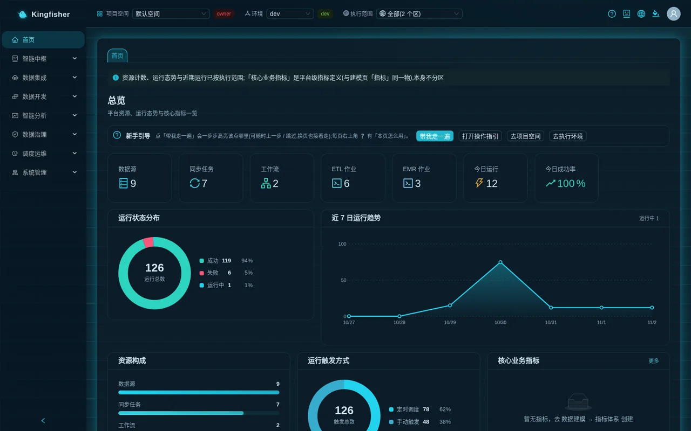</p>

<table>
<tr><th align="left">At a glance</th><th align="left"></th></tr>
<tr><td><b>Data Integration</b></td>
<td>JDBC (MySQL / PostgreSQL / Oracle / SQL Server) · S3 · DynamoDB · Kinesis · MSK data sources; Glue batch sync into S3 Tables / Redshift; DMS / Zero-ETL / Flink CDC real-time sync</td></tr>
<tr><td><b>Data Development</b></td>
<td>Glue PySpark / Redshift SQL / EMR Serverless Spark batch jobs; visual DAG orchestration published to each region's own MWAA Serverless; Redshift / Athena direct query; Flink SQL stream compute</td></tr>
<tr><td><b>Scheduling &amp; Ops</b></td>
<td>Task monitor · scheduling configuration · multi-region consistency dashboard · backfill center · alerting and SLA baselines · FinOps cost governance (reconciled per region) · ops dashboard · incident knowledge base · AI run diagnosis</td></tr>
<tr><td><b>Data Governance</b></td>
<td>Catalog · table- / column-level lineage · impact analysis · classification and masking · sensitive-data scan · quality rules · scheduled governance tasks · governance health score · data modeling (layers / data domains / standards / code tables / dimensions and facts / metrics) · OpenMetadata</td></tr>
<tr><td><b>Smart Analytics</b></td>
<td>Natural-language questions with GenBI (an AgentCore agent that really queries the region's warehouse, masks automatically by classification, and keeps session cards that can refresh on a schedule) · Skills · observability dashboard · report builder · requirements workbench · Copilot Plan Center (creates objects, never runs them)</td></tr>
<tr><td><b>System</b></td>
<td>Workspace RBAC · execution environments (add a region with a page wizard) · user management · audit log · system settings (the platform's AI model can be switched at runtime: Claude Opus / GPT / GLM / Kimi)</td></tr>
</table>

> 📸 **Screenshots and a description of every feature**: [`docs/features.md`](docs/features.md) (feature tour, page by page following the menu).
> 📚 **Pages / APIs / code / AWS dependencies of every module**: [`docs/architecture.md`](docs/architecture.md) (components, core concepts, code layout).
> 🤖 **Taking over this project with an AI tool? Have it read [`AGENTS.md`](AGENTS.md) first** (the project index: overview / deployment relationships /
> documentation map / red lines; Codex reads `AGENTS.md` natively, Claude Code, Kiro, Cursor and other tools load it as the project rules file).

---

## 1. Technical architecture (AWS service view)

### 1.1 Overview: one control plane × N data planes

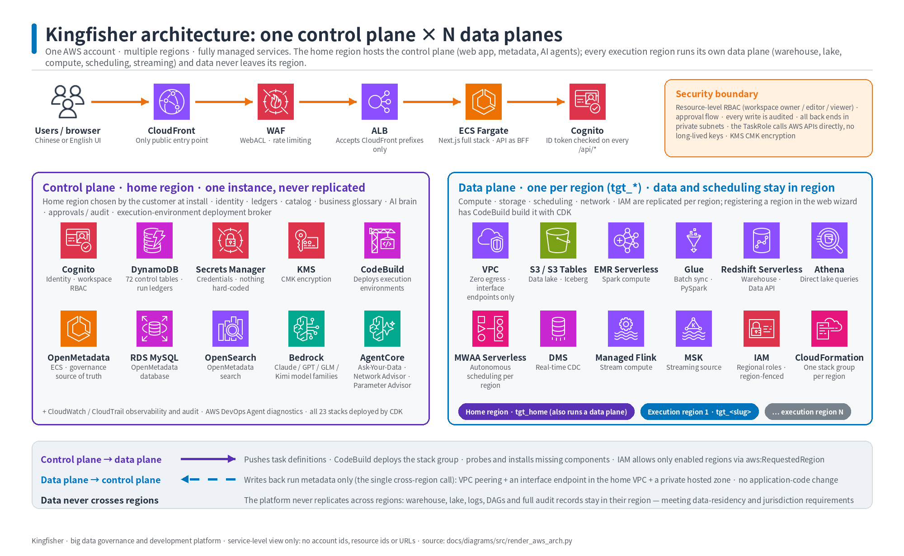

- **Entry chain**: CloudFront is the only public entry point → WAF → ALB (accepts the CloudFront prefix list only) → Next.js full stack on ECS Fargate (pages + API acting as the BFF); Cognito validates the ID token of every `/api/*` call.
- **Control plane (home region, one per platform)**:
  - Cognito · 72 DynamoDB control tables · Secrets Manager · KMS · OpenMetadata (ECS + RDS MySQL + OpenSearch);
  - Bedrock + three AgentCore agents (ask-your-data / network advisor / parameter advisor);
  - CodeBuild as the execution-environment deployment broker · CloudWatch / CloudTrail · AWS DevOps Agent.
- **Data plane (one per region, `tgt_*`)**:
  - a VPC with zero internet egress (interface endpoints only) · S3 data lake + S3 Tables (Iceberg) · Glue · EMR Serverless · Athena · Redshift Serverless;
  - MWAA Serverless (autonomous in-region scheduling) · DMS · Managed Flink · MSK;
  - a per-region execution role (locked to the region with `aws:RequestedRegion`).
- **Two cross-region channels, zero cross-region data**: control plane → data plane carries only definitions / deployments / health probes; data plane → control plane carries only run metadata (over private cross-region VPC peering). The platform never replicates data across regions.
- **Figures show components, never versions**: the supported versions of every runtime / AWS service engine / data-source driver are maintained in one place, [`docs/supported-versions.md`](docs/supported-versions.md).

### 1.2 Control plane: 23 CDK stacks in six layers

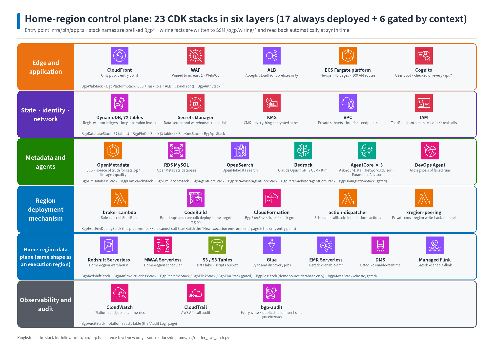

### 1.3 Execution-region data plane: one complete stack group per region

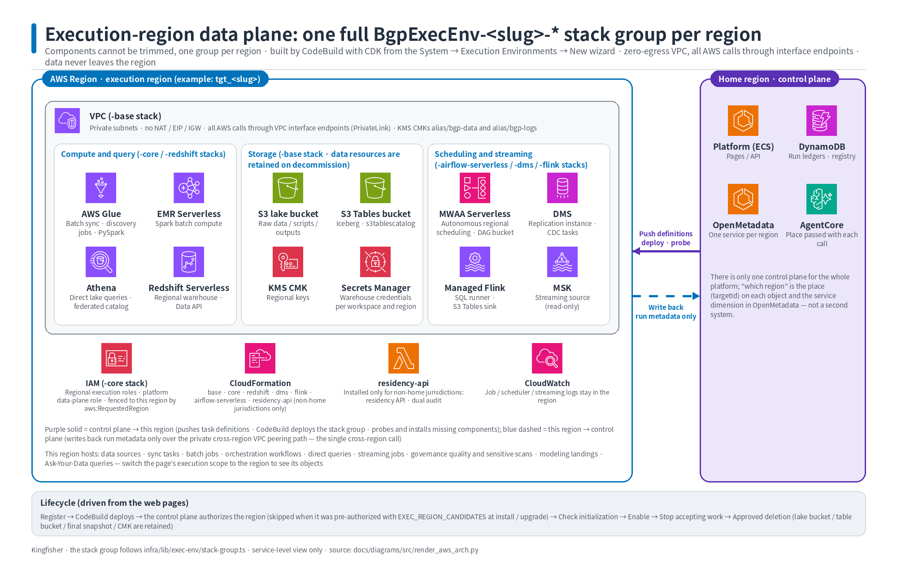

### 1.4 How multi-region works

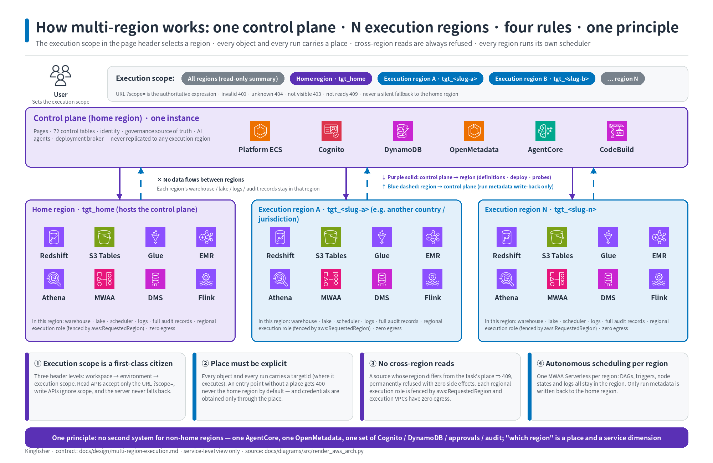

| Mechanism | In one sentence |
|---|---|
| Execution scope is a first-class citizen | Top bar has three levels: workspace → environment → execution scope; read APIs honour only URL `?scope=`; the server never falls back (invalid 400 · unknown 404 · not visible 403 · not ready 409) |
| The target must be explicit | Every object / every run carries a `targetId`; an entry point without a target is a 400, never a silent default to the home region; credentials are obtained only through the target |
| No cross-region reads | A source and a task in different regions ⇒ permanent 409; each region's execution role is region-locked; execution VPCs have zero egress |
| Autonomous scheduling per region | One MWAA Serverless per region; DAGs / triggers / logs all stay in the region; only run metadata is written back to the home region |
| One principle | No second system for non-home regions: one AgentCore, one OpenMetadata, one set of Cognito / DynamoDB / approvals / audit |

Components, request chain, key flow sequences and data flow: [`docs/architecture.md`](docs/architecture.md) (with the flow / sequence diagrams);
design contract: [`docs/design/multi-region-execution.md`](docs/design/multi-region-execution.md); figure index: [`docs/diagrams/README.md`](docs/diagrams/README.md).

---

## 2. Feature panorama (by menu)

Every page has an "**execution scope**" in the top bar: see all regions, or only one region; lists, runs, costs and catalogs are filtered by the selected region,
and run buttons repeat "which region this runs in". Each cell below is one screenshot; the complete page-by-page description is in [`docs/features.md`](docs/features.md).

<table>
<tr>
<td width="50%"><b>Data Integration · Data Sources</b><br>
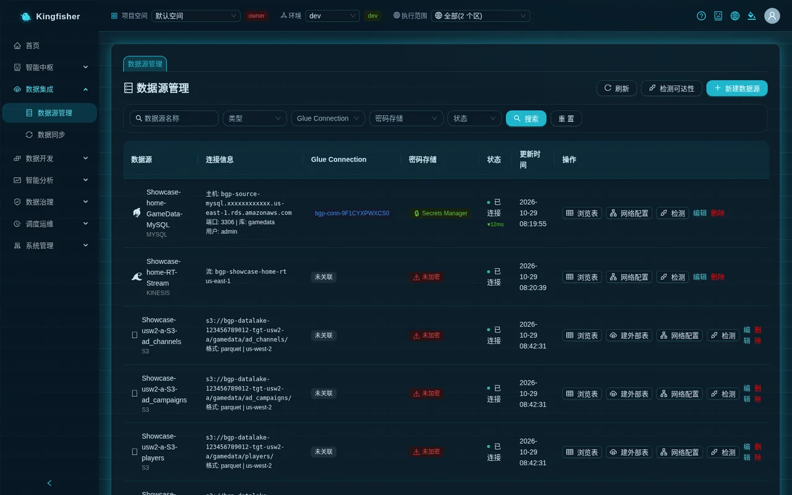<br>
JDBC / S3 / Kinesis / DynamoDB / MSK; a source is created in the selected execution region; browse tables, reachability check, network settings, create external tables</td>
<td width="50%"><b>Data Integration · Data Sync</b><br>
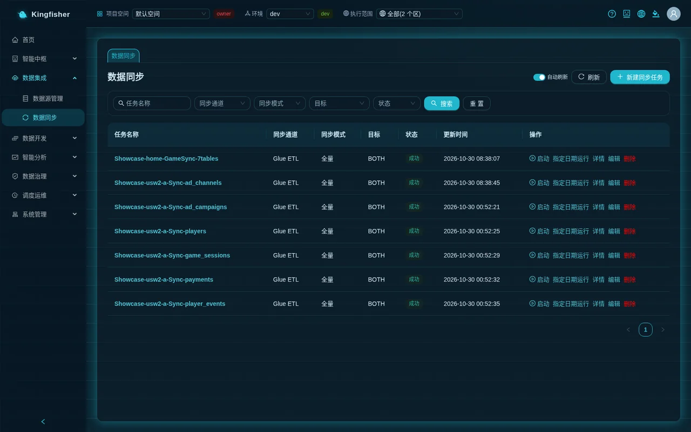<br>
Glue batch full / incremental → S3 Tables / Redshift; DMS / Zero-ETL real-time; pushed down to the region for execution; stop / delete really tear down the cloud objects</td>
</tr>
<tr>
<td><b>Data Development · Batch Compute</b><br>
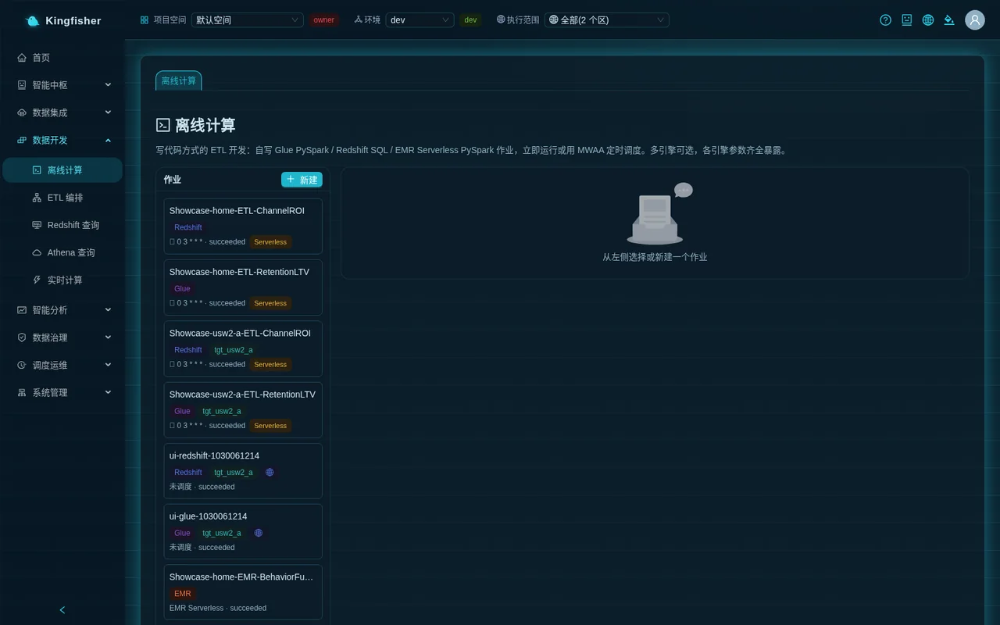<br>
Three engines: Glue PySpark · Redshift SQL · EMR Serverless Spark; run now or on a cron schedule; really runs in each region</td>
<td><b>Data Development · ETL Orchestration</b><br>
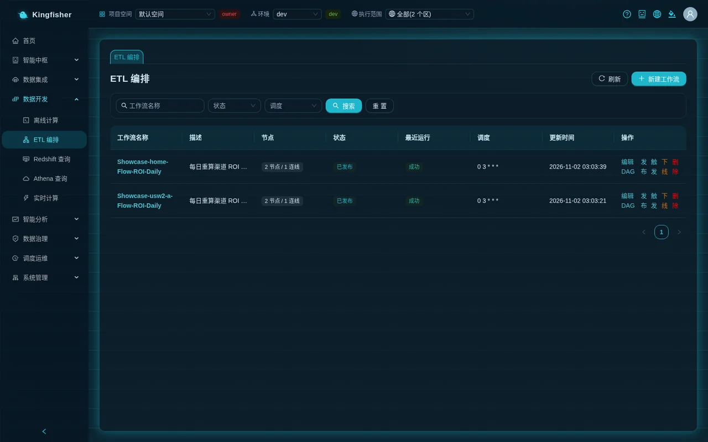<br>
Visual DAGs; published to each region's own MWAA Serverless; one publish, execution in many regions</td>
</tr>
<tr>
<td><b>Data Development · Redshift Query / Athena Query</b><br>
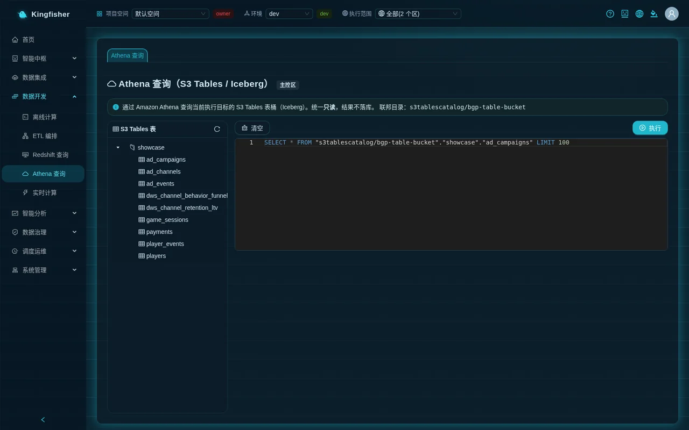<br>
Direct per-region queries over the warehouse and the S3 Tables (Iceberg) data lake; Athena federated catalog <code>s3tablescatalog</code></td>
<td><b>Data Development · Stream Compute</b><br>
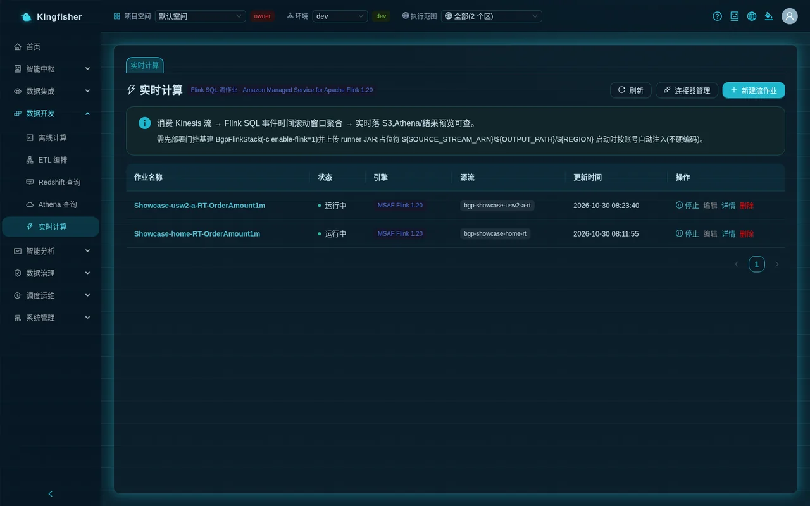<br>
Flink SQL streaming jobs (Managed Flink 1.20); Kinesis / MSK stream sources; results land in S3 Tables and can be queried directly</td>
</tr>
<tr>
<td><b>Smart Analytics · Ask-Your-Data (GenBI)</b><br>
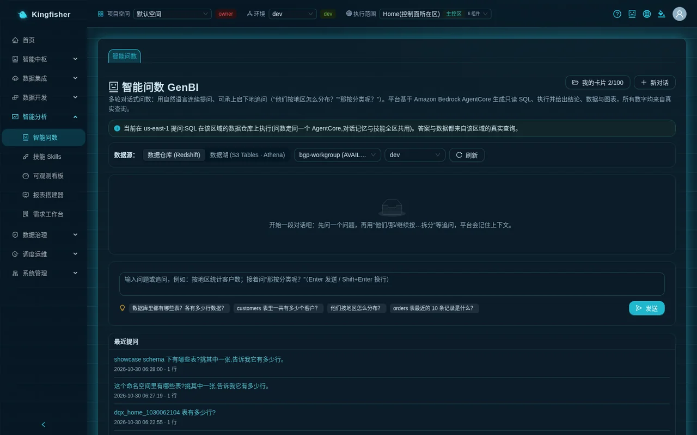<br>
Natural language → read-only SQL, really executed against the region's warehouse / lake; AgentCore agent + 7 MCP skills; automatic masking by classification; session cards</td>
<td><b>Smart Analytics · Observability / Skills</b><br>
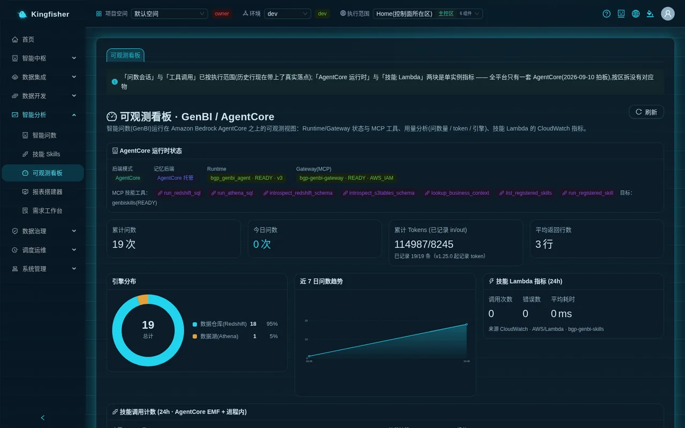<br>
AgentCore Runtime / Gateway status, question volume and tokens, engine distribution, skill Lambda metrics</td>
</tr>
<tr>
<td><b>Data Governance · Data Governance</b><br>
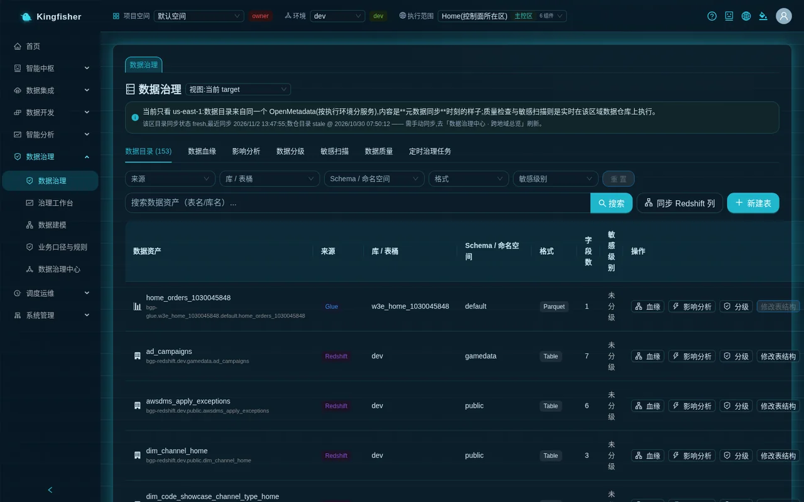<br>
Catalog (per region) · table- / column-level lineage · impact analysis · classification and masking · sensitive-data scan · quality rules · scheduled governance tasks</td>
<td><b>Data Governance · Governance Workbench / Data Modeling</b><br>
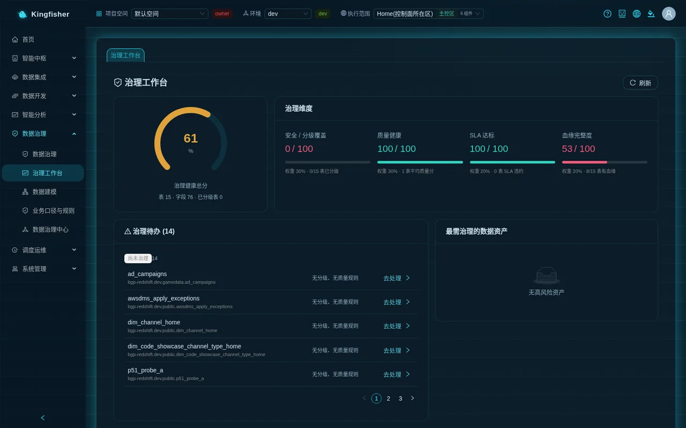<br>
Governance health score and to-dos; layers / data domains / standards / code tables / dimensions and facts / metric system, deployable to any region</td>
</tr>
<tr>
<td><b>Scheduling &amp; Ops · Task Monitor</b><br>
<br>
Every run, filtered by region / type / trigger; logs; one-click AI analysis (AWS DevOps Agent); scheduling configuration</td>
<td><b>Scheduling &amp; Ops · Multi-Region Dashboard</b><br>
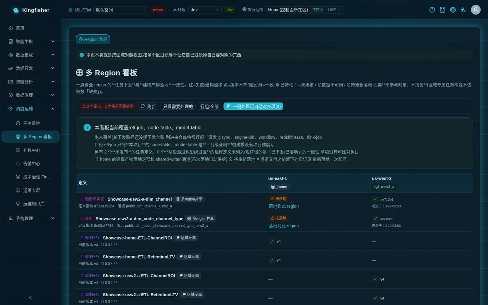<br>
Cross-region consistency matrix for task distribution and deployed modeling artifacts; one-click remediation of items that can be aligned automatically</td>
</tr>
<tr>
<td><b>Scheduling &amp; Ops · FinOps</b><br>
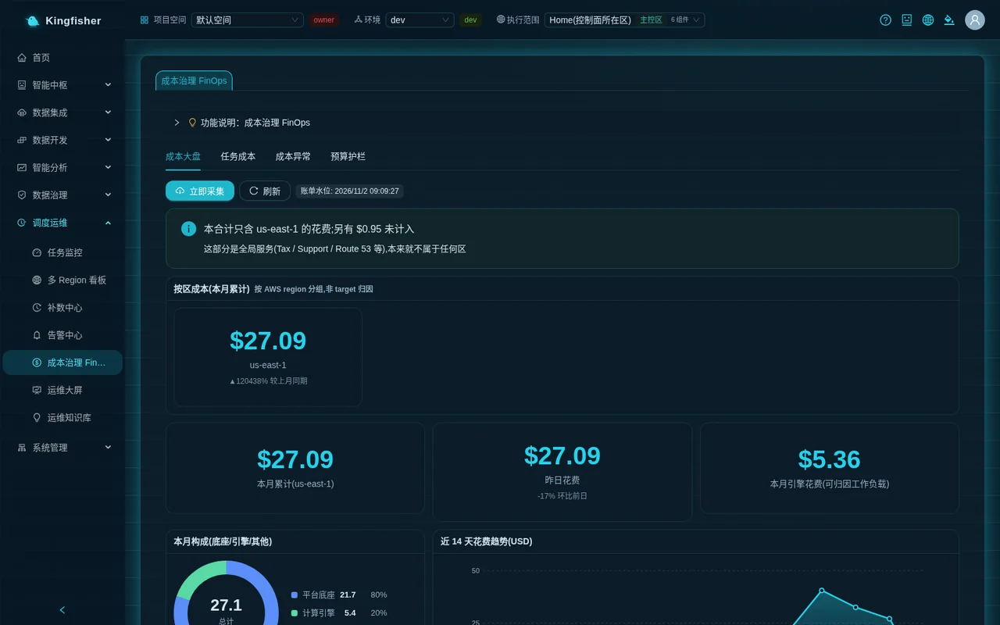<br>
Cost per region (reconciled with Cost Explorer by REGION) · task- / run-level attribution · anomaly detection · budget guardrails</td>
<td><b>Scheduling &amp; Ops · Ops Dashboard</b><br>
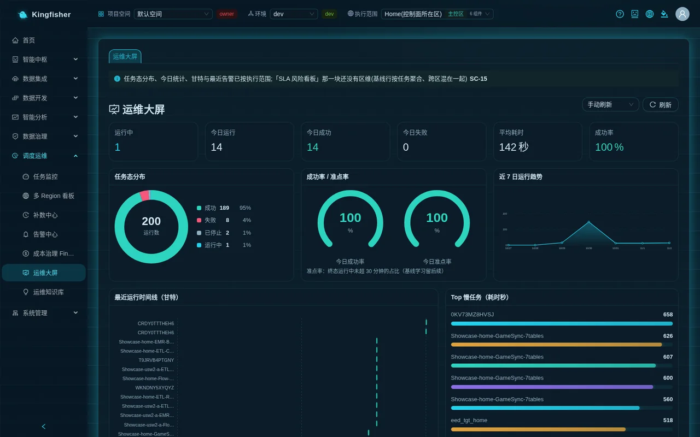<br>
Run-state distribution, success rate / on-time rate, 7-day trend, run Gantt chart, top slow tasks</td>
</tr>
<tr>
<td><b>System · Execution Environments</b><br>
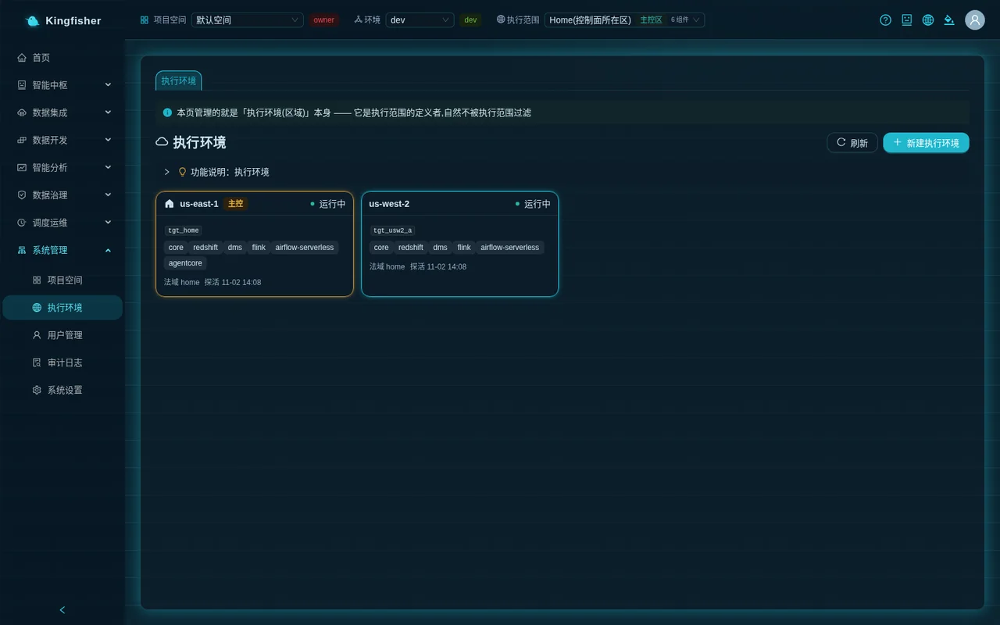<br>
Add a region with a page wizard: register → CodeBuild deployment → detect initialization → enable; the component set is complete and cannot be trimmed; jurisdiction tag</td>
<td><b>System · Workspaces / Users / Audit / Settings</b><br>
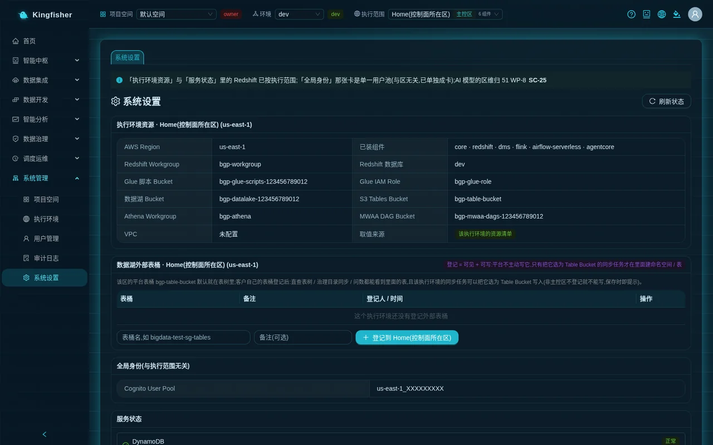<br>
Workspace RBAC and approvals; Cognito users; every write operation audited; the platform's AI model can be switched at runtime</td>
</tr>
</table>

The AI Hub **Copilot Plan Center** (a guardrail that creates but never executes), **Backfill Center**, **Alerting Center and SLA baselines**, **Report Builder**,
**Requirements Workbench**, **Business Glossary and Rules**, **Incident Knowledge Base**, **Governance Center (OpenMetadata)** and more are in the feature tour.
Every page has a ❓ "How to use this page" panel in the top-right corner, and the first visit starts an interactive tour.

---

## 3. Deployment (multi-region, production)

The complete procedure and acceptance criteria are in **[`docs/deployment.md`](docs/deployment.md)**; only the skeleton is listed here.
Deployment machine tools: git · Docker + buildx · Node 20+ · AWS CLI v2 · python3 · zip · curl · 🔴 **Maven + JDK 17**
(without `mvn` the deployment still exits 0, but the whole "Stream Compute" capability is unusable).

```bash
# 0) Get the release — must be a git clone (not a ZIP export without .git); a fresh clone must install dependencies first
git clone --branch <release-tag> <repository-url> && cd sample-kingfisher
(cd infra && npm ci) && (cd platform && npm ci)

# 1) Account pre-flight (❌ do not start before fixing; the two ignorable ❌ are listed in the guide, section 2) — the third argument is the planned execution region
./scripts/01-preflight-account.sh <profile> <home-region> <execution-region>

# 2) Deploy the home region (one command, about 60–90 minutes) — guide section 3; BGP_DEPLOY_MODE must be given explicitly (production = no sample data, admin user only)
#    To pre-authorise several execution regions at once: prefix EXEC_REGION_CANDIDATES=<region-1,region-2,...> (or all-enabled)
BGP_DEPLOY_MODE=production ./scripts/deploy-all.sh <profile> <home-region>

# 3) Post-deploy truth check (exit 0 is not enough; run it before changing the admin password) — guide section 4
./scripts/02-postdeploy-truth.sh <profile> <home-region>

# 4) For every additional execution region — guide section 5: in the console, System → Execution Environments → New: pick the region → Start deployment → "Detect initialization" → "Enable"
#    If the region was not pre-authorised, authorise it once after the build succeeds: BGP_DEPLOY_MODE=production ./scripts/redeploy-platform.sh <profile> <home-region>
```

Key points:
- **The customer chooses the home region** and it never changes afterwards; it must offer Bedrock, Redshift Serverless, S3 Tables, AgentCore and MWAA Serverless.
  - Bedrock: the factory default is Claude Opus 4.5; the deployment script walks a candidate chain with real calls and picks the first available model,
    or you specify `BEDROCK_MODEL_ID=<id>`; after go-live it can be hot-switched under "System Settings → AI Model".
  - Organisation SCPs must not block `us-east-1` (the WAF for CloudFront is created there).
- 🔴 **Multi-region production cannot "import an existing VPC"**; one region allows exactly one execution environment, and the component set cannot be trimmed.
- Always pass `--profile` explicitly to AWS; never run `cdk deploy` by hand (the deployment scripts handle wiring, the mode, the IAM simulation gate and the agent images).
- Upgrading to a new version / rollback / decommissioning an execution region: guide sections 6 / 7 / 8; read the upgrade notes of that version in `CHANGELOG.md`.

---

## 4. Documentation map

| I want to… | Read this |
|---|---|
| **See what every feature looks like and how to use it** (screenshots page by page) | [`docs/features.md`](docs/features.md) |
| **Know what every module does today** (pages / APIs / core code / AWS dependencies / mechanisms / boundaries) | [`docs/features.md`](docs/features.md) · [`docs/architecture.md`](docs/architecture.md) |
| Current architecture: components / request flow / data flow / stack list | [`docs/architecture.md`](docs/architecture.md) · figures [`docs/diagrams/README.md`](docs/diagrams/README.md) |
| 🔴 **Deploy to production in the customer's account / add an execution region / upgrade / roll back / known boundaries** | **[`docs/deployment.md`](docs/deployment.md)** (the production deployment guide; adding a region is section 5) |
| Pre-flight for another account / restricted accounts / resuming after a failed step / troubleshooting | [`docs/operations.md`](docs/operations.md) |
| What the platform costs per month | [`docs/cost-model.md`](docs/cost-model.md) |
| Which versions are supported (Node / Next.js / CDK · Glue / EMR / Flink / DMS / OpenMetadata / MySQL / OpenSearch · data-source drivers · JDK / Maven · browsers · version policy) | [`docs/supported-versions.md`](docs/supported-versions.md) (figures never carry versions; this file is the single source of truth) |
| Security scanning conclusions and accepted findings | [`docs/security.md`](docs/security.md) (section 6, secure development) |
| Requirements, architecture, API contract, interaction design and acceptance for multi-region execution | [`docs/design/multi-region-execution.md`](docs/design/multi-region-execution.md) |
| Design documents of the other modules | [`docs/design/`](docs/design/) |
| 🤖 Hand the project to an AI tool (Claude Code / Kiro / Codex …) | **[`AGENTS.md`](AGENTS.md)** |
| Release history | [`CHANGELOG.md`](CHANGELOG.md) |

**Languages.** Documentation is written in English. Source comments, test titles and the console output of the deployment
scripts are written in Chinese, the working language of the engineering team. The console ships complete Chinese and English
locales: the language is suggested from the visitor's location and can be switched by the user at any time.

---

## 5. Repository structure and tech stack

| Path | Contents |
|---|---|
| `platform/` | The platform application: Next.js 15 (App Router, `output: standalone`) + React 19 + antd 6 + TypeScript; pages `src/app/<route>/page.tsx` (40 routes), APIs … (see below) |
| `infra/` | AWS CDK v2 (TypeScript): 23 control-plane stacks `lib/*.ts` (entry `bin/app.ts`) + execution-environment stack group `lib/exec-env/` + … (see below) |
| `scripts/` | Deployment and operations scripts (`01-preflight-account.sh` pre-flight · `deploy-all.sh` first install · `02-postdeploy-truth.sh` truth check · …, see below) and gates |
| `flink-sql-runner*/`, `flink-connector-modules/` | Managed Flink 1.20 SQL runners (generic / + S3 Tables Iceberg / + Kafka) and connector Maven modules |
| `docs/` | Guides, feature tour and screenshots, design documents, figures |

Full text of the long cells (the table keeps only their beginning):

- **`platform/`** · Contents:
  - The platform application: Next.js 15 (App Router, `output: standalone`) + React 19 + antd 6 + TypeScript;
  - pages `src/app/<route>/page.tsx` (40 routes), APIs `src/app/api/<group>/…/route.ts` (51 groups / 309 files), business libraries `src/lib/`, components `src/components/`;
  - unit tests with vitest
- **`infra/`** · Contents:
  - AWS CDK v2 (TypeScript): 23 control-plane stacks `lib/*.ts` (entry `bin/app.ts`) + execution-environment stack group `lib/exec-env/`;
  - execution-environment deployment buildspec + IAM call manifest `iam/` + Lambda (`lambda/`) + three AgentCore agent containers (`agent/`)
- **`scripts/`** · Contents:
  - Deployment and operations scripts: `01-preflight-account.sh` pre-flight · `deploy-all.sh` first install · `02-postdeploy-truth.sh` truth check ·
    `redeploy-platform.sh` upgrade / authorise a new region · `redeploy-agents.sh` refresh agents · `cut-release.sh` cut a release;
  - and the offline gates

Tech stack: Next.js 15 · React 19 · TypeScript 5 · antd 6 · Node 20 · AWS CDK v2 · Python 3 · OpenMetadata 1.6.1 ·
Amazon Bedrock (four model families: Claude Opus / GPT / GLM / Kimi, switchable at runtime) · Bedrock AgentCore · MWAA Serverless · Redshift Serverless ·
S3 Tables (Iceberg) · Glue · EMR Serverless · DMS · Managed Service for Apache Flink 1.20 · Cognito · CloudFront + WAF · DynamoDB · KMS.
The pinned version of every component is maintained in [`docs/supported-versions.md`](docs/supported-versions.md).

---

## 6. Versions

- **Latest release**: `VERSION` 2.1.2, in customer production since 2026-10-29. The trunk of this repository is the **2.2.0 candidate**
  (Next.js 15 / React 19, optional Glue 6.0, the data-source external-object lifecycle fixes, the stream-compute sample-data and EMR run-submission fixes,
  the security-scan remediation); at release time `scripts/cut-release.sh` bumps `VERSION` and creates the tag.
- **Tag naming**: from 2.2.0 on, every release is tagged `v<version>` (`v2.2.0`) and a hotfix increments the patch number; earlier releases were tagged
  `release-<date>` and remain checkable in the engineering history. Customer deployments and upgrades always use a tag, never a branch head.
- Increments and upgrade notes are in [`CHANGELOG.md`](CHANGELOG.md); every release is accepted by a full headless-browser run against a test account before the tag is cut
  (see [`docs/development.md`](docs/development.md), section 11).

## Security

See [CONTRIBUTING](CONTRIBUTING.md#security-issue-notifications) for more information.

## License

This project is licensed under the MIT-0 License. See the [LICENSE](LICENSE) file.
