# Kingfisher Architecture

This document describes how Kingfisher is deployed and how a request or a job travels through it.
It covers the current shape of the product only. Design rationale, interface contracts, interaction design and acceptance criteria live in
[`design/multi-region-execution.md`](design/multi-region-execution.md) and the other notes under `docs/design/`.
The pages and features are described one by one in [`features.md`](features.md); the entry point for AI coding tools is the root [`AGENTS.md`](../AGENTS.md).
The architecture document and figure set of the single-region stage (2026-08) are historical only and are not part of this repository.

When this document and the code disagree, the code wins. The authoritative places are `platform/src`, `infra` and `scripts`.

Figures are static PNG files under `docs/diagrams/` (`mr-*.png`, sources `docs/diagrams/src/mr-*.mmd`; the AWS service-view figures `aws-*.png` are rendered by
`docs/diagrams/src/render_aws_arch.py`); the rendering commands are in the Rendering section of [`diagrams/README.md`](diagrams/README.md).
Markdown never embeds live Mermaid. When the architecture changes, change the source and re-render the figure in the same commit.

Figures name components but never carry version numbers. Supported versions are listed in [`supported-versions.md`](supported-versions.md).

## Contents

1. Deployment topology
2. Control-plane components
3. Execution-region stack group
4. Core concepts
5. Request and run flows
6. Data flow
7. Storage
8. Security boundaries at a glance
9. Code layout
10. Related documents

## 1. Deployment topology

### 1.1 One account, one home region, N execution regions

Kingfisher is installed into a single AWS account that belongs to the customer.
The account holds one **home region** and any number of **execution regions**.

- The home region runs the **control plane**: the web application, metadata tables, identity, OpenMetadata, the AI agents and the deployment broker.
- Every execution region runs a complete **data plane**: Redshift Serverless, an S3 Tables table bucket, Glue, EMR Serverless, MWAA Serverless, DMS and Managed Flink.
- The home region also has its own data plane. It is registered as the execution target `tgt_home` and is treated like any other region.
- Central services exist once: OpenMetadata and the AgentCore agents run only in the home region; regions are told apart by a per-region service dimension (OpenMetadata)
  or by the place parameter carried by every call (agents).

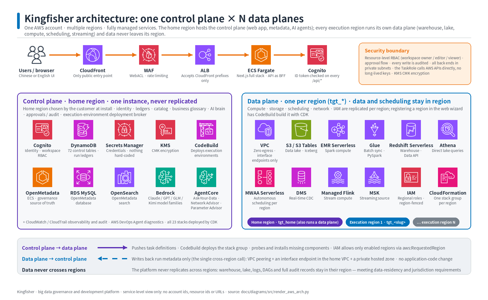

*Figure 1. AWS service view. The entry chain is CloudFront, WAF, ALB and ECS Fargate. The control plane lives in the home region; each execution region carries its own data plane.
Source: `diagrams/src/render_aws_arch.py`. The same series also includes the control-plane layering (`aws-control-plane.png`, Figure 3), the execution-region data plane
(`aws-execution-region.png`, Figure 4) and the multi-region mechanics (`aws-multi-region.png`, Figure 2); all four are also embedded in section 1 of the root README.*

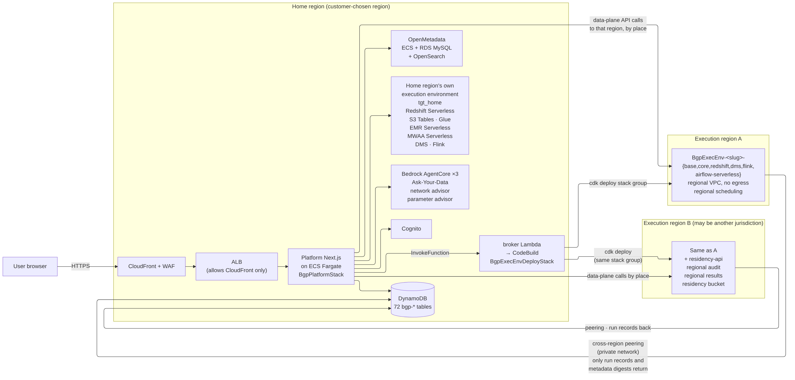

*Figure 1a. Deployment shape (home region plus N execution regions). Source: `diagrams/src/mr-overview.mmd`; re-render with mermaid-cli after changes.*

### 1.2 What lives where

| Concern | Home region | Each execution region |
|---|---|---|
| Web pages and all `/api/*` routes | ECS Fargate behind ALB and CloudFront | — |
| Identity | Cognito user pool | — |
| Platform metadata | DynamoDB `bgp-*` tables | — |
| Data catalog and lineage | OpenMetadata, one instance | Glue Data Catalog, regional |
| AI agents | Bedrock AgentCore, three runtimes | — |
| Warehouse | Redshift Serverless | Redshift Serverless |
| Lake | S3 Tables table bucket and data lake bucket | S3 Tables table bucket and data lake bucket |
| Batch and SQL compute | Glue, EMR Serverless, Athena | Glue, EMR Serverless, Athena |
| Scheduling | MWAA Serverless | MWAA Serverless |
| Change data capture and streaming | DMS, Managed Flink | DMS, Managed Flink |
| Region deployment | CodeBuild project plus broker Lambda | Stack group `BgpExecEnv-<slug>-*` |

### 1.3 Data stays in its region

Every object and every run carries the id of the execution target it belongs to.
Jobs, syncs, schedules, queries and natural-language questions execute in the region where the data lives.

- A request that would read data from one region and write it into another is rejected.
- A request that does not name a target is rejected with HTTP 400. The platform never falls back to the home region.
- Execution-region VPCs have no internet egress. AWS API calls leave through VPC endpoints only.
- The only cross-region traffic is the write-back of run records and metadata summaries from an execution region to the control-plane tables.

### 1.4 How the control plane reaches a region

- The platform task role calls regional AWS APIs directly. Every SDK client is created for an explicit region through one factory, `platform/src/lib/aws/clients.ts`.
- Execution-region stacks are deployed by a CodeBuild project in the home region. The source package is the CDK asset captured when the control plane itself was deployed.
- Write-back from an execution region uses a private cross-region path: a VPC peering connection to the home VPC, a DynamoDB interface endpoint in the home VPC and a private hosted zone in the execution region.

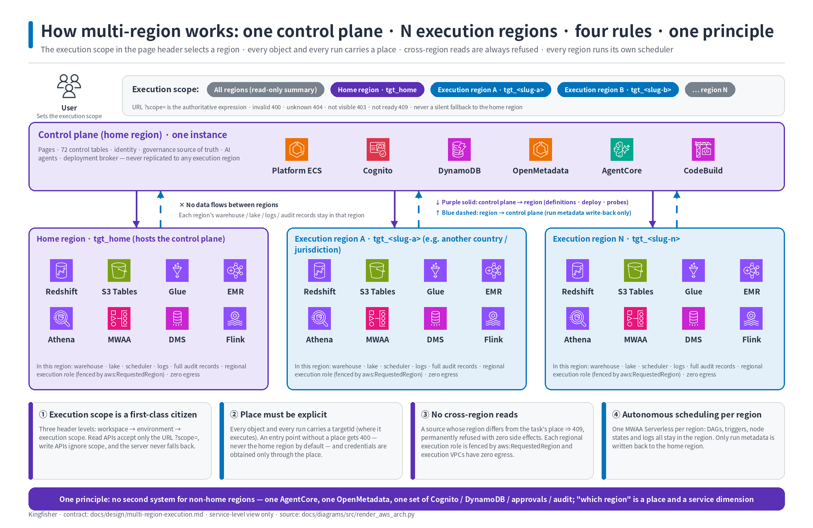

*Figure 2. The four multi-region rules and the single-instance services. Scope selects what a page shows; place states where a run executes; cross-region reads are refused; each region schedules its own work.*

## 2. Control-plane components

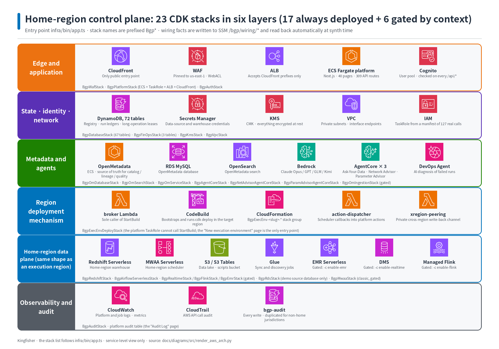

*Figure 3. The control plane as CDK stacks: edge and application, state and identity, metadata and agents, the execution-region deployment mechanism, the home data plane, and observability.*

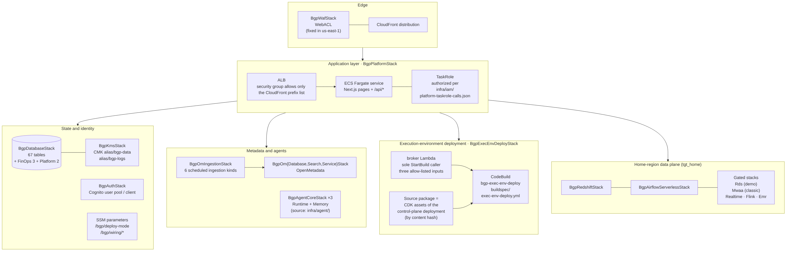

*Figure 3a. Control-plane components (23 stacks in the home region). Source: `diagrams/src/mr-control-plane.mmd`; re-render with mermaid-cli after changes.*

### 2.1 Stack inventory

All control-plane stacks are instantiated by `infra/bin/app.ts` and are named `Bgp<Name>Stack`.
Seventeen stacks are always present. Six are created only when a CDK context flag or the deployment mode asks for them.

| Stack | Purpose | Gated by |
|---|---|---|
| Kms | Two customer-managed keys: `alias/bgp-data` and `alias/bgp-logs` | always |
| Waf | CloudFront web ACL; always created in `us-east-1` | always |
| Vpc | Home VPC and the home-side endpoint for the cross-region path; importing an existing VPC is not supported in a multi-region production deployment | always |
| Database | Platform DynamoDB tables (67, see 7.1) encrypted with the data key | always |
| FinOps | Three cost-governance tables | always |
| Auth | Cognito user pool and app client; the initial accounts are created by `scripts/10-bootstrap-cognito.sh`; outputs `UserPoolId` and `ClientId` | always |
| Audit | CloudTrail and VPC flow logs encrypted with the logs key | always |
| Redshift | Home Redshift Serverless namespace and workgroup | always |
| OmDatabase, OmSearch, OmService | OpenMetadata: RDS MySQL, OpenSearch, ECS Fargate service | always |
| Platform | Web app on ECS Fargate, task role, ALB, CloudFront, home buckets; runtime parameters (model, wiring, credential mode) are injected through CDK context; also creates two tables, `bgp-action-commands` and `bgp-action-schedules`. | always |
| AirflowServerless | Home MWAA Serverless entry: workflow bucket, worker security group, role | always |
| AgentCore | Question-answering agent runtime, gateway and skills Lambda; container source `infra/agent/genbi`, image tagged with the git short hash | always |
| NetAdvisorAgentCore | Network advisor agent runtime; container source `infra/agent/netadvisor`, image tagged with the git short hash | always |
| ParamAdvisorAgentCore | Parameter advisor agent runtime; container source `infra/agent/paramadvisor`, image tagged with the git short hash | always |
| ExecEnvDeploy | CodeBuild project `bgp-exec-env-deploy`, broker Lambda (sole holder of `StartBuild`, three allow-listed inputs) and source-package asset for region deployment | always |
| Rds | Demo source MySQL database with sample data | `BGP_DEPLOY_MODE=demo` only |
| Mwaa | Classic Airflow environment | `-c classic-mwaa=1` |
| Realtime | DMS and Kinesis foundation | `-c enable-realtime=1` |
| Flink | Managed Flink foundation | `-c enable-flink=1` |
| Emr | EMR Serverless shared role and security group | `-c enable-emr=1` |
| OmIngestion | Scheduled OpenMetadata ingestion, six kinds: redshift, glue, s3, s3tables, sources, profiler | `-c om-bot-secret-arn` and `-c rs-admin-secret-arn` |

The three `enable-*` flags are set by `scripts/deploy-all.sh` as needed.

### 2.2 Deployment entry points

Three scripts own deployment; they share one agent mapping table, `scripts/lib/agentcore-agents.sh`.
They write SSM wiring, pick the deployment mode, build agent images and run the IAM simulation gate.

| Script | Use |
|---|---|
| `scripts/deploy-all.sh <profile> <home-region>` | First install into a fresh account: writes SSM `/bgp/deploy-mode` and `/bgp/wiring/*`, enables the gated stacks as needed, builds and pushes the three agent images, runs the IAM simulation gate |
| `scripts/redeploy-platform.sh <profile> <home-region> [extra cdk -c]` | Upgrade, re-authorize regions, redeploy the platform stacks; reads the wiring back from CloudFormation and SSM, so a bare deploy does not reset it; does **not** rebuild the agent images and does **not** deploy the agent stacks. |
| `scripts/redeploy-agents.sh <profile> <home-region> [--check] [--only ...]` | Upgrade or refresh the three agents: recompile `core-dist`, build and push the three ARM64 images (tag = git short hash), deploy the agent stacks one by one, then read back the runtime image tag to verify; `--check` only compares the deployed tag with the local HEAD, read-only. |

Running `cdk deploy` by hand is not supported. The scripts carry wiring that a bare deploy would silently reset.

### 2.3 Platform runtime configuration

The platform container reads its configuration from environment variables set by the Platform stack.
The full key list is in `platform/.env.example`; a guard test keeps it identical to the stack definition.

| Setting | Source | Meaning |
|---|---|---|
| Deployment mode (`BGP_DEPLOY_MODE`) | SSM `/bgp/deploy-mode`, read at synth time; a deploy-time parameter, **not** a container variable | `production` or `demo`; fixed after install |
| `BGP_DATAPLANE_CREDS` | CDK context `-c dataplane-creds` | `taskrole` (default, production), `observe` or `enforce`; not written to SSM, so a redeploy without the flag returns to the default; see 4.5 |
| Wiring: `OPENMETADATA_URL`, `GENBI_BACKEND`, `*_RUNTIME_ARN`, `*_MEMORY_ID` (OpenMetadata URL, agent backends, runtimes, memories) | SSM `/bgp/wiring/*` | Read back at synth time so a plain redeploy keeps them |
| `EXECUTION_REGIONS` | Derived by `redeploy-platform.sh` from the registry plus the candidate list | Execution regions the control plane is authorized to call |
| `BEDROCK_MODEL_ID` and the runtime setting | Factory default `us.anthropic.claude-opus-4-5-20251101-v1:0`. At deploy time `scripts/resolve-home-model.sh` walks the candidate chain against the home account's real model inventory and injects the first model whose real invocation succeeds; the chain is `candidateModelIds` in `platform/ai-model.json`: Claude Opus 4.5, then GLM 5.3, then Kimi K3. At runtime the model can be changed in Settings, AI model; the change takes effect only after the server-side probe passes. The selectable set is the four families of the vendor profile `platform/src/lib/ai/core/vendors.ts`; the same profile is compiled into the `core-dist/ai` of the three agent containers and shapes every Converse request. | Default model for all AI features |
| `KEEP_ALIVE_TIMEOUT` | Platform stack (ALB idle timeout plus a margin) | Node keep-alive timeout kept at or above the ALB idle timeout (60 s) to avoid sporadic HTTP 502 |

## 3. Execution-region stack group

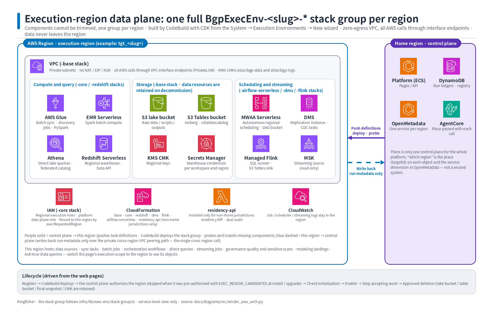

*Figure 4. One execution region. The VPC has no egress; compute, storage, scheduling and streaming services are regional; the only cross-region channel writes run metadata back to the home region.*

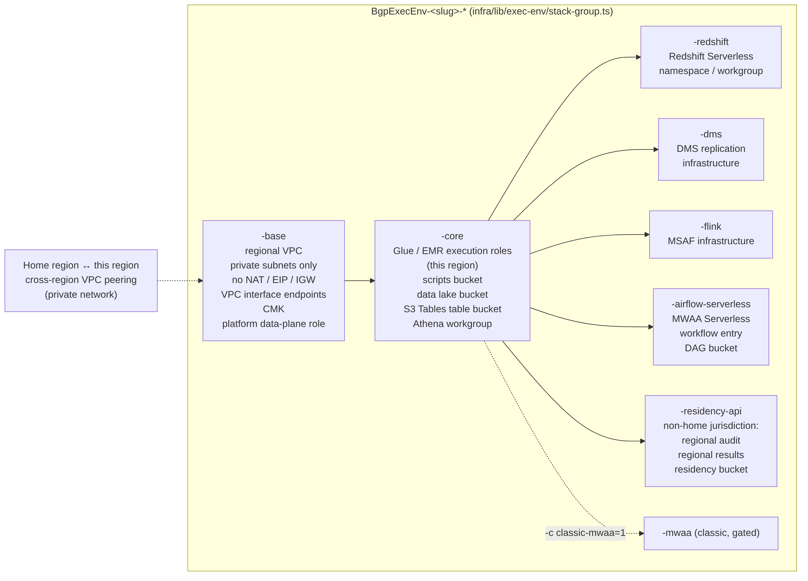

*Figure 4a. Execution-environment stack group (one per region). Source: `diagrams/src/mr-exec-env-stacks.mmd`; re-render with mermaid-cli after changes.*

### 3.1 Stacks in the group

The group is assembled by `infra/lib/exec-env/stack-group.ts`. Every stack name is produced by the naming source of truth, `platform/naming.json`, through its deploy-side exit `infra/lib/shared/naming.ts`.
The base class `exec-env-stack.ts` performs no context lookups and synthesizes with zero credentials, which `npm run synth-gate` verifies offline.
Passing `-c exec-env-target=<targetId>` makes `infra/bin/app.ts` synthesize only this group and none of the control-plane stacks.

| Stack suffix | Contents | Present when |
|---|---|---|
| `-base` | Regional VPC without NAT or internet gateway, VPC endpoints, CMK, platform data-plane role, cross-region link | always |
| `-core` | Glue and EMR execution roles, scripts bucket, data lake bucket, S3 Tables table bucket, Athena workgroup | always |
| `-redshift` | Redshift Serverless namespace, workgroup and admin secret | component `redshift` |
| `-dms` | DMS replication subnet group and roles | component `dms` |
| `-flink` | Managed Flink execution role | component `flink` |
| `-airflow-serverless` | MWAA Serverless entry: workflow bucket, worker security group, execution role | component `airflow-serverless` |
| `-residency-api` | Regional audit table, regional results table and results bucket | jurisdiction other than home |
| `-mwaa` | Classic Airflow environment | component `mwaa`, gated |

The control plane always sends the full component set, so an execution region is never a trimmed copy.
A component that is listed but not implemented makes the synth fail loudly instead of being skipped.

### 3.2 Lifecycle

The registry row of a target carries a phase, an intent and an observed health. The user-facing status is projected from them in `platform/src/lib/exec-env/lifecycle.ts`.

- `registered`: the descriptor exists, no stack has been deployed.
- `initializing`: the CodeBuild deployment succeeded and the components are being probed.
- `active`: every component probe passed and the target was enabled. `degraded` means a probe later turned red.
- `draining`: the target no longer accepts new work. Draining can be reversed.
- `decommissioning` and `deleted`: the destroy build is running or has finished. Data buckets, table buckets and warehouse snapshots are retained.
- `failed`: the build or a probe failed; the target can be redeployed.

### 3.3 Adding a region

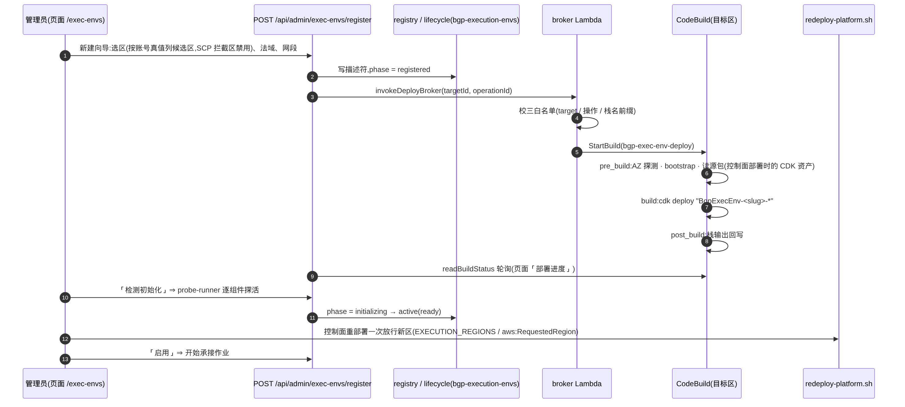

*Figure 5. Adding an execution region. The wizard registers the descriptor, the broker starts a CodeBuild run that deploys the stack group, the probe checks each component, and the administrator enables the target.
Source: `diagrams/src/mr-flow-add-exec-env.mmd`; re-render with mermaid-cli after changes.*

1. An administrator opens the execution-environment wizard and selects a region, a jurisdiction and a network range.
2. The platform writes the descriptor and calls the broker Lambda with the target id and an operation id.
3. The broker validates three allow-lists (target, operation, stack-name prefix) and is the only principal allowed to start the build.
4. CodeBuild probes availability zones, bootstraps the region with `cdk bootstrap --app ''`, and deploys `BgpExecEnv-<slug>-*` from the stored source package.
5. The page polls the build status, then the administrator runs the component probe and enables the target.

IAM conditions on `aws:RequestedRegion` are baked into the control-plane roles at synth time by `infra/lib/shared/execution-regions.ts`.
The allowed list is the union of the home region, the regions present in the registry and the candidate regions declared at install or upgrade time.
A region that was not pre-authorized needs one control-plane redeploy before it can be probed.

### 3.4 Removing a region

Removal is the reverse path: stop accepting work (`draining`), preview the deletion with its impact list, obtain approval, run the broker's destroy build (`decommissioning`), then `deleted`.
Data buckets, table buckets, the warehouse final snapshot and the regional CMK are kept.

## 4. Core concepts

### 4.1 Execution target

An execution target is one region's data plane, described by a row in `bgp-execution-envs`.
The row holds the immutable `targetId`, the region, the installed components, the real resource names, the jurisdiction and the lifecycle fields.

- The home region is always `tgt_home`. Other targets use ids such as `tgt_<slug>`; the id grammar is defined once in `platform/src/lib/exec-env/target-id.ts`.
- `platform/src/lib/exec-env/registry.ts` is the only reader. A missing or not-ready descriptor fails closed; it never falls back to the home target.
- Resource names for non-home targets carry the target slug, for example `bgp-datalake-<account>-<slug>`. Home keeps its original names.

### 4.2 Place

Place answers "where does this run execute". Every create and every run names a target explicitly.

- `requestedTargetId` in `platform/src/lib/place/resolve.ts` is the single place where a request's target id is read. A missing id raises an error that routes turn into HTTP 400.
- `resolvePlace` turns a target reference into regional resource names and clients. Credentials are obtained through the place only.
- Regional SDK clients come from `platform/src/lib/exec-env/target-clients.ts`.

### 4.3 Scope

Scope answers "which regions does this page show". The top bar of every page carries a scope selector.

- Read APIs accept only the URL parameter `?scope=`. Write APIs never read scope.
- The grammar lives in `platform/src/lib/scope/scope.ts`: `global`, a single target id, or `cmp:` followed by two to four target ids.
- An invalid or unauthorized scope is a 4xx response. There is no silent fallback.
- Every page read that does not carry a scope must be justified in `platform/src/lib/scope/api-read-ledger.ts`, and that list may only shrink.

### 4.4 Project

Resources are isolated by project. Each project has its own warehouse credentials in each region.
`platform/src/lib/projects/guard.ts` exposes `requireProject` and `guardResourceAccess`; routes authorize by the project that owns the resource.

### 4.5 Data-plane credential modes

`BGP_DATAPLANE_CREDS` selects how data-plane calls are signed. The three values are defined in `platform/src/lib/aws/dataplane-creds.ts`.

| Mode | Behaviour | Use |
|---|---|---|
| `taskrole` | The platform task role calls the data plane directly | Production default |
| `observe` | Try the regional data-plane role first; log a denial and retry with the task role | Acceptance, to collect policy gaps |
| `enforce` | Only the regional data-plane role is used | Acceptance |

Each region has one platform data-plane role: `bgp-platform-data-role` at home and `BgpExecEnv-<slug>-platform-data-role` elsewhere.
Any other value of the variable is treated as `taskrole`; there is no fourth state.

### 4.6 SSM wiring

Deployment writes the facts that connect stacks together into SSM Parameter Store under `/bgp/`.

- `/bgp/deploy-mode` holds `production` or `demo`. Once written it must not change.
- `/bgp/wiring/*` holds the OpenMetadata URL and the backend, runtime ARN and memory id of each agent.
- `/bgp/wiring/execution-region-candidates` holds the pre-authorized execution regions.
- `infra/bin/app.ts` reads the wiring back at synth time, so a redeploy without explicit context keeps the connections.

### 4.7 Scheduler

Each region schedules its own work on its own MWAA Serverless.
Workflows, syncs, offline jobs, governance tasks and card refreshes are published to the region that owns the object.

- The publisher builds a DAG definition and a code package and stores them in the regional workflow bucket, then creates or updates the workflow.
- Node types include `sql`, `python`, `sync`, `foreach`, `branch`, `join`, `setvar`, `external` and `platform-action`.
- A `platform-action` node writes a command row into `bgp-action-commands`; a DynamoDB stream triggers the dispatcher Lambda, which calls an internal API route.
- Run records are written to `bgp-task-runs`. Monitoring, alerting, SLA and backfill all read that table.
- Classic Airflow exists only behind `-c classic-mwaa=1`.

### 4.8 Audit and jurisdiction

Every write operation is recorded in `bgp-audit` through `platform/src/lib/audit.ts`.
A target whose jurisdiction differs from the home jurisdiction installs the `-residency-api` stack and keeps regional audit and results in its own region.
User acknowledgements of data-residency notices are stored append-only in `bgp-residency-acks`.

### 4.9 Long operations

Requests that wait for an external system to reach a terminal state go through one framework in `platform/src/lib/long-ops/`.
The kinds are a closed list in `kinds.ts`; each kind declares the resources it holds exclusively while it runs.

- `submitLongOp` runs the operation in-process and waits up to `LONG_OPS_SYNC_WAIT_MS` (default 45 seconds).
- If the operation finished, the route answers exactly as it would have synchronously.
- Otherwise it answers HTTP 202 with `{ taskId, kind, label, protocol: "long-op/1" }`, and the client polls `GET /api/long-ops/[taskId]`.
- A second long operation on the same object answers HTTP 409 `LONG_OP_IN_PROGRESS`.
- The browser-side fetch interceptor recognizes the protocol marker, polls to completion and reshapes the result, so page code is unchanged.

## 5. Request and run flows

### 5.1 Request chain

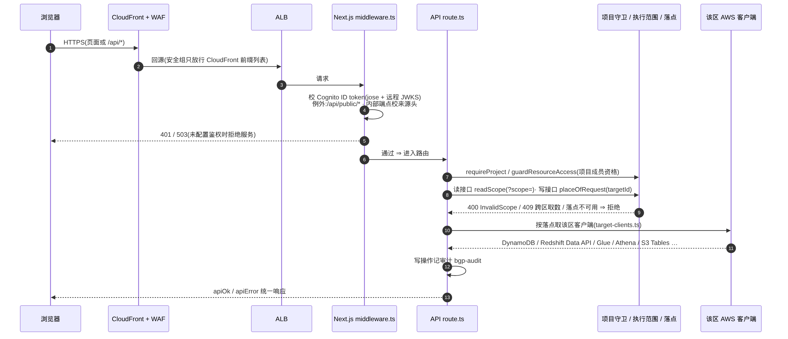

*Figure 6. Request chain. CloudFront and WAF, ALB, the Next.js middleware, the route handler, the project, scope and place guards, then a client created for the target region.
Source: `diagrams/src/mr-request-chain.mmd`; re-render with mermaid-cli after changes.*

1. The browser calls CloudFront over HTTPS. WAF filters the request.
2. CloudFront forwards to the ALB. The ALB security group admits only the CloudFront origin prefix list.
3. `platform/src/middleware.ts` verifies the Cognito ID token against the remote JWKS. `/api/public/*` is exempt; internal routes check an origin header instead.
4. With authentication unconfigured the middleware answers HTTP 503; it never falls open.
5. The route handler checks project membership, then reads scope (read routes) or place (write routes).
6. A client for the target region is obtained through the place. Write operations append an audit record.
7. Responses use the shared `apiOk` and `apiError` envelopes from `platform/src/lib/api-response.ts`.

### 5.2 Data synchronization run (Glue channel)

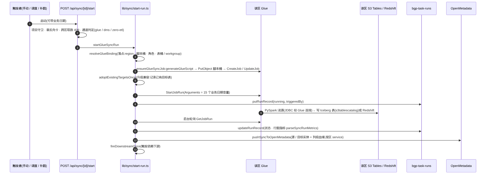

*Figure 7. A synchronization run. The route resolves the place, ensures the Glue job in that region, starts it, records the run, polls to a terminal state, and pushes lineage to OpenMetadata.
Source: `diagrams/src/mr-flow-sync-run.mmd`; re-render with mermaid-cli after changes.*

1. A trigger (manual, scheduled or backfill) calls `POST /api/sync/[id]/start`.
2. The route applies the project guard, refuses cross-region reads, and selects the channel: Glue, DMS or zero-ETL.
3. `lib/sync/start-run.ts` resolves the Glue binding from the place: region, scripts bucket, role, table bucket or workgroup.
4. The generated PySpark script is uploaded and the Glue job is created or updated, then started with the business-date arguments.
5. The job reads the source through its Glue connection and writes Iceberg tables in the table bucket or tables in Redshift.
6. A background poller updates the run record with the state and row metrics, pushes column-level lineage to OpenMetadata, and fires dependent downstream objects once.

### 5.3 Scheduling: publish and run on time

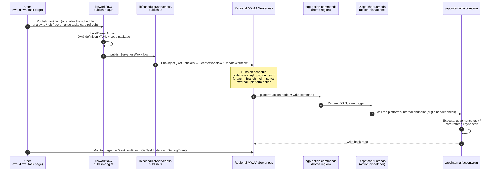

*Figure 8. Scheduling. The publisher stores a DAG definition and code package in the regional workflow bucket and creates the workflow. Platform-action nodes reach the platform through a command table, a stream and a dispatcher Lambda.
Source: `diagrams/src/mr-flow-scheduling.mmd`; re-render with mermaid-cli after changes.*

Run records land in `bgp-task-runs`; monitoring, alerting, SLA and backfill all read that table.
Downstream dependencies are triggered once by `lib/scheduler/dependency.ts` after the upstream run succeeds.

### 5.4 Natural-language questions (GenBI)

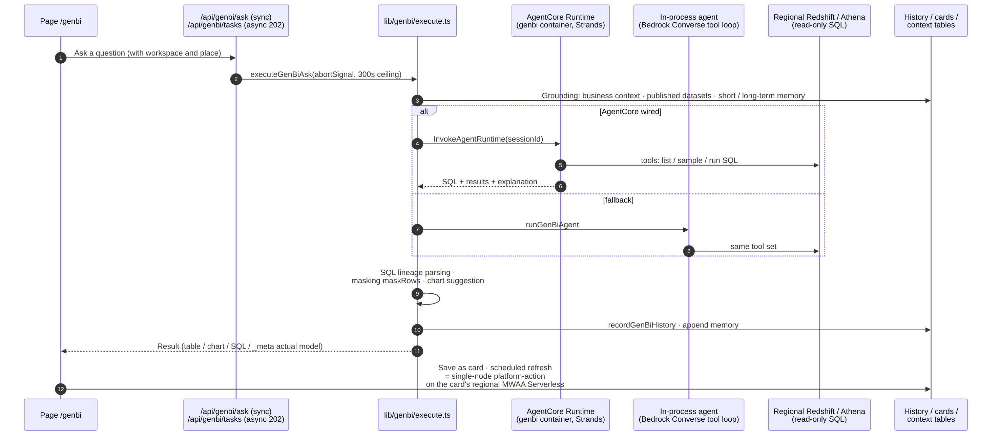

*Figure 9. A question. The executor grounds the request with business context and memory, calls the AgentCore runtime or the in-process agent, runs read-only SQL in the target region, masks sensitive columns and records history.
Source: `diagrams/src/mr-flow-genbi.mmd`; re-render with mermaid-cli after changes.*

- Questions carry a project and a place. SQL is executed read-only in that region's Redshift or Athena.
- When the AgentCore runtime is wired, it is called with a session id; otherwise an in-process agent runs the same tool loop against Bedrock.
- The result is parsed for lineage, masked by classification policy, and recorded with the model that actually answered.
- A saved card refreshes on a schedule in the region where the card lives, as a single-node workflow.

### 5.5 Data source onboarding

A data source lives in the execution region selected when it is created. The platform creates the Glue connection **in that region** (JDBC URL, subnet and security group;
a user-specified subnet and several security groups can be used, otherwise the platform probes the network and creates its own security group), writes the password to Secrets Manager
and ensures the Glue role (`lib/aws/datasource-service.ts`).

The reachability check ("heartbeat") and "browse tables" log in to the source through a discovery job started over the data source's own Glue connection, in the source's region
(`lib/datasource/glue-reach.ts`): a successful job means the source is reachable and brings the table list back; a failed job means unreachable, with Glue's error message.
By default the probe first tries a direct connection from the control plane and runs the discovery job when that fails and the source has a Glue connection.
The wizard's connection test for a JDBC source checks that the Glue connection exists; the status cell shows "connected" only after a real connection has succeeded.

## 6. Data flow

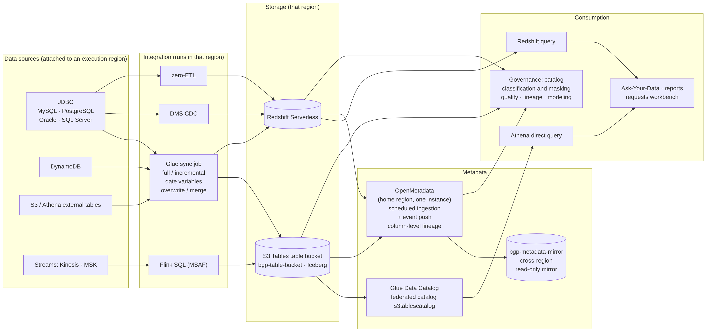

*Figure 10. Data flow. Sources are attached to an execution region; integration and storage happen in that region; OpenMetadata holds one catalog for all regions; consumption reads through Athena, Redshift, questions, reports and governance.
Source: `diagrams/src/mr-data-flow.mmd`; re-render with mermaid-cli after changes.*

- **Sources**: JDBC databases (MySQL, PostgreSQL, Oracle, SQL Server), DynamoDB, S3 and Athena external tables, and streams (Kinesis, MSK). Each source lives in one execution region.
- **Integration**: Glue synchronization jobs (full, incremental, date-variable, overwrite, merge), DMS change data capture, zero-ETL, and Flink SQL on Managed Flink.
- **Storage**: the S3 Tables table bucket (Iceberg) and Redshift Serverless of that region.
- **Metadata**: the regional Glue Data Catalog with the `s3tablescatalog` federated catalog; OpenMetadata in the home region (one instance for the whole platform, regions told apart as services)
  fed by scheduled ingestion and event push; the read-only local mirror table `bgp-metadata-mirror` for the cross-region overview.
- **Consumption**: Athena queries, Redshift queries, natural-language questions, reports, the requirements workbench and governance (catalog, classification and masking, quality, lineage, modeling).

## 7. Storage

### 7.1 DynamoDB table families

Control-plane state lives in DynamoDB tables prefixed `bgp-`, all in the home region.
CDK synthesizes 72 tables (Database 67, FinOps 3, Platform 2). The platform process reads and writes 63 of them through the `TABLES` constant in `platform/src/lib/aws/dynamodb.ts`.

| Family | Tables |
|---|---|
| Execution targets and place | `execution-envs`, `residency-acks`, `metadata-mirror`, `settings` |
| Data integration | `datasources`, `sync-tasks`, `flink-jobs`, `flink-connectors` |
| Data development | `workflows`, `redshift-tasks`, `etl-jobs`, `engine-jobs`, `query-handles`, `resource-versions` |
| Runs and scheduling | `task-runs`, `run-groups`, `action-commands`, `action-schedules`, `dataplane-jobs`, `backfill-plans`, `backfill-instances` |
| Governance | `data-classification`, `data-grants`, `quality-rules`, `quality-results`, `sensitive-findings`, `metrics`, `metric-values` |
| Modeling | `data-layers`, `data-domains`, `data-standards`, `code-tables`, `model-assets`, `model-tables`, `model-metrics` |
| Questions and AI | `genbi-history`, `genbi-cards`, `genbi-turns`, `genbi-context`, `genbi-skills`, `genbi-tasks`, `long-ops` (long-operation tasks and object leases), `requirements` |
| Reports and Copilot | `bi-reports`, `bi-dashboards`, `bi-analyses`, `copilot-plans`, `copilot-steps`, `copilot-plan-tasks`, `copilot-recipes` |
| Advisors | `network-advisor-turns`, `param-advisor-turns` |
| Operations | `alert-rules`, `alert-channels`, `alert-events`, `baselines`, `slas`, `incidents`, `diagnostics` |
| Identity and audit | `projects`, `project-members`, `approvals`, `audit` |
| Infrastructure only and other | The three FinOps tables, the action command and action schedule tables and a few others, nine in total, are not in `TABLES`; the stacks create them directly |

Table names are written once, in `TABLES`. The naming source of truth for regional resources deliberately excludes them.

### 7.2 S3 buckets

Bucket names come from `platform/naming.json`. Home keeps the original names; other targets append the target slug.

| Purpose | Home name | Execution-target name |
|---|---|---|
| Data lake | `bgp-datalake-<account>` | `bgp-datalake-<account>-<slug>` |
| Glue scripts | `bgp-glue-scripts-<account>` | `bgp-glue-scripts-<account>-<slug>` |
| MWAA Serverless workflows | `bgp-airflow-sls-<account>` | `bgp-airflow-sls-<account>-<slug>` |
| Classic Airflow DAGs | `bgp-mwaa-dags-<account>` | `bgp-mwaa-dags-<account>-<slug>` |
| Residency results | `bgp-region-results-<account>-home` | `bgp-region-results-<account>-<slug>` |

All buckets block public access and are encrypted. Data buckets are retained when a stack is deleted.

### 7.3 S3 Tables and catalogs

- Each region has one platform table bucket: `bgp-table-bucket` at home and `bgp-table-bucket-<slug>` elsewhere. Tables are Iceberg.
- Athena reads table buckets through the federated catalog `s3tablescatalog/<table-bucket>`; the platform enables it per region during install and probe.
- Customers can register their own table buckets as writable external buckets; the registration is the single source used to validate sync targets.
- Athena workgroups are `bgp-athena` and `bgp-athena-<slug>`; Redshift namespaces and workgroups are `bgp-namespace[-<slug>]` and `bgp-workgroup[-<slug>]`.

### 7.4 Secrets and keys

- Data-source passwords and per-project, per-region warehouse credentials are stored in Secrets Manager.
- Home DynamoDB tables, buckets and logs are encrypted with the customer-managed keys `alias/bgp-data` and `alias/bgp-logs`. Each execution region has its own data key, `alias/bgp-data-<slug>`.
- The initial administrator password is written to a local file on the deployment machine; it never enters the repository.

## 8. Security boundaries at a glance

Details, threat model and scan results are in [`security.md`](security.md). The boundaries in one view:

- **Edge**: WAF in front of CloudFront for the platform and for OpenMetadata; the ALB admits only the CloudFront prefix list.
- **Identity**: every `/api/*` request carries a Cognito ID token verified in the middleware; project membership is checked per resource; the OpenMetadata factory administrator password is replaced during deployment.
- **Deployment privilege**: the platform task role cannot start builds. Only the broker Lambda holds `codebuild:StartBuild`, and only for the one project; CloudFormation rights live on the CodeBuild service role.
- **Region fencing**: IAM statements carry `aws:RequestedRegion` conditions for the allowed regions; the application refuses cross-region reads before any AWS call.
- **Network**: execution-region VPCs have no NAT and no internet gateway; a single peering connection carries write-back traffic to the home region.
- **Encryption**: customer-managed KMS keys for data and logs; secrets in Secrets Manager.
- **Audit**: CloudTrail and VPC flow logs; every platform write in `bgp-audit`; regional audit for other jurisdictions.
- **Least privilege by manifest**: every AWS SDK call is registered in `infra/iam/platform-taskrole-calls.json` and simulated against the task role on each redeploy.

## 9. Code layout

| Area | Location | Notes |
|---|---|---|
| Pages | `platform/src/app/<route>/page.tsx` | 40 page routes; menu in `src/components/layout/routes.tsx`; seven menu groups (AI Hub, Data Integration, Data Development, Smart Analytics, Data Governance, Scheduling and Ops, System); every page has the execution-scope selector in its top bar; run buttons restate the region they run in. |
| API routes | `platform/src/app/api/<group>/.../route.ts` | 52 groups, 314 route files at the time of writing; shared response envelope `src/lib/api-response.ts`; read routes call `requireScope`, write routes go by place; authentication in `src/middleware.ts` and `src/lib/auth/`. |
| Business libraries | `platform/src/lib/` | 57 directories; the key ones are: `exec-env/` (registry, state machine, deployment control, place clients) · `place/` (place resolution) · `scope/` (execution scope) · `projects/` (project isolation) · `sync/` (synchronization: script generation, jobs, start) · `scheduler/serverless/` (MWAA Serverless) · `workflow/` (orchestration) · `genbi/` (questions) · `copilot/` (plan center) · `openmetadata/` (catalog push) · `athena/` (S3 Tables direct query) · `realtime/` (DMS, Flink) · `governance/`, `quality/`, `lineage/`, `modeling/` (governance) · `finops/`, `alerting/`, `incidents/`, `monitor/` (operations) · `aws/` (SDK client factory `clients.ts`, table names `dynamodb.ts`, data-plane credentials `dataplane-creds.ts`) |
| Data-source providers | `platform/src/lib/datasource-spi/` | One provider each for JDBC (MySQL, PostgreSQL, Oracle, SQL Server), DynamoDB, S3 and Athena external tables, and streams (Kinesis, MSK): connection model, probe, introspection |
| Shared types | `platform/src/types/` | Shared types for data sources, tasks, execution environments and more; one copy used by pages and routes alike |
| Tests | `platform/src/**/__tests__/*.test.ts` | Unit tests, assembly-level checks and static gates (naming source of truth, place ratchet, read-level scope ledger, mock hygiene) |
| Control-plane stacks | `infra/lib/*.ts`, entry `infra/bin/app.ts` | See 2.1 |
| Execution-region stacks | `infra/lib/exec-env/` | See 3.1 |
| Lambdas | `infra/lambda/` | Broker, action dispatcher, Cognito bootstrap, skills, cross-region peering |
| Agent containers | `infra/agent/` | Question answering, network advisor, parameter advisor |
| Deployment and gates | `scripts/` | Install, redeploy, post-deploy truth, red-line scan |
| Flink runners | `flink-sql-runner*/`, `flink-connector-modules/` | Maven modules built on the deployment machine |

Development workflow, local gates and engineering rules are in [`development.md`](development.md).

### 9.1 Quality gates (developer side)

- Local: `tsc`, `vitest` (started only from `platform/`), `naming-parity`, infra `tsc` plus `synth-gate`, and the red-line scan (pre-commit and CI).
- Real environment: `scripts/mr-gate.sh` deploys to a developer test account, runs headless-browser acceptance of every multi-region feature,
  fills the capability by region by execution-mode matrix and stamps the result.
- IAM simulation gate: `scripts/iam-simulate-gate.py` against `infra/iam/platform-taskrole-calls.json`, run at the end of every `redeploy-platform.sh`.
- Customer environments need only `scripts/02-postdeploy-truth.sh`.

## 10. Related documents

- [`development.md`](development.md): repository layout, gates, engineering rules, branch model.
- [`security.md`](security.md): security model and controls.
- [`supported-versions.md`](supported-versions.md): every pinned runtime, engine and driver version.
- [`features.md`](features.md): every page, what it does and how to use it.
- [`design/multi-region-execution.md`](design/multi-region-execution.md): the multi-region contract, design, interaction design and acceptance criteria.
- [`design/long-running-operations.md`](design/long-running-operations.md): the long-running-operation framework.
- [`diagrams/README.md`](diagrams/README.md): all figures, their sources and the rendering commands.
