# Kingfisher Big Data Governance Platform — Technical Deep Dive (Architect Briefing Edition)

> 🔴 **Scope note (2026-10-13)**: this document was written in 2026-08, during the single-region stage. It explains how the components **inside the home region** (GenBI / AgentCore / Strands / observability) are implemented, and for those components it is still the authoritative deep dive today;
> it does not, however, cover anything about the multi-region model (execution environments / places / execution scope), and the deployment steps it mentions must not be taken as the current procedure — for deployment read
> [`deployment.md`](deployment.md), for architecture read [`architecture.md`](architecture.md); the roadmap document `DATAWORKS-ROADMAP.md` that this text cites has been archived (historical material, not part of this repository).

> **Last updated: 2026-08-02 · Corresponding platform state: the 47 roadmap modules delivered by that date (the archived roadmap document was the authoritative master outline at the time) · Scope: the complete implementation picture of the whole platform**
>
> This is the script for a **2-hour technical briefing / training session** for an AWS architect team (the source-level deep dive is in §15). It walks through the implementation of the entire platform, with **a deliberate focus on the end-to-end
> implementation principles of GenAI / Ask-Your-Data (GenBI) / Amazon Bedrock AgentCore / the unified Strands framework / DevOps Agent fault diagnosis / observability** (how context and memory are implemented, which methods the short- and long-term
> stores call, how they are triggered, how the reasoning loop turns, and mechanisms such as SigV4 / MCP / EMF), and it also covers completely the implementation details of the big data foundation (data sources / sync / real-time integration / Flink
> stream compute / batch multi-engine / scheduling / lineage / governance / modeling / BI / FinOps / backfill / the AI-native moat).
>
> Companion figures: architecture, flow and sequence diagrams are all **static PNG** files (the AWS architecture diagrams are generated with the `diagrams` library + graphviz; flow and sequence diagrams are rendered from `docs/diagrams/src/*.mmd` with
> mermaid-cli; no Mermaid is embedded in the Markdown, so the figures still display on a weak network or when a renderer fails). The index is [`docs/diagrams/README.md`](diagrams/README.md).
>
> 🔒 Security: this is a tracked document and **contains no real AWS account ids / resource ids / ARNs / URLs / passwords** (it uses the placeholders `<ACCOUNT>` / `<REGION>` and service-level names). Real values live only in local `*.local.md` files (gitignored).
>
> 📌 **Honest boundary**: every capability in this document is tagged with its real status — 🟢 verified by real runs in production / 🔵 code landed but not verified online / 🔒 intentionally left open (safety gate) / 📐 designed but not implemented. Use
> the same wording in demos and talks; do not overstate.

---

## Contents

- [0. Briefing guide (how to present in 2 hours)](#0-briefing-guide-how-to-present-in-2-hours)
- [1. Project overview: what this is](#1-project-overview-what-this-is)
- [2. System architecture and end-to-end data flow](#2-system-architecture-and-end-to-end-data-flow)
- [3. 🎯 GenAI capability map (master outline of the focus topics)](#3--genai-capability-map-master-outline-of-the-focus-topics)
- [4. 🎯 GenBI Ask-Your-Data — end-to-end deep dive](#4--genbi-ask-your-data--end-to-end-deep-dive)
- [5. 🎯 Amazon Bedrock AgentCore — end-to-end deep dive](#5--amazon-bedrock-agentcore--end-to-end-deep-dive)
- [6. 🎯 Context and memory — end-to-end deep dive (short- and long-term storage / methods / triggers)](#6--context-and-memory--end-to-end-deep-dive-short--and-long-term-storage--methods--triggers)
- [7. 🎯 DevOps Agent fault diagnosis — end-to-end deep dive](#7--devops-agent-fault-diagnosis--end-to-end-deep-dive)
- [8. 🎯 Observability — end-to-end deep dive](#8--observability--end-to-end-deep-dive)
- [9. AI-assisted code generation and the requirement pipeline](#9-ai-assisted-code-generation-and-the-requirement-pipeline)
- [10. Big data foundation — implementation details](#10-big-data-foundation--implementation-details)
- [11. Remaining modules — implementation details](#11-remaining-modules--implementation-details)
- [11bis. 🎯 AI-native moat (differentiation over traditional data platforms)](#11bis--ai-native-moat-differentiation-over-traditional-data-platforms)
- [12. Infrastructure (CDK stack topology and deployment order)](#12-infrastructure-cdk-stack-topology-and-deployment-order)
- [13. Security design that runs through the whole platform](#13-security-design-that-runs-through-the-whole-platform)
- [14. Appendix: resources / tables / environment variables / glossary / briefing script](#14-appendix-resources--tables--environment-variables--glossary--briefing-script)
- [15. 🔬 Source-level deep dive (real code and wire formats)](#15--source-level-deep-dive-real-code-and-wire-formats)

---

## 0. Briefing guide (how to present in 2 hours)

The architect team's priorities, in order (which is also the order of emphasis in this document): **GenAI/AI ≈ GenBI ≈ AgentCore ≈ observability > big data foundation > everything else**. Suggested pacing for 2 hours (with the source-level §15 interleaved):

| Time slot | Topic | Sections | One-line selling point |
|---|---|---|---|
| 0–10 min | What the platform is / panoramic architecture / end-to-end data flow | §1, §2 | A one-stop big data development and governance platform, built entirely on AWS managed services, Next.js full stack on ECS |
| 10–20 min | GenAI capability map (unified Converse kernel + Strands assembly) | §3 | One Bedrock kernel drives 7 user-visible AI capabilities + 3 enabling layers |
| 20–45 min | **GenBI Ask-Your-Data** (NL→SQL) + source-level loop / retrieval / guard | §4, §15.1–15.5 | Business users who do not know SQL ask their data questions in Chinese; 100% of the numbers come from real queries |
| 45–75 min | **AgentCore** (Runtime + Gateway + MCP) + CfnResource / SigV4 / skill source code | §5, §15.6–15.8 | Move the agent from "in-process" to an AWS-managed Runtime; tools via MCP; SigV4 instead of OAuth |
| 75–90 min | **Context and memory** (dual backend / triggers / exact wire format) | §6, §15.9 | Short-term events + long-term semantic recall; self-managed vs managed, which APIs are called and when they fire, explained thoroughly |
| 90–105 min | **DevOps Agent diagnosis** + **observability** (EMF) | §7, §8, §15.10–15.11 | Automatic RCA for failed tasks; per-tool / per-skill EMF counters + control-plane status |
| 105–120 min | Big data foundation (sync / real-time / multi-engine / data source SPI) + modeling / governance / BI / FinOps + **AI-native moat** (Copilot / Cookbook / unified Strands) | §10, §11, §11bis, §15.13 | Source DB → Glue/EMR/Flink → S3 Tables/Redshift → MWAA; four data-source paradigms; AI differentiation over traditional data platforms |
| (as questions come) | Security / IAM / evolvability / failure modes / Q&A | §12, §13, §15.12, §15.14 | Read-only guard / SSRF / SigV4 / masking / least privilege / one-switch fallback |

> In the 2-hour version, every 🎯 focus section can open the matching §15 source-level subsection live (code + exact JSON wire formats) to answer deep questions; when time is short, §15 is the backstop for Q&A. The big data foundation and the AI-native
> moat (§10 / §11 / §11bis) cover the modules delivered later in the roadmap (real-time integration, Flink, multi-engine, data-source SPI, modeling, governance depth, BI, lineage collection, FinOps, backfill, baselines, incident knowledge base,
> Copilot, Cookbook, Strands); pick and choose according to the audience's interest.

**How to read this document (two layers, to avoid reading the same thing twice)**: **§1–§14 = the concept / narrative layer** (what it is, why, how things connect, with figures and key decisions); **§15 = the source layer** (real code + exact JSON
wire formats + IAM actions + CfnResource property trees + failure modes). Each topic appears once in each layer — read the narrative layer first to build a mental model, then jump to the corresponding §15.x when you need source code or wire formats.
The on-stage cheat sheet is the companion [`deep-dive-brief.md`](deep-dive-brief.md).

**The three "how"s most worth explaining thoroughly (architects' favorite questions):**
1. **How are context and memory implemented?** → §6: multi-turn `messages` within one inference, cross-turn short-term memory, and cross-session long-term semantic memory — three layers; self-managed (DynamoDB + S3) vs AgentCore managed (CreateEvent /
   RetrieveMemoryRecords) dual backends; which APIs are called and when they fire is all spelled out.
2. **How does the agent call tools safely?** → §5: MCP-over-HTTP + **SigV4** (service = `bedrock-agentcore`); the Gateway's inbound authorizer is `AWS_IAM`, so no OAuth; tools hot-load (dynamic discovery via `tools/list` on every call).
3. **Why can the numbers be trusted?** → §4: hard rules in the system prompt + a closed loop through the `run_sql` tool + **read-only SQL guard** + hard row cap; all computation is delegated to the query engine.

---

## 1. Project overview: what this is

**A one-stop big data development and governance platform**: it converges the entire chain "data onboarding → sync → ETL development and orchestration → scheduling → governance (catalog / lineage / classification / quality) → metrics → smart
analytics (Ask-Your-Data) → monitoring / diagnosis" into a single web platform.

- **Shape**: a Next.js 14 full-stack application (frontend + API routes in the same repository) running on **ECS Fargate**; all infrastructure in **AWS CDK (TypeScript)**; the underlying layer uses **AWS managed services** exclusively; data governance
  uses a **self-deployed OpenMetadata** (the single source of truth for catalog + lineage).
- **Main data flow**: sources (eight kinds: MySQL / PostgreSQL / Oracle / SQL Server / S3 / DynamoDB / Kinesis / MSK) ── batch (Glue / EMR ETL, full and incremental) or real-time (DMS / Zero-ETL CDC, Flink stream compute) ──► **S3 Tables (Iceberg)** + **Redshift Serverless (data warehouse)**;
  - batch compute is multi-engine (Glue / EMR Serverless / Athena / Redshift SQL) + stream compute on **MSAF Flink**;
  - scheduling runs on **MWAA / Airflow**;
  - authentication is **Cognito**;
  - control-plane metadata (data sources / sync / workflows / jobs / run records / diagnostics / memory / skills / modeling / BI / cost …) is stored in **DynamoDB**;
  - generative AI uniformly uses **Amazon Bedrock (Claude Opus)** + **Amazon Bedrock AgentCore** + **Strands assembly**;
  - fault diagnosis uses the **AWS DevOps Agent**.
- **Roles (Cognito groups → resource-level RBAC)**: `bgp-admin` super administrator / `bgp-manager` manager / `bgp-developer` developer / `bgp-analyst` operations analyst (Ask-Your-Data + raising requests only) / business users without a group are viewers.

### Technology stack at a glance

| Layer | Choice |
|---|---|
| Frontend / backend | Next.js 14 (App Router; frontend + `/api/*` in the same repository), Ant Design, TypeScript |
| Runtime | ECS Fargate (platform image), CloudFront (HTTPS entry point), ALB (security group allows only the CloudFront prefix list) |
| Authentication / authorization | Cognito User Pool (ID token), a central middleware validates every `/api/*` request, resource-level RBAC + approvals |
| Control-plane storage | DynamoDB (61 tables, PAY_PER_REQUEST + CMK encryption + PITR 35 days + RETAIN), Secrets Manager (all passwords) |
| Data integration | Batch sync (Glue, full / incremental) + real-time CDC (three channels: DMS / Zero-ETL / Flink CDC); data-source SPI with four paradigms (JDBC relational / S3 object storage / DynamoDB NoSQL / Kinesis·MSK streams; 8 providers in total) |
| Compute engines | AWS Glue (PySpark/SQL + Iceberg; versions in [`supported-versions.md`](supported-versions.md)), EMR Serverless (PySpark, pluggable engine SPI), Amazon Athena (querying the S3 Tables data lake), Redshift Serverless (warehouse SQL), **Amazon Managed Service for Apache Flink** (`FLINK-1_20` runtime, stream compute) |
| Storage / warehouse | S3 Tables (managed Iceberg), Redshift Serverless |
| Scheduling | Amazon MWAA (Apache Airflow), exactly-once cross-task dependencies + a production-grade backfill center |
| Governance | Self-deployed OpenMetadata (ECS + its own RDS MySQL + OpenSearch), table- and column-level lineage + compute lineage collection |
| Generative AI | Amazon Bedrock (Claude Opus, Converse API), **Amazon Bedrock AgentCore** (Runtime + Gateway/MCP + Memory), **Strands Agents SDK** (unified agent assembly framework), **AWS DevOps Agent** (`aidevops`) |
| IaC | AWS CDK v2 (TypeScript), **21 stacks** (17 always-on + 4 gated by context switches) |

---

## 2. System architecture and end-to-end data flow

### 2.1 System architecture (official AWS icons)

> Figure: `docs/diagrams/system-architecture.png` (generated by `docs/diagrams/src/system-architecture.py` with the `diagrams` library + graphviz; official AWS icons, service level, no sensitive values).

```text
User (browser) ──HTTPS──► CloudFront ──► ALB (SG: CloudFront prefix list only) ──► ECS Fargate (Next.js full stack)
                                                                                      │
   ┌──────────────────────────────────────────────────────────────────────────────┼───────────────────────────────┐
   │ Control plane: Cognito (RBAC) · DynamoDB (data sources / sync / jobs / runs / memory / skills / diagnostics …) · Secrets Manager │
   │ Data pipeline: source RDS MySQL ─Glue ETL→ S3 Tables (Iceberg) + Redshift Serverless ; MWAA scheduling ; Athena queries the lake │
   │ Governance: OpenMetadata (ECS + its own RDS + OpenSearch)                                                                        │
   │ Generative AI: Bedrock (Claude Opus, Converse) · AgentCore (Runtime + Gateway/MCP + Memory) · DevOps Agent                       │
   └──────────────────────────────────────────────────────────────────────────────────────────────────────────────────────────────────┘
```

**Key boundary design**:
- The only public entry point is CloudFront; the ALB security group allows only the CloudFront managed prefix list; all backend services sit in private subnets.
- The platform's ECS task calls AWS APIs (Glue / Redshift Data API / Bedrock / AgentCore / CloudWatch / DynamoDB …) directly through its **TaskRole**; no long-lived keys are stored anywhere.
- All database passwords live in Secrets Manager; Redshift uniformly uses the managed admin secret `redshift!bgp-namespace-admin` (superuser) so that table ownership stays consistent across the identities that execute statements.

### 2.2 End-to-end data flow

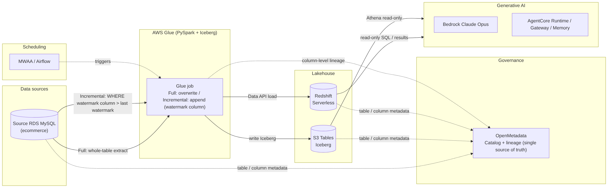

**Two kinds of "flow" must be kept apart** (architects often confuse them):
- **Data plane**: real data travels from the source database through Glue into the lakehouse (S3 Tables / Redshift).
- **Control plane**: the platform's create / read / update / delete operations on metadata such as "data sources / sync tasks / workflows / jobs / run records / diagnostics / memory / skills", stored in DynamoDB; **the source of truth for governance metadata (catalog / lineage) is OpenMetadata**.

---

## 3. 🎯 GenAI capability map (master outline of the focus topics)

The platform's "generative AI" is not an isolated feature; it is **a cluster of capabilities driven by one unified kernel plus one unified assembly framework**. The unified kernel is **Amazon Bedrock (`Converse` API / Claude Opus)**; the model id is
injected through `BEDROCK_MODEL_ID` and comes from the single source of truth `platform/ai-model.json` (current default `us.anthropic.claude-opus-4-6-v1`; the model can be swapped for a newer generation and is not locked to one family). Remote
containerized agents are uniformly assembled with the **Strands Agents SDK** (see §11bis.3 / §11bis.4), while the lightweight in-process path still uses a hand-written Converse loop.

**Capability inventory (honest wording)**: the roadmap lists nine "moat" capabilities, but one must distinguish **"user-visible AI capabilities" from "enabling layers"** — the AI capabilities that really call the LLM and that users perceive directly
number **7**; the other 3 are **enabling layers** that do not face users directly (the AgentCore platform standard / the Engine Cookbook [a deterministic recipe library with zero LLM calls] / the unified Strands framework).

> Panoramic figure with official AWS icons (GenBI / AgentCore / memory / DevOps Agent / Copilot / advisors in one view): `docs/diagrams/genai-architecture.png` (generated by `docs/diagrams/src/genai-architecture.py`; service level, no sensitive values).

**The 7 user-visible AI capabilities**:

| # | Capability | How the model is called | Execution vehicle | Key files | Status |
|---|---|---|---|---|---|
| 1 | **GenBI Ask-Your-Data** | Converse **tool-use loop** (NL → read-only SQL → chart; contains two internal LLM touch points: semantic table retrieval re-ranking and long-term memory distillation) | Remote AgentCore Runtime (Strands) as the main chain + in-process (hand-written loop) as fallback | `lib/genbi/execute.ts` · `agent.ts` · `infra/agent/genbi/agent.js` | 🟢 |
| 2 | **Network connectivity advisor** | L1 probing + L2 deterministic reachability verdict + L3 Converse advice; permanently read-only | In-process by default; remote AgentCore optional (🔵 not deployed) | `lib/network-advisor/` | 🟢 (in-process) |
| 3 | **Parameter advisor** | Four channels (glue-etl / glue-sync / flink / dms); a deterministic engine produces the values, Converse only explains them | In-process by default; remote AgentCore optional (🔵 not deployed) | `lib/param-advisor/` | 🟢 (in-process) |
| 4 | **DevOps diagnosis agent** | **AWS DevOps Agent** (`aidevops`, a managed SRE that autonomously correlates logs and metrics) + memory augmentation (injects verified fixes + business definitions) | Managed service (neither AgentCore nor Converse) | `lib/diagnostics/devops-agent.ts` · `lib/incidents/` | 🟢 |
| 5 | **AI code generation (requirements / ETL / engines)** | Single Converse call (`temperature=0` + catalog grounding + Cookbook dialect guard) | In-process | `lib/requirements/codegen.ts` | 🟢 |
| 6 | **Flink SQL AI generation** | Converse (NL → Flink SQL, reuses the GenBI channel, Cookbook guard before start) | In-process | `lib/realtime/flink-sql-ai.ts` | 🔵 code landed |
| 7 | **Unified platform Copilot** | Q&A uses a hand-written Converse loop; cross-module planning uses **Strands** (`Agent.invoke` + structured output); three gates of "may create, must not execute" | In-process (Converse + Strands); remote **deliberately not done** | `lib/copilot/agent.ts` · `plan/planner.ts` | 🟢 (planning L2; L3 delegated execution 🔒 left open) |

**The 3 enabling layers (not directly user-facing)**: ① the **AgentCore platform standard** (the template "every AI capability = its own Gateway + Runtime + Memory"); ② the **Engine Cookbook** (a dialect recipe library retrieved by engine /
capability tag, fed to every codegen exit, **zero LLM calls**); ③ the **unified Strands framework** (converges the remote agents onto one assembly skeleton). All three are covered in §11bis.

**Why it is designed this way**: "calling the model" is converged into one unified kernel (uniform dialect / methods / region / credentials + a single source of truth for the model id), and "what the model is allowed to do" is constrained through
**tools (MCP) + data-catalog grounding + hard rules in the system prompt + the Cookbook dialect guard**, which keeps AI output **trustworthy, controllable, read-only and explainable**. The following sections dig into GenBI / AgentCore / memory /
diagnosis one by one (§4–§8); code generation and the requirement pipeline are in §9; Copilot / Cookbook / Strands are in §11bis.

---

## 4. 🎯 GenBI Ask-Your-Data — end-to-end deep dive

**Goal**: a business or operations colleague who does not know SQL asks, in Chinese, "How many customers do we have per region?"; the platform automatically generates **read-only SQL**, executes it in Redshift (or in Athena over the data
lake), explains the real result clearly in Chinese, and recommends a chart. **The core promise: every number comes from a real query; the model is never allowed to compute in its head or make numbers up.**

Entry point: `POST /api/genbi/ask` (`platform/src/app/api/genbi/ask/route.ts`). Request body `{ question, engine?, database?, conversationId? }`; the project is passed in the request header `x-bgp-project`.

### 4.1 Top-level orchestration (what happens in one question)

`ask/route.ts` is the conductor: it picks the backend according to the feature switch `GENBI_BACKEND`, then runs a chain of "governance post-processing" steps shared by both backends:

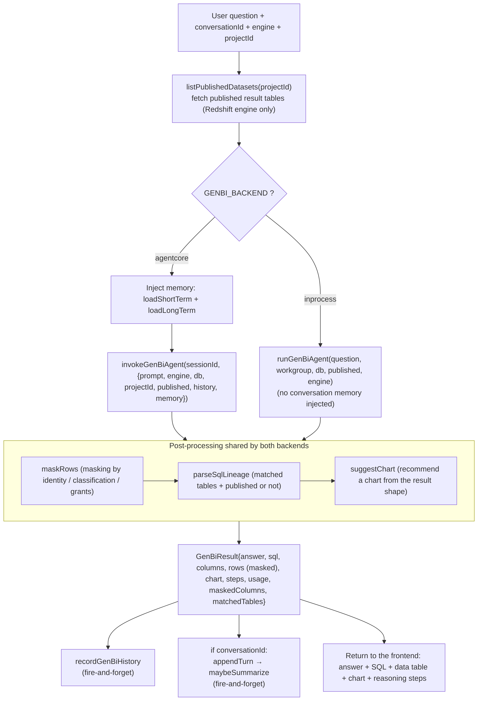

Key points:
- **Published result tables** (`listPublishedDatasets`): earlier, the "development pipeline" published the result of some question as a Redshift table; when a question comes in, that table is reused preferentially (consistent definitions, faster); see §4.5–4.11.
- **Memory is injected only on the `agentcore` backend** (which is the production configuration): the `inprocess` backend does not inject conversation context. The **outer layer** of both backends calls `appendTurn` (writes one turn) and triggers
  `maybeSummarize` whenever a `conversationId` is present.
- **Masking happens at the return-value layer** (§4.5–4.11 / §15.5): only the rows returned to the frontend are changed; data in the database is never touched.

### 4.2 Dual-backend architecture and one-switch fallback

The same "NL→SQL" can run either **inside the Next.js process** or in an **AgentCore Runtime (container)**; the choice is made by an environment variable and can be rolled back with one switch:

| Aspect | `inprocess` backend | `agentcore` backend (production) |
|---|---|---|
| Where it runs | Inside the Next.js ECS process | AgentCore Runtime (ARM64 container) |
| Entry point | `lib/genbi/agent.ts` `runGenBiAgent()` | `lib/genbi/agentcore-client.ts` `invokeGenBiAgent()` → Runtime `agent.js` |
| Tools | Single tool `run_sql` (direct connection to Redshift / Athena) | **MCP tools** through the Gateway (8 of them, including registered skills / business definitions / OM descriptions) |
| Conversation memory | Not injected | Injects short-term history + long-term memory |
| Switching | `-c genbi-backend=inprocess` | `-c genbi-backend=agentcore -c genbi-runtime-arn=...` |

> The two backends share **the same contract** (transparent to the frontend): both return `{answer, sql, columns, rows, steps, usage}`, which then uniformly passes through masking / chart recommendation / history. This is the engineering value of
> "one-switch fallback" — if AgentCore has a problem, changing one context value and redeploying the platform falls back to the pure in-process implementation.

### 4.3 The NL→SQL reasoning loop (Converse tool-use loop)

This is the heart of GenBI. Below, the **in-process** `runGenBiAgent` is used to explain the hand-written tool-use loop thoroughly. ⚠️ Note: **the remote AgentCore version `infra/agent/genbi/agent.js` is no longer a hand-written Converse loop; it is
assembled with the Strands Agents SDK (`new Agent(...)` + `agent.invoke`)** (see §11bis.3). Both share the same `@genbi/core` pure-logic brain (prompt / retrieval / guard / chart recommendation); the differences are the loop skeleton (hand-written vs
Strands) and the tool source (direct connection vs MCP):

**Phase one · grounding**: `introspectSchema` (one SQL statement that queries `pg_tables` ⨝ `information_schema.columns`, executed with the admin secret) → `selectRelevantTables` (semantic retrieval, §4.4) → `systemPrompt` (hard rules + focused catalog + published-table section).

**Phase two · tool-use loop (at most `GENBI_MAX_ITERS=8` rounds)**

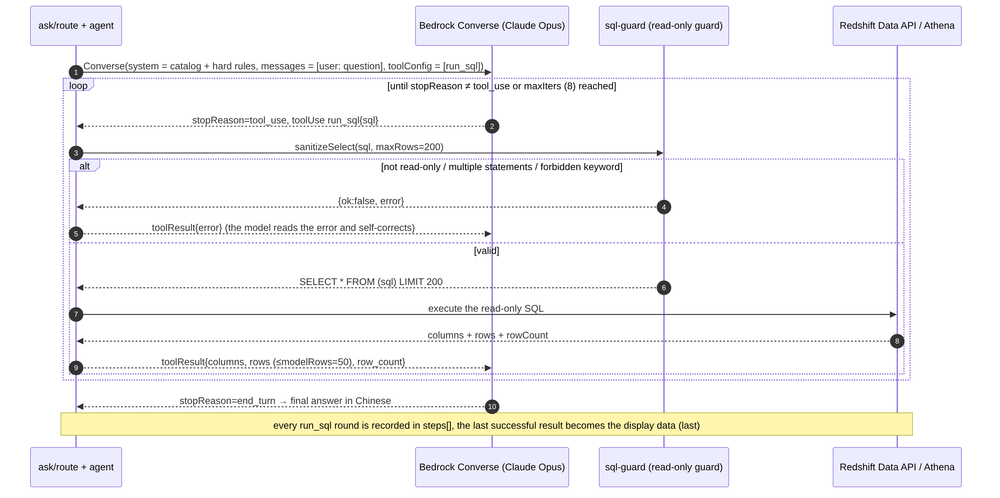

Key points: `maxTokens=2200`, cumulative `usage`; tool results sent back to the model are **truncated to 50 rows** (the complete `last` of ≤200 rows is kept for display); errors are returned to the model for **self-correction** (multi-step
self-healing); a fallback kicks in after 8 rounds. **The loop code + the exact JSON wire format of `toolSpec/toolUse/toolResult` are in §15.2.**

### 4.4 Semantic table retrieval (LLM re-ranking to pick tables)

`lib/genbi/retrieval.ts`: not a hard-coded "question → table" mapping, but an explainable 4-step retrieval:

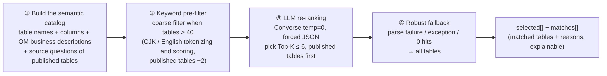

- OM descriptions (best-effort) + keyword pre-filter (when there are more than 40 tables) + LLM re-ranking (`temp=0`, forced JSON, fault-tolerant `extractJson`) + **fallback to all tables on exception or zero hits**; `preferred` only trusts the
  published tables registered by the platform (it does not take the model's self-report at face value). **The scoring / re-ranking prompt / fallback source code is in §15.3.**

### 4.5–4.11 The remaining key points (concepts; source in §15.4 / §15.5)

- **Hard rules in the system prompt** (`prompt.ts`): ① numbers must come from real `run_sql` results (no mental arithmetic) ② all computation goes into the SQL ③ Chinese aliases in double quotes ④ a single SELECT/WITH statement, no writes ⑤ aggregate
  whenever possible ⑥ Athena uses three-part catalog names. The system prompt **embeds a "focused data catalog"** (only the tables the retrieval hit) for grounding.
- **Read-only SQL guard** (`sql-guard.ts`, identical to the Lambda's `rs.js`): strip comments → strip the trailing semicolon → **forbid multiple statements** → must be SELECT/WITH → **whole-word scan for forbidden words** → wrap in `LIMIT 200`. This is
  **defense in depth at the application layer**; configuring a database-level read-only role in addition is recommended. **Full source in §15.4.**
- **Published result tables**: the development pipeline publishes the result of a question as a Redshift table and registers it (source question / definition); retrieval gives it a `+2` weight plus the hint "**must be used preferentially; do not
  recompute from detail rows**" → reuse / acceleration / **consistent definitions**.
- **Field masking** (`masking.ts` `maskRows`): **only the rows returned to the frontend are masked; the database is never modified**; administrators and authorized users are exempt; the referenced tables are determined from `ColumnMetadata.tableName`
  (exact) + `parseSqlLineage` (fallback); policies are `full/partial/email/hash` (for same-named columns across several tables the strongest policy wins); best-effort, never throws. **Source in §15.5.**
- **Chart recommendation** (`chart.ts`, pure function): single scalar → `metric`; the last numeric column = y, the first non-numeric column = x; if x looks like a date → `line`, otherwise `bar`; more than 50 rows → `table`.
- **History / usage** (`history.ts`): `recordGenBiHistory` writes best-effort to `bgp-genbi-history` (including engine / backend / input and output tokens / chartType) for the §8 observability dashboard.
- **Dual engine**: `redshift` (PostgreSQL / Data API) | `athena` (Trino / three-part federated catalog / S3 Tables); the differences are the system-prompt dialect, table-name qualification, the execution branch and the read-only guard (the Athena side additionally allows `SHOW/DESCRIBE/EXPLAIN`).

---

## 5. 🎯 Amazon Bedrock AgentCore — end-to-end deep dive

### 5.1 Motivation: why move the agent from "in-process" to a managed Runtime

The in-process agent (`inprocess` in §4.2) stuffs both "calling the model" and "calling tools" into the Next.js process. AgentCore **decouples them into cloud-native managed components**:

- **Runtime**: runs the agent as a container (independent scaling, independent releases, ARM64, managed sessions).
- **Gateway**: standardizes "skills" as **MCP tools**; inbound uses **AWS_IAM (SigV4)**, so no OAuth; the skill backend is Lambda (can evolve independently).
- **Memory**: managed short-term events + long-term semantic memory (vector recall), no self-built storage or summarization needed (§6).
- **Evolvability**: adding a skill = changing Lambda / data; the agent discovers tools generically and dynamically (§5.6), **with no change to or rebuild of the agent**.

On the platform side only a thin "invoke the Runtime" client was added, and **the in-process implementation is kept as a one-switch fallback**.

> - 📌 **This is not a one-off refactoring of GenBI; it is the platform standard**: "every AI capability = its own Gateway + Runtime + Memory + a thin platform wrapper" has been solidified into a reusable template; the network connectivity advisor and the
>   parameter advisor each built their own AgentCore stack following it (reusing the same protocol base class `infra/lib/shared/agentcore-base.ts`). GenBI is the template that is already running in production; the advisors' Runtime code has landed but
>   **the remote side is not deployed yet** (🔵 online, the default path is in-process). The full picture of the unified Strands assembly is in §11bis.4.

### 5.2 IaC topology and deployment order (the CDK CfnResource escape hatch)

AgentCore resources are declared with CDK `CfnResource` (`AWS::BedrockAgentCore::{Gateway,GatewayTarget,Runtime,Memory}`) in `infra/lib/agentcore-stack.ts` (a new stack `BgpAgentCoreStack`, independent, does not block the core stacks).

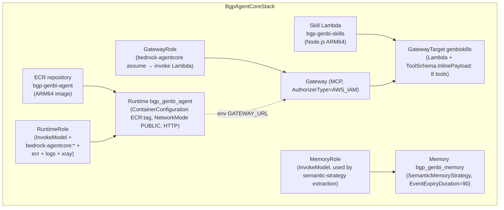

**The deployment order solves the chicken-and-egg problem "the image must exist before the Runtime"**:
1. Deploy this stack first (**without** `-c genbi-runtime`): it creates the ECR repository + skill Lambda + Gateway + GatewayTarget + Memory + roles (**but no Runtime**).
2. Build the agent image with `docker buildx --platform linux/arm64` and push it to the ECR repository output by this stack.
3. Deploy this stack again **with** `-c genbi-runtime=1 -c genbi-agent-tag=<tag>`: only now is the Runtime that references that image created.

> When changing the Lambda / Gateway tools you still have to pass `-c genbi-runtime=1`, otherwise CloudFormation deletes the Runtime (gating logic: `withRuntime = tryGetContext("genbi-runtime")`).

### 5.3 The Runtime container contract (/invocations + /ping)

The agent container (`infra/agent/genbi/`, `Dockerfile` based on `node:20-slim`, `--platform=linux/arm64`) must implement the HTTP contract of the AgentCore Runtime (`index.js`, listening on `0.0.0.0:8080`):

- `GET /ping` → `200 {status:"healthy"}` (health check).
- `POST /invocations` → reads the body (≤5 MB), accepts either `{input:{...}}` or a bare `{...}`, calls `runAgent(input)`, returns `200 {output}` or `4xx/5xx {error}`.

> ✅ **Project-level isolation**: when `index.js` calls `runAgent` it passes `projectId` through (`runAgent({..., projectId: input.projectId})`), so inside the Runtime "business definitions / registered skills" are isolated by the real project, consistent with the in-process path.

### 5.4 Gateway + 8 MCP tools

Gateway (`AWS::BedrockAgentCore::Gateway`): `AuthorizerType=AWS_IAM`, `ProtocolType=MCP`, `SupportedVersions=["2025-03-26"]`. GatewayTarget `genbiskills`: `CredentialProviderConfigurations=[{GATEWAY_IAM_ROLE}]` (outbound calls to Lambda use the
GatewayRole), and `ToolSchema.InlinePayload` declares the 8 tools inline:

| Tool | Purpose | Input |
|---|---|---|
| `run_redshift_sql` | Read-only SQL on Redshift (PostgreSQL dialect) | `{sql}` |
| `run_athena_sql` | Read-only SQL on Athena over the data lake (Trino dialect) | `{sql}` |
| `introspect_redshift_schema` | List Redshift tables / columns | `{}` |
| `introspect_s3tables_schema` | List tables / columns of the S3 Tables namespace | `{}` |
| `lookup_business_context` | Look up business definitions / terms / rules (grounding) | `{projectId, keywords?}` |
| `fetch_om_descriptions` | Fetch OpenMetadata table / column descriptions for retrieval grounding | `{keywords?}` |
| `list_registered_skills` | List the registered business skills | `{projectId}` |
| `run_registered_skill` | Execute a registered skill by name (SQL template / HTTP API) | `{skill, params, projectId}` |

### 5.5 The MCP-over-HTTP + SigV4 client inside the agent

The agent calls the Gateway with a minimal MCP client (`infra/agent/genbi/mcp.js`): **Streamable HTTP + SigV4**.

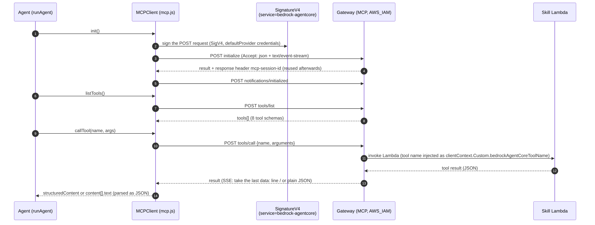

Key points: every POST is signed with `SignatureV4(service=bedrock-agentcore)` (`undici` fetch) → inbound `AWS_IAM` means **no OAuth and no token management**; the `mcp-session-id` is cached and reused; for SSE the last `data:` line is taken; the
result prefers `structuredContent`, otherwise `content[].text` is parsed. **The full source of `mcp.js` + the JSON-RPC envelope wire format are in §15.7.**

### 5.6 Skill hot loading (a generic dynamic agent)

`runAgent` (`agent.js`) no longer hard-codes tools; **on every call it discovers all MCP tools on the Gateway via `tools/list` and exposes them to the model**:

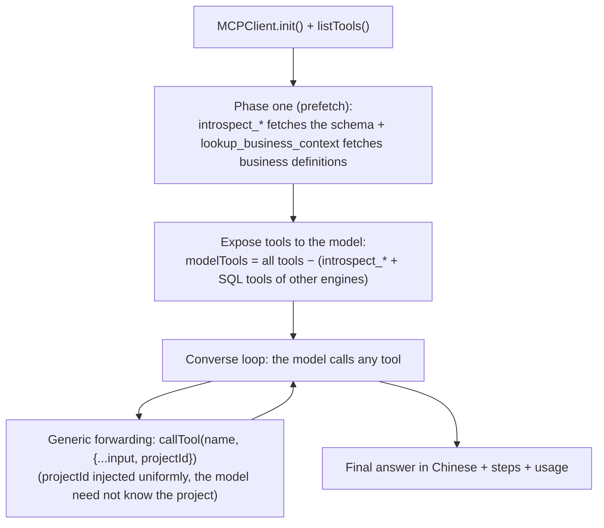

→ **From now on, any skill (tool) added to the Gateway is discovered and used automatically by subsequent sessions, with no change to or rebuild of the agent and no session restart**. This is the foundation of the platform's "zero-deployment hot
loading" (together with the registered skills in §5.8).

`agent.js` also implements **real multi-turn conversation**: it expands `history[]` into a prefix of alternating `user/assistant` `messages` (high-fidelity context) and then appends the current question (details in §6).

### 5.7 The skill Lambda (unified read-only backend + EMF)

- `genbi-skills` (`index.js` + `rs.js`) is the execution backend for all MCP tools: `toolNameOf` (takes the part after `<target>___<tool>` from `clientContext.Custom.bedrockAgentCoreToolName`) dispatches the 8 tools;
- Redshift / Athena go through the managed admin secret + the `sanitizeSelect` read-only guard + polling;
- **every call emits a CloudWatch EMF record** (namespace `BGP/GenBI`, dimensions `ToolName` / `Skill`) for the §8 counters.
- **Tool dispatch / SSRF guard / EMF / `rs.js` source are in §15.8.**

### 5.8 Registered skills (data-driven, zero-deployment hot loading)

A registered skill = a reviewed, parameterized read-only call + its parameter declaration, stored in DynamoDB `bgp-genbi-skills` (pk = `projectId`; `global` means shared). Two kinds:
- **SQL template** (`kind:"sql"`): read-only SELECT/WITH with `{{param}}` placeholders; the Lambda renders it safely (number validation / identifier allow-list / single-quote escaping for strings) → read-only guard → executed on Redshift / Athena.
- **HTTP external API** (`kind:"http"`, added in v1.29.0): method + URL template (+ optional request headers / request body / result path); the Lambda renders it → `fetch` → maps the JSON response to columns / rows. **SSRF guard** (https only, no
  placeholders in the host name, after DNS resolution reject private / link-local / metadata addresses, no redirects, timeout, length limit, optional domain allow-list); HTTP skills can be registered **only by platform administrators**.

The model discovers skills through `list_registered_skills` and executes them by name through `run_registered_skill(skill, params)`. Adding a skill = adding one row to the table (**pure data, zero deployment, automatically available to subsequent sessions**). Management page: `/skills`.

### 5.9 The business glossary (lookup_business_context)

- Maintainable business context (definitions / metric definitions, term aliases, rules / caveats), stored in DynamoDB `bgp-genbi-context` (project-isolated + `global` shared).
- Before answering a question, the agent calls `lookup_business_context` and injects the matching definitions / rules into the system-prompt section "Business definitions and rules (must be followed)";
- code generation (§9) injects them as well.
- Example: define "GMV = the sum of `quantity*unit_price` over `order_items`" → ask "What is the GMV?" → the model generates `SELECT SUM(quantity*unit_price) FROM order_items` (following the definition).
- Management page: `/knowledge`.

### 5.10 How the platform side invokes the Runtime

`lib/genbi/agentcore-client.ts` `invokeGenBiAgent(sessionId, input)`:
- `InvokeAgentRuntimeCommand({ agentRuntimeArn, runtimeSessionId, qualifier:"DEFAULT", contentType/accept: application/json, payload: {input} })` (data plane, IAM-authenticated).
- `runtimeSessionId = "genbi-" + sha256(conversationId).slice(0,48)` (≥33 characters and stable for the same conversation → the session context is reused).
- Read the streamed response → `JSON.parse` → take `output`. The TaskRole needs `bedrock-agentcore:InvokeAgentRuntime`.

---

## 6. 🎯 Context and memory — end-to-end deep dive (short- and long-term storage / methods / triggers)

> This is the "how" architects care about most. Below, "where the context comes from, where it is stored, which APIs are called, when they fire, and how it is injected back into the model" is explained layer by layer.

### 6.1 The four layers of context

GenBI's "context" is not one thing but **four layers**, from the smallest scope to the largest:

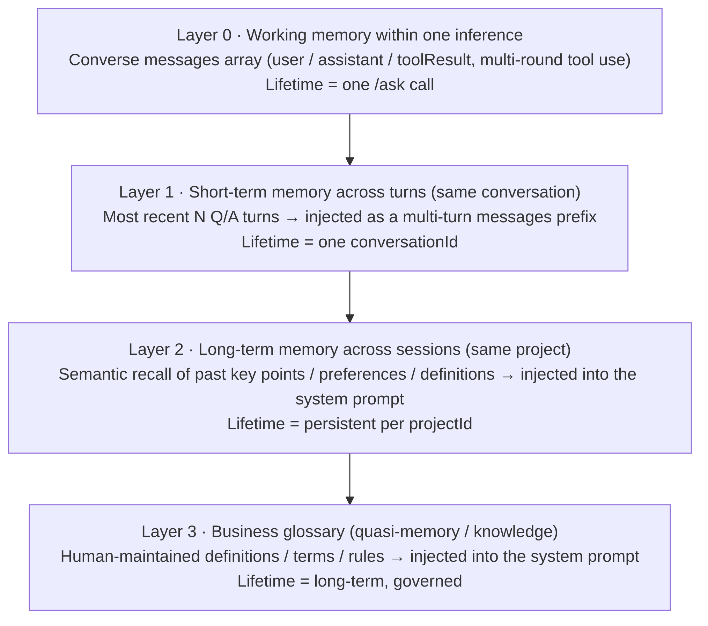

- **Layer 0** is carried natively by Bedrock Converse (the tool-use rounds within one `/ask` call).
- **Layers 1 and 2** are the "conversation memory", implemented by a switchable memory backend (the focus of this section).
- **Layer 3** is the business glossary of §5.9 (maintained by people, not accumulated automatically).

### 6.2 Switchable memory backend (GENBI_MEMORY_BACKEND)

The memory implementation is concentrated in `lib/genbi/memory.ts` and is switched by the environment variable `GENBI_MEMORY_BACKEND = selfmanaged | agentcore` (following the one-switch fallback idea of §4.2). It exposes one uniform set of functions:
`appendTurn` / `loadShortTerm` / `loadLongTerm` / `maybeSummarize` / `runtimeSessionId` / `isAgentCoreMemory`. `ask/route.ts` only calls this uniform set and does not care about the backend.

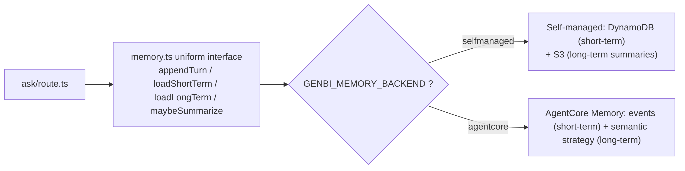

> Note: conversation memory is **injected** into the model only when `GENBI_BACKEND=agentcore` (the agent backend); the "write" side (`appendTurn/maybeSummarize`) happens in the outer layer of both agent backends (as long as a `conversationId` is
> present). The production configuration is agentcore + agentcore memory.

### 6.3 Self-managed backend (selfmanaged): DynamoDB short-term + S3 long-term summaries

- **Self-managed (selfmanaged)**: short-term = DynamoDB `bgp-genbi-turns` (pk = `conversationId`, sk = `ts=<ISO>#<rand6>`, `ttl=now+24h` so items expire automatically);
- `appendTurn` writes fire-and-forget after a question; `loadShortTerm` runs a `Query` (`ScanIndexForward:true`) before a question and takes the most recent **6** turns.
- Long-term = S3 `genbi-memory/<projectId>/<conversationId>.json`;
- `maybeSummarize` fires **every 6 accumulated turns**, asks Bedrock for a summary of ≤120 characters and writes it to S3; `loadLongTerm` reads the 3 most recent summaries with `ListObjectsV2` + `GetObject`.

### 6.4 AgentCore managed backend (agentcore): events + semantic strategy

Uses `AWS::BedrockAgentCore::Memory` (semantic strategy `genbiSemantic`, `Namespaces=["/genbi/{actorId}"]`, `EventExpiryDuration=90` days; SDK `@aws-sdk/client-bedrock-agentcore`). Naming: `actorId=projectId`, `sessionId=runtimeSessionId(conversationId)`, `namespace=/genbi/<projectId>`.
- **Short-term**: written with `CreateEvent` (two conversational payloads per question/answer pair: USER / ASSISTANT); read with `ListEvents` (`includePayloads`, paired in ascending `eventTimestamp` order) to get the most recent N.
- **Long-term**: **no explicit write is needed** — the semantic strategy **asynchronously** extracts memory records into the namespace after `CreateEvent` (`maybeSummarize` is a no-op); reading uses `RetrieveMemoryRecords` (`searchQuery=the question`,
  `topK=3`, **managed vector semantic recall**, replacing a self-built OpenSearch k-NN) → `memoryRecordSummaries[].content.text`.
- **Asynchrony**: semantic records take a few minutes to materialize; when the result is empty the code degrades gracefully (nothing injected, no error); short-term `ListEvents` is synchronous and immediate.

> **Exact input / output JSON, the `runtimeSessionId=sha256` derivation, the "cache vs storage" clarification and the trigger arithmetic are in §15.9; the trigger timing summary is the table in §6.5 below.**

### 6.5 Trigger timing at a glance (when written, when read, when extracted)

| Moment | Self-managed backend | AgentCore backend |
|---|---|---|
| **Before** a question (injection) | `loadShortTerm` (Query, most recent 6 turns) + `loadLongTerm` (S3, 3 most recent summaries) | `loadShortTerm` (ListEvents, paired) + `loadLongTerm` (RetrieveMemoryRecords, semantic topK 3) |
| **After** a question (write one turn) | `appendTurn` (PutItem, TTL 24h) | `appendTurn` (CreateEvent, 2 conversational payloads) |
| Long-term accumulation | `maybeSummarize`: **every 6 turns** one Bedrock summary is written to S3 | The semantic strategy extracts **asynchronously** from events (no explicit trigger) |
| Expiry | DynamoDB TTL 24h (short-term); S3 summaries are kept long-term | Events `EventExpiryDuration=90` days |

### 6.6 Injection path: how memory "gets back" into the model

Once memory has been loaded it is injected along two paths (`agent.js` `runAgent`):

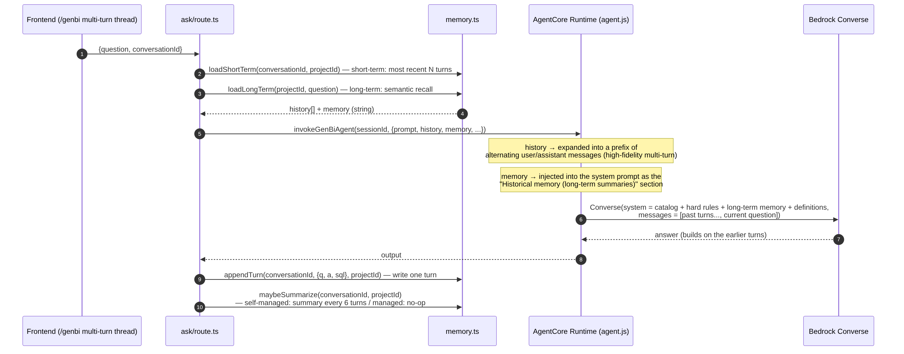

- **Short-term `history[]` → multi-turn `messages`**: `agent.js` expands the most recent 6 turns into alternating `user/assistant` messages (the `assistant` content is the previous answer; an empty answer is replaced with a placeholder to avoid a
  Converse error) and then appends the current question — this is "real multi-turn conversation", higher fidelity than stuffing the history into one block of text.
- **Long-term `memory` (string) → system prompt**: injected as the section "Historical memory (long-term summaries of earlier conversations, for reference definitions / preferences)" of the system prompt.
- **Effect**: the user first asks "how many customers are there", then "how are they distributed by region"; using short-term memory the model correctly resolves "they" to customers (measured: 5 regions with 400 each).

### 6.7 Self-managed vs managed — comparison

| Dimension | Self-managed (DynamoDB + S3) | AgentCore managed Memory |
|---|---|---|
| Short-term storage | DynamoDB `bgp-genbi-turns` (TTL 24h) | AgentCore events (CreateEvent / ListEvents, 90 days) |
| Long-term mechanism | Every 6 turns a Bedrock summary is written to S3; the 3 most recent are read | The semantic strategy extracts memory records asynchronously; RetrieveMemoryRecords does **vector recall** |
| Long-term recall | Most recent first (not semantic) | **Most semantically relevant first** (recalled by the question) |
| Operations | You manage the tables / buckets / summary logic yourself | Managed (no self-built vector store) |
| Immediacy | Short- and long-term are both immediate | Short-term immediate; long-term extracted **asynchronously** |
| Best for | Simple, controllable, zero external dependencies | Stronger semantic recall, evolvable; prefers managed services |

> Design trade-off: item 3 "long-term memory on OpenSearch k-NN" and item 4 "AgentCore managed Memory" were two routes to the same problem (semantic long-term recall). In the end **the vector recall of AgentCore managed Memory implements that goal**,
> saving us from building another OpenSearch vector store; the self-managed backend is kept as a zero-dependency fallback.

---

## 7. 🎯 DevOps Agent fault diagnosis — end-to-end deep dive

**Goal**: for any task run (failed → root-cause diagnosis; succeeded → run review), one click lets the **AWS DevOps Agent** (an AWS-managed autonomous SRE, `signingName=aidevops`, **not a self-built agent**) correlate real logs / metrics and produce a structured report in Chinese.

### 7.1 The three components

| Component | File | Responsibility |
|---|---|---|
| DevOps Agent wrapper | `lib/diagnostics/devops-agent.ts` | Discover / create the Agent Space → create a session → send evidence → collect the event-stream text |
| Evidence builder | `lib/diagnostics/evidence.ts` | Assemble one run into an "evidence-rich" Chinese prompt (including real logs) |
| Async orchestration + records | `lib/diagnostics/service.ts` | Create a running record + fire-and-forget background investigation + store the report |
| Frontend | `components/common/DiagnosisButton.tsx` | Start + poll + report dialog |

### 7.2 Agent Space reused by name

`ensureAgentSpace()`: `ListAgentSpaces` looks up the space by the name `bgp-devops-agent`; if it exists its id is reused, otherwise `CreateAgentSpace`. **No hard-coded id** (the id is cached in-process in `_spaceId`), so it self-heals after a temporary account is recycled.

### 7.3 Evidence construction (real logs, not a vague prompt)

- `buildIncidentContext(taskId, runId)`: `GetItem` fetches the run record from `bgp-task-runs` → `taskType` → `getDefinition` (reads the script from `bgp-etl-jobs` / `bgp-workflows` / `bgp-sync-tasks`) → assembles the "evidence-rich" prompt = runtime
  environment + failed task (name / type / status / business date / error) + script excerpt + **real logs** (Glue `GetJobRun.ErrorMessage` + CloudWatch `/aws-glue/jobs/error` with a regex filter for the relevant lines;
  Redshift `DescribeStatement.SubStatements[].Error`).
- **The prompt forks on status**: failed → root-cause diagnosis in 4 sections;
  succeeded → run review in 4 sections (added in v1.29.0 when the "failed only" restriction was lifted).
- **Full source in §15.10.**

### 7.4 Async orchestration + polling (avoiding the CloudFront 60 s limit)

A diagnosis takes tens of seconds and must not block HTTP. `startDiagnosis` immediately creates a `running` record (`bgp-diagnostics`, pk = `diagnostic` / sk = `diagnosticId`) and runs fire-and-forget in the background; the frontend polls.

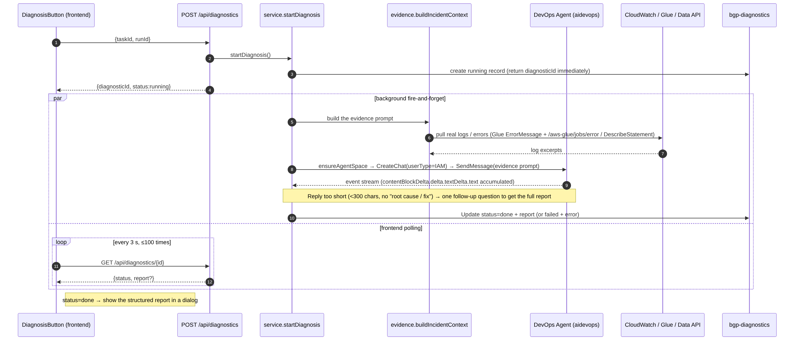

Key points: `investigate()` uses `CreateChat` (userType IAM) → `SendMessage` (content = the evidence prompt) → `collectText` iterates the event stream asynchronously (`contentBlockDelta.delta.textDelta.text`) and concatenates the report; if the
report is too short it **asks a follow-up only once** (to avoid repetition). The entry point no longer has the "failed only" restriction (a diagnosis can be started for any completed run in Task Monitor / job run history / workflow run history; for
successful runs the button is labeled "AI Analysis").

---

## 8. 🎯 Observability — end-to-end deep dive

**Goal**: one dashboard (`/observability`, under Scheduling & Ops) answers "how are GenBI / AgentCore doing, how much have they been used, how many times was each skill called, were there errors". The backend `lib/observability/genbi.ts`
`getGenBiObservability()` aggregates **four data sources**, all best-effort (a single failing source does not take the whole dashboard down).

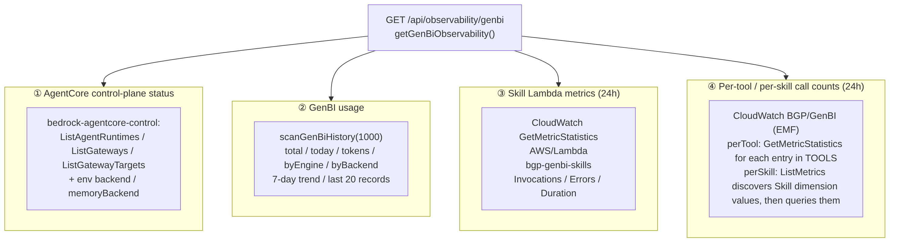

### 8.1 How EMF works (why zero latency and no extra IAM)

After every tool call the skill Lambda does a `console.log` of one **CloudWatch Embedded Metric Format (EMF)** JSON record:
```json
{ "_aws": { "Timestamp": <ms>, "CloudWatchMetrics": [{ "Namespace": "BGP/GenBI",
    "Dimensions": [["ToolName"]], "Metrics": [{"Name":"Calls"},{"Name":"Errors"}] }] },
  "ToolName": "run_redshift_sql", "Calls": 1, "Errors": 0 }
```text
CloudWatch **extracts custom metrics from the log automatically** — **no `PutMetricData` permission is needed and there is no extra network round trip or latency**. A registered-skill call additionally emits one record with the `Skill` dimension, so
usage can be broken down by "which registered skill".

### 8.2 Dashboard aggregation and rendering

- Four aggregation functions:
  - `agentcoreStatus` (control-plane listing of Runtime / Gateway / Targets + reports `backend` / `memoryBackend`),
  - `genbiStats` (aggregates `bgp-genbi-history`: total / today / tokens / distribution by engine and backend / last 7 days / most recent 20),
  - `lambdaMetrics` (`AWS/Lambda` for `bgp-genbi-skills`, 24 h Invocations / Errors / Duration),
  - `toolCallMetrics` (`BGP/GenBI` perTool queried one by one + perSkill discovered through `ListMetrics` on the `Skill` dimension).
- Frontend `/observability`: AgentCore status card (including a memory-backend tag) + usage KPIs / trend + Lambda 24 h + **skill call counter cards** (perTool / perSkill) + most recent calls; `/skills` reuses the counters. TaskRole:
  `bedrock-agentcore:List*/Get*` + `cloudwatch:GetMetricStatistics/GetMetricData/ListMetrics`. **Query source in §15.11.**

---

## 9. AI-assisted code generation and the requirement pipeline

### 9.1 AI-assisted code generation (`lib/requirements/codegen.ts`)

A developer describes the intent in natural language → the LLM, grounded in the **real table structure**, generates a **production-grade** ETL implementation → after review it is applied with one click (**never executed automatically**; resource creation stays on the developer's side).

- Entry points: `generateEtlCode({intent, currentCode?}, targetType)` (job development page) and `generateImplementation(requirement, targetType)` (requirements side) share the core `generateCore`.
- Two targets:
  - `redshift`: produces idempotent SQL (`CREATE TABLE IF NOT EXISTS` + the `${ds}` business-date placeholder + re-entrant writes).
  - `glue`: produces directly runnable **PySpark** — the system prompt **injects the facts of the platform's real runtime environment** (S3 Tables is already registered as the Spark catalog `s3tablescatalog`, read `--ds` with `getResolvedOptions`, write
    to Redshift through the boto3 `redshift-data` Data API rather than JDBC, the standard Glue skeleton), and **injects the real S3 Tables catalog** (namespaces / tables / columns) so the model does not invent table names.
- In common: `introspectSchema` fetches the Redshift catalog for grounding; `temperature=0`; business definitions can be injected (§5.9); `splitCodeAndExplanation` splits the model output into "code block + explanation".

### 9.2 The requirement pipeline (AI inside multi-role collaboration)

A state machine `Ask-Your-Data → raise as a request → manager accepts / assigns → developer generates the implementation with the LLM and creates an ETL job → run → deliver → manager accepts` (`lib/requirements/service.ts`). The GenBI side only
"raises requests"; technical implementation and resource creation stay on the developer's side. Authorization uses `isRequester` / `isAssignee` (by sub, with username as fallback).

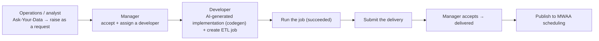

---

## 10. Big data foundation — implementation details

> Concepts and flows are in this section; **the key source code (`ensureGlueJob --conf` / the control-character fix in the scheduling DAG / exactly-once `fireDownstreamOnce` / `run-params`) is in §15.13.**

### 10.1 Data source onboarding

`lib/datasource/`: connects to MySQL / PostgreSQL / Oracle / SQL Server. `schema-reader.ts` reads the source database's tables / columns; `heartbeat.ts` probes connectivity on demand; passwords are stored in Secrets Manager; sync uses a Glue
Connection. Creating a data source registers its databases / tables / columns in OpenMetadata (event-driven).

### 10.2 Data sync (`lib/sync/`)

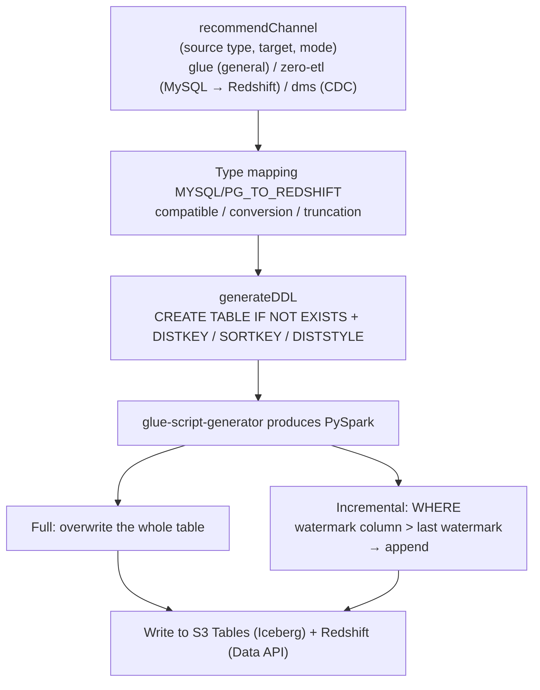

- `recommendChannel`: recommends a channel based on source / target / mode (Glue by default; MySQL → Redshift incremental recommends Zero-ETL; CDC scenarios may use DMS).
- Type mapping: the `MYSQL_TO_REDSHIFT` / `PG_TO_REDSHIFT` registries, annotated with compatibility (compatible / converted / may truncate), preserving `VARCHAR/CHAR/DECIMAL` lengths.
- `generateDDL`: includes `DISTKEY` / `SORTKEY` / `DISTSTYLE`.
- **Full / incremental**: full = overwrite of the whole table; incremental = read only the new rows by "watermark column > last watermark" and append (`glue-script-generator.ts` generates the corresponding PySpark).
- The target table name is customizable (prefix / suffix / override, `target-naming.ts`).

### 10.3 ETL orchestration (visual DAG → MWAA)

A visual drag-and-drop DAG (node types `sync` / `sql` / `python` + dependency edges), published to MWAA. `lib/workflow/dag-generator.ts` renders the DAG into Airflow Python:
- `sync` node → `trigger_sync_task` (boto3 `glue.start_job_run` + polling).
- `sql` node → `execute_redshift_sql` (`redshift-data`, **with the admin SecretArn injected** so ownership stays consistent across identities).
- `python` node → `run_custom_script`.
- Edges → `src >> tgt` dependencies; leaf nodes → the `_status_done` callback; `on_success` / `on_failure` write back to `bgp-task-runs` (reused by the monitoring page).
- Publishing / triggering is **non-blocking** (fire-and-forget + readiness wait), which eliminates the CloudFront 60 s 504.

### 10.4 Job development (code-first)

`lib/etl/job-service.ts`: developers write Glue PySpark / Redshift SQL jobs directly.
- **Glue**: `ensureGlueJob` uploads the script to S3 and does `CreateJob` / `UpdateJob` idempotently;
  - `GlueVersion 5.1`;
  - `DefaultArguments` uses `--conf` to **register the S3 Tables Iceberg catalog `s3tablescatalog`** (otherwise `spark.table("s3tablescatalog...")` fails with `[REQUIRES_SINGLE_PART_NAMESPACE]`).
  - `runGlueScriptJob` does `StartJobRun` with the business-date parameters `--ds/--ds_nodash/...`; `pollGlueRun` polls every 15 s.
- **Redshift**: `runRedshiftSqlJob` does `BatchExecuteStatement` (admin secret) + `pollRedshiftRun` every 2 s; `dryRunRedshiftSqlJob` uses `EXPLAIN` (only for queries / DML, pure DDL is skipped) to **validate without writing**.
- **Business-date parameterization** (`lib/etl/run-params.ts`): `paramSet(runDate)` provides `${ds}/${ds_nodash}/yesterday_ds/tomorrow_ds`; Redshift uses text substitution, Glue uses `--ds`; `dateRange` supports **backfill** (day by day over an
  interval, ≤31 days); **rerun** = run again with the same business date.

### 10.5 Scheduling and cross-task dependencies (exactly once)

- Native MWAA cron (`schedule_interval`), automatic unpause.
- **Cross-task dependencies** (`lib/scheduler/dependency.ts`): an upstream task declares `triggers: string[]` with downstream ids; after the upstream succeeds it fans out and triggers the downstream tasks. **Exactly once**: `fireDownstreamOnce` claims
  with a DynamoDB conditional write (`attribute_not_exists(downstreamFired)`) — only the path that wins fans out, so even "calling it from every completion path" never triggers twice. Downstream sync → `glue.start_job_run`; downstream workflow → MWAA
  `CreateCliToken` + `dags trigger`.

### 10.6 Lineage and impact analysis

- `lib/lineage/sql-lineage.ts`: a **heuristic table-level** parser (no AST library, because AST coverage of the Redshift dialect is poor).
  - `stripComments` / `stripStrings` → `detectTarget` (ctas / view / insert / merge / update / delete) → `extractFromJoin` (tokenize, skip subqueries by balancing parentheses, but still descend to capture source tables inside subqueries) → `cteNames`
    excludes CTEs → `normalizeRef` normalizes to the FQN `bgp-redshift.<db>.<schema>.<table>`.
  - **Best-effort, never throws.**
  - Used for: the tables hit by masking (§15.5), impact analysis, pushing lineage to OM.
- `lib/openmetadata/om-push.ts`: on save, parse and push table-level lineage to OM; the sync path pushes `source → S3 Tables → Redshift` column-level lineage.
- Impact analysis: BFS over OM downstream + the affected jobs.

### 10.7 Athena queries over the data lake

A self-managed Athena workgroup `bgp-athena` (results land in the platform's own bucket, SSE_S3, engine v3). The `lib/athena/` read-only guard allows only `SELECT/WITH/SHOW/DESCRIBE/EXPLAIN`; frontend: "Data Development → Athena Query". GenBI's `athena` engine reuses it (§4.5–4.11).

### 10.8 OpenMetadata governance (single source of truth for catalog / lineage)

Two complementary paths make OM the source of truth: ① **periodic connector ingestion** (EventBridge Scheduler → ECS Fargate runs the `openmetadata/ingestion` image, connecting to Redshift / Glue / S3); ② **platform event push** (every sync pushes
`source → S3 Tables → Redshift` column-level lineage and completes the S3 Tables columns from the source-side schema, bypassing Lake Formation). Authentication uniformly uses the ingestion-bot JWT from Secrets Manager. Catalog / lineage / impact /
classification / quality on the governance pages all take OM as the authority.

### 10.9 Real-time data integration — CDC

Beyond batch sync, the platform offers **three near-real-time ingestion channels** into the warehouse (source-database changes reach Redshift within seconds), all pure orchestration with no always-on infrastructure (destroyed as soon as verification is done, to stop cost accrual):

- **DMS channel** (`lib/realtime/dms-service.ts`): the DMS orchestration that was first worked out by hand on the CLI, solidified into idempotent code; migration types `full-load | cdc | full-load-and-cdc` (default: full load plus CDC in one). The
  replication instance's ARN is discovered at run time by id (no static environment variable, to avoid drift across destroy / recreate), and if the instance does not exist a `dms.t3.small` is created lazily. Three COPY prerequisites: create the
  dedicated `dms_ingest` user, pre-create the target schema, associate the COPY role with the namespace (`redshift-target.ts`).
- **Zero-ETL channel** (`lib/realtime/zeroetl-service.ts`): the managed RDS MySQL → Redshift Zero-ETL Integration, real CDC increments (replacing the "fake incremental" of a Glue WHERE predicate). A separate Redshift Serverless namespace isolates the
  case-sensitivity risk; integration activation is a cold start of about 50 minutes, handled asynchronously with an idempotent status endpoint that advances the state.
- **Flink CDC channel**: a mysql-cdc source (binlog → S3 Tables), living in the Flink service of §10.10.

**Status**: 🟢 the DMS main ingestion path is verified end to end from the browser (an INSERT in the source MySQL reaches Redshift within seconds). 🔵 Zero-ETL code has landed; the hard evidence of real runs is in uncommitted local verification notes (externally, describe it at the same level as DMS).

### 10.10 Real-time compute — Flink

Users write **Flink SQL** on the platform to define streaming jobs that run on **Amazon Managed Service for Apache Flink (MSAF; runtime `FLINK-1_20` / Java 11)**; resources / checkpoints / snapshots / runtime properties are all exposed as parameters, complemented by AI-generated SQL + AI diagnosis.

- **source × sink matrix**: source ∈ `{kinesis (default), mysql-cdc, msk}`; sink ∈ `{s3 (filesystem, default), mysql (jdbc), s3table (Iceberg / S3TablesCatalog), custom (user-uploaded connector)}`. SQL templates are generated per combination (`flink-service.ts`).
- **Connector uber-jar assembly routing** (a deep-dive point, `flink-connectors.ts`): built-in sinks use pre-built fat jars (`runnerFor(sinkType)`); custom sinks go through `assembleUberJar`, which merges the user's JAR; on-demand modular assembly
  `assembleModularUberJar` resolves the required modules from the `'connector'='...'` tokens in the SQL + a content-hash cache. **Combinations that include the heavy Iceberg stack short-circuit to the pre-built package** — merging at run time with
  adm-zip cannot write ZIP64 (the 65,535-entry limit is exceeded), so the heavy stack must be pre-built with Maven.
- **MSK authentication** (`buildKafkaAuthProps`): `security.protocol` is hard-coded to `SASL_SSL` (transport encryption is an invariant; never PLAINTEXT); IAM uses port 9098 / SCRAM uses port 9096; SCRAM credentials come from Secrets Manager and are never stored in the database.
- **The MSK → S3 Tables combination fixed in this round**: previously the Iceberg short-circuit swallowed the kafka module → the job crashed at start with `Could not find any factory for identifier 'kafka'`.
  - Fix = a new standalone Maven module `flink-sql-runner-s3t-kafka/` (the s3t package + flink-sql-connector-kafka 3.4.0-1.20 + aws-msk-iam-auth 2.2.0 + relocation); the assembly routing selects the combined package when the SQL contains kafka;
  - the existing s3t package is unchanged, character for character → zero regression for Kinesis / CDC → S3 Tables (locked by three unit-test cases).

**Status**: 🟢 verified by real runs in production (MySQL CDC → S3 Tables `realtime.flink_orders_by_region=100000`; MSK → S3 Tables normal platform path 4/4: create MSK source + s3table sink → RUNNING → Athena query of `realtime.msk_region_agg` matches the source exactly).

### 10.11 Batch multi-engine — EMR Serverless

Batch compute is not only Glue: the platform abstracts the compute engine into a **pluggable SPI** (`lib/engines/`: the `types/spi/registry` trio + the `emr/` provider) and has connected **EMR Serverless (PySpark)** as "an engine" alongside the online Glue.

- **The engine SPI's seven methods**: `ensureResource/destroyResource/submit/poll/stop/readLogs/reconcile`; adding an engine = adding one row to the registry.
- **One independent application per job**: every EMR job dynamically does `CreateApplication` (ARM64 / SPARK / `autoStopConfiguration idleTimeout=15min`); deleting the job does Stop + Delete. Nothing shared, zero head-of-line blocking, automatic stop when idle so nothing is billed.
- **Automatic S3 Tables catalog injection**: the platform automatically injects the `s3-tables-catalog-for-iceberg-runtime` jar + the warehouse ARN, so user scripts can call `spark.table("s3tablescatalog.ns.tbl")` directly. Run records are written to
  the shared `bgp-task-runs` (so they appear in monitoring naturally).

**Status**: 🟢 verified by real runs in production (S3 Tables orders, 100,000 rows → EMR PySpark → Redshift, 5 rows per region totaling 100,000; per-job application isolation / TERMINATED on job deletion verified). **Honest boundary**: `EngineType`
currently has only one value, `emr-serverless` — this is "a pluggable base with one engine connected", not several engines side by side.

### 10.12 Data-source ecosystem SPI (four paradigms)

Data sources also use a **pluggable SPI** (`lib/datasource-spi/`): a new data source = one standalone provider file added incrementally + one row in the registry, with zero changes to existing code. **8 providers cover the four major source paradigms of mainstream data-integration products**:

| Paradigm | Provider | Key differences |
|---|---|---|
| **JDBC relational** | mysql / postgresql / oracle / sqlserver | The base collects the commonalities; a provider only declares the driver class / port / URL-template dialect (for example Oracle EZConnect `@//h:p/service` with uniform Service Name semantics); `needsGlueConnection` + VPC binding; only mysql supports the zero-etl channel |
| **Object storage** | s3 | `iam-role` credentials; syncChannel = glue; differentiated support for creating an Athena external table for direct queries |
| **NoSQL** | dynamodb | Phase one: full Scan (`supportsCdc=false`; Streams increments in phase two); Glue + EMR dual-channel ingestion into the lake |
| **Streaming messages** | kinesis / msk | kinesis `canProvision=true` (streams can be created on demand); msk `canProvision=false` (clusters are not created on the user's behalf; brokers in a private VPC + SASL/IAM); syncChannel = flink-cdc |

- **Fat interface + capability flags** (isomorphic with the engine SPI): `capabilities` (paradigm / credentialKind / isVpcBound / canIntrospect / supportsCdc / needsGlueConnection / canProvision / syncChannels / analysisChannels); callers always face
  only `getProvider(type)`; creating a source / testing a connection / introspection are all delegated to the provider.

**Status**: 🟢 all four paradigms implemented and verified by real runs in production — the four JDBC siblings end to end (Redshift target table row counts match exactly); S3 with 1,000,000 rows in 4 files matched value by value; DynamoDB via the Glue + EMR dual channel, 250,000 rows each with no lost rows; MSK Kafka → S3 raw files match exactly; Kinesis provisioning creates streams on demand. **Pending (honestly marked)**: upload of user-defined driver jars (downgraded to an enhancement, since
all four drivers are built into Glue 5.1), DynamoDB Streams increments (phase two).

---

## 11. Remaining modules — implementation details

### 11.1 Multi-tenancy / workspaces / resource-level RBAC / approvals

- Workspaces `bgp-projects` + members `bgp-project-members` (GSI `byUser` supports "my projects"); member roles owner / editor / viewer.
- Resources are isolated by `(project, env)`; every API passes through `lib/projects/guard.ts` `requireProject(req, role)` (viewer / editor / owner), which returns `ctx.identity` (including `isPlatformAdmin` / `username`).
- Access requests are approved through `bgp-approvals` (approved by the owner).

### 11.2 Data classification + masking + access requests

- Classification table `bgp-data-classification` (pk = table FQN, sk = column name; levels L1–L4 + masking policy full / partial / email / hash), set only by platform administrators.
- Grant table `bgp-data-grants` (pk = username, sk = table FQN): written when a data-access request is approved → that user's columns of that table are no longer masked.
- Masking takes effect at the query return-value layer (§4.5–4.11 / §15.5); administrators and grantees are exempt.

### 11.3 Data quality (templates + scoring + SLA)

- `lib/quality/templates.ts` has 6 templates: not-null / unique / range / enumeration / row count / freshness, validated against Redshift.
- `lib/quality/service.ts`: weighted pass-rate score + per-dimension scores + freshness-SLA breach determination. Shown on the "Data Quality" tab of the governance page.

### 11.4 Metrics store

- Business metrics are defined uniformly (table + aggregation count / count_distinct / sum / avg / min / max + measure column + dimension / time columns + unit / format).
- `lib/metrics/service.ts`: **safe aggregation SQL** (identifier allow-list + double quoting, no free-form SQL, uniformly executed read-only as admin) + current value / dimension distribution / time trend + writes snapshots to `bgp-metric-values` and writes back `lastValue`. Dashboard `/metrics`.

### 11.5 Version management and rollback

- Configuration-type resources (workflows / jobs / sync / Redshift tasks) keep a version snapshot in `bgp-resource-versions` on every save and can be rolled back.

### 11.6 Multiple environments and promotion (dev / staging / prod)

- Resources carry `env` + `lineageId`; lists are isolated by `(project, env)` (environment selector in the header + `x-bgp-env`).
- `lib/env/promote-service.ts` promotion: take the portable definition (stripping environment-bound runtime bindings such as glueJobName / airflowDagId), then update or create the target by `lineageId`; **dev → staging is direct, promotion to prod goes through approval** (`type:"deploy"`).

### 11.7 Authentication + audit

- Cognito across the site: the central middleware validates the ID token of every `/api/*` request (`aws-jwt-verify`, 401/200); the frontend's global fetch carries the token and intercepts for login.
- Operation audit `lib/audit.ts` → `bgp-audit` (who / when / did what).

### 11.8 Warehouse modeling — layers, domains, dimensional modeling, metrics

Full-stack modeling with a DynamoDB metadata layer + a Redshift physical layer:
- **Layers**: ODS / DWD / DWS / ADS provisioned with one click (each layer maps to one Redshift schema), idempotent `seedLayers`.
- **Data domains / subject domains + data standards + code tables**: a two-level domain tree; code tables land as the Redshift physical table `dim_code_<code>` (DELETE + INSERT, idempotent reload).
- **Dimension / fact modeling**: a column editor + **safe DDL generation with zero injection surface** (identifier regex validation + type allow-list; 13 canonical types, 18 accepted keys including aliases), `CREATE TABLE IF NOT EXISTS` really executed
  on Redshift (existing tables are not ALTERed); lineage attachment + OM Glossary push.
- **Metric system**: atomic → derived metrics, compiled by the pure function `buildMetricSql` (aggregation / op / time window all allow-listed + escaped, zero injection surface).
- Files `lib/modeling/{service,dimensions,metric-sql,redshift}.ts`. **Status**: 🟢 real runs in production (hard evidence: the column structure of `dwd.dim_user_qa` + atomic GMV = 1649 / derived last-30-days paidGMV = 350 computed).

### 11.9 Governance depth (sensitive-data scanner + governance workbench)

- **Sensitive-data detection** (`lib/governance/sensitive/`): detectors are **SPI-based and globalized** — 9 general detectors (email, credit card with **Luhn** check, IP v4 + v6, IBAN, phone **E.164**, credentials, personal name, address, date of
  birth) + pluggable regional samples (US SSN / CN national id / IN Aadhaar). Column-name + value double evidence scoring → **suggestions** with confidence → classification is written only after a person **adopts with one click**. 🔒 **Privacy hard
  rule**: sampled values are used in memory only to compute the hit rate and are **never persisted / never logged / never returned by the API**; findings store metadata only.
- **Governance health score / workbench** (`health-service.ts`): a four-dimension weighted total = classification coverage 0.3 + quality 0.3 + SLA 0.2 + lineage 0.2 + a to-do workbench + an asset risk leaderboard (pure aggregation, zero new tables).
- **Status**: 🟢 real runs in production (first phase, headless-browser acceptance 18/18 including Luhn / SSN / zero sample leakage). 📐 Row-level security (RLS) is scheduled for phase two.

### 11.10 BI analytics dashboards (QuickSight-style)

One canvas embeds N visuals + top filters bound to fields with scoped linkage + a field configurator (charts without writing SQL) + ECharts theming + grid drag-and-drop:
- **Three data sources** (`WidgetSource.kind`): free-form SQL / a Data Service reference (Data Service was retired on 2026-09-05; the existing kind is kept) / a published GenBI question (stores the SQL, not a snapshot = refreshable); the engine `redshift|athena` is an orthogonal sub-axis.
- **Filter linkage**: filters whose scope matches append `(field,value)` into builder.filters and the SQL is recompiled (this fixed a real bug: "configuration-style SQL has no placeholders → filters had no effect"); hand-written SQL still uses `{{key}}` placeholders.
- 🔴 **Masking is mandatory**: direct-query results uniformly pass through `maskRows` (the only cost of bypassing the Data Service for direct queries).
- **Status**: 🟢 real runs in production (v1 → v4, headless-browser acceptance 13/13, scoped linkage East = 19808 + hard evidence of isolation).

### 11.11 Compute lineage collection

Collects **table-level** lineage (input tables → output tables) for four kinds of compute engines, double-written to OpenMetadata (the primary read source of the governance pages) + the platform table `bgp-lineage` (fallback):
- SQL lineage = **heuristic regex / token scanning** (no AST library, because AST coverage of the Redshift dialect is poor); supports CTAS / VIEW / INSERT / MERGE / UPDATE…FROM; **best-effort, never throws**.
- Four paths: Redshift SQL (on save), EMR PySpark (on submit, heuristic extraction), Flink (on start, source → sink) ✅ connected; **Glue ETL is deliberately not collected** (text parsing of arbitrary DataFrame code is unreliable).
- Column level = a heuristic over shared same-named columns (derived columns are not mapped; nothing is invented). **Status**: 🟢 real runs in production (on the governance page `channel_ad_conversion` has upstreams: 11 nodes, 10 edges, and similar).

### 11.12 FinOps cost governance

Task- / run-level cost attribution (a granularity AWS does not offer natively), in a fully isolated architecture (4 new directories + a separate stack, pull model with zero hooks):
- **L1 account overview**: Cost Explorer real billing by service × day (`UnblendedCost`, T+1).
- **L3 task- / run-level attribution**: a watermark-based read-only scan of `bgp-task-runs` → real values from Glue `DPUSeconds` / EMR `billedResourceUtilization` × **a built-in price table estimate** (with an auditable `priceVersion`) → idempotent conditional writes.
- Anomaly detection (reuses the MAD robust statistics + dual condition of the baseline module, §11.14) → a two-way closed loop (alerting through the Alerting Center + accumulation into the incident knowledge base, §11.15); budget guardrails (alert only, never block).
- ⚠️ **Honest boundary**: L3 is "real engine metering × price estimate", **not a real-time bill breakdown**; phase-one run-level attribution covers Glue / EMR. **Status**: 🟢 real runs in production (first phase; L1 vs an independent Cost Explorer query
  differs by $0.0000; L3 equals the hand calculation exactly).

### 11.13 Production-grade backfill center

Batch dates × nodes expanded into instances + cascading backfill along the dependency chain topology:
- Plan expansion (upper limits: day ≤62 / week ≤60 points / hour ≤7 days); the workflow scope derives the same-date upstreams as dependencies from the DAG topology; a concurrency gate + an instance ceiling, two protections against runaway runs; dry-run preview before persisting.
- The idempotent driver `tick` (conditional writes + runToken to prevent duplicate spend); resume after failure (reruns only the failed instances + their blocked downstreams).
- 🔒 **Hard constraint of isolation from online runs**: backfill runs are always written to `bgp-task-runs` with `triggeredBy=backfill`, strictly isolated from online runs. **Status**: 🟢 real runs in production (cascade timestamps, concurrency gate,
  ceiling rejection and resume after failure all verified; 20 unit tests).

### 11.14 Smart baselines + SLA breach prediction

- **Dynamic baseline learning**: learns p50 / p90 / p95 / EWMA from historical runs, **MAD outlier removal + exclusion of backfill / copilot runs** (otherwise p90 is distorted); fewer than 7 samples is marked lowConfidence (no false alarms during cold start).
- **Critical-path ETA breach prediction**: rolls the ETA along the DAG's critical path against the SLA's promised time → willBreach + green / yellow / red + the bottleneck node; multi-window burn rate reduces false alarms (a single jitter does not
  alert); pushed through the Alerting Center channels (idempotent by dedupeKey).
- **Status**: 🟢 real runs in production (hard evidence that baselines exclude backfill: samples = 3; breach prediction red / bottleneck node; 23 unit tests).

### 11.15 Incident knowledge base + diagnosis memory augmentation (the compounding-moat closed loop)

- Structured incidents are merged and accumulated by **fault fingerprint signature** + manually verified fix runbooks (an ordered rule table hit → `engine::key`; no hit → normalized, de-identified FNV hash as fallback).
- During diagnosis, "**verified** fixes of the same kind + business definitions" are injected into the RCA; 🔒 **safety hard rule**: only manually verified fix runbooks return their full text (prevents an unverified AI suggestion from being applied as if "verified").
- 🔴 **Honest statement**: the solution the user approved for the diagnosis brain = **memory-augmenting the existing AWS DevOps Agent (the `aidevops` managed service), explicitly "not a self-built AgentCore Runtime"** (wrapping it in a Runtime would
  degrade it / nest one agent inside another); grounding means injecting into the existing diagnosis flow and involves no new Runtime. **Status**: 🟢 real runs in production (verified hits injected into Alert / idempotent `occurrenceCount`
  accumulation).

---

## 11bis. 🎯 AI-native moat (differentiation over traditional data platforms)

This group is the platform's **differentiating moat** relative to traditional data development and governance products: the unified Copilot, the engineering knowledge base, the dual-engine convergence and the unified Strands
framework. All of them follow the AgentCore platform standard of §5.

### 11bis.1 Unified platform Copilot

A centralized conversational entry point across the whole platform (a drawer in the header), with one hard safety line running through it: **"create / generate / suggest" is allowed; "execute / run / publish / delete" is forbidden**.

- **Two brains (always present them separately)**: ① **read-only Q&A** `/api/copilot/ask` runs a **hand-written Converse tool-use loop** (7 read-only tools + 4 create tools loaded by role); ② **cross-module planning** `/api/copilot/plan` runs on
  **Strands** (`Agent.invoke` + Zod structured output, read-only discovery tools), submitted asynchronously to avoid the CloudFront 60 s limit.
- **The three gates of "may create, must not execute"** (`action-guard.ts`, defense in depth): gate 1, the capability surface (the tool `kind` type layer is only `read|create`, never execute) + gate 2, action-guard (deny by default + allow-list + a
  hard block on the suffixes `.run/.start/.delete`) + gate 3, RBAC (editor role) + audit. Everything created lands with `status:draft` / `scheduleEnabled:false` and never runs / schedules / touches the cloud.
- 🔒 **Honest boundary**: **L3 step-by-step delegated execution is left open** — the `execute()` of every step handler is an empty interface and the executor's execution segment is dead code; "plan execution" actually only goes as far as "create drafts + guidance", and a real run still requires the user to click manually; enabling L3 needs explicit configuration + the user's written approval. Remote AgentCore hosting = **decided against after capability tiering** (the read-only tools are inherently
  coupled to the platform's semantic layer). **Status**: 🟢 Q&A + draft creation + three gates + Strands planning L2 verified online.

### 11bis.2 The platform-level engineering knowledge base: Engine Cookbook

A platform-shared library of "verified engine engineering knowledge" (`lib/cookbook/`), maintained in one place and consumed in many, **a deterministic foundation with zero LLM calls**:
- **Three layers**: ① deterministic **tag retrieval** (scored topK by engine / capability, controlling tokens); ② **prompt injection** (hard dialect rules rendered into the system prompt); ③ **guard validation on persist** (lexical safety after masking + fixpoint iterative correction; if an error-level issue cannot be fixed the result is blocked).
- **All 4 major AI codegen exits are connected**: batch ETL, real-time Flink, both GenBI backends, the Copilot planner.
- 🔵 **Honest boundary**: **wiring the Cookbook guard into the remote GenBI container is fully coded and all green locally, but has not been deployed and verified in the nine-round online verification matrix** (the remote GenBI / AgentCore path is the
  default main chain online, so this is a blind spot on the main chain) — do not write "accepted". The guard reliably corrects only declarative SQL; for imperative PySpark it only warns.

### 11bis.3 GenBI dual-engine convergence

The two GenBI brains that used to be duplicated word for word — TS (inprocess) and JS (remote image) — were converged into **a single pure-logic source `@genbi/core`**:
- All 8 core files are "engine-agnostic pure logic / zero IO / zero AWS SDK" (prompt / retrieval / dual-dialect sql-guard / chart / catalog); the platform wrapper and the remote container are both thin adapter shells around it.
- The remote container hosts the loop on **Strands** (`agent.js` `new Agent + agent.invoke`); the local inprocess path still hand-writes Converse as a direct-connect fallback shell around core.
- **The dual execution backend is kept deliberately** (`GENBI_BACKEND` selection + automatic fallback on failure; the code states explicitly "kept on purpose, do not delete") — inprocess guards three values: fallback when AgentCore fails / the only
  path that can really stop compute / local development. **Status**: 🟢 stages 1–3 verified online with zero regression; both backends return the same result (898 persons).

### 11bis.4 Unifying the whole platform's AI framework on Strands

All of the platform's AI capabilities converge on one architecture: a single pure-logic core + standard Strands assembly + the AgentCore Runtime as the remote main chain + the early hand-written code kept for disaster recovery. **The framework's four pieces**:
- ① **core-build** (`scripts/core-prebuild.sh`: TS core → CJS → copied into the containers / Lambda; a CI diff prevents drift);
  ② **agent-runner** (`infra/agent/_runtime/agent-runner.js`: converges the identical loop skeleton of net / param, Strands assembly);
  ③ **the CDK protocol base class** (`infra/lib/shared/agentcore-base.ts`: assembles Gateway / gated Runtime / Memory; the three stacks synthesize byte-for-byte isomorphic);
  ④ **the model SSOT** (`platform/ai-model.json`: the platform-wide default modelId is traceable to one place; currently opus-4-6).
- 🔵 **Honest boundary (important)**: GenBI is the Strands template that really runs; but **the migration of paramadvisor / netadvisor to Strands stopped at "code landed + local docker build"; the remote Runtime is not deployed and has never really been
  invoked; online, the default is still in-process**. The Copilot decision is **not to go remote** (capability tiering, not unfinished work). Migration status: genbi ✅ running / param ✅ code · ❌ remote / net ✅ code · ❌ remote / copilot ❌ deliberately
  not migrated.

---

## 12. Infrastructure (CDK stack topology and deployment order)

`infra/bin/app.ts` orchestrates **21 CDK stacks** (env from `CDK_DEFAULT_ACCOUNT/REGION`): **17 unconditional always-on stacks + 4 context-gated switches**. The AWS-icon stack dependency figure is `docs/diagrams/cdk-stacks.png`.

**The 17 always-on stacks** (instantiated unconditionally in `infra/bin/app.ts`):

| Stack | Responsibility |
|---|---|
| `BgpKmsStack` | CMK encryption foundation (data keys distributed uniformly to all stacks) |
| `BgpWafStack` | WAF (in front of CloudFront) |
| `BgpVpcStack` | VPC / subnets / NAT |
| `BgpDatabaseStack` | DynamoDB (58 tables: 40 created in a loop + 18 created individually) |
| `BgpFinOpsStack` | 3 cost-governance tables (zero always-on cost, installed by default) |
| `BgpAuthStack` | Cognito User Pool + groups |
| `BgpRedshiftStack` | Redshift Serverless (data warehouse) |
| `BgpRdsStack` | Source MySQL (`fromGeneratedSecret`) |
| `BgpOmDatabaseStack` | OpenMetadata backend RDS MySQL (engine version in [`supported-versions.md`](supported-versions.md)) |
| `BgpOmSearchStack` | OpenMetadata OpenSearch |
| `BgpOmServiceStack` | OpenMetadata ECS + ALB + CloudFront |
| `BgpPlatformStack` | Platform ECS + ALB + CloudFront + S3 + Glue role |
| `BgpMwaaStack` | MWAA (Apache Airflow) |
| `BgpAgentCoreStack` | GenBI AgentCore (ECR + Lambda + Gateway + Target + gated Runtime + Memory) |
| `BgpNetAdvisorAgentCoreStack` | Network advisor AgentCore (assembled by the protocol base class) |
| `BgpParamAdvisorAgentCoreStack` | Parameter advisor AgentCore (assembled by the protocol base class) |
| `BgpAuditStack` | CloudTrail + audit (can be skipped with `-c skip-cloudtrail=1`) |

**The 4 gated stacks** (synthesized only `if tryGetContext(...)`; all involve always-on cost or heavy resources and are not installed by default):

| Stack | Gating context | Notes |
|---|---|---|
| `BgpRealtimeStack` | `-c enable-realtime=1` | DMS + Kinesis (always-on cost) |
| `BgpFlinkStack` | `-c enable-flink=1` | MSAF (always-on KPU cost) |
| `BgpEmrStack` | `-c enable-emr=1` | EMR Serverless (one dynamic application per job; this stack holds only roles / networking) |
| `BgpOmIngestionStack` | `-c om-bot-secret-arn` + `-c rs-admin-secret-arn` | EventBridge → ECS periodic ingestion |

> ⚠️ **Two-level gating to know about**: the 3 AgentCore stacks (genbi / net / param) are **themselves always instantiated**, but **the Runtime resource inside each stack is gated by a separate context** (a Runtime is created only in a second
> deployment that passes `-c {genbi,netadvisor,paramadvisor}-runtime=1`). Currently only the **genbi Runtime is deployed**; the net / param Runtimes are **not deployed** (🔵 code landed, online the default is inprocess; see §11bis).

**Deployment-order essentials**:
- `BgpPlatformStack` needs OM's CloudFront URL (`-c openmetadata-url=...`), so **OM Service is deployed before Platform**; the URL is injected via context to avoid a hard cross-stack dependency (OM is a heavy / optional component and must not block the core).
- `BgpAgentCoreStack` is deployed in two phases (the image chicken-and-egg problem of §5.2); the net / param advisor stacks reuse the same protocol base class `infra/lib/shared/agentcore-base.ts` (the three stacks `cdk synth` byte-for-byte isomorphic; see §11bis.4).
- `BgpOmIngestionStack` is synthesized only when both the `om-bot-secret-arn` and `rs-admin-secret-arn` contexts are provided (optional / independent).
- Account-level prerequisites (the OpenSearch service-linked role, Cognito groups / users) are handled idempotently by `scripts/00-prereqs.sh` / `scripts/10-bootstrap-cognito.sh`; `scripts/deploy-all.sh` deploys everything in order with one command.

---

## 13. Security design that runs through the whole platform

| Topic | Implementation |
|---|---|
| **Read-only SQL guard** | `sanitizeSelect`: single statement + must be SELECT/WITH + whole-word scan for forbidden words + hard row cap (reused in GenBI / Athena / registered skills and elsewhere) |
| **SSRF guard** | HTTP registered skills: https only, no placeholders in the host name, after DNS resolution reject private / link-local / metadata (169.254.169.254) addresses, no redirects, timeout, length limit, optional domain allow-list; only platform administrators may register them |
| **SigV4 / no OAuth** | Agent → Gateway uses SigV4 (service=bedrock-agentcore); the Gateway's inbound authorizer is AWS_IAM; platform → Runtime is IAM-authenticated |
| **Field masking** | Masking at the return-value layer by identity / classification / grants; data in the database is untouched; administrators and grantees are exempt |
| **Least privilege** | TaskRole / GatewayRole / RuntimeRole / MemoryRole are separate; permissions granted as needed |
| **No hard-coded credentials** | All passwords in Secrets Manager; RDS `fromGeneratedSecret`; Redshift uniformly uses the managed admin secret (which also keeps ownership consistent across identities) |
| **Network boundary** | CloudFront is the only entry point; the ALB security group allows only the CloudFront prefix list; backends in private subnets |
| **Authentication** | The site-wide Cognito middleware validates every `/api/*` request; resource-level RBAC + approvals |
| **Audit** | Key operations are written to `bgp-audit` |
| **Public-repository red line** | Tracked files contain no real account ids / ARNs / URLs / ids / passwords (placeholders only); real values exist only in gitignored `*.local.md` files |
| **Network exposure note** | The AgentCore Runtime has `NetworkMode=PUBLIC` but can be invoked only with IAM; the skill Lambda's outbound traffic is subject to the SSRF guard |

---

## 14. Appendix: resources / tables / environment variables / glossary / briefing script

### 14.1 DynamoDB tables (control plane, 61 in total)

All uniformly hardened: PAY_PER_REQUEST + CMK encryption + PITR 35 days + RemovalPolicy.RETAIN. 58 are in `BgpDatabaseStack` (40 created in a loop + 18 created individually), 3 are in `BgpFinOpsStack`. By subsystem:

| Subsystem | Tables |
|---|---|
| Core data / sync / orchestration | `bgp-datasources` · `bgp-sync-tasks` · `bgp-workflows` · `bgp-redshift-tasks` · `bgp-task-runs` · `bgp-sql-history` · `bgp-etl-jobs` |
| Governance / lineage / quality | `bgp-lineage` · `bgp-data-classification` · `bgp-data-grants` · `bgp-quality-rules` · `bgp-quality-results` · `bgp-sensitive-findings` (TTL) |
| Audit / multi-tenancy | `bgp-audit` · `bgp-projects` · `bgp-approvals` · `bgp-project-members` (GSI byUser) |
| Version rollback | `bgp-resource-versions` |
| Metrics store | `bgp-metrics` · `bgp-metric-values` |
| Requirement pipeline | `bgp-requirements` |
| GenBI | `bgp-genbi-history` · `bgp-genbi-turns` (short-term memory, TTL) · `bgp-genbi-context` (business glossary) · `bgp-genbi-skills` (registered skills) · `bgp-genbi-tasks` (async, TTL) |
| Warehouse modeling | `bgp-data-layers` · `bgp-data-domains` · `bgp-data-standards` · `bgp-code-tables` · `bgp-model-assets` · `bgp-model-tables` · `bgp-model-metrics` |
| Real-time / multi-engine | `bgp-flink-jobs` · `bgp-flink-connectors` · `bgp-engine-jobs` |
| Smart operations / alerting | `bgp-alert-rules` · `bgp-alert-channels` · `bgp-alert-events` (TTL) |
| DevOps diagnosis / incident knowledge base | `bgp-diagnostics` · `bgp-incidents` (TTL; the incident master record is permanent) |
| BI reports | `bgp-bi-reports` · `bgp-bi-dashboards` · `bgp-bi-analyses` |
| SLA / backfill | `bgp-baselines` · `bgp-slas` · `bgp-backfill-plans` · `bgp-backfill-instances` (TTL) |
| Unified Copilot | `bgp-copilot-plans` · `bgp-copilot-steps` (TTL) · `bgp-copilot-plan-tasks` (TTL) · `bgp-copilot-turns` (TTL) · `bgp-copilot-recipes` |
| Advisor memory | `bgp-network-advisor-turns` (TTL) · `bgp-param-advisor-turns` (TTL) |
| Data Service (retired 2026-09-05, tables kept) | `bgp-data-apis` (GSI byPath) · `bgp-data-api-keys` (GSI byHash) · `bgp-data-api-usage` (TTL) |
| FinOps (separate stack) | `bgp-cost-daily` · `bgp-cost-runs` (TTL) · `bgp-budgets` |

### 14.2 Key environment variables (GenAI / AgentCore related)

| Variable | Meaning |
|---|---|
| `GENBI_BACKEND` | `agentcore` (production) / `inprocess` (fallback) — the execution vehicle of the Ask-Your-Data agent |
| `GENBI_RUNTIME_ARN` | AgentCore Runtime ARN (used by the agentcore backend) |
| `GENBI_MEMORY_BACKEND` | `agentcore` (managed) / `selfmanaged` (DynamoDB + S3 fallback) — the memory backend |
| `GENBI_MEMORY_ID` | AgentCore Memory id (used by the agentcore memory backend) |
| `GENBI_MAX_ITERS` / `GENBI_MAX_TOKENS` / `GENBI_MODEL_ROWS` / `GENBI_MAX_ROWS` | Reasoning-loop limit 8 / Converse maxTokens 2200 / rows returned to the model 50 / hard row cap 200 |
| `BEDROCK_MODEL_ID` | Claude model id, from the single source of truth `platform/ai-model.json` (current default `us.anthropic.claude-opus-4-6-v1`; can be swapped for a newer generation, not locked to one family) |
| `COPILOT_BACKEND` / `COPILOT_RUNTIME_ARN` / `COPILOT_MEMORY_BACKEND` | The unified Copilot's execution vehicle (default inprocess) / remote ARN / memory backend |
| `NETADVISOR_*` / `PARAMADVISOR_*` | The backend · runtime-arn · memory matrix of the network / parameter advisors (default inprocess; remote not deployed) |
| `GENBI_ASYNC` | Asynchronous execution switch for Ask-Your-Data (default 1, avoids the CloudFront 60 s limit) |
| `GENBI_HTTP_ALLOWLIST` | Outbound domain allow-list for HTTP registered skills (empty = unrestricted, still subject to the private-IP guard) |
| `GATEWAY_URL` (inside the Runtime) | The Gateway MCP endpoint the agent calls |

### 14.3 Glossary

- **Converse**: Bedrock's unified conversation / tool-calling API (tool-use loop, `stopReason`, `usage`).
- **MCP** (Model Context Protocol): the tool protocol; this platform uses the Streamable HTTP transport (`initialize` / `tools/list` / `tools/call`).
- **SigV4**: AWS request signing; Agent → Gateway signs with `service=bedrock-agentcore`, no OAuth.
- **AgentCore Runtime / Gateway / Memory**: the managed agent runtime / MCP gateway / memory service.
- **EMF**: CloudWatch Embedded Metric Format; writing a log line produces a metric, no PutMetricData needed.
- **Iceberg / S3 Tables**: the table format / AWS-managed Iceberg table buckets; the federated catalog name is `s3tablescatalog`.
- **CTAS**: `CREATE TABLE AS SELECT` (one of the write targets recognized by lineage parsing).
- **Zero-ETL**: the managed near-real-time sync channel MySQL / Aurora → Redshift.

### 14.4 The 2-hour briefing script (replay of the key points)

1. **Opening (architecture panorama)**: one AWS-icon figure explains "all AWS managed services + Next.js full stack + data pipeline + governance + generative AI".
2. **GenAI master outline**: one Converse kernel + Strands assembly drives 7 user-visible AI capabilities + 3 enabling layers; stress that "tools + grounding + hard rules + Cookbook dialect guard" buys "trustworthy / read-only / explainable".
3. **GenBI live demo**: ask "customers per region" → look at the generated read-only SQL, the real result, the automatic chart recommendation and the reasoning steps; explain the read-only guard + the row cap.
4. **AgentCore**: why move from in-process to a managed Runtime; MCP + SigV4 instead of OAuth; tool hot loading (new skills with zero deployment).
5. **Memory / context (highlight)**: the four layers of context; self-managed vs managed dual backends; short-term `CreateEvent/ListEvents`, long-term semantic `RetrieveMemoryRecords`; the trigger timing table; a live demo of multi-turn follow-up.
6. **DevOps Agent**: one-click RCA for a failed task; real CloudWatch / Glue / Data API logs as evidence; asynchronous + polling.
7. **Observability**: per-tool / per-skill EMF counters + control-plane status + usage; EMF has zero latency and needs no IAM.
8. **Big data foundation + AI-native moat**: sources (the eight-kind data-source SPI) → Glue / EMR / Flink → S3 Tables (Iceberg) / Redshift → MWAA; exactly-once cross-task dependencies + the backfill center; then point out the differentiation over traditional data platforms
   does not have — the unified Copilot (may create, must not execute), the Engine Cookbook, GenBI convergence, unified Strands.
9. **Closing**: security design (read-only / SSRF / SigV4 / masking / least privilege) + evolvability (one-switch fallback, zero-deployment hot loading) + Q&A.

> The companion static figures and AWS-icon figures are in `docs/diagrams/` (indexed by [`diagrams/README.md`](diagrams/README.md)). All figures are uniformly static PNG (no Mermaid embedded in the Markdown), so they display correctly on a weak network or when a renderer fails.

---

## 15. 🔬 Source-level deep dive (real code and wire formats)

> This section is a **source-level** reference: real code excerpts function by function (very long functions are condensed losslessly for readability;
> logic, method names and parameters match the repository), **exact API request / response JSON wire formats**, data structures, IAM actions,
> CfnResource property trees, and the boundary / failure / idempotency mechanisms. It is the backing material for deep questions and Q&A.
>
> 📌 **Path note**: GenBI's pure logic (prompts / semantic retrieval / dual-dialect sql-guard / chart suggestion / context formatting) was unified under
> `platform/src/lib/genbi/core/*` during the dual-engine convergence (§11bis); the files of the same name under `lib/genbi/` (`retrieval.ts` / `sql-guard.ts` / `chart.ts`, etc.)
> are now re-export adapter shells; `applyMask` / `maskRows` belong to `lib/governance/masking.ts`. The subsection titles below keep the file names everyone knows;
> the authoritative source lives in core.
>
> Subsections: 15.1 ask orchestration · 15.2 NL→SQL loop wire formats · 15.3 semantic retrieval · 15.4 read-only guard · 15.5 chart suggestion / masking ·
> 15.6 AgentCore CfnResource property trees · 15.7 MCP + SigV4 client · 15.8 skills Lambda (incl. SSRF / EMF) · 15.9 memory (dual-backend wire formats) ·
> 15.10 DevOps Agent · 15.11 observability · 15.12 IAM action inventory · 15.13 big-data foundation source · 15.14 failure modes and design trade-offs.

### 15.1 GenBI orchestration `ask/route.ts` (backend dispatch + memory injection + governance post-processing)

The core of `POST /api/genbi/ask` (`platform/src/app/api/genbi/ask/route.ts`, condensed):

```ts
const engine: "redshift" | "athena" = body.engine === "athena" ? "athena" : "redshift";
const projectId = req.headers.get("x-bgp-project") || undefined;
const conversationId = (body.conversationId || "").trim();
const backend = (process.env.GENBI_BACKEND || "inprocess").toLowerCase();
const useAgentCore = backend === "agentcore" && isAgentCoreConfigured();   // requires GENBI_RUNTIME_ARN

// Published (materialized) result tables — warehouse engine only. Shared by both backends.
const published = engine === "athena" ? [] : await listPublishedDatasets(projectId).catch(() => []);

let answer="", columns:string[]=[], rows:(string|null)[][]=[], genSql:string|null=null, steps:any[]=[], usage={inputTokens:0,outputTokens:0};

if (useAgentCore) {
  // Inject short-term (last N turns) + long-term (semantic / summary) memory — only the AgentCore backend injects memory
  const [history, memory] = await Promise.all([
    conversationId ? loadShortTerm(conversationId, projectId || "proj-default").catch(() => []) : Promise.resolve([]),
    loadLongTerm(projectId || "proj-default", question).catch(() => ""),
  ]);
  const sid = runtimeSessionId(conversationId || `${getUserId(req)}-default`);  // stable session id of ≥ 33 characters
  const out = await invokeGenBiAgent(sid, { prompt: question, engine, database, projectId: projectId||"proj-default", published, history, memory });
  ({ answer, columns, rows, steps, usage } = out); genSql = out.sql || (out.steps.at(-1)?.sql ?? null);
} else {
  const out = await runGenBiAgent(question, workgroup, database, published, engine);  // in-process; no memory injection
  answer = out.answer; columns = out.last?.columns||[]; rows = out.last?.rows||[]; genSql = out.last?.sql || null; steps = out.steps; usage = out.usage;
}

// —— Governance post-processing shared by both backends ——
const identity = await resolveIdentity(req).catch(() => null);
const masked = await maskRows({ columns: columns.map(name => ({name})), rows, sql: genSql||undefined, database, identity });  // §15.5
const matchedTables = engine === "athena" || !genSql ? [] : deriveMatched(parseSqlLineage(genSql,{database}), published); // §15.13 lineage
const result: GenBiResult = {
  answer, sql: genSql, columns, rows: masked.rows, rowCount: rows.length,
  chart: suggestChart(columns, masked.rows),          // §15.5
  steps, usage,
  ...(masked.maskedColumns.length ? { maskedColumns: masked.maskedColumns } : {}),
  ...(matchedTables.length ? { matchedTables } : {}),
};

// History + conversation memory (both fire-and-forget; they never block the response)
recordGenBiHistory(getUserId(req), question, result, { engine, backend: useAgentCore ? "agentcore" : "inprocess" }).catch(()=>{});
if (conversationId) appendTurn(conversationId, { question, answer, sql: genSql }, projectId||"proj-default")
  .then(() => maybeSummarize(conversationId, projectId||"proj-default")).catch(()=>{});
return apiOk(result);
```

**Boundaries / design points**: ① Memory is **injected only on the agentcore backend**, but `appendTurn` / `maybeSummarize` are written in the **outer layer**
for both backends (written whenever a `conversationId` is present). ② Every non-critical side effect (history, memory, summary) is `.catch(()=>{})` fire-and-forget
and **never blocks the Ask-Your-Data response**. ③ `maskRows` / `suggestChart` / `parseSqlLineage` are the unified post-processing for both backends,
which guarantees that "switching the backend is invisible to the front end".

### 15.2 NL→SQL reasoning loop (Converse request body / toolConfig / toolResult wire formats)

The loop body of the in-process `runGenBiAgent` (`lib/genbi/agent.ts`; the AgentCore `agent.js` is isomorphic):

```ts
const system = [{ text: systemText }];                          // system prompt = focused catalog + hard rules (+ published-table section)
const messages: Message[] = [{ role: "user", content: [{ text: question }] }];
const toolConfig = { tools: [buildRunSqlTool(engine)] };        // single tool: run_sql
let last: SqlRunResult | null = null, inTok = 0, outTok = 0;
const steps: GenBiStep[] = [];

for (let iter = 0; iter < GENBI.maxIters /*8*/; iter++) {
  const resp = await bedrock.send(new ConverseCommand({
    modelId: GENBI.modelId, system, messages, toolConfig,
    inferenceConfig: { maxTokens: GENBI.maxTokens /*2200*/ },
  }));
  inTok += resp.usage?.inputTokens || 0; outTok += resp.usage?.outputTokens || 0;
  const outMsg = resp.output?.message; if (outMsg) messages.push(outMsg);   // append the assistant turn to the context

  if (resp.stopReason !== "tool_use") {                          // converged → extract the final text
    const answer = (outMsg?.content||[]).map(b => "text" in b ? b.text : "").join("").trim();
    return { answer, steps, last, usage:{inputTokens:inTok,outputTokens:outTok}, matchedTables: retrieval.matches };
  }
  const toolResults: Message["content"] = [];
  for (const blk of outMsg?.content || []) {
    const tu = "toolUse" in blk ? blk.toolUse : undefined;
    if (!tu?.toolUseId) continue;
    if (tu.name === "run_sql") {
      const sql = (tu.input as {sql?:string}).sql || "";
      const res = isAthena ? await runSelectAthena(sql) : await runSelect(sql, workgroup, database);  // sql-guard runs inside
      steps.push({ sql, ok: res.success, rowCount: res.rowCount, error: res.error });
      if (res.success) last = res;
      const payload = res.success
        ? { columns: res.columns, rows: res.rows.slice(0, GENBI.modelRows /*50*/), row_count: res.rowCount, shown_rows: Math.min(res.rows.length,50) }
        : { error: res.error || "查询失败" };
      toolResults.push({ toolResult: { toolUseId: tu.toolUseId, content: [{ json: payload }] } });
    }
  }
  messages.push({ role: "user", content: toolResults });          // tool results go back as a user turn
}
```text

**The `toolSpec` of `buildRunSqlTool` (Converse tool declaration wire format)**:
```jsonc
{ "toolSpec": {
    "name": "run_sql",
    "description": "在 Amazon Redshift 执行只读 SQL(仅 SELECT/WITH)。返回列名与数据行。所有计算都在这里完成。",
    "inputSchema": { "json": { "type":"object",
      "properties": { "sql": { "type":"string", "description":"Redshift(PostgreSQL 方言) SELECT 或 WITH 查询；中文别名用双引号包裹" } },
      "required": ["sql"] } } } }
```

**The model issues a tool call (`stopReason="tool_use"`, one block inside `output.message.content`)**:
```jsonc
{ "toolUse": { "toolUseId": "tooluse_abc123", "name": "run_sql",
    "input": { "sql": "SELECT region, COUNT(*) AS \"客户数\" FROM public.customers GROUP BY region" } } }
```text

**The platform returns the tool result (the next turn appends one `role:"user"` entry to `messages`)**:
```jsonc
{ "role": "user", "content": [
  { "toolResult": { "toolUseId": "tooluse_abc123",
      "content": [{ "json": { "columns":["region","客户数"], "rows":[["华东","400"],["华北","400"]], "row_count":5, "shown_rows":5 } }] } } ] }
```
On error the content is `content:[{json:{error:"..."}}]` (the AgentCore side additionally adds `status:"error"`), and the model reads the error and corrects itself.
**Token accounting** accumulates `resp.usage` for the Observability dashboard (§8).

### 15.3 Semantic table retrieval `retrieval.ts` (prefilter scoring + LLM re-ranking + robust fallback)

**Keyword prefilter scoring** (triggered only when there are more than 40 tables; it bounds the number of candidates fed to the re-ranking model):
```ts
function prefilter(question: string, entries: CatalogEntry[], cap /*40*/: number): CatalogEntry[] {
  if (entries.length <= cap) return entries;
  const qts = new Set(tokenize(question));        // tokenize: Chinese + English tokenization, length ≥ 2
  const scored = entries.map(e => {
    const hay = [e.table, e.schema, e.description||"", e.published?.question||"", e.published?.title||"", ...e.columns.map(c=>c.name)].join(" ");
    let score = 0; for (const t of tokenize(hay)) if (qts.has(t)) score++;
    if (e.published) score += 2;                  // boost published tables (high value / definitions already fixed)
    return { e, score };
  });
  return scored.sort((a,b)=>b.score-a.score).slice(0, cap).map(x=>x.e);
}
```typescript

**System prompt of the LLM re-ranking + JSON parsing + fallback**:
```ts
const system = `你是数据目录检索助手。根据用户的分析问题，从候选数据表中选出**最相关**的表...
- 优先选择标注"已固化结果表"的表：若其口径与用户问题一致，直接选它...
- 通常选 1-3 张，最多 ${TOPK/*6*/} 张。
- 严格只输出 JSON：{"tables":[{"schema","table","reason","preferred"}],"note"}`;
const resp = await bedrock.send(new ConverseCommand({
  modelId: GENBI.modelId, system:[{text:system}],
  messages:[{role:"user",content:[{text:`用户问题：${question}\n\n候选表：\n${candidates.map(entryBrief).join("\n")}`}]}],
  inferenceConfig: { maxTokens: 700, temperature: 0 },      // temp=0 for stability
}));
const parsed = extractJson(text);                           // tolerant parsing with the regex /\{[\s\S]*\}/
const picks = Array.isArray(parsed?.tables) ? parsed.tables : [];
// ... map back through byKey; "preferred" is honored only for published tables the platform registered (e.published) — never trust the model's self-report
if (selected.length === 0) return { selected: catalog, matches: [], note:"未检索到明确匹配，使用全部表", usedFallback:true };
```
**The fallback is the floor**: if `extractJson` fails, Converse throws, or there are 0 hits → always `selected = all tables` with `usedFallback=true`;
a retrieval failure is never allowed to interrupt Ask-Your-Data.

### 15.4 Read-only SQL guard `sql-guard.ts` (structure)

The decision pipeline of `sanitizeSelect(raw, maxRows)` (**structure only, not the forbidden-word list column by column — the blacklist is one layer of
defense in depth, not the only line of defense**):

```ts
export function sanitizeSelect(raw: string, maxRows: number): GuardResult {
  // 1) strip comments (/* */ and --) + trailing semicolon
  // 2) forbid multiple statements: any remaining semicolon → reject
  // 3) must start with SELECT / WITH, otherwise reject
  // 4) whole-word scan for write / DDL / DML keywords (\b boundaries → no false positives on names like created_at); any hit → reject
  // 5) hard row cap: wrap in a bounded subquery SELECT * FROM (<sql>) AS q LIMIT <maxRows(=200)>
  //    —— regardless of any LIMIT the model wrote itself
}
```text

> The AgentCore-side Lambda `rs.js` inlines the **same** guard (§15.8), so both execution paths carry the same read-only constraint.
>
> 🔒 **Defense in depth, not the only line of defense**: a keyword blacklist can by nature be bypassed through enumeration gaps (a general property of
> blacklist-style filtering), so it is only one of the **application-layer defense-in-depth measures**. **The root fix is a database-level read-only role** —
> run GenBI queries as a least-privilege read-only DB user so that any write / DDL is ruled out on the database side, complementing the application-layer guard.
> Production deployments should rely primarily on the database-level read-only role and treat the application-layer guard as the secondary layer.

### 15.5 Chart suggestion `chart.ts` and masking `applyMask`

**Chart-suggestion heuristic (pure function)**:
```ts
export function suggestChart(columns, rows): ChartSpec {
  if (!columns.length || !rows.length) return { type:"table" };
  if (rows.length===1 && columns.length===1) return { type:"metric", yField: columns[0] }; // single scalar → big number
  const isNumericCol = (i) => { let saw=false; for (const r of rows){ const v=r[i]; if(v==null||v==="")continue; if(Number.isNaN(Number(v)))return false; saw=true;} return saw; };
  let yIdx=-1; for (let i=columns.length-1;i>=0;i--) if(isNumericCol(i)){yIdx=i;break;}  // last numeric column = measure
  let xIdx=-1; for (let i=0;i<columns.length;i++) if(i!==yIdx && !isNumericCol(i)){xIdx=i;break;} // first non-numeric column = dimension
  if (yIdx===-1||xIdx===-1) return { type:"table" };
  if (rows.length>50) return { type:"table", reason:"结果行数较多，建议用表格查看" };
  const dateLike = /date|time|month|year|day|week|周|月|年|季|日期|时间/i.test(columns[xIdx]);
  return { type: dateLike?"line":"bar", xField: columns[xIdx], yField: columns[yIdx], reason: dateLike?"按时间维度展示趋势":"按分类维度对比" };
}
```

**Masking strategy implementation `applyMask` (value level; null / empty pass through unchanged)**:
```ts
export function applyMask(value: unknown, strategy: MaskStrategy): unknown {
  if (value==null || strategy==="none") return value;
  const s = String(value); if (s==="") return value;
  switch (strategy) {
    case "full":  return "***";
    case "hash":  return "sha256:" + createHash("sha256").update(s).digest("hex").slice(0,8);
    case "email": { const at=s.indexOf("@"); return at<=0 ? maskPartial(s) : `${s[0]}***${s.slice(at)}`; }
    case "partial": return maskPartial(s);             // keep first and last character, * in between; len≤2 → "***"
    default: return "***";
  }
}
// When a column name matches several tables, the "strongest" strategy wins: STRENGTH={none:0,partial:1,email:1,hash:2,full:3}
```text
`maskRows` determines the referenced tables from `ColumnMetadata.tableName` (exact) plus `parseSqlLineage` (fallback) → `getClassificationsForTables`
fetches the classifications → `getUserGrantSet` exempts tables the user has been granted → the strategy is located column by column → `applyMask`.
**Administrators and granted users are exempt as a whole; on any exception the original rows are returned** (best-effort; the query is never interrupted).

### 15.6 AgentCore CfnResource property trees (real declarations, no sensitive values)

`infra/lib/agentcore-stack.ts` declares four kinds of resources with CDK `CfnResource`. **Gateway**:
```ts
new cdk.CfnResource(this, "GenbiGateway", { type: "AWS::BedrockAgentCore::Gateway", properties: {
  Name: "bgp-genbi-gateway", RoleArn: gatewayRole.roleArn,
  AuthorizerType: "AWS_IAM",                 // inbound uses SigV4; no OAuth needed
  ProtocolType: "MCP",
  ProtocolConfiguration: { Mcp: { SupportedVersions: ["2025-03-26"],
    Instructions: "GenBI 只读数据查询技能：在 Redshift / Athena(S3 Tables) 执行只读 SQL、探查表结构。" } },
  Description: "GenBI skills gateway (read-only SQL / schema tools)",
}});
```
**GatewayTarget** (one Lambda backend + 8 tools with inline schemas; 2 of the tools shown):
```ts
properties: {
  GatewayIdentifier: gatewayId, Name: "genbiskills",
  CredentialProviderConfigurations: [{ CredentialProviderType: "GATEWAY_IAM_ROLE" }],  // outbound identity
  TargetConfiguration: { Mcp: { Lambda: {
    LambdaArn: skillFn.functionArn,
    ToolSchema: { InlinePayload: [
      { Name:"run_redshift_sql", Description:"在 Amazon Redshift 执行只读 SQL...",
        InputSchema:{ Type:"object", Properties:{ sql:{Type:"string", Description:"只读 SELECT / WITH 查询"} }, Required:["sql"] } },
      { Name:"run_registered_skill", Description:"按名执行一个已注册的业务技能...",
        InputSchema:{ Type:"object", Properties:{ skill:{Type:"string"}, params:{Type:"object"}, projectId:{Type:"string"} }, Required:["skill"] } },
      /* run_athena_sql / introspect_redshift_schema / introspect_s3tables_schema / lookup_business_context / list_registered_skills ... */
    ] } } } },
}
```text
**Runtime** (gated by `-c genbi-runtime`; not created otherwise → when changing the Lambda, always pass that context, or the Runtime gets deleted):
```ts
new cdk.CfnResource(this, "GenbiRuntime", { type: "AWS::BedrockAgentCore::Runtime", properties: {
  AgentRuntimeName: "bgp_genbi_agent",
  AgentRuntimeArtifact: { ContainerConfiguration: { ContainerUri: `${repo.repositoryUri}:${imageTag}` } },  // ARM64 image
  RoleArn: runtimeRole.roleArn,
  NetworkConfiguration: { NetworkMode: "PUBLIC" },        // no VPC needed (the skills only use the public Data API / Athena)
  ProtocolConfiguration: "HTTP",                          // maps to the container's /invocations + /ping
  EnvironmentVariables: { GATEWAY_URL: gatewayUrl, BEDROCK_MODEL_ID: modelId,
    GENBI_MAX_ITERS:"8", GENBI_MAX_TOKENS:"2200", GENBI_MODEL_ROWS:"50", GENBI_MAX_ROWS:"200" },
}});
```
**Memory** (semantic strategy, managed long-term memory):
```ts
new cdk.CfnResource(this, "GenbiMemory", { type: "AWS::BedrockAgentCore::Memory", properties: {
  Name: "bgp_genbi_memory", EventExpiryDuration: 90,      // retention of short-term events in days (3-365)
  MemoryExecutionRoleArn: memoryRole.roleArn,             // lets the semantic strategy call the embedding / extraction models
  MemoryStrategies: [{ SemanticMemoryStrategy: {
    Name: "genbiSemantic",
    Namespaces: ["/genbi/{actorId}"],                     // actorId=projectId → long-term memory is isolated per workspace
  } }],
}});
// Return attributes: getAtt("MemoryId") / getAtt("MemoryArn") → CfnOutput, injected into the platform via -c genbi-memory-id
```typescript

### 15.7 MCP-over-HTTP + SigV4 client `mcp.js` (source)

```js
const { SignatureV4 } = require("@aws-sdk/signature-v4");
const { Sha256 } = require("@aws-crypto/sha256-js");
const { defaultProvider } = require("@aws-sdk/credential-provider-node");
const { HttpRequest } = require("@smithy/protocol-http");
const { fetch } = require("undici");

class MCPClient {
  constructor(gatewayUrl, region) {
    this.url = new URL(gatewayUrl); this.region = region; this.sessionId = null; this.nextId = 1;
    this.signer = new SignatureV4({ service: "bedrock-agentcore", region, credentials: defaultProvider(), sha256: Sha256 });
  }
  async _post(body, extraHeaders = {}) {
    const payload = JSON.stringify(body);
    const headers = { host: this.url.host, "content-type":"application/json",
      accept: "application/json, text/event-stream",                 // MCP Streamable HTTP
      ...(this.sessionId ? { "mcp-session-id": this.sessionId } : {}), ...extraHeaders };
    const req = new HttpRequest({ method:"POST", protocol:this.url.protocol, hostname:this.url.hostname, path:this.url.pathname, headers, body: payload });
    const signed = await this.signer.sign(req);                      // ★ SigV4 signature
    const res = await fetch(this.url.toString(), { method:"POST", headers: signed.headers, body: payload });
    const sid = res.headers.get("mcp-session-id"); if (sid) this.sessionId = sid;   // cache the session
    return this._parse(await res.text(), res.status);
  }
  _parse(text, status) {                                             // SSE: take the JSON of the last data: line
    if (text.includes("data:")) {
      const datas = text.split(/\r?\n/).filter(l=>l.startsWith("data:")).map(l=>l.slice(5).trim());
      for (let i=datas.length-1;i>=0;i--) try { return JSON.parse(datas[i]); } catch {}
    }
    try { return JSON.parse(text); } catch { throw new Error(`MCP 响应解析失败(status ${status})`); }
  }
  async init() {
    const r = await this._post({ jsonrpc:"2.0", id:this.nextId++, method:"initialize",
      params:{ protocolVersion:"2025-03-26", capabilities:{}, clientInfo:{name:"bgp-genbi-agent",version:"1.0.0"} } });
    await this._post({ jsonrpc:"2.0", method:"notifications/initialized" }).catch(()=>{});  // notification, no id
    return r;
  }
  async listTools() { const r = await this._post({ jsonrpc:"2.0", id:this.nextId++, method:"tools/list", params:{} }); return r?.result?.tools || []; }
  async callTool(name, args) {
    const r = await this._post({ jsonrpc:"2.0", id:this.nextId++, method:"tools/call", params:{ name, arguments: args||{} } });
    if (r?.error) return { success:false, error: JSON.stringify(r.error).slice(0,300) };
    const result = r?.result; if (!result) return { success:false, error:"工具无返回" };
    if (result.structuredContent) return result.structuredContent;   // prefer structuredContent
    for (const c of result.content||[]) if (c?.type==="text"||typeof c?.text==="string") { try { return JSON.parse(c.text); } catch { return { success:true, text:c.text }; } }
    return { success:false, error:"工具结果为空" };
  }
}
```
**JSON-RPC envelope wire format**:
```jsonc
// → initialize request
{ "jsonrpc":"2.0","id":1,"method":"initialize","params":{"protocolVersion":"2025-03-26","capabilities":{},"clientInfo":{"name":"bgp-genbi-agent","version":"1.0.0"}} }
// → tools/call request
{ "jsonrpc":"2.0","id":3,"method":"tools/call","params":{"name":"genbiskills___run_redshift_sql","arguments":{"sql":"SELECT ...","projectId":"proj-default"}} }
// ← SSE response (take the last data: line)
// data: {"jsonrpc":"2.0","id":3,"result":{"content":[{"type":"text","text":"{\"success\":true,\"columns\":[...],\"rows\":[...]}"}]}}
```text
**Key points**: inbound `AWS_IAM` ⇒ the caller only needs SigV4 (`service=bedrock-agentcore`), **no OAuth and no token management**;
the `mcp-session-id` session is reused; tool results prefer `structuredContent`, otherwise `content[].text` holds the JSON string our Lambda returned,
which is then `JSON.parse`d.

### 15.8 Skills Lambda `genbi-skills` (tool dispatch / SSRF guard / EMF)

**Gateway→Lambda event contract**: the tool name arrives in `context.clientContext.Custom.bedrockAgentCoreToolName` (of the form `<target>___<tool>`)
and the arguments are the `event` itself. The dispatcher:
```js
function toolNameOf(context) {
  const raw = context?.clientContext?.Custom?.bedrockAgentCoreToolName
    || context?.clientContext?.custom?.bedrockAgentCoreToolName || "";
  return String(raw).split("___").pop() || raw;   // genbiskills___run_redshift_sql → run_redshift_sql
}
exports.handler = async (event, context) => {
  const tool = toolNameOf(context); const args = event && typeof event==="object" ? event : {};
  let result;
  try {
    switch (tool) {
      case "run_redshift_sql": result = await H.runRedshiftSql(args.sql||""); break;
      case "introspect_redshift_schema": result = await H.introspectRedshift(); break;
      case "run_athena_sql": result = await athenaQuery(args.sql||""); break;
      case "introspect_s3tables_schema": result = await introspectS3Tables(); break;
      case "lookup_business_context": result = await lookupBusinessContext(args); break;
      case "fetch_om_descriptions": result = await fetchOmDescriptions(); break;
      case "list_registered_skills": result = await listRegisteredSkills(args); break;
      case "run_registered_skill": result = await runRegisteredSkill(args); break;
      default: result = { success:false, error:`unknown tool: ${tool}` };
    }
  } catch (e) { result = { success:false, error: e?.message || String(e) }; }
  const isErr = !result || result.success === false;
  emitToolMetric("ToolName", tool || "unknown", isErr);                 // EMF, §15.11
  if (tool === "run_registered_skill" && args?.skill) emitToolMetric("Skill", String(args.skill), isErr);
  return result;
};
```

**Read-only Redshift execution `rs.js` (admin secret + polling)**:
```js
async function runRedshiftSql(sql) {
  const g = sanitizeSelect(sql, MAX_ROWS /*200*/); if (!g.ok) return { success:false, error:g.error };
  const SecretArn = await getSecretArn();                       // DescribeSecret resolves redshift!bgp-namespace-admin by name and caches it
  const { Id } = await rs.send(new ExecuteStatementCommand({ Sql:g.sql, WorkgroupName:RS_WORKGROUP, Database:RS_DATABASE, ...(SecretArn?{SecretArn}:{}) }));
  for (let i=0;i<40;i++){ await sleep(800);
    const d = await rs.send(new DescribeStatementCommand({ Id }));
    if (d.Status==="FINISHED"){ const r = await rs.send(new GetStatementResultCommand({ Id }));
      return { success:true, columns:(r.ColumnMetadata||[]).map(c=>c.name||""), rows:(r.Records||[]).map(row=>row.map(cell)), rowCount:r.TotalNumRows ?? (r.Records||[]).length }; }
    if (d.Status==="FAILED"||d.Status==="ABORTED") return { success:false, error:d.Error||d.Status };
  }
  return { success:false, error:"查询超时" };
}
```text
> **Unified admin identity**: every Redshift execution (GenBI / skills / jobs / scheduling) uses the managed superuser secret `redshift!bgp-namespace-admin`,
> which avoids the cross-identity ownership problem where "a table created by the MWAA worker's federated identity cannot be read by the platform admin".

**Registered-skill parameter rendering (injection-safe)**:
```js
function renderTemplate(tpl, params, paramDefs) {        // SQL template
  const types = {}; (paramDefs||[]).forEach(p => types[p.name]=p.type);
  return String(tpl).replace(/\{\{\s*([a-zA-Z0-9_]+)\s*\}\}/g, (_m, name) => {
    const t = types[name]||"string"; const v = params?.[name];
    if (v==null||v==="") throw new Error(`缺少参数 ${name}`);
    if (t==="number"){ const n=Number(v); if(!Number.isFinite(n)) throw new Error(`参数 ${name} 必须是数字`); return String(n); }
    if (t==="identifier"){ if(!/^[A-Za-z_][A-Za-z0-9_]*$/.test(String(v))) throw new Error(`参数 ${name} 非法标识符`); return String(v); }
    return `'${String(v).replace(/'/g,"''")}'`;          // string → single-quote escaped
  });
}
```

**HTTP-skill SSRF guard** (`executeHttpSkill` + `isPrivateIp`, v1.29.0):
```js
const dns = require("dns").promises; const net = require("net");
function isPrivateIp(ip) {
  if (net.isIPv4(ip)) { const p = ip.split(".").map(Number);
    if (p[0]===0||p[0]===10||p[0]===127) return true;
    if (p[0]===169&&p[1]===254) return true;                 // link-local (incl. the 169.254.169.254 metadata endpoint)
    if (p[0]===172&&p[1]>=16&&p[1]<=31) return true;
    if (p[0]===192&&p[1]===168) return true;
    if (p[0]===100&&p[1]>=64&&p[1]<=127) return true;        // CGNAT
    return false; }
  if (net.isIPv6(ip)) { const low=ip.toLowerCase();
    if (low==="::1"||low==="::") return true;
    if (low.startsWith("fe80")) return true; if (low.startsWith("fc")||low.startsWith("fd")) return true;
    if (low.startsWith("::ffff:")) return isPrivateIp(low.replace("::ffff:","")); return false; }
  return true; }                                             // cannot be parsed → reject conservatively
async function executeHttpSkill(s, params) {
  let url = renderHttp(s.http.urlTemplate, params, s.params, "url");     // parameters are URL-encoded
  const u = new URL(url);
  if (u.protocol !== "https:") return { success:false, error:"只允许 https 出站请求" };
  if (!hostAllowed(u.hostname)) return { success:false, error:`域名不在允许列表: ${u.hostname}` };   // GENBI_HTTP_ALLOWLIST
  const addrs = (await dns.lookup(u.hostname, { all:true })).map(a=>a.address);
  if (!addrs.length || addrs.some(isPrivateIp)) return { success:false, error:"目标解析到内网/受限地址，已拒绝" };
  const ctrl = new AbortController(); const timer = setTimeout(()=>ctrl.abort(), HTTP_TIMEOUT_MS /*8000*/);
  const resp = await fetch(u.toString(), { method, headers, body, signal:ctrl.signal, redirect:"error" });  // redirects forbidden to prevent SSRF bypass
  let text = await resp.text(); clearTimeout(timer);
  if (text.length > HTTP_MAX_BYTES /*200000*/) text = text.slice(0, HTTP_MAX_BYTES);                   // length cap
  // JSON → httpJsonToTable: array of objects → columns / rows; scalar / object → key / value
}
```text
**EMF metrics (zero latency, no PutMetricData needed)**:
```js
function emitToolMetric(dimName, dimVal, isError) {
  console.log(JSON.stringify({
    _aws: { Timestamp: Date.now(), CloudWatchMetrics: [{ Namespace:"BGP/GenBI",
      Dimensions: [[dimName]], Metrics: [{Name:"Calls",Unit:"Count"},{Name:"Errors",Unit:"Count"}] }] },
    [dimName]: dimVal, Calls: 1, Errors: isError?1:0,
  }));
}
```
**SSRF defense in depth**: static (at registration, `validateHttpConfig`: https only + no `{{}}` placeholders in the host segment + no private IPs / local names) + dynamic (at execution, DNS resolution checked address by address + `redirect:"error"` + timeout + length cap + host allow-list) + **only platform administrators may register HTTP skills**.

### 15.9 Memory / context `memory.ts` (source + exact wire formats + trigger mechanism)

> This answers the questions architects ask most: **How is context managed? Is it a cache or storage? Long-lived or temporary? Which APIs are called?
> What triggers them?** Point by point.

**First, "cache vs. storage"**: the platform's conversation memory is **not an in-process / Redis cache**; it is **persistent storage read on demand and injected**:
- **Short-term (temporary storage with a TTL)**: on the `agentcore` backend = the **session events** of AgentCore Memory (managed; they expire after `EventExpiryDuration=90` days);
  on the `selfmanaged` backend = **DynamoDB `bgp-genbi-turns`** (the `ttl` attribute expires items automatically after 24h). It plays the role of "short-term memory / session context",
  but it is **durably persisted**, not a volatile cache — so context survives across ECS instances and across microVM session expiry.
- **Long-term (permanent storage)**: `agentcore` = the **semantic memory records** of AgentCore Memory (managed vector store); `selfmanaged` = **S3 summary objects**.
- The only thing that comes close to a "cache" is the AgentCore Runtime's **microVM session** (the same `runtimeSessionId` lands on the same microVM for up to 8h,
  naturally reusing context) — but we **do not rely on it for memory** (sessions expire / instances change); context is explicitly rebuilt from storage,
  and session reuse is only an accelerator.

**Backend switch + session id derivation**:
```ts
const MEMORY_BACKEND = (process.env.GENBI_MEMORY_BACKEND || "selfmanaged").toLowerCase();
const MEMORY_ID = process.env.GENBI_MEMORY_ID || "";
export const isAgentCoreMemory = () => MEMORY_BACKEND === "agentcore" && !!MEMORY_ID;
// The AgentCore runtimeSessionId must be ≥ 33 characters and stable for the same conversation → reuses the microVM session context
export function runtimeSessionId(conversationId) {
  const h = createHash("sha256").update(conversationId || "default").digest("hex").slice(0, 48);
  return `genbi-${h}`;                       // 6 + 48 = 54 characters
}
const actorOf = (projectId) => projectId || "proj-default";   // long-term memory is isolated per workspace
const namespaceOf = (projectId) => `/genbi/${actorOf(projectId)}`;
const memSession = (conversationId) => runtimeSessionId(conversationId);
```text

**Short-term · write `appendTurn` (trigger: after every Ask-Your-Data response, fire-and-forget in the outer layer)**
```ts
// selfmanaged: DynamoDB PutItem (temporary storage + TTL)
await docClient.send(new PutCommand({ TableName: TABLES.GENBI_TURNS, Item: {
  conversationId,                                   // pk
  ts: `${now.toISOString()}#${rand6}`,              // sk (no key collision within the same millisecond)
  question: turn.question, answer: (turn.answer||"").slice(0,4000), sql: turn.sql || null,
  ttl: Math.floor(now.getTime()/1000) + 24*3600,    // ★ TTL: expires automatically after 24h
}}));
// agentcore: CreateEvent (one question + one answer = two conversational messages)
await agentcore.send(new CreateEventCommand({
  memoryId: MEMORY_ID, actorId: actorOf(projectId), sessionId: memSession(conversationId),
  eventTimestamp: new Date(),
  payload: [ { conversational: { role:"USER",      content:{ text: turn.question } } },
             { conversational: { role:"ASSISTANT", content:{ text: answer + (sql?`\n[SQL] ${sql}`:"") } } } ],
}));
```

**Short-term · read `loadShortTerm` (trigger: before asking; injected only by the agentcore Ask-Your-Data backend)**
```ts
// selfmanaged: Query in ascending order, keep the last 6 turns
const { Items=[] } = await docClient.send(new QueryCommand({ TableName: TABLES.GENBI_TURNS,
  KeyConditionExpression: "conversationId = :c", ExpressionAttributeValues: { ":c": conversationId }, ScanIndexForward: true }));
return Items.slice(-6).map(i => ({ question:i.question, answer:i.answer, sql:i.sql }));
// agentcore: ListEvents fetches the events → sort ascending by eventTimestamp → pair USER / ASSISTANT
const r = await agentcore.send(new ListEventsCommand({ memoryId:MEMORY_ID, actorId:actorOf(projectId),
  sessionId: memSession(conversationId), includePayloads:true, maxResults:40 }));
// r.events[].payload[].conversational{role, content.text} → turns[{question,answer}] → slice(-N)
```text

**Long-term · read `loadLongTerm` (trigger: in parallel before asking)**
```ts
// selfmanaged: list the 3 most recent summary objects and read the summary field
const list = await s3.send(new ListObjectsV2Command({ Bucket:MEMORY_BUCKET, Prefix:`genbi-memory/${projectId}/`, MaxKeys:50 }));
// take 3 by LastModified descending → GetObject → JSON.parse → j.summary
// agentcore: RetrieveMemoryRecords (★ managed vector semantic recall)
const r = await agentcore.send(new RetrieveMemoryRecordsCommand({
  memoryId: MEMORY_ID, namespace: namespaceOf(projectId),
  searchCriteria: { searchQuery: question || "用户偏好与业务口径", topK: 3 }, maxResults: 3 }));
return (r.memoryRecordSummaries||[]).map(x => x.content?.text?.trim()).filter(Boolean).map(t=>`- ${t}`).join("\n");
```

**Long-term · write / consolidate `maybeSummarize` (trigger arithmetic)**
```ts
export async function maybeSummarize(conversationId, projectId) {
  if (isAgentCoreMemory()) return;                       // ★ agentcore: no-op (the semantic strategy extracts from events asynchronously)
  const turns = await loadShortTerm(conversationId, projectId, 50);
  if (turns.length === 0 || turns.length % 6 !== 0) return;   // ★ fires once every 6 accumulated turns
  // Use Bedrock Converse to produce a Chinese summary of ≤ 120 characters (definitions / frequently used tables / conclusions / preferences, no sensitive details) → PutObject overwrites the S3 object
}
```text

**Exact API input / output wire formats**:
```jsonc
// CreateEvent input
{ "memoryId":"bgp_genbi_memory-xxxx", "actorId":"proj-default", "sessionId":"genbi-<54hex>",
  "eventTimestamp":"2026-06-16T13:05:01.916Z",
  "payload":[ {"conversational":{"role":"USER","content":{"text":"customers 有多少客户？"}}},
              {"conversational":{"role":"ASSISTANT","content":{"text":"2000\n[SQL] SELECT COUNT(*)..."}}} ] }
// ListEvents output
{ "events":[ {"eventId":"...","eventTimestamp":"...","payload":[{"conversational":{"role":"USER","content":{"text":"..."}}}, ...] } ], "nextToken":null }
// RetrieveMemoryRecords input / output
{ "memoryId":"...", "namespace":"/genbi/proj-default", "searchCriteria":{ "searchQuery":"客户 地区 分布", "topK":3 }, "maxResults":3 }
{ "memoryRecordSummaries":[ {"memoryRecordId":"...","content":{"text":"用户常按地区统计客户数, GMV 用 order_items..."},"namespaces":["/genbi/proj-default"],"createdAt":"...","score":0.83} ], "nextToken":null }
```

**Trigger summary (end to end)**:

| Action | Trigger point | selfmanaged call | agentcore call |
|---|---|---|---|
| Read short-term | Before asking (injected only by the agentcore Ask-Your-Data backend) | DynamoDB `Query` (last 6 turns) | `ListEvents` (paired) |
| Read long-term | In parallel before asking | S3 `ListObjectsV2` + `GetObject` (3 most recent summaries) | `RetrieveMemoryRecords` (semantic topK 3) |
| Write one turn | After the response (fire-and-forget; written whenever a conversationId is present) | DynamoDB `PutItem` (TTL 24h) | `CreateEvent` (USER + ASSISTANT) |
| Consolidate long-term | After writing a turn | accumulated `turns % 6 === 0` → Bedrock summary → S3 `PutObject` | no-op (the semantic strategy extracts **asynchronously**) |
| Inject back into the model | At invoke time | history → alternating `messages`; memory → system prompt | same as left |

**Asynchronous behavior**: on `agentcore`, long-term memory records are extracted **asynchronously** by the semantic strategy (several minutes);
`RetrieveMemoryRecords` returns empty until extraction completes → `loadLongTerm` degrades gracefully (nothing injected, no error);
the short-term `ListEvents` is synchronous and immediate.

### 15.10 DevOps Agent `devops-agent.ts` + `evidence.ts` (source)

**`@aws-sdk/client-devops-agent` (signingName `aidevops`, managed SRE, us-east-1 only)**. The Agent Space is reused by name, then investigated:
```ts
let _spaceId; // in-process cache
export async function ensureAgentSpace() {
  if (_spaceId) return _spaceId;
  const list = await client.send(new ListAgentSpacesCommand({}));
  const found = (list.agentSpaces||[]).find(s => s.name === "bgp-devops-agent");   // discovered by name; the id is not hard-coded
  if (found?.agentSpaceId) return (_spaceId = found.agentSpaceId);
  const created = await client.send(new CreateAgentSpaceCommand({ name:"bgp-devops-agent", description:"BGP 平台任务故障诊断" }));
  return (_spaceId = created.agentSpace.agentSpaceId);
}
// Collect event-stream text: accepts either an array or an async-iterable event stream
async function collectText(events) {
  const parts = []; const handle = e => { const t = e?.contentBlockDelta?.delta?.textDelta?.text; if (t) parts.push(t); };
  if (typeof events?.[Symbol.asyncIterator] === "function") { for await (const e of events) handle(e); }
  else if (Array.isArray(events)) events.forEach(handle);
  return parts.join("");
}
export async function investigate(prompt, userId="bgp-platform") {
  const agentSpaceId = await ensureAgentSpace();
  const chat = await client.send(new CreateChatCommand({ agentSpaceId, userId, userType:"IAM" }));
  const executionId = chat.executionId;
  const first = await client.send(new SendMessageCommand({ agentSpaceId, executionId, content: prompt, userId }));
  let report = (await collectText(first.events)).trim();
  const looksComplete = report.length >= 300 || /根因|修复建议|##|故障摘要/.test(report);
  if (!looksComplete) {                                      // follow up once only when the first reply is too short (avoids duplication)
    const follow = await client.send(new SendMessageCommand({ agentSpaceId, executionId,
      content:"请直接输出完整的中文故障诊断报告：① 故障摘要 ② 根因分析 ③ 修复建议（可操作） ④ 预防建议。", userId }));
    const more = (await collectText(follow.events)).trim(); if (more) report += "\n\n" + more;
  }
  return { report, agentSpaceId, executionId };
}
```text

**Evidence construction `evidence.ts` (pulls real logs)**:
```ts
export async function buildIncidentContext(taskId, runId) {
  const { Item: run } = await docClient.send(new GetCommand({ TableName: TABLES.TASK_RUNS, Key:{taskId, runId} }));
  const taskType = run.taskType || "unknown";
  const def = await getDefinition(taskId, taskType);          // fetch the script from ETL_JOBS / WORKFLOWS / SYNC_TASKS
  const isFailed = String(run.status||"").toLowerCase() === "failed";
  const lines = [];
  if (isFailed) lines.push("...对这次任务失败做诊断...① 故障摘要 ② 根因分析 ③ 修复建议 ④ 预防建议");
  else          lines.push("...对这次任务运行做分析复盘...① 运行摘要 ② 运行表现/数据评估 ③ 优化建议 ④ 风险与注意");
  lines.push(`## 运行环境\n- 账号 <ACCOUNT>, 区域 <REGION>\n- Glue 5.1 / Redshift Serverless / S3 Tables(联邦目录 s3tablescatalog) / MWAA`);
  lines.push(`## 失败任务\n- 名称 ${def?.name||taskId}\n- 类型 ${taskType}\n- 状态 ${run.status}`);
  if (def?.script) lines.push("## 作业脚本\n```\n" + String(def.script).slice(0,3000) + "\n```");
  if (run.glueJobRunId && run.glueJobName) {                 // Glue: ErrorMessage + tail of the CloudWatch error log
    const { JobRun } = await glue.send(new GetJobRunCommand({ JobName:run.glueJobName, RunId:run.glueJobRunId }));
    if (JobRun?.ErrorMessage) lines.push(`- Glue ErrorMessage: ${JobRun.ErrorMessage}`);
    const errTail = await tailLogStream("/aws-glue/jobs/error", run.glueJobRunId, 120);   // GetLogEvents
    const relevant = errTail.filter(l => /error|exception|traceback|fail|caused by|at \w/i.test(l)).slice(-40);
    if (relevant.length) lines.push("```\n"+relevant.join("\n").slice(0,2500)+"\n```");
  } else if (run.statementId) {                              // Redshift: sub-statement errors from DescribeStatement
    const desc = await rsData.send(new DescribeStatementCommand({ Id: run.statementId }));
    for (const s of desc.SubStatements||[]) if (s.Error) lines.push(`- 子语句错误: ${(s.QueryString||"").slice(0,120)} → ${s.Error}`);
  }
  return { taskId, runId, taskType, resourceName: def?.name||taskId, status: run.status, prompt: lines.join("\n") };
}
```
- **Asynchronous orchestration `service.ts`**: `startDiagnosis` immediately `PutItem`s one `running` record (`bgp-diagnostics`, pk=`"diagnostic"` / sk=`ULID`)
  and runs `buildIncidentContext → investigate → UpdateCommand(done+report / failed+error)` in the background, fire-and-forget;
  the front-end `DiagnosisButton` polls `GET /api/diagnostics/{id}` every 3s, at most 100 times.
- **Why asynchronous**: a DevOps Agent investigation takes 20–40s (measured: a real Glue `REQUIRES_SINGLE_PART_NAMESPACE` failure produced a 3,605-character RCA in 42s),
  which exceeds the CloudFront 60s origin timeout → it must be asynchronous with polling.

### 15.11 Observability `observability/genbi.ts` (source)

**EMF custom-metric aggregation (per tool)**:
```ts
const GENBI_METRIC_NS = "BGP/GenBI";
const TOOLS = ["run_redshift_sql","run_athena_sql","introspect_redshift_schema","introspect_s3tables_schema","lookup_business_context","list_registered_skills","run_registered_skill"];
const sum = async (MetricName, dimName, dimVal) => {
  const r = await cw.send(new GetMetricStatisticsCommand({ Namespace: GENBI_METRIC_NS, MetricName,
    Dimensions: [{ Name: dimName, Value: dimVal }], StartTime: start, EndTime: end, Period: 86400, Statistics: ["Sum"] }));
  return (r.Datapoints||[]).reduce((s,d)=>s+(d.Sum||0), 0);
};
const perTool = await Promise.all(TOOLS.map(async t => ({ tool:t, calls: await sum("Calls","ToolName",t), errors: await sum("Errors","ToolName",t) })));
// Registered skills: discover the Skill dimension values with ListMetrics, then query each one
let nextToken, skillNames = new Set();
do { const lm = await cw.send(new ListMetricsCommand({ Namespace:GENBI_METRIC_NS, MetricName:"Calls", NextToken:nextToken }));
  for (const m of lm.Metrics||[]) { const d=(m.Dimensions||[]).find(x=>x.Name==="Skill"); if (d?.Value) skillNames.add(d.Value); }
  nextToken = lm.NextToken; } while (nextToken);
const perSkill = await Promise.all([...skillNames].map(async s => ({ skill:s, calls: await sum("Calls","Skill",s), errors: await sum("Errors","Skill",s) })));
```text
- **AgentCore control-plane status**: `ListAgentRuntimesCommand` / `ListGatewaysCommand` / `ListGatewayTargetsCommand` (`@aws-sdk/client-bedrock-agentcore-control`)
  fetch the Runtime (name / status / version), the Gateway (status / authorizer) and the Targets;
  it also reports `backend` / `memoryBackend` / `memoryConfigured` (from env).
- **GenBI usage**: `scanGenBiHistory(1000)` aggregates total / today / tokens / byEngine / byBackend / 7-day trend / latest 20.
- **Lambda metrics**: `AWS/Lambda` with dimension `FunctionName=bgp-genbi-skills`, 24h Invocations / Errors / Duration.
- Everything runs under `Promise.all` and is best-effort (a single failing point does not drag the rest down).

### 15.12 IAM action inventory (least privilege, per role)

| Role | Key actions (excerpt) | Purpose |
|---|---|---|
| **Platform TaskRole** | `bedrock:InvokeModel/InvokeModelWithResponseStream/Converse/ConverseStream`; `bedrock-agentcore:InvokeAgentRuntime`, `CreateEvent/ListEvents/GetEvent/ListSessions/ListActors/RetrieveMemoryRecords/ListMemoryRecords/GetMemoryRecord/GetMemory/ListMemories`; `bedrock-agentcore:ListAgentRuntimes/GetAgentRuntime/ListGateways/GetGateway/ListGatewayTargets/GetGatewayTarget` (control plane, read-only); `cloudwatch:GetMetricStatistics/GetMetricData/ListMetrics`; `aidevops:*`; Athena / Redshift-Data actions enumerated within scope (no wildcards); `secretsmanager:GetSecretValue`; DynamoDB restricted to `table/bgp-*`, S3 restricted to `bgp-*` buckets (`*FullAccess` was removed during production hardening; converged to least privilege); Cognito actions as needed (resolving member `sub`s) | Ask-Your-Data calls the model / the Runtime / memory read-write; observability control plane + EMF; diagnostics; queries; scheduling |
| **GenbiGatewayRole** (outbound) | assumed by `bedrock-agentcore.amazonaws.com`; `lambda:InvokeFunction` (skills Lambda) | The Gateway invokes the skills Lambda (`CredentialProviderType=GATEWAY_IAM_ROLE`) |
| **GenbiRuntimeRole** | `bedrock:InvokeModel/.../Converse/ConverseStream`; `bedrock-agentcore:*` (to call the Gateway); `logs:CreateLogGroup/Stream/PutLogEvents`; `ecr:GetDownloadUrlForLayer/BatchGetImage/GetAuthorizationToken`; `xray:Put*`; `cloudwatch:PutMetricData` | The Agent inside the Runtime calls the model + the Gateway + logs / images / tracing |
| **GenbiMemoryRole** | assumed by `bedrock-agentcore.amazonaws.com`; `bedrock:InvokeModel/InvokeModelWithResponseStream` | The semantic memory strategy calls the embedding / extraction models |
| **Skills Lambda role** | `redshift-data:ExecuteStatement/DescribeStatement/GetStatementResult`, `redshift-serverless:GetCredentials`, `secretsmanager:GetSecretValue/DescribeSecret`, `athena:StartQueryExecution/GetQueryExecution/GetQueryResults/StopQueryExecution`, `glue:GetTable(s)/GetDatabase(s)/GetCatalog/GetPartitions`, `lakeformation:GetDataAccess`, `s3tables:Get*/List*`, `s3:GetObject/PutObject/ListBucket/GetBucketLocation`, `dynamodb:Query/GetItem` (`bgp-genbi-context` / `bgp-genbi-skills`) | Read-only queries on Redshift / Athena / S3 Tables + reading the business-context / registered-skills tables |

> The Gateway's inbound side uses **AWS_IAM** (SigV4; no OAuth / Cognito); platform→Runtime uses SDK IAM. The `AuthorizerType` enum is
> `{CUSTOM_JWT, AWS_IAM, NONE, AUTHENTICATE_ONLY}`; the `CredentialProviderType` enum is `{GATEWAY_IAM_ROLE, OAUTH, API_KEY, CALLER_IAM_CREDENTIALS, JWT_PASSTHROUGH}`.

### 15.13 Big-data foundation source excerpts

**`ensureGlueJob`: registering the S3 Tables Iceberg catalog (the critical `--conf`)**
```ts
const s3tablesConf = [
  "spark.sql.catalog.s3tablescatalog=org.apache.iceberg.spark.SparkCatalog",
  "spark.sql.catalog.s3tablescatalog.catalog-impl=org.apache.iceberg.aws.glue.GlueCatalog",
  `spark.sql.catalog.s3tablescatalog.glue.id=${account}:s3tablescatalog/${tableBucket}`,
  "spark.sql.catalog.s3tablescatalog.io-impl=org.apache.iceberg.aws.s3.S3FileIO",
  `spark.sql.catalog.s3tablescatalog.warehouse=arn:aws:s3tables:${region}:${account}:bucket/${tableBucket}`,
].join(" --conf ");
const jobInput = { Role: roleArn, Command:{Name:"glueetl", ScriptLocation, PythonVersion:"3"},
  GlueVersion: "5.1", NumberOfWorkers: 2, WorkerType: "G.1X", Timeout: 60,
  DefaultArguments: { "--datalake-formats":"iceberg", "--TempDir":`s3://${SCRIPTS_BUCKET}/temp/`, "--conf": s3tablesConf } };
// GetJob decides whether it exists → UpdateJob / CreateJob (idempotent)
```
> Without that `--conf`, `spark.table("s3tablescatalog.<ns>.<table>")` in the script fails with `[REQUIRES_SINGLE_PART_NAMESPACE]`
> (Spark treats it as a two-part namespace of the default hive catalog) — exactly the real root cause the DevOps Agent found in the measured diagnosis.

**Scheduler DAG generation: avoiding the `json.loads` control-character bug (a real pitfall we hit)**
```python
# ✗ Wrong: JSON.stringify escapes the newlines of multi-line SQL as \n; embedded in a non-raw Python triple-quoted string they are turned back into real newlines → json.loads raises a control-character error
# STATEMENTS = json.loads('''${JSON.stringify(statements)}''')
# ✓ Right: embed a Python list literal directly (a valid JSON array is a valid Python list)
STATEMENTS = ${JSON.stringify(statements)}
def run_job(**ctx):
    resp = rsdata.batch_execute_statement(WorkgroupName="bgp-workgroup", Database="dev", Sqls=STATEMENTS, SecretArn="<admin-secret>")
```text

**Exactly-once cross-task dependency `fireDownstreamOnce` (DynamoDB conditional-write race)**
```ts
export async function fireDownstreamOnce(upstreamId, runId) {
  try {
    await docClient.send(new UpdateCommand({ TableName: TABLES.TASK_RUNS, Key:{taskId:upstreamId, runId},
      UpdateExpression: "SET downstreamFired = :t",
      ConditionExpression: "attribute_not_exists(downstreamFired)",   // ★ only the caller that sets the flag first wins
      ExpressionAttributeValues: { ":t": true } }));
  } catch (e) { return; }            // ConditionalCheckFailedException ⇒ another path already fired; do not fan out again
  await triggerDownstream(upstreamId);  // the winner fans out: downstream sync → glue.start_job_run / downstream workflow → MWAA CreateCliToken + dags trigger
}
```
> Value: the completion signal may arrive from several places (sync polling / Glue status backfill / workflow status backfill / DAG on_success);
> the conditional write guarantees the downstream is **triggered exactly once**.

**Business-date parameters `run-params.ts`**
```ts
export function paramSet(runDate) { const ds = runDate; return {
  ds, ds_nodash: ds.replace(/-/g,""), yesterday_ds: shiftDs(ds,-1), tomorrow_ds: shiftDs(ds,1), /* ... */ }; }
export function renderTemplate(text, params) {            // text substitution for Redshift; Glue receives the --ds argument
  return text.replace(/\$\{([a-zA-Z0-9_]+)\}/g, (m,k) => k in params ? params[k] : m); }
// dateRange(start,end,maxDays=31): backfill range day by day (≤ 31 days); dry-run uses EXPLAIN and writes nothing
```

### 15.14 Failure modes and design trade-offs (backing for architect Q&A)

| Topic | Failure / boundary | Handling | Design trade-off |
|---|---|---|---|
| Semantic retrieval | LLM returns no JSON / throws / 0 hits | tolerant `extractJson` + **fall back to all tables** | Better all tables than an interrupted question; `temperature=0` for stability |
| NL→SQL loop | SQL error / more than 8 iterations | errors are returned to the model for self-correction; past the limit a fallback message is returned | The tool-use closed loop lets the model read errors and fix them, which beats one-shot generation |
| Read-only guard | multi-statement / write operation / injection | whole-word forbidden keywords + single statement + row cap | Application-layer defense in depth; a DB-level read-only role is **additionally recommended** |
| Memory — long-term (managed) | semantic records not yet materialized (asynchronous) | `RetrieveMemoryRecords` returns empty → nothing injected | Short-term memory is available immediately; long-term memory "grows stronger" over time |
| Memory — session reuse | microVM session expires / instance changes | memory does not depend on the session; **explicitly rebuilt from storage** | Session reuse only accelerates; it is not the source of truth |
| Runtime projectId | an early `index.js` once failed to pass `projectId` through | fixed: with pass-through the Runtime isolates definitions / skills by the real workspace | Lesson: verify parameters explicitly across process / container boundaries; never assume defaults |
| AgentCore IaC | `aws-cdk-lib` has no AgentCore L1 constructs | **`CfnResource` escape hatch** (validate with a minimal Gateway first; fall back to out-of-band scripts) | No CDK upgrade (ripple risk across 11 stacks) |
| Deployment "image chicken-and-egg" | the Runtime needs the image to exist first | two phases: create ECR / Gateway / Memory first, push the image, then create the Runtime with `-c genbi-runtime=1` | Changing the Lambda / Gateway must also carry that context, otherwise the Runtime is deleted |
| HTTP skills | SSRF / redirect bypass | static (https / no placeholders in host / no private IPs) + dynamic (DNS per address / redirect:error / timeout / length cap / allow-list) + administrators only | Private networks denied by default; an optional host allow-list tightens further |
| Cross-identity ownership | tables created by the MWAA worker unreadable by the platform | all Redshift execution uses the single admin superuser secret | A single identity in exchange for "consistent table ownership" |
| Backend switch | AgentCore malfunction | `GENBI_BACKEND` / `GENBI_MEMORY_BACKEND` one-switch fallback | In-process + self-managed memory is always the safety net |
| Long-task timeout | diagnosis / publish > CloudFront 60s | asynchronous fire-and-forget + front-end polling / non-blocking publish | The user experience never gets stuck on a 504 |
| Governance post-processing | masking / lineage parsing throws | best-effort; on exception return the original / empty | Side effects never interrupt the main query |

**Cost trade-off** (based on AWS GA pricing as of 2025-10): Runtime $0.0895 per vCPU-hour + $0.00945 per GB-hour (active seconds only, I/O wait is free, starting at 128MB),
Gateway $0.005 per thousand tool calls, Identity is free through the Runtime / Gateway. GenBI is low-frequency → each question costs < $0.001 of active compute plus a handful
of Gateway calls, so **the incremental infrastructure cost is negligible; the main cost is still Bedrock model tokens** (unchanged from before the migration).
