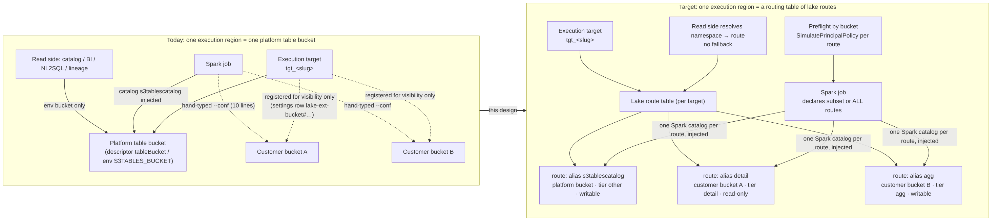
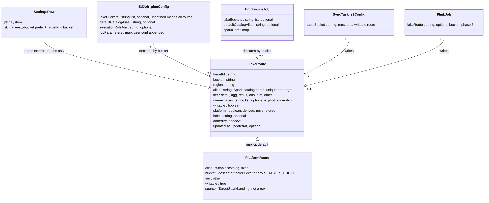
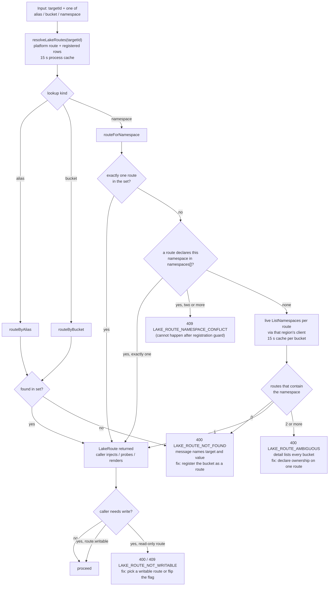
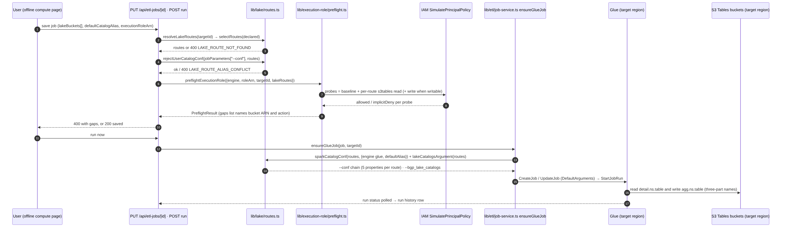

# Lake Table-Bucket Routing · Decoupling Execution Environments from a Single Table Bucket

> - Revision **1.2-en** (2026-11-09). Status: **authoritative; Phase 1 implemented and verified by headless page-driven acceptance on a two-region test account**. This English document supersedes the earlier Chinese draft of this design. Where the two differ, this document wins.
>   Decisions D1–D13 in §13 were signed off on 2026-11-03 and are binding. §15 records where the Phase 1 implementation deviates from §6 and why; where §15 and §6 differ, the implementation (§15) is the fact.
> - Revision history: 1.2-en (2026-11-09) — the two read-only endpoints (route list, bucket candidates) moved out of the `/api/admin` prefix so that any signed-in user can read them (§6.10.1, §6.10.5, §15 item 14); Phase 1 acceptance recorded in §15 item 15.
>   1.1-en (2026-11-06) — Phase 1 implemented; §13 decisions recorded as binding; §15 implementation notes 1–13. 1.0-en (2026-11-03) — initial authoritative design, four static diagrams, decisions proposed.
>
> Vocabulary follows the multi-region execution design ([`multi-region-execution-design.md`](./multi-region-execution-design.md) §0–§3): an **execution target** (`targetId`, home is `tgt_home`) is one region's data plane; a **place** is the explicit target a request runs against; a **scope** is the page-level "all regions / one region" view filter. The execution role binding design ([`execution-role-binding.md`](./execution-role-binding.md)) supplies the per-job execution role and the save-time IAM preflight that this design extends.

---

## 1. Summary

The platform treats "the lake of a region" as "the one platform table bucket of that region". Customer-owned S3 Tables buckets are second-class: they can be *registered* for visibility and for sync writes, but every Spark catalog the platform injects, every IAM preflight, every read-side component (catalog, BI, NL2SQL, lineage) assumes one bucket per region. A job that must read bucket A and write bucket B needs the user to hand-type ten Spark `--conf` lines.

This design replaces the single binding with a **lake route table** per execution target. A route is `bucket → alias / tier / namespace ownership / writable`. The platform table bucket becomes the implicit default route (alias `s3tablescatalog`). Jobs use all routes of their region unless they declare a subset. The platform injects one Spark catalog per route, probes IAM per bucket at save time, resolves namespaces to buckets without falling back, and shows routes in the settings, job, sync and query pages. Zero new tables, zero new environment variables, IAM only (no Lake Formation).

Phases 1 and 2 (core routing plus read-side routing) ship in 2.2.0. Phase 3 (permission matrix, least-privilege role generator, Flink writes to customer buckets) ships in the following release.



---

## 2. Problem statement and customer scenario

### 2.1 Customer scenario (anonymised)

A customer stores data tiers in **separate S3 Tables table buckets** because compliance requires bucket-level IAM isolation between tiers: detail data in one bucket, aggregates in another, published results in a third. A single Spark job must read the detail bucket and write the aggregate bucket:

```sql
INSERT OVERWRITE TABLE agg.orders_daily
SELECT dt, sum(amount) AS total, count(*) AS cnt
FROM detail.orders_detail
GROUP BY dt
```

Here `agg` and `detail` are different buckets. The customer wants the **schema (namespace) to route to the bucket**. The customer has no mature isolation model and no notion of a "project space"; therefore the execution environment itself must not be hard-bound to one bucket. Their words, paraphrased: *"The platform should let us specify the storage bucket, instead of binding one by default and not letting us change or specify it."*

### 2.2 What happens today

- Each execution region owns exactly one platform table bucket. Every Spark job receives one injected catalog, `s3tablescatalog`, pointing at it.
- Customer buckets can be registered under "System settings → Lake external table buckets". Registration makes them visible in the query tree, the governance catalog and NL2SQL, and makes them writable by sync tasks. Registration is **not routing**: no alias, no tier, no namespace ownership.
- A cross-bucket job needs the user to add a `--conf` job parameter with five Spark properties per bucket (Appendix B). Two-part names fail with `TABLE_OR_VIEW_NOT_FOUND`; only three-part names work.
- The save-time IAM preflight for custom execution roles does not probe `s3tables` at all; a job whose role lacks a bucket permission saves fine and fails at runtime with a 403.
- The home-region EMR role and both Flink roles can only touch the platform bucket.
- Governance "create table", the BI builder, NL2SQL seeds, lineage FQNs and the non-home governance catalog are hard-wired to the platform bucket.

### 2.3 Why this is a product defect, not a documentation gap

The no-code workaround (Appendix B) works but violates three platform principles: it requires hand-typed technical identifiers (account id, region, bucket ARN); the permission model cannot be reasoned about per bucket; and the read side cannot see what the write side produced. Bucket-level isolation is the customer's compliance control, so the platform must model buckets as first-class routes.

---

## 3. Current state

Facts were re-verified against the working tree on 2026-11-03 (`platform/src` and `infra` paths are relative to the repository root; `platform/src/` is omitted below for platform files).

| Layer | Fact (file:line) | Gap |
|---|---|---|
| Bucket provisioning | Home: `infra/lib/platform-stack.ts:71-73` creates `bgp-table-bucket`; env `S3TABLES_BUCKET` / `S3TABLES_CATALOG` / `S3TABLES_NAMESPACE=ecommerce` at `:1362-1364`. Execution region: `infra/lib/exec-env/core-stack.ts:76-78` creates `nameOf("tableBucket")`; the descriptor field `tableBucket` is a mandatory core probe item (`lib/exec-env/component-contract.ts:19`) | "One target ≡ one bucket" is the base assumption of every layer |
| Spark landing resolver | `lib/exec-env/target-clients.ts:117-147` `resolveTargetGlue` returns a single `tableBucket` (home from env at `:126`, non-home from the descriptor at `:145`) | Single value, no notion of additional buckets |
| Athena / catalog resolver | `lib/athena/s3tables.ts:73-93` `resolveS3TablesPlace` (one bucket); `:117-134` `resolveS3TablesPlaces` = platform bucket + registered rows with a 15 s `globalThis` memo (`:101-115`); `:149-165` `resolveS3TablesPlaceForNamespace` probes `ListNamespaces` per bucket and **falls back to the platform bucket** when nothing matches (`:164`) | Two resolvers, and a silent default (violates engineering rule 3 of the [development guide](../development.md), no silent legal defaults) |
| External bucket registry | `lib/lake/external-table-buckets.ts`: one `SETTINGS` row per bucket, `pk="system"` (`lib/settings/model-store.ts:31`), `sk=lake-ext-bucket#<targetId>#<bucket>` (`:18-19`, `:40-42`), fields `{targetId,bucket,region,label?,addedBy,addedAt}` (`:22-29`); registration checks name grammar, "not the platform bucket", `GetTableBucket` in the target region (`:92-127`); no IAM or Lake Formation action | Registration = visibility + sync write, not routing; no alias / tier / namespace ownership / writable flag |
| Registry API | `app/api/admin/lake-buckets/route.ts` GET / POST / DELETE (platform admin for writes); `app/api/admin/lake-buckets/candidates/route.ts` lists the region's buckets with `platform` / `registered` flags (`lib/lake/table-bucket-candidates.ts:10-28`) — Phase 1 moved this file to `app/api/lake-buckets/candidates/route.ts` and left the admin path as a re-export (§15 item 14) | No update verb, no alias / tier fields |
| Read side consumers | Query tree `app/api/athena/tables/route.ts:17-26` (per-namespace `bucket` / `external`); NL2SQL `lib/genbi/athena.ts:39` (namespace → bucket via the fallback resolver); home governance push `lib/openmetadata/om-push.ts:387` (`resolveS3TablesPlaces(HOME_TARGET_ID)` only) | Non-home regions never reach the governance catalog; namespace resolution can silently pick the platform bucket |
| Sync write guard | `lib/sync/table-bucket.ts:77-83` `tableBucketRejection`: own bucket must be the platform bucket or a registered row for non-home targets; **home accepts any bucket** (`:80`); `effectiveTableBucket` at `:45-47` | Home and non-home differ; the registry is not the single source of truth |
| Offline Glue jobs | `lib/etl/job-service.ts:310-317` injects exactly one catalog (`s3tablescatalog` → platform bucket, five properties, `GlueCatalog` implementation); user `--conf` is appended unchecked (`:360-364`); `--bgp_table_bucket` is a single value (`:356`); `--TempDir` is `s3://<scriptsBucket>/temp/` (`:346`); reserved argument set at `:324-327` | Cross-bucket requires hand-typed configuration; alias collisions are not detected |
| EMR Serverless | `lib/engines/emr/spec.ts:173-185` `s3TablesCatalogParameters` injects one catalog using `software.amazon.s3tables.iceberg.S3TablesCatalog` (three properties plus a shared `--jars` and `spark.sql.extensions`); `provider.ts:273-277` uses env `EMR_S3TABLES_WAREHOUSE_ARN` for home; home EMR role IAM is limited to `bgp-table-bucket` (`infra/lib/emr-stack.ts:94-102`) | Home EMR cannot reach a second bucket at all; the EMR recipe differs from Glue's, so one author must know the engine |
| Flink | Home role `infra/lib/flink-stack.ts:126-134` and per-target role `infra/lib/exec-env/flink-stack.ts:150-157` grant `s3tables:*` on the platform bucket only; `lib/realtime/flink-place.ts:87` carries one `s3tablesBucket`; template catalog `s3t` with `${TABLE_BUCKET_ARN}` substituted at `lib/realtime/flink-service.ts:209-213`, `:504-506` | Real-time writes can only reach the platform bucket |
| IAM, other roles | Home `bgp-glue-role`: `s3tables:*` on `*` (`infra/lib/platform-stack.ts:134-137`); execution-region Glue / EMR roles: any bucket in the region via `tableBucketAnyArn` (`infra/lib/exec-env/exec-roles.ts:88-99`, used at `core-stack.ts:132`, `:185`); no Lake Formation API call anywhere in the platform; federated catalog `s3tablescatalog` is created with `Identifier=arn:aws:s3tables:<region>:<account>:bucket/*` and `IAM_ALLOWED_PRINCIPALS` (`lib/aws/s3tables-catalog.ts:15-26`) | The permission surface is wide enough; what is missing is a product-level "declare" and "measure per bucket" |
| Execution-role preflight (execution role binding) | Glue baseline probes only `s3:GetObject` on the scripts bucket and `s3:PutObject` on `<datalakeBucket>/temp/probe` (`lib/role-advisor/engine-baseline.ts:169-183`); never probes `s3tables`; the real `--TempDir` is the **scripts** bucket (`job-service.ts:346`, `start-run.ts:280`) | A job that only touches customer buckets is forced to grant write on the platform datalake bucket; a missing bucket permission passes save and fails at run |
| Read side hard-binding | Governance "create table" `lib/governance/catalog-ddl.ts:233-237` (platform bucket of the target); BI builder `lib/bi/query-builder.ts:50-56` (env bucket); NL2SQL seeds `lib/genbi/global-skills-seed.ts:19-22` (env bucket); lineage FQN `om-push.ts:593` (env bucket); plan discovery `lib/copilot/plan/discovery-tools.ts:110` and codegen `lib/requirements/codegen.ts:213-215` introspect only `S3TABLES_NAMESPACE`; prompts teach `s3tablescatalog.<ns>.<table>` (`codegen.ts:69`, `lib/cookbook/seed/emr.ts:80`, `:210`); GenBI agent takes one `catalogRef` from the place wire (`infra/agent/genbi/agent.js:249`) | Tables in customer buckets do not exist on these surfaces, or resolve to the wrong bucket |
| Lake query page | SQL is passed through without catalog injection (`app/api/athena/query/route.ts:22-30`); `sanitizeReadOnly` forbids writes (`lib/genbi/core/sql-guard.ts:71-90`) | Read-only is by design and stays |
| Redshift | No S3 Tables carrier; `CREATE EXTERNAL SCHEMA` is banned (`lib/exec-env/admin-ddl-guards.ts:109`) | Out of scope |
| Upgrade script | `scripts/redeploy-platform.sh:161-183` has steps 2c / 2c′ / 2c″ for stacks that must follow HEAD | No step for data migration of settings rows |
| Synth gate | `infra/scripts/exec-env-synth-gate.mjs` §9 already numbers 9.1 – 9.6 (9.5 = source asset checks) | A new IAM-shape assertion needs a fresh number (§9.8, §6.7) |

In one sentence: **the platform equates "this region's lake" with "this region's one platform table bucket"; customer buckets are second-class, cross-bucket work needs hand-typed Spark configuration, permissions are not measured per bucket, and the read side does not recognise the buckets.**

---

## 4. Goals and non-goals

### 4.1 Goals

| # | Goal |
|---|---|
| G1 | A job reads bucket A and writes bucket B with **no hand-typed configuration**, using `<alias>.<namespace>.<table>` names |
| G2 | Buckets are **declared** per execution target with alias, tier, namespace ownership and writable flag, by a platform admin, in the UI |
| G3 | Permissions are **measured per bucket** at save time, with the exact missing action and ARN in the error |
| G4 | The read side (query tree, governance catalog incl. non-home regions, create-table, BI, NL2SQL, lineage) resolves every table to its bucket through the same route table, **never falling back** |
| G5 | Existing jobs, sync tasks, registrations and hand-typed configuration keep working after upgrade |
| G6 | Zero new DynamoDB tables, zero new environment variables, no Lake Formation dependency |

### 4.2 Non-goals (explicit)

| # | Not in scope | Reason |
|---|---|---|
| N1 | Cross-account table buckets | Production shape is single account × multiple regions; the registry already states this at `external-table-buckets.ts:90-91` |
| N2 | Redshift reading S3 Tables through external schemas | No carrier; banned DDL |
| N3 | Writes from the lake query page | Read-only is the page's design |
| N4 | Lake Formation fine-grained permissions | IAM mode already satisfies bucket-level isolation (§7) |
| N5 | Project space × bucket two-dimensional authorisation | Routes belong to the execution target, not to a project — this matches the customer's "no project space" shape |
| N6 | Routing a Spark two-part name to a bucket by namespace inside Spark | Spark semantics: cross-catalog access needs three-part names; the platform exposes a per-job default catalog instead (R3) |

---

## 5. Requirements with acceptance criteria

Acceptance is **page-driven**: every criterion is performed in a headless browser against the pages; API, CLI and DynamoDB reads are cross-checks only ([development guide](../development.md), section 11, headless acceptance).

| # | Requirement | Acceptance (page-driven) | Cross-check |
|---|---|---|---|
| R1 | **Route table per execution target.** Each target holds routes `bucket → alias / tier / namespaces / writable`. The platform bucket is the implicit default route (alias fixed `s3tablescatalog`). Registering a customer bucket creates a route. A route's bucket must exist in the target's region and account (fail-closed) | Settings page: register `demo-detail-bucket` as alias `detail`, tier `detail`, and `demo-agg-bucket` as alias `agg`, tier `agg`. The route table lists both with alias, tier, writable | `GET /api/admin/lake-routes?targetId=` lists three routes incl. platform |
| R2 | **Job-level multi-bucket.** Glue and EMR jobs may declare the routes they use (default = all routes of the region). The platform registers one Spark catalog per declared route, alias = route alias. Scripts use `<alias>.<namespace>.<table>` without any `--conf`. The declaration is saved with the job and applies to scheduled, orchestrated and backfill runs | Create a Glue job with no parameters; script `INSERT OVERWRITE agg.agg.t SELECT … FROM detail.detail.t`; run → `succeeded` | Glue job definition `--conf` contains both catalog groups |
| R3 | **Optional default catalog.** A job may mark one declared route as default (`spark.sql.defaultCatalog`), so single-bucket jobs use two-part names. Cross-bucket still needs the alias prefix (Spark semantics, stated on the page) | Set default catalog `agg` → `INSERT OVERWRITE agg.t SELECT …` succeeds | `--conf` contains `spark.sql.defaultCatalog=agg` |
| R4 | **Permissions measured per bucket.** The custom-role preflight probes each declared route: read actions always, write actions when the declaration is `write`; Glue jobs also probe the federated Glue catalog. The Glue baseline probes the **real** TempDir (scripts bucket `temp/`) instead of the datalake bucket. Gaps reject save with 400 and name action + ARN (same shape as the execution role binding design) | Role grants only the `agg` bucket → save 400 lists `s3tables:GetTableData` on the `detail` bucket ARN; grant → save 200 → run succeeds | Preflight response `gaps[]` |
| R5 | **IAM alignment.** Home EMR role and both Flink roles grant `s3tables:*` on any bucket of their region (same as execution-region Glue / EMR roles). Synth gate pins the shape | Home EMR job across two customer buckets → `succeeded` | Synth gate §9.8 green; mutation to a single bucket is red |
| R6 | **Read side resolves by route.** Query tree shows alias / tier tags; governance catalog syncs every route of every ready target (incl. non-home); governance "create table" offers a bucket choice; BI builder / NL2SQL / plan discovery / codegen resolve `namespace → bucket` via the route table; no match ⇒ 400 naming the namespace (no fallback); lineage FQNs carry the bucket | NL2SQL answers a question on a table in the `agg` bucket and the generated SQL's three-part name points at that bucket; governance "create table" dropdown offers `agg` | OpenMetadata database per bucket; Athena query text |
| R7 | **Explicit namespace ownership.** If the same namespace exists in two routes, registration requires `namespaces[]` ownership (409); namespace-only lookups that match two routes without ownership fail with 400 naming both buckets | Both buckets have namespace `dw` → registering the second returns 409 with both bucket names and the fix | Error code `LAKE_ROUTE_NAMESPACE_CONFLICT` |
| R8 | **Sync and real-time follow the same rule.** The sync wizard bucket dropdown shows `bucket · alias · tier`, lists only writable routes, and home and non-home both require "must be a route entry" (home no longer accepts any bucket; existing tasks' buckets are auto-registered by the upgrade step). Phase 3: Flink jobs choose a route as the lake sink | Sync wizard option reads `demo-agg-bucket · agg · aggregate`; sync writes into the customer bucket | Glue job `--conf`, bucket listing |
| R9 | **Compatibility and migration.** Existing rows get `alias` (derived from the bucket name) and `writable=true` on first read; existing jobs are untouched; hand-typed `--conf` keeps being appended; a hand-typed alias that collides with a platform-generated alias on a different bucket rejects save with 400; no new tables; `S3TABLES_BUCKET` remains the source of the platform route only | After upgrade, existing jobs, sync tasks and the query page behave as before | Byte-identical `--conf` for regions without external routes |
| R10 | **Observability and audit.** Register / update / revoke and job route declarations are audited. Phase 3: settings page "bucket permission matrix" (route × role → reachable or not, via `SimulatePrincipalPolicy`) | Matrix shows role B ✗ on the `detail` bucket | `bgp-audit` rows |
| R11 | **Explicit non-goals** | — (see §4.2) | — |

---

## 6. Architecture

### 6.1 Concepts

| Term | Definition |
|---|---|
| **Lake route** | One `(targetId, bucket)` pair with routing metadata. The unit of declaration, injection, preflight and read-side resolution |
| **Alias** | The Spark catalog name for the route. Grammar `^[a-z][a-z0-9_]{0,31}$`. Unique per target. Reserved: `s3tablescatalog` (platform route), `spark_catalog` (Spark's session catalog), `glue_catalog`, `default` |
| **Tier** | Closed list `detail · agg · result · ods · dim · other`. Display and compliance-audit label; carries no permission semantics |
| **Namespace ownership** | Optional explicit list `namespaces[]` on a route. When set, namespace-only lookups resolve to this route without probing. Required when two routes contain the same namespace |
| **Writable** | Boolean. `false` makes the route unusable as a sync target, a Flink sink, a create-table target or a `write` job declaration. It is a product-level guard, not an IAM control |
| **Platform route** | The implicit default route of a target: alias `s3tablescatalog`, bucket from `TargetSparkLanding.tableBucket` (`target-clients.ts:126`, `:145`), tier `other`, writable `true`. Never stored as a row |
| **Declaration** | A job's chosen subset of routes with an access mode per entry (`read` or `write`). Undeclared = all routes, access derived from `writable` |

### 6.2 Data model (zero new tables)

Routes reuse the existing settings row. The key is unchanged; fields are added.

```ts
// lib/lake/routes.ts — row shape of pk="system", sk="lake-ext-bucket#<targetId>#<bucket>"
export type LakeTier = "detail" | "agg" | "result" | "ods" | "dim" | "other";

export interface LakeRouteRow {
  targetId: string;            // existing
  bucket: string;              // existing
  region: string;              // existing
  label?: string;              // existing
  addedBy: string;             // existing
  addedAt: string;             // existing (ISO 8601)
  alias: string;               // NEW  Spark catalog name, ^[a-z][a-z0-9_]{0,31}$, unique per target
  tier: LakeTier;              // NEW  default "other"
  namespaces?: string[];       // NEW  explicit ownership, absent = discover live
  writable: boolean;           // NEW  default true
  updatedBy?: string;          // NEW
  updatedAt?: string;          // NEW
}

export interface LakeRoute extends LakeRouteRow {
  platform: boolean;           // derived: true only for the implicit platform route
  catalogRef: string;          // derived: "s3tablescatalog/<bucket>" for Athena
  bucketArn: string;           // derived: arn:aws:s3tables:<region>:<account>:bucket/<bucket>
}

export interface LakeRouteSet {
  targetId: string;
  region: string;
  platform: LakeRoute;
  external: LakeRoute[];       // registration order
  all: LakeRoute[];            // [platform, ...external]
  fetchedAt: string;
}
```

Job-side declaration fields (closed, validated):

```ts
// types/etl-job.ts GlueJobConfig  and  lib/engines/emr/types.ts EmrEngineJob
export interface LakeBucketDeclaration { bucket: string; access: "read" | "write" }
lakeBuckets?: LakeBucketDeclaration[];   // undefined = all routes of the region
defaultCatalogAlias?: string;            // must be the alias of a declared (or, if undeclared, any) route
```

Sync tasks keep `s3Config.tableBucket` (string); the value must be a writable route. Flink jobs gain `lakeRoute?: string` (bucket) in Phase 3.



### 6.3 Single author `lib/lake/routes.ts`

All route knowledge lives in one module. `lib/athena/s3tables.ts` (`resolveS3TablesPlaces`, `resolveS3TablesPlaceForNamespace`) and `lib/lake/external-table-buckets.ts` become thin wrappers that import it. A source-literal ratchet test asserts that `spark.sql.catalog.` appears only in this file.

```ts
// Errors — one class, five codes, status chosen by the caller's context
export type LakeRouteErrorCode =
  | "LAKE_ROUTE_NOT_FOUND"          // 400: alias / bucket / namespace matches no route of the target
  | "LAKE_ROUTE_AMBIGUOUS"          // 400: namespace matches ≥ 2 routes and no route owns it
  | "LAKE_ROUTE_ALIAS_CONFLICT"     // 409 on register/update, 400 on job/sync save
  | "LAKE_ROUTE_NOT_WRITABLE"       // 400 on save, 409 on start
  | "LAKE_ROUTE_NAMESPACE_CONFLICT";// 409 on register/update
export class LakeRouteError extends Error {
  constructor(readonly code: LakeRouteErrorCode, readonly status: 400 | 409, message: string, readonly detail?: unknown);
}

// Reading
export async function resolveLakeRoutes(targetId: string, opts?: { fresh?: boolean }): Promise<LakeRouteSet>;
export async function routeByAlias(targetId: string, alias: string): Promise<LakeRoute>;      // throws NOT_FOUND
export async function routeByBucket(targetId: string, bucket: string): Promise<LakeRoute>;    // throws NOT_FOUND
export async function routeForNamespace(targetId: string, namespace: string): Promise<LakeRoute>; // §6.4
export function selectRoutes(set: LakeRouteSet, declared?: LakeBucketDeclaration[]): SelectedRoute[]; // throws NOT_FOUND / NOT_WRITABLE
export type SelectedRoute = LakeRoute & { access: "read" | "write" };

// Writing (platform admin only, called by the routes API and the upgrade migration)
export async function registerLakeRoute(input: RegisterLakeRouteInput): Promise<LakeRoute>;
export async function updateLakeRoute(input: UpdateLakeRouteInput): Promise<LakeRoute>;
export async function revokeLakeRoute(targetId: string, bucket: string): Promise<boolean>;

// Grammar and derivation
export const LAKE_ALIAS_RE = /^[a-z][a-z0-9_]{0,31}$/;
export const LAKE_RESERVED_ALIASES: ReadonlySet<string>;   // s3tablescatalog, spark_catalog, glue_catalog, default
export function assertAlias(alias: unknown): string;
export function aliasFromBucket(bucket: string, taken: ReadonlySet<string>): string;

// Injection (§6.5) — the only place that spells Spark catalog properties
export function sparkCatalogConf(routes: readonly LakeRoute[], opts: { engine: "glue" | "emr"; account: string; defaultAlias?: string }): string[];
export function lakeCatalogsArgument(routes: readonly LakeRoute[]): string;    // "alias=bucket,alias=bucket"
export function rejectUserCatalogConf(userConf: string | undefined, routes: readonly LakeRoute[]): { drop: string[]; notices: string[] }; // throws ALIAS_CONFLICT

// Preflight (§6.6)
export function lakeRouteProbes(routes: readonly SelectedRoute[], ctx: { engine: "glue" | "emr" | "flink"; account: string }): PreflightNeed[];
```

Fail-closed semantics:

- No function returns the platform route as a substitute for a missing match. `resolveS3TablesPlaceForNamespace` loses its `return places[0]` fallback (`s3tables.ts:164`) and throws `LAKE_ROUTE_NOT_FOUND`.
- `selectRoutes` rejects any declared bucket that is not a route of the target, and any `write` declaration on a route with `writable=false`.
- `resolveLakeRoutes` throws when the target is not ready or its descriptor lacks `tableBucket` (same behaviour as `resolveS3TablesPlace` today at `s3tables.ts:85-91`).
- Write-side guards (sync save/start, job save) call with `fresh: true` and bypass the cache, exactly as `lib/sync/table-bucket.ts` reads the registry directly today.

### 6.4 Resolution algorithm, ambiguity and caching



`routeForNamespace(targetId, namespace)`:

1. Load the route set (cached, §6.4.1).
2. If the set has exactly one route, return it. Existence of the namespace is not probed here; downstream Athena or Spark reports a missing schema as today.
3. If exactly one route lists the namespace in `namespaces[]`, return it. Two or more would be a registration-guard failure and is reported as `LAKE_ROUTE_NAMESPACE_CONFLICT` (defensive, should not occur).
4. Otherwise probe `ListNamespaces` on every route whose `namespaces[]` is absent, using that region's S3 Tables client (per-region clients as in `s3tables.ts:167-175`). Results are cached 15 s per `(targetId, bucket)`.
5. Zero hits ⇒ `LAKE_ROUTE_NOT_FOUND` (400) with message "namespace `<ns>` is in none of the N routes of `<targetId>`: …". One hit ⇒ that route. Two or more ⇒ `LAKE_ROUTE_AMBIGUOUS` (400) with `detail.buckets[]` and the fix "declare ownership of `<ns>` on one route".

Registration and update guard (the explicit-namespace-ownership requirement): before writing a row, the author computes `live(new bucket) ∩ (∪ live-or-declared namespaces of existing routes)`. A non-empty intersection without `namespaces[]` on the new route covering those names ⇒ `LAKE_ROUTE_NAMESPACE_CONFLICT` (409) listing each namespace with both buckets. Two routes declaring the same namespace ⇒ same error. Ownership affects namespace-only lookups only; a three-part Spark name is always explicit.

#### 6.4.1 Caching

- Route set: 15 s process cache on `globalThis` under `Symbol.for("bgp.lake.routes.memo")`, replacing the existing memo at `s3tables.ts:101-115`. The `globalThis` anchor is required because the Next.js build duplicates module instances across route bundles.
- Namespace discovery: 15 s cache per `(targetId, bucket)` under a second symbol.
- Invalidation: register / update / revoke clear both caches in-process; other ECS tasks converge within 15 s.
- Write-side guards read fresh (`fresh: true`): "registered one second ago" must pass immediately on every task.

### 6.5 Injection into Glue ETL, EMR Serverless, sync and Flink



#### 6.5.1 Glue ETL jobs (`lib/etl/job-service.ts#ensureGlueJob`)

`sparkCatalogConf(selected, { engine: "glue", account, defaultAlias })` emits, per route, the five properties below (the current recipe at `job-service.ts:311-317`, with alias and bucket substituted), joined by ` --conf `:

```text
spark.sql.catalog.<alias>=org.apache.iceberg.spark.SparkCatalog
spark.sql.catalog.<alias>.catalog-impl=org.apache.iceberg.aws.glue.GlueCatalog
spark.sql.catalog.<alias>.glue.id=<account>:s3tablescatalog/<bucket>
spark.sql.catalog.<alias>.io-impl=org.apache.iceberg.aws.s3.S3FileIO
spark.sql.catalog.<alias>.warehouse=arn:aws:s3tables:<region>:<account>:bucket/<bucket>
```

Then, when `defaultCatalogAlias` is set: `spark.sql.defaultCatalog=<alias>`.

Additional `DefaultArguments`:

- `--bgp_table_bucket` unchanged (= platform bucket) so existing scripts keep working.
- `--bgp_lake_catalogs=<alias>=<bucket>,<alias>=<bucket>,…` (new, reserved, read via `getResolvedOptions(sys.argv, ["bgp_lake_catalogs"])`). Platform route first, then external routes in registration order.
- `RESERVED_ARGS` (`job-service.ts:324-327`) gains `--bgp_lake_catalogs`.

User `--conf` (`cfg.jobParameters["--conf"]`, appended today at `:360-364`) passes through `rejectUserCatalogConf` first: entries `spark.sql.catalog.<alias>*` whose alias equals a platform-generated alias **and** whose `glue.id` / `warehouse` point at the same bucket are dropped with a notice ("taken over by the platform"); same alias on a different bucket ⇒ `LAKE_ROUTE_ALIAS_CONFLICT` (400); aliases unknown to the route table are appended untouched (hand-typed catalogs for non-route buckets stay allowed, §7). A user `spark.sql.defaultCatalog` is dropped with a notice when the job declares a default.

Byte budget: with a 6-character alias and an 18-character bucket name one route costs ≈ 430 bytes of `--conf`; with maximal names ≈ 610 bytes. The author computes the real size of the value and rejects save (`VALIDATION_FAILED`, message states bytes and the Glue ceiling) when it would exceed the per-value limit of `DefaultArguments`; the UI warns above 10 declared routes (§12).

Regions with **no** external routes produce a `--conf` value byte-identical to today's.

#### 6.5.2 EMR Serverless (`lib/engines/emr/spec.ts#s3TablesCatalogParameters`, `provider.ts:273-277`)

EMR uses the S3 Tables catalog implementation, not `GlueCatalog`; the author emits a different property set for `engine: "emr"`:

```text
--jars <EMR_S3TABLES_JAR>                                                        (once)
spark.sql.extensions=org.apache.iceberg.spark.extensions.IcebergSparkSessionExtensions   (once)
spark.sql.catalog.<alias>=org.apache.iceberg.spark.SparkCatalog                  (per route)
spark.sql.catalog.<alias>.catalog-impl=software.amazon.s3tables.iceberg.S3TablesCatalog
spark.sql.catalog.<alias>.warehouse=arn:aws:s3tables:<region>:<account>:bucket/<bucket>
spark.sql.defaultCatalog=<alias>                                                 (optional)
spark.bgp.lakeCatalogs=<alias>=<bucket>,…                                        (reserved, per job)
```

`provider.ts:273-277` stops reading `EMR_S3TABLES_WAREHOUSE_ARN`; home and non-home both derive the platform route from the landing. The env key stays in the task definition for one release (the environment-key guard pins the key list) and is removed next release. `RESERVED_SPARK_CONF` (`spec.ts:141-156`) gains `spark.bgp.lakeCatalogs`; user `sparkConf` goes through `rejectUserCatalogConf` as for Glue.

#### 6.5.3 Sync tasks (`lib/sync/start-run.ts`, `lib/sync/glue-script-generator.ts`)

- `effectiveTableBucket` (`table-bucket.ts:45-47`) must resolve to a **writable route** of the landing target; the home bypass at `table-bucket.ts:80` is removed. Save ⇒ 400 `LAKE_ROUTE_NOT_WRITABLE` / `LAKE_ROUTE_NOT_FOUND`; start ⇒ 409 with the same code.
- The injected `--conf` (`start-run.ts:279-290`) is produced by `sparkCatalogConf([route], { engine: "glue" })` for the single target route; the alias is the route alias (platform route keeps `s3tablescatalog`).
- `S3T_CATALOG` in the generated script (`glue-script-generator.ts:334`) becomes a parameter equal to the route alias.
- The federated-catalog self-heal (`lib/aws/s3tables-catalog.ts`) is unchanged: one catalog per region covers every bucket.

#### 6.5.4 Flink (Phase 3)

- Flink jobs gain `lakeRoute?: string` (bucket). `${TABLE_BUCKET_ARN}` (`flink-service.ts:504-506`) resolves to that route's ARN; absent ⇒ platform route (byte-identical to today).
- `writable=false` routes are rejected at job save (400) and start (409).
- The SQL template keeps catalog name `s3t` (it is inside user SQL, not a platform alias).

### 6.6 Preflight by bucket

`lib/execution-role/preflight.ts#preflightExecutionRole` gains `lakeRoutes: SelectedRoute[]`. All four call sites (`job-service.ts`, `start-run.ts`, `flink-service.ts`, `emr/provider.ts` + `emr/schedule-fanout.ts`) pass the job's selected routes. `lib/role-advisor/lake-probes.ts#lakeRouteProbes` adds, per route:

| Access | Action | Resource ARN form |
|---|---|---|
| read | `s3tables:GetTableBucket`, `s3tables:ListNamespaces`, `s3tables:GetNamespace`, `s3tables:ListTables` | `arn:aws:s3tables:<region>:<account>:bucket/<bucket>` |
| read | `s3tables:GetTable`, `s3tables:GetTableMetadataLocation`, `s3tables:GetTableData` | `arn:aws:s3tables:<region>:<account>:bucket/<bucket>/table/*` |
| write (adds) | `s3tables:CreateNamespace`, `s3tables:CreateTable` | bucket ARN |
| write (adds) | `s3tables:PutTableData`, `s3tables:UpdateTableMetadataLocation` | table ARN form |
| read, Glue engine only | `glue:GetDatabase`, `glue:GetTable`, `glue:GetTables` | `arn:aws:glue:<region>:<account>:catalog/s3tablescatalog/<bucket>`, `…:database/s3tablescatalog/<bucket>/*`, `…:table/s3tablescatalog/<bucket>/*/*` |
| write, Glue engine only (adds) | `glue:CreateTable`, `glue:UpdateTable`, `glue:CreateDatabase` | same forms |

Each probe carries `sid = LakeRoute:<alias>:<read|write>` and a `why` of the form "job declares route `<alias>` (`<bucket>`) for `<access>`; without this the run fails with 403 on the first table access". The Glue federated-catalog resource forms must be confirmed by the IAM-manifest test that evaluates them with `SimulatePrincipalPolicy`; the EMR `S3TablesCatalog` path does not call Glue and skips those probes.

Baseline change (Glue branch of `engine-baseline.ts:169-183`): `BaselineGlueDatalake` (PutObject on `<datalakeBucket>/temp/probe`) is **removed** and replaced by `BaselineGlueTempDir` = `s3:PutObject` on `arn:aws:s3:::<scriptsBucket>/temp/probe`, matching the real `--TempDir`. A job that only touches customer buckets no longer needs write access to the platform datalake bucket.

The gap text's fourth remedy reads: "grant the role these `s3tables` actions on `<bucket>`, or remove `<alias>` from the job's lake bucket declaration, or change its access to `read`".

Platform default roles already hold `s3tables:*` in their region (after §6.7), so the preflight is only decisive for custom roles. The TaskRole needs no new actions (`SimulatePrincipalPolicy`, `s3tables:ListNamespaces` are already in `infra/iam/platform-taskrole-calls.json`); a mutation test that deletes the `lakeRouteProbes` call turns the wiring test red.

### 6.7 IAM changes per role

| Role | Today | Target |
|---|---|---|
| Home EMR job role (`infra/lib/emr-stack.ts:94-102`) | `s3tables:*` on `bucket/bgp-table-bucket` and `bucket/bgp-table-bucket/*` | `s3tables:*` on `arn:aws:s3tables:<home-region>:<account>:bucket/*` |
| Home Flink role (`infra/lib/flink-stack.ts:126-134`) | same as above | same target form |
| Per-target Flink role (`infra/lib/exec-env/flink-stack.ts:150-157`) | `s3tables:*` on the target's own bucket | `tableBucketAnyArn(ctx, p)` |
| Per-target Glue / EMR roles (`core-stack.ts:132`, `:185`) | already `bucket/*` in region | unchanged |
| Home Glue role (`platform-stack.ts:134-137`) | `s3tables:*` on `*` | unchanged |
| Platform TaskRole | `s3tables:*` + named actions in region (`platform-stack.ts:1018-1021`) | unchanged |

The single author of the ARN form moves from `infra/lib/exec-env/exec-roles.ts:97-99` to `infra/lib/shared/table-bucket-arn.ts` (`anyTableBucketArn(partition, region, account)`), imported by the three stacks above and by `exec-roles.ts`. `bucket/*` matches both `bucket/<name>` and `bucket/<name>/table/<id>`; the region segment still pins the region, so cross-region access is not widened.

Synth-gate assertion **§9.8** (9.5 is taken by the source-asset checks): for templates `BgpEmrStack`, `BgpFlinkStack` and every `BgpExecEnv-*-flink`, each statement containing an `s3tables:` action must have every `Resource` match `^arn:aws:s3tables:[^:]+:[^:]+:bucket/\*$` after token resolution and must not contain a literal bucket name; the gate also asserts the statement exists (a missing statement is red, not green). Mutation: reverting one stack to the single-bucket form turns §9.8 red.

Upgrade note: execution regions obtain the new Flink IAM only after "Execution environments → Redeploy" (same procedure as the earlier Glue / EMR widening); the home stacks follow `redeploy-platform.sh`.

### 6.8 Read-side routing (Phase 2)

| Surface | Change |
|---|---|
| Query tree API `app/api/athena/tables/route.ts` | `catalogs[]` entries gain `alias`, `tier`, `writable`; namespace nodes gain `alias`, `tier`. Existing `catalog` / `bucket` / `external` fields stay |
| Governance catalog push `om-push.ts#pushS3TablesSchemaToOpenMetadata` | Signature becomes `({ targetId })`; the governance "sync columns" long operation iterates every ready target and calls it per target. One OpenMetadata instance and one service `bgp-s3tables` (platform mandate); database = bucket name; schema = namespace; columns introspected through that target's Athena place (`introspectS3Tables(ns, { targetId, catalogRef })` already supports this) |
| Lineage FQN `om-push.ts:593` | Bucket comes from the sync task's effective route (write side) or `routeForNamespace` (read side), never from env |
| Governance "create table" `catalog-ddl.ts:233-237` | `targetBucket` becomes mandatory in `CatalogCreateSpec`; missing ⇒ 400; must be a writable route ⇒ else 400 `LAKE_ROUTE_NOT_WRITABLE`; the page shows a dropdown of writable routes |
| BI builder `query-builder.ts:50-56` | `tableRef(engine, schema, table, place)` takes the resolved route (`routeForNamespace(targetId, schema)`); the BI schema endpoint already carries `targetId` |
| NL2SQL `genbi/athena.ts:39`, `place.ts`, `agent.ts` | `resolveS3TablesPlaceForNamespace` is now fail-closed; the place wire's Athena leg gains `routes[] = {alias, bucket, catalogRef, tier}` so the AgentCore container builds three-part names per route instead of one `catalogRef` (`infra/agent/genbi/agent.js:249`). The agent image must be rebuilt (`scripts/redeploy-agents.sh`) |
| Seeds `global-skills-seed.ts:19-22` | Keep env for the demo platform route only; comment states the limitation |
| Plan discovery `discovery-tools.ts:110`, codegen `codegen.ts:213-215` | Introspect every route's namespaces; catalog text groups tables by `alias` and states the three-part form |
| Prompts and cookbook `codegen.ts:69`, `cookbook/seed/emr.ts:80`, `:210` | Teach `<alias>.<namespace>.<table>`, aliases from `--bgp_lake_catalogs` / `spark.bgp.lakeCatalogs`; `s3tablescatalog` remains the alias of the platform bucket |
| `S3TABLES_NAMESPACE` env | Only a hint for the platform route's default namespace; no longer implies a bucket anywhere |

### 6.9 UI

| Page | Element | `data-testid` |
|---|---|---|
| System settings → card renamed "Lake table buckets and routes" (today `settings-lake-ext-buckets`, `app/settings/page.tsx:245-269`) | Route table with columns bucket / alias / tier / namespaces / writable / label / added by; the platform route is the first, non-removable row | `lake-route-table` (kept alias `lake-ext-bucket-table`), row `lake-route-row`, cells `lake-route-alias`, `lake-route-tier`, `lake-route-writable` |
| same card | Register form: bucket (`TableBucketPicker`), alias (pre-filled from bucket name, editable), tier select, writable switch, namespaces tag input, label | `lake-route-bucket`, `lake-route-alias-input`, `lake-route-tier-select`, `lake-route-writable-switch`, `lake-route-namespaces-input`, `lake-route-add` |
| same card | Row actions edit / revoke; 409 messages shown verbatim | `lake-route-edit`, `lake-route-revoke` |
| same card (Phase 3) | "Bucket permission matrix" sub-card: routes × (platform roles ∪ roles used by jobs of this target) → ✓ / ✗ / ? | `lake-perm-matrix`, cell `lake-perm-cell` |
| Offline compute → job → Advanced properties | New block "Lake table buckets": multi-select of routes (default all, chips show `alias · tier`, per-chip access toggle read / write), "Default catalog" select, read-only list "catalogs available to this job: `detail → demo-detail-bucket`, …", "copy three-part example" button | `job-lake-buckets`, `job-lake-access`, `job-default-catalog`, `job-lake-catalogs-hint`, `job-lake-copy-example` |
| EMR job panel | Same block | same testids |
| Sync wizard (`app/sync/SyncTaskModal.tsx`, `components/lake/TableBucketPicker.tsx`) | Option label `bucket · alias · tier`; only writable routes selectable; non-route buckets keep the existing "unregistered" hint and link | existing `table-bucket-option` gains `data-alias`, `data-tier`, `data-writable` |
| Lake query page tree (`app/athena/page.tsx:132-133`) | Namespace prefix tag `alias · tier` for every route, including the platform route | `lake-ns-route` (kept `lake-ns-external`) |
| Governance → create table | Bucket dropdown of writable routes | `catalog-create-bucket` |
| "How to use this page" help | One sentence per page explaining routes, aliases and three-part names; English dictionary entries in `lib/i18n/messages/en.ts` in the same commit | — |

Friendliness rules: no field requires an account id, region or ARN; alias and tier are pre-filled; every rejection names the object and the next action; the job block offers a copy-ready example.

### 6.10 HTTP API contracts

All responses use the platform envelope: success `{ "success": true, "data": … }`; error `{ "success": false, "error": { "message", "code", "detail"? } }` (`lib/api-response.ts:99-110`). The five codes below are added to `ApiErrorCode`. Every route requires an explicit `targetId` (`requestedTargetId`, `lib/place/resolve.ts:41`): missing ⇒ 400 `PLACE_UNDECIDABLE`. Write verbs require a platform admin (403 `RBAC_DENIED` otherwise).

#### 6.10.1 `GET /api/lake-routes?targetId=<id>` — list (any signed-in user; `GET /api/admin/lake-routes` stays for one release as an admin-only alias of the same handler, §15 item 14)

```json
{ "success": true, "data": {
  "targetId": "tgt_usw2_a", "region": "<region>", "fetchedAt": "2026-11-03T10:00:00Z",
  "routes": [
    { "bucket": "bgp-table-bucket-tgt-usw2-a", "alias": "s3tablescatalog", "tier": "other", "writable": true, "platform": true,
      "catalogRef": "s3tablescatalog/bgp-table-bucket-tgt-usw2-a" },
    { "bucket": "demo-detail-bucket", "alias": "detail", "tier": "detail", "writable": true, "platform": false,
      "namespaces": ["detail"], "label": "raw tier", "addedBy": "admin", "addedAt": "2026-11-03T09:00:00Z",
      "catalogRef": "s3tablescatalog/demo-detail-bucket" },
    { "bucket": "demo-agg-bucket", "alias": "agg", "tier": "agg", "writable": true, "platform": false,
      "addedBy": "admin", "addedAt": "2026-11-03T09:01:00Z", "catalogRef": "s3tablescatalog/demo-agg-bucket" }
  ] } }
```

#### 6.10.2 `POST /api/admin/lake-routes` — register

Request:

```json
{ "targetId": "tgt_usw2_a", "bucket": "demo-agg-bucket", "alias": "agg", "tier": "agg", "writable": true,
  "namespaces": ["agg"], "label": "aggregate tier" }
```

| Status | Code | When |
|---|---|---|
| 201 | — | Route created; `data` = the route |
| 400 | `VALIDATION_FAILED` | Bucket name or alias grammar invalid, tier not in the closed list, alias reserved |
| 404 | `NOT_FOUND` | No such table bucket in the target's region |
| 409 | `CONFLICT` | Bucket already a route of this target, or bucket is the platform bucket |
| 409 | `LAKE_ROUTE_ALIAS_CONFLICT` | Alias already used by another route of this target; `detail = { alias, bucket }` |
| 409 | `LAKE_ROUTE_NAMESPACE_CONFLICT` | Namespace overlap without ownership; `detail = { conflicts: [{ namespace, buckets: ["demo-detail-bucket", "demo-agg-bucket"] }] }` |

Example 409:

```json
{ "success": false, "error": { "code": "LAKE_ROUTE_NAMESPACE_CONFLICT", "message": "Namespace dw exists in both demo-detail-bucket (alias detail) and demo-agg-bucket. Declare which route owns dw in namespaces[] and retry.",
  "detail": { "conflicts": [ { "namespace": "dw", "buckets": ["demo-detail-bucket", "demo-agg-bucket"] } ] } } }
```

#### 6.10.3 `PATCH /api/admin/lake-routes` — update

Request `{ "targetId", "bucket", "alias"?, "tier"?, "writable"?, "namespaces"?, "label"? }`. `bucket` and `targetId` identify the route and are immutable. Alias change is accepted only with `"confirmAliasChange": true` because scripts reference aliases (the response without it is 409 `DECISION_REQUIRED` listing jobs that declare the route). Other statuses as in §6.10.2. The platform route accepts no update (400).

#### 6.10.4 `DELETE /api/admin/lake-routes?targetId=<id>&bucket=<name>` — revoke

| Status | Code | When |
|---|---|---|
| 200 | — | `{ "removed": true }`; bucket and tables untouched |
| 404 | `NOT_FOUND` | Not a route |
| 409 | `DATASOURCE_IN_USE`-style listing is **not** used; instead `CONFLICT` with `detail = { syncTasks: [...], jobs: [...] }` when a sync task writes to it or a job declares it explicitly | Remove references first |
| 400 | `VALIDATION_FAILED` | Attempt to revoke the platform route |

#### 6.10.5 Compatibility alias

`/api/admin/lake-buckets` (GET / POST / DELETE) stays for one release as a thin alias: GET returns the external routes as an array (new fields included); POST registers with a derived alias, tier `other`, `writable=true`; DELETE revokes. The bucket-candidates list is served at `GET /api/lake-buckets/candidates?targetId=` (any signed-in user) and additionally reports `alias` / `tier` on registered candidates; `/api/admin/lake-buckets/candidates` re-exports the same handler for one release (§15 item 14).

#### 6.10.6 Job declaration fields

`POST|PUT /api/etl-jobs[/{id}]` body `glueConfig`:

```json
{ "lakeBuckets": [ { "bucket": "demo-detail-bucket", "access": "read" }, { "bucket": "demo-agg-bucket", "access": "write" } ],
  "defaultCatalogAlias": "agg", "executionRoleArn": "arn:aws:iam::<account>:role/customer-agg-job" }
```

EMR jobs carry the same two fields at the top level of the job body. Validation per bound target:

| Status | Code | When |
|---|---|---|
| 400 | `LAKE_ROUTE_NOT_FOUND` | A declared bucket is not a route of a bound target; `detail = { targetId, bucket }` |
| 400 | `LAKE_ROUTE_NOT_WRITABLE` | `access: "write"` on a read-only route |
| 400 | `VALIDATION_FAILED` | `defaultCatalogAlias` not among the job's catalogs; `--conf` byte budget exceeded |
| 400 | `LAKE_ROUTE_ALIAS_CONFLICT` | Hand-typed `spark.sql.catalog.<alias>` collides with a generated alias on a different bucket; `detail = { alias, userBucket, routeBucket }` |
| 400 | `VALIDATION_FAILED`, `detail.reason = "exec-role-preflight"` | Custom role lacks a probed action (same shape as the [execution-role binding](./execution-role-binding.md) preflight; `detail.gaps[]` names action, resource, why) |

Success responses carry `_meta.notices[]` when user `--conf` entries were taken over by the platform.

Sync tasks (`POST|PUT /api/sync[/{id}]`): `s3Config.tableBucket` must be a writable route ⇒ otherwise 400 `LAKE_ROUTE_NOT_WRITABLE` / `LAKE_ROUTE_NOT_FOUND`; start (`POST /api/sync/{id}/start`) ⇒ 409 with the same codes.

---

## 7. Security model

| Principle | Statement |
|---|---|
| IAM only | Bucket-level isolation is enforced by IAM on S3 Tables ARNs. The platform never calls Lake Formation. The federated Glue catalog is created with `IAM_ALLOWED_PRINCIPALS` and `Identifier=bucket/*` (`lib/aws/s3tables-catalog.ts:15-26`) |
| Per-job least privilege | Isolation between jobs comes from the **execution role** bound to the job (see [execution role binding](./execution-role-binding.md)). A route declaration narrows what the preflight demands from that role; it does not grant anything |
| Platform roles stay broad within the region | Platform default roles hold `s3tables:*` on `bucket/*` in their region. Customers who need job-level isolation bind custom roles; the handbook and the job page say so |
| Hand-typed catalogs are allowed and unprobed | A user may still register a Spark catalog for a bucket that is not a route. The platform appends it, does not probe it, and the execution role's IAM decides. The platform is not a policy enforcement point for arbitrary Spark configuration |
| `writable=false` is a product guard | It prevents the platform from producing writes (sync, create-table, Flink sink, `write` declarations). It does not alter IAM and does not stop a script from writing if its role allows it |
| What the platform never does | Create, delete or configure customer table buckets; change bucket policies or encryption; create namespaces or tables in a route except through an explicit user action (sync task target, create-table, job script); copy data between buckets; grant IAM permissions |
| Audit | `lake.route.register`, `lake.route.update`, `lake.route.revoke` (resource `s3-table-bucket`, detail: targetId, region, alias, tier, writable, namespaces, before/after for update); job save audits include `lakeBuckets` and `defaultCatalogAlias` in `detail`; upgrade auto-registration audits with actor `upgrade` |
| Data residency | Routes are per target and must be in the target's region; `resolveLakeRoutes` never returns a route of another target; cross-region injection remains impossible by construction |
| Secrets | None involved; route rows contain no credentials |

---

## 8. Compatibility and migration

| Item | Behaviour after upgrade |
|---|---|
| Existing registry rows (no `alias` / `writable` / `tier`) | On first read the author derives `alias = aliasFromBucket(bucket)` (lower-case, non `[a-z0-9_]` → `_`, prefixed `b_` when the first character is not a letter, truncated to 32, `_2` suffix on collision), `writable=true`, `tier="other"`, and writes them back once with a conditional update (`attribute_not_exists(alias)`); idempotent across tasks |
| Existing Glue / EMR jobs | No declaration ⇒ all routes; in regions without external routes the generated `--conf` is byte-identical to today; `--bgp_table_bucket` unchanged; scripts using `s3tablescatalog.<ns>.<t>` keep working |
| Jobs with hand-typed `--conf` from the no-code workaround | Same alias and same bucket as a registered route ⇒ platform entries replace the user's, response carries a notice; same alias, different bucket ⇒ 400 on next save (the job keeps running with its stored definition until then); aliases unknown to the route table ⇒ appended as before |
| Home sync tasks writing to a non-platform, unregistered bucket | Upgrade step **2c‴** in `scripts/redeploy-platform.sh` runs `scripts/lib/lake-routes-migrate.mjs`: scans home sync tasks, registers each unknown `s3Config.tableBucket` as a route (derived alias, tier `other`, writable `true`, label `auto-registered by upgrade`) through the same row shape the author uses (golden test: fixture shape mirrors a real row), audits with actor `upgrade`. Runtime safety net: an unregistered bucket at start ⇒ 409 `LAKE_ROUTE_NOT_FOUND` with the fix "register it"; no silent auto-registration at runtime. `scripts/02-postdeploy-truth.sh` gains the check "no home sync task references an unregistered bucket" |
| Non-home sync tasks | Already required registration; unchanged |
| `/api/admin/lake-buckets` clients | Kept as an alias for one release (§6.10.5) |
| Audit action names | `lake.external-bucket.register` / `.unregister` are replaced by `lake.route.register` / `.revoke`; the audit page shows action strings verbatim, no consumer parses them |
| Environment variables | None added. `EMR_S3TABLES_WAREHOUSE_ARN` becomes unread, stays one release, then is removed together with its entry in `platform/.env.example` and the key guard |
| DynamoDB | No new tables; rows gain attributes under the same key |
| Deployment | Home: `redeploy-platform.sh` (platform ECS, EMR and Flink stacks, step 2c‴). Execution regions: page "Redeploy" to receive the Flink IAM; Glue / EMR per-target IAM is already wide. Agents: `redeploy-agents.sh` after Phase 2 (place-wire routes) |
| Rollback | Previous image ignores the new attributes; rows remain valid; `--conf` returns to the single catalog; jobs that relied on injected routes fail with `TABLE_OR_VIEW_NOT_FOUND` until the hand-typed `--conf` is restored (documented in the release notes) |

---

## 9. Observability and failure modes

| Failure | User-visible result | Recovery |
|---|---|---|
| Declared bucket is no longer a route (revoked after the job was saved) | Save / run ⇒ 400 `LAKE_ROUTE_NOT_FOUND` naming target and bucket; scheduled run ⇒ run row `failed` with the same message | Re-register the bucket or edit the declaration |
| Namespace exists in two routes, no ownership (NL2SQL, BI, codegen) | 400 `LAKE_ROUTE_AMBIGUOUS` listing both buckets | Declare ownership on one route in settings |
| Namespace exists in no route | 400 `LAKE_ROUTE_NOT_FOUND` | Register the bucket, or fix the namespace |
| Custom role lacks a bucket action | Save 400 with `gaps[]` (action, ARN, why, remedy) | Grant the action, use the role advisor, or drop the route from the declaration |
| Role can be probed but policy evaluation unavailable (SCP / throttling) | Preflight returns `unverifiable`; save proceeds; result shown as "could not verify" | Retry "check permissions"; runtime 403 would still be shown verbatim in the run log |
| `ListNamespaces` throttled or slow | Resolution waits on the SDK budget (connect 5 s, idle 60 s, 3 retries) then 502 `UPSTREAM_ERROR` naming the bucket | Retry; declare `namespaces[]` to avoid live discovery |
| Hand-typed alias collides with a generated alias on another bucket | Save 400 `LAKE_ROUTE_ALIAS_CONFLICT` with both buckets | Rename the alias or remove the hand-typed lines |
| `--conf` value exceeds the Glue ceiling | Save 400 `VALIDATION_FAILED` with byte count and limit | Declare a subset |
| Sync task targets a read-only route | Save 400 / start 409 `LAKE_ROUTE_NOT_WRITABLE` | Pick a writable route or flip the flag |
| Route table row half-written (missing alias after a failed write-back) | Read derives alias again; write-back retried; never blocks reads | None needed |
| Cache staleness across ECS tasks (≤ 15 s) | A route registered a moment ago may not appear in a read-side list on another task for up to 15 s; write-side guards read fresh and are unaffected | Wait or refresh |
| Governance push for a non-home target fails | Long-operation result lists the target and error; other targets still pushed | Fix the target and rerun "sync columns" |

Metrics and logs: the author logs one line per resolution failure with code, target, value and candidate buckets; the long-operation framework already surfaces governance push outcomes; audit rows cover every write. No new dashboards are required for Phase 1–2; Phase 3's permission matrix is the operator view.

---

## 10. Rollout plan

| Phase | Scope | Effort | Exit criteria |
|---|---|---|---|
| **1 — Core routing** (2.2.0) | §6.2 data model · §6.3 author · §6.4 resolution · §6.5 Glue / EMR / sync injection · §6.6 preflight by bucket · §6.7 IAM + synth gate §9.8 · §6.9 settings card, job block, sync dropdown · §8 migration (2c‴, truth check) · §6.10 API | 3 days | Local gates green (tsc, vitest, naming parity, synth gate, red-line scan, IAM manifest); page-driven scenarios LR-1 … LR-8 pass on a test account with two regions; existing contract snapshot unchanged |
| **2 — Read side** (2.2.0) | §6.8 query tree tags · governance push per target incl. non-home · create-table bucket choice · BI builder · NL2SQL (place-wire routes, agent rebuild) · plan discovery / codegen · lineage FQN · prompts | 2 days | LR-9 … LR-12 pass; `redeploy-agents.sh --check` clean after rebuild; contract snapshot unchanged |
| **3 — Governance** (next release) | R10 permission matrix · role-advisor "least-privilege role for these routes" generator · Flink `lakeRoute` sink + role IAM | 1.5 days | LR-13 … LR-14 pass; matrix cells agree with `SimulatePrincipalPolicy` cross-checks |

Each phase ends with the full headless gate on a test account (both regions), the contract-guard before/after comparison, and release notes stating the home-sync behaviour change.

---

## 11. Test plan

### 11.1 Unit tests

| Area | Assertions |
|---|---|
| Author grammar | Alias regex accepts `detail`, `agg_2`, rejects `Detail`, `1a`, 33 chars, reserved names; `aliasFromBucket` derivation incl. collision suffix |
| Author resolution | Three outcomes of `routeForNamespace` (0 / 1 / ≥ 2) with a mocked S3 Tables client; explicit ownership short-circuits probing; single-route fast path; **no code path returns the platform route on a miss** (assert on a miss the promise rejects with `LAKE_ROUTE_NOT_FOUND`) |
| Registration guard | Namespace overlap ⇒ `LAKE_ROUTE_NAMESPACE_CONFLICT` listing both buckets; alias reuse ⇒ `LAKE_ROUTE_ALIAS_CONFLICT`; platform bucket ⇒ `CONFLICT` |
| `sparkCatalogConf` | Glue output for the platform route equals today's five lines at `job-service.ts:311-317` byte for byte; EMR output equals today's `s3TablesCatalogParameters` output for the platform route; per-route multiplication; `defaultCatalog` line only when requested |
| `rejectUserCatalogConf` | Same alias + same bucket ⇒ dropped + notice; same alias + other bucket ⇒ throw; unknown alias ⇒ untouched |
| Byte budget | Value size computed from the real string; rejection at the ceiling; no rejection below |
| Ratchets | `spark.sql.catalog.` literal appears only in `lib/lake/routes.ts`; `job-service.ts`, `start-run.ts`, `emr/spec.ts` import the author (source-literal wiring checks at the call sites, not only the import) |
| Preflight | `lakeRouteProbes` emits read set for `read`, read + write set for `write`; Glue engine adds federated-catalog probes, EMR does not; `BaselineGlueDatalake` is gone and `BaselineGlueTempDir` targets the scripts bucket; a role missing `s3tables:GetTableData` on the detail bucket produces exactly one gap naming that ARN |
| Sync guard | Home target with an unregistered bucket is now rejected; registered writable passes; registered read-only rejected with `LAKE_ROUTE_NOT_WRITABLE` |
| Migration script | Fixture row shape equals a real settings row read from a test account (golden); idempotent on rerun; audit actor `upgrade` |
| Read side | Query tree payload fields; governance push called once per ready target; create-table without `targetBucket` ⇒ 400; BI `tableRef` uses the resolved bucket; codegen catalog text groups by alias |
| Routes API | 401 / 403 / 400 / 404 / 409 matrix above; compatibility alias shapes |
| Components | Server-side render of the settings card, job block, sync picker, Athena tag with the listed testids; `Form.Item` id passthrough preserved |
| Environment keys | Key list unchanged this release (guard stays green) |

### 11.2 Mutation tests (each must turn a test red)

1. Remove the ambiguity branch in `routeForNamespace` (return first hit).
2. Restore `return places[0]` fallback.
3. Delete the `lakeRouteProbes` call in `preflightExecutionRole`.
4. Revert `infra/lib/emr-stack.ts` to the single-bucket ARN (synth gate §9.8).
5. Remove `--bgp_lake_catalogs` from `RESERVED_ARGS`.
6. Skip `rejectUserCatalogConf` in `ensureGlueJob`.

### 11.3 Synth gate

- §9.8 IAM shape assertion for `BgpEmrStack`, `BgpFlinkStack`, `BgpExecEnv-*-flink` (§6.7).
- Existing §9.4 assertions (PassRole shape from [execution role binding](./execution-role-binding.md)) unchanged.
- IAM manifest: no new TaskRole calls; the manifest test additionally evaluates the federated-catalog probe ARN forms.

### 11.4 Page-driven end-to-end scenarios (headless browser, two regions)

| # | Scenario | Pass condition |
|---|---|---|
| LR-1 | Settings: register two buckets as `detail` / `agg` with tiers | Table shows alias, tier, writable; audit rows exist |
| LR-2 | Offline compute: new Glue job, no parameters, cross-bucket script | Run `succeeded`; Glue definition `--conf` holds both catalogs; `--bgp_lake_catalogs` present |
| LR-3 | Set default catalog `agg`, two-part name | `succeeded` |
| LR-4 | Custom role with `agg` only, declaration `detail: read`, `agg: write` | Save 400 lists `s3tables:GetTableData` on the detail ARN; grant; "refresh"; save 200; run `succeeded` |
| LR-5 | Home EMR job across both customer buckets | `succeeded` |
| LR-6 | Sync wizard on home: pick a non-route bucket | Rejected with register link; register; rerun ⇒ task writes into the customer bucket |
| LR-7 | Negative: second bucket with the same namespace | 409 with both bucket names; declare ownership; 201 |
| LR-8 | Negative: hand-typed `--conf` alias `detail` to a third bucket | Save 400 `LAKE_ROUTE_ALIAS_CONFLICT` |
| LR-9 | Lake query page tree | Namespace tags `detail · detail`, `agg · agg` visible |
| LR-10 | Governance: "sync columns" on the second region, then "create table" into the `agg` route | Catalog lists the customer bucket's tables for that region; table created in the chosen bucket |
| LR-11 | NL2SQL question on a table in the `agg` bucket | Answer returned; SQL three-part name points at the agg bucket |
| LR-12 | Existing job (no declaration) and existing sync task after upgrade | Save without change ⇒ identical stored values; run ⇒ `succeeded` |
| LR-13 (Phase 3) | Permission matrix | Role B shows ✗ on the detail bucket, ✓ after grant |
| LR-14 (Phase 3) | Flink job with `lakeRoute` = `agg` | Rows land in the agg bucket |
| LR-T | Teardown | Jobs, tasks, routes, buckets and roles created by the scenario removed; showcase objects untouched |

Judges read user-visible text and `data-testid`s, never antd internals; locale is pinned to Chinese by the shared helper; every object created is deleted at the end.

---

## 12. Risks and limits

| Risk / limit | Mitigation |
|---|---|
| **Spark three-part names.** Cross-catalog access requires `<alias>.<namespace>.<table>`; a two-part name resolves inside the default catalog only | Page copy and handbook state it; job block shows copy-ready examples; `defaultCatalogAlias` covers the single-bucket case |
| **Glue `DefaultArguments` value ceiling.** One route costs ≈ 430–610 bytes of `--conf`; under a 10 KB ceiling that is roughly 16–23 routes per job, not the 60 the Chinese draft estimated. The exact ceiling must be confirmed against the Glue API reference before implementation | Author measures real bytes and rejects over-budget declarations; UI warns above 10 routes; customers with many buckets declare subsets |
| **`ListNamespaces` latency and quotas.** Live discovery costs one paginated call per route per resolution | 15 s cache per bucket; explicit `namespaces[]` skips discovery; single-route fast path |
| **Behaviour change for home sync tasks.** "Any bucket" becomes "must be a route" | Upgrade step auto-registers existing targets with audit; post-deploy truth check; release notes; runtime 409 names the fix |
| **Alias rename breaks scripts** | Alias immutable without explicit confirmation; confirmation response lists affected jobs |
| **Same namespace in two tiers is normal** (`detail.dw`, `agg.dw`) | Ownership declaration is a required, cheap step at registration; three-part names are unaffected |
| **Two regions, same bucket name.** OpenMetadata database names are bucket names | Open question Q1; interim: non-home databases may be suffixed with the region |
| **EMR S3TablesCatalog needs public S3 Tables API reachability** (today's constraint, `spec.ts:171`) | Unchanged; documented limitation of the EMR path |
| **Preflight probe ARN forms for the federated Glue catalog** | Confirmed by the IAM manifest test before Phase 1 exit |
| **Platform roles are broad within a region** | Documented; job-level isolation requires custom roles (see [execution role binding](./execution-role-binding.md)) |
| **Hand-typed catalogs bypass product guards** | By design (§7); IAM remains the control |

---

## 13. Decisions (signed off by the product owner on 2026-11-03; binding)

All decisions below were accepted as proposed. D1 fixes the release split (Phases 1 and 2 in 2.2.0, Phase 3 in the next release); §15 records how Phase 1 implemented them.

| # | Decision | Rationale |
|---|---|---|
| D1 | Phases 1 and 2 ship in 2.2.0; Phase 3 ships in the following release | Core routing without the read side leaves customer-bucket tables invisible in the catalog and NL2SQL, which was the original defect report; the matrix and role generator are governance conveniences |
| D2 | Default declaration = **all routes of the region**, access derived from `writable` | Zero configuration gives cross-bucket for free; declaring a subset is only needed for least-privilege custom roles or byte budget |
| D3 | Declarations carry an **access mode per bucket** (`read` / `write`) instead of a plain bucket list | The customer's aggregation job reads a bucket that sync tasks write; without an access mode the preflight would demand write permission on the detail bucket, defeating least privilege |
| D4 | Home sync tasks must target a route; the upgrade step auto-registers existing targets | One source of truth for "writable external buckets" on every target; no silent runtime registration |
| D5 | The platform route is implicit (never a row), alias fixed `s3tablescatalog` | Byte-identical behaviour for existing scripts and for regions without external routes |
| D6 | Routes belong to the execution target, not to a project | Matches the customer's "no project space" shape and the platform's residency model |
| D7 | IAM only; no Lake Formation | Bucket-level isolation is already expressible in IAM; Lake Formation would add a second permission model and an operational dependency |
| D8 | Engine-specific catalog implementations are emitted by one author: Glue → `GlueCatalog` (5 properties), EMR → `S3TablesCatalog` (3 properties + shared jar and extensions) | Both recipes exist today and are proven; unifying them on one implementation is a separate risk |
| D9 | Canonical API `/api/admin/lake-routes`; `/api/admin/lake-buckets` kept one release as an alias | The list shape changes (platform route included, new fields); a new path avoids breaking existing clients |
| D10 | Hand-typed Spark catalogs for non-route buckets remain allowed and unprobed | Preserves the documented no-code workaround; IAM is the enforcement point |
| D11 | Alias change requires explicit confirmation listing affected jobs | Aliases appear in scripts; a silent rename breaks runs |
| D12 | Tier is a closed six-value list, display-only | Compliance labelling without inventing permission semantics; extensibility is Q3 |
| D13 | Synth-gate assertion number §9.8 and upgrade step 2c‴ | §9.5 and 2c″ are taken |

---

## 14. Open questions

| # | Question | Proposed answer |
|---|---|---|
| Q1 | Two regions may hold buckets with the same name; the OpenMetadata database is named after the bucket | Suffix non-home databases with the region (`<bucket>@<region>`) only when a collision exists; decide before Phase 2 |
| Q2 | Should `writable=false` also make the preflight **refuse** a role that *could* write the bucket? | No: the platform cannot know a script's intent; keep `writable` as a product guard and show the matrix (Phase 3) |
| Q3 | Should the tier list be customer-extensible? | Not in 2.2.0; collect demand |
| Q4 | Should a revoked route's jobs be auto-edited? | No: revoke is blocked while references exist (409 listing them) |
| Q5 | Should EMR move to the `GlueCatalog` implementation for parity with Glue? | Separate evaluation; both recipes stay |
| Q6 | Should the Flink SQL template expose one catalog per route (Phase 3) instead of a single `lakeRoute`? | Start with one sink route; extend if asked |
| Q7 | Exact Glue `DefaultArguments` per-value ceiling | Confirm against the API reference; encode as a constant in the author with a test |
| Q8 | Should the permission matrix include roles of jobs in other targets? | No: a matrix is per target, like the routes |

---

## 15. Implementation notes (Phase 1 implemented 2026-11-06, accepted 2026-11-09)

Phase 1 (core routing, §10) is implemented. The items below are the places where the shipped code deviates from §6–§9, each with the reason. Everything not listed here matches the design text.

1. **Update verb.** `PATCH` (this design) and `PUT` (an earlier revision of this design) land on the same handler of `/api/admin/lake-routes`; both are accepted and behave identically.
2. **Namespace-ownership guard.** Exactly one route declaring ownership of a namespace lets a registration pass.
   The literal §6.3 rule ("an existing route already declares the namespace and the new bucket also contains it ⇒ conflict") would make a new bucket that legitimately shares a namespace name unregistrable; ownership declared on either side resolves it.
3. **EMR parameter string.** It gains one extra `--conf spark.bgp.lakeCatalogs=…` (§6.5.2), so the EMR string is no longer byte-identical to the pre-routing string. The Glue `--conf` value stays byte-identical to the pre-routing five lines when the region has no external route.
4. **Flink entry point.** The platform route's write probe is added only when the SQL references `s3t.` or `${TABLE_BUCKET_ARN}`. Phase 1 Flink has no bucket picker; probing unconditionally would false-fail custom roles that never write to the lake.
5. **`BaselineGlueDatalake` removal also changes the role advisor.** `policy-builder` shares `engineBaseline`, so advisor-generated Glue roles no longer carry a blanket write grant on the platform data-lake bucket; writes come from the resource profile and the per-bucket route probes.
6. **Legacy-row normalisation** writes back with `attribute_exists(sk)`, so a route revoked while a normalisation is in flight cannot be resurrected.
7. **Probe author.** `lakeRouteProbes` lives in `lib/role-advisor/lake-probes.ts`; `lib/lake/routes.ts` only re-exports it (the design listed both files as authors).
8. **Error codes.** `LakeRouteError` carries the five design codes plus `VALIDATION_FAILED`, `NOT_FOUND`, `CONFLICT` and `DECISION_REQUIRED` for the generic rejections of register, revoke and alias change.
9. **Residual `spark.sql.catalog.` literals** remain in `cookbook/seed/emr.ts`, `seed/s3tables.ts` and `diagnostics/evidence.ts` (user-script examples; a Phase 2 §6.8 item). The single-author ratchet exempts these three files explicitly.
10. **Glue single-value limit** is a constant of 10240 bytes with a comment; it was not re-verified against the Glue API reference (open question Q7).
11. **Migration script** `scripts/lib/lake-routes-migrate.mjs` uses only the `aws` CLI (zero dependencies, no platform `node_modules`). The platform bucket name comes from `--platform-bucket` (default `bgp-table-bucket`).
    Its summary line reports buckets registered concurrently by another writer separately from the ones it registered itself.
12. **Synth gate.** A pre-existing assertion required the per-target Flink role template to contain the target's table-bucket name literal, which contradicts §6.7 and §9.8 (`bucket/*`, no bucket-name literal).
    It now asserts the fact instead of the shape: every `s3tables:` resource of that role resolves to `arn:aws:s3tables:<target region>:<account>:bucket/*`.
13. **Settings card revoke** goes through the platform's single DELETE reader (`lib/http/delete-json.ts`) and shows the server's message verbatim on failure.
14. **Read paths outside the admin prefix (2026-11-09).** The gateway (`middleware.ts`) requires `bgp-admin` for every method under `/api/admin/**`, so the two read-only endpoints this design placed there were 403 for developers:
    the sync wizard's bucket picker and the job's lake-bucket block showed empty lists with the analyst-only message.
    Phase 1 therefore serves `GET /api/lake-routes` and `GET /api/lake-buckets/candidates` outside the prefix (signed-in + explicit `targetId`, same handlers),
    the three components read the new paths, the old admin GET paths re-export the same functions for one release, write verbs and the gateway are unchanged.
    A route-level guard pins: alias identity, GET-only exports, no component read under `/api/admin/lake-*`, and the gateway's admin rule verbatim.
15. **Phase 1 acceptance (2026-11-09).** Phase 1 was accepted by headless, page-driven tests on a two-region test deployment covering: route registration, alias conflict, the sync wizard's rejection of an unregistered bucket, cross-bucket Glue and EMR Serverless jobs with zero hand-written `--conf`, revoke-in-use, the upgrade step's automatic registration of a legacy bucket, and the developer read paths (with a control run on the pre-fix build).

---

## Appendix A — Spark catalog property templates

### A.1 Glue (AWS Glue 5.1 or later, Iceberg `GlueCatalog`) — per route

```text
spark.sql.catalog.<alias>=org.apache.iceberg.spark.SparkCatalog
spark.sql.catalog.<alias>.catalog-impl=org.apache.iceberg.aws.glue.GlueCatalog
spark.sql.catalog.<alias>.glue.id=<account>:s3tablescatalog/<bucket>
spark.sql.catalog.<alias>.io-impl=org.apache.iceberg.aws.s3.S3FileIO
spark.sql.catalog.<alias>.warehouse=arn:aws:s3tables:<region>:<account>:bucket/<bucket>
```

Optional once per job: `spark.sql.defaultCatalog=<alias>`.
Reserved job argument: `--bgp_lake_catalogs=s3tablescatalog=<platform-bucket>,detail=<bucket-a>,agg=<bucket-b>`.

### A.2 EMR Serverless (Iceberg `S3TablesCatalog`)

```text
--jars <EMR_S3TABLES_JAR>
--conf spark.sql.extensions=org.apache.iceberg.spark.extensions.IcebergSparkSessionExtensions
--conf spark.sql.catalog.<alias>=org.apache.iceberg.spark.SparkCatalog
--conf spark.sql.catalog.<alias>.catalog-impl=software.amazon.s3tables.iceberg.S3TablesCatalog
--conf spark.sql.catalog.<alias>.warehouse=arn:aws:s3tables:<region>:<account>:bucket/<bucket>
--conf spark.bgp.lakeCatalogs=s3tablescatalog=<platform-bucket>,detail=<bucket-a>,agg=<bucket-b>
```

### A.3 Flink SQL (Phase 3, one sink route)

```sql
CREATE CATALOG s3t WITH (
  'type' = 'iceberg',
  'catalog-impl' = 'software.amazon.s3tables.iceberg.S3TablesCatalog',
  'warehouse' = '${TABLE_BUCKET_ARN}'   -- resolved to the job's lakeRoute, else the platform route
);
```

### A.4 Reading the route map from a script

```python
# Glue
args = getResolvedOptions(sys.argv, ["JOB_NAME", "bgp_lake_catalogs"])
catalogs = dict(kv.split("=", 1) for kv in args["bgp_lake_catalogs"].split(","))
# catalogs == {"s3tablescatalog": "<platform-bucket>", "detail": "<bucket-a>", "agg": "<bucket-b>"}
spark.sql("INSERT OVERWRITE TABLE agg.agg.orders_daily SELECT dt, sum(amount), count(*) FROM detail.detail.orders_detail GROUP BY dt")

# EMR
catalogs = dict(kv.split("=", 1) for kv in spark.conf.get("spark.bgp.lakeCatalogs").split(","))
```

---

## Appendix B — Today's no-code workaround and how this design supersedes it

The customer handbook for release 2.1.2 ("one offline job reading and writing several S3 Tables buckets") documents the following procedure, which needs no platform change:

1. Create the two table buckets and their namespaces with the AWS CLI in the job's region and account.
2. Optionally register both buckets under "System settings → Lake external table buckets" (per execution environment, chosen through the scope selector) so the query tree, governance catalog and NL2SQL list their tables.
3. Create a Glue PySpark job; write every table as a three-part name `<catalog>.<namespace>.<table>`.
4. Under "Advanced properties → Job parameters" add one `--conf` parameter whose value chains five Spark properties per bucket (the Glue template in A.1 with the account id, region and bucket names typed by hand; ten properties for two buckets).
5. Keep Glue 5.1, save, run, verify in the lake query page with `"s3tablescatalog/<bucket>"."<namespace>"."<table>"`.
6. Known failure modes listed there: two-part names fail with `TABLE_OR_VIEW_NOT_FOUND`; an unregistered catalog name fails with `REQUIRES_SINGLE_PART_NAMESPACE`; a custom role without `s3tables` permissions on a bucket fails at run time with a 403 naming `s3tables:GetTableBucket`; upper-case names fail in the federated catalog; the lake query page rejects `INSERT`.
7. Permissions: the platform Glue role already reaches any bucket in its region, so the workaround needs no IAM change, but jobs are not isolated from each other.

What this design changes:

| Workaround step | After this design |
|---|---|
| Hand-typed `--conf` with account, region, ARNs | Register the bucket once as a route; the platform injects the catalog for every job of the region |
| Catalog name chosen in the `--conf` | Alias chosen at registration, shown on the job page, copy-ready example |
| Registration = visibility only | Registration = route: visibility, writability, alias, tier, ownership |
| 403 at run time | 400 at save time naming the action and the bucket ARN |
| Platform Glue role for everything | Per-job custom role with a declaration that states exactly which buckets are read and written |
| Only Glue | Glue, EMR (home included), sync; Flink in Phase 3 |
| Tables in customer buckets absent from create-table, BI, NL2SQL seeds, lineage, non-home catalog | All resolve through the route table |
| Existing hand-typed jobs | Keep working; identical entries are taken over by the platform with a notice |

The handbook remains valid for 2.1.x and for any catalog that a customer deliberately keeps outside the route table.
