# Multi-Region Execution

> One control plane, many execution regions, data stays where it is produced.
> This document is the public design of the multi-region execution model of the Kingfisher platform.
> Related designs: [Project isolation](./project-isolation.md) and [Model configuration](./model-configuration.md).
> Supported service and library versions are listed in [Supported versions](../supported-versions.md).

---

## 1. Summary

Kingfisher runs inside one customer AWS account as a **single control plane** plus **N execution regions**. The control plane lives in the *home
region* chosen at installation.

It hosts the web application, metadata, the governance catalog and the AI agents. Each execution region hosts a complete **data plane**: warehouse,
lake table bucket, Glue, EMR Serverless, serverless Airflow scheduling, DMS and Flink.

Three rules shape the whole design.

- Every object and every run carries an explicit **place** (the `targetId` of the execution region). A request that cannot name its place is rejected with 400. The platform never silently falls back to the home region.
- Every read API filters by an explicit **scope** passed in the URL (`?scope=`). Write APIs ignore scope and use the body or the resource binding instead.
- Business data never leaves its region through the platform. Only run records and metadata summaries flow back to the control plane.

An administrator adds a region from the web wizard. The platform deploys the regional stack group itself through an isolated build pipeline, probes
every component, and enables the region once all probes are green.

Scheduling is local to each region. Natural-language querying, the governance catalog and the AI agents stay single-instance in the home region but
execute and catalogue per region.

---

## 2. Goals and non-goals

### 2.1 Goals

1. **One definition, many regions.** A sync task, offline job, workflow or model definition is authored once and bound to one or more execution regions. Publishing instantiates it per region.
2. **Self-service region onboarding.** Adding a region is a web wizard: register, deploy, probe, enable. No manual CDK commands.
3. **Region visibility everywhere.** Every page that shows regional objects can switch between "all regions", one region, or a 2-4 region comparison.
4. **Data residency by construction.** Compute runs next to the data; the control plane stores metadata, pointers and run records only.
5. **Auditability of cross-jurisdiction access.** Every data operation against a region in another jurisdiction is audited regionally in full and centrally as a summary.
6. **Least standing privilege for deployment.** The web process cannot deploy infrastructure directly; a narrow broker and an isolated build project do.
7. **Zero egress execution networks.** Execution VPCs have no NAT, no public IPs and no default route; AWS calls go through VPC endpoints.

### 2.2 Non-goals

- Cross-region task dependencies (a node in region A depending on a node in region B).
- Platform-driven cross-region data replication. Copying data between regions is a business task, not a platform feature.
- A second catalog or a second AI runtime per region. There is exactly one OpenMetadata and one AgentCore deployment.
- Global high availability or disaster recovery of the control plane. The control plane is single-region.
- Hard legal gating of cross-jurisdiction access. The platform audits; it does not make legal decisions.
- Multi-account or multi-partition execution targets.

---

## 3. Concepts

### 3.1 Execution target

An **execution target** is one region's data plane, identified by an immutable `targetId`.

| Property | Value |
|---|---|
| Identity | `targetId`, server-generated, never reused |
| Format | `tgt_` + 1-16 lowercase `[a-z0-9_]`, first and last alphanumeric |
| Maximum length | 20 characters |
| Slug form | `targetSlug` = `targetId` with `_` replaced by `-` |
| Registry table | `bgp-execution-envs` (`pk = "env"`, `sk = targetId`) |

The slug is used wherever underscores are illegal: CloudFormation stack names, DNS labels, IAM role names.
The id is used everywhere else: lock keys, catalog service names, audit keys, DynamoDB values.
The mapping lives in one file, `platform/src/lib/exec-env/target-id.ts`, and is checked against resource name budgets.

The registry row is the **descriptor** of the target. It stores, among others:

- location: `region`, `accountId`, `partition`;
- `jurisdiction` (defaults to `home`);
- `components` installed and `resources`, a bag of the actual resource names and ARNs written back from stack outputs;
- lifecycle `spec` (intent) and `observed` (phase, health, in-flight operation, versions);
- `access` (project allow-list), `residencyAck`, `credentialIsolationState`, `vpcCidr`, `schedulerPreference`.

Admission reads of the descriptor use strongly consistent reads and are never cached.
A missing, incomplete or non-ready descriptor is a hard failure. There is no "treat unknown as home" path.

### 3.2 Home target

The control-plane region also has a data plane. It is registered as the fixed target `tgt_home`. The home target cannot be deleted.

Its resources keep their original names so that existing deployments need no migration. Everything that applies to another region applies to the home
target as well; it is not a special code path.

### 3.3 Components and the stack group

A region is deployed as a **stack group** named `BgpExecEnv-<targetSlug>-<component>`.

| Stack suffix | Role | When present |
|---|---|---|
| `-base` | VPC, private subnets, VPC endpoints, CMK, platform data-plane role | always |
| `-core` | Glue and EMR execution roles, scripts bucket, lake bucket, S3 Tables bucket, Athena workgroup | always |
| `-redshift` | Redshift Serverless namespace and workgroup | always |
| `-dms` | DMS replication infrastructure | always |
| `-flink` | Managed Flink infrastructure | always |
| `-airflow-serverless` | Serverless Airflow entry point and definition bucket | always |
| `-residency-api` | Regional audit and result storage | jurisdiction other than `home` |
| `-mwaa` | Classic Airflow environment | only with an explicit context flag; no longer offered |

The product deploys **one execution environment per region** and the complete component set.
`base` is a foundation, not a component; it is not listed in `components`.
Each component declares its probe items in `platform/src/lib/exec-env/component-contract.ts`.
A probe run must cover exactly the declared component set before a target can become ready.

### 3.4 Place

A **place** is the resolved execution location of one request: region, warehouse, buckets, roles.
It is derived only from the registry descriptor, including for the home target.

- `requestedTargetId(raw, where)` reads the `targetId` from the query string or body. Missing or empty is a 400.
- `requestedTargets(body, where)` reads the binding list `targets[]` for new objects. Empty is a 400.
- `placeOfRequest` / `placeOfBinding` resolve a place; an unresolvable place throws `PlaceUndecidable` or `PlaceUnavailable`.

All AWS SDK clients are built by one factory, `platform/src/lib/aws/clients.ts`, which asserts the region of the place.
Per-target warehouse clients come from `platform/src/lib/exec-env/target-clients.ts`.
The implementation authors are under `platform/src/lib/place/`.

### 3.5 Scope

**Scope** is the view state of the current page: all regions, one region, or a comparison of 2-4 regions.
It is carried only in the URL (`?scope=`). Headers are never a source of scope.

| Scope kind | URL literal | Meaning |
|---|---|---|
| global | `?scope=global` or absent | all regions (default) |
| target | `?scope=<targetId>` | one region |
| compare | `?scope=cmp:<t1>,<t2>[,<t3>,<t4>]` | 2-4 regions, deduplicated, order kept |

Read routes filter with scope; write routes ignore it. The grammar has one author, `platform/src/lib/scope/scope.ts`.

### 3.6 Project space

Resources belong to a **project space**. The active project is sent in the `x-bgp-project` header. Every route checks membership and role before
touching a resource.

See [Project isolation](./project-isolation.md). A target may carry a project allow-list; projects not on the list cannot see or bind the target.

### 3.7 Data-plane credential modes

The platform process calls regional data planes with one of three credential modes, set by `BGP_DATAPLANE_CREDS`.

| Mode | Behaviour |
|---|---|
| `taskrole` (default) | data-plane clients use the ECS task role directly |
| `observe` | try the per-target platform data role first; on IAM denial log `place.creds.denied` and retry with the task role |
| `enforce` | use only the per-target platform data role |

The per-target role is named `bgp-platform-data-role` (home) or `BgpExecEnv-<slug>-platform-data-role`. Its policy is limited to that target's
resources and carries an `aws:RequestedRegion` condition for that region.

Identity-sensitive calls (Athena query execution, Redshift Data without a secret) are never retried with a different identity in `observe` mode. Any
value other than the three literals is treated as `taskrole`.

### 3.8 SSM wiring

Deployment scripts write operational facts to SSM Parameter Store so that a later `cdk synth` reads them back.

| Parameter | Content |
|---|---|
| `/bgp/deploy-mode` | `production` or `demo`; fixed after first deployment |
| `/bgp/wiring/*` | OpenMetadata URL, agent runtime and memory identifiers, and similar wiring |
| `/bgp/wiring/execution-region-candidates` | regions pre-authorised for future execution environments |

### 3.9 Region allow-list baked at synth

IAM policies of the platform roles carry `aws:RequestedRegion` conditions. These are rendered at synth time by one
function, `requestedRegionCondition()` in `infra/lib/shared/execution-regions.ts`, used by all 18 affected statements.

- Inputs: CDK context `-c execution-regions=<r1,r2,...>` (highest priority) or the environment variable `BGP_EXECUTION_REGIONS`.
- Region names must be full names; `*` is rejected; the home region is always included.
- Without input the condition is a single region, so existing templates are byte-identical.

Every regional IAM statement is built by `regionalStatement({ axis, reason, ... })`. Axis `home` pins the ARN region to the home region.

Axis `execution` uses `*` in the ARN and adds the region condition. A `reason` string is mandatory for both axes, so the choice is auditable in code.

The effective allow-list is the union of: home region, regions of registered targets, and **candidate regions**. Candidates are declared at install or
upgrade time with `EXEC_REGION_CANDIDATES=<regions|all-enabled|none>` and persisted in SSM.

A region on the list can be added from the wizard without a later control-plane redeploy. A region not on the list needs one control-plane redeploy
after its build succeeds; the wizard says so before the build starts.

### 3.10 Naming

Resource names come from one rule table, `platform/naming.json`, exposed on both sides as `resourceName(kind, vars)`.

| Resource class | Rule |
|---|---|
| S3 buckets | `bgp-<purpose>-<account>-<targetSlug>`; home keeps its legacy name |
| Region-level resources | home keeps fixed names; other targets add `-<targetSlug>` |
| Per-target IAM roles | `BgpExecEnv-<slug>-<role>` |
| DynamoDB tables | control plane only, one copy, not in the rule table |

Unknown kinds, missing variables or over-long names raise an error; a guessed name is never returned.
At runtime the platform reads the actual names from the descriptor; naming rules are only used when creating a region.

---

## 4. Architecture

### 4.1 Deployment shape

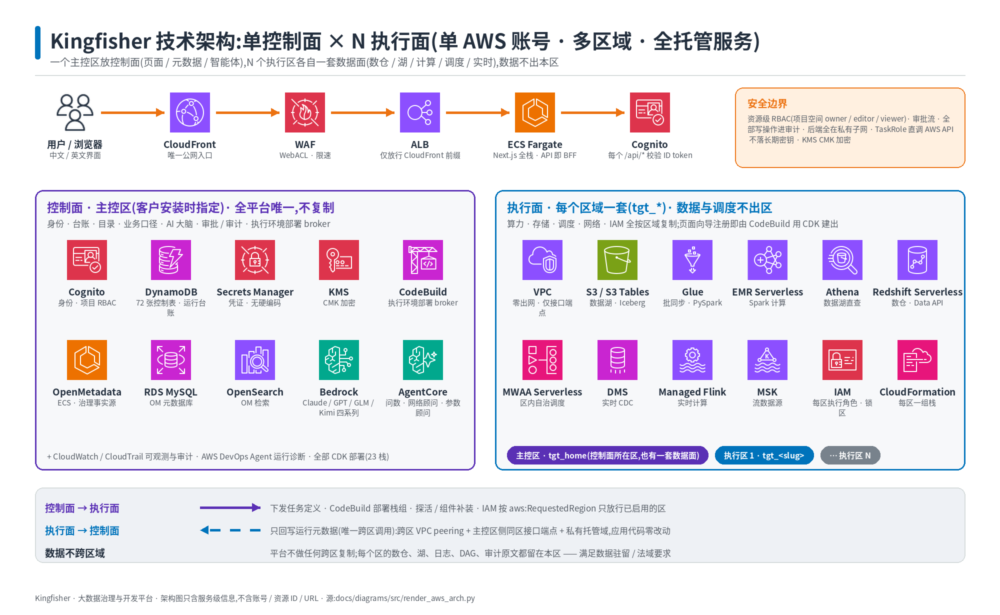

*Figure 1. One control plane in the home region, N execution regions, two cross-region channels.*

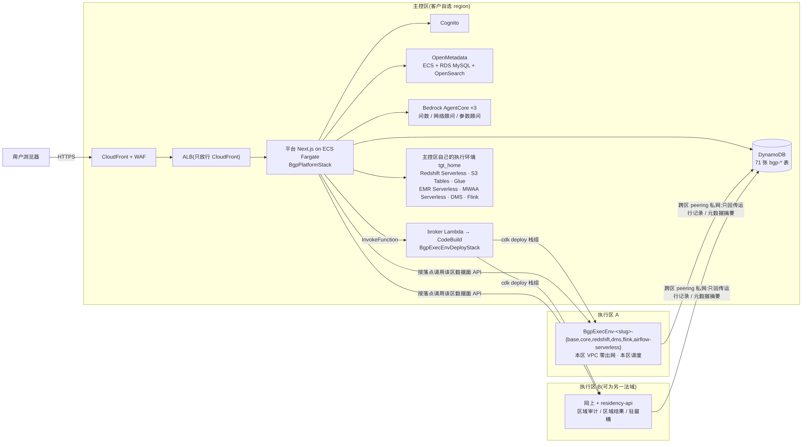

*Figure 2. Browser, control plane, home data plane and two execution regions; only run records flow back.*

The browser reaches CloudFront and WAF, then the ALB and the Next.js application on ECS Fargate. The application talks to Cognito, DynamoDB,
OpenMetadata, the three AgentCore runtimes and the deployment broker.

Each execution region receives deployments from the broker and data-plane calls from the application. Each region sends only run records and metadata
summaries back over a private cross-region link.

### 4.2 Control plane

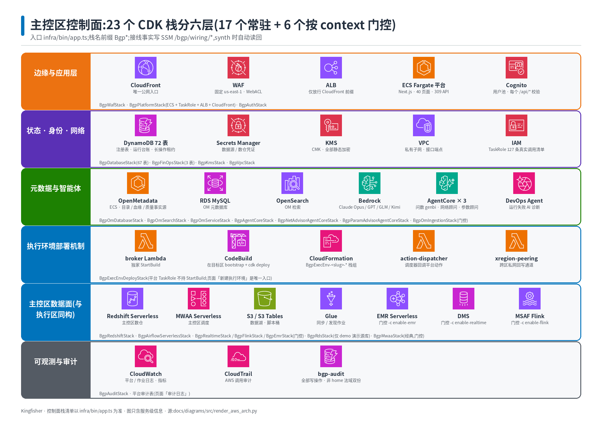

*Figure 3. Control-plane stacks: edge, application, state and identity, metadata and agents, deployment mechanism, home data plane, audit.*

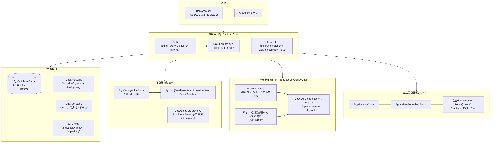

*Figure 4. The same layering as a component diagram.*

| Layer | Stacks |
|---|---|
| Edge | Waf (always in `us-east-1`), CloudFront distribution in Platform |
| Application | Platform: ALB, ECS Fargate service, task role, CloudFront |
| State and identity | Kms, Database, FinOps, Auth (Cognito), Audit (CloudTrail) |
| Metadata and agents | OmDatabase, OmSearch, OmService, OmIngestion (gated), AgentCore x3 |
| Deployment mechanism | ExecEnvDeploy: broker Lambda, CodeBuild project, source asset |
| Home data plane | Redshift, AirflowServerless, Realtime, Flink, Emr, Rds (demo), Mwaa (classic) |

The control plane has 23 stacks: 17 always deployed and 6 gated by context flags.
The task role is authorised from one manifest of real SDK calls, `infra/iam/platform-taskrole-calls.json`.
After each platform deployment the manifest is replayed against the role with IAM policy simulation.

### 4.3 Execution-region stack group

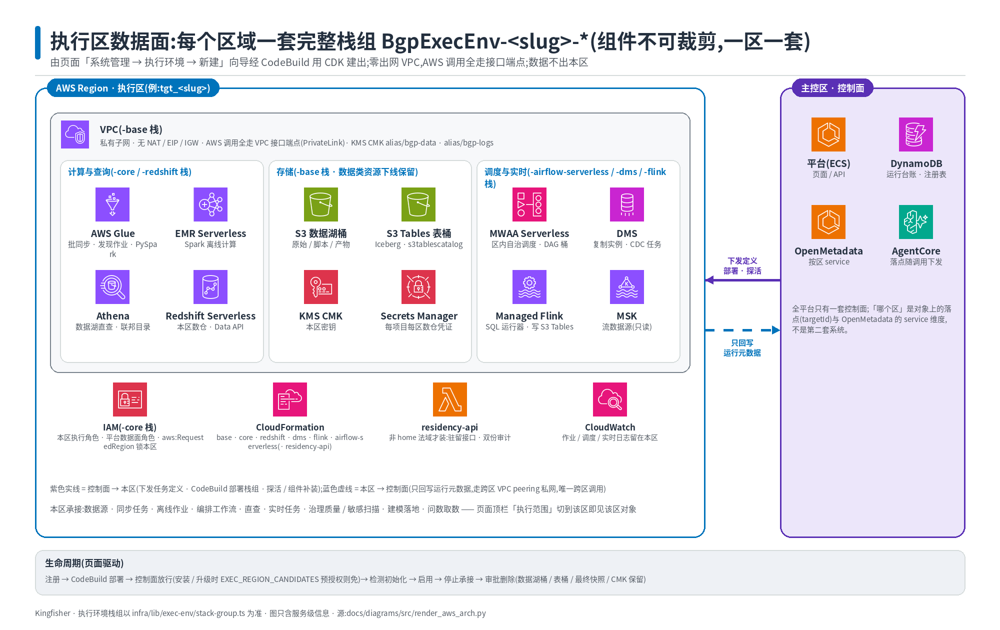

*Figure 5. Execution region: isolated VPC, compute and query, storage, scheduling and streaming, IAM and residency.*

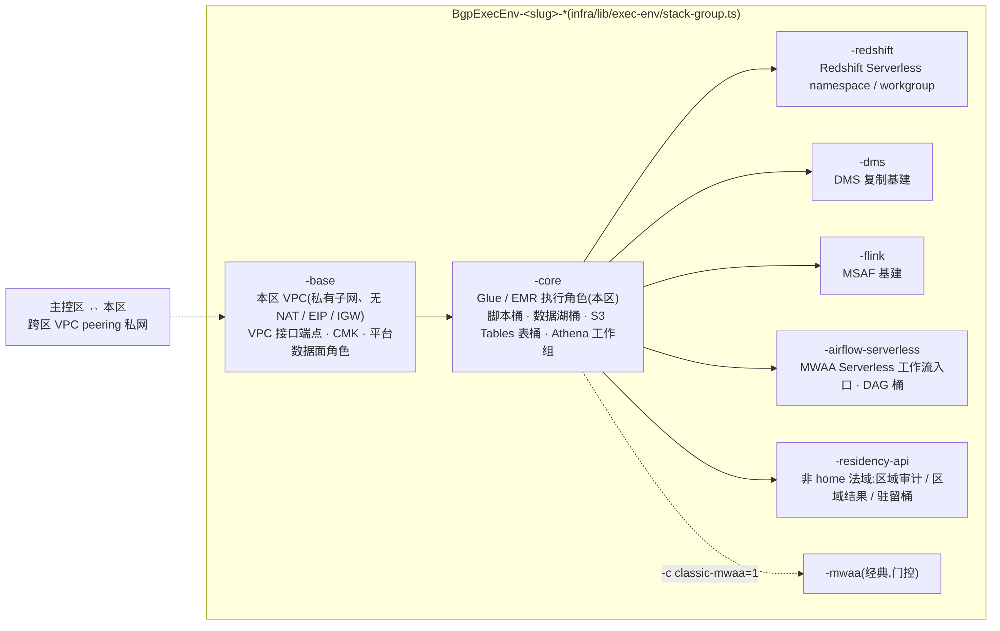

*Figure 6. Stack group `BgpExecEnv-<slug>-*`: base, core and component stacks.*

Design rules of the stack group:

- Stack names never intersect control-plane stack names, so `cdk deploy "BgpExecEnv-<slug>-*"` cannot touch the control plane.
- The group builds its own VPC, CMK and buckets. It imports no live construct from the control plane.
- Data resources (lake bucket, scripts bucket, S3 Tables bucket, CMK, regional audit tables) are retained on stack deletion and never auto-emptied.
- Every physical name is produced by the naming rule table and written back as a stack output.
- `cdk synth` of the group runs with zero credentials; an offline synth gate checks prefix, isolation, region, retention and naming.

### 4.4 Network: zero egress and the private link home

Execution VPCs have no NAT gateway, no Elastic IP and no default route. Subnets are isolated private subnets.

Every AWS call from jobs goes through a VPC endpoint. The endpoint list has one author, `infra/lib/exec-env/endpoints.ts`.

| Endpoint type | Services |
|---|---|
| Gateway (free) | S3, DynamoDB of the same region |
| Interface, always | STS, CloudWatch Logs, CloudWatch, KMS, Secrets Manager, Glue, EMR Serverless, Redshift Data, S3 Tables, Redshift Serverless |
| Interface, serverless scheduler | Airflow Serverless |
| Interface, classic scheduler only | SQS, ECR API, ECR Docker, Airflow API, environment and ops |

The only cross-region path is the run-record write-back to the home DynamoDB tables. It is carried by:

1. a VPC peering connection between the execution VPC and the home VPC, with routes on both sides;
2. a DynamoDB interface endpoint in the **home** VPC (same region, private DNS disabled);
3. a private hosted zone in the execution VPC that resolves the home DynamoDB hostname to that endpoint.

Application code is unchanged: the SDK uses the default hostname. Execution VPC address blocks are allocated from
a pool at registration so that they never overlap the home VPC. The lock semantics of the run ledger
(conditional writes) are preserved because the ledger stays a single-region table.

### 4.5 Deployment mechanism and privilege isolation

The platform deploys regions itself, but the web process never holds deployment power.

| Principal | Permissions |
|---|---|
| Platform task role | `lambda:InvokeFunction` on the broker, `codebuild:BatchGetBuilds`, `cloudformation:Describe*` |
| Broker Lambda `bgp-exec-env-broker` | `codebuild:StartBuild` on the single project `bgp-exec-env-deploy` |
| CodeBuild service role | CloudFormation and the resource permissions needed by the stack group |

The broker accepts only `{ targetId, components[], operationId }`; any extra field is rejected. Region and account are read from the registry, never
from the caller.

No build override is forwarded. The broker takes a per-target deploy lock and increments a `lockEpoch`; a stale lock from a finished build can be
taken over.

The build spec is part of the control-plane source asset and cannot be changed at runtime.
It fails fast on missing inputs, checks that the target account equals the build account, runs an availability-zone
preflight, bootstraps the region without loading the app, deploys the stack group, and writes stack outputs back.
A destroy mode deletes component stacks in reverse order and requires a final snapshot name chosen by the platform.

### 4.6 Request chain

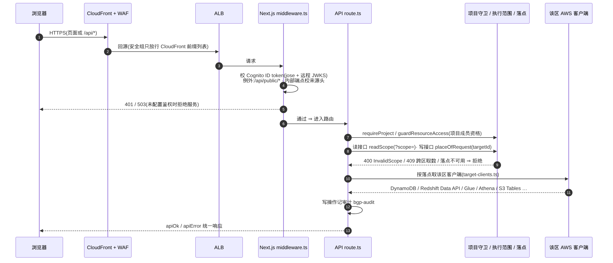

*Figure 7. CloudFront, ALB, middleware, route, guards, regional client.*

1. The browser calls CloudFront; the ALB accepts only CloudFront origins.
2. The middleware validates the Cognito ID token on every `/api/*` route; public routes and internal endpoints have their own checks.
3. The route applies the project guard (`requireProject` / `guardResourceAccess`).
4. A read route parses `?scope=`; a write route resolves the place from `targetId` in the body or the resource binding.
5. Invalid scope, cross-region data access or an unavailable place is rejected (400, 409 or 4xx) before any AWS call.
6. The route obtains the regional client for the place and performs the call.
7. Write operations are recorded in the audit table; responses use one envelope (`apiOk` / `apiError`).

### 4.7 Data flow

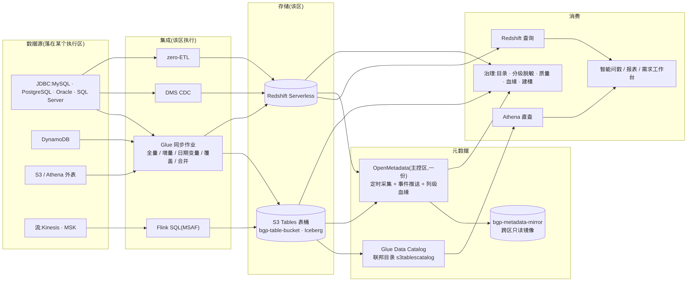

*Figure 8. Sources, integration, storage and metadata stay in the execution region; consumption reads through the control plane.*

Sources are registered in an execution region. Glue sync jobs, DMS, zero-ETL and Flink run in that region and write to the regional S3 Tables bucket
or Redshift Serverless.

The Glue Data Catalog of the region exposes the lake through the federated catalog `s3tablescatalog`. OpenMetadata in the home region receives
per-region metadata through scheduled ingestion and event push; a read-only metadata mirror feeds the cross-region overview.

### 4.8 One catalog, one agent runtime

The governance catalog is one OpenMetadata instance. A region is expressed as a catalog **service**:
`bgp-redshift` and `bgp-glue` for home, `bgp-redshift-<slug>` and `bgp-glue-<slug>` for other targets.
Catalog pages read the catalog only and filter by service; the response carries a freshness block
(`_meta.catalogFreshness`) so that users know when the regional view was last synchronised.

Natural-language querying uses one AgentCore runtime. The platform resolves the warehouse place and injects it into every tool call payload
(`rsRegion`, `rsWorkgroup`, `rsDatabase`, `rsSecretArn`). The skill Lambda builds its client for that region.

The payload always carries a place, including for home; the Lambda's own environment is never used as a fallback for a platform call. The result meta
reports `ranIn` and `backend`.

### 4.9 Lifecycle

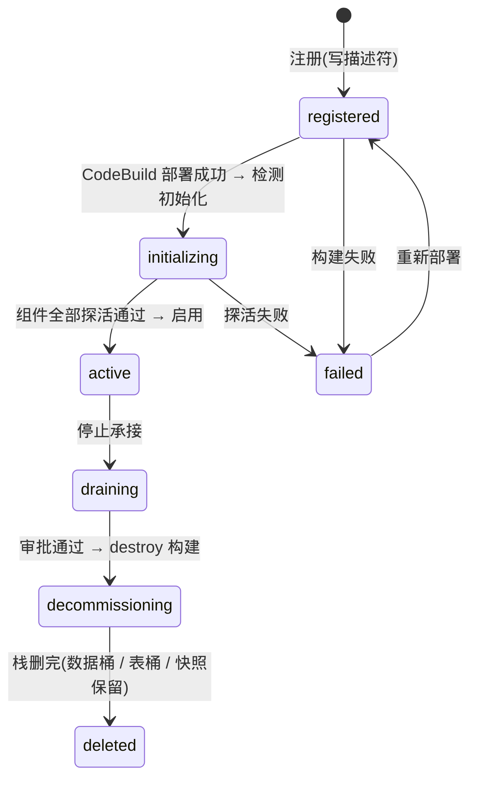

*Figure 9. Lifecycle as shown to users.*

Internally the state is split into **phase**, **health** and **in-flight operation**. The single writer is
`platform/src/lib/exec-env/lifecycle.ts`.

| Phase | Meaning |
|---|---|
| `registered` | descriptor exists, nothing deployed |
| `provisioning` | first build running or failed and retryable |
| `verifying` | build succeeded, probes pending |
| `ready` | all probes green; upgrades keep this phase |
| `draining` | no new work accepted; reversible |
| `decommissioning` | destroy build running |
| `gone` | stacks deleted; row kept as a tombstone |

Health is `unknown`, `healthy` or `degraded`. Pages show a projected status: `registered`, `initializing`, `testing`,
`active`, `degraded`, `failed`, `upgrading`, `draining`, `decommissioning`, `deleted`.
A periodic in-process reconciler (leader lease) refreshes observed state every few minutes.
A target becomes `active` only when the phase is ready, the latest probe is green and the operator clicks "Enable".

---

## 5. Interface contract

### 5.1 Principles

1. **Explicit `targetId` on every write.** Run, publish, land, delete and similar actions take the target from the body or from the resource binding. A missing target is a 400.
2. **`?scope=` on every read.** List and detail endpoints filter by scope. The default is all regions.
3. **4xx never falls back to home.** Invalid, unknown, forbidden or not-ready targets are rejected. The response never substitutes another region.
4. **Headers are not a source of place or scope.** The `x-bgp-project` header selects the project; no header selects the region.
5. **Presentation is not authorisation.** Pickers list installed targets; the write path performs its own binding checks.

### 5.2 Scope errors

| Situation | Response |
|---|---|
| Grammar invalid | 400 `INVALID_SCOPE`, `detail.received` echoes the value |
| Target unknown or deleted | 404 `TARGET_NOT_FOUND` |
| Target not visible to the project | 403 `TARGET_FORBIDDEN` |
| Target installed but not serviceable now | 409 `TARGET_NOT_READY` with the reason |
| Component missing for the page | 200 with `{ capability: "unavailable", reason }` |

A comparison scope with one bad target is rejected as a whole.
Scope filtering has two shapes: a DynamoDB filter on scalar `targetId` columns (runs, cost rows, data sources),
and in-memory filtering through `bindingTargets(row)` for rows with a `targets[]` list.
A row without `targets[]` and without `targetId` belongs to the home target.

### 5.3 API groups

| Group | Example paths | Who | Reads | Writes |
|---|---|---|---|---|
| Execution environments | `/api/admin/exec-envs/*` | platform admin | descriptors, build status | register, deploy, probe, enable, drain, delete |
| Target pickers | `/api/exec-targets?component=` | any member | installed targets by dimension | none |
| Scope counts | `/api/scope/counts?resource=` | any member | counts per target | none |
| Consistency matrix | `/api/multi-region/matrix` | viewer | definition x region cells | none |
| Metadata mirror | `/api/metadata-mirror`, `/api/admin/metadata-mirror` | member / admin | mirrored metadata facets | trigger a collection |
| Run groups | `/api/run-groups/[id]*` | viewer / editor | group and children | cancel, retry plan |
| Residency | `/api/residency/ack` | any member | none | record consent |
| Resource APIs | `/api/{sync,etl-jobs,engines,workflow,flink,modeling}/*` | editor | `?scope=` lists | `targetId` / `targets[]` actions |

### 5.4 Execution-environment administration

All routes under `/api/admin/exec-envs` require the platform admin group at the gateway.

| Method and path | Purpose |
|---|---|
| `GET /api/admin/exec-envs` | list descriptors (raw, including unhealthy rows) |
| `GET /api/admin/exec-envs/[targetId]` | one descriptor |
| `GET /api/admin/exec-envs/candidate-regions` | regions that can host a new environment, with enablement status |
| `POST /api/admin/exec-envs/preflight` | account-level checks for a region |
| `POST /api/admin/exec-envs/register` | create the descriptor; server generates `targetId`; account from the caller identity |
| `POST /api/admin/exec-envs/seed-home` | create or adopt the home descriptor from live resources |
| `POST /api/admin/exec-envs/[targetId]/deploy` | start a build; `operationId` generated server-side; upgrades carry `approvedPlanHash` |
| `POST /api/admin/exec-envs/[targetId]/preview` | plan a deployment or upgrade; returns `planHash` |
| `POST /api/admin/exec-envs/[targetId]/add-components` | full-set component deployment for an existing environment |
| `GET /api/admin/exec-envs/[targetId]/build-status?buildId=` | phase, per-stack status, log tail |
| `POST /api/admin/exec-envs/[targetId]/probe` | finalize outputs, probe each component, record result |
| `POST /api/admin/exec-envs/[targetId]/enable` | ready + green probe + testing => active, otherwise 409 |
| `POST /api/admin/exec-envs/[targetId]/drain` / `intent` | stop or resume accepting work |
| `GET /api/admin/exec-envs/[targetId]/delete-preview` | bindings, enabled schedules, running runs; all must be 0 |
| `POST /api/admin/exec-envs/[targetId]/delete-request` | create the approval item with the preview hash |
| `POST /api/admin/exec-envs/[targetId]/destroy-retry` / `recover` / `discard` | recovery paths for stuck operations |
| `POST /api/admin/exec-envs/[targetId]/access` | project allow-list: all projects or a list |
| `GET /api/admin/exec-envs/[targetId]/acks` | who accepted which disclaimer version |
| `GET /api/admin/exec-envs/[targetId]/statements?auditId=` | warehouse statements linked to an audit id |
| `GET/POST .../jobs`, `.../scheduler-preference`, `.../credential-state` | data-plane jobs, scheduler choice, credential isolation |

Registration rejects a client-supplied account or partition and rejects regions in another partition.
A non-home jurisdiction requires a disclaimer acknowledgement in the registration body.

### 5.5 Target-aware resource APIs

| Action | Parameter | Semantics |
|---|---|---|
| Publish a definition | `targets?: string[]` | per-target, serial, fail-fast; results list per target |
| Run or start | `targetId` | missing: use the definition's binding only if it has exactly one target; otherwise 400 |
| Enable a schedule | `targets?: string[]` | 409 `SCHEDULER_NOT_INSTALLED` listing every target without a scheduler, with a fix link |
| Land a model object | `{ targets, mode }` | per-target result `ok`, `drift` or `failed`; overall 200 |
| Ask a question | `targetId` | one target per conversation |
| List runs | `?scope=` | response carries `countsByTarget` for the same time window |

Run identifiers are composite, `<raw>#<targetId>`, so the same definition can run in two regions at the same time.
The run lock key also includes the target: same definition and same target are serialised, different targets run in parallel.

### 5.6 Target pickers and counts

`GET /api/exec-targets?component=<dim>` lists installed targets for a picker. The dimension is a closed list:

| Dimension | Lists |
|---|---|
| `redshift` | targets with a warehouse |
| `airflow` | targets with any scheduler component; home always listed |
| `core` | every ready target |
| `any` | the scope switcher list |

A target appears when its descriptor is valid, it is not deleted, it has completed initialisation and the project is allowed.
Draining or unconfirmed-health targets are still listed with a "not serviceable" badge.

`GET /api/scope/counts?resource=<kind>` returns `{ counts: { [targetId]: n }, total }` for the current project and
environment. It paginates to the end and is never cached. Supported kinds are the definition tables, data sources,
modelling tables and backfill plans. Run counts come from the run list response instead.

### 5.7 Run groups

A multi-region run creates a **run group** with one child run per target.

- Group status is derived from the children at read time: `submitting`, `running`, `partial-failed`, `failed`, `cancelled`, `succeeded`. A partial failure is never folded into `failed`.
- `GET /api/run-groups/[id]` returns the group and children; children of deleted targets are still listed with `region: null`.
- `POST /api/run-groups/[id]/cancel` cancels only running children, each through its own target's engine.
- `POST /api/run-groups/[id]/retry-failed` returns a retry plan; the original run route performs the retry and links it with `retryOfRunGroupId`.
- Scheduled runs in different regions join the same group through a deterministic key `rgs_` + 24 hex characters of a hash over definition kind, definition id and the cron slot.

Single-region runs do not form a group, except when they are a retry of a group.

---

## 6. Key flows

### 6.1 Add a region from the wizard

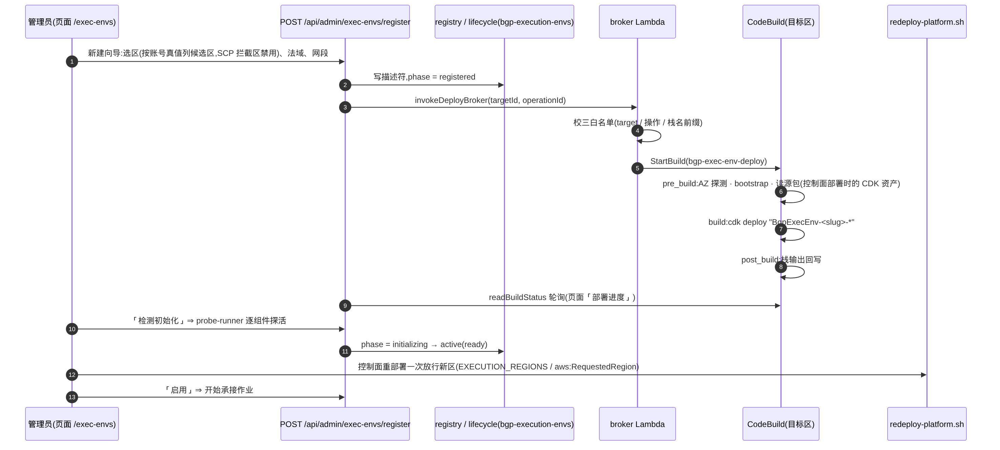

*Figure 10. Register, broker, CodeBuild, probe, enable.*

1. The administrator opens "Execution environments" and clicks "New". Step 1 lists candidate regions from the account; blocked or occupied regions are disabled with the reason. Each region shows whether the control plane already allows it.
2. Step 1 also shows the resource names that will be created and, for a non-home jurisdiction, requires the disclaimer acknowledgement.
3. Step 2 shows the complete component set as a read-only list.
4. Step 3 confirms. The server creates the descriptor (`registered`), allocates a VPC address block and invokes the broker.
5. The broker validates the whitelist, takes the deploy lock and starts the build.
6. The build runs the availability-zone preflight, bootstraps the region without loading the app, deploys `BgpExecEnv-<slug>-*` and writes stack outputs back.
7. The wizard turns into a progress view: build phase, per-stack CloudFormation status and a log tail. A failed stack can be retried in place.
8. The administrator clicks "Detect initialisation". The platform finalises outputs into the descriptor, probes every component and records the result. The S3 Tables federated catalog of the region is created on first probe.
9. If the region was not pre-authorised, the operator redeploys the control plane once to extend the IAM region allow-list, then probes again.
10. With all probes green the status becomes `testing`; "Enable" moves it to `active` and the region starts accepting bindings.

Decommissioning runs the reverse path: drain, delete preview (three counters must be zero), typed region name,
approval item, destroy build, verification that resources are gone. Data buckets, table buckets and the final warehouse
snapshot are retained.

### 6.2 Sync run

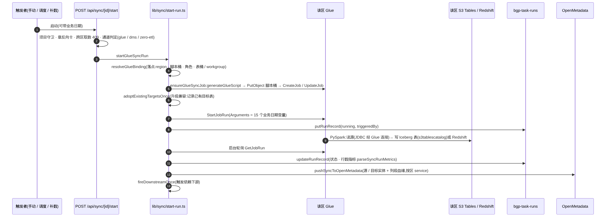

*Figure 11. A Glue sync run: guards, binding, job, run record, catalog push.*

1. A trigger (manual, schedule or backfill) calls `POST /api/sync/[id]/start` with an optional business date.
2. The route applies the project guard, checks the place stamp of the task, rejects cross-region data access with 409 and picks the channel (Glue, DMS or zero-ETL).
3. The binding is resolved to a place: region, scripts bucket, execution role, table bucket or workgroup.
4. The Glue job is generated for that place, uploaded to the regional scripts bucket and created or updated.
5. Existing target tables are recorded once for upgrade compatibility.
6. The job run is started with the business-date arguments and a run record is written as `running`.
7. PySpark reads the source through the Glue connection and writes Iceberg tables through `s3tablescatalog` or Redshift.
8. The platform polls the job run in the background, updates the run record with status and row metrics.
9. Source and target entities and column-level lineage are pushed to the catalog under the regional service.
10. Downstream dependents are fired once.

### 6.3 Scheduling per region

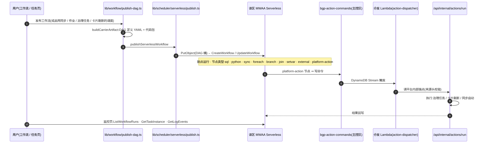

*Figure 12. Publish to the regional serverless scheduler, timed run, platform action dispatch.*

Every region schedules its own work. A definition bound to two regions is published twice, once per region.

1. The user publishes a workflow or enables the schedule of a sync task, job, governance task or dashboard card.
2. The platform first checks that every bound target has a scheduler component. If any lacks one, it returns 409 with the full list and a link to install the component. No artifact is written in that case.
3. For each target the platform builds the carrier artifact: a DAG definition in YAML and a code package.
4. The artifact is uploaded to the regional definition bucket and the workflow is created or updated in that region's serverless Airflow.
5. At the scheduled time the regional scheduler runs the nodes: SQL, Python, sync, foreach, branch, join, setvar, external and platform-action.
6. A platform-action node writes a command row to the home region; a stream-triggered dispatcher Lambda calls the internal action endpoint, which executes the action and writes the result back.
7. Each run writes its run record to the home ledger through the private link. Scheduled runs in several regions share one run group key.
8. Monitoring reads runs, task instances and logs from the region that executed them.

Naming of the per-region artifact is `<base>` for home and `<base>__<targetId>` for other targets.
When both scheduler components are present the target's `schedulerPreference` decides; the default is serverless.

### 6.4 Natural-language querying across regions

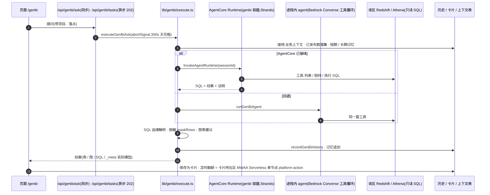

*Figure 13. One question, one region, one agent runtime.*

1. The user picks the region in the scope switcher and asks a question on the query page.
2. The request carries the project and the `targetId`. One conversation is anchored to one region; switching region starts a new conversation.
3. The platform grounds the question with business context, published datasets and memory from the control plane.
4. The platform resolves the warehouse place of the target and invokes the single AgentCore runtime with the place in the payload.
5. The agent's tools list tables, sample data and execute read-only SQL in that region's warehouse.
6. If the agent runtime is unavailable the in-process agent runs the same tools against the same place.
7. The platform parses SQL lineage, applies masking by classification (including aliased result columns), suggests a chart and records the history with the `targetId`.
8. The result card shows the SQL, the data, the model used and the region the SQL ran in.
9. A result can be saved as a card. Card refresh is scheduled by the serverless scheduler of the card's own region.

Questions are not fanned out to several regions. Comparing regions is done through the direct-query page (one SQL,
one sheet per region) or the consistency matrix.

---

## 7. Interaction design essentials

### 7.1 Scope switcher

The page header has three tiers: project space, environment, **execution scope**. The control is never called "Region".

- Options are grouped by region; the selected value is always a `targetId`. Each option shows region, name, jurisdiction, health and component badges.
- Three states: all, one target, compare (2-4, only on cost and matrix pages).
- The URL is authoritative. The last choice is stored per project and environment and written back into the URL on cold start. A stored choice that no longer exists falls back to "all" with an explicit notice.
- Switching scope never leaves the page and never reloads it.
- Only installed targets are listed. A fresh installation lists only the home target, and single-target pages render it without asking.

Six guard rails apply on every scoped page:

1. Never lose things: in one-region view a notice says "other scopes have N more items" with a link to "all".
2. Write buttons restate the target: "Run now - <region>", "Publish to 2 regions"; confirmations name every region.
3. Instances point back to their definition: "from home definition X - v3".
4. A single-target page in "all" view asks the user to choose; it never silently picks home.
5. In "all" view a definition is one row that expands into per-region instances.
6. Compare mode exists only for cost and the consistency matrix.

Every route declares its scope capability: wired, wired with a listed partial area, not yet wired with a stated gap,
or global-only with a closed reason code and a pointer to where regional data lives. Not-yet-wired pages show a
permanent notice. A guard test keeps the count of such pages from growing.

### 7.2 Badges and labels

| Element | Where | Meaning |
|---|---|---|
| Home badge | environment cards | the control-plane region; cannot be deleted |
| Status badge | cards and detail | projected lifecycle status, one colour per status |
| "Not serviceable" badge | scope switcher | installed but draining, unconfirmed or mid-operation |
| Jurisdiction label | query sheets, matrix columns, run rows | neutral globe label with region and jurisdiction |
| Consent indicator | pages of a non-home jurisdiction | "disclaimer vN accepted" for the current user |
| Scheduler tag | job lists and run history | "Serverless" or "MWAA" |
| Binding tag | matrix rows | shared across regions or region-exclusive |
| Audit id | query sheet header | copyable id linking the query to its regional audit row |

### 7.3 Wizard and environment detail

- The wizard has three steps and turns into the live progress view after "Start deployment".
- The detail page shows one row per component with a probe badge (untested, green, red with reason) and the network row "zero egress, interface endpoints n/n, private link to home".
- An "Authorised projects" card switches between all projects and an allow-list, with an impact preview of projects that would lose visibility.
- An "Acknowledgements" list (non-home jurisdiction) shows who accepted which disclaimer version, read-only.
- A retired component stays visible with a disabled checkbox and a "no longer offered" tag; existing installations keep working.
- Deleting an environment has four gates: platform admin only, impact preview with three counters, typed region name, approval with the preview snapshot replayed to the approver.

### 7.4 Consistency matrix

The multi-region dashboard shows definitions as rows and regions as columns. Each cell shows the deployed version and a state.

| Cell state | Rendering | Needs attention |
|---|---|---|
| `ok` | green check | no |
| `stale` | yellow, version behind | yes |
| `failed` | red | yes |
| `never-deployed` | yellow, bound but never published | yes |
| `drift` | red, a different table already exists | yes |
| `specialized` | marker, intentionally different | no |
| `not-bound` | dash | no |
| `unavailable` | marker, data not present in that region | no |

Only resource types whose publish path writes the deployment ledger appear in the matrix. Draft definitions that were never published are excluded.

Columns include retired targets flagged as inactive. A cell action redeploys to that one region after an impact preview; `drift` has no one-click
action.

### 7.5 Scheduler-missing notice

When a schedule cannot be published because a region lacks a scheduler component, the page renders a persistent
notice card under the schedule area. It lists each affected target with region and name, states that timed work
runs only in its own region, and offers "Install scheduler in execution environment", which opens the detail page
with the component row highlighted.

### 7.6 Multi-region direct query

The warehouse query page can submit one SQL to several regions. Each region has its own sheet with its own lifecycle: results appear as they arrive,
an error is shown in its own sheet, and a timeout cancels only that sheet.

A comparison sheet is first. Results are never merged automatically.

---

## 8. Acceptance criteria

The following behaviours are verified in a real deployment by driving the web pages with a headless browser.
Backend state (registry rows, stack status, warehouse history) is used only to corroborate what the page shows.

### 8.1 Onboarding and lifecycle

- [ ] The wizard lists only regions enabled in the account; blocked regions are disabled with a reason; the naming preview matches the naming rules.
- [ ] Starting deployment creates a `registered` descriptor with a server-generated id and a build id; the progress view shows per-stack status.
- [ ] A pre-authorised region reaches green probes and `active` without any command-line step.
- [ ] A region that is not pre-authorised shows the "needs one enablement" note in the wizard before the build.
- [ ] "Detect initialisation" turns green for every declared component; a green probe that does not cover the component set does not advance the state.
- [ ] "Enable" is clickable only after green probes and moves the status to `active`.
- [ ] Two deployments of the same target cannot run at once; the second is refused or queued.
- [ ] Calling the build project directly with the platform identity is denied by AWS; build overrides are denied.
- [ ] A stale or non-ready target rejects new work with a message that names the reason; nothing runs in the home region instead.
- [ ] Deleting the home environment is hidden in the UI and refused by the API.
- [ ] After decommissioning, data buckets, table buckets and the final snapshot still exist; compute and network stacks are gone.
- [ ] Entering `draining` immediately refuses new bindings, schedules and runs; a stale operation cannot write state after the epoch changed.

### 8.2 Network

- [ ] The execution VPC has zero NAT gateways and zero Elastic IPs; private route tables contain no default route.
- [ ] The set of VPC endpoints covers every AWS service called by job code.
- [ ] From inside the execution VPC the home DynamoDB hostname resolves to a private address and a conditional write succeeds; without the hosted zone the same call times out.
- [ ] A call to a service without an endpoint times out; a public HTTPS address times out.
- [ ] Redshift, Glue and EMR Serverless jobs and a scheduled workflow succeed in the zero-egress region, and their run records appear in the home ledger.

### 8.3 Scope

- [ ] Selecting a region changes the list on the same route, puts `?scope=<targetId>` in the URL, survives a refresh and works when pasted into a new tab.
- [ ] Row counts in one-region view equal the rows bound to that region; the "other scopes have N" number equals the rows of the other visible regions.
- [ ] An unknown, malformed, forbidden or not-ready scope returns the documented 4xx; the page shows no home data and does not rewrite the URL.
- [ ] Opening a global-only page does not reset the switcher; returning to a scoped page keeps the scope.
- [ ] Run buttons restate the region; multi-region confirmations name each region and the resulting runs are stamped with those targets.
- [ ] A request header naming another target does not change where a run executes.
- [ ] The switcher lists only installed targets; an initialising or failed target is absent; a draining target is present with a badge.

### 8.4 Execution and scheduling

- [ ] A definition bound to two regions publishes one artifact per region into that region's bucket, and both schedulers run it.
- [ ] Scheduled runs from two regions appear as two run records with distinct composite ids and are grouped under one run group.
- [ ] Publishing to a target without a scheduler returns 409, writes no artifact, and the page shows the notice card with a working fix link.
- [ ] Taking a schedule offline removes the workflow and the artifact in every region; a failed offline keeps the ledger and reports 502.
- [ ] A direct query against a second region executes in that region's workgroup, as shown by that region's query history.
- [ ] Landing a model object to two regions creates the table in both; a pre-existing different table yields `drift`, not `ok`.
- [ ] Taking a task offline in one region removes that region's artifact only.

### 8.5 Catalog and querying

- [ ] The catalog shows the second region's tables under its own service and displays the synchronisation freshness.
- [ ] A question asked in a second region executes SQL in that region; the result card shows the region and the model used.
- [ ] Masking applies to aliased and computed result columns.

### 8.6 Residency and audit

- [ ] Registering a non-home jurisdiction without the disclaimer acknowledgement is refused.
- [ ] A user's first data operation on a non-home jurisdiction target returns the consent prompt; after consent the operation proceeds and the prompt does not return for the same version.
- [ ] Each data operation on such a target produces a full regional audit row and a central summary; if either write fails the operation is not executed.
- [ ] The acknowledgement list on the environment page shows the registering administrator and each consenting user.
- [ ] Pages contain no legal qualifications such as "data export" or "legal filing".

---

## 9. Residency and audit

### 9.1 Model

Each target carries a `jurisdiction` label (`home` by default; otherwise a lowercase token of 2-32 characters).
A target in another jurisdiction is treated exactly like a same-jurisdiction target, with two additions:

1. a **technical prerequisite**: the `residency-api` component (regional audit and result storage) and per-target execution roles must be present, otherwise the target does not accept work;
2. **auditability**: every data operation is written to the regional audit store in full and to the central audit table as a summary without personal data.

The platform makes no legal decision, keeps no legal gate and never refuses an operation for residency reasons.
Registering such a target is the customer's decision.

### 9.2 What stays regional and what is central

| Regional only | Central (summary) |
|---|---|
| operator identity, SQL text, statement ids, entry point, trigger kind, auth kind | SQL hash, target, row count, duration, status |
| query results, answer text, conversation memory, SQL history | query id hash, region, scanned bytes, model used |
| exported files, regional result buckets | counts, verdicts, health scores |

Metadata needed for cross-region overviews (catalog entities, lineage, quality verdicts) is mirrored without data rows.
The regional audit and result stores are retained when an environment is deleted.
The task role is explicitly denied delete and update on audit rows.

### 9.3 Disclaimer and consent

The disclaimer text has one author, `platform/src/lib/residency/disclaimer.ts`, with a version and a text hash. Consent is recorded twice: by the
administrator at registration (stored in the descriptor) and by each user on their first data operation against the target (stored in
`bgp-residency-acks`).

The server enforces consent with 409 when it is missing; the dialog is only the rendering of that response. The environment page lists all
acknowledgements.

### 9.4 Audit ids

Each warehouse statement submitted for a non-home jurisdiction target is named with an audit id (`audit_` + ULID).
The query sheet shows the id; `GET /api/admin/exec-envs/[targetId]/statements?auditId=` resolves it to the statements
in that region without returning SQL text.

### 9.5 Known residency boundary

The AI model hop uses global inference profiles. For a target in another jurisdiction the prompt (schema and query results) is routed by the model
service, not by the platform.

Pure SQL, lake and BI paths remain regional. This boundary is documented to users and is on the roadmap as region-pinned models.

---

## 10. Limits and roadmap

### 10.1 Design limits

- One execution environment per region; components are a complete set and cannot be removed individually.
- No cross-region task dependencies and no platform-driven cross-region data copy.
- Cross-jurisdiction SQL history and conversation memory stay regional; there is no unified cross-region history view.
- Residency is enforced by architecture and audit, not by organisation-level policies; multi-account controls are outside this design.
- The control plane is single-region; a control-plane outage stops administration while regional schedulers keep running.
- The classic Airflow environment is no longer offered for new installations; existing environments keep working.
- The consistency matrix covers only resource types whose publish path writes the deployment ledger; definitions never published are not shown.
- Region-specialised copies of a shared definition are modelled (the `specialized` cell state) but have no authoring path yet.
- Scope wiring is tracked per route; routes declared "not yet wired" show a permanent notice and are counted by a guard test.
- Orchestration (workflow) runs are not grouped into run groups.

### 10.2 Roadmap (as stated in the design)

- Browser-direct regional data API for cross-jurisdiction targets, as a proximity optimisation rather than a gate.
- Regional-side masking for cross-jurisdiction results.
- Region-pinned model inference profiles to close the AI model hop.
- Per-member target assignment and a region-administrator role within a project.
- Authoring path for region-specialised copies with a "follow shared definition again" action.
- Target dimension for workflow bindings and run grouping of workflow runs.

---

## Appendix A. Where the facts live

| Topic | Path |
|---|---|
| Target identity and slug | `platform/src/lib/exec-env/target-id.ts` |
| Registry and admission | `platform/src/lib/exec-env/registry.ts` |
| Lifecycle state machine | `platform/src/lib/exec-env/lifecycle.ts` |
| Component probe contract | `platform/src/lib/exec-env/component-contract.ts` |
| Place resolution | `platform/src/lib/place/resolve.ts` |
| Scope grammar and server reader | `platform/src/lib/scope/scope.ts`, `platform/src/lib/exec-env/scope.ts` |
| Data-plane credential modes | `platform/src/lib/aws/dataplane-creds.ts` |
| Region allow-list at synth | `infra/lib/shared/execution-regions.ts`, `scripts/lib/execution-regions.sh` |
| Stack group | `infra/lib/exec-env/stack-group.ts` |
| VPC endpoint list | `infra/lib/exec-env/endpoints.ts` |
| Build spec | `infra/buildspec/exec-env-deploy.yml` |
| Deployment broker | `infra/lambda/exec-env-broker/index.mjs` |
| Residency prerequisite, audit, disclaimer | `platform/src/lib/exec-env/residency.ts`, `residency-audit.ts`, `platform/src/lib/residency/disclaimer.ts` |
| Consistency matrix | `platform/src/lib/exec-env/consistency-matrix.ts` |
| Metadata mirror | `platform/src/lib/exec-env/metadata-mirror.ts` |
| Multi-region direct query | `platform/src/lib/redshift/multi-region-query.ts` |
| Decommission | `platform/src/lib/exec-env/decommission.ts`, `delete-impact.ts` |
