# Architecture and Flow Diagrams

This folder holds every figure used by the Kingfisher documentation, together with the sources needed to
regenerate it. Figures are committed as static PNG files so that they render everywhere, including offline
and in viewers without Mermaid support.

- `*.png` in this folder: the rendered figures referenced from `README.md`, `docs/*.md` and `docs/design/*.md`.
- `src/*.mmd`: Mermaid sources for flow, sequence and structure diagrams.
- `src/render_aws_arch.py` and `src/aws-icons/`: the Python renderer and the AWS Architecture Icons used by
  the service-view figures.

> **Scope of this index (as of 2026-10-14)**: **section 0 lists the current figures of the multi-region release
> (`release-2026-10-13`)**; they are embedded in [`../architecture.md`](../architecture.md) and
> [`../modules.md`](../modules.md) and are maintained with every release. Sections 1 and later are **historical
> figures from the single-region stage (2026-08)**: the system architecture, the stack dependency graph and the
> other figures there reflect the single-region deployment shape (for example "DynamoDB, 61 tables" was the number
> at that time; today there are 71 tables). They are kept for traceability only. The DEEP-DIVE companion figures
> (Ask-Your-Data, AgentCore, observability) describe mechanisms inside the home region and remain valid.
>
> Every figure in the repository is a static PNG; Markdown never embeds live Mermaid rendering (it fails on weak
> network connections).

> Professional figures intended for all users. AWS architecture figures use the **official AWS icons** (generated
> with the `diagrams` library plus graphviz; the source code reproduces them). Flow and sequence diagrams are
> **static PNG files** (rendered from the Mermaid sources `src/*.mmd` with mermaid-cli; Mermaid is not embedded in
> Markdown, so the figures display correctly even on a weak network or when scripts fail).
> Figures carry service-level information only and **never contain a real AWS account ID, resource ID or URL**.

## 0. Current figures of the multi-region release (`release-2026-10-13`)

- The four architecture figures with official AWS icons (Figures 0 to 0d) are produced by `src/render_aws_arch.py`
  (Pillow plus Noto Sans CJK; re-render with `python3 docs/diagrams/src/render_aws_arch.py`, which writes the four
  `aws-*.png` files into this folder regardless of the working directory; the icons are in `src/aws-icons/`).
- All other sources are `src/mr-*.mmd` (the four lake table-bucket routing figures are `src/lake-*.mmd`, rendered
  with the same parameters). Rendering (high resolution, about 3000 px wide):
  `cd docs/diagrams && mmdc -i src/mr-<name>.mmd -o mr-<name>.png -b white -w 1000 -s 3`
  (global `@mermaid-js/mermaid-cli` 11; requires a Chromium and a CJK-capable font). The tooling (mermaid-cli with a
  Chromium, Pillow and a CJK-capable font) is listed in [`../supported-versions.md`](../supported-versions.md).
- Since 2026-10-14 every Mermaid-sourced figure (including the historical figures from section 1 onward, 38 figures
  in total) has been re-rendered with these same parameters.
- Do not use `;` in message or note text: Mermaid treats it as a statement separator.

| Figure | File | Embedded in | What it shows | Source |
|---|---|---|---|---|
| Figure 0 | `aws-overview.png` | `README.md` section 1.1 · `../architecture.md` section 1.1 · `../design/multi-region-execution.md` section 4.1 | **Official AWS icons**: overview of one control plane × N data planes (entry chain · 10 control-plane components · 12 data-plane components · the two cross-region channels); AWS service view: entry chain, one control plane in the home region, one data plane per execution region. Icons from `src/aws-icons/` (Architecture Icons 2026-07-31) | `src/render_aws_arch.py` |
| Figure 0b | `aws-control-plane.png` | `README.md` section 1.2 · `../architecture.md` section 2 · `../design/multi-region-execution.md` section 4.2 | Official AWS icons: the 23 control-plane stacks of the home region grouped into six layers (edge and application / state, identity and network / metadata and agents / execution-environment deployment mechanism / home-region data plane / observability and audit) | `src/render_aws_arch.py` |
| Figure 0c | `aws-execution-region.png` | `README.md` section 1.3 · `../architecture.md` section 3 · `../design/multi-region-execution.md` section 4.3 | Official AWS icons: the execution-region data plane, the `BgpExecEnv-<slug>-*` stack group (zero-egress VPC · compute and query · storage · scheduling and streaming · IAM / CloudFormation / residency) and the single cross-region channel that writes back to the home region | `src/render_aws_arch.py` |
| Figure 0d | `aws-multi-region.png` | `README.md` section 1.4 · `../architecture.md` section 1.4 | Official AWS icons: the multi-region mechanics (execution scope / explicit place / no cross-region reads / autonomous scheduling per region · one AgentCore, one OpenMetadata) | `src/render_aws_arch.py` |
| Figure 1 | `mr-overview.png` | `../design/multi-region-execution.md` section 4.1 | Deployment shape overview: home-region control plane + N execution regions + cross-region peering (the private link back to the home region) | `src/mr-overview.mmd` |
| Figure 2 | `mr-control-plane.png` | `../design/multi-region-execution.md` section 4.2 | Control-plane component layering of the 23 stacks: edge / application layer / state and identity / metadata and agents / execution-environment deployment mechanism / home-region data plane | `src/mr-control-plane.mmd` |
| Figure 3 | `mr-exec-env-stacks.png` | `../design/multi-region-execution.md` section 4.3 | The 8 stacks of the execution-environment stack group `BgpExecEnv-<slug>-*` and their dependencies | `src/mr-exec-env-stacks.mmd` |
| Figure 4 | `mr-request-chain.png` | `../architecture.md` section 5.1 · `../design/multi-region-execution.md` section 4.6 | Request-chain sequence: browser → CloudFront → ALB → middleware → route → guards → the AWS client of that region | `src/mr-request-chain.mmd` |
| Figure 5 | `mr-flow-add-exec-env.png` | `../architecture.md` section 3.3 · `../design/multi-region-execution.md` section 6.1 | Sequence for adding an execution region through the web wizard: Register → broker → CodeBuild → Check initialization → Enable → control-plane authorization | `src/mr-flow-add-exec-env.mmd` |
| Figure 6 | `mr-flow-sync-run.png` | `../architecture.md` section 5.2 · `../design/multi-region-execution.md` section 6.2 | Sequence of a data synchronization run (Glue channel) through Glue in the target region | `src/mr-flow-sync-run.mmd` |
| Figure 7 | `mr-flow-scheduling.png` | `../architecture.md` section 5.3 · `../design/multi-region-execution.md` section 6.3 | Scheduling: publishing a workflow to the regional MWAA Serverless, timed execution, and dispatching platform actions | `src/mr-flow-scheduling.mmd` |
| Figure 8 | `mr-flow-genbi.png` | `../architecture.md` section 5.4 · `../design/multi-region-execution.md` section 6.4 | Ask-Your-Data sequence: a natural-language question answered against the target region's warehouse or lake — AgentCore / in-process fallback / masking / cards | `src/mr-flow-genbi.mmd` |
| Figure 9 | `mr-data-flow.png` | `../architecture.md` section 6 · `../design/multi-region-execution.md` section 4.7 | Data flow: sources → integration → storage → metadata → consumption | `src/mr-data-flow.mmd` |
| — | `mr-module-sync.png` | `../modules.md` section 2.2 | Data Sync module architecture | `src/mr-module-sync.mmd` |
| — | `mr-module-genbi.png` | `../modules.md` section 4.1 | Ask-Your-Data module architecture | `src/mr-module-genbi.mmd` |
| — | `mr-module-exec-env-lifecycle.png` | `../modules.md` section 7.2 · `../design/multi-region-execution.md` section 4.9 | Execution environment lifecycle state machine | `src/mr-module-exec-env-lifecycle.mmd` |
| — | `lake-binding-current-vs-target.png` | `../design/lake-bucket-routing.md` section 1 | Lake table-bucket routing: the current "one platform table bucket per region" binding compared with the target "one route table per region" (source `src/lake-binding-current-vs-target.mmd`, 2026-11-03) | `src/lake-binding-current-vs-target.mmd` |
| — | `lake-route-resolution.png` | `../design/lake-bucket-routing.md` section 6.4 | Lake table-bucket routing, route resolution flow: alias / bucket / namespace → hit · miss 400 · ambiguity 400 · not writable 400/409, never a silent fallback (source `src/lake-route-resolution.mmd`) | `src/lake-route-resolution.mmd` |
| — | `lake-job-submit-sequence.png` | `../design/lake-bucket-routing.md` section 6.5 | Lake table-bucket routing, job save / submit sequence: select routes → check conflicts with user `conf` → preflight per bucket → inject one Spark catalog per bucket → Glue run (source `src/lake-job-submit-sequence.mmd`) | `src/lake-job-submit-sequence.mmd` |
| — | `lake-data-model.png` | `../design/lake-bucket-routing.md` section 6.2 | Lake table-bucket routing data model: SETTINGS row plus fields = LakeRoute, the implicit platform route, and the declaring fields on jobs / syncs / Flink jobs (source `src/lake-data-model.mmd`) | `src/lake-data-model.mmd` |

Where each figure is embedded: `README.md` (overview), `../architecture.md` (service views and flows),
`../design/multi-region-execution.md` (multi-region figures) and `../design/lake-bucket-routing.md`
(lake figures).

## 1. System architecture (official AWS icons)

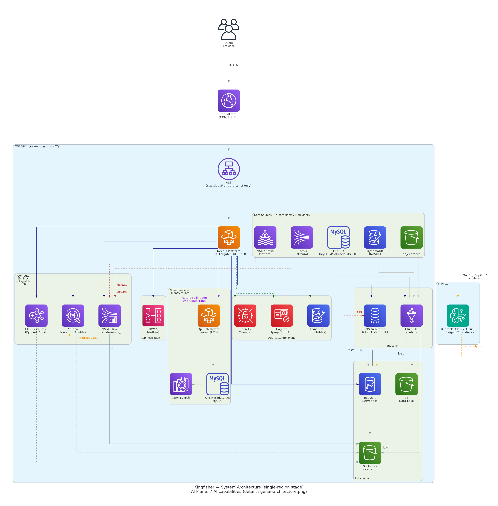

- Users access the platform through **CloudFront (HTTPS)**;
  the ALB security group admits only the CloudFront prefix list;
  the application is a full-stack Next.js app on **ECS Fargate**.
- The control plane uses **Cognito (per-workspace RBAC) / DynamoDB (61 tables) / Secrets Manager**.
- Data integration covers **data sources of four paradigms and 8 providers** (the four JDBC siblings MySQL / PostgreSQL / Oracle / SQL Server,
  object storage S3, NoSQL DynamoDB, streams Kinesis / MSK), landing them in the lakehouse **S3 Tables (Iceberg) / Redshift Serverless / S3 data lake**
  through **batch (Glue ETL, full / incremental) plus real-time CDC (DMS / Zero-ETL / Flink)**;
  compute engines form a **pluggable SPI** (Glue PySpark / SQL, EMR Serverless, Athena, Redshift SQL, MSAF Flink stream computing), scheduled by **MWAA**;
  data governance is carried by **OpenMetadata** (ECS + its own RDS MySQL + OpenSearch).
- On the right, the **AI plane** (Bedrock Claude Opus + 3 AgentCore stacks, carrying 7 user-visible AI capabilities: GenBI / Copilot /
  network and parameter advisors / DevOps diagnosis / AI codegen) runs **read-only SQL** on Redshift / Athena; see section 2.1 below.

> Reproduce: `python3 docs/diagrams/src/system-architecture.py` from the repository root (requires `pip install diagrams` plus graphviz).

## 2. OpenMetadata metadata ingestion architecture (official AWS icons)

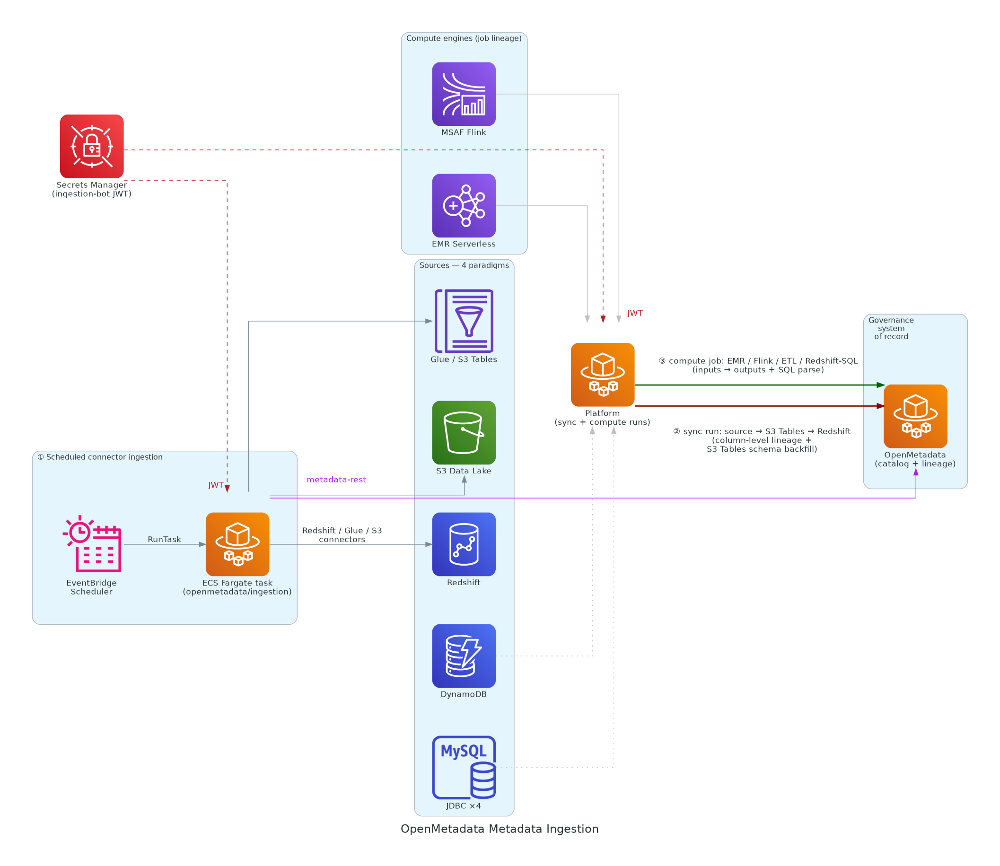

Two complementary paths make OpenMetadata the system of record for catalog and lineage: (1) **periodic connector ingestion**
(EventBridge Scheduler → an ECS Fargate task running the `openmetadata/ingestion` image, connecting to Redshift / Glue / S3);
(2) **platform event push** (on every synchronization the platform pushes `source → S3 Tables → Redshift` column-level lineage and
back-fills the S3 Tables columns from the source schema, bypassing Lake Formation). Authentication uses the ingestion-bot JWT
stored in Secrets Manager throughout.

> Reproduce: `python3 docs/diagrams/src/om-ingestion-architecture.py` from the repository root.

## 2.1 GenAI / AgentCore plane (official AWS icons)

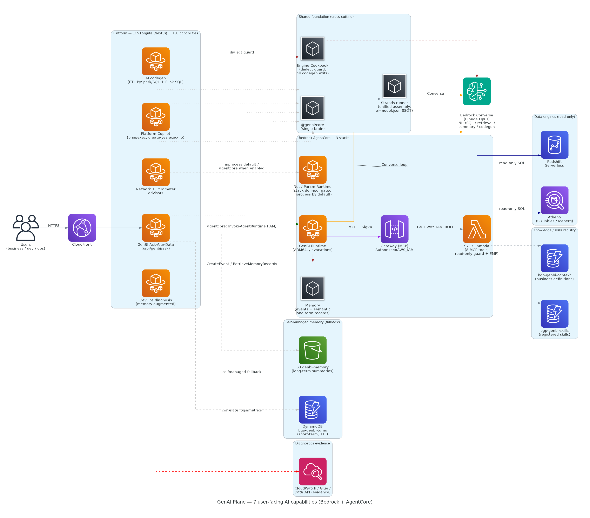

- **7 user-visible AI capabilities** (GenBI Ask-Your-Data / platform Copilot [may create, guardrail forbids execution] / network advisor /
  parameter advisor / DevOps fault diagnosis [memory-augmented] / AI codegen [ETL PySpark · SQL + Flink SQL]) share one
  **kernel + assembly + dialect-governance** foundation: `@genbi/core` (the single brain) + the **Strands runner** (unified assembly,
  `ai-model.json` as the single source of truth) + the **Engine Cookbook** (dialect guard for every codegen exit).
- Underneath are **Amazon Bedrock (Converse / Claude Opus)** + **3 AgentCore stacks** (the GenBI Runtime is live; the network / parameter
  advisor stacks are defined but run in-process by default, and their Runtime is gated and not deployed);
- GenBI skills run read-only SQL on Redshift / Athena through **Gateway (MCP, SigV4) → Skills Lambda (8 MCP tools, read-only guard + EMF)**;
  conversation memory has **two back ends: managed AgentCore Memory and self-managed DynamoDB + S3**.
- The accompanying **end-to-end implementation details** are in **[`../deep-dive.md`](../deep-dive.md)** (concept layer sections 1–14 plus
  source-code layer section 15);
  the **two-hour stage briefing** is **[`../deep-dive-brief.md`](../deep-dive-brief.md)**.

> Reproduce: `python3 docs/diagrams/src/genai-architecture.py` from the repository root (requires `pip install diagrams` plus graphviz).

## 3. Data flow (static figure)

> Four paradigms / 8 sources → batch (Glue ETL) + real-time CDC (DMS / Zero-ETL / Flink) → lakehouse (S3 Tables / Redshift / S3 data lake)
> → multi-engine compute (SPI) → GenAI plane; table / column metadata along the whole chain plus column-level and compute lineage
> flow into OpenMetadata.

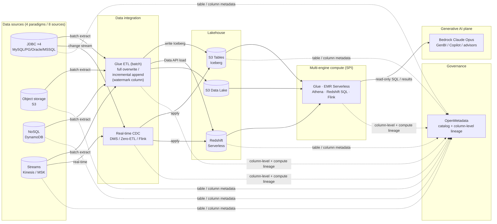

## 4. Data synchronization sequence (static figure)

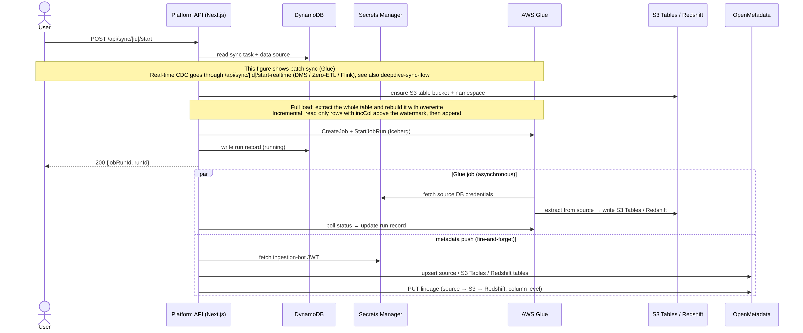

## 5. OpenMetadata periodic ingestion sequence (static figure)

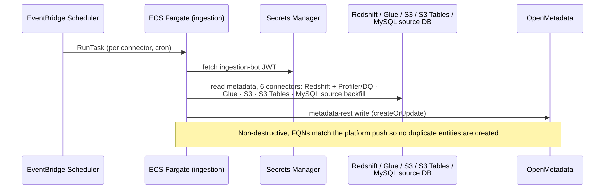

## 6. CDK infrastructure stack dependencies (static figure)

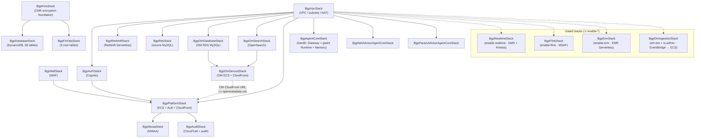

## 7. Workflow orchestration and dependency scheduling sequence (static figure)

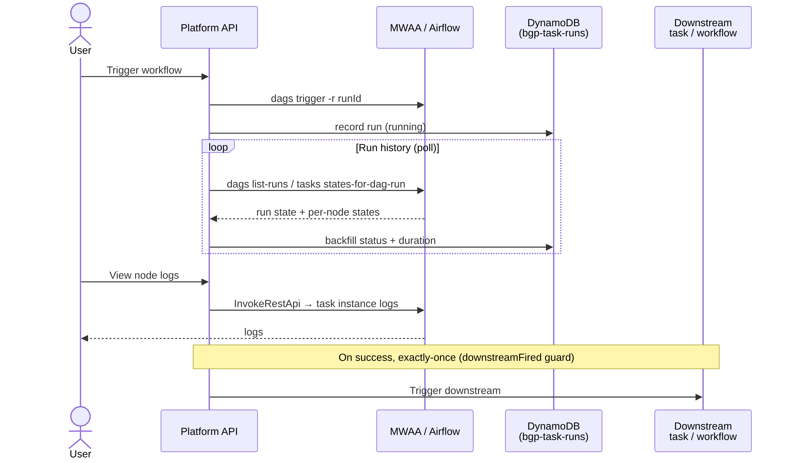

## 8. Authentication and request-chain sequence (static figure)

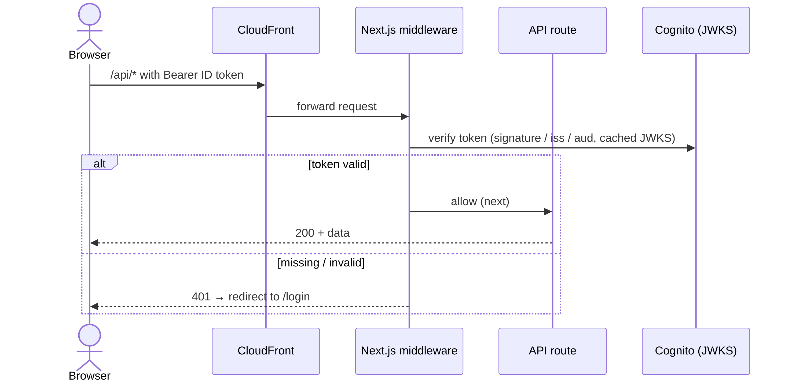

## 9. GenBI Ask-Your-Data sequence (static figure)

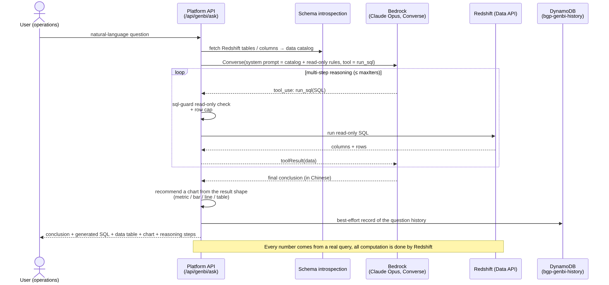

## 10. GenAI deep-dive sequences (static figures, companion to `../deep-dive.md`)

### 10.1 GenBI NL→SQL reasoning loop (tool-use loop)

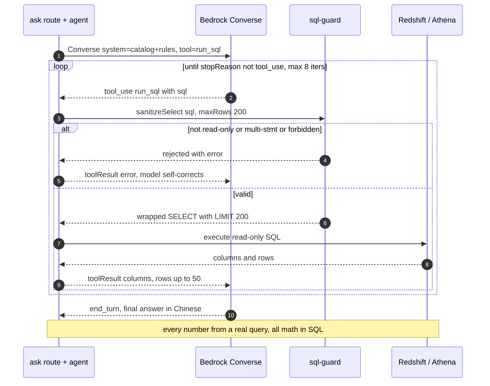

### 10.2 AgentCore MCP + SigV4 invocation handshake

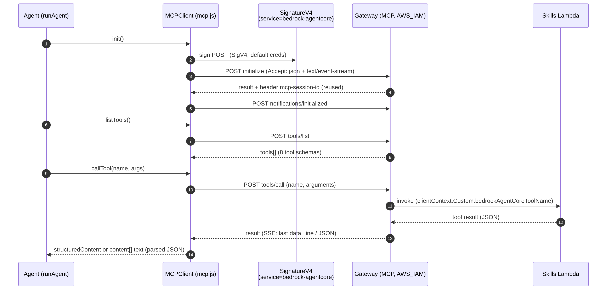

### 10.3 Conversation memory write / read (short-term events + long-term semantic recall, two back ends)

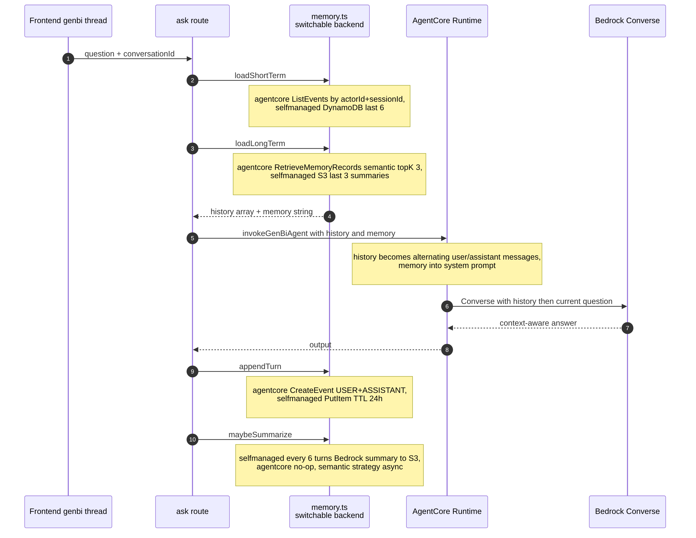

### 10.4 DevOps Agent fault diagnosis (asynchronous + polling)

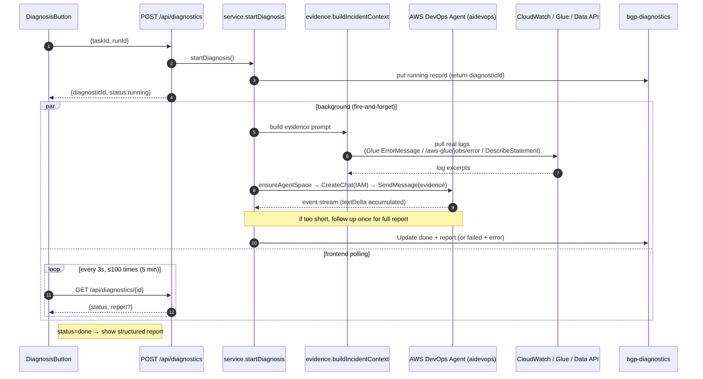

Step-by-step flowchart of the same process (page → back end → evidence collection → DevOps Agent → merge and write back → polling
returns; source `src/devops-agent-flow.mmd`, first rendered 2026-10-14):

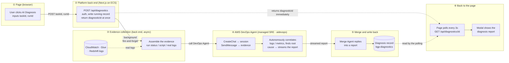

---

## 11. DEEP-DIVE flow and sequence figures (static PNG, sources `src/deepdive-*.mmd`)

The 14 flow and sequence figures that accompany the chapters of [`../deep-dive.md`](../deep-dive.md) (originally Mermaid embedded in
the text, now uniformly externalized as static PNG files):

| Figure | Corresponding section |
|---|---|
| `deepdive-data-flow-e2e.png` | Section 2.2 End-to-end data flow |
| `deepdive-genbi-orchestration.png` | Section 4.1 GenBI top-level orchestration |
| `deepdive-nl2sql-loop.png` | Section 4.3 NL→SQL reasoning loop |
| `deepdive-semantic-retrieval.png` | Section 4.4 Semantic table retrieval |
| `deepdive-agentcore-iac.png` | Section 5.2 AgentCore IaC topology |
| `deepdive-mcp-sigv4.png` | Section 5.5 MCP-over-HTTP + SigV4 |
| `deepdive-skill-hotload.png` | Section 5.6 Skill hot loading |
| `deepdive-context-layers.png` | Section 6.1 The four context layers |
| `deepdive-memory-backend.png` | Section 6.2 Switchable memory back end |
| `deepdive-memory-inject.png` | Section 6.6 Memory injection path |
| `deepdive-diagnosis-async.png` | Section 7.4 Asynchronous diagnosis orchestration + polling |
| `deepdive-observability.png` | Section 8 Observability (EMF) |
| `deepdive-requirement-pipeline.png` | Section 9.2 Requirements pipeline |
| `deepdive-sync-flow.png` | Section 10.2 Data synchronization flow |

In addition, `cdk-stacks.png` (section 12, the CDK topology of 21 stacks) has its source in `src/cdk-stacks.mmd` as well.

---

### Maintenance

- AWS architecture figures: after changing a `*.py` renderer, re-run the script to regenerate the PNG (`pip install diagrams`; the system
  needs `graphviz` / `dot`). The AWS service-view figures of section 0 render with the Python script
  `python3 docs/diagrams/src/render_aws_arch.py`, which writes the four `aws-*.png` files into this folder regardless of the working directory.
- Flow / sequence figures: the sources are in `src/*.mmd`; after a change, render them to high-resolution PNG with mermaid-cli, from this
  folder (`cd docs/diagrams && mmdc -i src/<name>.mmd -o <name>.png -b white -w 1000 -s 3`). The repository uses **static PNG** throughout;
  Markdown never embeds live Mermaid: change the `.mmd` source, re-render, and commit both. Mermaid labels must not contain `;`, which
  Mermaid treats as a statement separator.
- Security: no figure may **ever** contain a real account ID / resource ID / ARN / URL (use placeholders or service-level names).
- Versions (decided 2026-11-04): architecture and flow diagrams **carry no service version numbers** (write "Next.js", "RDS MySQL",
  "Managed Flink", "OpenMetadata", "AWS Glue"; do not write 15 / 8.4 / 1.20 / 1.6.1 / 5.1); supported versions are maintained in one place only,
  [`../supported-versions.md`](../supported-versions.md). When a version is raised, change that document plus the CHANGELOG, not the figures.
- Housekeeping: every figure in this folder is referenced by at least one Markdown document, and every `.mmd` source has a rendered PNG.
  When the last reference to a figure is removed, delete the PNG and its source in the same commit. The repository guard test checks both rules.
