# Kingfisher Features

This document walks through every page of the Kingfisher console, one section per menu group and one subsection per page.
Each subsection states the purpose of the page, its key capabilities, a screenshot and the AWS services behind it.
Screenshots come from a two-region demo environment (home region plus one execution region); the UI is shown in Chinese, and an English mode is available from the top-right language switcher.

Three behaviours are shared by every page:

- The top bar carries three levels of context: workspace, environment and **execution scope** (all regions or one region). Lists, runs, costs and catalogs are filtered by the selected scope.
- The question-mark button in the top-right corner opens "How to use this page"; an interactive tour starts on the first visit.
- Any action that waits for an external system (table creation, model landing, sync generation, model calls) moves to the background after 45 seconds.
  Progress shows in the bottom-right corner, so no page ever hits the 60-second gateway timeout.

## 1. Sign-in and home

### 1.1 Sign-in (`/login`)

Users sign in against an Amazon Cognito user pool that the platform creates at deployment.
The page footer shows the release tag and build commit of the running platform; the public endpoint `GET /api/public/version` returns the same facts.

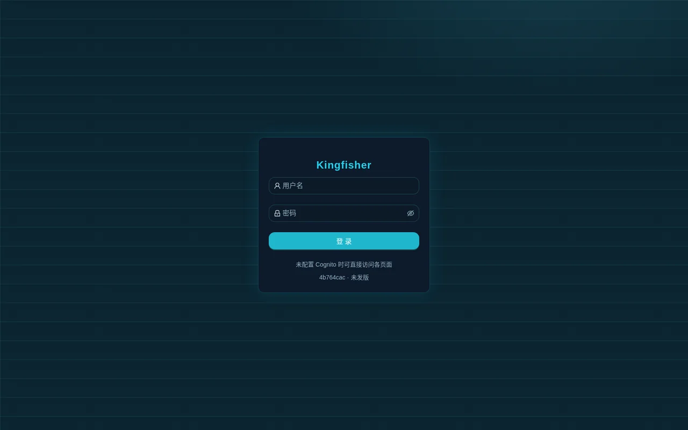
*Figure 1.1: Sign-in page. The footer shows the release tag and build commit.*

**Related AWS services:** Amazon Cognito, CloudFront, AWS WAF.

### 1.2 Home (`/`)

The home page summarises the selected execution scope: resource counts, today's runs and success rate, run-status distribution and a 7-day run trend.
It also shows the trigger mix (scheduled versus manual) and core business metrics taken from the metrics system of Data Modeling.
A "getting started" row offers the interactive tour, the operation guide and shortcuts to Workspaces and Execution Environments.

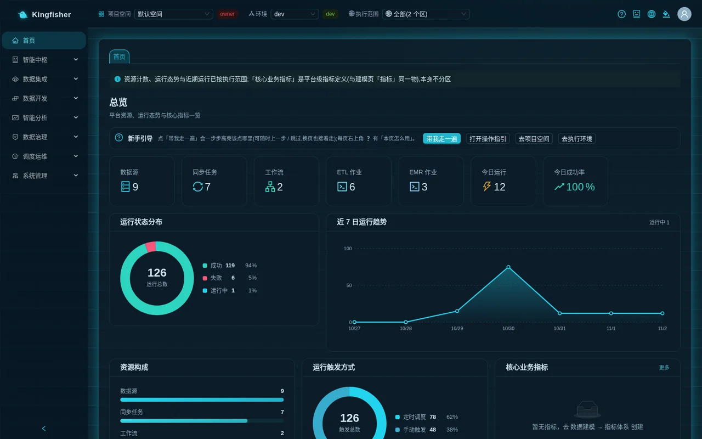
*Figure 1.2: Home page for one execution scope.*

### 1.3 Execution-scope selector

The top-bar selector switches between all regions (read-only aggregate), the home region and each execution region.
The URL query `?scope=` is the authoritative expression of the scope, so a refresh never loses it.

*Figure 1.3: The execution-scope dropdown.*

### 1.4 Operation guide and tour

The guide groups quick-start paths by role (developer, administrator, analyst) and adds a dedicated path for multi-region and compliance topics.
Every page also has its own "How to use this page" panel.

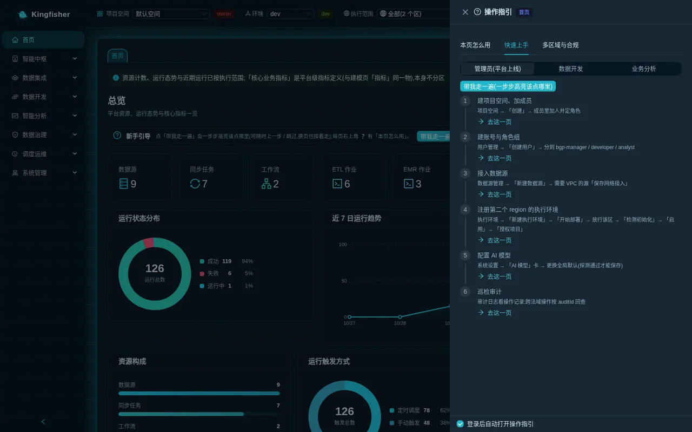
*Figure 1.4: Operation guide.*

## 2. AI Hub

### 2.1 Copilot Plan Center (`/copilot/plans`)

You describe a data task in plain language, for example "compute advertising ROI".
Copilot first inspects the current state (where the data is, whether a metric already exists, whether the table is synced) and then produces an execution plan you confirm step by step.
Creating objects is the plan's job; running them stays with you on the corresponding page, so Copilot "creates but never executes" and all its outputs are drafts.

**Key capabilities**

- Plan generation from a natural-language request, grounded in the live platform state.
- Step-by-step confirmation; each confirmed step calls the same creation API the page itself uses.
- A hard guard that blocks any execution-type action from the agent.
- An "engineering recipes" library of reusable patterns on the right-hand side.
- Every plan step names the region it lands in; plan generation itself creates nothing in any region.

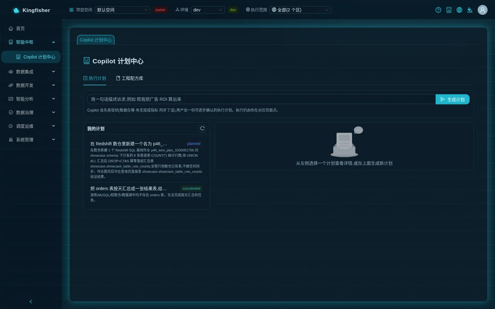
*Figure 2.1a: Copilot Plan Center.*

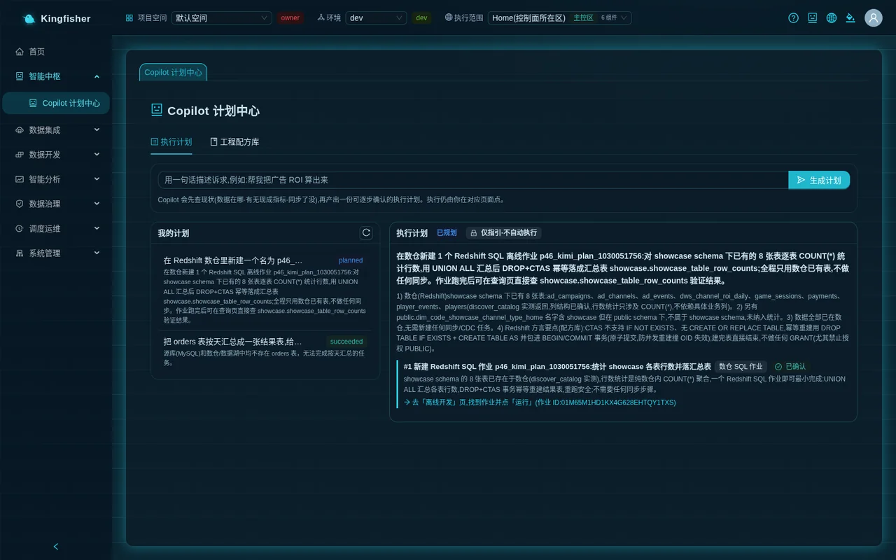
*Figure 2.1b: Plan detail with per-step confirmation.*

**Related AWS services:** Amazon Bedrock (Converse API).

## 3. Data Integration

### 3.1 Data Sources (`/datasources`)

The data source page registers and manages connections to source systems: JDBC databases (MySQL, PostgreSQL, Oracle, SQL Server), S3 object storage, DynamoDB, Kinesis and MSK.
Credentials go to Secrets Manager; a JDBC source gets a Glue connection and a platform-managed security group in the region you choose.
Platform-owned network objects are tagged, and if someone deletes them outside the platform they are rebuilt at the next use with an audit record.

**Key capabilities**

- New-data-source wizard: type, connection details, network configuration, connection test, finish. Provisioning runs as a background task.
- Per-row actions: browse tables, network configuration (subnet and security-group facts), reachability check, edit, delete.
- Delete refuses with a list of the sync or streaming tasks that still reference the source.
- S3 sources can create an external table in the region's Glue catalog for direct Athena queries.
- A network advisor agent diagnoses connectivity in the source's region and proposes applicable fixes.
- Each source lives in one execution region; a task in another region cannot use it.

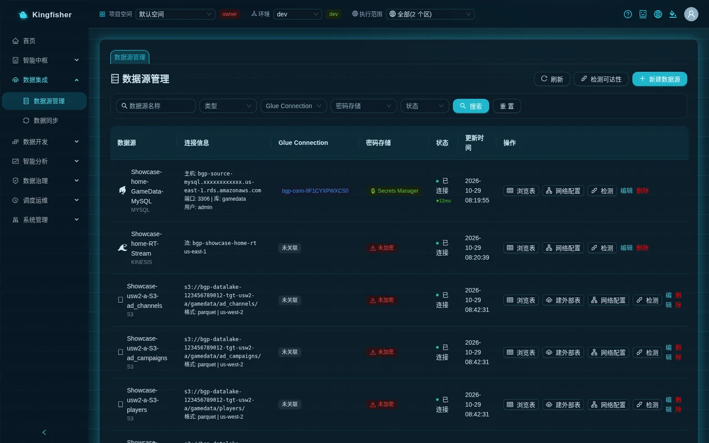
*Figure 3.1a: Data source list.*

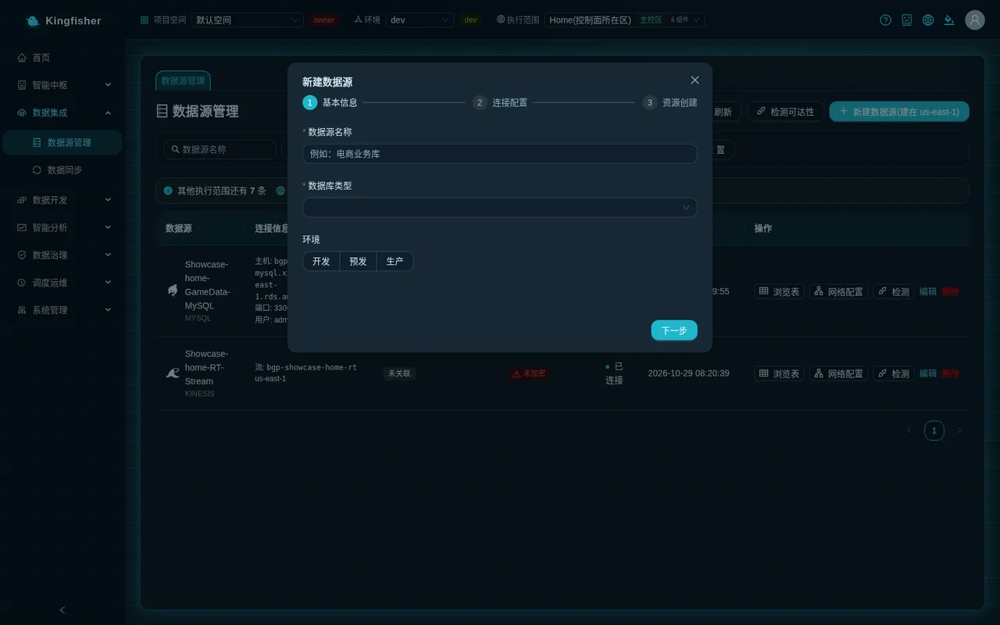
*Figure 3.1b: New data source wizard.*

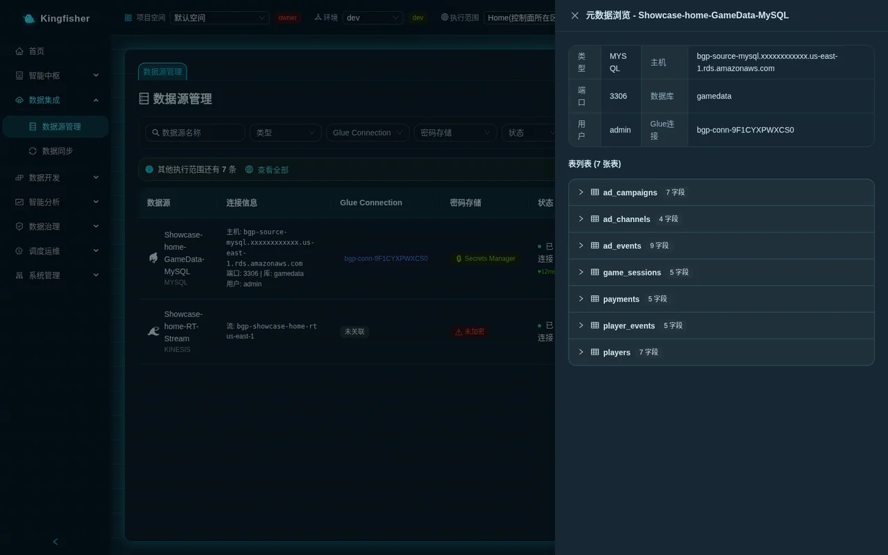
*Figure 3.1c: Browse tables.*

**Related AWS services:** AWS Glue (connections, discovery jobs), Secrets Manager, Amazon EC2 (security groups, subnets), Amazon RDS, Kinesis, Amazon MSK, Athena.

### 3.2 Data Sync (`/sync`, `/sync/[id]`)

Data Sync moves source tables into the region's data lake (S3 Tables, Apache Iceberg) and/or warehouse (Redshift Serverless).
Batch sync runs as Glue jobs; real-time sync uses DMS change data capture, Zero-ETL integrations or Flink CDC.
Every run records row counts, duration and logs, and tasks can be scheduled on the region's own scheduler.

**Key capabilities**

- Wizard whose first step only asks for source and target; everything else has defaults. Drafts are kept locally for seven days.
- Table picker with filtering, "selected only" and bulk selection.
- Load modes: full, incremental by watermark column, business-date variables (15 date variables), WHERE filter, atomic overwrite, merge by key, derived partitions and monthly tables.
- Saving a task refreshes its script and Glue job immediately; the target table bucket is chosen from a dropdown, and customer-owned buckets must first be registered in Settings.
- Start now, run for a given date, schedule by cron, or backfill a date range.
- Post-write reconciliation, row-count metrics and column-level lineage pushed to OpenMetadata.
- A guard that asks for confirmation before overwriting a table the platform did not create.
- Stop and delete remove the DMS replication task and the Glue job, not just the row.
- List auto-refresh while tasks are starting, running or stopping; a detail page with run history and per-run logs.
- A task runs only in the region of its data source; list and detail views are filtered by execution scope.

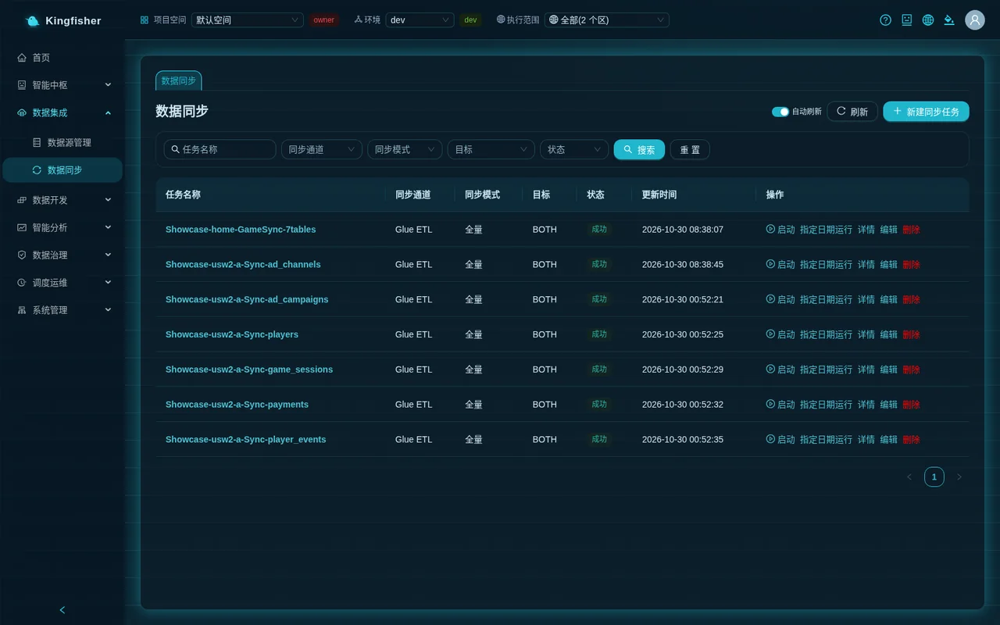
*Figure 3.2a: Sync task list.*

*Figure 3.2b: New sync task wizard.*

*Figure 3.2c: Sync task detail.*

**Related AWS services:** AWS Glue, S3 Tables, Amazon Redshift Data API, Amazon S3, AWS DMS, CloudWatch Logs, OpenMetadata (self-hosted).

## 4. Data Development

### 4.1 Batch Compute (`/etl-jobs`)

Batch Compute runs code-first ETL on three engines: Glue PySpark, Redshift SQL and EMR Serverless Spark.
All engine parameters are exposed, a parameter advisor suggests tuning, and the full set of business-date parameters is passed to every run.
Jobs run immediately or on a cron schedule published to the region's scheduler; run history and logs are available in Task Monitor.

**Key capabilities**

- Three engines with their own configuration panels; EMR Serverless applications are created per job and removed afterwards.
- Script generation from engine recipes with an AI code generator, and a parameter advisor for tuning.
- Execution role selection from a dropdown with three groups: platform default, advisor-generated and custom roles. A refresh button picks up roles created in IAM without leaving the page.
- Run, rerun, backfill, run groups, logs and dependency view.
- Job submission runs as a background task, so an EMR application cold start cannot time out the page.
- The job detail names its execution region, and the run button repeats "run now in <region>".

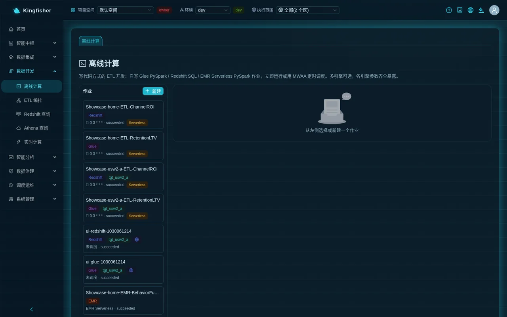
*Figure 4.1a: Batch Compute job list.*

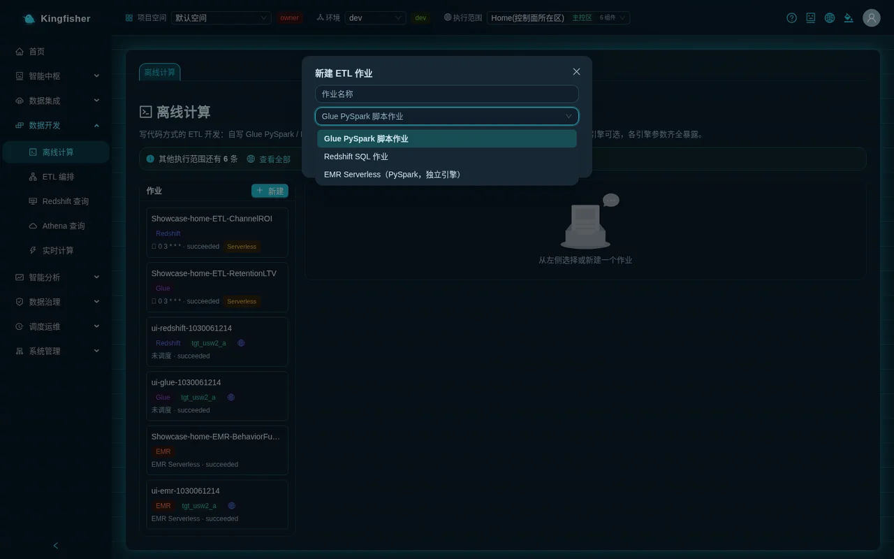
*Figure 4.1b: New job with engine choice.*

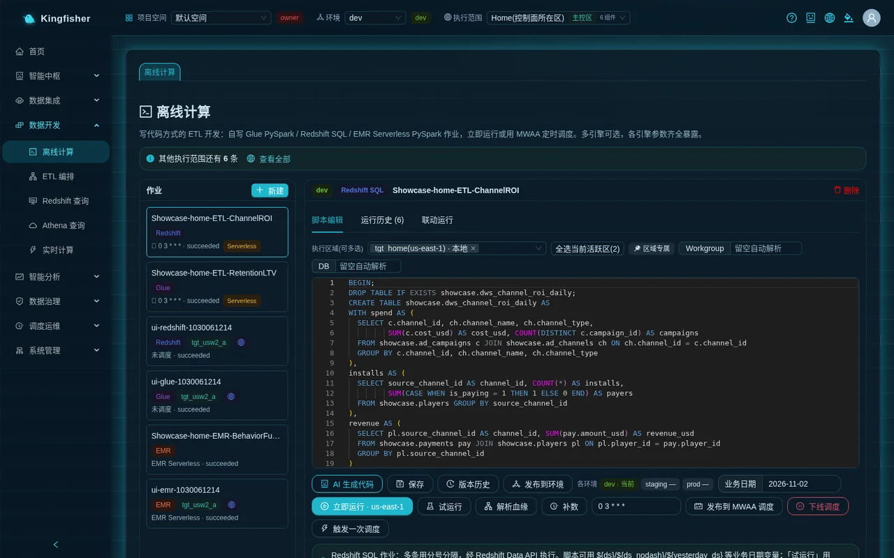
*Figure 4.1c: Job detail and script editor.*

**Related AWS services:** AWS Glue, Amazon Redshift Data API, EMR Serverless, Amazon S3, CloudWatch Logs, AWS IAM.

### 4.2 ETL Orchestration (`/workflow`, `/workflow/[id]`)

ETL Orchestration is a visual DAG editor whose nodes are sync tasks, batch jobs, SQL, Python, control flow and platform actions.
A workflow is published to the MWAA Serverless environment of its execution region, where it runs on a cron schedule or on demand.
One publish can target several regions.

**Key capabilities**

- Node types: sync task, batch job (Glue, Redshift or EMR Serverless), SQL, Python, foreach, branch, join, set-variable and external task.
- Publish, unpublish, trigger, cancel and retry-failed-nodes; run status and per-node logs; run groups.
- SQL nodes execute multi-statement scripts as one transaction.
- After publishing, the header and node states refresh from the real run state.
- Changing the region of a published workflow is rejected; the region label never lies.

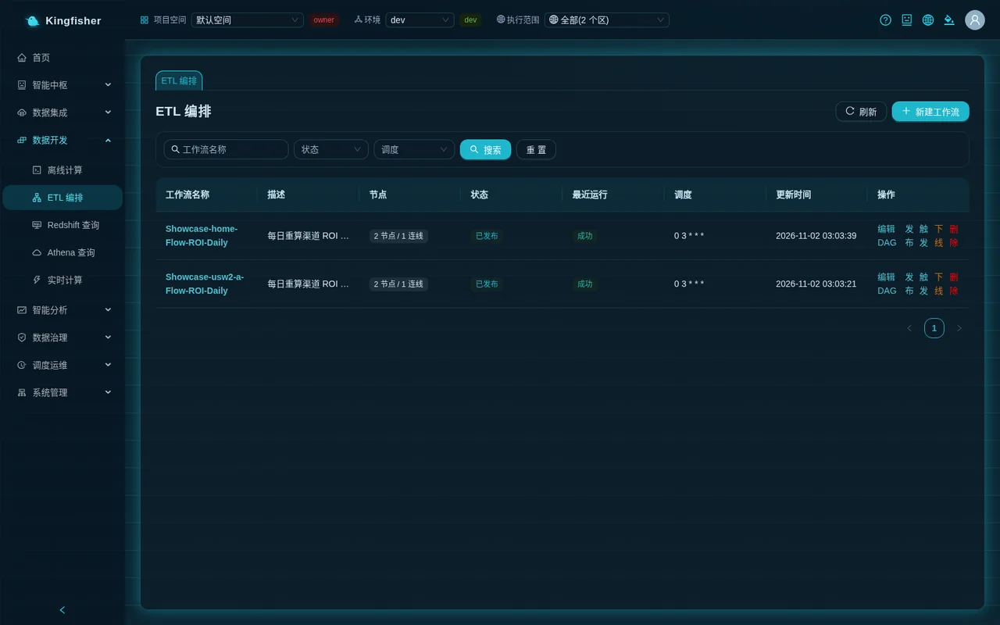
*Figure 4.2a: Workflow list.*

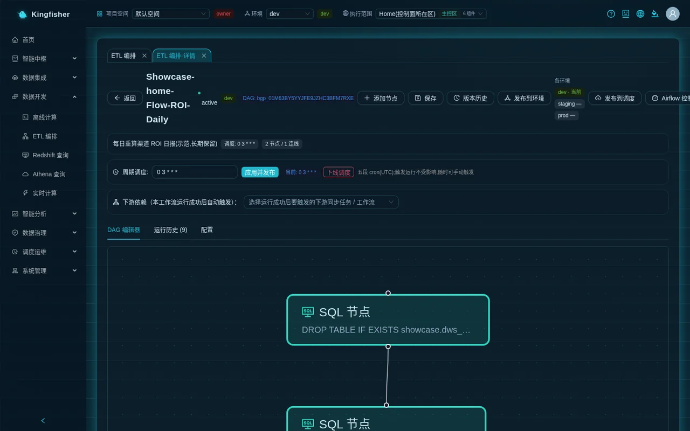
*Figure 4.2b: Workflow DAG detail.*

**Related AWS services:** Amazon MWAA Serverless, Amazon S3 (DAG bucket), AWS Lambda (action dispatcher), DynamoDB Streams.

### 4.3 Redshift Query (`/redshift`)

Redshift Query is a SQL editor over the Redshift Serverless workgroup of the selected region.
It uses the Redshift Data API with per-workspace, per-region credentials, so no database password is exposed to the browser.

**Key capabilities**

- Execute, cancel, result paging and query history.
- Schema browser for databases, schemas and tables.
- SQL templates and "save as task" for scheduled execution.
- Queries from several regions can run in parallel under the all-regions scope.

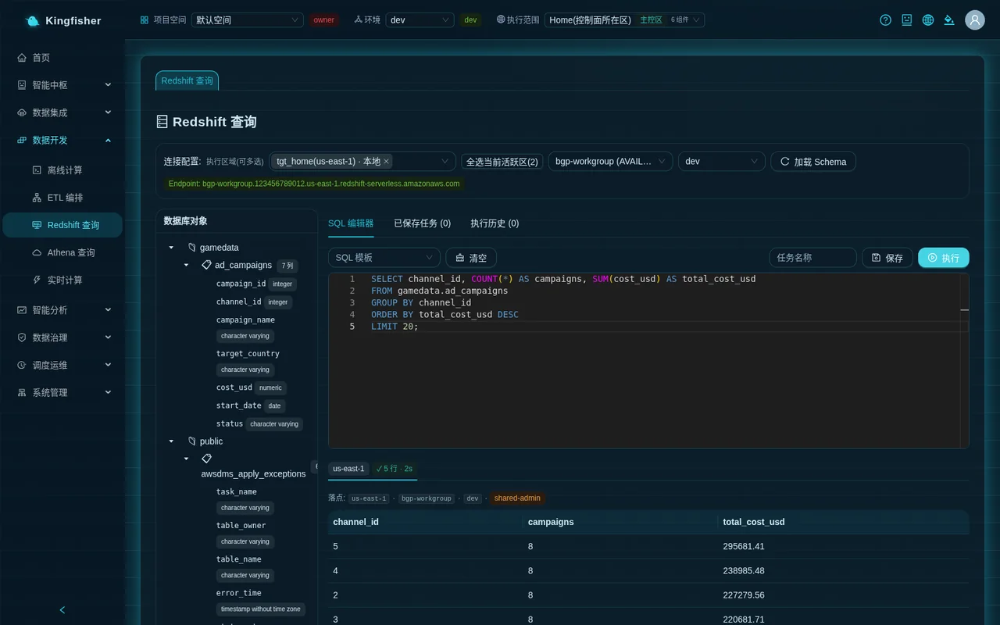
*Figure 4.3: Redshift Query with a result set.*

**Related AWS services:** Amazon Redshift Serverless (Data API), Secrets Manager.

### 4.4 Athena Query (`/athena`)

Athena Query reads the S3 Tables buckets of the selected region through the federated catalog `s3tablescatalog/<table-bucket>`.
The left-hand tree lists namespaces and tables; queries are read-only and results are not persisted by the platform.

**Key capabilities**

- Table tree per namespace for the platform bucket and for registered customer buckets.
- Query, stop, result view and query history.
- The federated catalog is created on demand if the region does not have it yet.
- Pre-filled SQL when you arrive from "create external table" on an S3 data source.

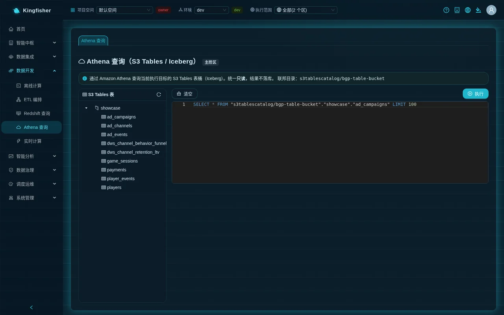
*Figure 4.4a: Athena Query editor.*

*Figure 4.4b: Athena Query with results.*

**Related AWS services:** Amazon Athena, S3 Tables, AWS Glue Data Catalog.

### 4.5 Stream Compute (`/realtime-compute`)

Stream Compute runs Flink SQL jobs on Amazon Managed Service for Apache Flink.
A job consumes a Kinesis or MSK stream, aggregates over event-time windows and writes to S3 or S3 Tables, where Athena can query the result immediately.

**Key capabilities**

- One Flink application per job, built from a shared runner JAR with the user SQL injected as runtime properties.
- Connector management for sources and sinks.
- AI-assisted SQL authoring and AI run diagnosis.
- A sample-data producer that writes ordered events so that window results appear within about a minute.
- Start, stop and delete act on the real Flink application; one submission creates one application per selected region.

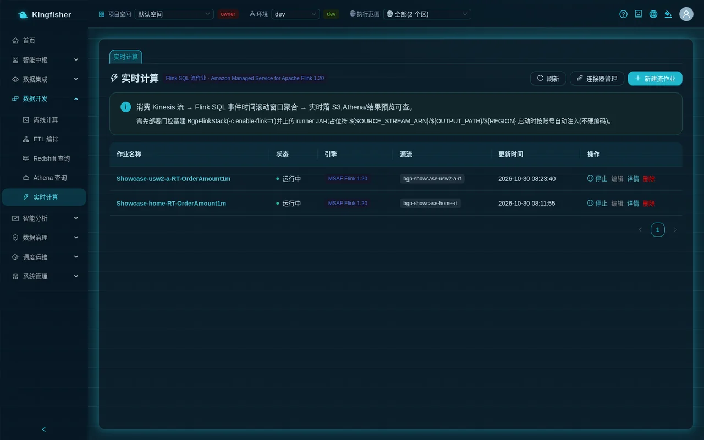
*Figure 4.5a: Stream Compute job list.*

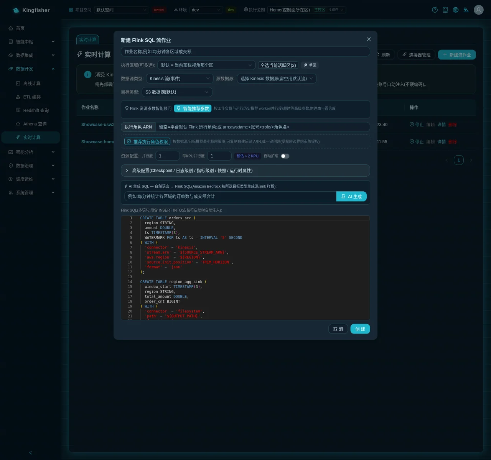
*Figure 4.5b: New streaming job.*

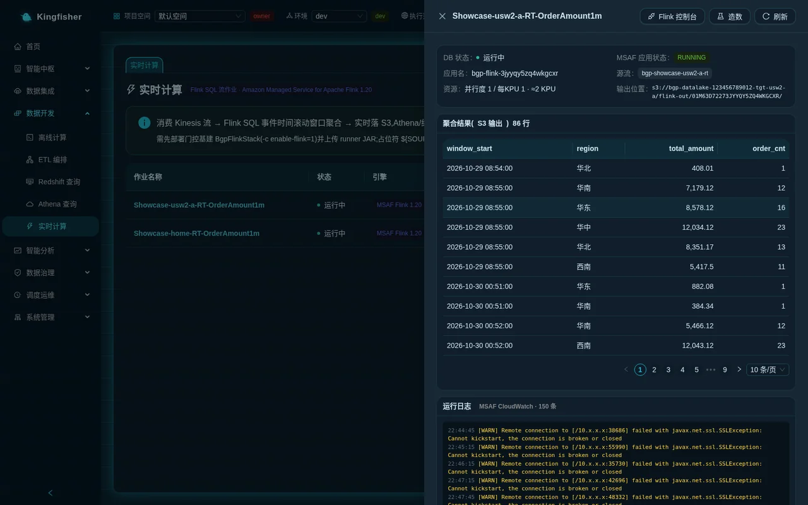
*Figure 4.5c: Streaming job detail.*

**Related AWS services:** Amazon Managed Service for Apache Flink, Amazon Kinesis, Amazon MSK, S3 Tables, Amazon S3.

## 5. Smart Analytics

### 5.1 Ask-Your-Data (`/genbi`)

Ask-Your-Data turns a natural-language question into read-only SQL, runs it in the region where the data lives (Redshift or Athena over S3 Tables) and returns a table, a chart and an explanation.
The agent runs on Amazon Bedrock AgentCore with Runtime, Gateway (MCP) and Memory, and is grounded in the business glossary, published datasets and conversation memory.
Results are masked automatically according to data classification, including aliased and expression columns.

**Key capabilities**

- Built-in MCP skills for read-only Redshift and Athena SQL, schema exploration, business-context lookup and registered skills.
- Session cards: save a conversation, resume it later, and refresh it on a schedule (up to 100 cards per user).
- Asynchronous execution with polling, a 300-second ceiling per question and immediate cancellation on timeout.
- The result card shows which model and backend answered.
- The page must be anchored to one execution environment; the target travels with every call to the single AgentCore runtime.

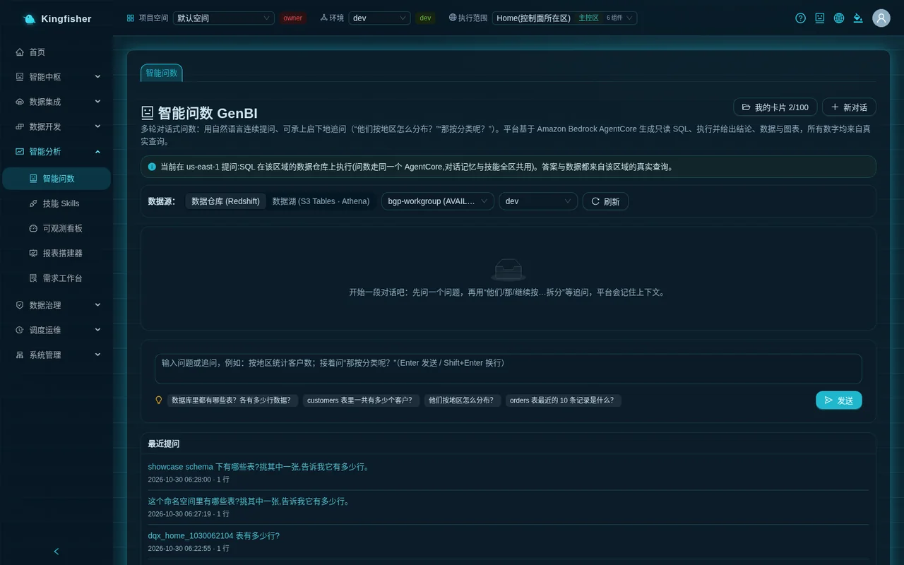
*Figure 5.1a: Ask-Your-Data landing page.*

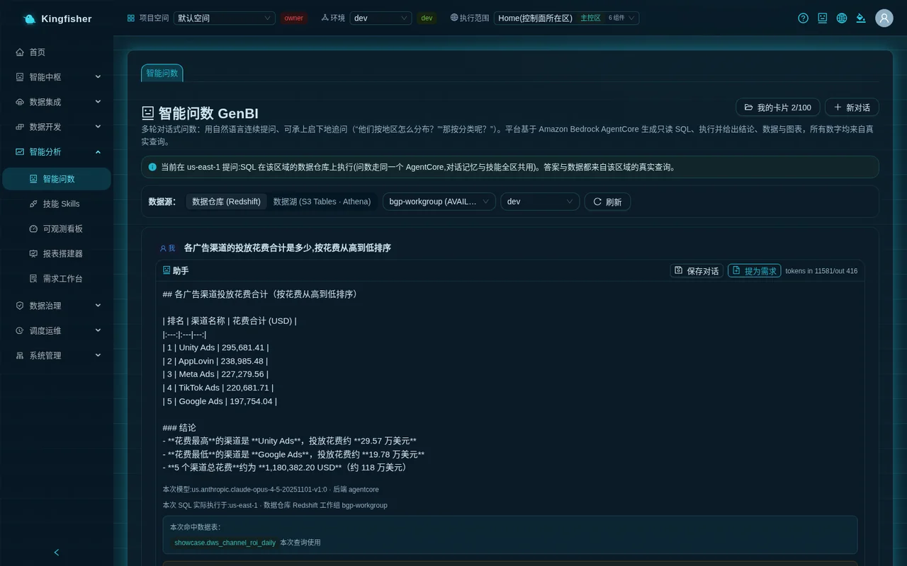
*Figure 5.1b: A question answered with SQL, result table and chart.*

**Related AWS services:** Amazon Bedrock AgentCore (Runtime, Gateway, Memory), Amazon Bedrock, AWS Lambda (skills), Amazon Redshift Data API, Amazon Athena.

### 5.2 Skills (`/skills`)

Skills lists what the Ask-Your-Data agent can call.
Built-in MCP skills ship with the platform; registered skills are parameterised read-only queries (SQL template or external HTTP API) that take effect immediately with no deployment.

**Key capabilities**

- Catalog of built-in and registered skills with descriptions and parameters.
- Registration form for SQL-template and HTTP skills; call counts come from CloudWatch.

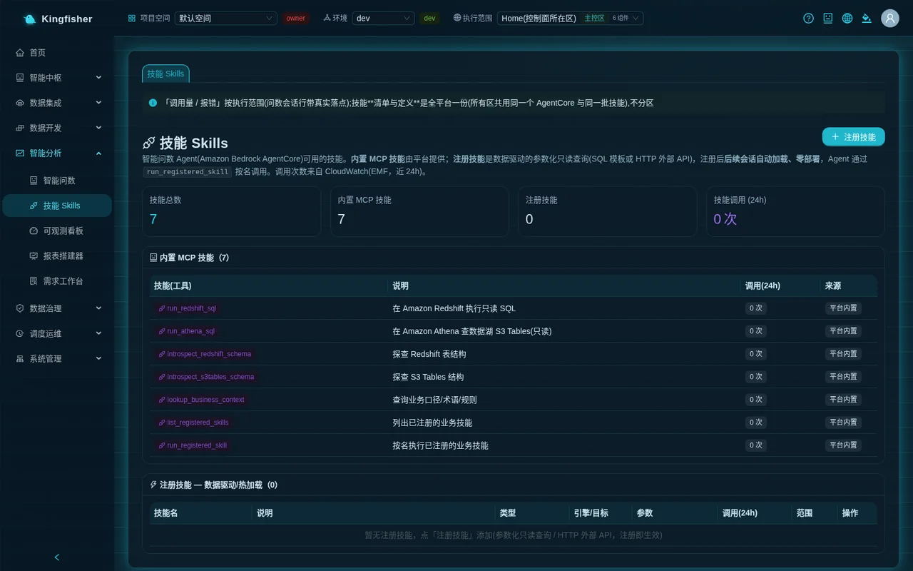
*Figure 5.2: Skills catalog.*

**Related AWS services:** AWS Lambda, Amazon CloudWatch, Amazon Bedrock AgentCore Gateway.

### 5.3 Observability (`/observability`)

Observability is the operational view of Ask-Your-Data and the AgentCore stack.

**Key capabilities**

- Runtime and Gateway status with the list of MCP tools.
- Cumulative and daily question counts, token usage, engine distribution and a 7-day trend.
- Skills Lambda metrics and invocation counts.

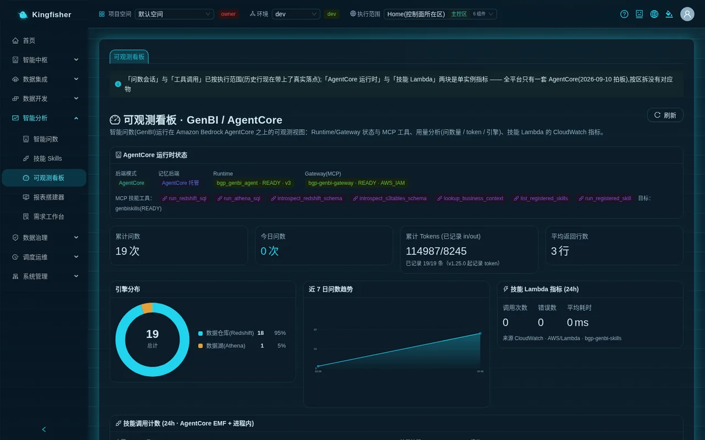
*Figure 5.3: Observability dashboard.*

**Related AWS services:** Amazon CloudWatch, Amazon Bedrock AgentCore.

### 5.4 Report Builder (`/bi`)

Report Builder is a self-service BI canvas: add several visuals to one dashboard, bind top-level filters to fields and let them drive every visual.
Data is fetched through the platform's query engines with the same automatic masking as Ask-Your-Data.

**Key capabilities**

- Reports, dashboards and ad-hoc analyses kept per workspace with optimistic locking.
- Each visual carries its own execution target, so one dashboard can show charts from different regions side by side.
- Export of results.

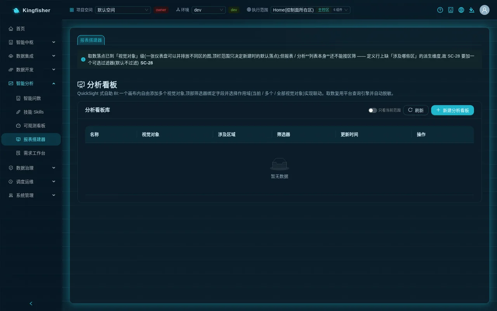
*Figure 5.4: Report Builder.*

**Related AWS services:** Amazon Redshift Data API, Amazon Athena.

### 5.5 Requests (`/requirements`)

Requests turns business questions captured from Ask-Your-Data into tracked work items.
A manager accepts and assigns a request; a developer generates an implementation with the model, creates the job and moves the item through its states.

**Key capabilities**

- Four views: assigned to me, raised by me, awaiting acceptance, all.
- Assign, comment, generate implementation, create job and transition actions.
- Published datasets that ground Ask-Your-Data answers.

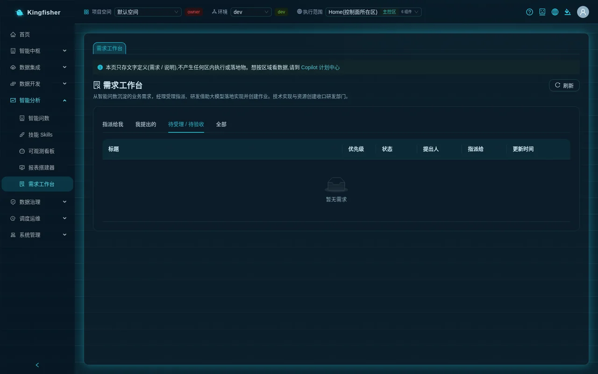
*Figure 5.5: Requests workbench.*

**Related AWS services:** Amazon Bedrock.

## 6. Data Governance

### 6.1 Data Governance (`/governance`)

The Data Governance page is the working surface for catalog, lineage, classification, sensitive-data scanning, quality and scheduled governance tasks.
The catalog lists tables and columns from Glue, Redshift and S3 Tables per region; lineage comes from SQL parsing and OpenMetadata.
Quality checks and sensitive scans run in the region of the data.

**Key capabilities**

- Catalog with filters by source, database, schema, format and sensitivity; "sync column info" from Redshift; create table (Redshift or S3 Tables) and alter table (Redshift) from the UI.
- Table- and column-level lineage with graph and table views, plus impact analysis for a selected asset.
- Data classification on four levels with masking strategies: none, full mask, partial, e-mail, hash. Ask-Your-Data, Report Builder and direct queries apply them automatically.
- Access grants per asset.
- Sensitive-data scan with detector type, confidence and suggested level; findings can be adopted as classification.
- Quality rules from templates (not null, unique, range, accepted values, row count, freshness/SLA) with runs, results and scores.
- Scheduled governance tasks (quality check, sensitive scan, catalog sync) published to the region's scheduler.

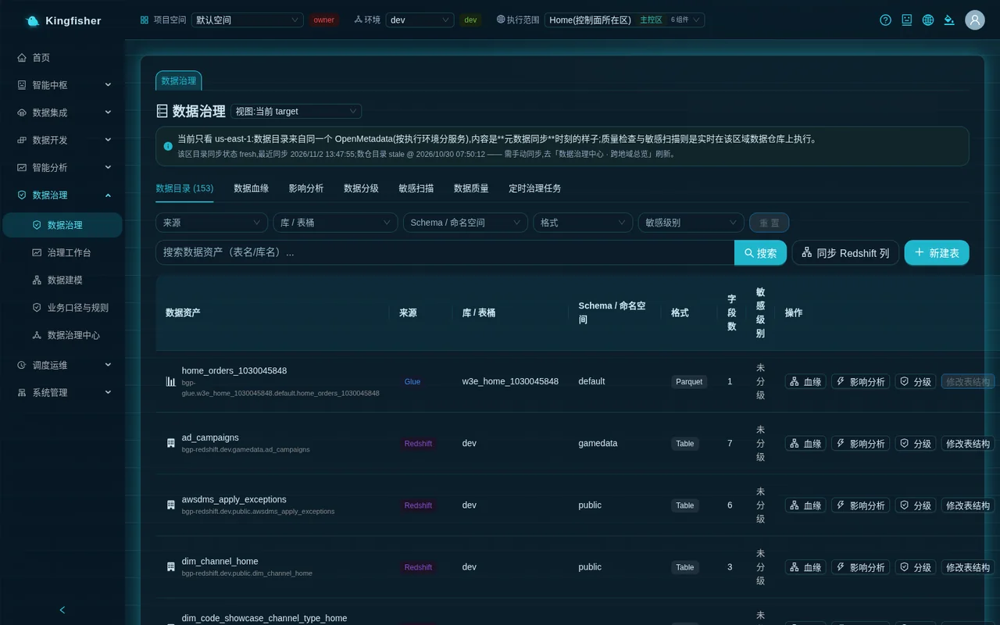
*Figure 6.1a: Governance catalog.*

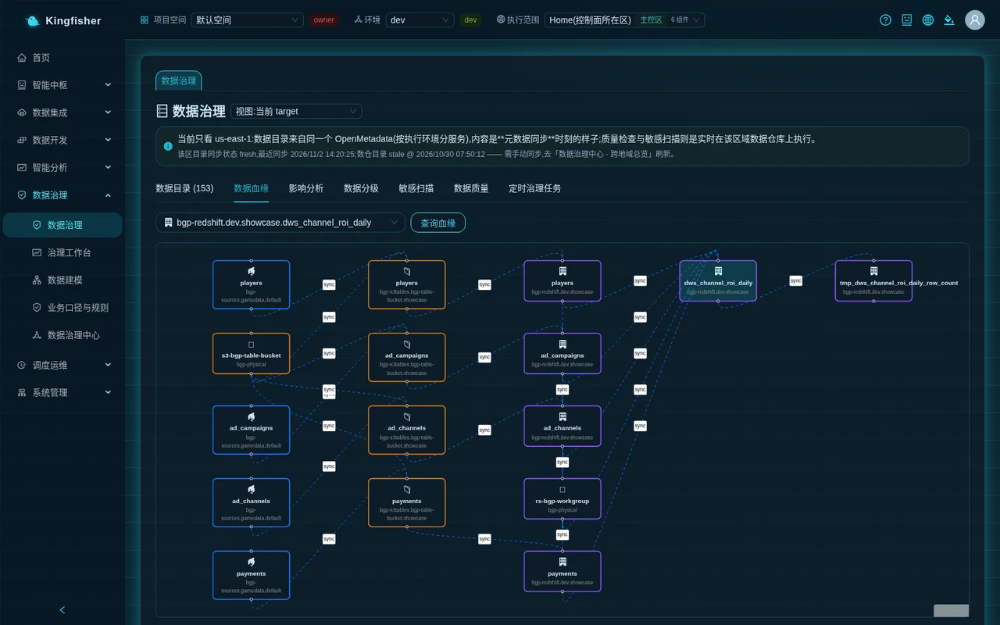
*Figure 6.1b: Lineage graph (a column-level lineage card sits below it on the same tab).*

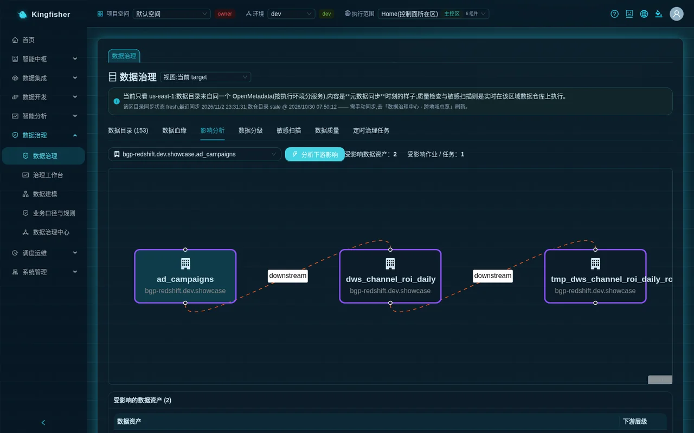
*Figure 6.1c: Impact analysis.*

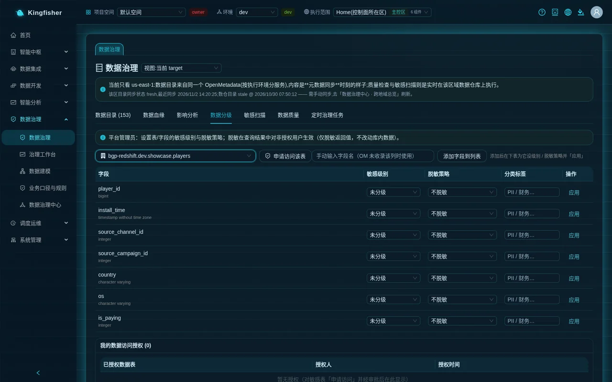
*Figure 6.1d: Classification and masking.*

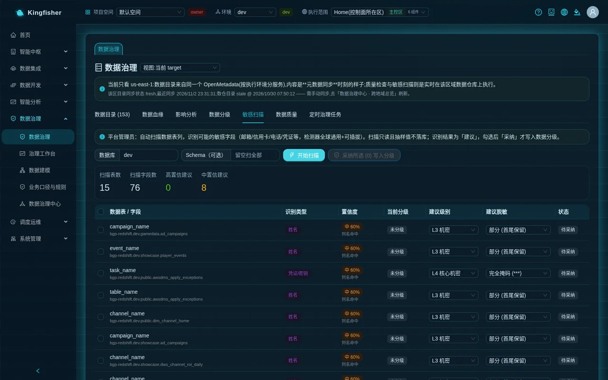
*Figure 6.1e: Sensitive-data scan.*

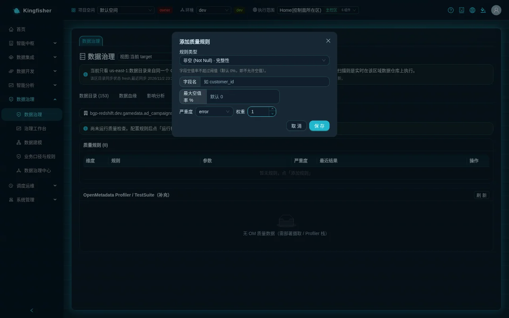
*Figure 6.1f: Data quality rule form.*

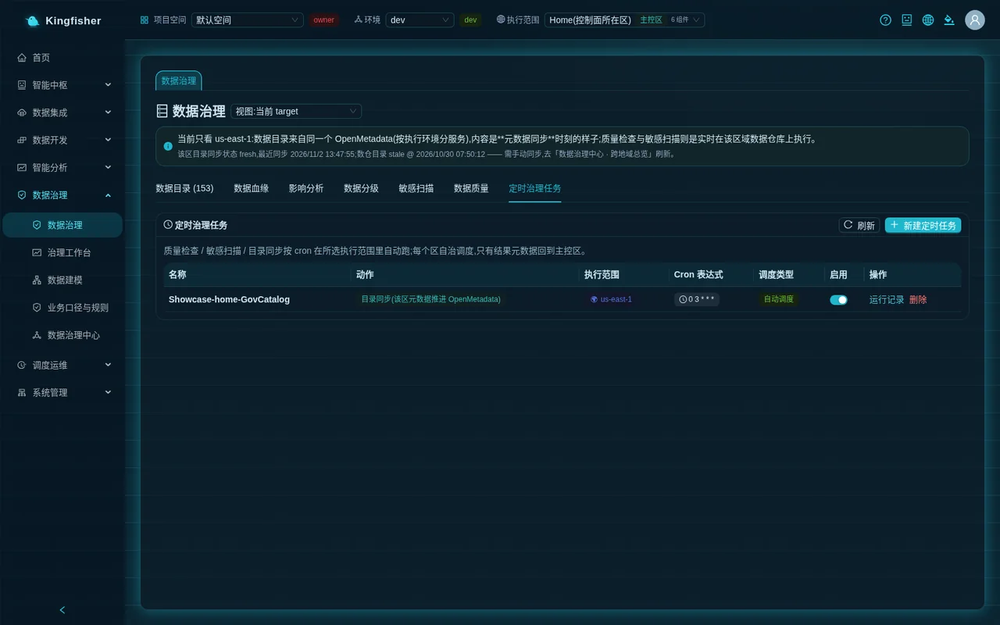
*Figure 6.1g: Scheduled governance tasks.*

**Related AWS services:** Amazon Redshift Data API, Amazon Athena, AWS Glue Data Catalog, S3 Tables, Amazon MWAA Serverless, OpenMetadata (self-hosted).

### 6.2 Governance Workbench (`/governance-workbench`)

The workbench condenses governance into one health score and a to-do list.
The score (0 to 100) weights four dimensions: security and classification coverage, quality health, SLA attainment and lineage completeness.

**Key capabilities**

- Overall and per-dimension scores computed from existing governance data, with no extra tables.
- To-do items with a "go fix" link to the right governance tab, and a ranking of the assets most in need of governance.

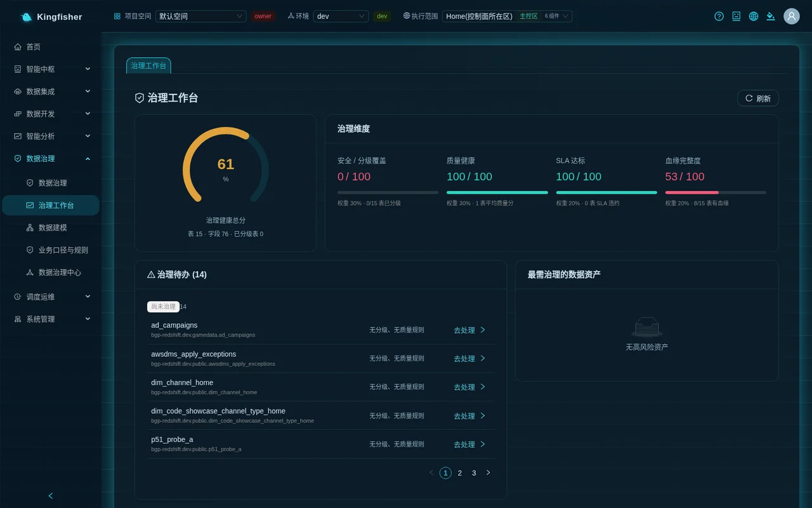
*Figure 6.2: Governance Workbench.*

### 6.3 Data Modeling (`/modeling`)

Data Modeling covers warehouse planning end to end: layers, data domains, data standards, code tables, dimension and fact models, and a metrics system.
Models can be landed and applied to the Redshift warehouse of any execution region, and the resulting metrics are reused by Ask-Your-Data, Report Builder and the home page.

**Key capabilities**

- Warehouse layers with one-click presets (ODS, DWD, DWS, ADS) and data domains.
- Data standards for field semantics: type, unit and value range.
- Code tables (enumeration dictionaries) that land as Redshift dimension tables in one click.
- Dimension and fact modeling: generate DDL, apply to Redshift, unbind with an impact preview.
- Atomic and derived metrics whose values are stored per region.
- Landing and applying run as background operations; a second operation on the same object is refused while the first is in progress.

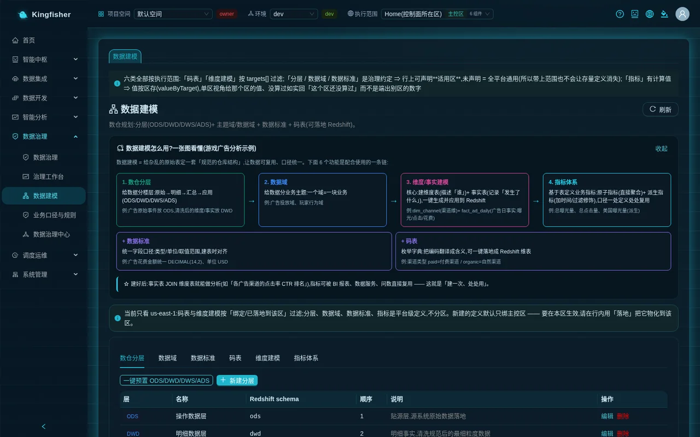
*Figure 6.3a: Warehouse layers.*

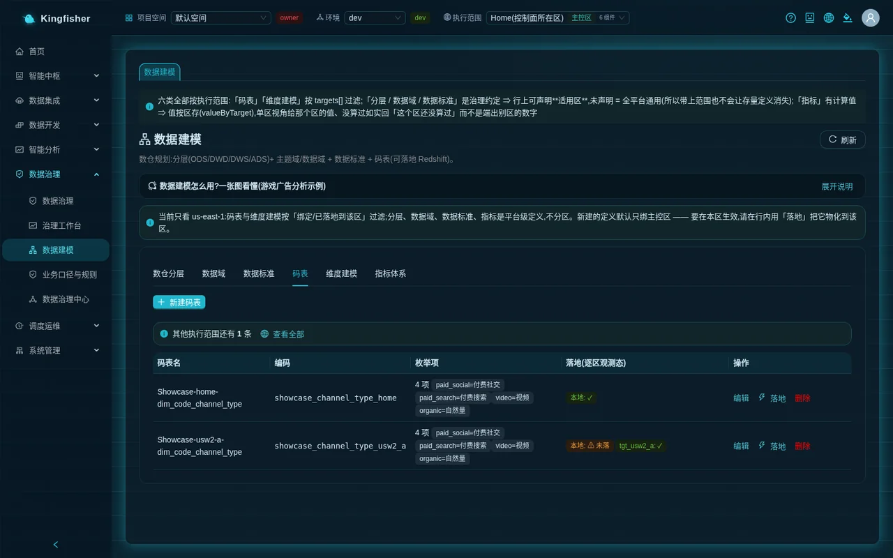
*Figure 6.3b: Code tables.*

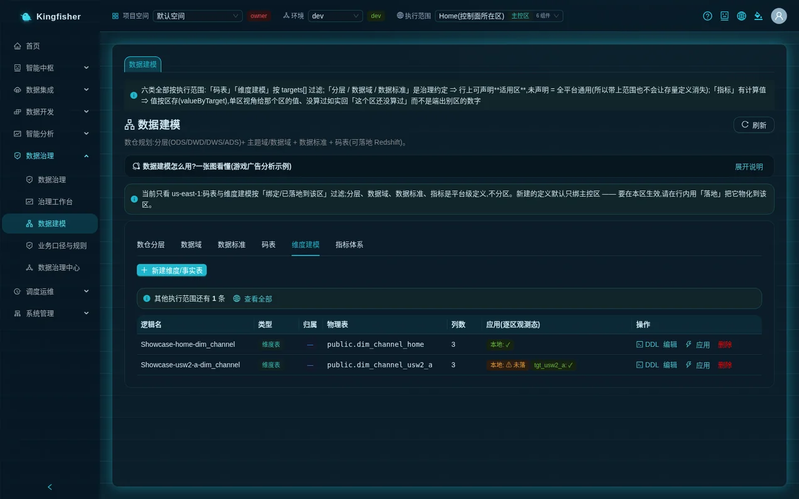
*Figure 6.3c: Dimension and fact modeling.*

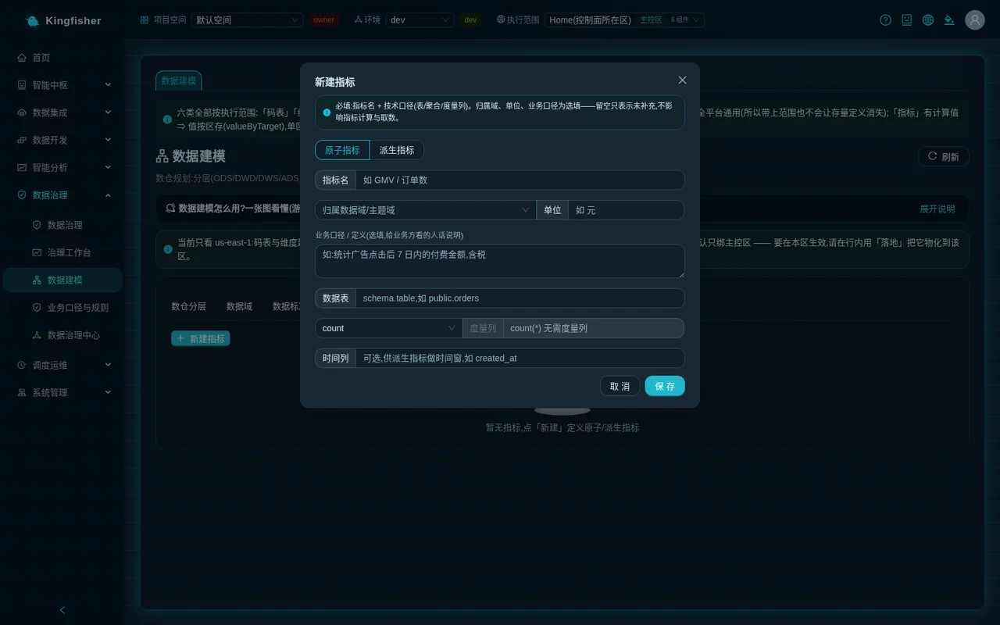
*Figure 6.3d: Metrics system.*

**Related AWS services:** Amazon Redshift Data API.

### 6.4 Business Glossary and Rules (`/knowledge`)

This page maintains business definitions, metric semantics, term aliases, rules and caveats.
The content is exposed to Ask-Your-Data and Copilot through the `lookup_business_context` skill, so generated SQL and code follow the agreed definitions.

**Key capabilities**

- Entries for definitions, aliases and rules with free-text notes.
- "Preset common definitions" fills in frequently used examples in one click.
- One glossary for the whole platform, independent of region.

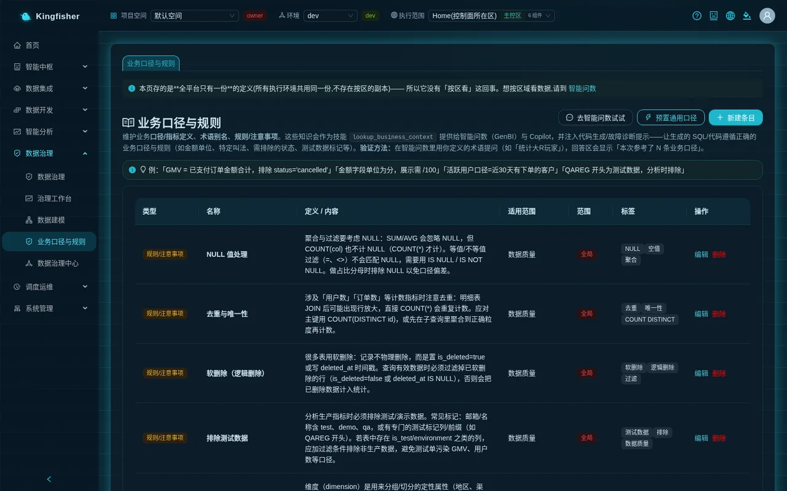
*Figure 6.4: Business glossary and rules.*

**Related AWS services:** Amazon DynamoDB.

### 6.5 Governance Center, OpenMetadata (`/openmetadata`)

The platform runs one self-hosted OpenMetadata instance in the home region as the metadata source of truth for catalog, column-level lineage, glossary and quality.
This page lists the OpenMetadata services for the selected scope and links straight into the OpenMetadata console.

**Key capabilities**

- Scheduled ingestion of Redshift, Glue, S3, S3 Tables, source databases and profiler data.
- Event push from sync runs: source and target entities plus column-level lineage, one service per region.
- Reconciliation that soft-deletes catalog entries no longer seen in a complete ingestion.
- Shortcuts to database services, pipeline services, glossary, tags and settings; the factory administrator password is replaced during deployment.

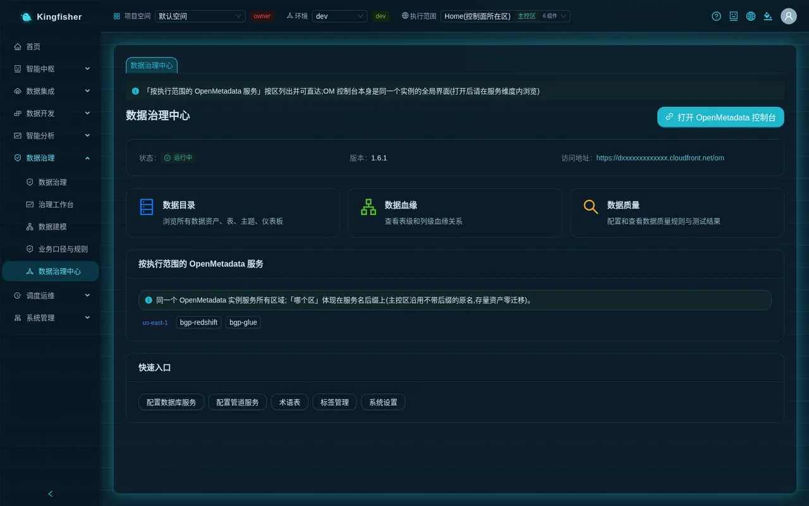
*Figure 6.5: Governance Center.*

**Related AWS services:** Amazon ECS (Fargate), Amazon RDS, Amazon OpenSearch Service, Secrets Manager.

## 7. Scheduling and Ops

### 7.1 Task Monitor (`/monitor`)

Task Monitor is the single view of every run on the platform: sync tasks, workflows, batch jobs, EMR jobs, governance tasks and card refreshes.
A "schedule configuration" tab manages the cron schedules of all objects on each region's scheduler.

**Key capabilities**

- Filters by region, type, status, trigger (scheduled, manual, backfill) and time; groups for running, failed and today.
- Per-run logs and one-click AI analysis through the AWS DevOps Agent (asynchronous, polled every few seconds).
- Run groups and cancel; a user cancellation is never rewritten as a failure.
- Schedule configuration with enable and disable per object and clear messages when a scheduler is missing or offline.

*Figure 7.1a: Task Monitor.*

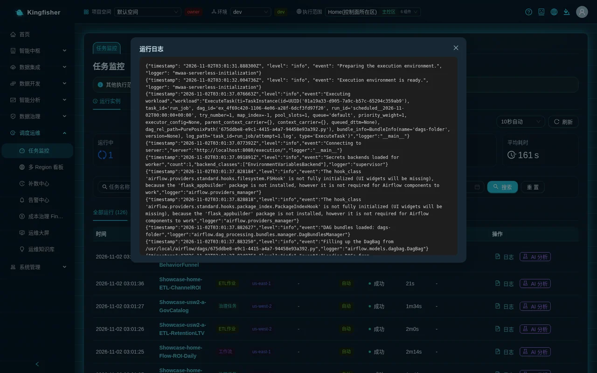
*Figure 7.1b: Run log.*

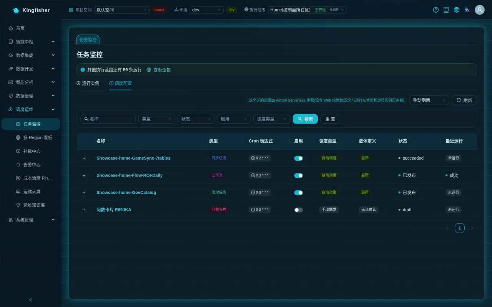
*Figure 7.1c: Schedule configuration.*

**Related AWS services:** Amazon MWAA Serverless, CloudWatch Logs, AWS DevOps Agent, AWS Glue, EMR Serverless.

### 7.2 Multi-Region Dashboard (`/multi-region`)

The dashboard answers "does anything need attention across regions" on one screen.
It compares task dispatch and modeling artifacts across all execution regions and highlights drift.

**Key capabilities**

- Consistency matrix: red for failure or structural drift, yellow for version mismatch or missing dispatch, green for consistent.
- One-click remediation for items that can be aligned automatically.
- Region-specific tasks are not reported as missing elsewhere.

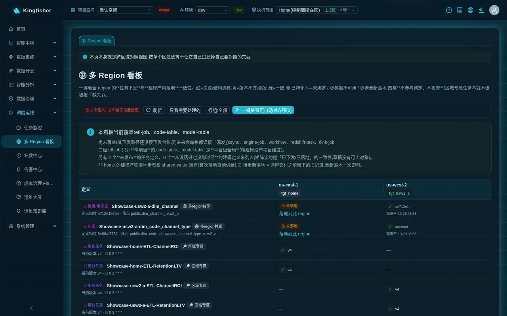
*Figure 7.2: Multi-Region Dashboard.*

### 7.3 Backfill Center (`/backfill`)

Backfill Center re-runs batch jobs, workflows and sync tasks over a business-date range.
A plan expands into instances that a background pump advances even after you close the page.

**Key capabilities**

- Date-range plans with cascade and concurrency settings; workflows that contain sync nodes run one instance at a time.
- Progress matrix; each cell opens an instance drawer with node, region, attempts, timing, rows written, error text and links to the run log.
- "Success with 0 rows" is flagged in amber with likely causes.
- Backfill runs are tagged and excluded from online success rate and SLA baselines.

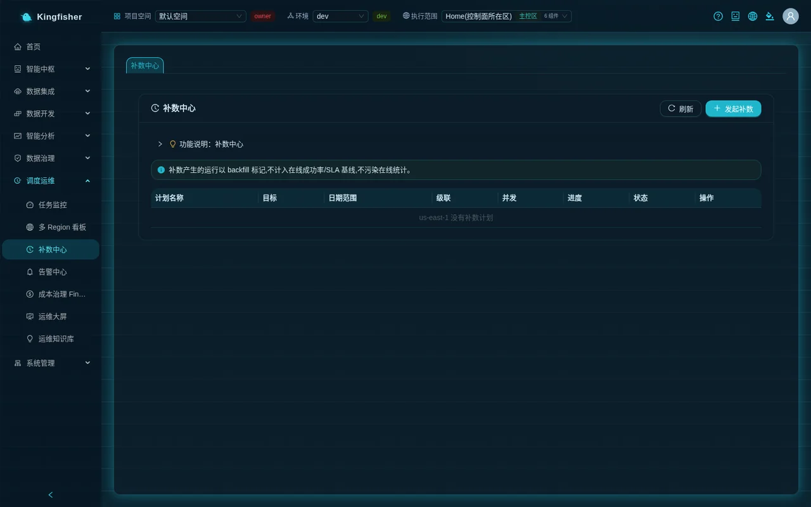
*Figure 7.3a: Backfill Center.*

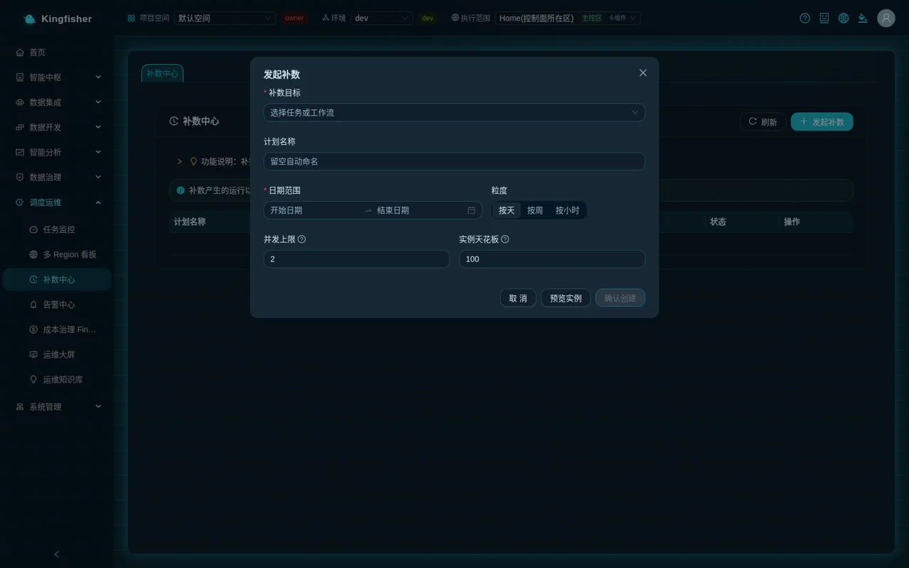
*Figure 7.3b: Start a backfill.*

**Related AWS services:** AWS Glue, EMR Serverless, Amazon Redshift Data API.

### 7.4 Alerting Center and SLA (`/alerting`)

Alerting Center evaluates rules against the run ledger and delivers notifications; the SLA tab learns baselines from history and predicts breaches.

**Key capabilities**

- Rule types: failure, timeout, success rate and data stall; events are de-duplicated.
- Channels: DingTalk, WeCom, e-mail, HTTP and generic webhook, each with a test delivery.
- Failure alerts can trigger an AI diagnosis automatically.
- SLA baselines for freshness and duration, breach prediction and a risk board.

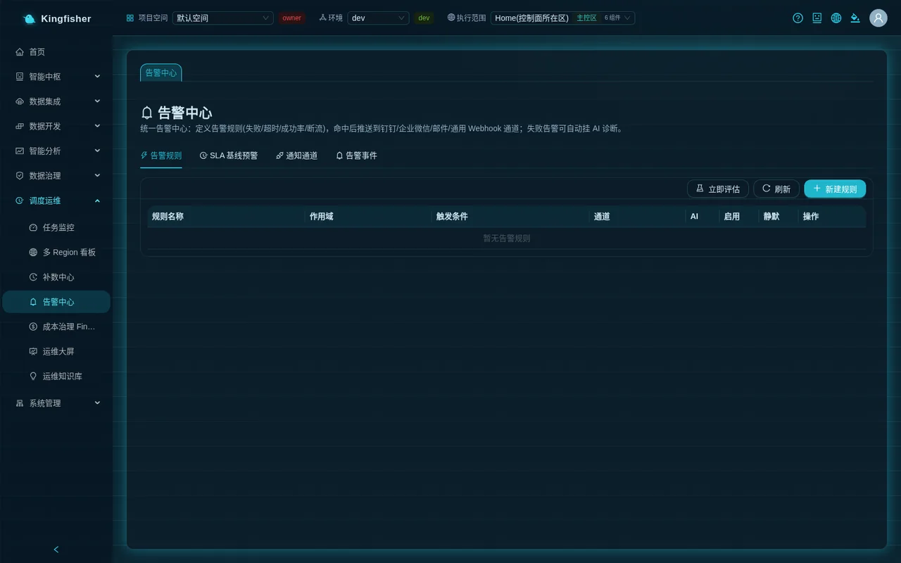
*Figure 7.4a: Alerting Center.*

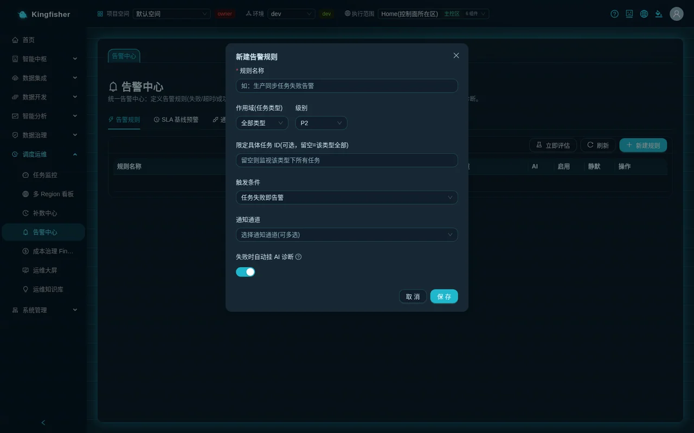
*Figure 7.4b: New alert rule.*

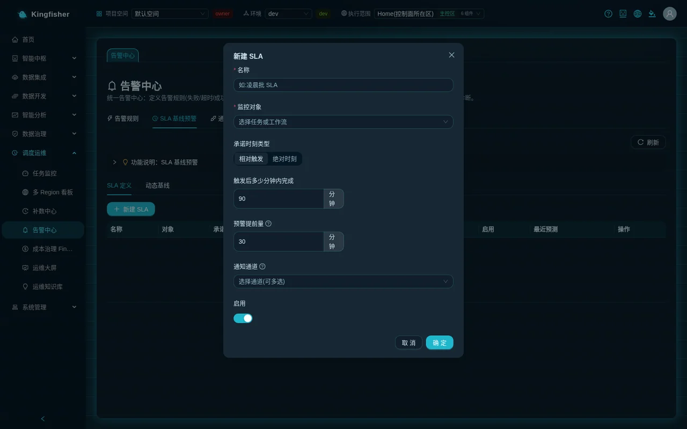
*Figure 7.4c: SLA baselines.*

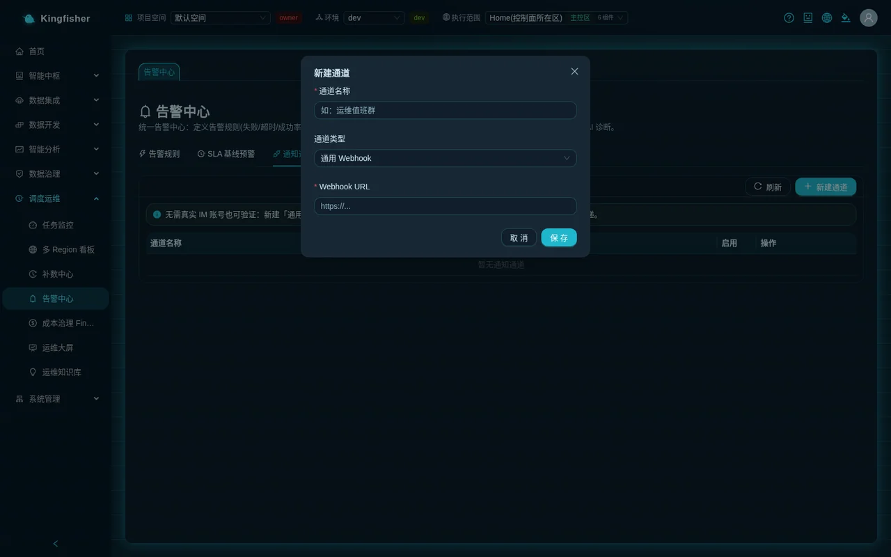
*Figure 7.4d: Notification channels.*

**Related AWS services:** Amazon DynamoDB, AWS DevOps Agent (diagnosis).

### 7.5 FinOps (`/finops`)

FinOps collects cost from AWS Cost Explorer by service, region and day and attributes it to regions, tasks and runs.
Per-region totals reconcile with Cost Explorer grouped by REGION, so the numbers match the AWS bill.

**Key capabilities**

- Cost overview per region with "collect now" to pull the latest billing watermark.
- Task- and run-level attribution through cost signatures.
- Anomaly detection per region, budget guardrails and saving advice.

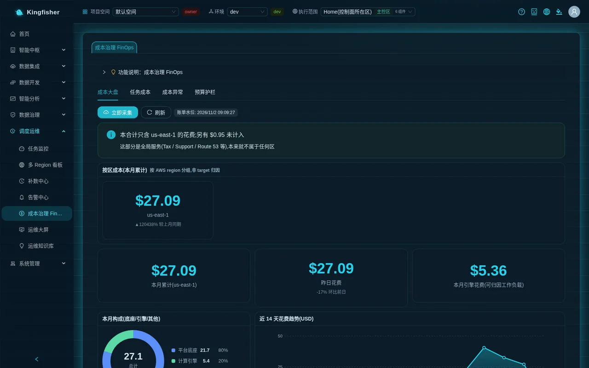
*Figure 7.5a: Cost overview.*

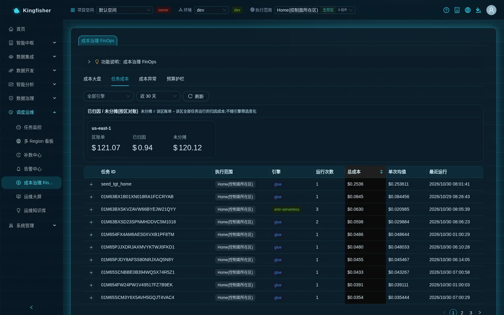
*Figure 7.5b: Task cost.*

*Figure 7.5c: Budget guardrails.*

**Related AWS services:** AWS Cost Explorer.

### 7.6 Ops Dashboard (`/ops`)

The Ops Dashboard is a wall-screen summary of platform health.

**Key capabilities**

- Run-status distribution, today's success and on-time rates, 7-day trend.
- Gantt chart of recent runs, the top slow tasks, and manual or timed refresh.

*Figure 7.6: Ops Dashboard.*

### 7.7 Incident Knowledge Base (`/incidents`)

Failed runs are grouped by failure signature so that recurring problems are recognised and their verified fixes are kept.

**Key capabilities**

- Signature cards with engine, recurrence count, affected tasks, regions, first and last seen.
- Verified fixes, silence and look-up by signature.
- MTTR and coverage statistics; redacted export.

*Figure 7.7: Incident Knowledge Base.*

**Related AWS services:** AWS DevOps Agent (diagnosis).

## 8. System

### 8.1 Workspaces (`/projects`)

A workspace (project space) is the boundary for resources and permissions: data sources, sync tasks, workflows, jobs, query tasks and more belong to exactly one workspace.
Members hold the roles owner, editor or viewer; platform-level Cognito groups add administrator, manager, developer and analyst rights.

**Key capabilities**

- Membership with join approval; cross-workspace sharing and copying.
- Independent warehouse credentials per workspace and per region, provisioned and recycled automatically.
- Delete pre-checks that list scheduled objects and open plans before refusing.
- Resource versions and promotion across environments.

*Figure 8.1a: Workspaces.*

*Figure 8.1b: New workspace.*

*Figure 8.1c: Members and approvals.*

**Related AWS services:** Amazon Cognito, Secrets Manager, Amazon Redshift Data API.

### 8.2 Execution Environments (`/exec-envs`)

Execution Environments manages the regions themselves.
The new-environment wizard registers a region, triggers a CodeBuild run that deploys the region's CDK stack group, then lets you detect initialization and enable the region.

**Key capabilities**

- Candidate regions come from the account's enabled regions; regions blocked by organisation policy are listed but disabled with the blocked action named.
- One environment per region with the full component set; a jurisdiction tag marks data-residency requirements.
- Detect initialization probes every component and enables the region's S3 Tables federated catalog.
- Detail view with components and probes, redeploy with preview, add components, stop accepting work, delete preview and approved deletion (data resources are retained).
- Credential state, health canary and residency acknowledgement per region.
- Regions pre-authorised at install or upgrade time need no command-line step after the wizard.

*Figure 8.2a: Execution Environments.*

*Figure 8.2b: New execution environment wizard.*

*Figure 8.2c: Execution environment detail.*

**Related AWS services:** AWS CodeBuild, AWS Lambda, AWS CloudFormation,
plus the per-region VPC, KMS, Redshift Serverless, S3 Tables, Glue, EMR Serverless, MWAA Serverless, DMS and Managed Service for Apache Flink.

### 8.3 Users (`/admin/users`)

Users manages the Cognito user pool: create users, assign roles, enable or disable accounts and reset passwords.

*Figure 8.3: Users.*

**Related AWS services:** Amazon Cognito.

### 8.4 Audit Log (`/audit`)

Every write operation is recorded with who, when, what, resource, request and details.
Entries carry the execution environment, so the log can be filtered by region; environments in a non-home jurisdiction keep a second copy of their audit records locally.

*Figure 8.4: Audit Log.*

**Related AWS services:** Amazon DynamoDB, AWS CloudTrail.

### 8.5 Settings (`/settings`)

Settings shows the resource facts of the current scope and holds the platform-wide configuration.

**Key capabilities**

- Resource facts: region, components, warehouse, buckets, workgroups and VPC.
- Registration of customer-owned S3 Tables buckets so that they become visible and writable.
- AI model: switch the default model at runtime among the Claude Opus, GPT, GLM and Kimi families.
  A server-side probe (and a tool-use probe for non-Claude families) must pass before the change takes effect.
- Data source network objects with one-click orphan cleanup, background cleanup tasks, global identity and service status.
- Platform version: release tag, product commit and version file.

*Figure 8.5a: Settings.*

*Figure 8.5b: AI model selection grouped by family.*

**Related AWS services:** Amazon Bedrock, S3 Tables, Amazon EC2, AWS Systems Manager Parameter Store.

## 9. Pages outside the menu

- **Metrics library** (`/metrics`): the same metric definitions as the Data Modeling metrics tab, reachable from modeling and Ask-Your-Data. No screenshot.
- **SLA** (`/sla`): redirects to the SLA tab of Alerting Center.
- **Theme gallery** (`/theme-gallery`, `/theme-preview`): a set of UI themes you can preview and apply.
- **English mode**: the language switcher in the top-right corner translates the whole console and the tours.

*Figure 9: Theme gallery.*

## 10. Cross-cutting behaviours

| Behaviour | What it does |
|---|---|
| Execution scope | Every page filters by the top-bar scope; read APIs accept `?scope=` and reject invalid or unauthorised values |
| Explicit target | Writes and runs must name an execution target; missing targets are rejected rather than defaulted |
| Workspace isolation | Routes check membership and resource ownership; credentials are issued per workspace and per region |
| Audit | Every write is one audit record with sensitive fields masked |
| Long operations | Waits longer than 45 seconds continue in the background with a progress toast; a second operation on the same object is refused while one is running |
| Multi-tab | Each route opens a keep-alive tab; right-click to close others, close right or close all |
| AI advisors | Network advisor, parameter advisor and role advisor help with connectivity, job tuning and IAM roles |
| Languages and themes | Chinese and English UI; selectable themes |
