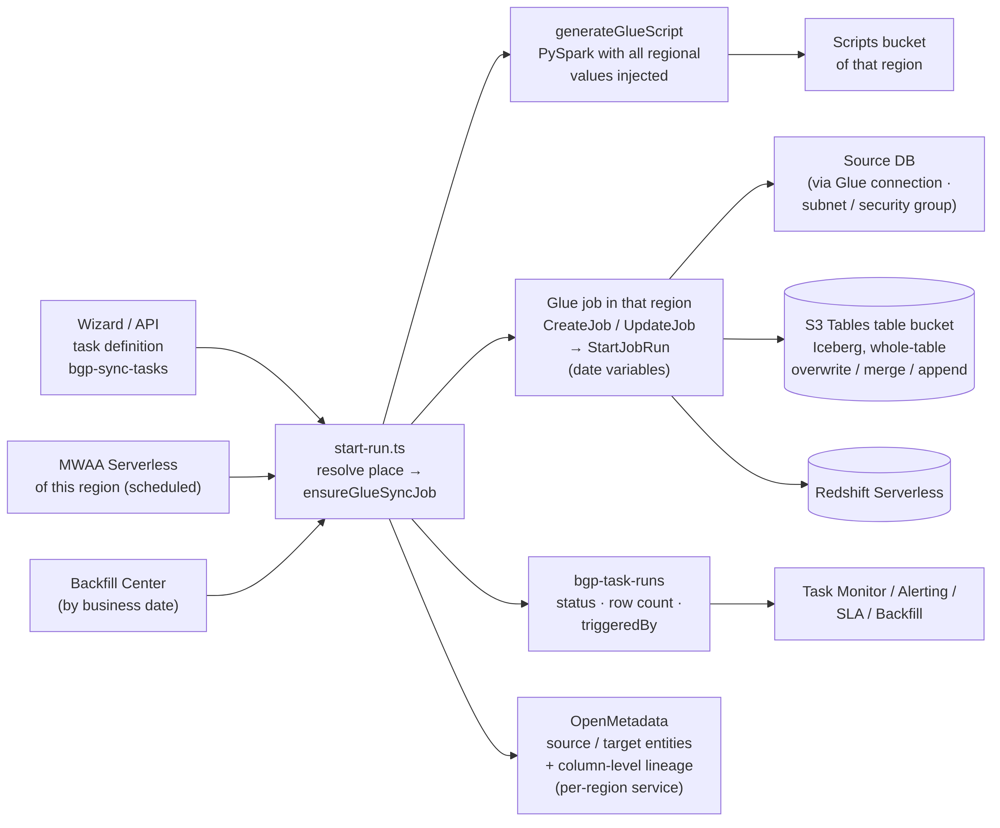
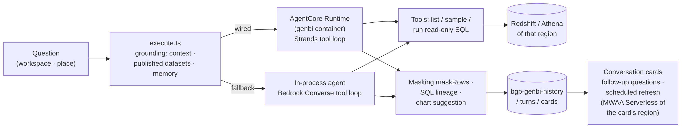
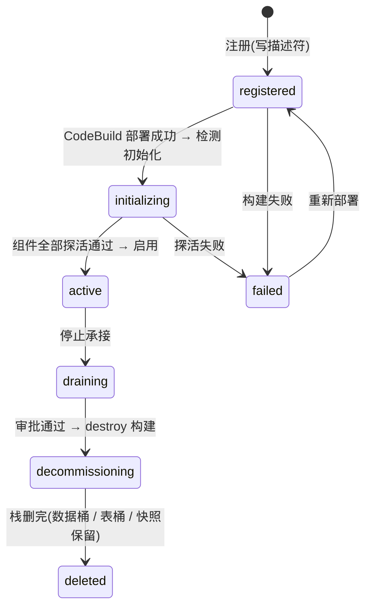

# Kingfisher Module Overview (release-2026-10-13)

> Scope: this document describes, according to the **current code** (tag `release-2026-10-13`, product bytes as of commit `2b181dc`), **what every functional module does today and where it lives**; it does not record design reasoning.
>
> Architecture and key flow diagrams: [`docs/architecture.md`](architecture.md); production deployment and known boundaries: the [deployment guide](deployment.md);
> the design notes of the single-region stage carry a scope header stating that current behavior is defined by this document and the code, while the multi-region, model-configuration, workspace-isolation, operation-guide, session-card and long-running-operation notes are current.
>
> Every module follows the same template: **What it does · Pages · API · Core code · AWS dependencies · Key mechanisms · Known boundaries (this release) · Design note**. Paths are relative to the repository root; `src/` means `platform/src/`.

## 0. Summary table (seven menu groups → modules)

| Menu group | Module | Pages | API groups (route count) | Core code |
|---|---|---|---|---|
| Home | Home | `/` | — | `src/app/page.tsx` |
| AI Hub | Copilot Plan Center | `/copilot/plans` | `copilot` (9) | `src/lib/copilot/` |
| Data Integration | Data Sources | `/datasources` | `datasources` (10) · `s3` (1) · `network-advisor` (3) | `src/lib/datasource/` · `src/lib/datasource-spi/` · `src/lib/aws/datasource-service.ts` |
| Data Integration | Data Sync | `/sync` · `/sync/[id]` | `sync` (16) | `src/lib/sync/` · `src/lib/realtime/{dms,zeroetl}-service.ts` |
| Data Development | Batch Compute | `/etl-jobs` | `etl-jobs` (12) · `engines` (12) · `param-advisor` (2) | `src/lib/etl/` · `src/lib/engines/` · `src/lib/cookbook/` |
| Data Development | ETL Orchestration | `/workflow` · `/workflow/[id]` | `workflow` (10) · `run-groups` (3) | `src/lib/workflow/` · `src/lib/scheduler/` |
| Data Development | Redshift Query | `/redshift` | `redshift` (10) | `src/lib/redshift/` |
| Data Development | Athena Query | `/athena` | `athena` (5) | `src/lib/athena/` |
| Data Development | Stream Compute | `/realtime-compute` | `flink` (15) | `src/lib/realtime/flink-*.ts` · `flink-sql-runner*/` |
| Smart Analytics | Ask-Your-Data | `/genbi` | `genbi` (16) | `src/lib/genbi/` · `infra/agent/genbi/` |
| Smart Analytics | Skills | `/skills` | `genbi/skills*` | `src/lib/genbi/skills*` · `infra/lambda/genbi-skills/` |
| Smart Analytics | Observability | `/observability` | `observability` (1) | `src/lib/observability/` |
| Smart Analytics | Report Builder | `/bi` | `bi` (10) | `src/lib/bi/` |
| Smart Analytics | Requests | `/requirements` | `requirements` (8) | `src/lib/requirements/` |
| Data Governance | Data Governance | `/governance` | `governance` (18) · `lineage` (1) · `metadata-mirror` (1) | `src/lib/governance/` · `src/lib/quality/` · `src/lib/lineage/` |
| Data Governance | Governance Workbench | `/governance-workbench` | `governance/health` | `src/lib/governance/health-service.ts` |
| Data Governance | Data Modeling | `/modeling` | `modeling` (22) | `src/lib/modeling/` |
| Data Governance | Business Glossary & Rules | `/knowledge` | `genbi/context*` | `src/lib/genbi/context.ts` |
| Data Governance | Governance Center | `/openmetadata` | `openmetadata` (1) | `src/lib/openmetadata/` · `infra/lib/om-*.ts` |
| Data Governance | Metrics Store (outside the menu) | `/metrics` | `metrics` (4) | `src/lib/metrics/` |
| Scheduling & Ops | Task Monitor | `/monitor` (includes the "Schedule config" tab; `/schedule` is the legacy address and redirects) | `monitor` (2) · `schedule` (1) · `seed` (3) | `src/lib/monitor/` · `src/lib/scheduler/` |
| Scheduling & Ops | Multi-Region Dashboard | `/multi-region` | `multi-region` (1) · `exec-targets` (1) · `scope` (1) | `src/lib/exec-env/consistency-matrix.ts` |
| Scheduling & Ops | Backfill Center | `/backfill` | `backfill` (6) | `src/lib/backfill/` |
| Scheduling & Ops | Alerting Center (including SLA) | `/alerting` · `/sla` (outside the menu) | `alerting` (8) · `sla` (4) · `baseline` (3) | `src/lib/alerting/` · `src/lib/baseline/` |
| Scheduling & Ops | FinOps | `/finops` | `finops` (9) | `src/lib/finops/` |
| Scheduling & Ops | Ops Dashboard | `/ops` | `ops` (1) | `src/lib/alerting/ops-summary.ts` |
| Scheduling & Ops | Incident Knowledge Base | `/incidents` | `incidents` (6) · `diagnostics` (2) | `src/lib/incidents/` · `src/lib/diagnostics/` |
| System | Workspaces | `/projects` | `projects` (4) · `approvals` (2) · `promote` (1) · `versions` (1) | `src/lib/projects/` · `src/lib/versions/` |
| System | Execution Environments | `/exec-envs` | `admin/exec-envs*` (the bulk of the 39 routes in the `admin` group) · `residency` (1) | `src/lib/exec-env/` · `infra/lib/exec-env/` |
| System | Users | `/admin/users` | `admin/users*` | `src/lib/auth/` |
| System | Audit Log | `/audit` | `audit` (1) | `src/lib/audit.ts` |
| System | Settings | `/settings` | `settings` (1) · `system` (1) · `public/version` (1) · `admin/model*` | `src/lib/settings/` · `src/lib/ai/` |
| Cross-cutting | Sign-in / themes / public endpoints | `/login` · `/theme-gallery` · `/theme-preview` | `public` (4) · `internal` (4) | `src/middleware.ts` · `src/lib/auth/` · `src/lib/skins/` |

> Of the 39 routes in the `admin` group, the large majority concern execution environments (register / deploy / build status / preview / delete approval / credential state / probing / adding components, and so on);
> the rest cover user management, model configuration and back-filling the place of data sources.

---

## 1. AI Hub

### 1.1 Copilot Plan Center

- **What it does**: the user describes a data-development need in natural language and Copilot generates a **reviewable multi-step plan** (create a data source / sync task / job / workflow, and so on);
  only after the user confirms each step ("Confirm this step") does the platform actually create the object — **create but never execute** is a hard guardrail (Copilot never starts a run on the user's behalf).
- **Pages**: `/copilot/plans`.
- **API**: `POST /api/copilot/ask` (a long-running operation since the release of 2026-10-27: the process waits in-line for 45 s; if no result has arrived ⇒ 202 with `protocol:"long-op/1"`, and the global fetch interceptor polls `GET /api/long-ops/[taskId]`;
  `/api/ai/tasks/[taskId]` is kept as an alias for one release) · `plan` · `plan/[planId]` (`confirm` · `control` · `tick`) · `plan/task/[taskId]` · `recipes`.
- **Core code**: `src/lib/copilot/agent.ts` (Bedrock Converse tool loop, the default in-process backend) · `agentcore-client.ts` (AgentCore backend; falls back to in-process on failure) · `plan/` (plan generation and advancement) ·
  `tools/` (tool registry, declarations shared with the AgentCore container) · `recipes/` · `action-guard.ts` (forbids execution-type actions).
- **AWS dependencies**: Bedrock (Converse).
- **Key mechanisms**: three tables for plans / steps / tasks (`bgp-copilot-plans/steps/plan-tasks`); a confirmed step calls the same create APIs the pages use;
  the domain vocabulary is unified in `src/lib/cookbook/capability-vocab.ts` so that the LLM cannot fill in fields outside the legal values.
- **Known boundaries**: there is no AgentCore-hosted Copilot container (planned in the [unified Copilot design](design/unified-copilot.md), never implemented).
- **Design note**: the [unified Copilot design](design/unified-copilot.md) (with the [endpoint inventory](design/unified-copilot-endpoint-inventory.md) and the [plan-execute design](design/unified-copilot-plan-execute.md)).

## 2. Data Integration

### 2.1 Data Sources

- **What it does**: registers and manages connections to source systems: JDBC (MySQL / PostgreSQL / Oracle / SQL Server), DynamoDB, S3 / Athena external tables, streams (Kinesis / MSK).
  Every data source **is placed in one execution region**; creating a source creates the Glue connection in that region (JDBC URL + subnet + security group), writes the password to Secrets Manager and ensures the Glue role; user-specified subnets and multiple security groups are supported.
- **Pages**: `/datasources` (list · creation wizard · reachability check ("Detect") · "Browse tables" · "Network configuration" ·
  the **"External table" (Athena direct query) dialog on S3 source rows (implemented after this baseline and released on 2026-10-27: pick a dataset ⇒ the table is created in the `bgp_s3_ext`
  database of the region this source lives in ⇒ "Open in Lake Query" opens the direct-query page with `?scope=&sql=`)**;
  **the "Demo data seeding" panel was removed following the user decision of 2026-10-21; seeding exists only as a test fixture through the `seed/*` endpoints**).
- **API**: `datasources` (root · `[id]` · `heartbeat` · `tables` · `schemas` · `s3-external` · `discover` · `test` · `kinesis-streams` · `msk-clusters`) · `s3/buckets` ·
  `network-advisor` (`probe` · `advise` (since the release of 2026-10-27: no result within 45 s ⇒ 202 + polling `GET /api/ai/tasks/[taskId]`) · `apply`).
- **Core code**: `src/lib/datasource-spi/` (provider registry: `jdbc/` ·
  `nosql/dynamodb.ts` ·
  `object-store/{s3,athena-external}.ts` ·
  `stream/{kinesis,msk}.ts`) · `src/lib/datasource/` (place `ds-place.ts` / `placement.ts`, heartbeat `heartbeat.ts`, `schema-reader.ts`) · `src/lib/aws/datasource-service.ts` (Glue connection / security group / role / network probing) · `src/lib/network-advisor/` (connectivity-diagnosis agent).
- **AWS dependencies**: Glue (Connection · Job) · Secrets Manager · EC2 (security groups / subnets) · RDS (instance discovery) · Kinesis · MSK · Athena.
- **Key mechanisms**: a data-source row records its place `targetId` and `probeVia`;
  - deleting a data source also removes the Glue connection and the platform-created security group (with retries);
  - the network advisor proposes applicable allow rules based on VPC / subnet / security group / routes;
  - **Edit** accepts only a closed list of editable fields (`src/lib/datasources/editable-fields.ts`, one list shared by the dialog and `PUT /api/datasources/[id]`; this fixed the 2026-10-15 report that renaming a source returned 500);
    when host / port / database / type or the login name / password change, the Glue connection in the source's region (JDBC URL · user name · password) and the secret are updated first and the row is written afterwards;
    if any step fails, the API returns 502 honestly and the record is left unchanged
    (previously only a password change wrote the secret, so a host change left the sync jobs connecting to the old address).
- **JDBC connection parameters** (released on 2026-10-27): the create / edit wizard accepts **additional JDBC connection parameters** (`jdbcParams`, of the form `k=v&k=v`; a user request of 2026-10-15);
  `src/lib/datasource-spi/jdbc/jdbc-params.ts` is the single author for parsing / validating / merging with the dialect defaults / concatenating (mysql · postgresql · oracle `?k=v&k=v`, sqlserver `;k=v;k=v`),
  and the result reaches the Glue connection URL, the sync scripts, the table-discovery scripts and the Flink MySQL sink through `provider.buildConnection`;
  - **the MySQL dialect carries `zeroDateTimeBehavior=CONVERT_TO_NULL` by default** (zero-value dates / timestamps are read as NULL so that one dirty row cannot fail the whole table — the cause of a sync-job failure reported on 2026-10-15; a parameter of the same name overrides it).
  - Boundary: it applies only to JDBC connections that go through the Glue connection / Glue jobs; the control-plane direct probe (mysql2 / pg drivers) does not read it.
- **Known boundaries (this release)**: "Detect" (heartbeat) and "Browse tables" connect to the source database directly **from the platform control plane**:
  when the source database lives in another VPC and allows only its own network range, the page shows it as unreachable and the table list is empty, while Glue sync jobs that run in that region's subnets are unaffected;
  - the wizard's "Test connection" and the "Connected" status cell shown after creation only verify that the Glue connection exists
    (**fixed on the development branch after this baseline and released on 2026-10-27**: creation wrap-up / "Test connection (by id)" / "Detect" share one author `lib/datasource/reachability-probe.ts`, "Connected" may only come from a real successful connection,
    and a freshly created source first shows "Testing");
    "Network configuration" only reads subnet / security-group facts.
  - The next release switches to running one discovery job through the data source's own Glue connection to log in to the source database.
- **Place of S3 external tables** (implemented after this baseline and released on 2026-10-27): the Athena external table created by `POST /api/datasources/[id]/s3-external` lands in the workgroup / Glue catalog of **the region this source lives in**
  (`lib/datasource-spi/object-store/athena-external.ts#ensureExternalTable(spec, place)` requires a place; the executor resolves it from the region stamp on the row through `resolveAthenaPlace`;
  previously every table landed in the home-region catalog, and the platform TaskRole's `bgp_s3_ext` Glue permission was likewise authorized for the home region only — both now follow the execution-region axis);
  - the response returns `targetId / region`.
- **Design note**: the [data-source ecosystem design](design/datasource-ecosystem.md) (single-region stage; its §13 is the 2026-10-26 addendum on the S3 external-table place) · multi-region placement: see the [multi-region execution design](design/multi-region-execution.md).

### 2.2 Data Sync (key module)

- **What it does**: synchronizes source tables into the region's data lake (S3 Tables, Iceberg) and / or data warehouse (Redshift Serverless):
  full load / incremental (watermark on an incremental column) / by business date (15 date variables) / WHERE filter / whole-table overwrite (atomic) / merge by key (Merge) / derived partitions and monthly tables;
  post-write reconciliation, row-count metrics and column-level lineage pushed to OpenMetadata; triggered manually, on a schedule (the region's MWAA Serverless) or by backfill. Channels: **Glue** (batch) · **DMS** (CDC) · **zero-ETL**.
- **Pages**: `/sync` (list · wizard) · `/sync/[id]` (details · run history · logs · output). The list refreshes automatically every 8 seconds while any task is running / starting / stopping (can be turned off, `src/lib/sync/auto-refresh.ts`);
  the wizard's table-selection step supports filtering by table name / showing only the selected tables / selecting everything that matches the filter / counting;
  the wizard configuration is saved automatically as a local draft in the browser (7 days, `src/lib/sync/wizard-draft.ts`) — close it without saving, reopen it and you can restore or discard the draft;
  every exception on "Done" produces an explicit message (released on 2026-10-27, following a user suggestion of 2026-10-15).
- **API**: `sync` (root · `[id]` · `start` · `stop` · `runs` · `runs/[runId]/logs` · `logs` · `output` · `glue-status` · `start-realtime` · `realtime-status` · `zeroetl-status` · `recommend-channel` · `type-mapping` · `generate-ddl` · `execute-ddl`).
- **Core code**: `src/lib/sync/start-run.ts` (the single author of the start path: resolve the place → create / update the job → start → write the run → background polling → OM push) · `glue-script-generator.ts` (PySpark script generation, a pure function;
  every region-specific value is injected from the place) · `sync-service.ts` (channel recommendation · type mapping · DDL) · `target-table-guard.ts` / `foreign-guard-adoption.ts` (foreign-table guard and one-time adoption) ·
  `run-vars.ts` / `run-vars-py.ts` (date variables, TS / Python from one source) · `run-metrics.ts` ·
  `schedule-carrier.ts` ·
  `src/lib/realtime/dms-service.ts` ·
  `zeroetl-service.ts`.
- **AWS dependencies**: Glue 5.x (jobs · connections · Data Catalog federated catalog `s3tablescatalog`) · S3 Tables · Redshift Data API · S3 (scripts bucket) · DMS · CloudWatch Logs · OpenMetadata.

*Data Sync module architecture (source `docs/diagrams/src/mr-module-sync.mmd`; re-render with mermaid-cli after changes).*

- **Key mechanisms**: **saving refreshes** the script and the Glue job (no need to run the task once more by hand); a whole-table overwrite of a table **the platform did not create** must be confirmed table by table
  (foreign-table guard; the same rule for Redshift and S3 Tables; tasks that had already succeeded before the upgrade are adopted once); Merge really merges by key (refused when the merge key is missing);
  run records carry `triggeredBy` to distinguish manual runs from backfill, and baselines and SLA exclude backfill on that basis; OM pushes for non-home regions are keyed by a per-region service; S3 Tables identifier sanitizing is aligned with the Glue catalog FQN.
- **Target table bucket must be a route** (lake table-bucket routing, ships with 2.2.0): the bucket entered in the wizard's "S3 Tables Data Lake Configuration → Table Bucket" must already be registered in "Settings → Lake table buckets and routes" and be writable; otherwise the save is rejected with a 400 that names the bucket and the next action. The upgrade script registers the external buckets referenced by existing home-region sync tasks as routes.
- **Switching the data source while editing** (released on 2026-10-27; fix for the 2026-10-15 report that a task could not be saved after switching its source): the wizard only accepts the table list of the last selected source
  (request sequence numbers; a stale table list / mapping from an earlier source that arrives later is discarded); after a source switch, selected tables that are not in the new source's table list are removed automatically with a notice,
  and the old source's DDL preview / channel recommendation become void;
  saving does not send back the old database name pre-filled in the form — the server-side `PUT /api/sync/[id]` recomputes `sourceDatabase` from the new source, a non-existent new source returns 404 and a new source in another execution environment returns 409 `CROSS_REGION_SOURCE`
  (the same "source and task in the same region" iron rule as the start route), and neither case writes the row.
- **Known boundaries (this release)**: saving a configuration change on a task that already has a Glue job may return 502 "save did not take effect"; tasks that write S3 Tables must use Glue version 5.1, which this release does not validate;
  tables synchronized into a **customer-owned** table bucket are not visible in the table tree / governance catalog / Ask-Your-Data. Details in the [deployment guide](deployment.md).
- **Design note**: after the single-region data-source ecosystem note, the capability completion of the 2026-10-13 release is recorded in [`CHANGELOG.md`](../CHANGELOG.md); multi-region
  push-down: see the data-sync work package in the [multi-region execution design](design/multi-region-execution.md).

### 2.3 Real-time integration (CDC)

- **What it does**: source database → Redshift full load + CDC (DMS), plus zero-ETL integration status; exists as two channels of a sync task, without a page of its own.
- **Core code**: `src/lib/realtime/dms-service.ts` (idempotent orchestration: endpoints / tasks / users / schemas are looked up before they are created) · `zeroetl-service.ts` · `redshift-target.ts` · `failure-advisor.ts`.
- **AWS dependencies**: DMS (replication infrastructure provided by the gated `BgpRealtimeStack` / the per-region `-dms` stack) · Redshift.
- **Design note**: the [real-time CDC design](design/realtime-cdc.md) (including the [DMS Serverless study](design/realtime-cdc-dms-serverless.md)).

## 3. Data Development

### 3.1 Batch Compute

- **What it does**: runs user-written Glue PySpark script jobs, Redshift SQL jobs and EMR Serverless jobs (engine SPI); supports script generation (recipes), parameter advice, run / rerun / backfill / logs / run groups / scheduling;
  the full set of 15 business-date parameters is passed to Glue and EMR jobs.
- **Pages**: `/etl-jobs`.
- **API**: `etl-jobs` (root · `[id]` · `run` · `rerun` · `runs` · `run-groups` · `logs` · `deps` · `backfill` · `schedule` · `schedule/trigger` · `generate`) · `engines/[engine]/…` (same shape, engine = `emr-serverless`) · `engines/generate` · `param-advisor` (`advise` · `recommend`).
  - Since the release of 2026-10-27 the three endpoints that call a large language model (`etl-jobs/generate` · `engines/generate` · `param-advisor/advise`) wait in-process for 45 s;
    with no result by then ⇒ 202 + polling `GET /api/ai/tasks/[taskId]` (the Requests workbench `requirements/[id]/generate` behaves the same way).
- **Core code**: `src/lib/etl/job-service.ts` (Glue / Redshift jobs) · `run-params.ts` / `run-params-py.ts` (date parameters, TS / Python from one source) · `dag-generator.ts` / `dag-fanout.ts` (artifacts of scheduled jobs) · `src/lib/engines/` (engine SPI;
  - `emr/` is the EMR Serverless implementation: application · scripts · network · logs · run records · schedule fan-out) · `src/lib/cookbook/` (script recipes: retrieval · guards · capability vocabulary) · `src/lib/param-advisor/`.
- **AWS dependencies**: Glue · Redshift Data API · EMR Serverless (shared base `BgpEmrStack` + the per-region `-core` execution role) · S3 · CloudWatch Logs.
- **Key mechanisms**: run records are written uniformly to `bgp-task-runs` and reused by the monitor page; a scheduled job is published as a workflow on the region's MWAA Serverless (the artifact is generated at publish time, so after changing parameters the job must be republished);
  EMR scripts read `sys.argv` by parameter name (the template was changed accordingly), so adding a parameter no longer raises "unknown parameter".
- **Glue version of new jobs** (ships with 2.2.0): "New" persists `glueConfig.glueVersion` at creation (nothing selected = default 6.0, the highest supported version; values outside the list are rejected with 400; single author `lib/sync/glue-version.ts#glueVersionForNewRecord`); existing jobs without a stored version keep running as 5.1. The run-history table scrolls horizontally (`scroll.x` 1400, fixed-width "Started" column) so both columns stay visible at a 1600 px viewport.
- **Lake table-bucket routing** (ships with 2.2.0): a job declares under "Advanced Properties → Lake table buckets" which S3 Tables buckets it reads and writes (default: every route of the region); Glue and EMR Serverless each get one Spark catalog per bucket (the alias is the catalog name) plus a default catalog, so scripts address tables as `alias.namespace.table` without a hand-written `--conf`. The route list is read from `GET /api/lake-routes?targetId=` (any signed-in user); the save-time preflight of a custom role probes the declared buckets (s3tables and federated-catalog actions); Glue job definitions are materialised at run / schedule / orchestration time, not on save.
- **Design note**: the [offline jobs](design/etl-jobs.md), [job run parameters](design/etl-run-parameters.md), [parameter advisor](design/param-advisor.md) and [engine cookbook](design/engine-cookbook.md) designs (single-region stage).

### 3.2 ETL Orchestration (workflows)

- **What it does**: canvas-based DAG orchestration with the node types `sql` · `python` · `sync` (sync task) · `foreach` · `branch` · `join` · `setvar` · `external` · `platform-action` · `empty`;
  published as a **workflow on the region's MWAA Serverless**, with trigger / run status / node logs / run groups / cancel / retry failed nodes.
- **Pages**: `/workflow` · `/workflow/[id]`.
- **API**: `workflow` (root · `[id]` · `publish` · `unpublish` · `trigger` · `run-groups` · `runs/[runId]/status` · `runs/[runId]/nodes` · `nodes/[task]/logs` · `airflow`) · `run-groups` (`[id]` · `cancel` · `retry-failed`).
- **Core code**: `src/lib/workflow/publish-dag.ts` (publish / unpublish / drift detection) · `dag-generator-v2.ts` ·
  `node-registry.ts` ·
  `node-exec-py.ts` ·
  `runtime-lib.ts` ·
  `src/lib/scheduler/serverless/` (`publish.ts` · `workflow-client.ts` · `yaml-generator.ts` · `code-package.ts` · `task-logs.ts`) · `src/lib/scheduler/action-*.ts` (platform-action nodes: command table → dispatcher Lambda → internal endpoint) ·
  `dependency.ts` (upstream success triggers downstream).
- **AWS dependencies**: MWAA Serverless (`CreateWorkflow` / `UpdateWorkflow` / `StartWorkflowRun` / `ListWorkflowRuns` / `GetTaskInstance` / `GetLogEvents` …) · S3 (DAG bucket) · Lambda (`infra/lambda/action-dispatcher`) · DynamoDB Streams.
- **Batch job node and sync node** (ships with 2.2.0): the `job` node references a batch job (Glue / Redshift / EMR) of the same project that is bound to the workflow's place, with run rows written on both sides and back-links; the sync node fails closed on place at publish time, writes the sync task's own run row and passes the workflow's business date to the sync Glue run as `--ds` (runtime library 13).
  The node panel and the "Downstream dependencies" selector both take their candidates **by the workflow's execution regions** (single author `components/dag-editor/scoped-candidates.ts`; a failed read shows the error text instead of an empty list). Design: [workflow job node](design/workflow-job-node.md).
- **Key mechanisms**: the multiple statements of a SQL node run as **one transaction**; the workflow execution contract is the home region (a workflow bound to a non-home region cannot be backfilled — backfill the individual jobs instead);
  "the region stamp must not lie" — republishing to a different region returns 409.
- **Known boundaries (this release)**: in a region that has only MWAA Serverless, the schedule-configuration page wrongly reports "This region has no Airflow environment yet" (scheduling actually works).
- **Design note**: the [multi-engine node design](design/multi-engine-nodes.md) (single-region stage) · moving all scheduling to MWAA Serverless: see the scheduling work package in the [multi-region execution design](design/multi-region-execution.md).

### 3.3 Redshift Query

- **What it does**: a SQL editor against the region's Redshift Serverless: execute / cancel / history / results, database and schema browsing, save as a Redshift task (schedulable).
- **Pages**: `/redshift`. **API**: `redshift` (`execute` · `cancel` · `result/[id]` · `history` · `history/[historyId]/sql` · `databases` · `schemas` · `connections` · `tasks` · `tasks/[id]`).
- **Core code**: `src/lib/redshift/` (including `direct-query.ts`: place resolution for direct queries + consolidated polling). **AWS dependencies**: Redshift Data API (credentials per workspace per region through Secrets Manager).
- **Design note**: the historical design card of the single-region stage (not published) · parallel direct query across regions: see the [multi-region execution design](design/multi-region-execution.md).

### 3.4 Athena Query (lake direct query)

- **What it does**: direct queries against the region's S3 Tables table bucket (Athena federated catalog `s3tablescatalog/<table bucket>`); the table tree on the left lists namespaces / tables; several regions can be queried in parallel.
- **Pages**: `/athena`. **API**: `athena` (`query` · `query/[id]` · `results` · `stop` · `tables`).
- **Core code**: `src/lib/athena/` (`s3tables.ts` table tree and external-bucket read cache). **AWS dependencies**: Athena · S3 Tables · Glue Data Catalog.
- **Mechanism** (implemented after this baseline and released on 2026-10-27, after the finding that a brand-new account has no `s3tablescatalog` federated catalog, so lake direct query and Ask-Your-Data failed with `CATALOG_NOT_FOUND`):
  the federated catalog `s3tablescatalog` is a region-level Glue resource that CloudFormation cannot create; the install / upgrade scripts enable it explicitly (`scripts/lib/s3tables-catalog.sh`),
  and at run time both the sync start path and direct query self-heal through the single author `src/lib/aws/s3tables-catalog.ts` (the catalog is created only when absent; if it cannot be created, that is reported honestly as the error of this query / start).
  The release in production creates it only as a side effect of the start path of a sync task that writes S3 Tables, so an environment that has never run such a sync always gets `CATALOG_NOT_FOUND` on direct query.
- **Table-bucket dropdown** (implemented after this baseline and released on 2026-10-27; a customer improvement request of 2026-10-16): the sync-task wizard's
  "S3 Tables Data Lake Configuration → Table Bucket" and "Settings → Data lake external table buckets → Register" share `src/components/lake/TableBucketPicker.tsx` (AutoComplete, manual entry still possible),
  - the list comes from `GET /api/lake-buckets/candidates?targetId=` (readable by any signed-in user with an explicit place since the lake-routing release; the admin path `/api/admin/lake-buckets/candidates` stays one release as an alias; `src/lib/lake/table-bucket-candidates.ts` reads all pages of ListTableBuckets read-only in the region of the place and marks "Platform table bucket of this region" and "Registered";
  - if the list cannot be fetched ⇒ 502 with an honest notice and a fallback to manual entry).
- **Known boundaries (this release)**: the table tree lists only **the platform's own table bucket** in each region; tables in customer-owned table buckets must be queried with a hand-written three-part name.
- **Design note**: the [Athena / S3 Tables design](design/athena-s3tables.md).

### 3.5 Stream Compute (Flink)

- **What it does**: Flink SQL streaming jobs (one MSAF application per job, run from a generic runner JAR, with the user's SQL injected through runtime properties): sources Kinesis / MSK, sinks such as S3 Tables (Iceberg); modular connectors; AI-assisted SQL authoring; run diagnosis.
- **Pages**: `/realtime-compute`. **API**: `flink` (`jobs` · `jobs/[id]` · `start` · `stop` · `status` · `logs` · `results` · `produce` · `diagnose` · `dashboard` · `connectors` · `connectors/[id]` · `meta` · `network` ·
  `ai-sql` (since the release of 2026-10-27: no result within 45 s ⇒ 202 + polling `GET /api/ai/tasks/[taskId]`)).
- **Core code**: `src/lib/realtime/flink-service.ts` (ensure → Start → Describe → Stop + Delete) · `flink-connectors.ts` · `connector-modules.ts` · `flink-sql-ai.ts` · `flink-place.ts`;
  - runner sources `flink-sql-runner/` (base) · `flink-sql-runner-s3t/` (S3 Tables / Iceberg) · `flink-sql-runner-s3t-kafka/` (MSK source), all on Flink 1.20; the JARs are built by `deploy-all.sh` and uploaded to each region's scripts bucket under `flink/`.
- **AWS dependencies**: Managed Service for Apache Flink · Kinesis · MSK · S3 Tables.
- **Design note**: the [real-time compute design](design/realtime-compute.md) (with the [modular connector runtime](design/realtime-compute-connector-runtime-modular.md), the [S3 Tables 412 root fix](design/realtime-compute-flink-s3tables-412-root-fix.md) and the [tri-engine verification](design/realtime-compute-tri-engine-s3tables-verification.md)).

## 4. Smart Analytics

### 4.1 Ask-Your-Data, GenBI (key module)

- **What it does**: natural language → SQL → a real query **in the region where the data lives** (Redshift / Athena, read-only) → table / chart / explanation; grounded in the business glossary, published datasets and short- / long-term memory;
  a result can be saved as a **session card** (continue the conversation, scheduled refresh, at most 100 cards per user); asynchronous execution (202 + polling); hot-loaded skills; observability dashboard.
- **Pages**: `/genbi` (questions) · `/skills` (skills) · `/observability` (observability) · `/knowledge` (business glossary and rules).
- **API**: `genbi` (`ask` · `tasks/[taskId]` · `history` · `cards` · `cards/[cardId]` (`refresh` · `resume` · `runs` · `schedule`) · `cards/schedules` · `context` · `context/[id]` · `context/seed` · `skills` · `skills/[id]` · `skills/seed`) · `observability/genbi`.
- **Core code**: `src/lib/genbi/execute.ts` (the single executor function: backend selection → grounding → invocation → masking → chart → history write; shared by the synchronous and asynchronous paths) · `agentcore-client.ts` (`InvokeAgentRuntime`) ·
  `agent.ts` (in-process fallback: Bedrock Converse tool loop) · `context.ts` ·
  `memory.ts` ·
  `cards-*.ts` ·
  `athena.ts` ·
  `core/` (the core shared with the AgentCore container; build output `infra/agent/genbi/core-dist/`) · `infra/agent/genbi/` (AgentCore Runtime container, Strands).
- **AWS dependencies**: Bedrock AgentCore (Runtime · Memory) · Bedrock (models) · Redshift Data API · Athena.

*Ask-Your-Data module architecture (source `docs/diagrams/src/mr-module-genbi.mmd`; re-render with mermaid-cli after changes).*

- **Key mechanisms**: a 300-second ceiling per question; on timeout the request is aborted and compute stops immediately;
  three-layer model resolution (factory default → Settings → takes effect only after a run-time probe passes; see the [model configuration design](design/model-configuration.md)), and the response `_meta` echoes the model actually used
  (implemented after this baseline and released on 2026-10-27: the result card shows "Model used: <id> · backend", `data-testid=genbi-model-used`); masking follows the classification rules ([classification and masking design](design/classification-masking.md));
  before a scheduled refresh **runs on the author's behalf**, the account / workspace membership / the card's region are re-verified.
- **Known boundaries**: if Bedrock is unavailable in the customer account (model access denied), Ask-Your-Data and all other AI features are unavailable; the remaining features are unaffected.
  - Since the release of 2026-10-27 the selectable models have been extended to four families (Claude Opus / GPT-5.6 / GLM 5 / Kimi K3, single author `platform/src/lib/ai/core/vendors.ts`), so an account whose access to Anthropic models is denied at the account level can switch to GLM / Kimi;
  - Kimi K3 always returns reasoning blocks and produces roughly twice as many output tokens as Claude (the platform scales maxTokens by a factor), and GLM 5.3 may not be enabled at the account level (probe classification `NotAvailableForAccount`).
- **Design note**: the [AgentCore GenBI](design/agentcore-genbi.md), [asynchronous execution](design/genbi-async-execution.md), [engine unification](design/genbi-engine-unification.md) and [session card](design/genbi-session-cards.md) designs (the session-card design is current) · deep dive in [`docs/deep-dive.md`](deep-dive.md).

### 4.2 Report Builder

- **What it does**: maintains report widgets, dashboards and ad-hoc analyses per workspace; data comes from Ask-Your-Data results / warehouse queries; export.
- **Pages**: `/bi`. **API**: `bi` (`reports` · `reports/[id]` · `dashboards` · `dashboards/[id]` · `analyses` · `analyses/[id]` · `analysis-query` · `query` · `schema` · `export`).
- **Core code**: `src/lib/bi/` (`reports.ts` key-based isolation with pk=projectId and optimistic locking; `query-builder.ts` · `chart-series.ts` · `definition-regions.ts`).
- **Design note**: the [BI report / dashboard design](design/bi-report-dashboard.md) (its early v2 – v4 drafts are archived).

### 4.3 Requests

- **What it does**: intake → assignment → comments → generation / job creation → state transitions for Ask-Your-Data requests; **published datasets** serve as grounding for Ask-Your-Data.
- **Pages**: `/requirements`. **API**: `requirements` (root · `[id]` · `assign` · `comment` · `create-job` · `generate` · `transition` · `assignees`).
- **Core code**: `src/lib/requirements/`. **Design note**: the [GenBI requirement pipeline](design/genbi-requirement-pipeline.md) and [semantic retrieval](design/genbi-semantic-retrieval.md) designs.

## 5. Data Governance

### 5.1 Data Governance (catalog · classification and masking · grants · quality · lineage · sensitive-data scan)

- **What it does**: the governance catalog (warehouse / table-bucket tables and columns, back-filled by "Sync column information") · data classification and masking rules · access grants (data grants) · quality rules / runs / results and scores ·
  SQL lineage and impact analysis · sensitive-data scan (findings can be adopted as classifications) · scheduled governance tasks (quality checks / sensitive scans / catalog sync, really executed per region).
- **Pages**: `/governance` (several tabs).
- **API**: `governance` (`catalog` ·
  `columns` ·
  `sync-redshift-schema` ·
  `classification` ·
  `access-grants` ·
  `quality-rules` ·
  `quality-rules/[id]` ·
  `quality-run` ·
  `quality-results` ·
  `quality` ·
  `lineage` ·
  `lineage/backfill-om` ·
  `impact` ·
  `sensitive-scan` ·
  `sensitive-scan/adopt` ·
  `schedules` ·
  `schedules/[taskId]` ·
  `health`) · `lineage/parse` ·
  `metadata-mirror`.
- **Core code**: `src/lib/governance/` (`classification.ts` · `masking.ts` · `lineage-service.ts` · `sensitive/` · `scoped-fqn.ts`) · `src/lib/quality/` (`service.ts` rule engine: template-generated validation SQL → executed on Redshift → scoring / SLA;
  `templates.ts`) · `src/lib/lineage/` (`sql-lineage.ts` · `spark-lineage.ts`) · `src/lib/exec-env/metadata-mirror*.ts` (cross-region read-only mirror) · `src/lib/scheduler/action-schedules.ts` (carrier of the scheduled governance tasks).
- **AWS dependencies**: Redshift Data API · Athena / Glue Data Catalog · OpenMetadata · MWAA Serverless (schedules).
- **Key mechanisms**: catalog sync reconciles against OpenMetadata (the tables fully collected in this round vs. the tables of the same OM service; tables not seen are soft-deleted; nothing is deleted when the collection is incomplete);
  quality / sensitive scans really run **in that region** according to the execution scope; scheduled governance tasks and Ask-Your-Data card refreshes share the same scheduling carrier (a single-node platform-action workflow).
- **Graphical create table / alter table** (implemented after this baseline and released on 2026-10-27): the catalog tab's "New table" wizard (Redshift: reuses the modeling landing channel, ledger entry `origin: catalog`; S3 Tables: s3tables `CreateTable` from an Iceberg schema) + the row action "Alter table" (Redshift: add column / comment / widen VARCHAR / drop column, where dropping a column requires typing the table name; changes that cannot be performed are refused as a whole with an explanation;
  non-home regions go through the admin executor `alter-model-table`; a table not yet in the ledger is first claimed with its real columns);
  - in a prod environment this becomes a `ddl` approval request.
  - **API**: `governance/tables` (root · `preview` · `columns` · `alter`).
  - **Core code**: `src/lib/governance/catalog-ddl.ts` · `src/lib/modeling/alter.ts` · `alter-service.ts`.
  - **Boundary**: no alter-table for S3 Tables tables (Iceberg schema evolution needs Spark; Athena does not support DDL on s3tablescatalog); the button is disabled with an explanation.
- **Known boundaries (this release)**: in an environment with many tables, "Sync column information" in the governance catalog may report "Sync failed" after 60 seconds although the background work has completed
  (refresh and the result is visible; fixed on the development branch after this baseline, then moved onto the long-running-operation framework in its second batch; released on 2026-10-27).
- **Design note**: the [SQL lineage and impact](design/sql-lineage-impact.md), [classification and masking](design/classification-masking.md), [quality rules / scoring / SLA](design/quality-rules-scoring-sla.md) and [governance deepening](design/governance-deepening.md) designs.

### 5.2 Governance Workbench

- **What it does**: the overall governance health score (0–100; security / classification 0.30 · quality 0.30 · SLA 0.20 · lineage 0.20) + per-dimension scores + asset ranking + to-dos; purely aggregated reads, zero new tables.
- **Pages**: `/governance-workbench`. **API**: `governance/health`. **Core code**: `src/lib/governance/health-service.ts`. **Design note**: the [governance deepening design](design/governance-deepening.md).

### 5.3 Data Modeling

- **What it does**: warehouse layers · data domains / subject areas · data standards · code tables (can be landed in the region's Redshift) · dimensions / facts (generate and apply DDL; can be unbound, with an impact preview) · model metrics · ownership of modeling assets.
- **Pages**: `/modeling`. **API**: `modeling` (`layers` · `domains` · `codetables` (`land` · `unbind` · `unbind-preview`) · `dimensions` (`ddl` · `apply` · `unbind` · `unbind-preview`) · `model-metrics` · `assets` …, 22 routes).
- **Core code**: `src/lib/modeling/` (`service.ts` · `landing.ts` · `dimensions.ts` · `redshift.ts` safe SQL + unified execution · `unbind.ts`). **AWS dependencies**: Redshift Data API.
- **Key mechanisms**: code tables and dimension tables can be landed in non-home regions (single author of the physical place); since the graphical create / alter table feature (released on 2026-10-27) the ledger row carries `origin` (modeling / catalog / catalog-adopted)
  and, for alterations in non-home regions, the pending execution plan `pendingAlter` (the admin executor operation `alter-model-table` reads only that). **Design note**: the [data modeling design](design/data-modeling.md).

### 5.4 Metrics Store

- **What it does**: metric definitions and value computation (single / all). **Pages**: `/metrics` (outside the menu; referenced from modeling / Ask-Your-Data). **API**: `metrics` (root · `[id]` · `compute` · `compute-all`). **Core code**: `src/lib/metrics/service.ts`.
  **Design note**: the [metrics store](design/metrics-store.md) and [metrics consolidation](design/metrics-consolidation.md) designs.

### 5.5 Business Glossary & Rules

- **What it does**: maintains the business context used to ground Ask-Your-Data (definitions, rules, terms), effective per workspace / place. **Pages**: `/knowledge`. **API**: `genbi/context` · `context/[id]` · `context/seed`. **Core code**: `src/lib/genbi/context.ts` (table `bgp-genbi-context`).

### 5.6 Governance Center (OpenMetadata)

- **What it does**: OpenMetadata 1.6.1 is the platform-wide metadata center (one instance, in the home region): 6 kinds of scheduled ingestion (redshift / glue / s3 / s3tables / sources / profiler) + platform event pushes (a sync run registers the source / target entities and column-level lineage) + reconciliation;
  the page provides the entry point and the SSO redirect.
- **Pages**: `/openmetadata`. **API**: `openmetadata/url`.
- **Core code**: `src/lib/openmetadata/` (`om-client.ts` · `om-push.ts` · `om-sync-coords.ts` (single author of the per-region service / FQN) · `om-reconcile.ts` · `om-mirror-push.ts` · `om-glossary.ts`) · `infra/lib/om-{database,search,service,ingestion}-stack.ts`.
- **AWS dependencies**: ECS Fargate · RDS MySQL · OpenSearch · ECS scheduled tasks (ingestion).
- **Key mechanisms**: objects of non-home regions are pushed under a per-region service (no longer attached to the home-region service); the factory password is replaced at deployment time with a random password in Secrets Manager.
  **Design note**: the [OpenMetadata ingestion design](design/openmetadata-ingestion.md).

## 6. Scheduling & Ops

### 6.1 Task Monitor (including schedule configuration)

- **What it does**: the unified view of the platform-wide run ledger (sync / jobs / workflows / governance tasks / card refreshes), with run groups, logs and cancel; the "Schedule config" tab
  manages the cron expression and on / off state of every object (`/schedule` is the legacy address and redirects automatically).
- **Pages**: `/monitor`. **API**: `monitor/runs` · `monitor/tasks/[id]/logs` · `schedule/enable` · `seed/*` (seeding = endpoints reserved for test fixtures: seeding jobs exist only in demo mode;
  **the front-end panel was removed following the user decision of 2026-10-21**, and the endpoints are called only by acceptance scripts / fixtures).
- **Core code**: `src/lib/monitor/` (`run-records.ts` single author of run records · `run-groups.ts` · `run-cancel.ts` · `cron-slot.ts`) · `src/lib/scheduler/` (`action-schedules.ts` · `carrier-ledger.ts` · `mwaa-*.ts`).
- **Key mechanisms**: every run is written to `bgp-task-runs`; cancel is a user action and is never rewritten to "failed" by automation; a missing / offline MWAA produces an explicit three-state notice.
- **Known boundaries (this release)**: the schedule-configuration false alarm described in 3.2. **Design note**: the [intelligent operations and alerting design](design/intelligent-ops-alerting.md) (monitoring part) · the historical schedule design card of the single-region stage (not published).

### 6.2 Multi-Region Dashboard

- **What it does**: the version / component / baseline consistency matrix across execution regions plus a run overview (it answers "does this need attention": missed publishes / version skew / failures). **Pages**: `/multi-region`.
  **API**: `multi-region/matrix` · `exec-targets` · `scope/counts`. **Core code**: `src/lib/exec-env/consistency-matrix.ts` · `matrix-actions.ts`. **Design note**: the interaction-design section on the multi-region dashboard in the [multi-region execution design](design/multi-region-execution.md).

### 6.3 Backfill Center

- **What it does**: backfills batch jobs (Glue / EMR, per region) and sync tasks over a business-date range: plan → instances → background advancement pump (the backfill completes even if the page is closed) → results;
  a workflow that contains a sync node runs with concurrency fixed at 1; workflows bound to a non-home region are explicitly refused.
- **Pages**: `/backfill`. **API**: `backfill` (root · `plan` · `targets` · `[planId]` · `control` · `tick`) · `internal/backfill/tick`.
- **Core code**: `src/lib/backfill/` (`plan.ts` · `execute.ts` · `pump.ts` the 30 s advancement pump · `sync-task.ts` · `due.ts`). **Design note**: the [backfill center design](design/agent-native-operations-backfill.md) of the agent-native operations set.
- **Instance observability** (released on 2026-10-27, following a customer report of 2026-10-19): the cells of the progress matrix are clickable ⇒ instance drawer
  (date / node / execution region / status / attempts / start and end / duration / **rows written and their source** / **verbatim error** / underlying run taskId · runId / Glue job) + "View run log" (the same dialog as the Task Monitor page, `components/monitor/RunLogModal.tsx`) / "Locate in Monitor" (`/monitor?name=&triggeredBy=backfill`; the monitor page's "Trigger" column and filter recognize "Backfill") / "Open task page";
  - **succeeded but wrote 0 rows** is marked amber "Succeeded (0 rows)" with candidate causes (no data in the date window / the WHERE clause matched nothing / the incremental watermark has already passed, or the SQL itself selects 0 rows);
  - plan-level "Total rows written (known for k / n successful instances) / succeeded with 0 rows / row count not reported".
  - The single author of the row-count source is `src/lib/backfill/run-facts.ts` (sync task `metrics.rowsWritten` > Redshift statement `metrics.rowsAffected` (`src/lib/redshift/affected-rows.ts`, the sum of Data API `ResultRows`) > null "not reported ≠ 0");
  - the instances returned by `GET /api/backfill/[planId]` carry `run` / `zeroRowHints`, and the response carries a `rows` summary.

### 6.4 Alerting Center and SLA

- **What it does**: alert rules (failure / timeout / success rate / stream interruption) · channels (with test delivery) · events (idempotent de-duplication) · optional AI diagnosis; SLA and baseline learning (freshness / duration prediction / risk board).
- **Pages**: `/alerting` (includes the SLA tab) · `/sla`. **API**: `alerting` (`rules` · `rules/[id]` · `channels` · `channels/[id]` · `channels/[id]/test` · `events` · `evaluate` · `test-sink`) · `sla` (root · `[id]` · `predict` · `risk-board`) · `baseline` (root · `[taskId]` ·
  `learn`) · `public/alerting-sink`.
- **Core code**: `src/lib/alerting/` (`evaluate.ts` · `rules.ts` · `channels/` · `events.ts` · `notify.ts` · `redact.ts`) · `src/lib/baseline/`.
- **Key mechanisms**: evaluate scans `bgp-task-runs`; events are idempotent through `putEventIfNew`; in this first phase evaluation is driven by front-end polling / manual triggering, with no resident worker.
  **Design note**: the [intelligent operations and alerting design](design/intelligent-ops-alerting.md) · the [baselines / SLA design](design/agent-native-operations-baseline-sla.md) of the agent-native operations set.

### 6.5 FinOps

- **What it does**: Cost Explorer collection by service × region × day (T+1, with rolling re-collection of the last N days), attribution by region, anomaly detection, budgets, advice, task-level cost signatures. **Pages**: `/finops`.
  **API**: `finops` (`overview` · `collect` · `detect` · `anomalies` · `budgets` · `budgets/[id]` · `advice` · `tasks` · `tasks/[taskId]`).
- **Core code**: `src/lib/finops/` (`collector.ts` · `cost-region.ts` · `anomaly*.ts` · `budget-eval.ts` · `advice.ts` · `cost-signature.ts`). **AWS dependencies**: Cost Explorer (T+1). **Design note**: the [FinOps design](design/finops.md).

### 6.6 Ops Dashboard · Incident Knowledge Base · Run diagnosis

- **Ops Dashboard** `/ops`: the aggregated view of alerts / runs / health (`ops/summary`, `src/lib/alerting/ops-summary.ts`).
- **Incident Knowledge Base** `/incidents`: incidents and their handling, accumulated by failure signature (`incidents`: root · `[signature]` · `silence` · `lookup` · `health` · `export`; `src/lib/incidents/`).
- **Run diagnosis**: AI diagnosis of failed runs / Flink jobs through the **AWS DevOps Agent managed service** (discover / create the Agent Space `bgp-devops-agent` by name → open a session → send the evidence → collect the investigation reply;
  asynchronous, with the page polling every 3 seconds; `diagnostics` API; `src/lib/diagnostics/devops-agent.ts`; flow diagram `docs/diagrams/devops-agent-flow.png`).
- **Design note**: the [DevOps-agent diagnostics design](design/devops-agent-diagnostics.md) · the [incident memory design](design/agent-native-operations-incident-memory.md) of the agent-native operations set.

## 7. System

### 7.1 Workspaces (RBAC · isolation · copy)

- **What it does**: a workspace (project) is the boundary of resources and permissions; member roles `owner` / `editor` / `viewer`; platform-level Cognito groups `bgp-admin` / `bgp-manager` / `bgp-developer` / `bgp-analyst`;
  **independent warehouse credentials per workspace per region** (Secrets Manager, provisioned / revoked automatically); pre-deletion checks; cross-workspace sharing / copying; resource versions and multi-environment release.
- **Pages**: `/projects`. **API**: `projects` (root · `[id]` · `members` · `members/[username]`) · `approvals` · `promote` · `versions`.
- **Core code**: `src/lib/projects/` (`guard.ts` · `project-service.ts` · `config-permissions.ts` · `project-resources.ts`) · `src/lib/exec-env/project-cred-*.ts` · `project-schema.ts` · `src/lib/versions/`.
- **Key mechanisms**: Ask-Your-Data / saving cards / direct query all check workspace membership; the default workspace starts with no members (non-administrators must be added first; demo installations seed the four demo role accounts as members).
  **Design note**: the [project isolation design](design/project-isolation.md) (current) · the [multi-tenancy RBAC](design/multitenancy-rbac.md), [versioning / rollback](design/versioning-rollback.md) and [multi-environment release](design/multi-environment-release.md) designs (single-region stage).

### 7.2 Execution Environments (key module)

- **What it does**: the full lifecycle of an execution region: register (choose region / jurisdiction / network range; the candidate regions come from the account's real state and regions blocked by SCP are disabled;
  since the release of 2026-10-27 every region is marked either "pre-authorized, usable right after the build" or "ops must release it once after the build") → deploy (broker Lambda → CodeBuild runs `cdk deploy` of the stack group in the target region) →
  Check initialization (probe each component; since the release of 2026-10-27 this includes idempotent enablement of the region's S3 Tables federated catalog) → Enable → add components / Redeploy (with a preview first)
  → stop accepting work → delete preview → approved deletion (data resources are retained);
  per-region credential state, probe canary, jurisdiction confirmation (residency ack), consistency matrix.
- **Pages**: `/exec-envs`. **API**: `admin/exec-envs` (root GET · `register` POST · `[targetId]` · `build-status` · `preview` · `add-components` · `canary` · `credential-state` · `access` · `acks` · `delete-preview` · `delete-request` …) · `residency/ack` · `exec-targets`.
- **Core code**: `src/lib/exec-env/` (`registry.ts` the read side of the registry, strongly consistent, never falls back to home ·
  `lifecycle.ts` the single author of the state machine ·
  `deploy-control.ts` / `deployments.ts` broker calls and build status ·
  `probe-runner.ts` / `implemented-components.ts` probing ·
  `decommission.ts` / `delete-impact.ts` ·
  `target-clients.ts` per-region clients ·
  `data-plane-target.ts` the four bindings (region ·
  workgroup ·
  database ·
  credentials) · `privileged-cred.ts` ·
  `residency*.ts` ·
  `consistency-matrix.ts`) · `infra/lib/exec-env/` (stack group) · `infra/lib/exec-env/deploy-stack.ts` (CodeBuild + broker + source-package asset) · `infra/lambda/exec-env-broker/` ·
  `infra/buildspec/exec-env-deploy.yml`.

*Execution environment lifecycle state machine (source `docs/diagrams/src/mr-module-exec-env-lifecycle.mmd`; re-render with mermaid-cli after changes).*

- **AWS dependencies**: CodeBuild · Lambda · CloudFormation · per region: VPC / endpoints / CMK / roles / Redshift Serverless / S3 Tables / Glue / EMR Serverless / MWAA Serverless / DMS / MSAF.
- **Key mechanisms**: state is split into two axes, spec (desired) and observed, and `lifecycle.ts` is the only code in the repository allowed to write the phase; the execution-region
  source package is the CDK asset uploaded by content hash when the control plane is deployed (changing the buildspec requires redeploying the control plane);
  after a new region is enabled, **the control plane must be redeployed once to authorize it** (`EXECUTION_REGIONS` / `aws:RequestedRegion`); a non-home jurisdiction must install residency-api and keep the audit in two copies;
  three data-plane credential modes `taskrole` (production default) / `observe` / `enforce`.
- **Known boundaries (this release)**: the data-plane credential mode defaults to `taskrole`, so the "IAM catches cross-region access" layer of defense in depth is not in effect (cross-region access is refused by the application-layer place check).
- **Design note**: the [multi-region execution overview](design/multi-region-execution.md) and the full contracts — [specification](design/multi-region-execution-spec.md) · [design document](design/multi-region-execution-design.md) · [interaction design](design/multi-region-execution-interaction.md).

### 7.3 Users · Audit Log · Settings

- **Users** `/admin/users`: create accounts / roles (Admin / Manager / Developer / Analyst / no platform group; the role-to-Cognito-group mapping has a single author in `src/lib/auth/groups.ts`; changing a role first removes the four platform groups and the legacy `bgp-viewer`) / enable and disable / reset password (Cognito; `src/lib/auth/cognito-users.ts`); the initial `admin` password is generated by the deployment script; all five writes are audited (`user.create` · `user.disable` · `user.enable` · `user.role.change` · `user.password.reset`).
  A non-administrator opening this page sees a red explanation ("This action requires platform-administrator (bgp-admin group) permission; please contact a platform administrator"); gateway 403 texts are chosen by reason with a single author in `src/lib/auth/forbidden-messages.ts`, and an analyst account leaving its whitelist still gets the operations-analyst sentence.
- **Audit Log** `/audit`: every write operation goes to `bgp-audit` (who / when / object / region), filtered by execution scope (`src/lib/audit.ts`; `audit` API).
- **Settings** `/settings`: run-time AI model configuration (three-layer resolution, probe gate, rate limiting, invalidation banner; see the [model configuration design](design/model-configuration.md)), wiring status (`system/wiring`),
  the **Platform version** card (implemented after this baseline and released on 2026-10-27: release tag / product commit / commit time / version file; the facts come from `GET /api/public/version`, single author `src/lib/build-info.ts`; the sign-in page footer shows the same facts);
  - non-admin users see only the currently effective model, read-only (`settings` API).
  - Core code `src/lib/settings/` · `src/lib/ai/`.
  - **Design note**: the [model configuration design](design/model-configuration.md) (current).
  - **Multi-vendor model channel** (released on 2026-10-27): a catalog of four families (Claude Opus / GPT-5.6 / GLM 5 `zai.glm-5*` / Kimi K3 `moonshotai.kimi-k3*`; the grouping comes from `families[]` of `GET /catalog`);
    - before saving, the GPT / GLM / Kimi families must pass a second, tool-use probe; without that evidence ⇒ 400 `ToolUseUnavailable`;
    - a new probe classification `NotAvailableForAccount` (not enabled at the account level);
    - Converse requests are shaped per vendor profile (Kimi: strip temperature / topP / stopSequences, maxTokens ×2; GLM: strip stopSequences; Claude: identity) + one same-layer retry at run time that learns from Bedrock's verbatim error message,
      located in `src/lib/ai/invoke.ts` and in the `core-dist/ai` of the three agent containers;
    - at deployment the default model is chosen by really invoking, one by one, the candidate chain `candidateModelIds` of `platform/ai-model.json` (Claude Opus 4.5 → GLM 5.3 → Kimi K3) (`scripts/resolve-home-model.sh`).
- **Settings → Lake table buckets and routes** card (ships with 2.2.0; `src/components/lake/LakeRoutesCard.tsx`): customer-owned S3 Tables buckets are registered as route entries (alias / tier / namespace ownership / writable; no new table — the external-bucket registry rows are reused, single author `src/lib/lake/routes.ts`); writes go through `POST / PATCH|PUT / DELETE /api/admin/lake-routes` (platform admin), reads through `GET /api/lake-routes` (any signed-in user); revoking a route still used by a job or task is refused with 409 naming them; an alias conflict is 409; the platform bucket is always an implicit route and cannot be revoked.

## 8. Cross-cutting mechanisms

| Mechanism | In one sentence | Code |
|---|---|---|
| Place | every write operation / run must explicitly resolve its execution environment (`targetId` → region · resources · credentials); if it cannot be derived the request is refused, and it **never falls back to the home region** | `src/lib/place/` (`resolve.ts` single author) · `src/lib/exec-env/data-plane-target.ts` |
| Execution scope | the selector in every page header; read APIs take `?scope=` (single region / global) with a strict grammar, 400 when invalid | `src/lib/scope/` (`scope.ts` · `route-scope.ts` · `api-read-ledger.ts` read ledger) |
| Authentication and workspace isolation | the middleware verifies the Cognito ID token; `requireProject` / `guardResourceAccess` inside the routes | `src/middleware.ts` · `src/lib/auth/` · `src/lib/projects/guard.ts` |
| Audit | one `bgp-audit` record per write operation; sensitive fields are masked | `src/lib/audit.ts` |
| AI advisors | network-connectivity advisor · job-parameter advisor · role-recommendation advisor (in-process / AgentCore) | `src/lib/network-advisor/` · `param-advisor/` · `role-advisor/` · `infra/agent/{netadvisor,paramadvisor}/` |
| Model resolution | factory default → Settings → probe; AgentCore model receipt verification; vendor profiles + Converse request shaping (released on 2026-10-27; the same copy is compiled into the three containers' `core-dist/ai`) | `src/lib/ai/model.ts` · `agentcore-contract.ts` · `src/lib/ai/core/vendors.ts` · `converse-shape.ts` |
| Long-running-operation framework (released on 2026-10-27; root fix for the 504 on cold-start landings, absorbs the hybrid AI-response protocol, adds object leases) | every request that waits for an external system to reach a terminal state goes through `submitLongOp`: the process waits `LONG_OPS_SYNC_WAIT_MS` (default 45 s); already terminal ⇒ the synchronous response is unchanged byte for byte; not terminal ⇒ 202 `protocol:"long-op/1"` + task table `bgp-long-ops` + `GET /api/long-ops/[taskId]`; a 300 s ceiling; a stale heartbeat is taken over by polling; a task is never re-run; **the client transport layer**, in the global fetch interceptor, recognizes only 202 responses that carry this protocol marker, polls to the terminal state and then reshapes the result into a Response of the same shape (success / failure status codes and envelopes restored byte for byte) ⇒ page call sites need no change, and the bottom-right corner shows "Running in background: <label> (n s elapsed)"; the first batch of 15 kinds: seven AI kinds + modeling landing / apply / unbind / unbind preview + catalog create table / alter table / read columns + approval DDL execution; the second batch of 14 kinds (released on 2026-10-27): governance column sync (the 60-second "Sync failed" false alarm) / workspace deletion (the warehouse cold-start retry) / sync generate DDL · execute create table / Flink start, stop and delete / workflow publish · unpublish · trigger · delete / S3 external table / metrics · model-metric computation; **the single primitive for awaiting a terminal state** is `awaitTerminal` (it throws when no waiting context is present; the 27-file ratchet baseline may only shrink); **object leases**: every kind declares the exclusive resource key it holds; if the lease cannot be taken ⇒ 409 `LONG_OP_IN_PROGRESS`, and the code-table / dimension-table modify and delete routes share the same guard; the six tabs of the modeling page refresh independently (a UX improvement of the same release) | `src/lib/long-ops/` (`kinds.ts` · `store.ts` · `driver.ts` · `await-terminal.ts` · `guard.ts` · `client/follow.ts`) · `src/lib/ai/long-op-executors.ts` · `src/lib/{modeling,governance,projects,sync,realtime,workflow,datasource,metrics}/long-ops.ts` · `src/app/api/long-ops/[taskId]/route.ts` · `src/components/long-ops/LongOpIndicator.tsx` |
| Background pumps | 15 s pump for long data-plane jobs, 30 s backfill pump, periodic reconciler; advanced through internal endpoints | `src/lib/dataplane-jobs/pump.ts` · `backfill/pump.ts` · `exec-env/reconciler-loop.ts` · `api/internal/*` |
| Platform-action dispatch | MWAA node → command table in the home region → dispatcher Lambda → `/api/internal/actions/run` | `src/lib/scheduler/action-*.ts` · `infra/lambda/action-dispatcher/` |
| Onboarding | interactive tour, a "How to use this page" help button on every page, role-based getting started | `src/lib/guide/` ([operation guide design](design/operation-guide.md)) |
| Multiple tabs (keep-alive) | every visited route opens a tab, and switching does not unmount opened pages; tab context menu "Close others / Close tabs to the right / Close all"; the tab bar is never empty (Close all keeps Home) | `src/components/layout/MultiTabs.tsx` · rules `multitabs-close.ts` |
| Internationalization / themes | Chinese string bundle and check scripts; preview page for 12 skins | `src/lib/i18n/` · `platform/scripts/i18n-*.mjs` · `src/lib/skins/` |
| Data service (retired) | `/api/public/data/*` returns 410 Gone | the superseded data-service design note (historical; not published) |

## 9. Module ↔ design note cross-reference

| Module | Design note | Status |
|---|---|---|
| Execution environments / multi-region / place / execution scope / autonomous scheduling / zero egress / jurisdiction / cost by region | [`design/multi-region-execution.md`](design/multi-region-execution.md) | Current |
| Run-time AI model configuration | [`design/model-configuration.md`](design/model-configuration.md) | Current |
| Workspace isolation and copy | [`design/project-isolation.md`](design/project-isolation.md) | Current |
| Operation guide | [`design/operation-guide.md`](design/operation-guide.md) | Current |
| Ask-Your-Data session cards | [`design/genbi-session-cards.md`](design/genbi-session-cards.md) | Current |
| Long-running-operation framework (automatic switch to 202 + polling after 45 s; root fix for the 504 on cold-start landings, absorbs the hybrid AI-response protocol, object leases) | [`design/long-running-operations.md`](design/long-running-operations.md) | Design note published; the first and second batches were merged to the development branch and released on 2026-10-27; the third-batch list is in the design note |
| Data Sync (capability completion of the 2026-10-13 release) | [`CHANGELOG.md`](../CHANGELOG.md), entry for the 2026-10-13 release | Current record |
| Per-job execution role selection | [`design/execution-role-binding.md`](design/execution-role-binding.md) | Current (ships with 2.2.0) |
| Offline job node in workflow orchestration | [`design/workflow-job-node.md`](design/workflow-job-node.md) | Current (ships with 2.2.0; node panel filtering by place and business-date pass-through follow) |
| Lake table-bucket routing (one job across several S3 Tables buckets) | [`design/lake-bucket-routing.md`](design/lake-bucket-routing.md) (revision 1.2-en) | Phase 1 (core routing) ships with 2.2.0; Phase 2 (read side) planned; Phase 3 (governance) next release |
| All other modules | the design documents of the single-region stage, each with a scope header; index in [`design/README.md`](design/README.md) | Single-region-stage designs; current behavior is defined by this document and the code |
