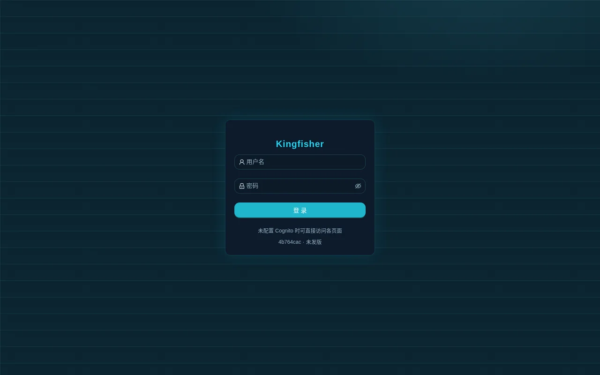
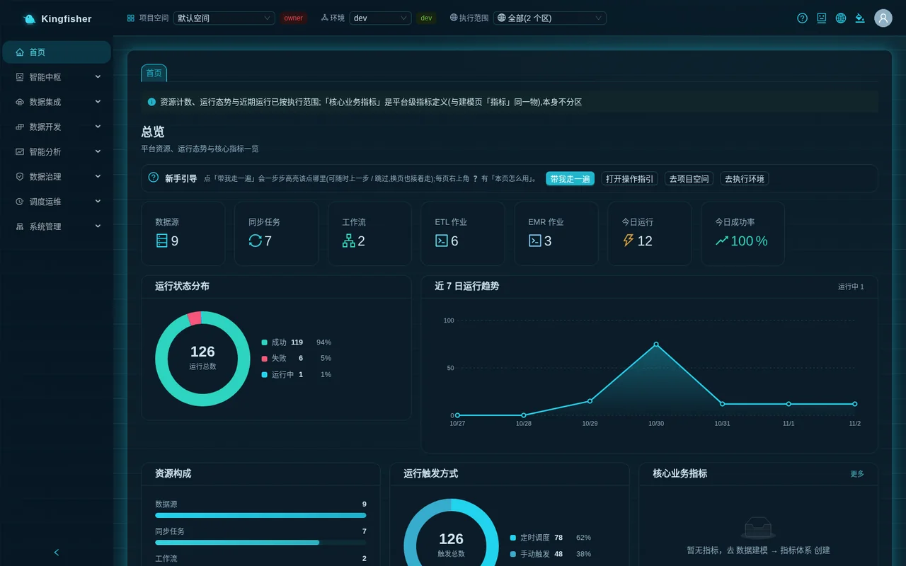
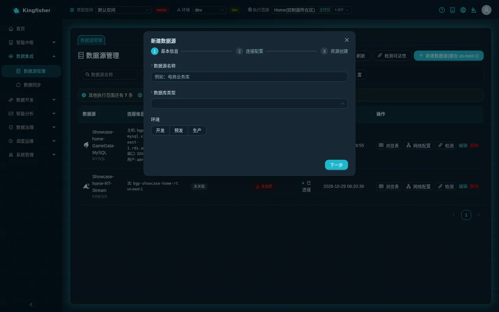
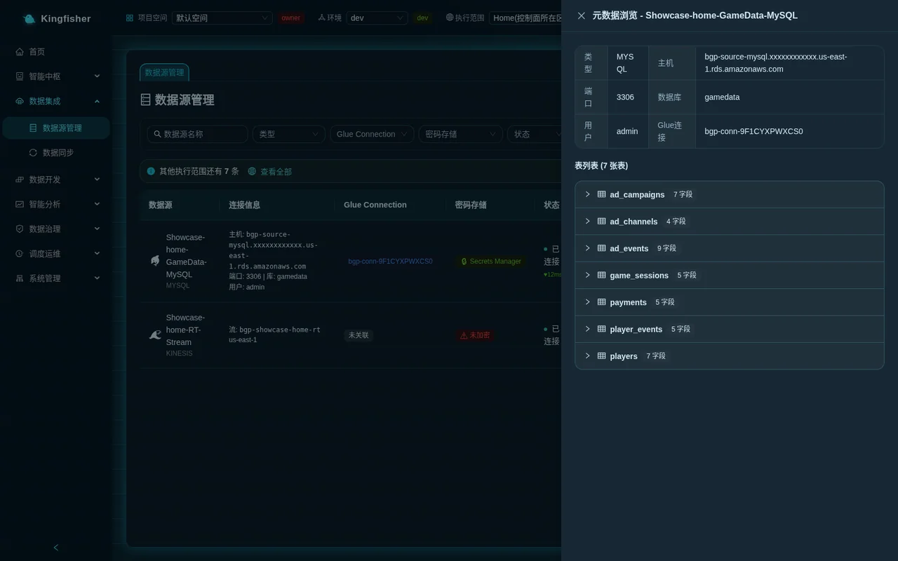
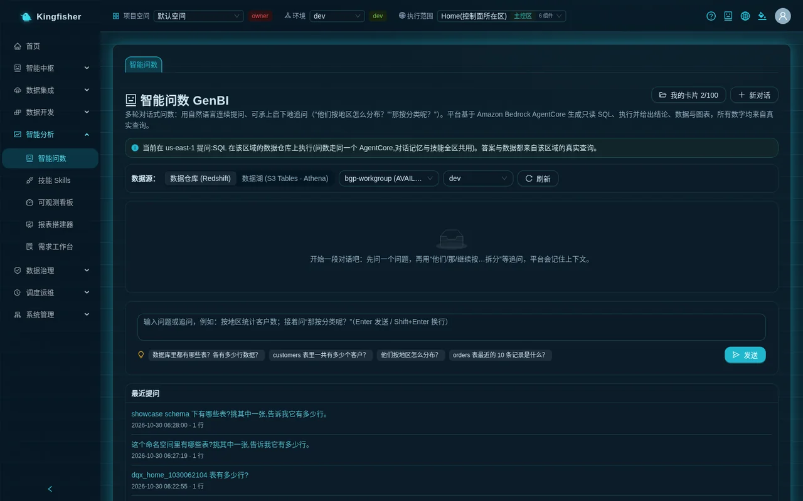
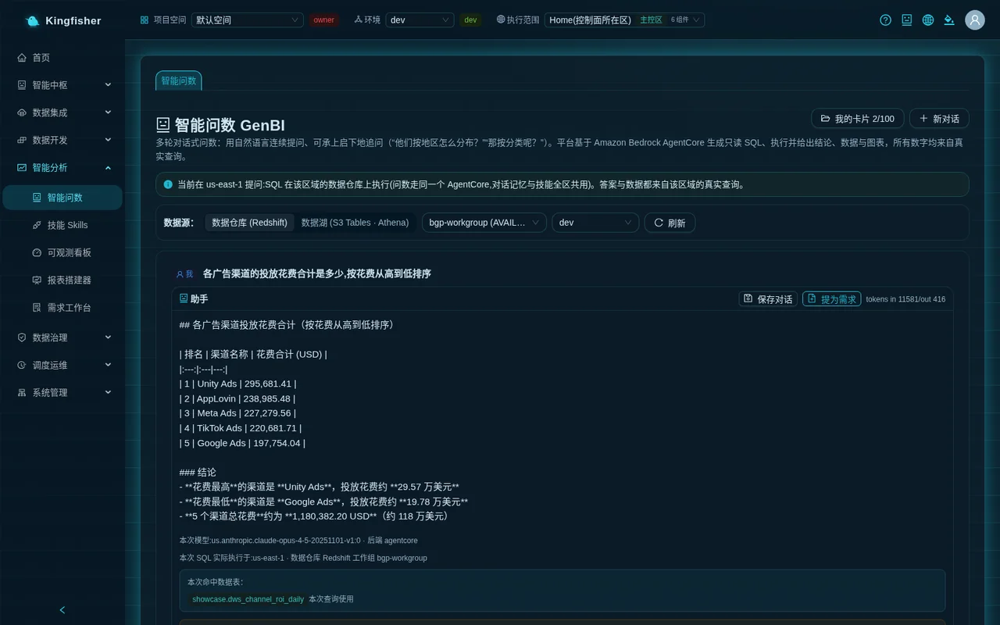
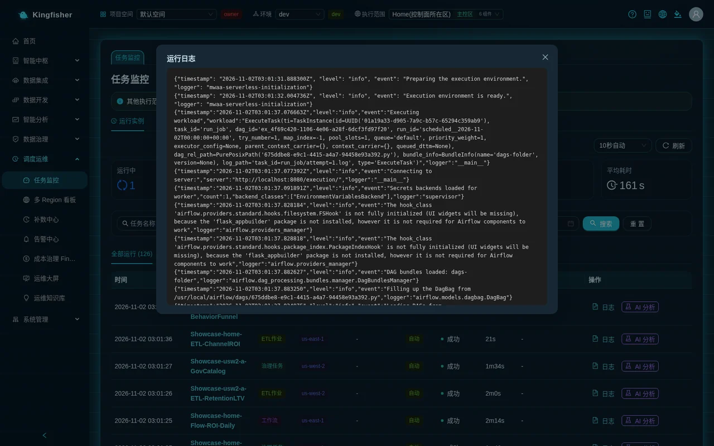

# Quick start: run your first pipeline end to end in 30 minutes

| Item | Description |
|---|---|
| Audience | Anyone using Kingfisher for the first time (admin / data engineer / analyst) |
| Estimated time | 30 minutes (excluding the sync job's own run time of about 3–8 minutes) |
| Prerequisites | The URL and an account for a demo installation that has run the evaluation-environment orchestration (it ships the game user-acquisition database `gamedata`; a demo environment that only ran the install script does not have it); the connection details of the demo MySQL source database (ask the platform admin); your account is already a member of a workspace |
| What you get | A changed password; an understanding of the three top-bar selectors; a MySQL data source you created yourself; a task that syncs 7 tables to S3 Tables; rows returned in "Athena Query"; one real answer from "Ask-Your-Data"; this run visible in "Task Monitor" |

## 0. Outcome first

Thirty minutes from now you will have a complete pipeline **from source database to data lake to natural-language query** on the demo installation, and you will know which page to go to for every step from then on.

Route (suggested timing in parentheses):

1. Log in, change the password, meet the first-visit tour (0–5 min)
2. Meet the top bar: "Workspace", "Environment", "Execution scope" (5–8 min)
3. Create the first MySQL data source under "Data Sources" and browse to its 7 tables (8–15 min)
4. Create the first sync task under "Data Sync", full-load the 7 tables into the S3 data lake, "Start" it and see "Success" (15–22 min)
5. Query rows from the freshly synced tables in "Athena Query" (22–25 min)
6. Ask a one-sentence question in "Ask-Your-Data" and click "View generated SQL" (25–28 min)
7. Find this sync run in "Task Monitor" and read its log (28–30 min)

Demo data: the MySQL game user-acquisition database `gamedata`, 7 tables — `players` players · `player_events` player events · `game_sessions` game sessions · `payments` payments · `ad_channels` ad channels · `ad_campaigns` ad campaigns · `ad_events` ad events.
Each execution region of the demo installation also has a ready-made set of sample objects (name prefix `Showcase-<region-slug>-`, e.g. the `Showcase-<region-slug>-GameData-MySQL` data source and the `Showcase-<region-slug>-GameSync-7tables` sync task); you can open them first to see the finished result, then build your own set following the steps below.

**Preparing the demo data yourself (administrator, demo installs only)**: a demo environment that only ran the install script has neither `gamedata` nor the showcase objects. On the deployment machine:

1. `./scripts/22-seed-game.sh <profile> <home-region>` loads the demo MySQL source database through a Glue job that runs inside the VPC: it **drops and recreates** the 7 `gamedata` tables (about 12 million rows, about 8 minutes) and is safe to re-run.
2. `./scripts/32-verify-all-regions.sh <profile> <home-region>` runs step 1 automatically when the lake has no `gamedata` yet, then creates the long-lived `Showcase-<region>-*` objects in every enabled execution region and exercises the nine capability classes (about 25 minutes per region).

Both commands are for your own demo environment only; never seed a customer's source database. Parameters, stages and timings: [`docs/deployment.md`, appendix C](../deployment.md#appendix-c-demo-and-acceptance-mode).

## 1. Preparation

- URL and account: ask the platform admin. A demo installation ships an admin account and a few role test accounts; a production installation has only the admin account, and the admin creates the others under "Users".
- **Project membership**: GenBI, saving cards, Redshift queries and so on all check project membership. The default workspace "Default Workspace" has **no members at all** at first; until a non-admin is added to a project, asking a question returns 403 "No access to this workspace".
  Ask an admin to add you under "System → Workspace" (viewer = view / ask only; editor = can develop; steps 3–4 of this guide need editor).
- The connection details of the demo MySQL source database (host, port, database name `gamedata`, username, password) are on the deployment machine; ask the admin for them, or use "Select from RDS" in the data source wizard to let the platform read the credentials automatically (see step 3).
- Browser: the latest desktop Chrome / Edge. The page language is suggested from where you access it; to change it, click the globe icon "Switch language" in the top-right corner and choose Chinese or English.

## 2. Step 1: log in and change the password (0–5 min)

1. Open the URL to reach the sign-in page. Enter "Username" and "Password" and click "Sign in". The bottom of the sign-in page shows the current release number (e.g. `v2.2.0`); check it here when reconciling an upgrade.
2. The first time you open the platform in this browser, the **interactive tour starts automatically** (it highlights what to click step by step along the "Data Development" path; it is remembered in the browser, so a different browser shows it again). Click "Skip tour" for now; to walk it again later, click "Walk me through" on the "Onboarding" card on the home page.
3. Change the password right away: avatar in the top-right corner → "Change password" → enter "Current password", "New password", "Confirm new password" → click "Change".
   Password rule: "At least 12 characters, with upper-case, lower-case, digits and symbols". On success you see "Password changed. Use the new password next time you sign in".
4. The ❓ in the top-right corner of any page is the "User guide" drawer: the "How to use this page" tab explains the page's purpose / steps / key points / related pages; the "Getting started" tab gives a path per role; the "Multi-region & compliance" tab explains multi-region execution.
   Turning off the switch "Open the guide automatically after login" at the bottom of the drawer stops the first-visit tour from popping up automatically.

You should see: the home page "Overview" — resource counts such as "Data Source", "Sync task", "Workflow", "ETL Job" and "EMR Job", "Runs today" and "Success rate today", "Run Status Distribution" and "Last 7 Days Run Trend", plus the "Onboarding" card.





## 3. Step 2: meet the top bar (5–8 min)

The three context layers at the left of the top bar decide **what you see and where you create things**. Look at all three first.

| Selector | What to choose now | Key points |
|---|---|---|
| "Workspace" | Choose the project the admin added you to; the tag next to it shows your role owner / editor / viewer | Switching reloads the whole page; data sources / sync tasks / jobs are visible only in the current workspace |
| "Environment" | Keep `dev` | dev / staging / prod isolate configuration-type resources by "project + environment"; publishing to prod requires approval. This guide stays in dev throughout |
| "Execution scope" | Switch from "All (N regions)" to the **home region** item (tagged "Home region"; its display name starts with `Home`) | The data sources / sync tasks you create later in this guide land in the region you select here; switching does not reload the page, it only changes `?scope=` in the address bar |

- The "Execution scope" dropdown is grouped by region; each item shows the environment name, the "Home region" or 🌍 jurisdiction tag and the component count; a region that cannot take new work at the moment carries the "Not accepting work" tag (you can still select it to view data).
- Once a region is selected, each list shows the notice "Other execution scopes have N more" and a "View all" button at the top, reminding you that other regions hold objects too; pages such as "Ask-Your-Data" **require** a selected region before they can be used.
- Objects created from the "All" view land in the home region; the button restates the target, e.g. "New data source (in <region>)".


## 4. Step 3: create the first data source (8–15 min)

Page: "Data Integration → Data Sources".

1. Make sure the top-bar "Execution scope" has the home region selected. Click "New data source" (in a single-region view the button reads "New data source (in <region>)", and the hover tip says the secret, security group and Glue connection are all created in that region).
2. Wizard step 1 "Basic info":
   - "Data source name": enter `GameData-MySQL` (the placeholder reads "e.g. e-commerce business database").
   - "Database type": choose `MySQL` (other options: PostgreSQL · Oracle · SQL Server · Kinesis stream · MSK / Kafka · DynamoDB · S3 object storage).
   - "Environment": keep "Development". It is only a label stored on the data source and does not affect its visibility under dev / staging / prod (the data source list is not filtered by environment).
3. Click "Next" to reach "Connection Config":
   - Radio buttons at the top: if the demo database is an RDS instance choose "Select from RDS", and the platform says "Credentials are read automatically from RDS Secrets Manager; no manual entry needed"; otherwise choose "Manual input" and enter "Host address", "Port" (MySQL default 3306), "Database name" `gamedata`, "Username" and "Password".
   - "Probe & browse method": keep "Auto (direct first, then via Glue connection if unreachable)". When the source database is in its own network and not in the same VPC as the platform, choose "Glue connection only (source in its own network)".
   - "Network Access (optional)": the three dropdowns VPC ("Auto-detect (can select manually)"), "Private Subnets (leave blank to auto-detect)" and "Security Groups (leave blank to auto-detect)" can all be left empty; the platform detects them automatically (for RDS the subnets are recognized automatically). If unsure, click "Network Connectivity Advisor" for a recommendation.
   - "Extra JDBC connection parameters (optional)": leave empty.
   - Click "Test connection"; expect "Connection test passed".
4. Click "Create Data Source". Wizard step 3 "Create Resource" shows "The following AWS resources were created automatically" (Glue connection, secret, security group); click "Done".
   Creating the source usually completes within 45 seconds; past 45 seconds the bottom-right corner shows "Running in background: New data source (ns elapsed)", which disappears automatically once done — **do not click again**.
5. Back in the list: the new row's "Status" first shows "Testing" and then changes to "Connected"; if it shows "Unreachable", click "Detect" in the row to probe again and check the network access.
6. Click "Browse tables" in the row: 7 tables should be listed (`ad_campaigns` `ad_channels` `ad_events` `game_sessions` `payments` `player_events` `players`), each expandable to show "Field name" and "Type".
   When tables are discovered via the Glue connection you see "Discovering tables via the data source's Glue connection (about 1–3 minutes)…"; be patient.

You should see: a new row `GameData-MySQL` in the list, "Type" MySQL, "Status" Connected, "Region" the region you selected.





Note:

- A data source's **region is fixed at creation** and cannot be changed afterwards; the sync tasks derived from it also run only in this region.
- The most common reason for "Browse tables" showing 0 tables is that the JDBC source database's security group does not allow inbound traffic on the database port; check the subnet / security group facts under "Network configuration" in the row, or use the "Network Connectivity Advisor".

## 5. Step 4: the first sync task to S3 Tables (15–22 min)

Page: "Data Integration → Data Sync".

1. Click "New sync task". The wizard has five steps: "Source configuration" → "Select Tables & Mapping" → "Target configuration" → "Create table preview" → "Schedule settings", with "Previous" and "Next" in the bottom-right corner and "Done" at the end.
2. "Source configuration":
   - "Task name": `GameSync-7tables`.
   - "Select data source": choose the `GameData-MySQL` you just created (tagged "Connected" in the dropdown; in the "All" view each source shows which region it is in).
   - "Sync mode": choose "Full-load sync" (the other two: "Incremental sync (CDC)" and "Real-time sync (DMS CDC)").
   - "Write mode": choose "Overwrite" (the other two: "Append" and "Merge"). The write mode **must be chosen explicitly**; the platform has no default.
   - "Target type": choose "S3 Data Lake" (the other two: `Redshift` and `S3 + Redshift`).
   - "Channel Recommendation": based on the source and target the platform lists `Glue ETL` / `Zero-ETL` / `DMS CDC` tagged "Recommendation" or "Not supported"; choose `Glue ETL` here.
   - "Data filter (WHERE)": leave empty (you may use the date variables from "Available variables", e.g. `created_at >= '${run_date}'`).
3. "Select Tables & Mapping": under "Select sync tables" use "Search table name" or simply click "Select all 7 shown"; the counter on the right shows "7 selected / 7 total"; "Field mapping" below shows "Source field", "Source type", "Target type" and "Target field" per table; leave them unchanged here.
4. "Target configuration":
   - "Target table naming": leave "Table name prefix" and "Table name suffix" empty (target tables keep the source table names).
   - "S3 Tables Data Lake Configuration": leave "Table Bucket" empty (= resolved automatically to the platform table bucket of the data source's execution environment, recommended); keep "Namespace" on "Auto (follow DB name)", i.e. `gamedata`; keep "File format" on "Parquet (recommended)"; add nothing under "Partition config".
   - "Iceberg Table Parameters": keep the defaults ("Snapshot retention (days)" 7, "Max snapshots" 100, "Auto-compaction interval (minutes)" 60).
   - "Glue Job Resources": keep the defaults ("Worker Type" G.1X, "Worker Count" 2, "Glue Version" default, "Job timeout (minutes)" 60, "Retry on failure" 0). Writing to S3 Tables needs Glue 5.1 or later, and the wizard's default already satisfies this.
   - "Execution Role": empty = platform default role.
5. "Create table preview": for an S3 target it shows "S3 target needs no table creation; Parquet files are created automatically".
   (If the target is Redshift, this step tags each table "New", "Table exists (created by platform)" or, in red, "Table exists (not created by platform; overwrite needs confirmation)"; with "Overwrite" selected, submitting opens "Overwrite existing tables?" asking you to confirm table by table.)
6. "Schedule settings": keep "Enable scheduling" off (this guide runs once manually); leave "Cron Expression", "Retry on failure", "Timeout (sec)" and "Dependency scheduling" empty. Click "Done".
7. Back in the list, the new row's "Status" is "Draft". Click "Start" in the row. "Status" changes to "Running", and the list refreshes every 8 seconds ("Auto refresh" in the top-right corner can be turned off); a full load of the 7 tables takes about 3–8 minutes, after which "Status" is "Success".
8. Click "Details" in the row: at the top "Recent runs" with "Run Count", "Success rate", "Avg duration" and "Total rows"; the tabs "Run Logs", "Output Result", "Run History (N)", "Field mapping" and "Full configuration".
   Each row of "Run History" has the "Read" and "Write" row counts and a "Logs" button.

You should see: the sync task's "Status" is Success, "Run History" has one successful record, and the "Write" row count is non-zero.


Note:

- A sync task **runs in the region of its data source**: source and task must be in the same region; cross-region reads are forbidden by design.
- To pick a customer-owned table bucket as "Table Bucket", it must first be registered as a writable route under "Settings → Lake table buckets and routes"; the dropdown lists writable routes only, and unregistered buckets are tagged "Not registered" with a "Register →" link.
- "Real-time sync (DMS CDC)" and the Zero-ETL channel incur ongoing charges; do not choose them for this exercise; see the [real-time pipeline scenario](23-scenario-realtime-cdc.md).

## 6. Step 5: see rows in Athena Query (22–25 min)

Page: "Data Development → Athena Query". Keep the top-bar "Execution scope" on the region of the sync task.

1. The blue bar at the top of the page reads "Query the current execution target's S3 Tables table bucket (Iceberg) via Amazon Athena. Strictly read-only; results are not stored. Federated catalog: `s3tablescatalog/<platform-table-bucket>`".
2. The "S3 Tables Table" tree on the left is listed by namespace; expand `gamedata` and you should see the 7 freshly synced tables. If not, click "Refresh tables" (right after a sync the catalog may lag by a few tens of seconds).
3. Click a table in the left tree, e.g. `ad_channels`; the editor is filled with a query for that table (the table name is a three-part name including the federated catalog):

   ```sql
   SELECT * FROM "s3tablescatalog/<platform-table-bucket>"."gamedata"."ad_channels" LIMIT 100
   ```

   Click "Execute". To query another table bucket in the same region, use the three-part name `"s3tablescatalog/<bucket>"."<namespace>"."<table>"` in the same way.
4. When "Executing..." finishes, the result table appears below; "Clear" empties the editor and "Cancel" aborts a running query.

You should see: the 6 rows of `ad_channels` (channel name `channel_name` and type `channel_type` paid / organic).


Note:

- This page is read-only; to write data use a sync task or a batch job.
- S3 Tables namespaces, table names and column names must be all lowercase.

## 7. Step 6: ask GenBI one question (25–28 min)

Page: "Smart Analytics → Ask-Your-Data".

1. This page **must be anchored to an execution environment**: if the top-bar "Execution scope" is "All", the page says "This page requires an execution environment to be anchored first (pick one under 'Execution scope' in the top bar)". Once the sync's region is selected, the top of the page says "Asking in <region>: SQL runs on that region's data warehouse…".
2. Under "Data source:" choose "Data Lake (S3 Tables · Athena)" and pick `gamedata` under "Select namespace". (Choosing "Data Warehouse (Redshift)" queries that region's warehouse instead, with workgroup and database "Resolved automatically by execution target".)
3. In the input box (placeholder "Ask a question or follow up, e.g. count customers by region; then ask "What about by category?" (Enter to send / Shift+Enter for newline)") type:

   `How many players does each channel have? Sort from most to fewest`

   Press Enter or click "Send". The page shows "Thinking, generating, and running SQL...", usually for ten-odd seconds to a minute.
4. The answer contains a conclusion, a "Result:" table or chart and "Matched tables:". Click "View generated SQL" to verify the query logic — make this your first habit when using GenBI.
5. You can follow up, e.g. `And by operating system?`; the "History" tab under "Recent questions" on the right lets you look back; "Save conversation as card" turns this conversation into a card you can continue and refresh on a schedule.

You should see: a result grouped and counted by `source_channel_id` or channel name, plus readable SQL.





Note:

- Getting 403 "No access to this workspace" = you are not a member of the current workspace; ask an admin to add you (see section 1).
- Results are masked automatically by data classification, and aliased columns are resolved back to physical columns for masking; masked values mean the governance rules are working, not that the query is wrong.
- The model in use can be viewed and changed under "Settings → AI model" (admins only).

## 8. Step 7: see the run in Task Monitor (28–30 min)

Page: "Scheduling & Ops → Task Monitor".

1. The page has two tabs: "Run instances" and "Schedule config". Stay on "Run instances".
2. Statistics at the top: "Runs today", "Succeeded today", "Failed today", "Success rate", "Avg duration".
3. Filter bar: enter `GameSync` in "Task name", choose "Sync" in "Task type", choose the sync's region in "Region", leave "Status" empty and click "Search"; "Reset" clears the conditions. In the top-right corner you can choose "Manual refresh" or "Auto every 5s", "Auto every 10s", "Auto every 30s".
4. The two tabs "All runs (N)" and "Today (N)" below list the run instances; find yours, with "Status" Success and "Trigger mode" manual.
5. Click "Logs" in the row to see the "Run Logs"; for a failed run you can click "Retry" or "AI Diagnosis" (for a successful run the button is called "AI Analysis"; both are asynchronous diagnoses); the "Audit" column lets you look up the regional audit record of a cross-jurisdiction run.

You should see: one row for your sync run, status "Success", with a log.




## Verify the result

| Check | Where to look | Expected |
|---|---|---|
| Password changed | Sign out and sign in again with the new password | You can sign in; the old password cannot |
| Data source | "Data Sources" list | `GameData-MySQL` with status "Connected", "Browse tables" shows 7 tables |
| Sync task | "Data Sync" list and details | Status "Success"; one entry in "Run History" with a non-zero "Write" row count |
| Data lake | "Athena Query" | 7 tables under `gamedata`; `ad_channels` returns rows |
| GenBI | "Ask-Your-Data" | A conclusion and "View generated SQL" |
| Monitoring | "Task Monitor → Run instances" | The run can be found and has a log |

## Common issues

| Symptom | Cause | Next step |
|---|---|---|
| The page opens in a language you did not choose | The platform suggested the language from where you access it | Globe icon "Switch language" in the top-right corner → choose Chinese or English; the choice is remembered in this browser |
| Asking a question returns 403 "No access to this workspace" | You are not a member of the current "Workspace" | An admin adds you as viewer / editor under "Workspace → Members"; or switch the top bar to a project you belong to |
| The object you just created is not in the list | One of the three top-bar layers "Workspace", "Environment", "Execution scope" differs from when you created it | Look for the "Other execution scopes have N more" notice at the top of the list and click "View all"; switch "Environment" back to dev; switch "Workspace" back to the original project |
| "Ask-Your-Data" says "This page requires an execution environment to be anchored first" | "Execution scope" is still on "All" | Choose a region in the top-bar "Execution scope" |
| "Browse tables" shows 0 tables / status "Unreachable" | The source database's security group does not allow the database port; or the source is in another VPC that allows only its own network range | Check subnets / security groups under "Network configuration" in the row; ask the "Network Connectivity Advisor" for a recommendation; when the source is in its own network, set "Probe & browse method" to "Glue connection only" |
| Creating a source / task reports an error after "Done", yet a refresh shows it was created | The request exceeded the gateway's 60 seconds; since 2.2.0 source creation uses the background execution protocol and shows "Running in background: New data source" in the bottom-right corner | Refresh the list first to see whether a new row appeared; **do not click again**; clicking "Done" for the same name while the background creation is still running returns 409 |
| The sync "Start" quickly turns to "Failed" and the log contains "Security Group Not Found" | The security group `bgp-ds-*` the platform created for the data source was deleted by another cleanup process in the account | Since 2.2.0 the platform rebuilds it on "Start" and writes an audit / alert entry; do not let tools that clean up security groups by "no interfaces = orphan" touch `bgp-ds-*` |
| The sync reports `SYNC_REFUSED_CLEAR_FOREIGN_TABLE` | The target table already exists, was not created by the platform, and the task has not gone through "Confirm overwrite" | Edit the task, walk through the wizard again and confirm the overwrite table by table in "Create table preview"; or change "Write mode" to "Append" |
| The new tables are not in the "Athena Query" left tree | Catalog refresh lags | Click "Refresh tables"; make sure the top-bar "Execution scope" is the sync's region |

## Cleanup

You can keep the exercise objects for the following scenarios; to delete them, follow this order (referenced objects cannot be deleted — that is the guard at work):

1. "Data Sync": first make sure the task is not "Running", then click "Delete" in the row → "Confirm delete?". Deleting also removes its Glue job.
2. "Data Sources": then delete `GameData-MySQL`. If sync / real-time tasks still reference it, you get 409 with every referencing task listed — delete those tasks first. Deleting a source removes only the security groups the platform created itself (`bgp-ds-*`), never the security groups you specified.
3. The tables already written under the `gamedata` namespace in the data lake are **not** deleted with the task; to remove them, handle the table bucket in the AWS console.
4. Cards saved in "Ask-Your-Data" are deleted one by one with "Delete" under "My cards".

## Further reading

- Next, read [Core concepts](02-concepts.md) to understand execution scope, targets, long-running operations and object leases.
- Complete this pipeline (incremental / date variables / jobs / orchestration / scheduling / backfill / reports): [Main scenario: detail to daily report](20-scenario-detail-to-daily-report.md).
- Screenshots of every page and the multi-region semantics: [Features](../features.md).
- More troubleshooting by symptom: [FAQ](32-faq.md).
