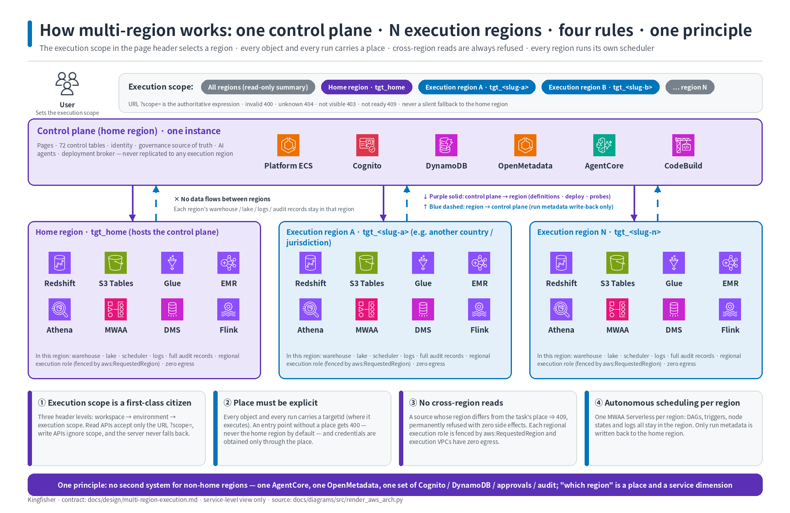
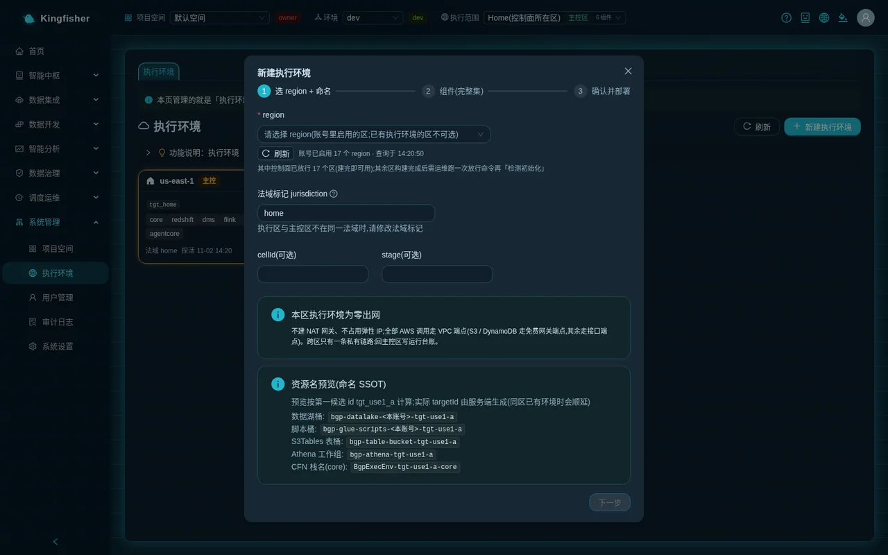
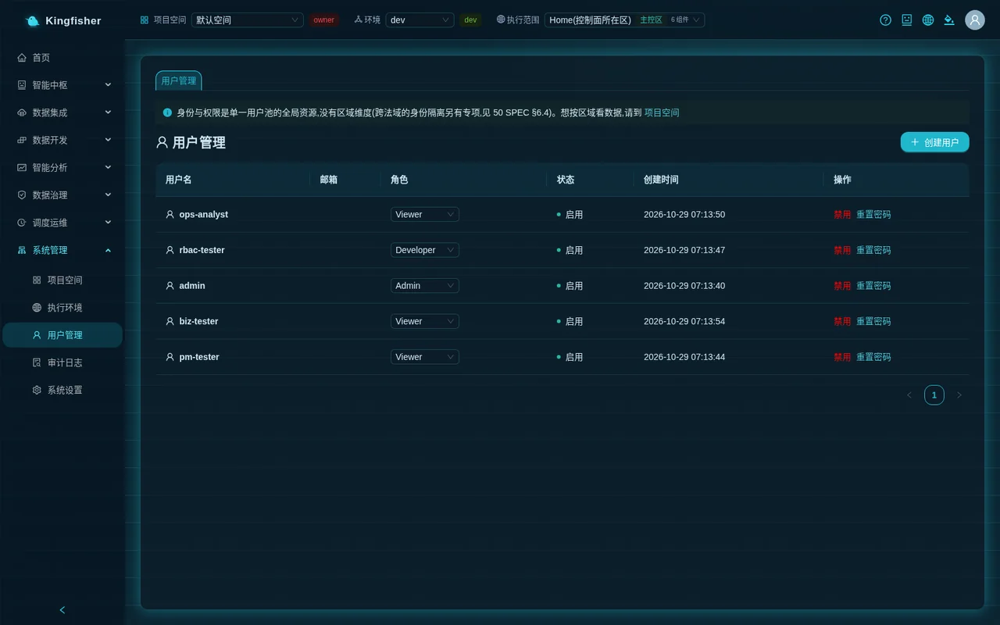
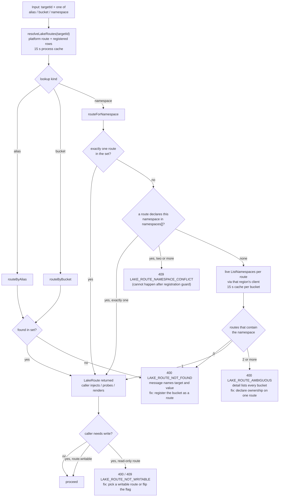

# Core concepts: one page each, so you understand what the pages are saying

| Item | Description |
|---|---|
| Audience | All roles; recommended after completing the [Quick start](01-quick-start.md) |
| Estimated time | 40 minutes to read through; then look things up as needed |
| Prerequisites | You can sign in to the platform; you know where the three selectors in the top bar are |
| What you will have afterwards | When you see a hint, a tag or a literal rejection message on a page, you know which rule it refers to and what to do next |

Every concept follows the same structure: **what it is · where you see it on the pages · rules that bite · related scenarios**. Error messages in the rules are quoted literally from the pages.

## 0. The relationships in one picture

- One platform is deployed in one AWS account of your own: the **home region** hosts the pages, metadata, governance center and agents; **every execution region** (including the home region itself) has a complete data plane of its own (warehouse, data-lake table bucket, job engines, scheduler, streaming).
- After signing in you are inside three layers of context: **workspace → environment → execution scope** (left to right in the top bar).
- Every object you create (data source / sync task / job / query) carries a **target**: the execution region it executes in; data does not leave that region.
- Operations that wait on external systems all follow the **long-running operation** protocol (switching to the background after 45 seconds); in-progress operations on the same object are mutually exclusive, enforced by **object leases**.
- Each region's data lake can have several table buckets; **table-bucket routing** lets you read and write them with alias-based three-part names.

## 1. Workspace (project)

**What it is**: the unit of resource isolation. Data sources, sync tasks, workflow orchestrations, batch jobs, query tasks, reports, GenBI cards and so on all belong to a workspace; a member holds one role in the project: `owner` > `editor` > `viewer`.
The platform ships with a preset "Default Workspace".

**Where you see it on the pages**

- The "Workspace" dropdown at the far left of the top bar; the tag beside it is your role in the current project.
- "System → Workspace": "New workspace", and per row "Switch to this" and "Members / Approvals" (in the drawer: "Add / Update" users and roles, "Remove", "Pending approval (access/role requests)"); the "Pending my approval (N)" card at the top of the page lists every approval you can decide.
- Spaces you are not a member of are listed under "Other workspaces you can request to join" and you can "Request to join"; after submitting it shows "Request submitted; awaiting workspace owner approval".

**Rules that bite**

- Resources are only visible in the current workspace; switching the "Workspace" reloads the whole page.
- Access by a non-member ⇒ 403 "No access to this workspace". The "Default Workspace" has no members at first, so a new user hits this when asking in GenBI before being added to a project.
- Insufficient role ⇒ 403 "Insufficient permission: a higher project role is required". Reads usually need viewer, create / modify need editor, approvals and configuration need owner.
- Platform admins (role group `bgp-admin`) are implicitly owner of all projects.
- **Creating** a workspace can only be done by a platform admin or a dev manager (`bgp-manager`); the page says "Workspaces are created by admins / R&D managers; contact them if you need a new one".
- **Configuration management** (rename / delete project / add, change or remove members / approval decisions) = a platform admin, or a dev manager who is also owner of this project.
  Other owners see the hint: "You are the owner of this project (developer permissions). Member management / rename / delete require a platform admin or R&D manager — you can still develop this project's sync tasks / jobs / workflows as usual."
- Deleting a project inventories the project's resources category by category; if any category is not 0 or cannot be read, the deletion is refused and the category is named; the system-managed per-region warehouse credentials are reclaimed automatically with the project.

**Related scenarios**: [Several teams sharing one platform](29-scenario-projects-permissions.md) · [Admin guide](10-guide-admin.md).

## 2. Environments (dev / staging / prod) and "Publish to environment"

**What it is**: three copies of the configuration-type resources (sync tasks / batch jobs / workflow orchestrations / Redshift tasks) within the same project. You tune in dev, then **publish** to staging and prod.

**Where you see it on the pages**

- The "Environment" dropdown in the top bar and the environment tag beside it; the tooltip reads "Switch the current environment (dev/staging/prod). Resources are isolated per project + environment; publishing to prod requires approval. Can't see what you just published? Switch here to the target environment first."
- The "Publish to environment" button in sync task details, batch job cards and workflow orchestration details (a dropdown to pick the target environment; the prod entry is marked "approval required").
- The "Promote" approvals in the "Pending my approval (N)" card at the top of the "System → Workspace" page, which a project owner can "Approve" or "Reject".

**Rules that bite**

- Switching the "Environment" reloads the whole page; **if you cannot see what you just published, switch the top bar to the target environment first**.
- Publishing to staging takes effect immediately; publishing to prod creates an approval ticket with the hint "Publish approval submitted" and a "Go to Project Spaces to approve" link; prod gets its copy only after the owner approves.
- "Publish to environment" carries only the definition (script / bound regions / parameters), not the run history; it is not the same thing as "Publish to MWAA schedule" (attaching a schedule in the current environment).
- Data sources are not per environment; they are connection resources shared across environments. The "Environment" (Development / Staging / Production) in the creation wizard is only a label recorded on the data source; the list is not filtered by it.

**Related scenarios**: [Several teams sharing one platform](29-scenario-projects-permissions.md) · [Main scenario: Detail to daily report](20-scenario-detail-to-daily-report.md).

## 3. Execution environments: home region and execution regions

**What it is**: a complete data plane in one AWS region (Redshift Serverless warehouse · S3 Tables table bucket · Glue / EMR job engines · MWAA Serverless scheduling · DMS · Flink). The region hosting the control plane is the **home region**; the others are **execution regions**.
One region can have only one execution environment, and components cannot be trimmed ("Every execution environment gets all components; there is no reduced variant").

**Where you see it on the pages**

- Each entry in the "Execution scope" dropdown in the top bar is an execution environment; the home region carries the "Home region" tag (display name "Home (control-plane region)"); regions in another jurisdiction carry the 🌍 jurisdiction tag; the component count follows; those that cannot take new work right now are marked "Not accepting work".
- "System → Execution Environments": list and details. The lifecycle buttons, in order: "New execution environment" → the three wizard steps "Choose region + name" (including the "Jurisdiction tag (jurisdiction)" field), "Components (full set)", "Confirm and deploy" → "Start deployment" → on the details page "Check initialization" → "Enable" → the "Authorized projects" card ("All projects (default)" or "Only the projects below").
- After upgrading the platform, use "Redeploy" on the details page (preview → approval → deploy); for missing components use "Complete missing components"; to retire, first "Drain (stop accepting new work)" and then go through the deletion flow (impact preview → type the name to confirm → approval → destroy; data buckets are kept).
- "Scheduling & Ops → Multi-Region Dashboard": the version-consistency matrix of every job / modeling artifact across regions.

**Rules that bite**

- Execution regions **can only be created through the page wizard** (choose region → automatic deployment → check initialization → enable); regions blocked by organization policy (SCP) are listed but not selectable, with the blocked actions spelled out.
- Regions not pre-authorized at install / upgrade time are marked "ops must release it once after the build" in the wizard; after deployment finishes, operations must release the region, otherwise "Check initialization" fails until it is released.
- Once "Authorized projects" is set to an allowlist, members of projects outside it cannot see that region nor bind objects to it; existing bindings are unaffected.
- "Not accepting work" is a badge, not a filter: an installed region can still be selected to **look at** data; writes are rejected by the server using the same criterion.
- Data does not leave the region: jobs, syncs and queries execute in the region where the object lives; run records report only a summary to the home region.

**Related scenarios**: [Data stays in its region](22-scenario-multi-region-residency.md) · [Admin guide](10-guide-admin.md).

## 4. Execution scope (scope)

**What it is**: the third layer in the top bar, deciding **which regions' objects you see now and where new objects land by default**. Three states: "All (N regions)" = cross-region read-only summary; one region = see only, create only in it; compare (2–4 regions) = only for cost and the consistency matrix.
It is deliberately not called Region: what you select is an execution environment (one region allows only one, but the platform identifies it by execution environment, not by region name).

**Where you see it on the pages**

- The "Execution scope" dropdown in the top bar, options grouped by region; the tooltip reads "Switch the current execution scope (only installed execution environments are listed; switching stays on the current page)".
- `?scope=` in the address bar: **the URL is authoritative**; it survives a refresh and you can send the link to a colleague. The "All" view has no such parameter.
- In a single-region view, the hint "Other execution scopes have N more" and a "View all" button stay at the top of lists; an empty list says directly how many there are in other regions and offers the same "View all".
- Some pages require anchoring to one region (for example "Ask-Your-Data"): "This page requires an execution environment to be anchored first (pick one under 'Execution scope' in the top bar)".
- Pages that do not support compare show "This page does not support the 'Compare' scope (compare is only for cost and the consistency matrix)".

**Rules that bite**

- Switching the execution scope **does not reload and does not leave the current page** (unlike "Workspace" and "Environment").
- The scope only filters **reads**; **writes do not read the execution scope**; the execution environment comes only from the region you explicitly chose in the form or from the object's own binding (see the next section, "Target").
- An invalid value in the address ⇒ 400 "Invalid execution scope ?scope= value… valid forms: global / <targetId> / cmp:<t1>,<t2>[,<t3>,<t4>]"; the page shows "Invalid execution scope value in the URL: …".
- The referenced region does not exist, has been deleted or has not finished initializing ⇒ 404 "The execution environment … referenced by the execution scope does not exist, has been deleted, or has not finished initializing — select the execution scope again (it will not switch back to the home region automatically)".
- This project is not authorized for that region ⇒ 403. The page shows the uniform hint "It may have been deleted, not finished initializing, be going offline, or this project is not authorized for it. This will not switch to another region automatically."
- **Never a silent fallback**: it never quietly switches to the home region, nor quietly to "All" — the former would amount to data leaving the country across jurisdictions, and the latter would make you think you are looking at one region when you are looking at all of them.

**Related scenarios**: [Quick start](01-quick-start.md) step 2 · [Data stays in its region](22-scenario-multi-region-residency.md).

## 5. Target (place)

**What it is**: **in which execution region** each object and each run executes. A data source's region is fixed when it is created; a sync task follows the data source it references; a batch job can be bound to several regions and one run executes once per region; a query executes in the region you choose.

**Where you see it on the pages**

- The create button restates the target: "New data source (in <region>)"; the tooltip reads "This data source will be created in <region>: its secret, security group and Glue connection all live in that region, and sync tasks derived from it run there too".
- The note at the top of the "Data Sync" page: "Sync tasks follow the data source's execution environment: create a data source in the current region, then create tasks that run in place (source and task must be in the same region; cross-region data pulls are prohibited by design)".
- "Execution regions (multi-select)" and "Select all active regions" in the "Batch Compute" job editor; "Run now (once in each of N regions)"; one entry per region in "Run History".
- "Execution regions (multi-select)" in "Redshift Query"; multi-region results have one sheet per region.
- The "Region" column in lists and run records; the "Region" filter in "Task Monitor".

**Rules that bite**

- The default target when creating an object = the region currently selected in the top bar; from the "All" view = the home region. The region in the form can be changed, but **there is never a silent default of "nothing selected = home region"**.
- A request missing its target ⇒ 400, with wording such as "… missing targetId — unknown which execution environment to execute in (will not default to the home region)" or "… no execution environment named (targets) — will not bind to the home region by default". Normal page use never hits this; if you do, the page state and the server are out of sync — refresh and redo.
- A data source's region **is sealed at creation and cannot be changed afterwards**.
- A sync task whose data source and task are in different regions ⇒ 409 rejected (the same when editing to switch the source to another region); nothing is persisted.
- The regions a job is bound to must be enabled and authorized for this project; when publishing to workflow orchestration, job nodes must be bound to the workflow's execution region, otherwise 400 naming the node.
- A region that is "Not accepting work": you can look at data, but create / run is rejected; wait for it to recover or switch regions.

**Related scenarios**: [Main scenario: Detail to daily report](20-scenario-detail-to-daily-report.md) · [Data stays in its region](22-scenario-multi-region-residency.md).

## 6. Jurisdiction and disclaimer

**What it is**: every execution environment has a **jurisdiction tag** (field name "Jurisdiction tag (jurisdiction)"), default `home`. It is only a label, an audit dimension and a trigger for technical prerequisites; the admin types it in the creation wizard, the platform **does not derive it from the region and makes no legal judgment**, and it cannot be changed after registration.
When an execution region is not in the same jurisdiction as the home region, change it to a non-`home` value (for example `eu-sim`); the format is "starts with a lowercase letter, contains only a-z / 0-9 / -, 2–32 characters".

**Where you see it on the pages**

- The "Jurisdiction tag (jurisdiction)" input in the new execution environment wizard with the hint "If this execution region is in a different jurisdiction from the home region, change the jurisdiction label"; when it is not `home`, the last step requires checking "I have read and agree" before "Start deployment".
- The 🌍 jurisdiction tag in the "Execution scope" in the top bar, in direct-query sheet headers, dashboard column headers and the "Execution regions" column of run history.
- The "⚠️ Disclaimer (v1)" dialog the first time you perform a data operation on a region in another jurisdiction:
  "Execution target … belongs to another jurisdiction; before your first data operation on it, read and agree to the following notice (your choice is recorded: user / target / version / time)."
  Body: "This platform assumes no legal risk related to cross-border data transfer or data compliance. You must constrain and control data compliance yourself in accordance with local government laws and regulations. Clicking [Agree and continue] means you have understood and agree." Buttons "Cancel" and "Agree and continue".
- The "Audit #" in the "Redshift Query" sheet header = the record id of that query in the regional audit table; the "Audit" column in "Task Monitor" and run history.
- The "Consents" card on the execution environment details page: who agreed to which version of the notice and when.
- The `residency.*` actions and auditId under "System → Audit Log".

**Rules that bite**

- An execution environment in a non-`home` jurisdiction must have the residency-api component installed (regional audit / result storage), otherwise the hint "Cross-jurisdiction target … has no residency-api … not accepting work — go to 'Execution Environments' to deploy that component" appears.
- The notice pops up **only once** per user per region; "Cancel" = nothing is executed and nothing is recorded; "Agree and continue" = recorded, then the original operation is retried automatically. A new version of the text pops it up again.
- Every cross-jurisdiction data operation is audited twice: the full record in that region + a summary without sensitive information in the home region; if either write fails, the operation is not executed (503).
- The SQL history text of cross-jurisdiction regions **stays in that region**; "Execution history" shows "Kept in region", and clicking view reads it on demand.
- The platform does not make legal determinations for you; the pages never show words like "cross-border / liability"; compliance constraints and controls are yours to enforce under local regulations.

**Related scenarios**: [Data stays in its region](22-scenario-multi-region-residency.md).

## 7. Role groups and project roles

**What it is**: two layers of permissions stacked together. **Role groups** are account-level (Cognito user groups) and decide which modules you can use; **project roles** owner / editor / viewer are project-level and decide what you can do in a given project (see section 1).

| Role group | Meaning | Typically can |
|---|---|---|
| `bgp-admin` platform admin | Superuser across all projects | User management, execution environments, settings, table-bucket route registration, implicit owner of all projects |
| `bgp-manager` dev manager | Picks up / assigns / accepts requests; creates and configures workspaces | "New workspace", member management, approval decisions (must be owner of that project) |
| `bgp-developer` developer | Takes on requests, develops resources | Creates data sources / syncs / jobs / orchestrations (per project role); cannot create workspaces |
| `bgp-analyst` operations analyst | Only GenBI and raising requests are open | "Ask-Your-Data", raising requests in "Requests"; every other API is 403 |

**Where you see it on the pages**

- "System → Users": "Create user" (fill in "Username", "Email", "Password", "Role"), "Reset password", "Disable" / "Enable".
  The "Role" dropdown offers five entries: "Admin", "Manager", "Developer", "Analyst" and "No platform group (project membership only)"; the first four each map to one group in the table above, the last writes no group at all (project membership only).
  Changing a role first removes all four platform groups (and the early page-created bgp-viewer) before adding the target group.
- The role tag (owner / editor / viewer) beside "Workspace" in the top bar.

**Rules that bite**

- An account only in the `bgp-analyst` group and in no privileged group gets 403 "Operations analyst accounts may only use Ask-Your-Data and submit requests" for everything except "Ask-Your-Data" and "Requests".
- Platform administration pages such as "Users" require `bgp-admin`.
- The literal rejection for project configuration management: "Configuration management (rename / delete project / add, change or remove members / approval decisions) requires a platform admin (bgp-admin) or a dev manager (bgp-manager) who is also owner of this project; you can still develop this project's sync / job / workflow resources as usual. Contact an admin or dev manager for changes."
- Button visibility and the server's decision share one source: if you cannot see a button, you usually lack the permission; "button lit but 403" does not happen.
- Warehouse direct query is read-only for non-platform-admins (DROP / INSERT etc. 403); but anyone who can create / modify batch jobs can write to schemas in the platform warehouse — the go-live convention is to grant editor only to trusted users.

**Related scenarios**: [Admin guide](10-guide-admin.md) · [Several teams sharing one platform](29-scenario-projects-permissions.md).

## 8. Long-running operations (background after 45 seconds)

**What it is**: every operation that waits for an external system to reach a final state (creating a data source, creating / altering tables, modeling landing, generating DDL for sync, publishing workflows, starting / stopping streaming jobs, deleting projects, LLM calls, Spark engine job submission, …) follows one protocol:
wait 45 seconds in-process first; if it finishes, return synchronously like an ordinary request; if not, switch to the background, and the page polls to the final state and then presents the result exactly as before. You never hit the gateway's 60-second timeout.

**Where you see it on the pages**

- The hint "Running in background: <label> (n s elapsed)" at the bottom right of the page, updated every two seconds, disappearing automatically at the final state; several concurrent long-running operations get one hint each.
  Common labels: "New data source", "Publish workflow", "Land code table to execution target", "Sync column information to the data catalog", "Generate DDL and probe target table", "Run engine job", "Delete workspace", "Copilot chat".
- When it finishes, the page's **original success toast and list refresh happen as usual**; failures keep the original wording and status code.

**Rules that bite**

- Over 5 minutes ⇒ "The operation was automatically terminated after 5 minutes; narrow the scope and try again"; the server-side state is timeout and it is **never rerun**.
- Refreshing or closing the tab while waiting: the task continues on the server to its final state; after a refresh the page no longer tracks it, but the record reflects what was really observed (for example a modeling landing status is visible on refresh).
- When you see "Running in background", **do not click the same button again**: the same object is blocked by the object lease (next section).

**Related scenarios**: [Quick start](01-quick-start.md) step 3 · [Rules and status codes](30-reference-rules.md).

## 9. Object leases (409 "in progress")

**What it is**: before a long-running operation executes, it takes hold of the objects it involves and releases them at the final state. While held, starting another long-running operation on the same object, or modifying / deleting it, is blocked.

**Where you see it on the pages**

- The literal 409 message: "'<label>' is in progress (n s elapsed); wait for it to finish before trying again".
- Similar guards: deleting a data source still referenced by sync / streaming tasks ⇒ 409 listing each referencing task; deleting a batch job with in-flight runs ⇒ 409 listing each runId; deleting a job referenced by a workflow ⇒ 409; deleting a modeling definition with landed artifacts ⇒ 409, requiring cleanup or explicit retention first.

**Rules that bite**

- The right response to a 409 is to **wait** (or deal with the objects it names first), not to retry through another entry point.
- Leases only cover in-progress long-running operations; objects that have reached a final state can be modified and deleted normally.

**Related scenarios**: [Rules and status codes](30-reference-rules.md) · [FAQ](32-faq.md).

## 10. Lake table buckets and routes (alias-based three-part names)

**What it is**: every execution region has one platform-provided S3 Tables table bucket (Iceberg); the catalog name in jobs is fixed as `s3tablescatalog`.
From 2.2.0 you can register **customer-owned table buckets** as **routes** of that region: one route = one table bucket + "Alias" (Spark catalog name) + "Layer" + "Namespace ownership" + "Writable".
Job scripts read and write across buckets with the three-part name `<alias>.<namespace>.<table>`; sync tasks can pick a writable route as Table Bucket; direct query, the governance catalog and GenBI see tables through the same route table.

**Where you see it on the pages**

- The "Lake table buckets and routes" card under "System → Settings" (select a region in the "Execution scope" in the top bar first, otherwise the hint "Pick an execution environment in the top bar first" appears): per row "Alias", "Layer", "Namespace ownership", "Writable"; field hints "Alias (scripts using the three-part name must change too)" and "Writable (when off, sync / create-table / write declarations cannot use it)".
- "Advanced properties → Lake table buckets" in the "Batch Compute" job editor: "All routes (default)" or select a subset and mark each bucket "Read" / "Write"; below, "Catalogs available to this job:" lists the aliases, and "Copy three-part name example" copies with one click.
- The "S3 Tables Data Lake Configuration → Table Bucket" dropdown in the sync wizard: lists writable routes only, showing bucket · alias · layer; unregistered buckets are marked "Not registered" with a "Register →" link.
- On the "Athena Query" page, any table bucket in the same region can be queried with the three-part name `"s3tablescatalog/<table-bucket>"."<namespace>"."<table>"`.

**Rules that bite**

- Registering / modifying / revoking routes can only be done by platform admins ("Only platform admins (bgp-admin) can register / modify / revoke lake table-bucket routes").
- When the same namespace appears in two routes, ownership must be declared with "Namespace ownership"; otherwise looking up a table by namespace is refused rather than guessed.
- By default a job can use all routes of its region; when using only some buckets or when a custom role needs least privilege, select a subset; permissions are checked per bucket on save, and the error states which action and which bucket is missing.
- Across catalogs always use three-part names; two-part names land only in the job's default catalog, and a mistake reports that the table does not exist.
- S3 Tables namespaces, table names and column names must be all lowercase.
- The 2.1.x method (adding `--conf` under the job's "Advanced properties → Job parameters" to register catalogs) still works, but the new method is primary; see the transition subsection of the cross-bucket scenario.

**Related scenarios**: [Detail bucket / summary bucket layering](21-scenario-cross-bucket-layering.md) · design details [Table-bucket routing design](../design/lake-bucket-routing.md).

<!-- Screenshot to be added: Settings · Lake table buckets and routes card · two registered routes -->

## 11. Quick lookup: which rule a sentence on the page refers to

| What you see | What it means | Which section |
|---|---|---|
| 403 "No access to this workspace" | You are not a member of the current workspace | Section 1 |
| "Can't see what you just published? Switch here to the target environment first." | It was published to another environment | Section 2 |
| Hint "Other execution scopes have N more" + button "View all" | Other regions have objects; you are only looking at one region | Section 4 |
| "This page requires an execution environment to be anchored first" | This page needs one region selected | Section 4 |
| "New data source (in <region>)" | The target for new objects = the currently selected region | Section 5 |
| "⚠️ Disclaimer (v1)" | First data operation on a region in another jurisdiction | Section 6 |
| "Operations analyst accounts may only use Ask-Your-Data and submit requests" | The account is only in the `bgp-analyst` group | Section 7 |
| "Running in background: <label> (n s elapsed)" | The operation exceeded 45 seconds and moved to the background; do not click again | Section 8 |
| "'<label>' is in progress (n s elapsed); wait for it to finish before trying again" | A long-running operation on the same object has not finished | Section 9 |
| "Not registered" / "Register →" | The table bucket is not yet a writable route of that region | Section 10 |

## Further reading

- All rejection reasons and status codes: [Rules and status codes](30-reference-rules.md)
- Terms: [Glossary](33-glossary.md)
- Components and request paths: [Architecture](../architecture.md)
- Mechanism and boundaries of each module: [Module overview](../modules.md)
