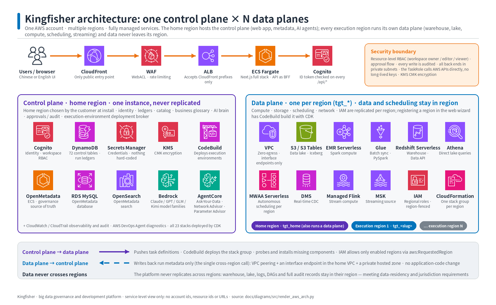
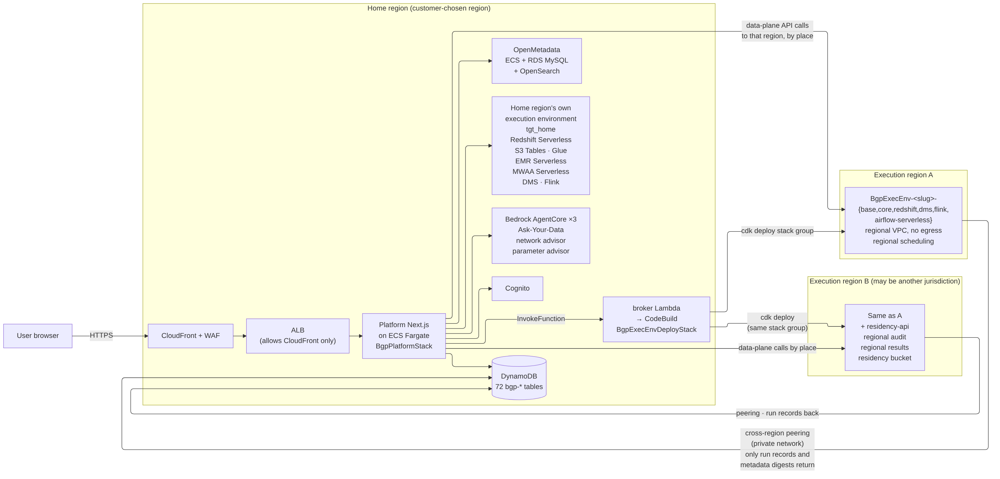
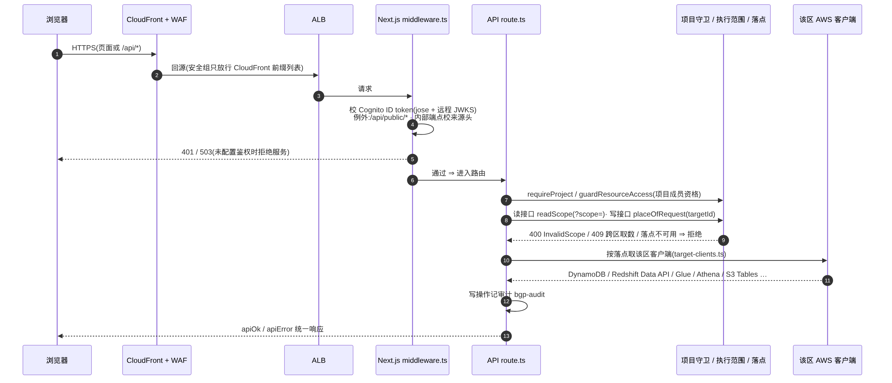
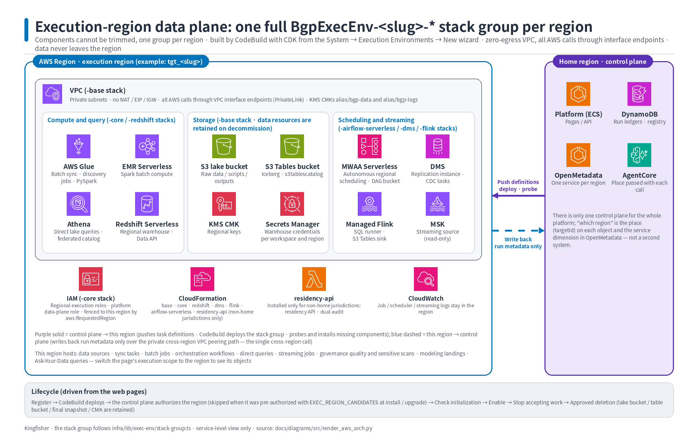
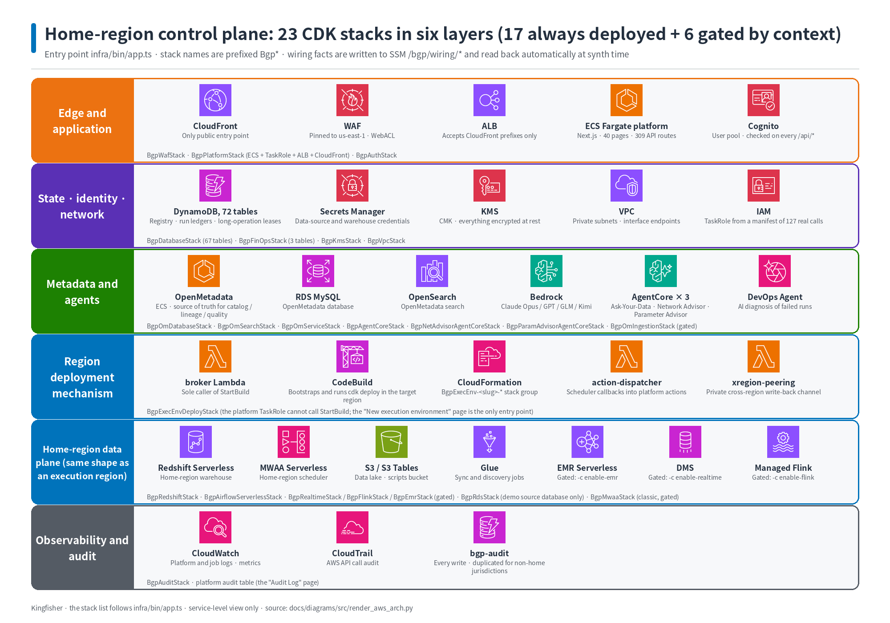
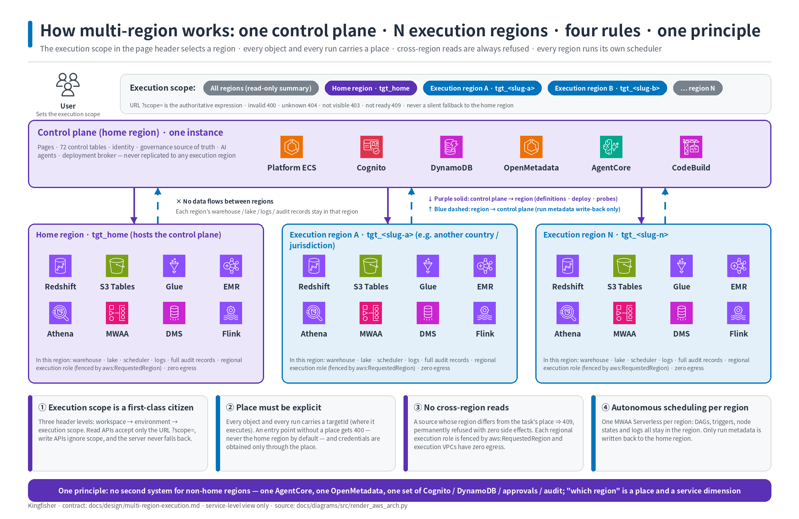
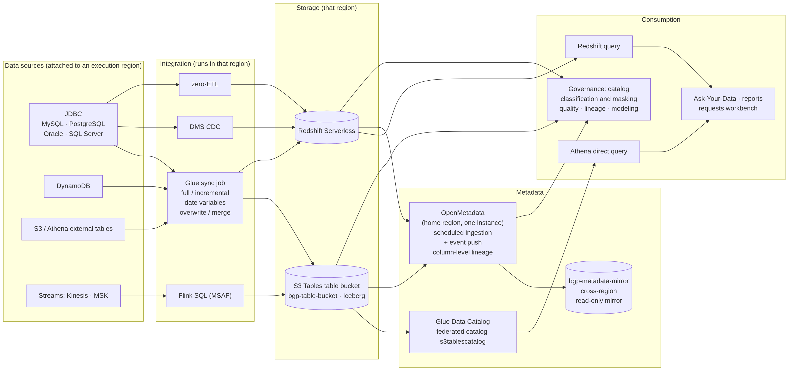

# Architecture overview and details

| Item | Description |
|---|---|
| Audience | Platform admins, architecture reviewers, anyone who wants to know "what the platform consists of and where the data goes" before going live |
| Estimated time | 25 minutes of reading |
| Prerequisites | None; having read [core concepts](02-concepts.md) makes the terms easier to place |
| What you will have | The ability to explain the deployment topology, which AWS services one page action passes through, which data-plane components each region has, and which mechanisms map to the six pillars of AWS Well-Architected |

## 0. One-page overview

- Kingfisher is deployed entirely in **one AWS account owned by the customer**; there are no vendor-hosted components and it never calls back to the software's authors.
- The topology is **single account × multiple regions**: one **home region** hosts the control plane (pages, metadata, OpenMetadata, three AI agents, identity and audit), and N **execution regions** each host a complete data plane (warehouse, data lake, Spark / Flink engines, replication, scheduling).
- The home region also has its own data plane, called `tgt_home` on the page, and it goes through the same path as every other execution region.
- **Data stays in its region**: every object and every run carries a target saying "which region it runs in"; jobs, sync, scheduling, queries and GenBI run in the region where the data lives; cross-region data access is rejected; execution-region VPCs have no internet egress.
- Central components exist once for the whole platform: one OpenMetadata, one set of AI agents, one set of Cognito / DynamoDB / approvals / audit; no second system is opened for non-home regions.

*Figure 1 · AWS service overview (the diagram shows components only, no versions; supported versions are in [`../supported-versions.md`](../supported-versions.md))*

*Figure 2 · Deployment topology (home-region control plane + N execution regions)*

## 1. Deployment topology: what lives where

| Concern | Home region | Each execution region |
|---|---|---|
| Pages and all APIs | Web application on ECS Fargate, fronted by ALB and CloudFront | — |
| Identity | Cognito user pool (role groups bgp-admin / bgp-manager / bgp-developer / bgp-analyst) | — |
| Platform metadata | DynamoDB `bgp-*` tables (object definitions, run ledger, audit, approvals) | — |
| Data catalog and lineage | One OpenMetadata (one service per region) | Glue Data Catalog (in the region) |
| AI agents | Three Bedrock AgentCore Runtimes (GenBI / network advisor / parameter advisor) | — |
| Warehouse | Redshift Serverless | Redshift Serverless |
| Data lake | S3 Tables table bucket + data lake bucket | S3 Tables table bucket + data lake bucket |
| Batch and SQL compute | Glue · EMR Serverless · Athena | Glue · EMR Serverless · Athena |
| Scheduling | MWAA Serverless | MWAA Serverless (autonomous per region) |
| Real-time | DMS · Managed Flink | DMS · Managed Flink |
| Region deployment mechanism | CodeBuild project + a broker Lambda that alone may start builds | Stack group `BgpExecEnv-<slug>-*` |

- The home region is **specified by the customer at installation** and never changed afterwards; other execution regions can only be brought up through the "System → Execution Environments → New execution environment" wizard on the page.
- A region allows only one execution environment, and components cannot be trimmed (there is no reduced "core only / no warehouse" variant).
- Neither cross-region channel moves business data: control plane → execution region only dispatches definitions, deployments and probes; execution region → control plane only writes back run records and metadata summaries (over private VPC peering).

## 2. Where one page action goes (request chain)

*Figure 3 · Request chain*

1. The browser enters only through **CloudFront** (one distribution each for the platform pages and OpenMetadata); HTTP always redirects to HTTPS; **AWS WAF** sits in front of the distributions (managed rule groups + a per-client rate-limit rule).
2. The security group of the origin **ALB** allows only the CloudFront origin-facing prefix list of the region and the VPC interior; the OpenMetadata origin additionally checks an origin-verification header injected by CloudFront.
3. The platform process on **ECS Fargate** first passes the authentication middleware: every `/api/*` request must carry an ID token issued by Cognito, whose signature, issuer, audience and token type are verified; a missing or expired token gets 401 "Not authenticated or the session has expired; please sign in again".
4. The routing layer then applies three guards: **workspace** (membership judged by the project that owns the resource), **execution scope** (read APIs accept only `?scope=` in the URL; invalid / unauthorized values always get 4xx) and **target** (write operations must state which region they run in; missing ⇒ 400, never defaulting to the home region).
5. Metadata reads and writes go to **DynamoDB**; data-plane actions (creating tables, starting jobs, querying the warehouse, GenBI) obtain AWS clients explicitly **for the target's region** under the platform task role and call that region's Redshift / Glue / EMR / Athena and other services directly.
6. Before every write operation finishes, one audit record is written to `bgp-audit` (who, when, action, resource, region).
7. Requests that wait for an external system to reach a final state (create table, landing, sync generation, large-model calls and so on) wait at most 45 seconds in-process; if not finished they return 202 and move to the background, the page shows "Running in background: <operation> (ns elapsed)" at the bottom right and polls automatically until the result arrives, so the page never hits the 60-second gateway timeout.

## 3. The data plane of each region

*Figure 4 · The data plane of one execution region*

| Component | What it does | Where you use it on the pages |
|---|---|---|
| Redshift Serverless | The region's warehouse; billed by RPU usage, free when idle | Redshift Query · Batch Compute (Redshift SQL jobs) · Data Sync (writing to the warehouse) · GenBI · Data Modeling landing |
| S3 Tables table bucket (Iceberg) + data lake bucket | The region's data lake; Athena queries it through the federated catalog `s3tablescatalog` | Data Sync (writing to the data lake) · Athena Query · GenBI · governance catalog |
| Glue | Batch sync jobs, Glue PySpark batch jobs, data source connections and discovery jobs | Data Sources · Data Sync · Batch Compute |
| EMR Serverless | Spark batch jobs | Batch Compute (EMR Serverless jobs) |
| MWAA Serverless | The region's scheduler: workflows, sync, jobs, governance tasks and GenBI card refreshes all run on time in the region | ETL Orchestration "Publish to scheduler" · Task Monitor · Backfill Center |
| DMS | Real-time sync (CDC) replication instance and tasks | Data Sync (real-time channel) |
| Managed Flink | Flink SQL streaming jobs | Stream Compute |
| VPC interface endpoints | Execution regions have no internet egress (no NAT, no IGW, no Elastic IP); all AWS calls go through endpoints | Not directly visible; the source of an execution region's idle base cost |
| Regional KMS CMK · regional IAM roles | The region's data is encrypted with the region's key; the execution roles for Glue / EMR / Flink / warehouse COPY / replication are named per region | The "Platform default" entry of the "Execution Role" dropdown in Batch Compute |

- The data-plane components of every region are **a complete set**; regions in a non-home jurisdiction additionally install `residency-api` (regional audit table, regional result table, residency bucket) for the dual auditing of cross-jurisdiction operations and for keeping results in the region.
- Scheduling is autonomous per region: DAGs, triggers and logs all stay in the region, and only run records are reported to `bgp-task-runs` in the home region, so the task monitor, alerting, SLA and backfill all read the same ledger.

## 4. Control-plane services

*Figure 5 · Home-region control-plane layers*

| Service | Role in the platform | Related pages |
|---|---|---|
| Amazon Cognito | User pool and four role groups; self-registration disabled; passwords at least 12 characters with upper and lower case, digits and symbols | Sign-in · Users · "Change password" in the avatar menu |
| DynamoDB | All platform metadata (object definitions · run ledger · approvals · audit · long-running operation tasks and object leases), encrypted with customer-managed keys, point-in-time recovery enabled | All list pages |
| OpenMetadata (ECS + RDS MySQL + OpenSearch) | The single source of truth for catalog, lineage and table descriptions; the factory admin password is replaced at deployment | Data Governance · Governance Center |
| Bedrock + AgentCore | The large-model channel and three agent Runtimes; the model can be switched at run time under "Settings → AI model" | Ask-Your-Data · Copilot Plan Center · network advisor / parameter advisor · AI diagnosis in the Incident Knowledge Base |
| KMS | Two customer-managed keys, data and logs, rotated automatically and retained when the stack is deleted | Not directly visible |
| Secrets Manager | Data source passwords, per-project per-region warehouse credentials, the OpenMetadata admin password and more; containers obtain the values through secret references | Data Sources (passwords are never echoed back) |
| CloudTrail + VPC Flow Logs | AWS-layer audit (multi-region trail, log file validation, encrypted storage) | Not on the platform pages; look in the AWS console |
| CodeBuild + broker Lambda | The only channel for creating / redeploying execution regions; the platform task role itself cannot start builds | Execution Environments ("Start deployment", "Redeploy", "Complete missing components") |
| CloudFront + WAF + ALB | Public entry point and edge protection | The sign-in URL itself |

## 5. How multi-region works

*Figure 6 · The four multi-region rules and the single-instance central components*

| Mechanism | In one sentence | What you see on the page |
|---|---|---|
| Execution scope | Three levels in the top bar: workspace → environment → execution scope (all regions / one region); lists, runs, costs and catalogs are filtered by the selected region | The "Execution scope" dropdown in the top bar; in the wrong region, objects "cannot be seen" |
| Explicit target | Every object / every run carries an execution environment; an entry point without a target always gets 400 and never defaults to the home region | The create button restates "New data source (in <region>)"; a job's "Execution regions (multi-select)" is mandatory; run buttons spell out "once in each of N regions" |
| No cross-region data access | Source and task targets differ ⇒ permanent 409; each region's execution roles are locked to the region; execution VPCs have no egress | Picking a source in another region is rejected with an explanation |
| Autonomous scheduling per region | Each region has its own MWAA Serverless; only run records return to the home region | The "Region" column in the Task Monitor; "Publish to scheduler" generates a DAG per region |
| Jurisdiction and disclaimer | An execution region can be tagged with a non-home jurisdiction; the first data operation on it requires clicking "Agree and continue" and the consent is kept on record; dual auditing | The disclaimer dialog; the "Consents" card on the execution environment details page; the residency.* actions in the audit log |

## 6. Data flow

*Figure 7 · Data flow*

- **Sources**: JDBC (MySQL / PostgreSQL / Oracle / SQL Server), S3, DynamoDB, Kinesis, MSK; a data source is placed in the selected execution region at creation.
- **Integration**: Glue batch sync (full / incremental) writes to S3 Tables or Redshift; DMS / Zero-ETL / Flink handle real-time.
- **Storage**: the region's S3 Tables (Iceberg) and Redshift Serverless; customer-owned S3 Tables table buckets can be registered as routes under "Settings → Lake table buckets and routes", and jobs read and write them with the three-part name `<alias>.<namespace>.<table>`.
- **Metadata**: every sync pushes the column-level lineage source → lake → warehouse to OpenMetadata; tables in non-home regions are covered in the cross-region overview by the metadata mirror.
- **Consumption**: Redshift / Athena queries, GenBI, the report builder, data modeling landing, governance tasks. Query results are masked server-side by column classification; stored data is never rewritten.

## 7. Mapping to the six pillars of AWS Well-Architected

| Pillar | Platform mechanisms | What you can do |
|---|---|---|
| Operational excellence | A unified run ledger; task monitor / alerting / SLA baselines / ops dashboard / incident knowledge base; every write operation audited; ❓ "How to use this page" on every page | Filter runs by region, read logs, rerun, backfill; create alert rules and channels; maintain fix runbooks; trace in the audit log who did what |
| Security | Cognito + four role groups; workspace RBAC; independent warehouse credentials per project per region; KMS customer-managed keys; WAF; execution regions with no egress; every write operation audited; column classification and masking | Create accounts in role groups; add people to projects as owner / editor / viewer; configure classification and masking rules; approve data access requests; review the audit log |
| Reliability | Autonomy per region (independent scheduling and data plane); long-running operations move to the background after 45 seconds with polling; object leases prevent concurrent edits / deletes; lists are reconciled with the AWS side when read; deletions go through an impact preview and approval | Use the Multi-Region Dashboard to find missed dispatches / version mismatches; on a 409 "In progress", wait for it to finish before acting; when a referenced object cannot be deleted, unbind it first as instructed |
| Performance efficiency | All-serverless engines (Redshift Serverless · Glue · EMR Serverless · MWAA Serverless · Managed Flink); execution scope filtering reads only the selected region | Choose engine and capacity per job; switch the top bar to a single region to reduce noise; compare / merge Redshift multi-region queries by sheet |
| Cost optimization | Mostly usage-based billing; the idle base cost is only the standing components; the FinOps page drills the bill down to tasks / runs; budgets and threshold alerts | Look at the cost overview and rankings; set budgets; stop unused DMS / Zero-ETL / Flink; see [`../cost-model.md`](../cost-model.md) |
| Sustainability | Serverless uses zero compute when idle; the warehouse cold-starts on demand; execution regions have no standing NAT | Stop unused streaming jobs; concentrate dashboard refreshes in fixed time windows; bind scheduled tasks only in the regions that need them |

**Details (by pillar)**

- Operational excellence: run records land in one place, `bgp-task-runs`; the task monitor, alerting, SLA and backfill all read the same ledger; failure alerts can attach AI diagnosis automatically; the incident knowledge base groups past diagnoses by failure fingerprint and offers "Save fix runbook" and "Redacted export".
- Security: execution-region VPCs have no NAT, internet gateway or Elastic IP, and all AWS calls go through VPC endpoints; the platform task role cannot start deployment builds and can only invoke one broker Lambda; audit records contain no passwords, secret values or complete sensitive SQL.
- Security (masking): column classification drives server-side masking in three places, the warehouse query page, reports and GenBI; aliased columns and expression columns are resolved back to physical columns, so renaming in SQL cannot bypass it; platform admins and users whose "Data access" request was approved see plaintext.
- Reliability: while a long-running operation on an object is in progress, landing / editing / deleting the same object gets 409 "In progress; please wait for it to finish before acting"; before a data source is deleted the platform checks whether sync / real-time tasks still reference it, and before a batch job is deleted it checks for in-flight runs.
- Cost optimization: the home region costs about 460 USD / month idle and each execution region about 165 USD / month idle (almost entirely interface endpoints); task costs are fully usage-based; see [plan the deployment](05-plan-deployment.md) and the scenario [FinOps](28-scenario-finops.md).
- Sustainability: Redshift Serverless is free when idle; the DMS replication instance stays on after the first real-time task is created, and Flink jobs are billed while running, so "Stop" them on the page when not in use.

## 8. Note (boundaries, stated candidly)

- Data-plane credentials default to the platform task role; the defense-in-depth layer "IAM catches cross-region access" is not in effect in this version, and cross-region access is rejected by the application-layer target validation.
- What the deployment-privilege isolation minimizes is the standing attack surface of the web process; the CDK bootstrap roles in the account are themselves equivalent to administrators, so this is not a least-privilege deployment path.
- The platform does not build cross-region networking (peering / Transit Gateway) between source databases and execution regions on the customer's behalf; that is the customer's network engineering.
- Browsers: only the headless Chromium acceptance path is formally endorsed; desktop Chrome / Edge / Firefox / Safari have not been tested separately (see [`../supported-versions.md`](../supported-versions.md)).

## 9. Further reading

- Components, request chain, key flow sequences: [`../architecture.md`](../architecture.md)
- What each feature module does and where its boundaries are: [`../modules.md`](../modules.md)
- The multi-region design contract: [`../design/multi-region-execution-design.md`](../design/multi-region-execution-design.md)
- Planning and cost: [plan the deployment](05-plan-deployment.md); hands-on data residency: [Scenario: data stays in its region](22-scenario-multi-region-residency.md)
