# Platform administrator guide

| Item | Description |
|---|---|
| Audience | Platform administrators (sign-in account holds the "Admin" role) |
| Estimated time | 40 minutes to read through; about 1 hour for the first-day actions; about 15 minutes per weekly check afterwards |
| Prerequisites | The platform is deployed; you have the initial password of `admin` (in the password file on the deployment machine, see the [production deployment manual](../deployment.md) §4) |
| What you will have at the end | Password changed, accounts and workspaces created, execution regions in place, AI model usable, table-bucket routes registered, audit log and alert channels available |

This guide is organised around "what an administrator does after go-live". Each section first says which page to open and what to click, then the key points and caveats.
The ❓ "How to use this page" at the top right of every page and "Walk me through" / "Open the guide" on the home page cover the same actions; use them side by side.

---

## 0. The administrator's work map

| Task | Page (menu group → page) | Key buttons | Frequency |
|---|---|---|---|
| Change your own password | Avatar at top right → "Change password" | "Change" | Go-live day; afterwards per your security policy |
| Create accounts / change roles / disable / reset passwords | System → Users | "Create user" "Disable" "Enable" "Reset password" | When someone joins / leaves |
| Create workspaces / add members / approve requests | System → Workspace | "New workspace" "Members / Approvals" "Approve" "Reject" | When a new team onboards; glance at pending approvals daily |
| Add / enable / retire execution regions | System → Execution Environments | "New execution environment" "Check initialization" "Enable" "Authorized projects" | When the business expands into a new region |
| Change the AI model / check wiring health | System → Settings | "Change global default" "Test this model" "Refresh status" | When the model is unavailable or you switch vendor |
| Register customer-owned table buckets as routes | System → Settings → "Lake table buckets and routes" | "Register to <execution environment>" "Edit" "Revoke" | When the business wants to use its own S3 Tables buckets |
| Look up who did what | System → Audit Log | Search box, "Filter by action type" | Weekly check; when something goes wrong |
| Create notification channels | Scheduling & Ops → Alerting Center → "Notification Channels" | "New Channel" "Send test" | Once at go-live; when a group bot changes |

---

## 1. Day one

### 1.1 First sign-in and password change

1. Open the platform URL (the CloudFront domain in the deployment output) and sign in with `admin` and the initial password. The sign-in page footer shows the current release tag and version; check it here after an upgrade.
2. Click the avatar at top right → "Change password". Fill in "Current password" "New password" "Confirm new password" and click "Change".
3. Password rules: at least 12 characters, with upper-case, lower-case, digits and symbols (the page shows the same hint under the input).
4. "Password changed. Use the new password next time you sign in" means success. Afterwards delete the password file on the deployment machine.

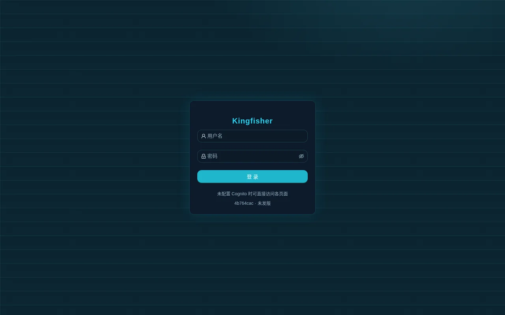

### 1.2 Get to know the three switches in the top bar

From left to right the top bar has three switches that affect "what you can see"; administrators must understand them first, or they will think objects have gone missing:

| Switch | Effect | First check when an object is missing |
|---|---|---|
| "Workspace" | Switches the current workspace; data sources / sync / orchestration / jobs and other resources are only visible in the current space | Did you switch to the space the object belongs to? |
| "Environment" | Switches dev / staging / prod; resources are isolated by project + environment, and publishing to prod requires approval | A freshly published resource is only visible after switching the environment to the target environment |
| "Execution scope" | "All" or one execution environment; list pages only show objects within that scope | Did you select the region the object belongs to? |

### 1.3 Check the system settings

Open "System → Settings" and look at three blocks from top to bottom:

- The "Service status" card: User authentication / Metadata store / Data Warehouse / Data Lake storage each show "Normal" or the raw error (such as an HTTP status code); when "User authentication" is normal it shows "N users"; click "Refresh status" to re-check.
- The "AI model" card: shows the "Effective model" and its "Source" ("Factory default (ai-model.json)" / "Deploy env (BEDROCK_MODEL_ID)" / "Runtime config") and the "Latest probe" result. On first go-live it usually shows "Not customized: using <factory default>".
- The "Platform version" card: "Release tag" "Product commit" "Committed at" "VERSION file"; this is the same fact as the sign-in page footer, use it to reconcile before and after an upgrade.

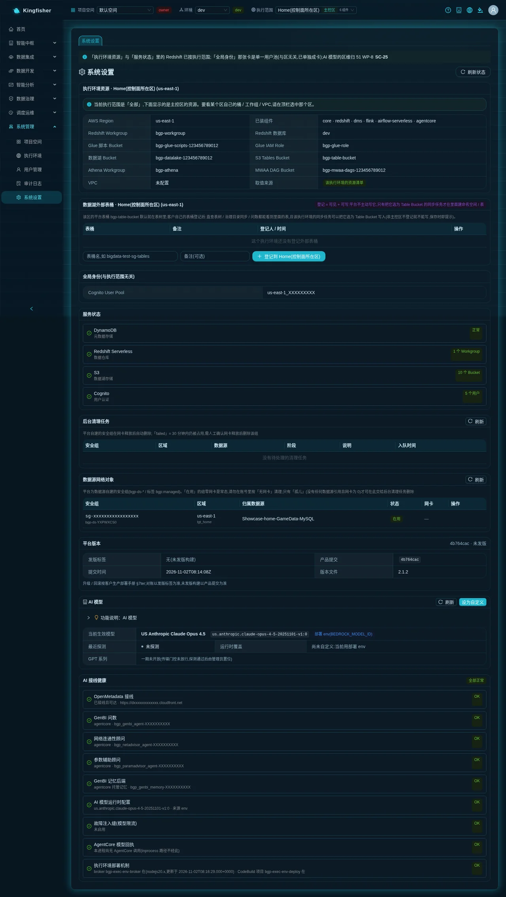

---

## 2. Users: create accounts, change roles, reset passwords, disable

Page: "System → Users". Only platform administrators can open it; other roles get 403.

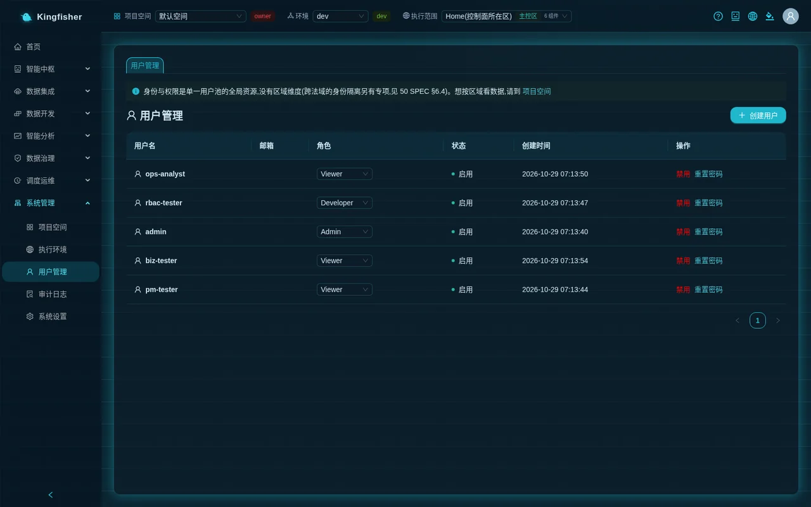

### 2.1 Create a user

1. Click "Create user" at top right.
2. Fill in "Username" (required), "Email" (optional), "Password" (required), "Role" (default Developer).
3. Click OK and look for "User created". The new user signs in directly with this password; no email verification is needed.
4. Add the new user to at least one workspace (see section 3), otherwise after signing in they see no resources and GenBI answers "No access to this workspace".

Set the password according to the user pool rules (at least 12 characters, with upper- and lower-case, digits and symbols). The create dialog itself only checks that the length is at least 8; a password that violates the user pool policy is rejected by Cognito and the page shows the raw AWS message.

### 2.2 The three platform roles

| Role on the page | Role group | What it can do |
|---|---|---|
| Admin | bgp-admin | Every administrative action: user management, creating / deleting workspaces, all approvals, execution environments, changes to settings |
| Developer | bgp-developer | Develops in the workspaces they were granted (what exactly they may change is decided by the project role, see section 3) |
| Viewer | bgp-viewer | The platform places no specific restriction on this group (the code only has the display mapping on the Users page); whether they can view or edit is entirely decided by the project role; for read-only, give them the viewer project role in the workspace |

Key points:

- The platform role decides "whether you can enter the admin pages"; the project role decides "whether you can change resources in a given space". Both layers must be configured.
- The "Role" column in the list is a dropdown; changing it takes effect immediately, no extra dialog.
- The platform has two more role groups: R&D manager (bgp-manager, can create workspaces and, as owner, manage members and approvals) and operations analyst (bgp-analyst, can only use "Ask-Your-Data" and submit requests in "Requests"; every other API returns 403).
  These two groups cannot currently be assigned on the Users page: a demo installation creates test accounts through the deployment script; to use them in production, an administrator adds users to the corresponding group in the Cognito console.
  Such accounts appear as Viewer in the "Role" column of the Users page (the page only decides by bgp-admin / bgp-developer; everything else shows Viewer); do not change their role in that column — doing so removes the account from its original group.

### 2.3 Disable and enable

- Click "Disable" in the list row → the dialog "Confirm disable?" appears → after confirming, the "Status" column becomes "Disable" and the account can no longer sign in; an already signed-in session may remain valid until its token expires.
- A disabled account's row shows "Enable"; one click restores it.
- There is no "Delete user" on the page. Handle leavers with "Disable" and remove them as members in the workspaces.

### 2.4 Reset a password

1. Click "Reset password" in the list row; the dialog title is "Reset password for <username>".
2. Fill in "New password" "Confirm new password" and click "Reset".
3. Hint text: "At least 12 characters with upper-case, lower-case, digit and symbol. Takes effect immediately; the user signs in with it next time".
4. The audit log records one `user.password.reset` entry (who reset whose password), never the password itself.
5. When the only administrator forgets their own password and no second administrator can reset it, the customer's account administrator runs one Cognito command on the AWS side; see the [production deployment manual](../deployment.md) §4 item 4.

---

## 3. Workspaces: create projects, add members, handle requests

Page: "System → Workspace". The page header explains its semantics: every workspace is an isolated work area, resources are isolated per space, and access is granted by project role (owner > editor > viewer).

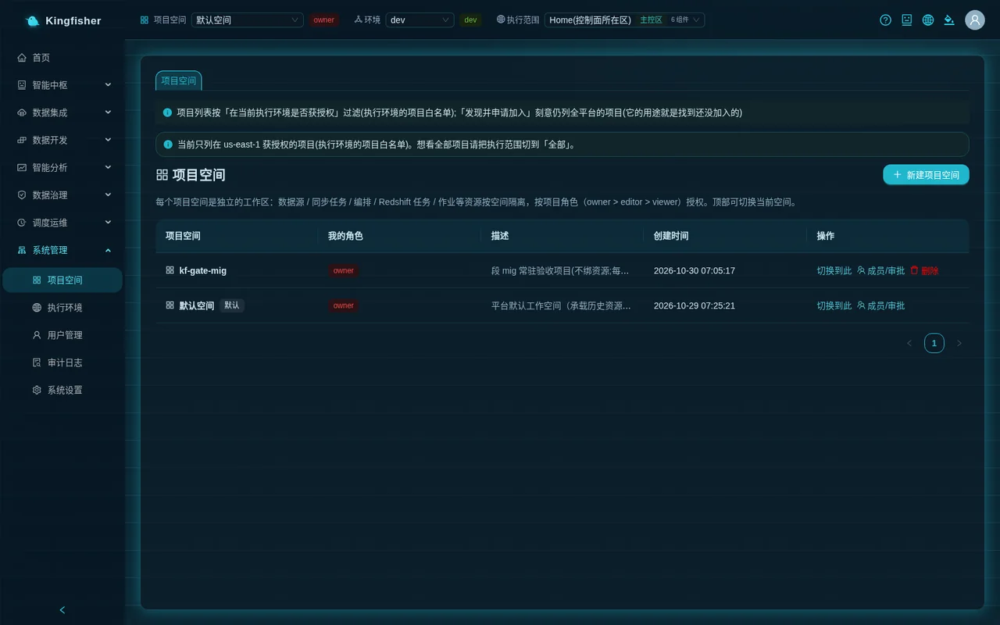

### 3.1 Who can create, who can manage

| Action | Who may |
|---|---|
| Create a workspace | Platform administrator (bgp-admin) or R&D manager (bgp-manager) |
| Rename / delete / add, change or remove members / approval decisions | Platform administrator; or "an R&D manager who is also the project's owner" |
| Develop resources in the project | Project role editor or above |
| View only, GenBI | Project role viewer or above |

Someone without create permission does not see "New workspace" on this page, only a line "Workspaces are created by admins / R&D managers; contact them if you need a new one".
A user with the Developer platform role has only developer permissions even when set as project owner; the drawer shows a hint: "You are the owner of this project (developer permissions). Member management / rename / delete require a platform admin or R&D manager — you can still develop this project's sync tasks / jobs / workflows as usual."

### 3.2 Create a workspace

1. Click "New workspace".
2. Fill in "Name" (required, e.g. "Risk-control data domain") and "Description", click "Create".
3. Look for "Workspace created". The new space appears in the list and your "My roles" shows owner.

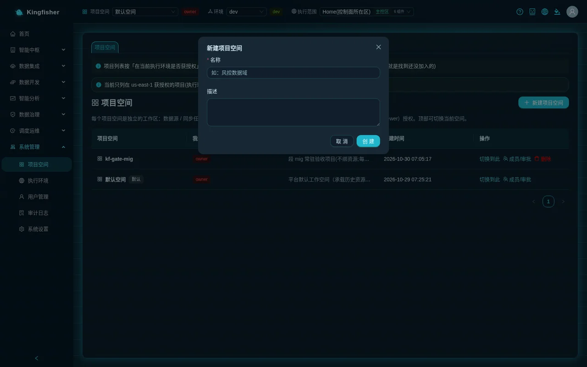

### 3.3 Add members and set roles

1. Click "Members / Approvals" in the project row to open the "Members & Approvals · <project name>" drawer.
2. In the form under the "Members" table enter the "Cognito Username" (the username from the Users page), choose a role, click "Add / Update".
3. Look for "Members updated". Adding the same user again changes their role.
4. To remove a member, click "Remove" in that row → confirm "Remove this member?".

The three project roles (as worded in the page dropdown):

| Project role | Page description |
|---|---|
| owner | project owner (config management also needs the admin/manager platform role…) |
| editor | create, update, delete resources |
| viewer | read-only |

### 3.4 The default space

After installation there is a "Default Workspace" tagged "Default". It starts without any members. Until a non-administrator is added to some space, GenBI, saving cards and Redshift Query all return 403 "No access to this workspace". Demo installations (`BGP_DEPLOY_MODE=demo`) are the exception: install step 11.6 and upgrade step 3d add the four demo role accounts to the default workspace (`pm-tester` = owner, `rbac-tester` = editor, `ops-analyst` / `biz-tester` = viewer); production installations do not.
Recommended go-live agreement: open only one project and grant editor only to trusted users (see the [production deployment manual](../deployment.md) §6).

### 3.5 Handling requests: two entry points

- The "Pending my approval (N)" card at the top of the page: aggregates the pending items of every project you can decide on, each row with a type tag — "Join group" "Promote" "Data access" "DDL" "Delete execution environment" (the last one is visible to platform administrators only). Click "Approve" or "Reject" in the row.
- "Pending approval (access/role requests)" at the bottom of the project drawer: only this project's requests, with columns "Requester" and "Request" (such as "Request to join project (role editor)" "Promote <name> → prod").

Key points:

- When "Execution scope" is set to one region, approvals that apply to other regions are hidden and the page says "The current execution scope hides N pending approvals … switch to 'All' to see every pending item".
- After approving a "Promote", a dialog "Approved and published to prod" appears with a "Switch to prod to view" button; after approving a "Join group" the requester immediately gets the requested role.
- When two people handle the same approval at the same time, the second one sees "This approval has already been processed" or "The approval status has changed; refresh".
- The complete request → approval → publish flow is in [Scenario: several teams sharing one platform](29-scenario-projects-permissions.md).

### 3.6 Switch the current workspace

Click "Switch to this" in the project row; after the toast Switched to "<project name>" the page refreshes; the top-bar "Workspace" selector switches directly as well.

### 3.7 Delete a workspace

- "Delete" appears in the row only for a non-default space where you are owner and hold config-management permission.
- Dialog wording: "Delete this workspace? Its resources and members must be removed first — the platform does not cascade delete; if anything remains it returns the details and refuses."
- The platform inventories the project's jobs / sync tasks / orchestration / reports / GenBI cards / scheduled governance and seeding / unfinished Copilot and backfill plans and so on, category by category; if any category is non-zero or unreadable it refuses and names it.
- Deletion is a background long-running operation: the row shows "Deleting…" and the bottom-right corner shows "Running in background: Delete workspace". The system-managed per-region warehouse credentials are reclaimed automatically.

---

## 4. Execution environments: add, check initialization, enable, authorize projects, redeploy, stop accepting work, retire

Page: "System → Execution Environments". This is where you manage "which AWS regions can run tasks". The home region (tagged "Home" in the list) was chosen at installation and is not changed here; every other region is created through this page's wizard, and only one set per region is allowed.

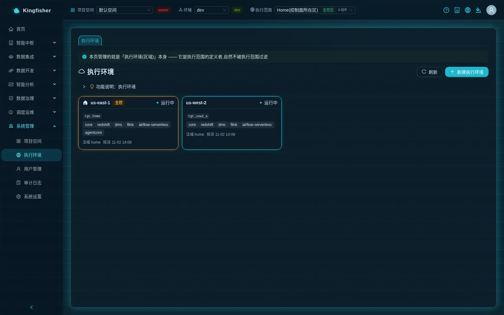

### 4.1 Reading the status badges

| Badge | Meaning |
|---|---|
| Registered | The wizard was submitted; deployment has not started or was not triggered successfully |
| Deploying | CodeBuild is creating the stacks in the target region |
| Testing | Stacks are built; waiting for "Check initialization" to go all green, then "Enable" |
| Running | Accepts tasks, queries and modeling landings |
| Degraded | The latest probe had failing items; see the details page |
| Failed | Deployment failed; "Resume" on the details page before retrying |
| Upgrading | A "Redeploy" is in progress |
| Draining | "Stop accepting work" was applied: no new bindings / schedules / runs; in-flight jobs finish |
| Destroying / Deleted | The deletion approval passed and destruction is under way; or destroyed / discarded |

The home region row has an "Initialize home environment" button; click it once after the first installation and look for "home initialized (all N probe items green)".

### 4.2 Create an execution environment (three-step wizard)

Click "New execution environment"; the wizard goes "Choose region + name" → "Components (full set)" → "Confirm and deploy".

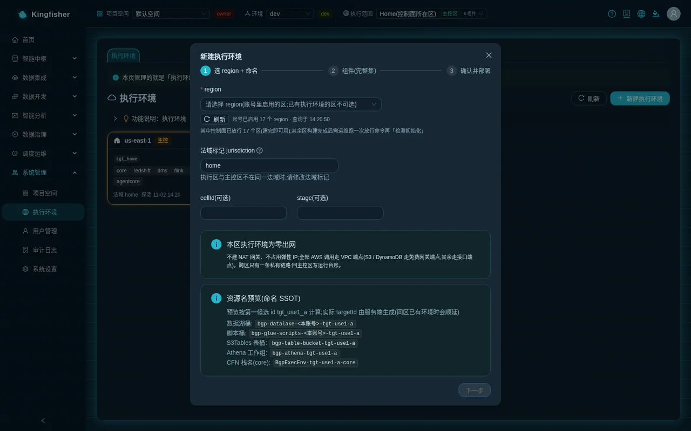

Step 1 "Choose region + name":

- The "region" dropdown lists only the regions enabled in this account; the header shows "N regions enabled in this account · queried at <time>". A region that already has an execution environment is tagged "Already has an execution environment" and cannot be selected.
- Regions blocked by organization policy are listed but not selectable, with the note "Blocked by your organization's service control policy (SCP); cannot deploy here". A region tagged "Organization policy could not be verified" can be re-checked with "Refresh".
- Each region also shows its release status: "pre-authorized, usable right after the build" or "ops must release it once after the build"; the header sums it up as "N of them are pre-authorized by the control plane (usable right after the build); the others need ops to run the release command once after the build, then 'Probe'".
- "Jurisdiction tag (jurisdiction)" defaults to `home`. When the execution region is not in the same jurisdiction as the home region it must be changed to another value (such as `eu-sim`). Format: starts with a lower-case letter, only a-z / 0-9 / -, 2–32 characters. The platform does not derive it from the region, it cannot be changed after registration, and no legal judgement is made.
- "stage (optional)" and "cellId (optional)" are normally left empty. "Resource name preview (naming SSOT)" below shows the resource names that will be created, read-only.

Step 2 "Components (full set)": the component list is read-only and every item is tagged "Required". Page wording: "Every execution environment gets all components; there is no reduced variant". A non-home jurisdiction adds residency-api (regional audit / result storage).

Step 3 "Confirm and deploy":

- A non-home jurisdiction requires ticking the "I have read and agree" disclaimer (the text carries a version number); without it "Start deployment" is disabled. The consent record (who / when / which version) is kept in the "Consents" card on that environment's details page and cannot be changed.
- Click "Start deployment". Look for "Environment <id> created; deployment in progress" and "Deployment triggered (buildId …)". Click "Done (you can keep following progress on the details page)" to close the wizard.
- If it shows "Registered, but triggering the deployment failed: … (you can retry on the details page)", click "Trigger deployment" on the details page.

### 4.3 Wait for the deployment and release the region if needed

- The "Deployment progress" card on the details page shows the build status and per-stack details live; click "View build log (tail)". Measured on the demo environment at about 11 minutes (6 stacks in the same jurisdiction; the three demo accounts took 10.9 / 11.2 / 10.9 minutes); a cross-jurisdiction environment adds one residency API stack and takes slightly longer.
- If the region was pre-authorized at installation or upgrade (tagged "pre-authorized, usable right after the build" in the wizard), go straight to the next step once the deployment succeeds.
- If the wizard tagged it "ops must release it once after the build", the details page shows a yellow notice "Control plane has not enabled region <region>: Probe will fail until it is enabled".
  In that case ops must run one control-plane redeployment on the deployment machine (the platform ECS service rolls once, a few minutes); afterwards come back and click "Check initialization". The command and its "will change / will not change" list are in the [production deployment manual](../deployment.md) §7.
- To avoid releasing every new region in the future, have ops pre-authorize the candidate regions in one go at the next upgrade (manual §7 step 2).

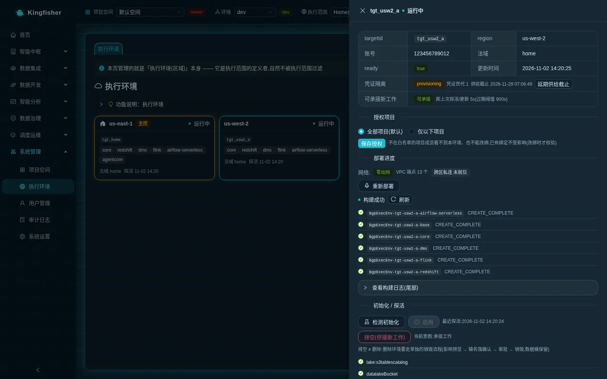

### 4.4 Check initialization → Enable

1. In the "Initialize / probe" area of the details page click "Check initialization". The platform probes the region's buckets / table buckets / Glue / Athena / warehouse / scheduler and so on item by item, and enables the region's S3 Tables federated catalog along the way.
2. When all green it shows "All probes green" and "Last probe: <time>"; with red items it shows "Some probe items failed; see details below". If "Finalize did not pass. This is the root cause of the red items below" appears, read that one first; the red items are mostly derived from it.
3. The "Enable" button is clickable only when the status is "Testing" and all probes are green (hovering explains "Can only be enabled when status=testing and all probes are green"). After clicking, the toast "Enabled; now accepting pushed work" appears and the status becomes "Running".
4. From then on the region appears in the execution-region dropdowns of batch jobs, Redshift Query and modeling landings.

### 4.5 Authorized projects

The "Authorized projects" card decides which workspaces can bind tasks / ad-hoc queries / modeling to this region:

- "All projects (default)": every project may use it.
- "Only the projects below": tick an allow-list (searchable by project name). Members of projects not on the list cannot see this environment or rebind to it; existing bindings are unaffected (validation happens on rebind).
- "Not accepting work": nobody can bind.
- Click "Save authorization" when done; the toast reads "Set to: all projects allowed" or "Set to: only N projects allowed".

### 4.6 "Redeploy" after an upgrade and "Complete missing components"

- After the platform is upgraded to a new version, every execution region needs one "Redeploy" on its details page to receive the new version's stacks. The flow is dry run first, then confirm: the page shows "Dry run: what the redeployment (upgrade) would change (no changes executed)", usually 1–3 minutes.
- When the dry run finishes, "Confirm the impact of this redeployment (upgrade)" pops up, listing "N stacks involved, M changes in total" and the "Plan fingerprint". With deletions / replacements the button reads "Confirm deployment (will interrupt running jobs)"; with additions only it reads "Confirm deployment (additions only)". Tick "I have read and approved this plan; start deployment" to execute.
- When the top of the details page shows "Execution environment incomplete: missing …", click "Complete missing components"; it also dry-runs first ("Dry run: what this supplemental deployment would change") and then confirms; it only adds resources and can run while the environment serves.
- A stuck dry run shows "Dry run exceeded 6 minutes with no verdict and was aborted (no changes made); retry later"; a failed dry run shows "Dry run finished but no impact verdict could be read … check the build logs".
- While the same environment has a deployment in flight, every deploy button is disabled with the explanation "A deployment session is still in flight"; wait for it to finish or use "Resume" from the next section.

### 4.7 Recovering from a failed deployment

- When the status is "Failed" or the details page says "Manual recovery required", click "Recover (record failure and unlock)" and confirm the dialog "Recover this failed deployment session?".
- Recovery records this failure, releases the deployment lock, and sets health to unknown (no new work accepted for now); after the next all-green probe it returns to "Running" automatically.
- After recovering, click "Redeploy" or "Trigger deployment" again.

### 4.8 Stop accepting work (drain) and resume

- Before maintenance, relocation or retirement, click "Drain (stop accepting new work)" → "Drain this execution environment?". Once effective, the region immediately refuses new bindings / schedules / runs, in-flight jobs finish, and no resource is destroyed; the status becomes "Draining".
- To resume, click "Resume accepting new work" → "Resume accepting new work?". The status only returns to "Running" after the next all-green probe; flipping a flag alone does not count.
- The home region has neither of these buttons.
- Page wording as a reminder: "Drain ≠ delete: deleting an environment uses a separate destruction flow (impact preview → type the name to confirm → approval → destroy; data buckets are kept)".

### 4.9 Retiring an execution region (deleting an execution environment)

The "Danger zone" on the details page offers only one of two paths, depending on the environment's actual state:

An environment that was never built (deployment failed; no resources of it in the target region):

- Shows "Discard this environment". Type the environment id to confirm and click "Discard". The platform first checks live that the target region really has no stacks, then marks it "Deleted" and frees the region slot so the region can be registered again.

An environment that was built, in two steps:

1. "1. Stop accepting work (drain)": click "Stop accepting work: <id>" → "Stop accepting work". The page shows "Stopped accepting work: new bindings / schedules / runs are all rejected".
2. "2. Request deletion": opens "Delete execution environment <region> — impact preview". "Pre-delete checks (all must be 0)" lists "Bound resources" "Enable scheduling" "Running runs"; when non-zero it offers "Go unbind these tasks"; when a source cannot be read it honestly says "Some sources could not be read, so zero cannot be confirmed (unreadable is not the same as none)" and refuses.
   Once all are 0, fill in "Reason (required, recorded in the audit log)", "Type the region name to confirm", and click "Confirm deletion". The toast reads "Deletion request submitted (approval …); waiting for a platform admin to approve".
3. A platform administrator goes to "Workspace → Pending my approval", finds the "Delete execution environment" approval with its "Impact preview snapshot" under the row. The page reminds: "On approval the server recomputes the impact preview; if it differs from the one submitted, approval is refused (reject and request again)". Clicking "Approve" starts the destruction (managed services first, then the component stacks, core and base in reverse dependency order).
4. If destruction gets stuck, the details page shows "Destruction is stuck" and "Retry destruction", which reuses the same deletion plan and the same final snapshot name without taking another snapshot.

Resources that remain after deletion and keep incurring charges (page wording under "Retained (not deleted)": data resources must be cleaned up separately after a human confirms; the platform does not decide for you):

- Data buckets, S3 Tables table buckets
- Warehouse namespace / workgroup and the final snapshot
- The data-domain CMK and its alias, the scheduler's DAG bucket
- The regional audit table / result bucket of a non-home jurisdiction

After deleting, have ops run one more control-plane redeployment to withdraw the release of that region (manual §7bis). The complete multi-region scenario is in [Scenario: data stays in its region](22-scenario-multi-region-residency.md).

---

## 5. Settings

Page: "System → Settings". Non-administrators see it read-only.

### 5.1 Change the AI model

The "AI model" card is the global default shared by all 9 AI capabilities of the platform (GenBI / Copilot / advisors / code generation and so on).

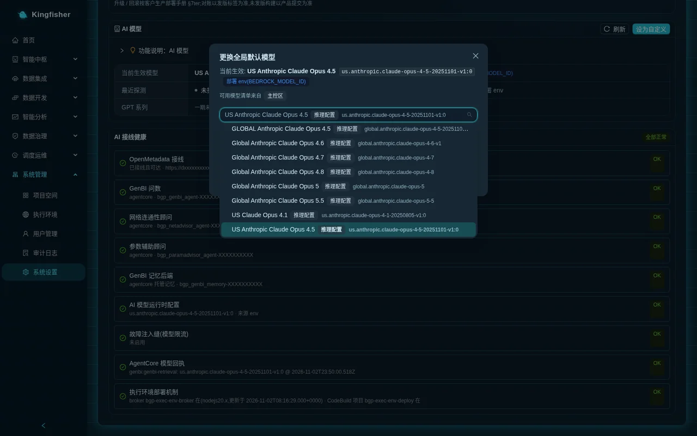

Steps:

1. Click "Change global default"; the "Change global default model" dialog opens.
2. The "Select a model (grouped by vendor series: <series list>)" dropdown groups by series (Claude / GPT / GLM / Kimi and so on, from the region's real catalog); entries carry an "inference profile" or "profile only" tag; "GPT series" entries are visible but tagged "not open in phase 1" and cannot be selected.
3. Click "Test this model". The platform really makes one call; saving is allowed only after you see "Probe passed (N s)". Page wording: "You must Test this model and pass before saving (the server probes once more on save)."
4. Click "Save"; the dialog "Change the global default model?" appears with "Impact preview (takes effect platform-wide immediately)": "Affected capabilities (9)" "All tenants, all projects" "Within 5s after saving (active cache invalidation, no restart)". Click "Confirm change".
5. Look for "Global default switched to <model>; effective platform-wide within 5s".

When the probe fails, the page gives "why + what to do" by type:

| Type shown on the page | Gist of the message | Next step |
|---|---|---|
| This account cannot invoke this model | Request access for the model in the Bedrock console | Enable model access, or switch to an enabled model |
| This model is unavailable in the current region | The list is already filtered by this region; if it still fails the model may have just been retired | Switch to a model that is live in this region |
| This model requires an AWS Marketplace subscription | Your account policy (SCP) forbids subscribing to third-party models | Use a first-party Anthropic model, or ask the account administrator to allow it |
| The probe was throttled | Please retry shortly | Wait a minute and test again |
| This model is not enabled for this account | Bedrock says "not available for this account"; unrelated to region / IAM / Marketplace | Ask your AWS account team to enable it, or pick another version in the same series / another vendor |
| Probe timed out | Reasoning models can take tens of seconds to start; this is not throttling | Test again shortly; on repeated timeouts switch to a global. inference profile |

Two more refusals:

- GPT / GLM / Kimi series must also pass a second tool-use probe before saving. Failure wording: "This model cannot call tools under Converse (tool-use probe failed); GenBI / Copilot / advisors would go silent, so it cannot be the global default".
- "This base model only supports inference-profile invocation; pick a us. / global. entry": you chose a base model that cannot be invoked on demand.

Key points:

- Kimi series entries are tagged "always reasoning blocks": every reply starts with a reasoning block, the output tokens are about 2× Claude's, and cost and response time rise accordingly.
- Probing is rate-limited: "Too many probes (max N per minute); retry in Ns".
- When the current model's latest probe failed, a red alert "AI model problem: the current model … failed its latest probe" appears at the top of the card, with "Restore factory default now". Restoring does not require a passing probe; it removes all runtime overrides and falls back to the deploy env / factory value.
- "Saved as the platform-wide default (per-region default models are not yet supported)".
- When two administrators change it at the same time, the one who saves later sees "Another admin just changed the config; refreshed, please choose again".
- If a model id was given explicitly at deployment, the card's "Source" shows deploy env; a runtime override takes precedence over it.

### 5.2 Wiring health, platform version, identity and resource facts

- The "AI Wiring Health" card: lists the status and explanation of every AI-related wiring item; the top-right summary is "All healthy", "Partially degraded" or "Wiring error".
- The "Service status" card: see section 1.3.
- The "Global identity (independent of execution scope)" card: the user pool identifier (Cognito User Pool), independent of the current execution scope.
- The "Execution environment resources" card: shows the region's region / installed components / data warehouse / data lake bucket / Glue script bucket / VPC and other facts according to the top-bar "Execution scope".
  When the scope is "All" the page explains "The current execution scope is 'All', so the resources shown below belong to the home region. To see a region's own buckets / workgroups / VPC, select that region in the top bar". When it cannot be read it honestly shows "Cannot read this execution environment's resource inventory … home region values will not be substituted here".

### 5.3 Lake table buckets and routes (registering customer-owned table buckets)

The "Lake table buckets and routes" card registers the customer's own S3 Tables table buckets as "routes". Once registered: batch / EMR job scripts can read and write it with the three-part name `<alias>.<namespace>.<table>`, sync tasks can choose it as Table Bucket, and Athena query / governance catalog / GenBI all see it, with no hand-written Spark configuration.
Card wording: "Registered = routed: jobs get a Spark catalog per alias, sync can write it, and it shows up in lake query / governance catalog / NL2SQL".

Prerequisite: routes belong to execution environments, not to projects. Select an execution environment in the top-bar "Execution scope" first; only then does the card show that region's route table (otherwise it says "Pick an execution environment in the top bar first"). Registering / editing / revoking requires a platform administrator (bgp-admin).

Columns of each route-table row:

| Column | Meaning |
|---|---|
| Table bucket | The S3 Tables bucket name; the first row is "Platform table bucket of this region", tagged "Implicit default route" "Created at deployment", and cannot be revoked |
| Alias | The Spark catalog name used in scripts; fixed to `s3tablescatalog` for the platform bucket; pre-filled from the bucket name for customer buckets and editable |
| Layer | detail (detail layer) / agg (aggregate layer) / result (result layer) / ods (ODS layer) / dim (dimension layer) / other (other) |
| Namespace ownership | Optional; when the same namespace appears in two routes, one of them must declare ownership |
| Writable | "Writable" or "Read-only"; when off, sync / table creation / job write declarations cannot use it |

Registration steps:

1. "Table bucket": pick from the dropdown or type the bucket name (such as `demo-agg-bucket`); it must really exist in this region and this account; the platform resolves it "Resolved from what exists".
2. "Alias (Spark catalog name, pre-filled from the bucket name)": may be shortened, such as `agg`.
3. Choose a "Layer"; "Writable" is on by default; fill in "Namespace ownership (optional, press Enter to add)" as needed; "Notes (optional)".
4. Click "Register to <execution environment name>". Success toast: "Route <bucket> registered (alias <alias>): jobs can reach it as <alias>.<namespace>.<table>; lake query / governance catalog / NL2SQL will show it".

Editing and revoking:

- "Edit" in the row changes alias / layer / writable / namespace ownership / notes. Changing the alias prompts "Changing the alias breaks scripts that reference the old alias. Change it anyway?"; after confirming, remember to update the three-part names in your scripts.
- "Revoke" in the row prompts "Revoke the route? The bucket and its tables stay; the platform just stops injecting / listing it". Success toast "Route revoked (the bucket and its tables are untouched)". When a sync task or a job declaration references it, the server refuses and the raw refusal reason is shown on the page.
- When the same namespace appears in two routes and neither declares ownership, registration is refused with 409 naming both buckets; fill in "Namespace ownership" on one route as instructed and retry.

The end-to-end usage (two buckets by layer, job read / write declarations, three-part names, verification) is in [Scenario: detail bucket / aggregate bucket layering](21-scenario-cross-bucket-layering.md); the design notes on field meanings are in [Lake table-bucket routing design](../design/lake-bucket-routing.md).

### 5.4 Data source network objects and background cleanup jobs

- The "Data source network objects" card lists the security groups the platform created for data sources (named `bgp-ds-*`), with columns "Owning data source" "ENIs" "Status" (In use / Orphan / untagged (legacy)).
  Page wording as a reminder: an "In use" group with zero ENIs is normal, do not clean up by 'no ENI' in the account; only "Orphan" groups may be handed to the background cleanup job here with "Clean up".
- The "Background cleanup jobs" card shows items waiting for cleanup / handed to the background and their "Phase"; `failed` means the group was still in use after 30 minutes and someone must confirm the ENIs are released before deleting it.

---

## 6. Audit log

Page: "System → Audit Log". Records who created / changed / deleted / ran which resource and when.

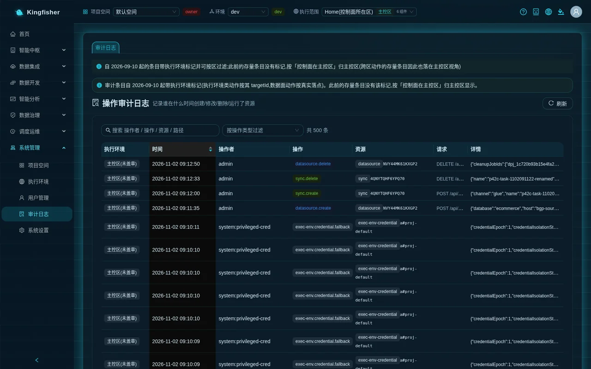

How to search:

1. In the top search box "Search operator / action / resource / path", type a username or action name and press Enter.
2. The "Filter by action type" dropdown filters by action name.
3. Columns: "Time" "Operator" "Actions" "Resources" "Execution Environments" "Request" "Details". "Refresh" at top right, "N items" at the bottom.
4. The "Execution Environments" column is stamped with the action's real target; older legacy entries have no stamp and show "Home region (untagged)". The top-bar "Execution scope" also filters this page.

Action names for administrative actions (paste them straight into the search):

| Action name | Meaning |
|---|---|
| project.create / project.update / project.delete | Create, change, delete a workspace |
| project.member.put / project.member.remove | Add a member or change a role, remove a member |
| approval.submit / approval.decide | Submit a request, approve or reject |
| promote.request / promote.execute | Request publishing to prod, the publish actually executing (including direct publishing to staging) |
| user.password.reset | An administrator reset someone's password |
| exec-env.register / exec-env.deploy / exec-env.probe / exec-env.enable | Execution environment registered, deployed, initialization checked, enabled |
| exec-env.access.set / exec-env.drain / exec-env.delete-request / exec-env.discard | Projects authorized, work stopped, deletion requested, discarded |
| residency.* | Summary records of cross-jurisdiction data operations, with an auditId; the full text stays in that region's regional audit table |

Cross-jurisdiction lookup: the "Audit" column in run history / Task Monitor carries an "Audit #"; paste it into the search box to find the home-region summary; the "Consents" card on the execution environment details page shows who agreed to which version of the disclaimer and when.

Note: creating users / disabling / enabling / changing roles / resetting passwords on the Users page all write audit entries (`user.create` · `user.disable` · `user.enable` · `user.role.change` · `user.password.reset`); passwords are never recorded; to cross-check at the AWS layer, look at CloudTrail (Cognito management operations).

---

## 7. Alert channels

Channels are usually created centrally by the administrator, rules by each team. Page: "Scheduling & Ops → Alerting Center" → "Notification Channels" tab.

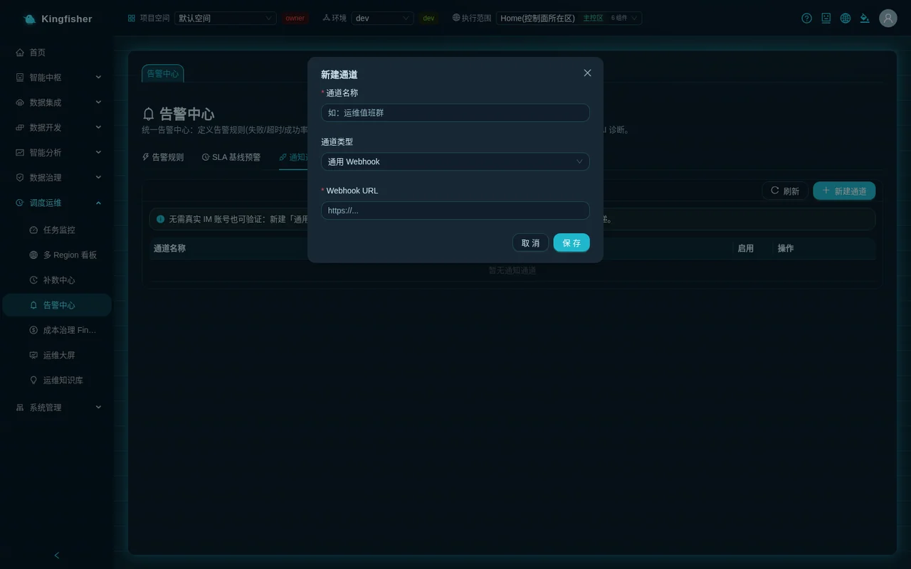

1. Click "New Channel". Fill in "Channel name" and choose "Channel type": "DingTalk group bot" "WeCom group bot" "Email (SES)" "Generic Webhook".
2. DingTalk / WeCom / Generic Webhook take a "Webhook URL"; when DingTalk security is set to "Signing", also fill in "Signing secret". Email takes "Sender (must be SES-verified)" and "Recipients (comma-separated)".
3. Click "Save"; the toast "Channel created" appears.
4. Click "Send test" in the row; success shows "Test delivered (HTTP 200)", failure shows "Test failed: <message>".
5. Afterwards, when you click "New Rule" in the "Alert Rules" tab (dialog title "New Alert Rule"), the channel can be chosen under "Select channels (multiple allowed)". Rule conditions are "Alert on task failure" "Run timeout (duration over threshold)" "Success rate below threshold" "No-run (no success within window)", with the option "Auto-attach AI diagnosis on failure".

Key points:

- Page wording: "For security, webhook URL / secret are not echoed; leave blank to keep, fill in to overwrite."
- You can verify delivery without a real group bot: create a "Generic Webhook" channel with URL `<platform domain>/api/public/alerting-sink` and delivery is verified end to end (the page shows the same hint).
- The demo environment has no notification channel configured (the "Notification Channels" page is empty); every delivery check in this guide uses the self-test webhook above; real DingTalk / WeCom / email delivery must be verified after configuring it in your own environment.
- Rules, SLA baselines and event handling are in [Scenario: operations and alerting](27-scenario-ops-alerting.md).

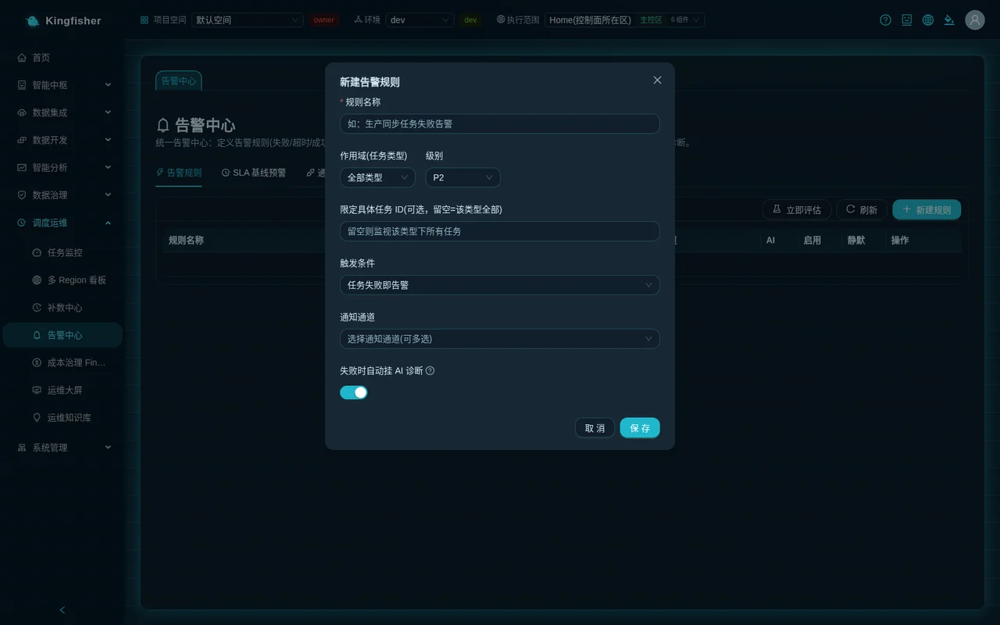

---

## 8. Weekly checklist

| Where to look | What to look at | When abnormal |
|---|---|---|
| System → Workspace | Is "Pending my approval (N)" piling up | Approve / reject one by one; for unfamiliar requesters, check the Users page first |
| System → Execution Environments | Is every region "Running"; any "Degraded" "Failed" | "Check initialization" on the details page for red items; for failures, "Resume" then redeploy |
| System → Settings | "Service status" all normal; "AI model" latest probe passed | "Refresh status"; when the model is abnormal, "Change global default" or "Restore factory default" |
| System → Audit Log | Are this week's `user.password.reset`, `project.member.put`, `exec-env.*` all accounted for | Compare against onboarding / change records |
| Scheduling & Ops → Alerting Center | Any "Delivery failed" under "Alert Events" | "Send test" on the channel; check whether the group bot is dead |
| Scheduling & Ops → FinOps | Execution region baseline cost and continuously billed items such as DMS / Redshift | See [Scenario: FinOps](28-scenario-finops.md) and the [cost model](../cost-model.md) |

---

## 9. Caveats and known boundaries

- The home region is chosen at installation and not changed afterwards; other regions can only be created through the page wizard, never by hand in the AWS console.
- Only one execution environment per region; components cannot be trimmed.
- Deleting an execution environment does not delete data resources (data buckets / table buckets / warehouse snapshots / CMK / DAG bucket); they keep incurring charges and must be cleaned up manually.
- Deleting a workspace does not cascade; resources, members and data-plane tables must all be 0 before it can be deleted.
- Data sources are not split by environment (dev / staging / prod share the connection); sync / jobs / orchestration / query tasks are isolated by project + environment.
- The Users page has only the three roles Admin / Developer / Viewer; the two role groups R&D manager (bgp-manager) / operations analyst (bgp-analyst) cannot be assigned on the page and are added by an administrator in the Cognito console.
- "Lake table buckets and routes" supports only table buckets in the same account and region; cross-account table buckets are out of scope.
- The AI model is one platform-wide default; per-region settings are not yet supported; GPT series entries are visible but not open in phase 1.
- The pages have an English mode (switcher at top right; all text and the tour in English); on first visit the language is suggested from the visitor's IP country (then the browser language), defaulting to Chinese.

---

## 10. Further reading

- [Quick start](01-quick-start.md) · [Core concepts](02-concepts.md)
- [Scenario: several teams sharing one platform](29-scenario-projects-permissions.md) · [Scenario: data stays in its region](22-scenario-multi-region-residency.md) · [Scenario: detail bucket / aggregate bucket layering](21-scenario-cross-bucket-layering.md)
- [Rules and status code reference](30-reference-rules.md) · [FAQ](32-faq.md) · [Glossary](33-glossary.md)
- [Production deployment manual](../deployment.md) (§4 accounts and passwords · §6 go-live agreements · §7 adding an execution region · §7bis retiring an execution region · §8 known boundaries) · [Features](../features.md) · [Modules](../modules.md)
