# Data engineer guide: daily work from connecting a source to the daily report

| Item | Description |
|---|---|
| Readers | Engineers who connect data sources, build syncs, write batch jobs, orchestrate schedules, backfill and watch runs (role group `bgp-developer`, project role `editor` or above) |
| Estimated time | 40 minutes to read through; about 2 hours to do one full pass |
| Prerequisites | You can sign in to the platform; you have been added to at least one workspace; the top bar shows at least one "Execution scope" (the home region is enough); the network where the data source lives has been opened by an administrator |
| What you will have afterwards | You know which pages to visit every day / every week, which buttons to click and what every option means; you know which rejections the platform makes on purpose and what to do next |

> This guide is organized by "what this role does in a day / a week". Each section gives: which page to go to · key buttons · key points · related scenarios.
> If you want a complete end-to-end walk-through first, go straight to [Scenario 1: MySQL detail data to a channel daily report](20-scenario-detail-to-daily-report.md).
> The ❓ "How to use this page" in the top-right corner of every page is always the most authoritative one-line description of that page; the button names in this guide match it word for word.

## 0. A day and a week

| Frequency | What you do | Where to go |
|---|---|---|
| Every morning | Check whether last night's runs failed, read the logs, rerun if needed | "Scheduling & Ops → Task Monitor" |
| Every day | Query data, check definitions, pull ad-hoc data | "Data Development → Redshift Query", "Data Development → Athena Query" |
| Every week | Connect new sources, build syncs, change jobs, change orchestration | "Data Integration → Data Sources / Data Sync", "Data Development → Batch Compute / ETL Orchestration" |
| On demand | Backfill a stretch of history, promote what you tuned in dev to staging / prod | "Scheduling & Ops → Backfill Center"; "Publish to environment" in each object's details |
| On demand | After a new execution region goes live, bind jobs to that region and check that regions are consistent | "Execution regions (multi-select)" in "Batch Compute"; "Scheduling & Ops → Multi-Region Dashboard" |

## 1. Before you start: the three selectors in the top bar

From left to right, the top bar shows "Workspace", "Environment" and "Execution scope". They decide what you see and where new objects are created.

- "Workspace": resources are isolated per project; if you cannot see an object a colleague created, check here first. Switching refreshes the whole page.
- "Environment": dev / staging / prod; resources are isolated per project + environment; publishing to prod requires approval. Just clicked "Publish to environment" and cannot see the object? Switch this selector to the target environment first.
- "Execution scope": "All (N regions)" or one execution environment. Only installed execution environments are listed; switching stays on the current page. The entry marked "Home region" is the region where the control plane runs.
- In a single-region view, list pages keep a persistent hint line "Other execution scopes have N more"; the objects are not lost, they are filtered out by the scope.

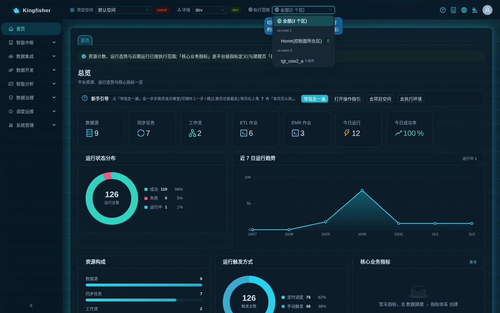

The concepts themselves (target, jurisdiction, long-running operation, object lease, table-bucket routing) are explained in [Core concepts](02-concepts.md).

## 2. Data sources

- Page: "Data Integration → Data Sources".
- Key buttons: "New data source" (in a single-region view the button reads "New data source (in <region>)") · row actions "Browse tables", "Network configuration", "Detect", "Edit", "Delete" · at the top, "Check reachability" and "Refresh".
- The creation wizard has three steps: "Basic info" (data source name · database type · environment "Development" / "Staging" / "Production") → "Connection Config" → "Create Resource".
- "Connection Config" for JDBC sources: "Manual input" or "Select from RDS"; host · port · database name · username · password · "Extra JDBC connection parameters (optional)" · "Probe & browse method" · "Network Access (optional)" (VPC / private subnets / security groups; leave empty to auto-detect).
- "Test connection" only checks that the connection configuration can be created; after creation the source first shows "Testing", turns "Connected" only once it has really connected, and honestly shows "Unreachable" when it cannot.
- When the source sits in its own VPC and the platform cannot reach it directly, set "Probe & browse method" to "Glue connection only (source in its own network)": browsing tables then starts a discovery job that takes about 1–3 minutes.

Key points:

- A data source **is created in** the region of the selected execution scope and cannot be moved to another region afterwards; sync tasks derived from it also run in that region.
- Passwords go into Secrets Manager; the platform creates its own security group and Glue connection for JDBC sources, tagged `bgp:managed`. If they are deleted outside the platform, they are rebuilt on next use and an audit record is written; if a security group you specified yourself is deleted, the source is marked "Network object missing" and recovers once you pick another group under "Network configuration".
- Deleting a source that is still referenced by sync / real-time tasks is rejected (409, every task listed) and nothing is deleted.

Related scenario: [Scenario 1 · Step 3](20-scenario-detail-to-daily-report.md).

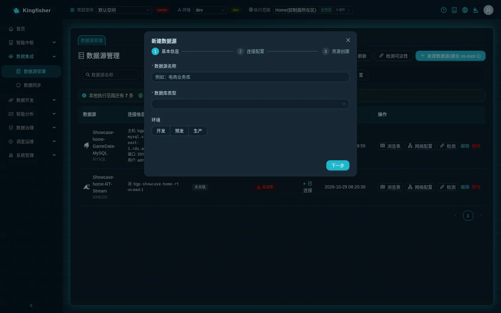

## 3. Data sync

- Page: "Data Integration → Data Sync"; details at `/sync/<task>`.
- Key buttons: "New sync task" · row actions "Start" / "Stop", "Run for a date", "Details", "Edit", "Delete" · the "Auto refresh" switch (re-fetches the list every 8 seconds while a task is running).

### 3.1 The five wizard steps

| Step | Title | Required / key points |
|---|---|---|
| 1 | "Source configuration" | Task name · select data source · "Sync mode" (Full-load sync / Incremental sync (CDC) / Real-time sync (DMS CDC)) · "Write mode" (overwrite / append / merge, **must be chosen explicitly**) · "Target type" (S3 Data Lake / Redshift / S3 + Redshift) · "Data filter (WHERE)" |
| 2 | "Select Tables & Mapping" | Tick tables ("Search table name", "Selected only", "Select all N shown", "Clear selection") · field mapping · "Table names with date variables" (for monthly-split tables) |
| 3 | "Target configuration" | Table name prefix / suffix · S3 Tables: "Table Bucket", "Namespace" (follows the database name automatically / set manually) · partition config · Redshift: Workgroup / Database / Schema / distribution style · derived columns · overwrite options · merge keys |
| 4 | "Create table preview" | "Generate DDL"; each table is marked "New", "Table exists (created by platform)" or, in red, "Table exists (not created by platform; overwrite needs confirmation)" |
| 5 | "Schedule settings" | Glue job resources (Worker Type / Worker Count / Glue Version / job timeout / retry on failure) · execution role · "Enable scheduling" + Cron Expression · downstream dependencies |

Click "Done" to save; the first two steps have required-field validation, the later steps all have defaults. The wizard automatically keeps a browser draft (7 days); when you close and reopen it you can "Resume" or "Discard".

### 3.2 The three settings most often chosen wrongly

- **Write mode**: overwrite = clear and rewrite the whole table on every run (can be changed to "By partition" under "Overwrite options"); append = insert only; merge = update the rows matched by the "Merge keys" and insert the rest — **merge keys are required and have no default**.
- **Overwriting a table the platform did not create**: clicking "Done" opens "Overwrite existing tables?" listing every table, and you must confirm them one by one. A task that was never confirmed is rejected at run time, the run row records the error `SYNC_REFUSED_CLEAR_FOREIGN_TABLE`, and not a single row is deleted.
- **Table Bucket**: empty = the region's platform table bucket (recommended). To write to your own table bucket, an administrator must first register it as a writable route under "Settings → Lake table buckets and routes"; the dropdown lists writable routes only, and an unregistered bucket is rejected on both save and start with a pointer to where to register it.

### 3.3 Date variables

"Data filter (WHERE)" and "Table names with date variables" accept `${variable}`; values are resolved from the business date at run time: clicking "Start" manually takes today in the task's "Business-date time zone", while "Run for a date" and backfills use the date you give. All 15 variables are listed in the [Configuration reference](31-reference-config.md); Scenario 1, Step 4 also has a table of them.

### 3.4 Run, check results, publish to prod

- After "Start", the status column goes Starting → Running → Success / Failed; on the details page, every row of "Run History (N)" shows rows read / written, duration, "Trigger", "Error" and the "📋 View" log link.
- Saving refreshes immediately: after editing a task and clicking "Done", the next run uses the new script; you do not have to run it once first.
- "Publish to environment" lives on the details page: publishing to staging takes effect immediately; publishing to prod must be approved by a platform administrator (or an R&D manager who is the owner of that project) under "Pending my approval" on the "Workspace" page.
- A sync task runs only in the region of its data source; the "Target" column of the list and the details page are both filtered by execution scope.
- DMS / Zero-ETL channels keep billing continuously; "Stop" them as soon as they are not needed (see [Scenario 4](23-scenario-realtime-cdc.md) for the real-time pipeline).

Related scenario: [Scenario 1 · Steps 4–5](20-scenario-detail-to-daily-report.md).

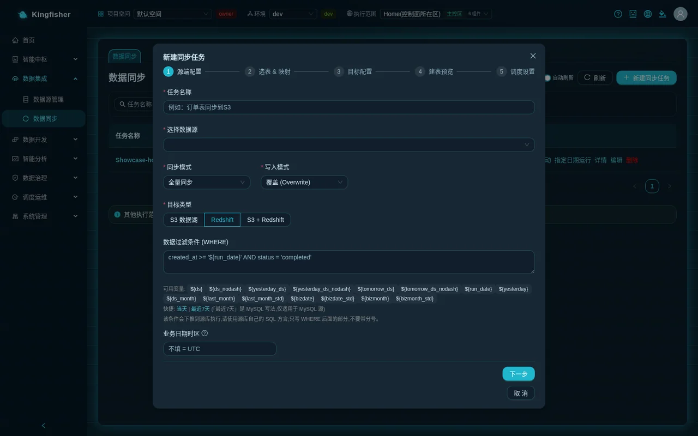

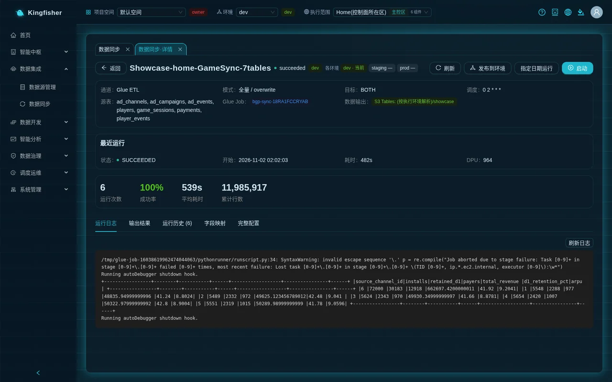

## 4. Batch compute

- Page: "Data Development → Batch Compute". The job list is on the left; the editor for the selected job is on the right.
- Key buttons: "New" → the "New ETL Job" dialog (job name + type) → "Create"; in the editor, "AI Generate Code", "Save", "Version history", "Dry run", "Run now · <region>", "Backfill", "Publish to MWAA schedule", "Publish to environment", "Parse lineage".

### 4.1 The three job types

| Type | What you write | How it runs | How to get the business date |
|---|---|---|---|
| "Glue PySpark Script Job" | PySpark; the platform has preconfigured the S3 Tables catalog, so write tables as `s3tablescatalog.<namespace>.<table>` | After saving, "Run now" creates / updates the Glue job of the same name and starts it; cold start takes about 1–2 minutes | `getResolvedOptions(sys.argv, ["JOB_NAME", "ds"])` reads `--ds` and the other parameters |
| "Redshift SQL Job" | Several SQL statements separated by semicolons, executed through the Data API | "Dry run" validates with EXPLAIN and writes no data; "Run now" really runs | Write `${ds}`, `${ds_nodash}`, `${yesterday_ds}` and the other variables directly in the script |
| "EMR Serverless (PySpark, standalone engine)" | PySpark; each job gets its own application | After saving, "Run now" submits one job-run; cold start takes about 1–2 minutes | The business date is appended after the "Script arguments" as `--ds` and the other parameters |

A script template is preloaded after creation; just edit it. The Glue version dropdown shows text such as "Glue 6.0 (Spark 4.1.1 / Python 3.13)" and defaults to the highest version; writing to S3 Tables needs at least 5.1; from Glue 6.0 on, Spark ANSI mode is on by default, so division by zero / invalid casts raise errors instead of returning NULL.

### 4.2 Multi-region binding and a single run

- "Execution regions (multi-select)": one job can be bound to several regions, or click "Select all active regions (N)". With several regions bound, the button becomes "Run now (one run in each of N regions)" and clicking it first asks "Which execution scopes should this run in?".
- The run button restates **the job's own binding**, not the top-bar view.
- "Run History (N)" has one run per region; the columns are Status / Execution region / Audit / Type / Trigger / Business date / Start / Duration / Error, with row actions "Logs", "AI Analysis" or "AI Diagnosis", and "Rerun".
- The first operation in a region of another jurisdiction opens the disclaimer; it executes only after "Agree and continue", and the run row's "Audit" column lets you look it up later.

### 4.3 Advanced properties

A Glue job's "Advanced Properties (retry / execution class / bookmark / custom parameters / dependent libraries)" contains:

- Retries · execution class (STANDARD / FLEX) · bookmark · max concurrency.
- The "Execution Role" dropdown with three groups: "Platform default (recommended, permissions complete)", "Created by Role Advisor", "Your own roles (must trust glue.amazonaws.com and be able to read the buckets your job depends on)"; to the right are "Refresh" (a role you just created in IAM shows up without leaving the page), "Enter ARN manually" and "Check permissions" (result: permissions complete / N permissions missing / cannot be measured). On save, the platform checks permissions against the buckets the job really references; anything missing is rejected on the spot with a 400 that lists every item.
- "Lake table buckets": none selected = all routes of the region; a subset injects only those catalogs and checks permissions per bucket; each bucket is marked "Read" or "Write"; below, "Catalogs available to this job" lists alias → bucket, and "Copy three-part name example" gives a pasteable `<alias>.<namespace>.<table>`. The complete recipe for cross-bucket layering is in [Scenario 2](21-scenario-cross-bucket-layering.md).
- "Job parameters": custom `--key` parameters; `--conf` is appended after the platform Spark configuration.
- "Dependency libraries": after "Upload dependency files" the S3 URI is filled in automatically (JAR → `--extra-jars`, `.py/.whl/.zip` → `--extra-py-files`), ≤ 100MB, one upload per region the job is bound to.

The EMR job panel is "Script & Spec": execution role, lake table buckets, "Driver / Executor spec (CPU / memory / disk)", custom Spark conf, "Connection Info (VPC subnet / security group)" (marked "Not configured (required before running)" when empty; if you leave it empty, the platform offers on submit to run with the default private subnets + security group instead) and "Script arguments".

### 4.4 The two kinds of "publish" are not the same thing

| Button | What it does | Where to see the result |
|---|---|---|
| "Publish to MWAA schedule" | Attaches a cron to this job in the **current environment** and ships the artifact to the scheduler of every region the job is bound to; the "Dispatch preview" dialog lists artifact / scheduler / execution identity per region, then click "Confirm dispatch" | The job card shows ⏱ cron; "Task Monitor → Schedule config" gains a row; "Take schedule offline" removes it; "Trigger once" runs it immediately without changing the cron |
| "Publish to environment" | Copies the job **definition** (script / bound regions / parameters) to staging or prod, without run history; publishing to prod requires approval | The job card's environment status shows `staging · Current` / `prod · Pending approval` and so on; switch the top-bar "Environment" to see it |

### 4.5 Backfill and delete

- "Backfill" opens the "Backfill (run day by day over a business date range)" dialog: start date / end date, ≤ 31 days, one run per day, each with its own `${ds}`. For large ranges, concurrency limits or a progress matrix, use the [Backfill center](#7-backfill-center).
- Before deleting a job the platform checks two things: runs still in progress ⇒ 409 listing every runId, wait for them to finish before deleting; referenced by a workflow's "Batch Job Node" ⇒ 409 naming the workflow, remove the node from the canvas first.

Related scenario: [Scenario 1 · Steps 6–7](20-scenario-detail-to-daily-report.md).

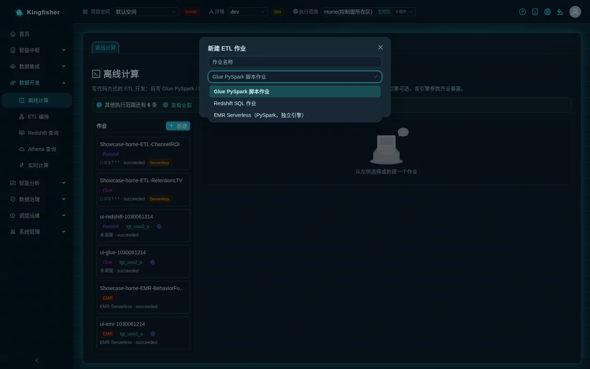

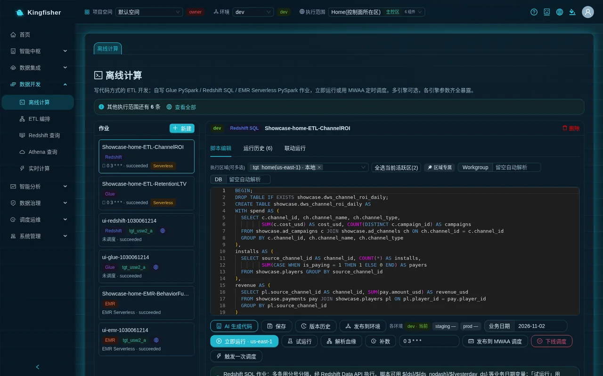

## 5. ETL orchestration

- Page: "Data Development → ETL Orchestration"; details at `/workflow/<workflow>`.
- Key buttons on the list: "New workflow" (name · description · "Execution regions (multi-select)") · row actions "Edit DAG", "Publish", "Trigger", "Take offline", "Delete".
- Key buttons on the details page: "Add node", "Save", "Version history", "Publish to scheduler", "Trigger run"; under "Recurring schedule", enter a cron and click "Apply and publish", or "Take schedule offline" once one is configured; "Downstream dependencies (auto-triggered after this workflow runs successfully)".

### 5.1 Canvas and nodes

The "Add node" dropdown lists the node types: "Data Sync Node", "SQL Node", "Python node", "Branch Node", "Empty Node", "Join Node", "For-each Node", "Assignment Node", "Cross-cycle Dependency Node", "Batch Job Node". Drag one onto the canvas, connect it, and click the node to open the "Node configuration" drawer on the right.

| Node | Settings | Key points |
|---|---|---|
| Data Sync Node | "Linked sync task" dropdown; options look like `task name (source table → target) · execution region` | Candidates are only the tasks bound to this workflow's execution regions; at run time it starts the task's Glue job and **passes no business date** (the task takes today in its own business time zone) |
| Batch Job Node | "Linked batch job" dropdown, grouped into "Batch compute (Glue / Redshift)" and "EMR Serverless", labels `name · engine · bound regions` | Shares the same core and the same run lock as "Run now" on the job page; the job's "Run History" gains a row reading Triggered by workflow "X", which links back to the workflow |
| SQL Node | "Execution engine" (Redshift / Glue Spark SQL) · database · SQL statement | All statements run as **one transaction** |
| Python node | "Python Script" | Restricted execution, pure computation only |
| Common | Node name · retries · timeout (seconds) | Deleting a node also removes the edges connected to it |

### 5.2 Publish and run

- "Save" only stores the canvas; "Publish to scheduler" ships the DAG to the MWAA Serverless **of this workflow's own execution regions**, and success shows "Published to Airflow".
- Pre-publish validation: an empty canvas, an unconfigured node, a Batch Job Node whose job is not bound to the workflow's execution region, or a sync node whose task is not in that region all return 400 naming the node, and nothing is published half-way; "Isolated nodes with no connections" is only a reminder ("Confirm before publishing → Continue publishing") and does not block.
- "Recurring schedule": five-field cron, **UTC**; fill it in and click "Apply and publish", which shows "Schedule applied and published (<cron>); after MWAA loads (~1 min) it runs on schedule".
- "Trigger run" runs once immediately regardless of the cron; with several regions bound it asks which regions to run in.
- The "Run History (N)" tab: Run ID / Status / Trigger mode / Start / Finished / Duration / Error, with row actions "Logs", "Node", "AI Analysis". The "Node" dialog shows status and logs node by node, with back-links "Job run history" and "Sync run history".
- The "Airflow Console" button is available to platform administrators only; Serverless scheduling has no web console anyway, so definitions and runs are viewed on this page and in "Task Monitor".
- "Take offline" = remove the DAG from the scheduler (scheduling stops) while the workflow definition is kept; only "Delete" deletes the definition.

Key points:

- The workflow itself also has "Execution regions (multi-select)"; one publish produces one artifact per region, and the node panel lists only tasks / jobs bound to every one of those regions.
- A workflow whose schedule was changed regenerates its DAG; the same job never runs twice concurrently (job-level run lock).
- "Publish to environment" lives on the details page with the same semantics as for jobs (staging direct, prod with approval).

Related scenario: [Scenario 1 · Step 8](20-scenario-detail-to-daily-report.md).

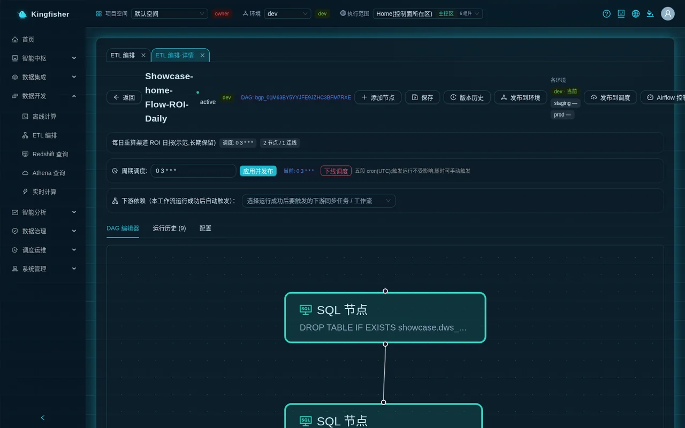

## 6. Scheduling: how many kinds of timer are there?

| Object | Where the timer is set | Where it runs |
|---|---|---|
| Sync task | Wizard step 5, "Enable scheduling" + Cron Expression (shortcuts "Hourly", "Daily at 2 AM", "Every 6 hours") | The scheduler of the data source's region |
| Batch job (Glue / Redshift / EMR) | Enter a cron in the editor → "Publish to MWAA schedule" | One artifact in each region the job is bound to |
| Workflow | "Recurring schedule" on the details page → "Apply and publish" | The scheduler of the workflow's execution regions |

All of them are managed on the "Task Monitor → Schedule config" tab, with the columns Name / Type / Cron Expression / Enabled / Schedule type (Auto schedule / Carrier not published / Manual trigger) / Carrier definition (Up to date / Carrier needs republishing / Not checked) / Status / Recent runs. "Carrier needs republishing" means the published definition no longer matches the current generator; click "Republish".

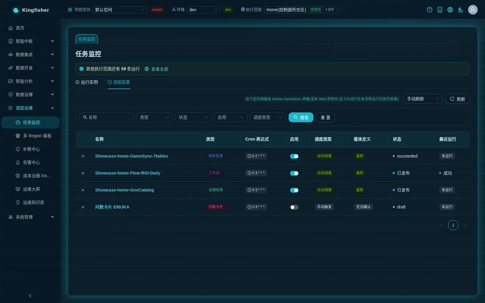

## 7. Backfill center

- Page: "Scheduling & Ops → Backfill Center".
- Key buttons: "New Backfill" → dialog: "Backfill target" (a task or a workflow) · plan name · "Date range" · "Granularity" (Daily / Weekly / Hourly) · "Max concurrency" · "Instance cap" · workflows can enable "Cascade downstream dependencies" → "Preview instances" → "Create".
- Plan list: Plan name / Target / Date range / Cascade / Concurrency / Progress / Status (Planned / Running / Paused / Cancelled / Completed / Partially failed) / "View progress".
- Progress dialog: total / succeeded / failed / running / pending / skipped; "Total rows written", "Succeeded with 0 rows", "Row count not reported"; buttons "Pause", "Resume", "Cancel", "Retry failed", "All runs in Monitor". Click a cell in the matrix to open the instance drawer: date / node / execution target / status / attempts / duration / rows written / error (verbatim) / underlying run, with the buttons "View run log", "Locate in Monitor", "Open task page".

Key points:

- Backfill runs always carry the trigger "Backfill" and are excluded from the online success rate and the SLA baseline.
- A background pump drives the plan forward; it completes even if you close the page.
- A sync task can be backfilled only if it uses the Glue channel, is full-load, and uses a date variable in its filter or table name; incremental tasks and DMS / Zero-ETL are not supported, and the target dropdown marks them "Not backfillable" with the reason.
- A workflow that contains a Data Sync Node has its concurrency fixed at 1; if the linked task does not meet the rule above, that node instance fails honestly (its downstream is skipped when cascading).
- "Succeeded with 0 rows" is highlighted in yellow and the drawer lists likely causes (no data in the date window / WHERE matched nothing / incremental watermark already past).

Related scenario: [Scenario 1 · Step 9](20-scenario-detail-to-daily-report.md).

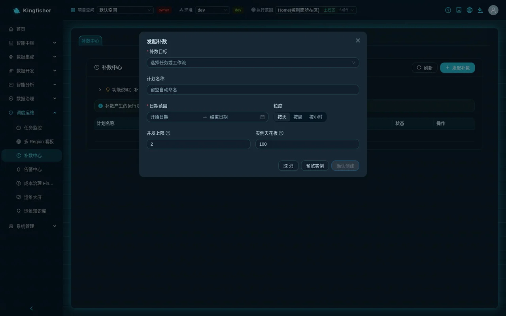

## 8. Task monitor

- Page: "Scheduling & Ops → Task Monitor", with two tabs "Run instances" and "Schedule config".
- Top statistics: Running / Succeeded today / Failed today / Runs today / Success rate / Avg duration; optional auto refresh every 5 / 10 / 30 seconds.
- Filters: task name · status (Success / Failed / Running) · task type (Sync / Workflow / ETL Job (Glue) / ETL Job (Redshift) / EMR Batch / Governance task / Ask-data card) · region · trigger mode (Auto / Manual / Backfill / Dry run / Rerun / Upstream dependency / Copilot) · date range → "Search".
- The list is split into "All runs", "Running", "Failed", "Today"; row actions "Logs", "AI Analysis" / "AI Diagnosis", and "Retry" on failed rows. The "Audit" column looks up the regional audit record of runs in another jurisdiction.
- The morning routine: switch to the "Failed" tab → click "Logs" to read the verbatim error → "AI Diagnosis" for an explanation → fix it, then rerun from the object's own page or click "Retry".

Related scenarios: [Scenario 1 · Step 10](20-scenario-detail-to-daily-report.md), [Scenario 8: operations and alerting](27-scenario-ops-alerting.md).

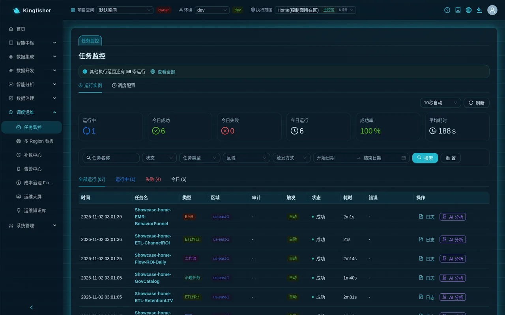

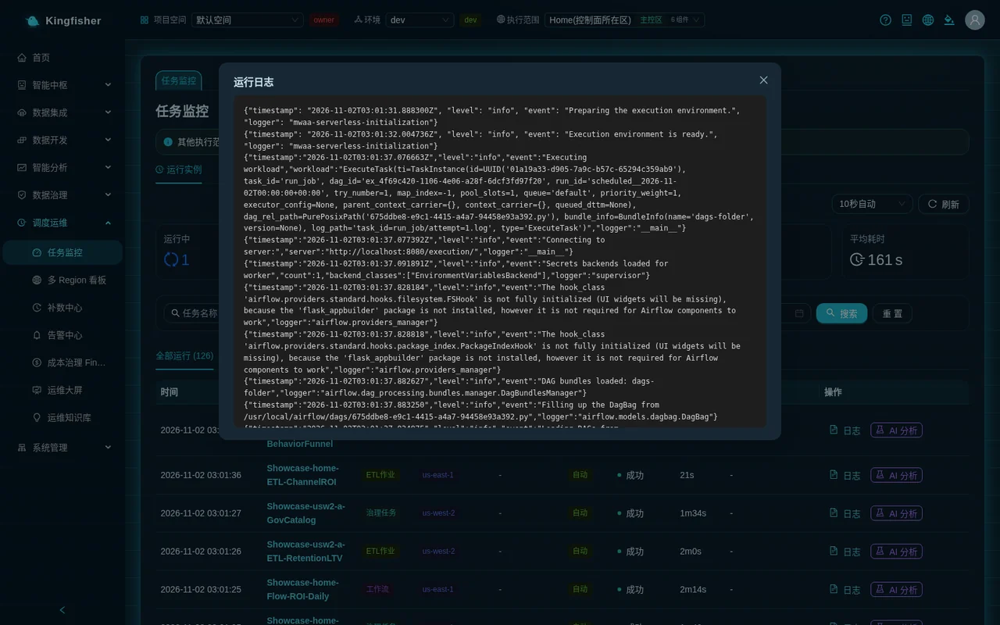

## 9. Redshift query and Athena query

| Page | What it queries | Key buttons | Key points |
|---|---|---|---|
| "Data Development → Redshift Query" | The Redshift Serverless of each execution region | "Execution regions (multi-select)", "Select all active regions (N)", "Load Schema", "Execute" / "Run (N regions)", "Save" as a task | With several regions, one result sheet per region, which you can "Compare" or "Merge into one table"; "Execution history" lets you look back; non-administrators are read-only |
| "Data Development → Athena Query" | The S3 Tables table buckets (Iceberg) of the current execution scope | "Refresh tables" in the table tree on the left · clicking a table name generates `SELECT * … LIMIT 100` · "Execute", "Cancel", "Clear" | Always read-only, results are not stored; three-part names `"s3tablescatalog/<table-bucket>"."<namespace>"."<table>"`; above the results you see scanned / duration / N rows returned |

Details of multi-region direct query are in [Scenario 3: data stays in its region](22-scenario-multi-region-residency.md).

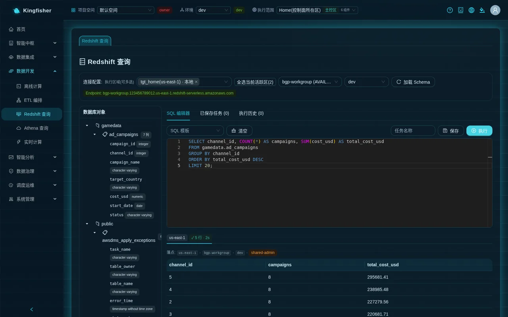

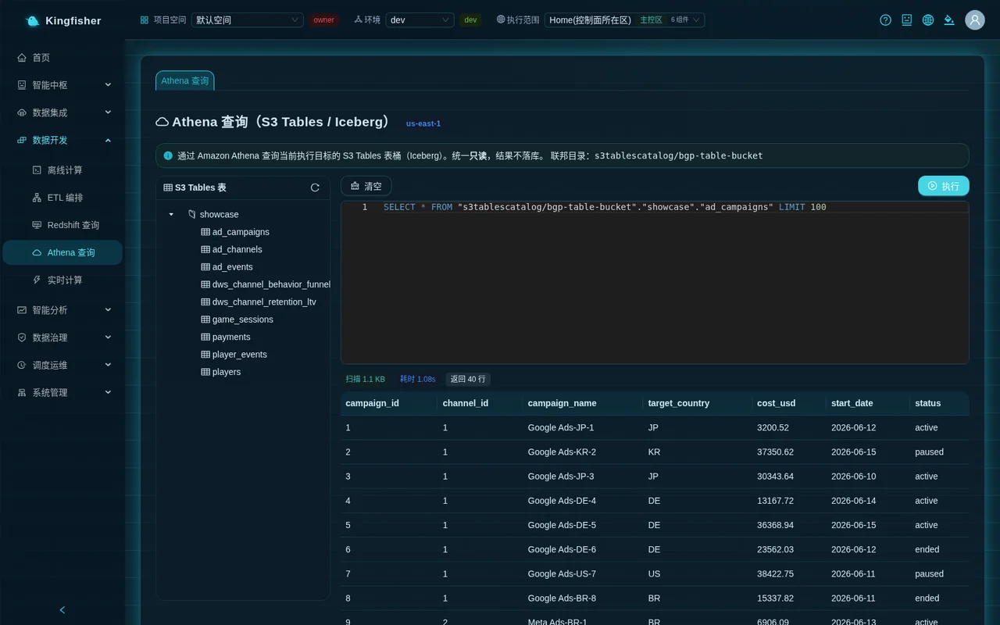

## 10. Three rules for multi-region runs

1. Where an object executes is decided by its own binding (a sync task follows its data source; jobs / workflows use "Execution regions (multi-select)"), not by the top-bar view; a request without a target is rejected with 400 and never falls back to the home region.
2. Source and task must be in the same region: a data source in region A with a sync task bound to region B is permanently rejected (fetching data across regions = data leaving its jurisdiction).
3. Once a new execution region is in place, bind the jobs you need to it and "Publish to MWAA schedule" again; check the "Multi-Region Dashboard" to see whether versions are consistent across regions (red = failed, yellow = versions differ / not published).

## 11. Quick lookup of common rejections

| What you see on the page | Why | Next step |
|---|---|---|
| "Running in background: <label> (n s elapsed)" (bottom right) | The operation exceeded 45 seconds and moved to the background (long-running operation) | Wait for it to finish; the page shows the result automatically; do not click again |
| "'<label>' is in progress (n s elapsed); please wait for it to finish before operating" (409) | Another long-running operation on the same object has not finished (object lease) | Wait for it to finish before editing / deleting |
| "This job still has N unfinished runs: … deletion refused" (409) | The job still had runs in progress when you tried to delete it | Wait for the runs to finish (or stop them first), then delete |
| "This job is still referenced by the Batch Job Nodes of N workflows: … deletion refused" (409) | The job is referenced by a DAG | Remove that node from the workflow canvas first |
| Deleting a data source returns 409 and lists tasks | The source is still referenced by sync / real-time tasks | Delete those tasks or point them elsewhere first |
| Run error `SYNC_REFUSED_CLEAR_FOREIGN_TABLE` | Overwriting a table the platform did not create without confirming each table | Confirm the overwrite under the task's "Edit", or change the target table name / switch to append |
| "Bucket … is not registered … as a route: save / start will be rejected" | Table Bucket was set to an unregistered bucket of your own | Ask an administrator to register it under "Settings → Lake table buckets and routes", or clear the field to use the platform table bucket |
| "Merge requires at least one merge key" | Write mode is merge but no merge key was given | Enter the merge keys under "Merge options" |
| Saving a job returns 400 listing `s3:GetObject` and a bucket name | Your own execution role cannot read the bucket holding the dependency libraries / referenced by the script | Add the permission to the role, click "Refresh" and "Check permissions", then save again; or switch to the platform default role |
| Publishing a workflow returns 400 naming a node | The job / task is not bound to the workflow's execution region | Bind that region under the job's "Execution regions (multi-select)", or pick another job |

All status codes and their meaning are in the [Rules and status code reference](30-reference-rules.md); for troubleshooting by symptom see the [FAQ](32-faq.md).

## 12. Related scenarios

- [Scenario 1: MySQL detail → sync → batch job → orchestration → backfill → monitoring → report](20-scenario-detail-to-daily-report.md)
- [Scenario 2: detail bucket / summary bucket layering (table-bucket routing)](21-scenario-cross-bucket-layering.md)
- [Scenario 3: data stays in its region (multiple execution regions)](22-scenario-multi-region-residency.md)
- [Scenario 4: real-time pipeline (DMS CDC / Flink)](23-scenario-realtime-cdc.md)
- [Scenario 8: operations and alerting](27-scenario-ops-alerting.md)
- Feature tour (one screenshot per page): [Features](../features.md); module mechanics and boundaries: [Modules](../modules.md)
