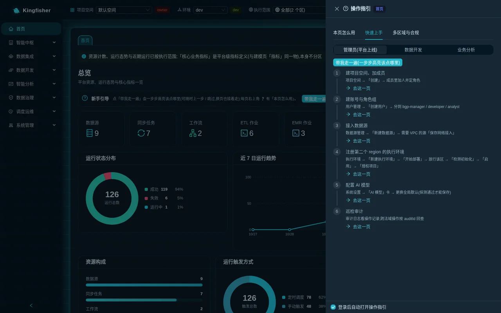
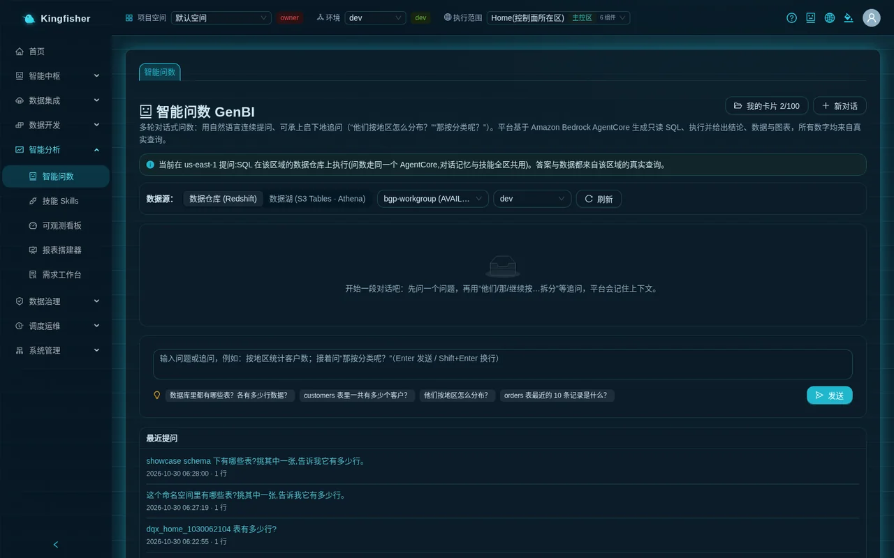
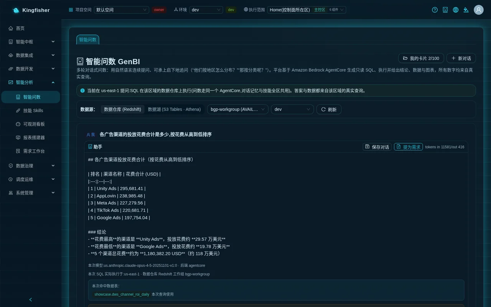
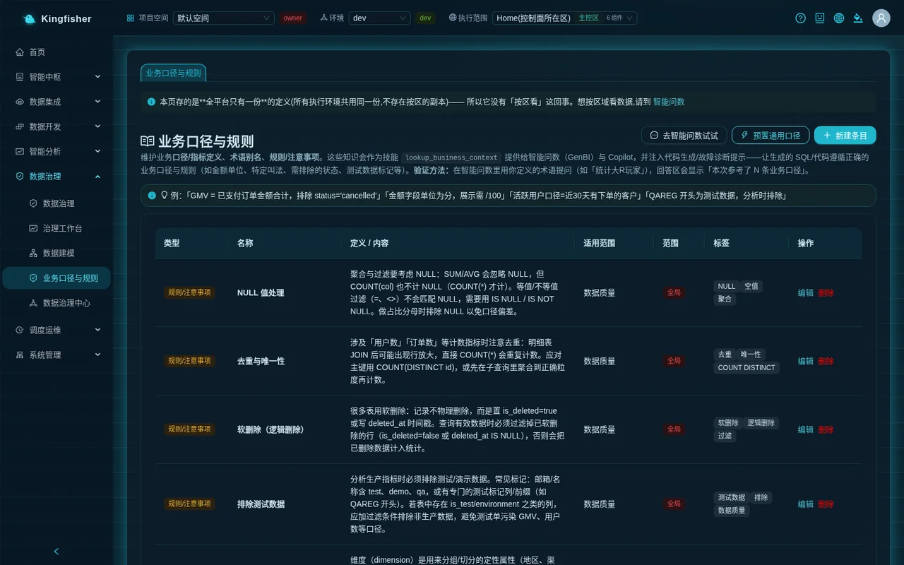
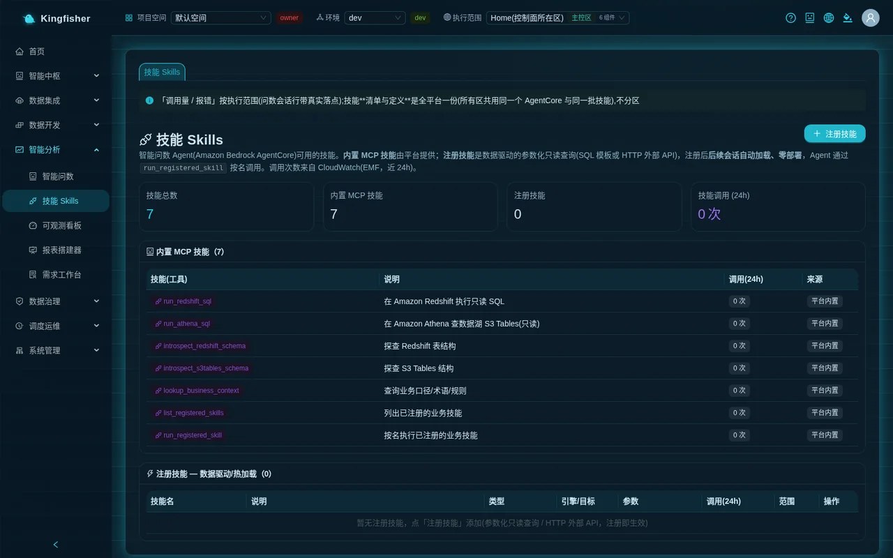
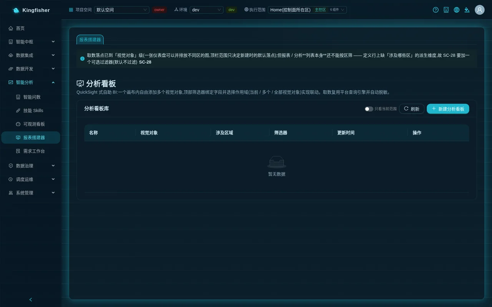
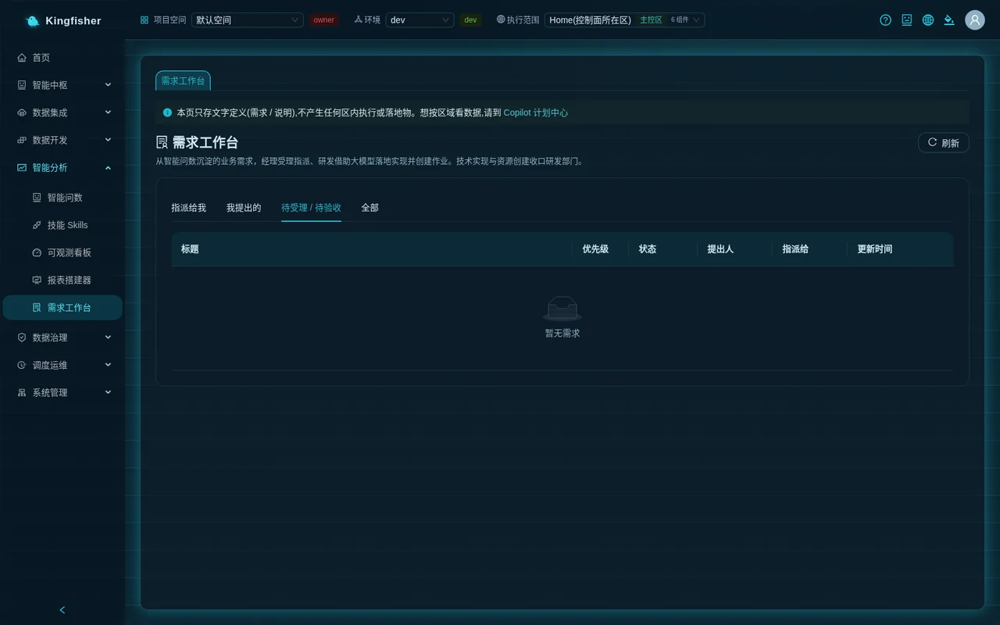
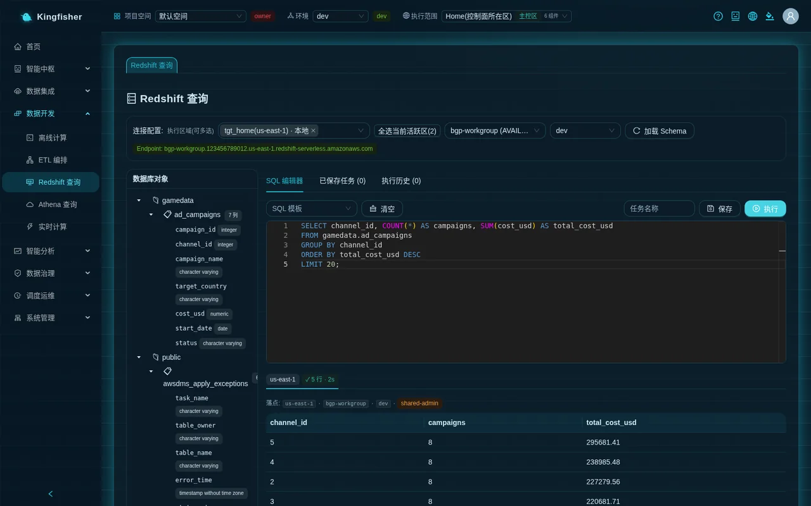
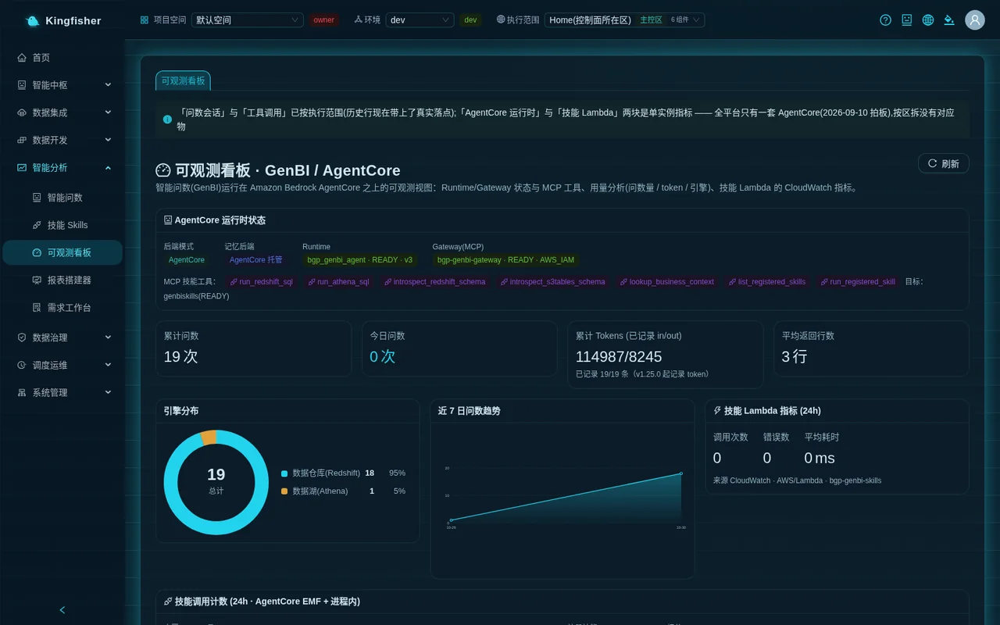

# Data analyst guide — ask questions in natural language, build reports, raise requests

| Item | Content |
|---|---|
| Audience | Business analysts, data product managers, business colleagues who need to pull and look at data themselves |
| Estimated time | 40 minutes to read through; about 1.5 hours to follow along |
| Prerequisites | You have a platform account and have joined at least one workspace; that workspace is authorized to use at least one execution environment; the demo installation has the `Showcase-*` demo objects |
| What you will have afterwards | You can ask questions in "Ask-Your-Data", verify the generated SQL, save cards and refresh them on a schedule; maintain business definitions and register skills; build an analysis dashboard; raise requests and follow them up; and you know the read-only rules of the direct-query pages |

This guide is organized around "what an analyst does in a day / a week". Every section gives: which page to go to · key buttons · key points · the matching scenario document.

---

## 0. First, find out what your account can do

Platform accounts fall into four role groups: `bgp-admin` (platform admin) · `bgp-manager` (manager) · `bgp-developer` (developer) · `bgp-analyst` (operations analyst). Admin / Developer / Viewer are assigned by an admin under "System → Users"; the `bgp-manager` and `bgp-analyst` groups cannot be assigned on the Users page and are added by an admin in the Cognito console.

**An account that belongs only to the `bgp-analyst` group** (no privileged group at all) is what the platform calls an "operations analyst account", with these rules:

- The left menu keeps only the two pages "Smart Analytics → Ask-Your-Data" and "Smart Analytics → Requests"; the other categories are not shown.
- Calling any other feature is rejected by the gateway with the literal message: "Operations analyst accounts may only use Ask-Your-Data and submit requests".
- The "Workspace" switcher in the top bar is usable (read-only).
- Note (measured in the demo environment): for an account that is only in the bgp-analyst group and in no other group, the "Execution scope" dropdown in the top bar offers only "All" (the API that reads the execution-scope list is not opened to this kind of account), while the Ask-Your-Data page must be anchored to an execution environment before you can ask — so such accounts currently cannot ask questions in a multi-region environment. Workaround: have an admin add the account to the bgp-developer group, or ask with an account that holds a developer role in the "Workspace"; this limitation is a known issue slated for a fix.

The "Business Glossary & Rules", "Skills", "Report Builder", "Observability", "Redshift Query" and "Athena Query" pages covered in §2 ~ §7 of this guide require your account to also belong to the `bgp-developer` (or higher) group.
Creating / modifying objects on these pages additionally requires you to be at least `editor` in the current workspace; `viewer` is enough to look without changing. For how admins assign groups and add members to projects, see the [Platform admin guide](10-guide-admin.md).

**Three selectors in the top bar — glance at them every time you enter the site** (details in [Core concepts](02-concepts.md)):

| Selector | Purpose | Effect on analysts |
|---|---|---|
| "Workspace" | Switch the current workspace | Definitions, skills, requests and dashboards are isolated per project; switching projects switches the whole set |
| "Environment" | dev / staging / prod | Affects development objects such as data sources / jobs; asking itself is not filtered by environment |
| "Execution scope" | "All" or one execution environment | The Ask-Your-Data page **must** have one execution environment selected; you are asking about the data in that region's warehouse |

**Finding help**: the ❓ at the top right of every page is the "User guide"; its "How to use this page" tab explains the buttons page by page; in the "Onboarding" row on the home page click "Walk me through" and choose the "Business analysis" path to highlight in turn Ask-Your-Data → Report Builder → Requests → Business Glossary & Rules.

---

## 1. Every day: Ask-Your-Data

- Page: "Smart Analytics → Ask-Your-Data"
- Key buttons: "Send", "View generated SQL", "Save conversation", "My cards", "New chat", "Raise as request"
- Matching scenario: [Scenario 5: Rolling out GenBI to the business team](24-scenario-genbi-rollout.md)

### 1.1 Select the execution scope first

The Ask-Your-Data page **must be anchored to one execution environment**. While the "Execution scope" in the top bar is at "All", the page shows nothing but the hints:

- "Select an execution scope"
- "This page requires an execution environment to be anchored first (pick one under 'Execution scope' in the top bar); N available now"

Select an execution environment in the "Execution scope" dropdown in the top bar (the home region entry carries the "Home region" tag; entries marked "Not accepting work" cannot take new work right now); a blue hint bar then appears on the page:
"Asking in <region>: SQL runs on that region's data warehouse (Ask-Your-Data uses the same AgentCore; conversation memory and skills are shared across regions). Answers and data come from real queries in that region."

Key points:

- Switching the execution scope means switching to another region's data; the "Recent questions" and "My cards" lists are filtered by region accordingly.
- The execution scope is the `?scope=` parameter in the URL; it survives a page refresh, and bookmarking the address with the parameter takes you straight to one region's Ask-Your-Data page.

### 1.2 Choose the data source: warehouse or data lake

"Data source:" at the top of the page has two options:

| Option | Description | Selectors beside it |
|---|---|---|
| "Data Warehouse (Redshift)" | Ask about tables in that region's Redshift Serverless | Workgroup (default "Resolved automatically by execution target") · Database (default `dev`) · "Refresh" |
| "Data Lake (S3 Tables · Athena)" | Ask about Iceberg tables in that region's S3 Tables table bucket | "Federated catalog <catalog name> (Iceberg)" tag · "Namespace:" dropdown · "Refresh" |

Key points:

- Both dropdowns are reloaded automatically with the execution scope and list **that region's** workgroups / databases / namespaces; re-check them after switching regions.
- On the demo installation, the `Showcase-*` sync task wrote the 7 game tables into both the `showcase` schema of the warehouse and the `showcase` namespace of the data lake; both options can reach them.
- Under the data lake option, results go through classification masking as well: the results of both options pass through the same masking entry point (the strongest policy over the result columns and the resolved physical columns), provided that the lake table carries a classification in the governance catalog; tables without a classification are not masked.

### 1.3 Ask

1. Write your question in plain language in the input box. The placeholder reads: "Ask a question or follow up, e.g. count customers by region; then ask 'What about by category?' (Enter to send / Shift+Enter for newline)".
2. Press Enter or click "Send". An empty question gives the hint "Enter a question".
3. While waiting it shows "Thinking, generating, and running SQL..."; after 3 seconds it starts showing "Ns elapsed".
4. Below the input box there are a few example-question tags; clicking one asks it directly (the example wording uses generic retail definitions; for the demo game data use your own questions instead).

**When the model is slow**: asking has an upper limit of 300 seconds (5 minutes). The server runs in the background and the page polls, so you can keep asking the next question meanwhile. On timeout that turn shows:
"The query was automatically terminated after 5 minutes. Please narrow the scope or split the question and try again."

**Follow-up questions**: within the same conversation you can follow up with phrases like "them / that / continue, broken down by …"; the platform remembers the context. To change topic click "New chat" at the top right; the hint "New conversation started" appears.

### 1.4 Reading an answer

Each turn's answer is an "Assistant" card, from top to bottom:

| Block | What to look at | Key points |
|---|---|---|
| Conclusion | A natural-language conclusion | All numbers come from real queries, not made up by the model |
| "Model used: <model id> · Backend <backend>" | The model actually used in this turn | If an admin switched the global model you see it here immediately; "degraded to fallback" means a candidate model was used |
| "This SQL actually ran in: <region>" | Which region the SQL really ran in | If it differs from the current view a red warning appears: "This SQL actually ran in <A>, not the current view <B> — this answer is NOT that region's data" |
| Masking note | "Some sensitive fields are masked per data classification: <columns> (for plaintext, use 'Request Access' in Data Governance)" | Classification lives on the physical column; aliased and expression columns are masked all the same; see §1.9 |
| "Matched tables:" | The tables retrieved this turn and why | Those tagged "Finalized" are tables consolidated through request delivery and are preferred |
| "Applied N business definition(s) (results follow these definitions):" | The definition entries that were referenced | Not shown = your definition was not referenced; go back to §2 and check the wording |
| Data area | A single value shows as a large metric; multiple rows show as a table or chart | "Display mode:" can switch between "Auto", "Table", "Bar chart", "Line chart"; tables paginate and show "N rows" |
| "View generated SQL" | The collapsed SQL text | Expand and check the definitions every time before deciding whether to save |
| "Execution path (N steps)" | Each step's tool, phase (prepare / reason), success / failure, duration, inputs, result | Look here to investigate "why this table was chosen" or "why it was slow" |

### 1.5 "Recent questions"

"Recent questions" at the bottom of the page lists the past questions in the current execution scope (time · N rows). Click the question text to ask the original question again. With no records it shows "No history".

### 1.6 "Save conversation": collect a whole conversation into a card

"Save conversation" and "Raise as request" sit side by side at the top right of every assistant card; saving stores the **whole conversation** (all turns), raising a request takes **this turn**.

1. Click "Save conversation" on any turn; the "Save conversation as card" dialog opens.
2. Fill in "Title" (required, at most 80 characters, defaulting to the first 40 characters of the first question).
3. The dialog explains: "Will save: all N turns of this conversation (question / conclusion / SQL / data / chart / matched tables / definitions / masked columns / reasoning)."
4. Note the blue hint: "The conversation body and title are stored only in <region> (execution environment <id>) and never leave that region." — the card content stays in that region under the data residency rules.
5. Click "Save". On success the toast "Saved as card" appears; saving the same conversation again gives "Card updated" and does not use more quota.

Key points:

- Each person has at most 100 cards platform-wide; the dialog and the "My cards u/l" button both show "Used u/l". When the quota is full, saving is rejected; the platform does **not** evict old cards automatically — delete some first.
- Platform admins see plaintext; cards saved by non-admins are re-masked according to the classification **at the time of opening**.

### 1.7 The "My cards" drawer: continue, refresh, schedule, history, delete

Click "My cards u/l" at the top right to open the drawer; one row per card, with five actions at the end of the row:

| Action | What it does | Key points |
|---|---|---|
| "Open and continue" | Lays the whole conversation back onto the page and restores the context | Success toast "Conversation context restored (N turns); you can keep asking" |
| "Refresh now" | Re-runs the SQL stored in the card in the card's region, without calling the LLM | Toast "Refreshed: N rows (same card; a run snapshot was kept)"; does not use quota |
| "Scheduled refresh" | Dialog "Schedule refresh for this card": enter a cron (default 08:00 daily) and toggle "Enable scheduled refresh" | The carrier is published to the scheduler of the card's region; a green "Schedule <cron>" tag appears on the row; "Carrier not published" means it has not been published yet |
| "History" | Dialog "Refresh history": start time / trigger mode (Auto · Manual) / status / rows / error | Both manual and scheduled refreshes are here |
| "Delete" | Confirm "Delete this card?" | The body is cleaned up from its region as well, and the quota is released immediately |

The top of the drawer also has:

- "Search titles".
- "N in the current execution scope; you have M more in other scopes" + "Show all scopes (M)"; once expanded, the hint "Showing all N of your cards (across all execution scopes); the execution scope in the top bar has not changed" appears, and you can click "Current scope only" to collapse.
- "The titles of N cards cannot be read right now (titles and bodies live in their own regions) — the cards themselves still exist; retry or open them directly".

**Opening a card that belongs to another region** shows a two-way dialog "This card belongs to <id> (<region>)":

- "View read-only": the conversation is laid out but the input box is disabled, with the hint "Read-only: this card belongs to …; switch the execution scope there to continue the conversation.", and "Switch region and continue" beside it.
- "Switch to <region> and continue the conversation": the execution scope in the top bar switches only when you click it; the platform never switches silently.
- When that region cannot take work right now, only "View read-only" is offered, with the reason and a "Go to Execution Environments to resolve" entry.

### 1.8 "Raise as request"

Click "Raise as request" on one turn's answer; the "Raise as request" dialog opens:

- "Request Title" (required, defaulting to the first 80 characters of the question) · "Priority" (P0 Urgent / P1 High / P2 Medium / P3 Low, default P2) · "Request Description" · "Business value" · "Acceptance Criteria".
- At the bottom of the dialog, "Insight sources submitted with the request (read-only snapshot):" attaches the question and SQL.
- Click "Submit request"; the toast "Submitted as a request; the dev manager will pick it up" appears. Then follow it up in "Requests" (§5).

### 1.9 Classification masking: what the `***` you see means

- After a platform admin sets a sensitivity level and masking policy on a column under "Data Governance → Data Classification", that column is transformed in the ask results of unauthorized users according to the policy: "Full mask (***)", "Partial (keep first & last)", "Email (j***@x.com)", "Hash (sha256)".
- Classification lives on the **physical column**. Aliased columns such as `device_id AS device` and expression columns such as `upper(email)` in the SQL are resolved back to the physical column by the platform and masked all the same.
- To see plaintext: under "Data Governance → Data Classification" select the table and click "Request access to this table"; a platform admin (or a dev manager who is also the owner of that project) clicks "Approve" under "Workspace → Pending my approval"; once approved, the table appears in the "My data access grants (N)" card and is no longer masked when you ask again.
- Platform admins (`bgp-admin`) themselves are not masked; to demonstrate masking use a non-admin account.

---

## 2. Weekly maintenance: business definitions and rules

- Page: "Data Governance → Business Glossary & Rules"
- Key buttons: "New entry", "Edit", "Delete", "Try in Ask-Your-Data"; admins also have "Load common definitions"
- Matching scenario: [Scenario 5 §3](24-scenario-genbi-rollout.md)

The knowledge maintained on this page is provided to Ask-Your-Data and Copilot as the skill `lookup_business_context`, so that the generated SQL follows the correct definitions. One copy platform-wide, not per region; isolated per project, and admins can create "Global" entries.

**Create an entry**: click "New entry"; the "New business definition / term / rule" dialog opens:

| Field | What to enter | Example |
|---|---|---|
| "Type" | Definition / metric definition · Term / Alias · Rules/Notes | Definition / metric definition |
| "Name" | A short name; you will use it when asking | ROAS |
| "Definition / content" | One executable definition: what is computed, from which table and column, what is excluded | ROAS = total attributed player payment amount ÷ total channel ad spend |
| "Scope (optional)" | Table name / engine / subject | ad-spend analysis under showcase |
| "Tags (optional, comma-separated)" | For filtering | ads,definition |
| "Set as global item (visible in all workspaces; platform admins only)" | When checked, visible to all projects | Only admins see this item |

Click "Save"; the toast "Added" appears. List columns: Type · Name · Definition / content · Scope · Range ("Global" / "This project") · Tags · Actions.

Key points:

- The wording decides the hit rate: the name must match how you phrase it when asking; the content should name the table, the columns and the exclusion conditions. Page examples: "GMV = total paid order amount, excluding status='cancelled'", "rows starting with QAREG are test data, exclude from analysis".
- How to verify: ask in Ask-Your-Data with the term you defined; if "Applied N business definition(s)" appears in the answer area, it was referenced.
- Permissions: creating / editing requires project `editor`; "Global" entries can only be created and edited by platform admins.
- When an admin clicks "Load common definitions", a set of common examples is filled in with one click, with the toast "Common definitions loaded (N added, M updated)".

---

## 3. Extend on demand: Skills

- Page: "Smart Analytics → Skills"
- Key buttons: "Register skill", "Delete"
- Matching scenario: [Scenario 5 §4](24-scenario-genbi-rollout.md)

Skills are tools the GenBI agent can call. Four statistics cards at the top of the page: "Total skills", "Built-in MCP skills", "Register skill", "Skill invocations (24h)". Below them, two tables:

- "Built-in MCP skills (N)": provided by the platform, with columns "Skill (tool)", "Description", "Calls (24h)", "Source".
- "Registered skills — data-driven / hot-reload (N)": the ones you registered, with columns "Skill name", "Description", "Type" (SQL template / HTTP API), "Engine / Target", "Parameters", "Calls (24h)", "Range", "Actions".

**Register a SQL template skill**: click "Register skill"; the "Register a business skill" dialog opens:

| Field | What to enter |
|---|---|
| "Skill type" | "SQL template (read-only SELECT / WITH)"; "HTTP External API (platform admins only)" is disabled for non-admins |
| "Skill name (English/underscores)" | Starts with a letter, 2–49 characters, e.g. `top_channels_by_roas` |
| "Purpose (shown to the model)" | The model decides when to call the skill from this sentence; state the inputs and outputs clearly |
| "Engine" | "Data Warehouse (Redshift)" or "Data Lake (Athena / S3 Tables)" |
| "Read-only SQL template (use {{param}} placeholders)" | A single SELECT / WITH; parameters as double-brace placeholders |
| "Parameter declaration (one per line: name:type:description; type=string\|number\|identifier)" | e.g. `topn:number:return the top N channels` |
| "Set as global skill (available in all workspaces; platform admins only)" | Visible to admins |

Click "Register"; the toast "Skill registered (auto-available in future Ask-Your-Data sessions)" appears. Registration takes effect immediately with no deployment; the agent calls it by name through `run_registered_skill`.

Key points:

- Call counts come from CloudWatch over the last 24 hours; "calls / errors" are filtered by execution scope, while the skill **list and definitions** are one copy platform-wide, not per region.
- SQL templates pass a read-only guard; HTTP skills pass an SSRF guard (https only, domain allowlist, private addresses rejected), and only platform admins can register them.
- Delete: "Delete" at the end of the row, confirm "Delete this skill?".

---

## 4. One chart a week: Report Builder

- Page: "Smart Analytics → Report Builder" (page title "Analysis")
- Key buttons: "New analysis", "Add visual", "Add filter", "Apply filters", "Save"
- Matching scenarios: [Scenario 1 wrap-up](20-scenario-detail-to-daily-report.md) · [Scenario 7](26-scenario-modeling-metrics-report.md)

### 4.1 Dashboard library

"Analyses" lists the dashboards of the current project: Name · Visual (count) · Regions involved · Filters (count) · Updated At · Actions ("Open", "Delete").
The "Current scope only" switch at the top right is off by default — switching the execution scope in the top bar does not hide dashboards of other regions; when on, only dashboards involving the current scope are shown.

### 4.2 Create a dashboard and visuals

1. Click "New analysis" to enter the canvas. At the top: "Back to list" · the "Analysis name" input · "Add visual" · "Save".
2. Click "Add visual"; the "Add visual" dialog opens: first fill in "Visual name" (e.g. "ROAS by channel"), then choose how to get the data:

| Data method | How | Key points |
|---|---|---|
| "Visual builder" | Choose "Warehouse (Redshift)" / "Data lake (Athena)" → "Select a table (no SQL needed)" → drag fields into "X axis / dimension", "Group / color", "Value / measure", "Filters" → choose a chart type → "Preview" | Chart types: bar / line / pie / table / metric card / gauge; stacking, horizontal, sorting and limit can be set |
| "Free SQL" | Choose the engine → write SQL → "Preview data" → choose "Chart type" (table / bar chart / horizontal bar / line chart / pie chart / metric card) | The SQL must be SELECT / WITH, otherwise the hint "SQL must be a read-only SELECT / WITH query" appears |
| "Import from reports" | "Select a report" | After import it becomes an independent visual on the canvas (the data configuration is copied and decoupled from the original report) |

3. Click "OK". Each visual on the canvas has "Edit", "Refresh", "Export CSV", "Remove" at its top right.
4. Fill in "Analysis name" and click "Save". An empty name gives "Please enter an analysis name"; no visuals gives "Please add at least one visual".

### 4.3 Linked filters

The "Filters" area at the top of the canvas: click "Add filter" → "Bind field" (add a visual and fetch its data first and the fields appear automatically; you can also type one directly) → "Label" → "Type" (Dropdown / Date) → for the dropdown type fill in "Options (comma-separated, whitelist)" → "Default value" → "Scope (which visuals are linked)" (All visuals / Specific visuals).
After changing a filter value click "Apply filters". Filters inject the field value into the visuals within their scope without changing the SQL.

Key points:

- Data retrieval reuses the platform query engine and is **automatically masked**, with the same classification rules as Ask-Your-Data.
- Every visual carries its own target: the execution scope in the top bar only decides the default target when creating; one dashboard can place charts from different regions side by side.
- The legacy "data service" data source has been retired; affected cards show "Data service retired" — rebuild them with one of the three data methods above.

---

## 5. Following up requests: Requests

- Page: "Smart Analytics → Requests"
- Key buttons: "Refresh", and "Comment" plus the status actions in the detail drawer
- Matching scenario: [Scenario 5 §8](24-scenario-genbi-rollout.md)

**Where requests come from**: an analyst clicks "Raise as request" on one turn of an Ask-Your-Data answer (§1.8).
The Requests page itself has no "New request" button; new requests can only enter through "Raise as request" in Ask-Your-Data.

**Tabs** (shown according to your role):

| Tab | Who sees it | Content |
|---|---|---|
| "Submitted by me" | Everyone | Requests you submitted |
| "Assign to me" | Developers | Requests assigned to you to implement |
| "Pending pickup / Pending acceptance" | Managers / admins | Requests waiting for pickup or acceptance |
| "All" | Managers / admins | All requests of the current project |

List columns: Title · Priority · Status · Requested by · Assign to · Updated At. The statuses, in order: Draft → Pending intake → Assigned → In Development → Pending acceptance → Delivered; plus Rejected / Cancelled.

**Detail drawer** (click the title):

- "Actions": depending on the current status and your role, "Submit", "Assign developer", "Reject", "Start development", "Submit Delivery", "Return for revision", "Accepted", "Cancel", "Reopen" and so on appear; reject / return / cancel / reopen ask you to fill in "Note / reason (optional)".
- "Basic info": priority, requester, assignee, description, business value, acceptance criteria.
- "Source insights (Ask-Your-Data)": the original question and SQL snapshot.
- "Development implementation (<engine>)" (e.g. "Development implementation (Redshift SQL)"): the code and explanation the developer generated with "Generate implementation with LLM"; once the job is built it shows "Job created →".
- "Activity timeline": every action, status change and comment; at the bottom the input box "Add comment...", then click "Comment".

An analyst's daily routine is simply: raise the request → watch the status under "Submitted by me" → add definitions via comments → check the result when the status reaches "Pending acceptance" → the manager marks it "Accepted". Generating the implementation and building the job are the developer's work.

---

## 6. Occasionally writing SQL yourself: Redshift Query / Athena Query (read-only)

Both pages are in the "Data Development" group and need the `bgp-developer` or higher role. **Non-platform-admins are always read-only**.

### 6.1 Redshift Query

- Page: "Data Development → Redshift Query"
- Steps: pick regions in "Execution regions (multi-select)" (or "Select all active regions (N)") → optionally click "Load Schema" to browse "Database object" → write SQL in the "SQL Editor" (optionally from "SQL Template") → "Execute"; with several regions the button reads "Run (N regions)" and the results have one sheet per region.
- Read-only rule: a non-SELECT / WITH statement submitted by a non-platform-admin is rejected with the literal message:
  "Warehouse direct query for non-platform-admins only allows read-only queries (a single SELECT / WITH): <reason>. For write operations / DDL contact a platform admin, or submit through job development".
  The CREATE TABLE AS / MERGE / UNLOAD entries in "SQL Template" can only be run by admins.
- Masked columns in the result are shown in the sheet header as "Masked columns: <column>".
- "Saved N tasks": fill in "Task name" and click "Save" to store the SQL as a task; "Execution history (N)" lets you look back and "Load".
- The first query against a region in another jurisdiction pops up the disclaimer (once per person per region); the "Audit #" in the sheet header is the regional audit record id of that query.

### 6.2 Athena Query (data-lake query)

- Page: "Data Development → Athena Query", page title "Athena Query (S3 Tables / Iceberg)".
- Hint bar: "Query the current execution target's S3 Tables table bucket (Iceberg) via Amazon Athena. Strictly read-only, results are not persisted. Federated catalog: <catalog>".
- The "S3 Tables Table" list on the left is grouped by namespace, with "Refresh tables" at the top right; clicking a table name brings up a query. Write SQL and click "Execute"; while running you can "Cancel".
- Above the result it shows "Scanned <size>", "Duration <seconds>", "N rows returned"; the result table paginates and shows "N rows".
- Only a single read-only statement is allowed (SELECT / WITH / SHOW / DESCRIBE / EXPLAIN); the platform limits the number of returned rows to prevent full-table scans.
- Your own table buckets registered as routes appear in the table tree on the left (the platform bucket first, then external buckets in registration order); the tree takes the route table of the execution environment the execution scope resolves to. You can also skip the tree and query directly with the three-part name `<alias>.<namespace>.<table>`.

---

## 7. Checking GenBI health: Observability

- Page: "Smart Analytics → Observability", title "Observability dashboard · GenBI / AgentCore", "Refresh" at the top right
- Matching scenario: [Scenario 5 §9](24-scenario-genbi-rollout.md)

| Block | Content |
|---|---|
| "AgentCore Runtime Status" | Backend mode (AgentCore / in-process) · memory backend · Runtime · Gateway · the "MCP Skill Tools:" list |
| Four statistics cards | "Total queries", "Queries today", "Total Tokens (in/out recorded)", "Avg rows returned" |
| "Engine distribution" · "Last 7 Days Ask Trend" | Warehouse / data lake share; number of asks per day |
| "Skill Lambda metrics (24h)" | "Calls", "Errors", "Avg duration" (ms) |
| "Skill invocation count (24h · AgentCore EMF + in-process)" | Two tables, "Built-in MCP tools" and "Registered skills (run_registered_skill breakdown)": tool / skill · calls · errors |
| "Recent asks" | Question · engine · backend · rows · tokens (in/out) · time |

Key points:

- "Ask sessions" and "Tool calls" are filtered by the execution scope in the top bar; "AgentCore runtime" and "Skill Lambda" are platform-wide single-instance metrics, not per region.
- With no data it shows "No observability data"; go to Ask-Your-Data and ask a few questions first.

---

## 8. Weekly checklist

| Frequency | Page | Key buttons | Key points |
|---|---|---|---|
| Daily | Ask-Your-Data | "Send", "View generated SQL", "Save conversation" | Select the execution scope first; verify the SQL behind every conclusion |
| Daily | My cards | "Open and continue", "Refresh now" | Turn recurring reports into cards with "Scheduled refresh" |
| Weekly | Business Glossary & Rules | "New entry" | Write the definition of a new metric before asking about it |
| Weekly | Report Builder | "New analysis", "Add filter" | Several charts on one dashboard, linked by filters |
| Weekly | Requests | "Comment" | Follow up "Submitted by me"; verify the numbers at "Pending acceptance" |
| As needed | Skills | "Register skill" | Turn repeatedly asked parameterized queries into skills |
| As needed | Observability | "Refresh" | Check hits, errors and latency |

---

## 9. FAQ

| Symptom | Cause | Next step |
|---|---|---|
| Clicking a menu reports "Operations analyst accounts may only use Ask-Your-Data and submit requests" | The account is only in the `bgp-analyst` group | For more features ask an admin to add the account to `bgp-developer` or another group (the Users page can only assign Admin / Developer / Viewer; other groups are added in the Cognito console) |
| The Ask-Your-Data page shows only "Select an execution scope" | The "Execution scope" in the top bar is at "All" | Select an execution environment in the top bar |
| "The query was automatically terminated after 5 minutes. Please narrow the scope or split the question and try again." | The question is too big or the model responds slowly | Narrow the time range, name a specific table, or split into two questions |
| The result contains `***` / `sha256:…` with the note "Some sensitive fields are masked per data classification: …" | The column is classified and you are not authorized | Under "Data Governance → Data Classification" click "Request access to this table"; ask again after approval |
| Red text "This SQL actually ran in <A>, not the current view <B>" | The target reported by the execution layer differs from the view | Do not trust this answer; switch the execution scope and ask again, and report it to an admin |
| "Save conversation" is rejected and shows Used 100/100 | Card quota is full; the platform does not evict automatically | Delete unused cards in "My cards" |
| Opening a card shows "This card's content is no longer in <region> — you can delete it to free up quota" | The region holding the body has been cleaned up or retired | Delete this card |
| "Applied N business definition(s)" does not appear | The definition name does not match how you asked, or the entry belongs to another project | Rename / make the content name the table and columns; check the workspace in the top bar |
| Redshift Query reports "Warehouse direct query for non-platform-admins only allows read-only queries…" | You are not a platform admin and the statement contains a write operation | Change it to SELECT / WITH; leave write operations to jobs or an admin |
| A report card shows "Data service retired" | The legacy data source has been stopped | Rebuild that visual with "Visual builder" or "Free SQL" |

---

## 10. Further reading

- [Quick start](01-quick-start.md) · [Core concepts](02-concepts.md)
- [Scenario 5: Rolling out GenBI to the business team](24-scenario-genbi-rollout.md)
- [Scenario 6: Governance loop (classification / masking / access requests)](25-scenario-governance-loop.md)
- [Rules and status code reference](30-reference-rules.md) · [FAQ](32-faq.md) · [Glossary](33-glossary.md)
- Feature tour: [../features.md](../features.md) §5 Smart Analytics, §4.3–4.4 direct query, §6.4 Business Glossary and Rules
- Mechanism details: [GenBI session cards design](../design/genbi-session-cards.md) · [Classification and masking design](../design/classification-masking.md)
