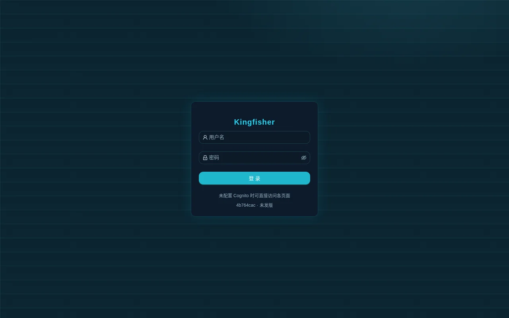
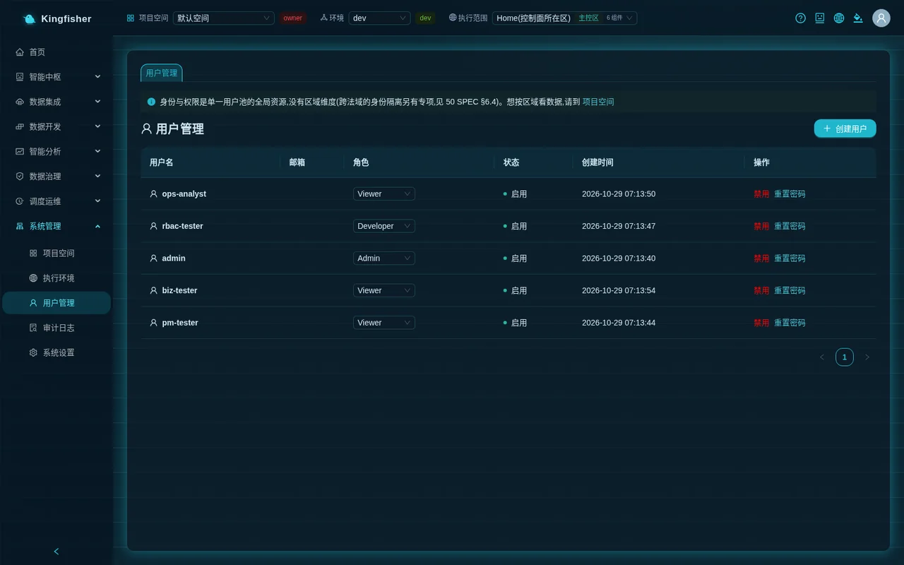
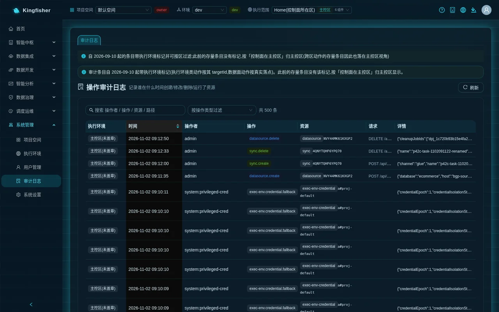

# Identity management

| Item | Content |
|---|---|
| Audience | Platform administrators (creating accounts, assigning roles, handling passwords); any user who wants to understand "why can't I see / do this" |
| Estimated time | 20 minutes to read; about 15 minutes to create a batch of accounts and add them to a project |
| Prerequisites | You can sign in as `admin` or another bgp-admin account; at least one workspace exists |
| What you will have at the end | A clear picture of the two permission layers, platform role groups and project roles; you can create accounts, change roles, disable / enable, reset passwords; you know what to do when the only administrator forgets the password; you can switch the UI language |

## 0. One page to understand it: permissions have two layers

| Layer | Where it is defined | What it decides |
|---|---|---|
| Platform role group | "System → Users", mapped to the groups bgp-admin / bgp-manager / bgp-developer / bgp-analyst in the Cognito user pool | Which pages you can enter, whether you can manage users / execution environments / models, whether you can create workspaces and manage configuration |
| Project role | The member list of each project under "System → Workspace", roles owner / editor / viewer | Whether you can view, edit or only read in that project; GenBI, saving cards and Athena queries are all checked against membership |
| Environment | Top-bar "Environment": dev / staging / prod | Resources are isolated by project + environment; publishing to prod requires approval |

- Resources belong to projects: non-members cannot see them; there is no implicit membership.
- Every `/api/*` request must carry the sign-in token issued by Cognito, and the server checks each one; an expired token returns 401 "Not authenticated or the session has expired; sign in again".
- Every write is audited; identity actions (password reset, project member changes, execution environment authorization) can also be looked up in the "Audit Log".

## 1. Sign-in and passwords

- On the sign-in page fill in "Username" "Password" and click "Sign in"; either the username or the email works as the login name. The platform **has no self-registration**; accounts can only be created by an administrator.
- Password policy: at least 12 characters, with upper-case, lower-case, digits and symbols. Both "Change password" and "Reset password" on the pages pre-check against the same policy; the Cognito server side has the final say.
- Change your own password: avatar at top right → "Change password", fill in "Current password" "New password" "Confirm new password", click "Change"; success shows "Password changed. Use the new password next time you sign in".
- The `admin` account must change its password immediately on first sign-in, then destroy the password file and deployment logs on the deployment machine (see [Deployment](06-deployment.md) §4).
- The sign-in page footer shows the current release tag; the hint "Pages are directly accessible when Cognito is not configured" only appears in the local development form; in production, when authentication is not configured, the platform refuses service outright.

## 2. Platform role groups

### 2.1 The three tiers assignable on the page

The "Create user" dialog and the in-row "Role" dropdown under "System → Users" offer only three tiers; what they can actually do is decided by the server.

| Page "Role" | Cognito group written | What it can do |
|---|---|---|
| Admin | bgp-admin | Platform-wide superuser: user management, every execution environment action, changing the AI model, saving masking rules, Multi-Region Dashboard landings, approving execution environment deletions, configuration management of any project |
| Developer | bgp-developer | All business pages; develops resources in projects as owner / editor / viewer; **cannot** create workspaces, and cannot manage members even as project owner |
| Viewer | bgp-viewer | A business account in no privileged group: can sign in and open every business page; what it can actually view or change is decided by the project role (usually viewer); not subject to the operations-analyst allow-list. The group is created automatically by the Users page the first time it is needed; no server-side check reads it |

- The admin APIs `/api/admin/*` (listing users, creating accounts, changing roles, disabling, execution environment management, model configuration) require bgp-admin at the gateway and check again inside the route; the other two tiers see a red explanation when they open "Users" ("This action requires platform-administrator (bgp-admin group) permission; please contact a platform administrator"), the list is not loaded, and every action is refused by the server with 403.
- The "Role" column of the list is derived from the groups: bgp-admin shows Admin, bgp-developer shows Developer, everything else shows Viewer.

### 2.2 The other two role groups: R&D manager and operations analyst

The platform also defines two more role groups; the server checks permissions against them, but the Users page **has no** way to assign them.

| Role group | What it can do | How to assign |
|---|---|---|
| bgp-manager (R&D manager) | Creates workspaces; manages configuration in projects where it is owner (rename / delete project / add, change, remove members / approval decisions) and sees that project's approvals; triages, assigns and accepts requests; otherwise per project role | The customer's account administrator adds the user to the group in the Cognito user pool console (the "Role" dropdown on the Users page offers only Admin / Developer / Viewer; changing the role on the page only touches those three groups and never removes bgp-manager / bgp-analyst) |
| bgp-analyst (operations analyst) | The menu shrinks to "Ask-Your-Data" "Requests"; every other API returns 403 "Operations-analyst accounts may only use Ask-Your-Data and submit requests" | As above |

- Only "in bgp-analyst and in none of the other three groups" is treated as an operations analyst; someone in both bgp-analyst and bgp-developer is treated as a developer.
- A platform administrator does not implicitly hold the R&D manager group, but both project configuration checks let administrators through explicitly.
- After a group change in the console, the user must sign in again to receive a new token; the "Role" column of the list still shows these two kinds of account as Viewer.
- demo mode ships with one test account for each of these two groups (passwords on the deployment machine); production mode has only `admin`.

## 3. Workspace roles

| Project role | What it can do | Typical holder |
|---|---|---|
| viewer | Views resources in the project; GenBI and Athena queries read-only | Business analysts, auditors |
| editor | Creates / changes / runs data sources, sync tasks, jobs, workflows and so on in the project | Data engineers |
| owner | All of editor's development permissions; configuration management (rename / delete project / add, change, remove members / approval decisions) additionally requires the platform administrator or R&D manager identity | Project lead |

- Who can create workspaces: platform administrators or R&D managers; developers see "Workspaces are created by admins / R&D managers; contact them if you need a new one".
- The configuration-management check is written in one place: platform administrator, or "R&D manager AND owner of this project". When a plain developer is made owner, the page shows "You are the owner of this project (developer permissions). Member management / rename / delete require a platform admin or R&D manager — you can still develop this project's sync tasks / jobs / workflows as usual."
- The default project "Default Workspace" starts **without any members**: until a non-administrator is added to the project, GenBI returns 403 "No access to this workspace". Its description on the page says "any logged-in user is implicitly an editor"; that is early wording, the server has no implicit membership, and "no members initially" is what counts. Demo installations (`BGP_DEPLOY_MODE=demo`) are the exception: install step 11.6 and upgrade step 3d add the four demo role accounts to the default workspace (`pm-tester` = owner, `rbac-tester` = editor, `ops-analyst` / `biz-tester` = viewer); production installations do not.
- Add members: "Workspace" → the project row's "Members / Approvals" → enter the "Username" (Cognito username), choose a "Role" → "Add / Update"; click "Remove" to remove.
- Request to join: a non-member clicks "Request to join" under "Other workspaces you can request to join"; a platform administrator or the space's R&D manager owner clicks "Approve" or "Reject" under "Pending approval (access/role requests)".
- Approval types: promotion (publishing to prod), joining a project (tagged "Join group" on the page), data access (requesting the clear text of masked columns), table creation / change (catalog table creation and changes in the production environment), execution environment deletion (platform administrators only).
- Every project has independent warehouse credentials per region, supplied automatically by the platform and reclaimed automatically when the project is deleted; users neither need to nor should manage them by hand.

The detailed scenario is in [Scenario: several teams sharing one platform](29-scenario-projects-permissions.md).

## 4. Day-to-day operations (Users page)

Page path: "System → Users". The menu entry is visible to every non-operations-analyst account, but the APIs only admit bgp-admin; anyone else sees a red explanation that platform-administrator permission is required, and every action is refused with 403.

| Action | How | What you should see |
|---|---|---|
| Create a user | Click "Create user", fill in "Username" "Email" (optional) "Password", choose "Role", confirm | Toast "User created"; the list gains a row with status "Enable" |
| Change a role | Change it directly in the row's "Role" dropdown | Toast "Action succeeded"; takes effect when the user next receives a new token |
| Disable | "Disable" in the row → confirm "Confirm disable?" | Status becomes "Disable"; the user can no longer sign in immediately; signed-in sessions last until the token expires |
| Enable | "Enable" in the row | Status becomes "Enable" |
| Reset a password | "Reset password" in the row → fill in "New password" "Confirm new password" → "Reset" | Toast "Action succeeded"; effective immediately, the user signs in with the new password next time; an administrator can also reset `admin`'s own password |

- The password entered when creating a user is their actual password (not a one-time temporary one); deliver it through a secure channel and have them change it after signing in.
- The create form only pre-checks that the password has at least 8 characters, but the user pool requires 12 with all four character classes; 8 to 11 characters or a missing class is rejected by Cognito and the page shows Cognito's raw English message (such as Password did not conform with policy).
- For users who were disabled or removed from a project, their saved scheduled GenBI cards re-verify identity before the next refresh and no longer run on their behalf.

### 4.1 The only administrator forgot the password

- When there is no second administrator on the page to "Reset password" for them, the customer's own AWS account administrator runs one Cognito command in the account to set a new password (this is a write to the customer account; the platform and the handover team do not do it for them).
- The command and parameters are in [`../deployment.md`](../deployment.md) §4 item 4; afterwards sign in and change the password once more as in §1.
- Prevention: keep at least two bgp-admin accounts.

## 5. Auditing identity actions

- "System → Audit Log": search by "operator / action / resource / path", or "Filter by action type", then click "Refresh".
- Identity actions you can find (action names shown as-is): `user.password.reset` (who reset whose password; the password is not recorded), `project.create`, `project.member.put`, `project.member.remove`, `exec-env.access.set` (execution environment authorized to projects).
- Creating users, disabling / enabling, changing role groups and resetting passwords are all written to the platform audit log (`user.create` · `user.disable` · `user.enable` · `user.role.change` · `user.password.reset`; passwords and e-mail addresses are never recorded); CloudTrail's Cognito events at the AWS layer remain available for cross-checking.
- Audit entries carry an execution environment stamp; identity actions belong to the control plane and are shown under the home region.

## 6. UI language

- The globe icon at the right of the top bar (tooltip "Switch language") opens a dropdown with the Chinese entry ("Simplified Chinese") or "English"; the change applies site-wide immediately, without a page reload, and the state of multiple tabs is preserved.
- The language on your first visit is a **suggestion**: decided by the visitor's origin; visitors from English-speaking countries / regions are suggested English, everyone else Chinese; when that cannot be determined the browser language preference is used; failing that it falls back to Chinese.
- Once you have chosen manually, the choice is stored in **this browser** (not on the account) and takes precedence over the suggestion; after switching browsers or clearing the cache you get a fresh suggestion.
- The translation covers UI text only; business data you entered yourself (project names, descriptions, job names, business-definition entries) is shown as-is and never translated. Platform-preset names such as "Default Workspace" do follow the language switch.

## 7. FAQ

| Symptom | Cause | Next step |
|---|---|---|
| After signing in the menu only has "Ask-Your-Data" "Requests" | The account is only in the bgp-analyst group | By design; for development features ask an administrator to change the role group |
| Opening "Users" shows an empty list and actions report "Action failed" | Not bgp-admin (the menu is visible, the APIs admit administrators only, server 403) | Ask a platform administrator |
| GenBI / Athena query returns 403 "No access to this workspace" | Not a member of the current workspace | Have an administrator or the project's R&D manager owner add you under "Workspace", or "Request to join" yourself |
| "New workspace" is missing on the projects page | The developer group cannot create projects | Ask an administrator or R&D manager to create it |
| I am owner but cannot manage members | Configuration management requires the platform administrator or R&D manager identity | The hint says "who to ask"; development permissions are unaffected |
| Creating a user fails with the raw password policy message | Password shorter than 12 characters or missing a character class | Re-enter following "At least 12 characters, with upper-case, lower-case, digits and symbols" |
| The pages suddenly switch language | No manual choice in this browser; the language was suggested from your origin | Switch back with the globe icon; the choice is remembered afterwards |
| An action reports "Not authenticated or the session has expired; sign in again" | The token expired or the account was disabled | Sign in again; if it still fails, ask an administrator to check the account status |

## 8. Further reading

- Everything an administrator does after go-live: [Platform administrator guide](10-guide-admin.md)
- Workspaces, the three project roles, the full approval and publishing flow: [Scenario: several teams sharing one platform](29-scenario-projects-permissions.md)
- Core concepts (role groups, project roles, environments, execution scope): [Core concepts](02-concepts.md)
- Permission-related refusal reasons and status codes: [Rules and status code reference](30-reference-rules.md)
