# Scenario 1: MySQL detail tables → data lake → channel ROI daily report (sync · batch jobs · orchestration · backfill · monitoring · reports)

| Item | Description |
|---|---|
| Audience | Data engineers (role group `bgp-developer`, `editor` or above in the workspace) |
| Estimated time | About 2.5 hours the first time through (including waiting for Glue cold starts and the sync to finish); 40 minutes once you are familiar with it |
| Prerequisites | You can sign in; you belong to a workspace; the "Execution scope" selector in the top bar offers an enabled execution environment; a MySQL source database (the demo installation ships with the game user-acquisition database `gamedata`, 7 tables) |
| What you will have at the end | 7 detail tables synced every day into the region's data lake and warehouse; one ROI summary table by channel and day (one copy in the lake, one in the warehouse); a DAG that runs automatically every day at 03:00 UTC; a stretch of history backfilled; a bar chart you can look at |

## 0. Bottom line first

Once you finish this scenario, every night the platform will, **in the execution region you chose**: sync all 7 MySQL tables in full into that region's S3 Tables data lake and Redshift warehouse → run a Glue PySpark job that computes each channel's spend / installs / payers / revenue / CPI / ROAS for the day and writes them to a lake table → run a Redshift SQL job that writes the same figures into a warehouse table → a bar chart in the report builder reads the warehouse table directly.

Route (in page order):

1. "Data Integration → Data Sources": register the MySQL source.
2. "Data Integration → Data Sync": create a 7-table sync task (full load · overwrite · S3 + Redshift) and run it.
3. "Data Development → Athena Query": verify that the lake has rows.
4. "Data Development → Batch Compute": create a Glue PySpark job (channel ROI daily summary), run it now, and check the run history and logs.
5. On the same page, create a Redshift SQL job, dry-run it, then run it now.
6. "Data Development → ETL Orchestration": chain a data sync node → 2 batch job nodes into a DAG, publish it to the region's scheduler, and attach a cron.
7. "Scheduling & Ops → Backfill Center": backfill a range of historical dates for the Glue job.
8. "Scheduling & Ops → Task Monitor": review all runs and logs.
9. "Smart Analytics → Report Builder": draw a bar chart from the warehouse table.

On a demo installation where the administrator has run the showcase-object script, every region already has a ready-made set of objects with matching names that you can look at first: `Showcase-<region-slug>-GameData-MySQL` (data source) · `Showcase-<region-slug>-GameSync-7tables` (sync task) · `Showcase-<region-slug>-ETL-ChannelROI` (Redshift SQL job) · `Showcase-<region-slug>-ETL-RetentionLTV` (Glue PySpark) · `Showcase-<region-slug>-Flow-ROI-Daily` (workflow). Open them for a quick look, then build your own set by following the steps below.

## 1. How it works (one page)

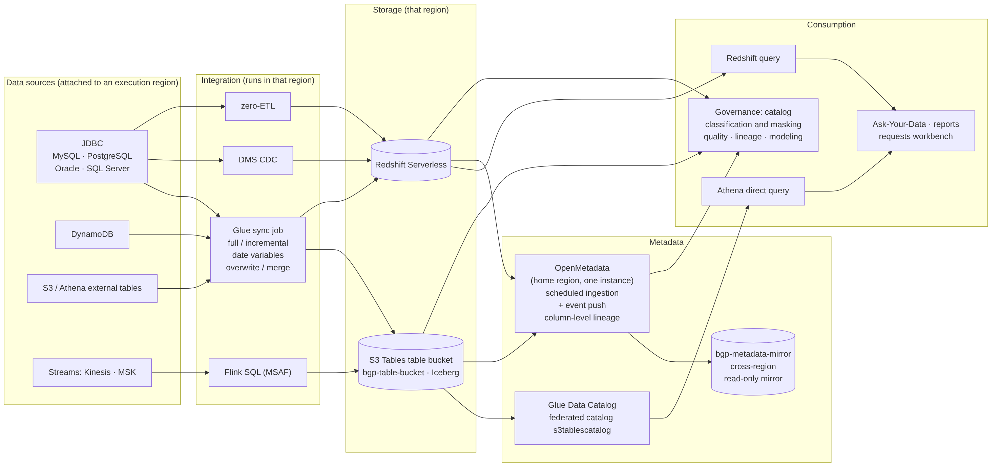

- **Target**: every object carries "which region it executes in". A data source is created in the region currently selected in "Execution scope"; a sync task follows its data source; batch jobs and workflows each have their own "Execution regions (multi-select)". Data does not leave the region.
- **Sync**: batch sync runs as a Glue job (the platform generates the script); writes to S3 Tables use Iceberg tables, writes to Redshift use the Data API; the first table creation and the platform marker happen in the same transaction. Saving the task refreshes the script.
- **How lake tables are referenced**: in every region the platform pre-configures the Iceberg catalog `s3tablescatalog` for jobs (pointing at that region's platform table bucket). In PySpark write `s3tablescatalog.<namespace>.<table>`; on the Athena query page write `"s3tablescatalog/<table-bucket>"."<namespace>"."<table>"`.
- **Business date**: jobs and sync tasks share one set of 15 date variables; a manual run can set it, a scheduled run uses the run date.
- **Scheduling**: every region has its own MWAA Serverless. A job's "Publish to MWAA schedule" and a workflow's "Publish to scheduler" both ship the artifact to **that region's own** scheduler; run records all come back to "Task Monitor".
- **Long-running operations**: requests that may exceed 45 seconds, such as creating a source or submitting a run, move to the background automatically; the bottom-right corner shows "Running in background: <label> (n s elapsed)"; there is no 504 and nothing is created twice.

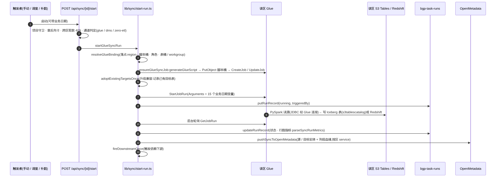

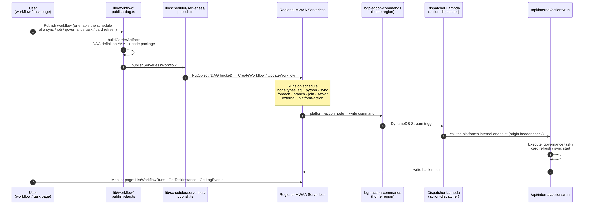

## 2. Preparation

- **Choose the region**: switch "Execution scope" in the top bar to the execution environment where your data should land (every object in this scenario is created in the same region). The entry marked "Home region" is the region hosting the control plane; using it is the least effort.
- **Choose the project and environment**: pick your project in the top-bar "Workspace" selector; leave "Environment" at dev.
- **The 7 source tables** (demo database `gamedata`; replace with your own in production):

| Table | Content | Columns used in this scenario |
|---|---|---|
| `ad_channels` | Channels (Google Ads / Meta Ads / TikTok Ads / AppLovin / Unity Ads / Organic) | `channel_id` `channel_name` `channel_type` |
| `ad_campaigns` | Campaigns | Not used directly in this scenario; synced along with the rest |
| `ad_events` | Impression / click events (about 2 million rows) | `channel_id` `event_time` `cost_usd` |
| `players` | Players (with attributed channel) | `player_id` `install_time` `source_channel_id` `is_paying` |
| `game_sessions` | Game sessions | Synced along with the rest |
| `payments` | Payments | `player_id` `pay_time` `amount_usd` |
| `player_events` | Player behaviour events (the largest fact table, millions of rows, generated randomly per player) | Synced along with the rest |

- **Dates in the demo data**: events are concentrated in the two weeks starting 2026-06-15. The manual runs below use `2026-06-20` as the "Business date", and the backfill range `2026-06-16 ~ 2026-06-22`. In production, substitute your own data dates.
- **Network**: when the source database is inside a VPC, the administrator must already have allowed the subnet / security group of that region's Glue connection to reach the source database port; the demo database is created by the platform together with everything else, so nothing to do there.
- **S3 Tables naming rules**: namespace, table and column names must be all lowercase (`a-z0-9_`), otherwise the federated catalog does not recognise them.

## 3. Register the data source

Page: "Data Integration → Data Sources".

1. Click "New data source" (in a single-region view the button reads "New data source (in <region>)").
2. "Basic info": Data source name `game-ads-mysql`; Database type MySQL; Environment "Development". Click "Next".
3. "Connection Config":
   - For the demo database choose "Select from RDS" and pick the demo instance from the list (the platform reads the credentials from the RDS Secrets Manager secret automatically and shows "Credentials are read automatically from RDS Secrets Manager; no manual entry needed").
   - For your own database choose "Manual input": Host address · Port `3306` · Database name `gamedata` · Username · Password.
   - "Extra JDBC connection parameters (optional)" is usually left empty (MySQL already carries `zeroDateTimeBehavior=CONVERT_TO_NULL` by default, so zero-value dates are read as NULL).
   - "Probe & browse method": when the source and the platform are not in the same VPC choose "Glue connection only (source in its own network)", otherwise leave "Auto (direct first, then via Glue connection if unreachable)".
   - Leave "Network Access (optional)" empty so the platform detects it automatically.
4. Click "Test connection" and wait for "Connection test passed". Click "Create Data Source".
5. The "Create Resource" page shows "Data source created" and the resources created: password storage in Secrets Manager, network configuration, Glue connection, connection test "Testing in background...". Click "Done".
6. Back in the list: the status is "Testing" first and becomes "Connected" once the connection really succeeds. Click "Browse tables" in the row; the "Metadata browser" drawer should list "Table list (7 tables)".

What you should see: one row `game-ads-mysql` with status "Connected".

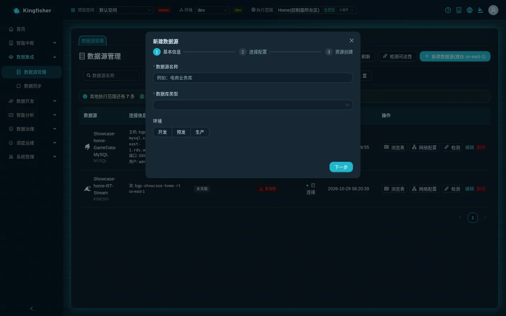

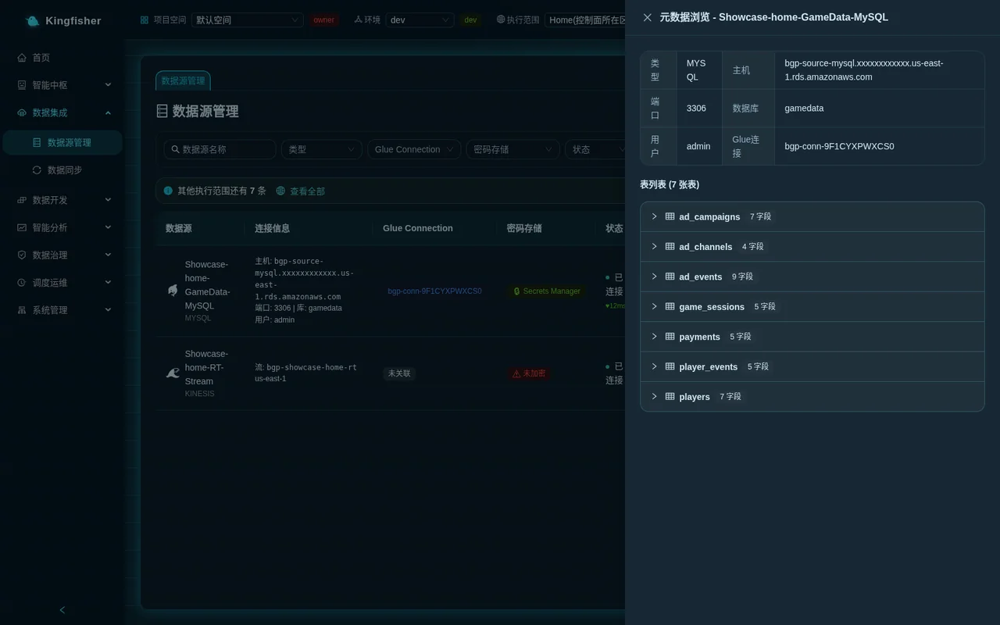

> Note: a data source stays forever in the region where it was created; "Detect" and "Browse tables" may show unreachable when the source database only allows its own network range, which does not affect sync jobs that run through that region's subnets.

## 4. Create the sync task: 7 tables → S3 data lake + Redshift

Page: "Data Integration → Data Sync". Click "New sync task"; the dialog has five steps.

### 4.1 "Source configuration"

| Field | Enter / choose | Notes |
|---|---|---|
| Task name | `game-ads-7tables` | |
| Select data source | `game-ads-mysql` | In the dropdown the source name is tagged "Connected" and with its region |
| Sync mode | "Full-load sync" | The other two options, "Incremental sync (CDC)" and "Real-time sync (DMS CDC)", are covered in scenario 4 |
| Write mode | "Overwrite" | **Must be chosen**; the other two are "Append" and "Merge" (merge requires merge keys) |
| Target type | "S3 + Redshift" | One copy in the lake for jobs and ad-hoc queries, one in the warehouse for reports |
| Data filter (WHERE) | Leave empty | To extract by day, write a condition such as `created_at >= '${run_date}'`; the available variables are listed in 4.4 |

After you choose the target type, "Channel Recommendation" appears below: for this task Glue ETL should be tagged "Recommendation". Click "Next".

### 4.2 "Select Tables & Mapping"

1. Tick the 7 tables in "Select sync tables"; you can use "Search table name" and "Select all N shown"; the tag on the right shows "7 selected / 7 total".
2. "Field mapping" below lists source field / source type / target type / target field per table; keep the defaults.
3. The "Table names with date variables" block is not used in this scenario (it is for sources that shard tables by month, such as `orders_202609`).

Click "Next".

### 4.3 "Target configuration"

| Block | Field | Enter / choose |
|---|---|---|
| Target table naming | Table name prefix / suffix | Leave empty (target tables keep the source table names) |
| S3 Tables Data Lake Configuration | Table Bucket | **Leave empty** = the region's platform table bucket (recommended). To write to your own table bucket it must first be registered as a writable route, see scenario 2 |
| S3 Tables Data Lake Configuration | Namespace | "Auto (follow DB name)" ⇒ namespace = `gamedata` |
| S3 Tables Data Lake Configuration | Partition config | Do not add any |
| Iceberg Table Parameters | Snapshot retention (days) / Max snapshots / Auto-compaction interval | Keep the defaults 7 / 100 / 60 |
| Redshift Configuration | Workgroup / Database | Leave empty = resolved automatically from the execution environment |
| Redshift Configuration | Schema | `gamedata` |
| Redshift Configuration | Distribution style / DISTKEY / SORTKEY | Default AUTO, leave the rest empty |

Leave "Derived columns" and "Overwrite options" untouched in this scenario (keep "Overwrite scope" at "Whole table"; do not tick "Allow clearing the target table even if 0 rows are read"). Click "Next".

### 4.4 Date variables (for reference)

All variables available in "Data filter (WHERE)" and "Table names with date variables". A manual "Start" takes today according to the task's "Business-date time zone" (empty = UTC); "Run for a date" and backfill use the date you give. Examples for business date 2026-11-09:

| Variable | Meaning | Example |
|---|---|---|
| `${ds}` | Business date | `2026-11-09` |
| `${ds_nodash}` | Business date, no dashes | `20261109` |
| `${yesterday_ds}` | Previous day | `2026-11-08` |
| `${yesterday_ds_nodash}` | Previous day, no dashes | `20261108` |
| `${tomorrow_ds}` | Next day | `2026-11-10` |
| `${tomorrow_ds_nodash}` | Next day, no dashes | `20261110` |
| `${run_date}` | Same as `${ds}` | `2026-11-09` |
| `${yesterday}` | Same as `${yesterday_ds}` | `2026-11-08` |
| `${ds_month}` | Month of the business date | `202611` |
| `${last_month}` | Previous month | `202610` |
| `${last_month_std}` | Previous month, with dash | `2026-10` |
| `${bizdate}` | Day before the run date (T-1 convention) | `20261108` |
| `${bizdate_std}` | Same, with dashes | `2026-11-08` |
| `${bizmonth}` | Month before the run date (T-1 convention) | `202610` |
| `${bizmonth_std}` | Same, with dash | `2026-10` |

Batch jobs use the same table: a Redshift SQL job writes `${ds}` in its script; Glue / EMR jobs receive them as parameters such as `--ds` `--ds_nodash`.

### 4.5 "Create table preview"

Click "Generate DDL". Every table should be tagged "New". If a table is tagged in red "Table exists (not created by platform; overwrite needs confirmation)", the warehouse already has a table of that name that the platform did not create: when you click "Done" a dialog "Overwrite existing tables?" lists them one by one and **each must be confirmed**, otherwise the run is refused with `SYNC_REFUSED_CLEAR_FOREIGN_TABLE` and not a single row is deleted (see FAQ).

### 4.6 "Schedule settings"

| Block | Field | Enter / choose |
|---|---|---|
| Glue Job Resources | Worker Type / Worker Count | `G.1X` / `2` (enough for the demo volume; raise to 4 when `player_events` is large) |
| Glue Job Resources | Glue Version | Keep the default (highest version); writing to S3 Tables requires Glue 5.1 or later, versions below 5.1 are disabled in the dropdown |
| Glue Job Resources | Job timeout (minutes) / Retry on failure | 60 / 0 |
| Execution Role | Execution Role | Leave empty = "Platform default role" |
| Schedule | Enable scheduling | **Off** (in this scenario the DAG does the scheduling; turn it on only for a standalone schedule) |
| Dependency scheduling | Downstream dependencies | Leave empty |

Click "Done". The list gains a row `game-ads-7tables` with status "Draft".


## 5. Run the sync and verify

### 5.1 Start

1. Click "Start" in the list row. The status changes to "Starting" → "Running"; while a task is running the list refreshes every 8 seconds (the "Auto refresh" switch at top right).
2. Click "Details". A row appears in the "Run History (N)" tab with "Trigger" = "Manual"; wait for the status to become "Success", with row counts in the "Read" and "Write" columns. The 7 tables hold about 2 million + 8.5 million rows; the first run including the Glue cold start takes about 10–20 minutes.
3. In the "Run Logs" tab click "Refresh logs" to see the Glue output; the "Output Result" tab shows "Data output location".

What you should see: one run-history row "Success" with rows written > 0; the "Glue Job" tag on the details page shows the job name.


### 5.2 Verify the lake tables in Athena Query

Page: "Data Development → Athena Query" (page title "Athena Query (S3 Tables / Iceberg)").

1. In the page header confirm that the execution environment tag is the region where you created the task; the blue banner states "Read-only, results are not persisted." and gives "Federated catalog: s3tablescatalog/<table-bucket>".
2. Click "Refresh tables" in the table tree on the left; the 7 tables should appear under the namespace `gamedata`.
3. Click the table name `players`; the editor is filled with `SELECT * FROM "s3tablescatalog/<table-bucket>"."gamedata"."players" LIMIT 100`. Click "Execute".
4. Change the SQL to a count and execute again:

```sql
SELECT COUNT(*) AS n FROM "s3tablescatalog/<table-bucket>"."gamedata"."players"
```

What you should see: above the result "Scanned … / Duration … / 1 rows returned", with `n` around 70–100 thousand (the data generator adds a random amount).


### 5.3 Verify the warehouse tables in Redshift Query (optional)

"Data Development → Redshift Query": choose the same region in "Execution regions (multi-select)" → "Load Schema" shows the 7 tables under `gamedata` → run `SELECT COUNT(*) FROM gamedata.players` → "Execute".

## 6. Glue PySpark job: channel ROI daily summary (writes a lake table)

Page: "Data Development → Batch Compute".

### 6.1 Create

1. Click "New" at top left. In the "New ETL Job" dialog: Job name `channel_roi_daily_lake`, type "Glue PySpark Script Job", click "Create". The toast "Created" appears and the job shows up on the left, already selected.
2. The "Edit script" tab contains a template; replace the whole thing with the script below.

### 6.2 Script

From the 4 synced lake tables, the script computes each channel's spend / new installs / payers / revenue / CPI / ROAS for the business date and writes them to the lake table `gamedata.dws_channel_roi_daily`; re-running the same day deletes before writing, so it is safe to repeat.

```python
import sys
from awsglue.utils import getResolvedOptions
from pyspark.context import SparkContext
from awsglue.context import GlueContext
from awsglue.job import Job
from pyspark.sql import functions as F

# The business date ds (YYYY-MM-DD) is injected by the platform as --ds from the run date; a manual run can set it in the "Business date" box
args = getResolvedOptions(sys.argv, ["JOB_NAME", "ds"])
ds = args["ds"]
sc = SparkContext(); glue = GlueContext(sc); spark = glue.spark_session
job = Job(glue); job.init(args["JOB_NAME"], args)

NS = "s3tablescatalog.gamedata"          # namespace written by the sync task; whichever region the job runs in, it reads that region's table bucket
TGT = f"{NS}.dws_channel_roi_daily"
day = F.to_date(F.lit(ds))

ch = spark.table(f"{NS}.ad_channels").select("channel_id", "channel_name", "channel_type")
cost = (spark.table(f"{NS}.ad_events").where(F.to_date("event_time") == day)
        .groupBy("channel_id").agg(F.sum("cost_usd").alias("cost_usd")))
inst = (spark.table(f"{NS}.players").where(F.to_date("install_time") == day)
        .groupBy(F.col("source_channel_id").alias("channel_id"))
        .agg(F.count("*").alias("installs"), F.sum("is_paying").alias("payers")))
rev = (spark.table(f"{NS}.payments").where(F.to_date("pay_time") == day)
       .join(spark.table(f"{NS}.players").select("player_id", "source_channel_id"), "player_id")
       .groupBy(F.col("source_channel_id").alias("channel_id"))
       .agg(F.sum("amount_usd").alias("revenue_usd")))

df = (ch.join(cost, "channel_id", "left").join(inst, "channel_id", "left").join(rev, "channel_id", "left")
      .na.fill({"cost_usd": 0, "installs": 0, "payers": 0, "revenue_usd": 0})
      .withColumn("dt", F.lit(ds))
      # From Glue 6.0 Spark ANSI mode is on by default: a zero denominator raises an error, so it must be guarded explicitly
      .withColumn("cpi_usd", F.when(F.col("installs") > 0, F.round(F.col("cost_usd") / F.col("installs"), 4)))
      .withColumn("roas", F.when(F.col("cost_usd") > 0, F.round(F.col("revenue_usd") / F.col("cost_usd"), 4))))

out = df.select(
    "dt", "channel_id", "channel_name", "channel_type",
    F.col("cost_usd").cast("double").alias("cost_usd"),
    F.col("installs").cast("long").alias("installs"),
    F.col("payers").cast("long").alias("payers"),
    F.col("revenue_usd").cast("double").alias("revenue_usd"),
    F.col("cpi_usd").cast("double").alias("cpi_usd"),
    F.col("roas").cast("double").alias("roas"))

spark.sql(f"""CREATE TABLE IF NOT EXISTS {TGT} (
  dt string, channel_id int, channel_name string, channel_type string,
  cost_usd double, installs bigint, payers bigint, revenue_usd double, cpi_usd double, roas double
) USING iceberg""")
spark.sql(f"DELETE FROM {TGT} WHERE dt = '{ds}'")   # idempotent: re-running the same day deletes before writing
out.writeTo(TGT).append()
out.orderBy(F.desc("roas")).show(truncate=False)      # show / print output goes to the CloudWatch log
job.commit()
```

> The script is adapted from the demo installation's showcase job and trimmed for this scenario; run it once in your environment with "Run now" to confirm before wiring it into the DAG. This script was really run once in the demo environment following the page steps (namespace changed to `showcase` to match the demo environment, target table given a temporary name): one run-history row succeeded, about 85 seconds.

### 6.3 Execution regions, resources and advanced properties

1. "Execution regions (multi-select)": confirm that the region where you created the sync task is ticked (default = the region of the current top-bar view). With only one region ticked it shows "📍 Region-specific".
2. Resource row: Worker type `G.1X(4vCPU/16GB)`, Workers `2`, "Timeout (min)" 60; keep the default in the Glue version dropdown (it shows text such as "Glue 6.0 (Spark 4.1.1 / Python 3.13)"). Leave "Glue Connection (optional, to access in-VPC sources like RDS)" empty — this job only reads lake tables.
3. Expand "Advanced Properties (retry / execution class / bookmark / custom parameters / dependent libraries)":
   - Keep the "Execution Role" dropdown at "Platform default role · <role name>" (group "Platform default (recommended, permissions complete)"). Using your own role is covered in scenario 2.
   - "Lake table buckets" with nothing selected = all routes of this region; "Catalogs available to this job" should list at least `s3tablescatalog`.
   - "Job parameters" and "Dependency libraries" are not used in this scenario.
4. Click "Save"; the toast "Saved" appears.

### 6.4 Run now and run history

1. Enter `2026-06-20` in the "Business date" box (the date the demo data covers; empty = today).
2. Click "Run now · <region>". The toast "Run submitted (business date 2026-06-20)" appears.
3. Switch to the "Run History (N)" tab and click "Refresh". The first run including the Glue cold start takes about 1–3 minutes and the status goes from running to `succeeded`; the columns show execution region / Trigger "Manual" / business date `2026-06-20` / duration.
4. "Logs" in the row opens "Run Logs": you can see the 6 channel ROI rows printed by `show()`. Logs come from CloudWatch and lag on a cold start; click "Refresh".
5. On failure click "AI Diagnosis"; the platform uses the run log to explain the cause and suggest a fix.

What you should see: one run-history row `succeeded`; after refreshing the table tree on the Athena query page, `gamedata` gains `dws_channel_roi_daily`; running `SELECT * FROM "s3tablescatalog/<table-bucket>"."gamedata"."dws_channel_roi_daily" ORDER BY roas DESC` returns 6 rows.

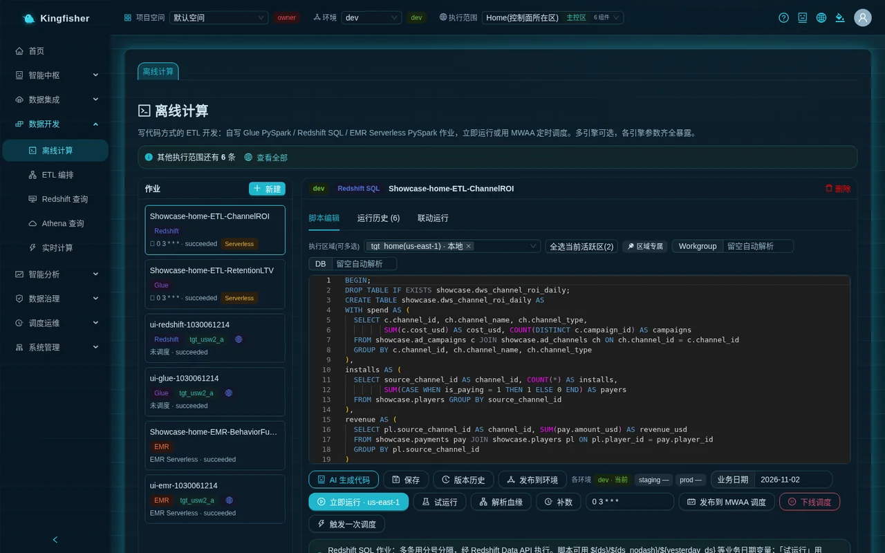

> Tip: on a scheduled run the platform uses **the run date** as the business date. To make the daily report compute "yesterday", change the parameter the script reads to `yesterday_ds` (Glue jobs also receive `--yesterday_ds`), or use `${yesterday_ds}` in a SQL job.

## 7. Redshift SQL job: the same figures into the warehouse

The report builder reads the warehouse fastest, so create a second, Redshift SQL job that writes the same figures to `gamedata.dws_channel_roi_daily` (a warehouse table; same name as the lake table, no conflict).

1. "Batch Compute" → "New": Job name `channel_roi_daily_dws`, type "Redshift SQL Job" → "Create".
2. Replace the whole script with:

```sql
BEGIN;
CREATE TABLE IF NOT EXISTS gamedata.dws_channel_roi_daily (
  dt DATE, channel_id INT, channel_name VARCHAR(40), channel_type VARCHAR(20),
  cost_usd DECIMAL(14,2), installs BIGINT, payers BIGINT, revenue_usd DECIMAL(14,2),
  cpi_usd DECIMAL(14,4), roas DECIMAL(14,4)
);
DELETE FROM gamedata.dws_channel_roi_daily WHERE dt = '${ds}';
INSERT INTO gamedata.dws_channel_roi_daily
WITH cost AS (
  SELECT channel_id, SUM(cost_usd) AS cost_usd
  FROM gamedata.ad_events WHERE event_time::date = '${ds}' GROUP BY channel_id),
inst AS (
  SELECT source_channel_id AS channel_id, COUNT(*) AS installs, SUM(is_paying) AS payers
  FROM gamedata.players WHERE install_time::date = '${ds}' GROUP BY source_channel_id),
rev AS (
  SELECT pl.source_channel_id AS channel_id, SUM(pay.amount_usd) AS revenue_usd
  FROM gamedata.payments pay JOIN gamedata.players pl ON pl.player_id = pay.player_id
  WHERE pay.pay_time::date = '${ds}' GROUP BY pl.source_channel_id)
SELECT '${ds}'::date, ch.channel_id, ch.channel_name, ch.channel_type,
       COALESCE(c.cost_usd, 0), COALESCE(i.installs, 0), COALESCE(i.payers, 0), COALESCE(r.revenue_usd, 0),
       ROUND(c.cost_usd / NULLIF(i.installs, 0), 4), ROUND(r.revenue_usd / NULLIF(c.cost_usd, 0), 4)
FROM gamedata.ad_channels ch
LEFT JOIN cost c ON c.channel_id = ch.channel_id
LEFT JOIN inst i ON i.channel_id = ch.channel_id
LEFT JOIN rev  r ON r.channel_id = ch.channel_id;
COMMIT;
```

3. Confirm "Execution regions (multi-select)" is the same region as before; leave Workgroup / DB empty ("Leave blank to resolve automatically"; the target is decided by that execution environment). Click "Save".
4. Click "Dry run": the toast "Trial run submitted (EXPLAIN validation, no data written)" appears; "Run History" gains a row with "Trigger" = "Dry run".
5. Enter `2026-06-20` as "Business date" and click "Run now · <region>"; the run history shows one row `succeeded`.
6. In "Redshift Query" run `SELECT * FROM gamedata.dws_channel_roi_daily ORDER BY roas DESC`; it should return 6 rows.

> Key points: separate multiple statements with semicolons; keep DELETE and INSERT inside `BEGIN; … COMMIT;` so readers never hit the window where the table is cleared but not yet rewritten. `${ds}` is replaced with the business date by the platform before submission.

## 8. ETL orchestration: sync → Glue job → Redshift job

Page: "Data Development → ETL Orchestration".

### 8.1 Create the workflow and the canvas

1. Click "New workflow": name `flow-channel-roi-daily`, any description; in "Execution regions (multi-select)" tick the same region as before (default = the region of the current top-bar view, shown as "📍 Single region"). After confirming, the toast "Created" appears (in a single-region view it reads "Created in <region> (scheduling runs only in this region)").
2. Click "Edit DAG" in the row to open the details. Buttons at the top: "Add node" "Save" "Version history" "Publish to scheduler" "Trigger run".
3. "Add node" → "Data Sync Node". Click the node on the canvas; the "Node configuration" drawer opens on the right:
   - Node name `Sync 7 tables`;
   - In "Linked sync task" choose `game-ads-7tables (…→ both) · <region>`; the top of the drawer carries a line "Candidates are filtered by this workflow's execution regions: <region>".
4. "Add node" → "Batch Job Node". The "Linked batch job" dropdown has two groups, "Batch compute (Glue / Redshift)" and "EMR Serverless", with entries of the form `name · engine · execution environment id`; choose `channel_roi_daily_lake · Glue · <execution environment id>`; node name `ROI lake table`.
5. Add another "Batch Job Node" and choose `channel_roi_daily_dws · Redshift · <execution environment id>`; node name `ROI warehouse table`.
6. Drag from the sync node's outlet to "ROI lake table", then from "ROI lake table" to "ROI warehouse table". The page header shows "3 nodes / 2 edges".
7. Click "Save"; the toast "Saved" appears and the "● Unsaved changes" tag disappears.

> The dropdowns only list tasks and jobs **bound to this workflow's execution region**. Missing a job? Go back to "Batch Compute", add this region to its "Execution regions (multi-select)" and save.

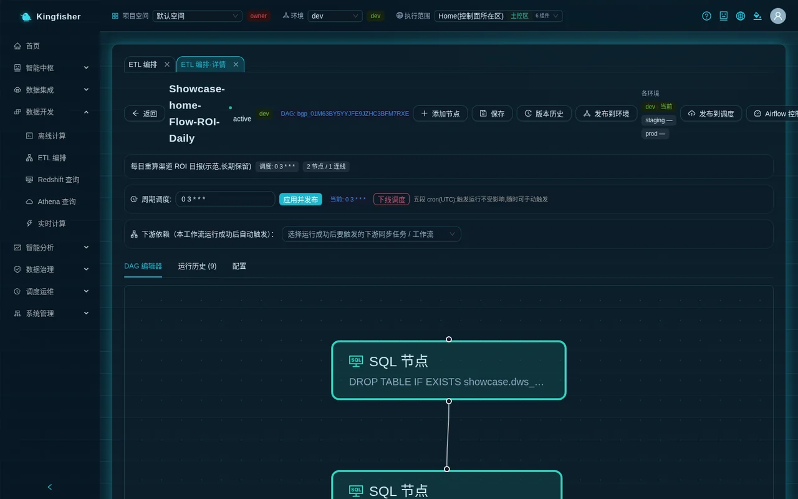

### 8.2 Publish to the scheduler and attach a cron

1. Click "Publish to scheduler". Before publishing, the platform checks that the canvas is not empty, every node is linked, and every job is bound to this region; when it passes, the toast "Published to Airflow" appears.
2. Enter `0 3 * * *` in the "Recurring schedule" row (five-field cron, **UTC**) and click "Apply and publish". The toast "Schedule applied and published (0 3 * * *); after MWAA loads (~1 min) it runs on schedule" appears; the page header shows "Schedule: 0 3 * * *".
3. Do not want to wait until the small hours: click "Trigger run"; the toast "Run triggered" appears.
4. Click "Refresh" in the "Run History (N)" tab: one run, status running → succeeded, and the "Trigger mode" column shows the region scheduler's tag Serverless. "Node" in the row opens "Node details", where the three nodes turn green one by one and each row has a back-link "Sync run history" / "Job run history"; "Logs" shows the log of the whole run.
5. Back in "Batch Compute", select `channel_roi_daily_lake` → "Run History": a new row whose "Trigger" column reads Triggered by workflow "flow-channel-roi-daily"; click it to return to that workflow run.

What you should see: one workflow run succeeded; the run histories of the two jobs and the sync task each gain one record triggered by the workflow; in "Task Monitor → Schedule config" the row `flow-channel-roi-daily` has "Schedule type" "Auto schedule" and "Carrier definition" "Up to date".

> Two things to note. ① When the sync node starts the sync task's Glue job it **does not pass a business date**; the task takes today according to its own "Business-date time zone" — the sync in this scenario is a whole-table overwrite independent of the date, which is exactly right; if your sync task uses date variables, backfill history with "Run for a date" or a backfill on the task itself. ② Job nodes in a workflow use the run date as the business date; on the demo data the day computed by the automatic early-morning run will most likely have 0 rows (the data only goes to the end of 2026-06); that is a property of the data, not a failure.

### 8.3 Taking offline and making changes

- "Take schedule offline" (or "Take offline" in the list row) removes the DAG from the scheduler and keeps the definition; only "Delete" deletes the workflow.
- After changing the canvas, "Save" and "Publish to scheduler" again; when "Carrier definition" in "Task Monitor → Schedule config" shows "Carrier needs republishing", click "Republish".

## 9. Backfill a stretch of history

Page: "Scheduling & Ops → Backfill Center".

1. Click "New Backfill".
2. In "Backfill target" choose `channel_roi_daily_lake (etl-glue)` (the parentheses hold the raw type value: Glue job `etl-glue`, Redshift job `etl-redshift`, EMR job `emr-serverless`; workflows are tagged "Workflow" and sync tasks "Sync task").
3. "Date range": `2026-06-16` to `2026-06-22`; "Granularity" "Daily"; "Max concurrency" `2`; keep "Instance cap" at its default.
4. Click "Preview instances"; the toast "Will generate 7 backfill instances" appears. Click "Create"; the toast "Backfill plan created" appears and the progress dialog opens automatically.
5. Progress dialog: at the top Total 7 / succeeded / failed / running / Pending; the matrix has one cell per date; "Total rows written" grows with each successful instance. The backfill completes even if you close the page (it advances in the background).
6. Click any green cell to open the "Backfill instance" drawer: date / node / execution region / status / Attempts / duration / rows written / Error (verbatim) / Underlying run / Glue job; "View run log" shows that run's log directly and "Locate in Monitor" jumps to Task Monitor.
7. When there are failed cells, click "Retry failed" to re-run only the failed items.

What you should see: all 7 instances "Success"; the Athena query `SELECT dt, COUNT(*) FROM "s3tablescatalog/<table-bucket>"."gamedata"."dws_channel_roi_daily" GROUP BY dt ORDER BY dt` returns the 7 dates 2026-06-16 ~ 2026-06-22 (still 7 rows even counting the manual run for 06-20 in step 6, because the same day is deleted before being written).

The warehouse table is backfilled the same way: start another backfill with "Backfill target" `channel_roi_daily_dws (etl-redshift)`; or click "Backfill" in the job editor and enter the start and end dates (≤ 31 days) in the "Backfill (run day by day over a business date range)" dialog.

> Why not backfill the workflow: when a workflow contains a data sync node, concurrency is fixed at 1, and the linked sync task must be a Glue channel, full load and **use date variables**, otherwise that node instance fails honestly (downstream nodes are skipped in the cascade). The sync task in this scenario has no date variables, so the two jobs are backfilled directly.

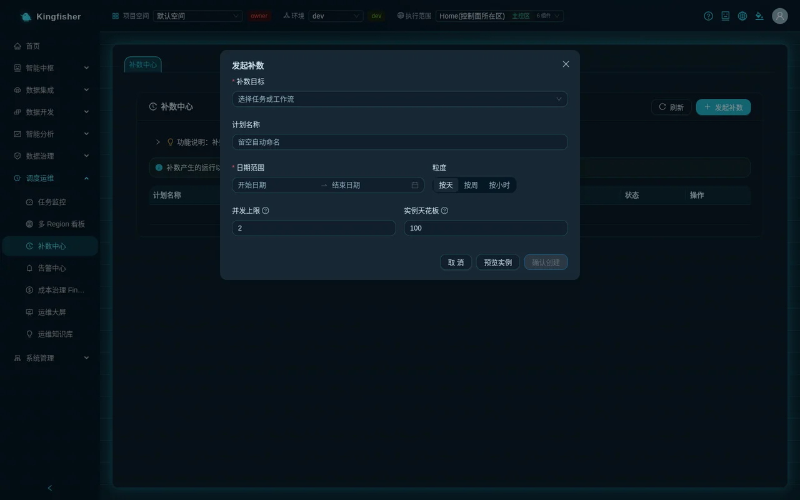

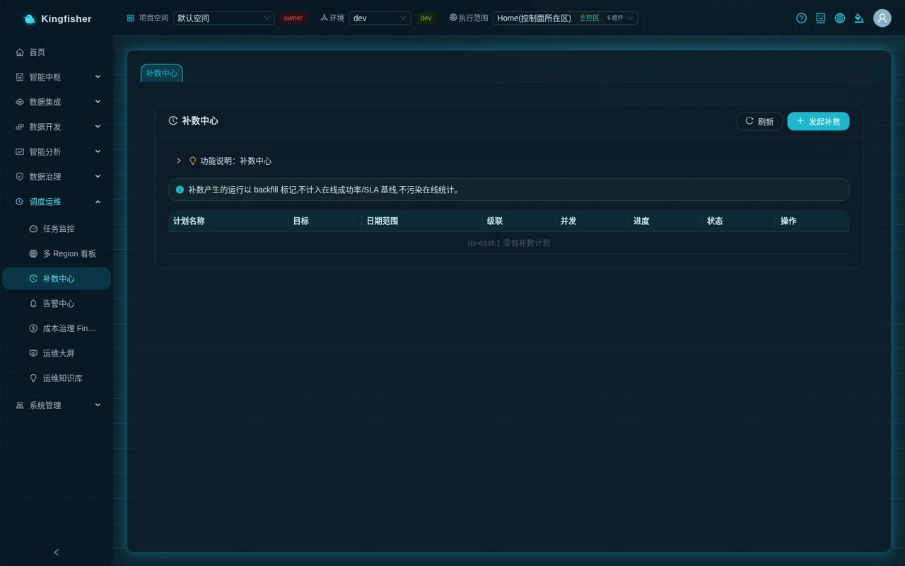

## 10. Task Monitor: every run in one place

Page: "Scheduling & Ops → Task Monitor" → "Run instances" tab.

1. Stat cards at the top: Running / Succeeded today / Failed today / Runs today / Success rate / Avg duration.
2. Filters: enter `channel_roi` as the task name; "Task type" "ETL Job (Glue)"; "Trigger mode" "Backfill"; click "Search". The 7 runs from step 9 should be listed, with your region in the "Region" column.
3. Switch "Trigger mode" to "Manual" to see the runs from steps 6–7; clear the filters and set "Task type" to "Workflow" to see the run from step 8.
4. "Logs" in a row opens the "Run Logs" dialog; successful / failed rows have "AI Analysis" / "AI Diagnosis"; failed rows have "Retry".
5. Switch to the "Schedule config" tab: the row `flow-channel-roi-daily` shows Cron `0 3 * * *`, "Enable" on, "Schedule type" "Auto schedule", "Carrier definition" "Up to date", "Recent runs" successful.


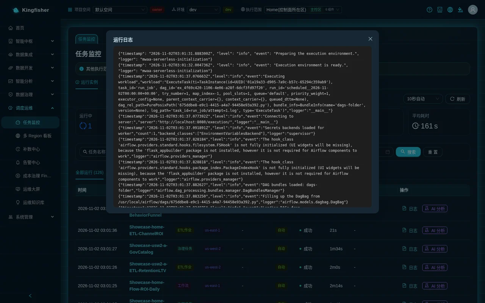

## 11. Report Builder: a channel ROAS bar chart

Page: "Smart Analytics → Report Builder" (page title "Analysis").

1. Click "New analysis". Enter the "Analysis name" `Channel acquisition daily report` at the top.
2. Click "Add visual". In the "Add visual" dialog:
   - "Visual name" `Channel ROAS (06-16 ~ 06-22)`;
   - Data source "Free SQL"; engine "Warehouse (Redshift)";
   - SQL:

```sql
SELECT channel_name,
       SUM(cost_usd)    AS cost_usd,
       SUM(revenue_usd) AS revenue_usd,
       ROUND(SUM(revenue_usd) / NULLIF(SUM(cost_usd), 0), 4) AS roas
FROM gamedata.dws_channel_roi_daily
WHERE dt BETWEEN '2026-06-16' AND '2026-06-22'
GROUP BY channel_name
ORDER BY roas DESC
```

   - Click "Preview data" and see 6 rows; "Chart type" "Bar chart"; click "OK".
3. The chart appears on the canvas; click "Save" and the toast "Saved" appears. Back in the "Analyses" list you can see it, with "Visual" = 1 and your region in the "Regions involved" column.
4. To avoid writing SQL: choose "Visual builder" as the data source, engine "Warehouse (Redshift)", and the "Select a table (no SQL needed)" dropdown lists the engine's `schema.table` entries directly (in the demo environment these are ten tables such as `showcase.dws_channel_roi_daily`; the one built in this guide is `gamedata.dws_channel_roi_daily`); drag `channel_name` to "X axis / dimension" and `revenue_usd` to "Value / measure", then click "Preview".

What you should see: a chart with 6 bars; the Organic channel having spend 0 and an empty ROAS is normal (organic traffic has no ad spend).

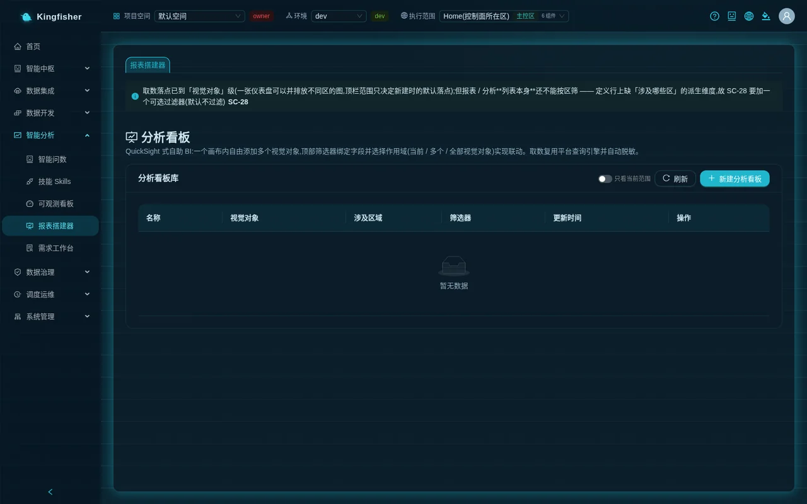

## 12. Verify the results

| Check | Where to look | What you should see |
|---|---|---|
| 7 tables in the lake | Athena Query table tree | 7 tables under `gamedata`, `players` count around 70–100 thousand |
| 7 tables in the warehouse | Redshift Query "Load Schema" | 7 tables under `gamedata` |
| Daily summary in the lake | Athena Query | `dws_channel_roi_daily` 7 dates × 6 channels = 42 rows |
| Daily summary in the warehouse | Redshift Query | `gamedata.dws_channel_roi_daily` row count matches the lake table |
| DAG scheduled | Task Monitor → Schedule config | `flow-channel-roi-daily` Auto schedule · carrier Up to date |
| Back-link | Batch Compute → Run History | Triggered by workflow "flow-channel-roi-daily" is clickable |
| Backfill isolation | Task Monitor | Backfill runs have "Trigger" = "Backfill" and do not count toward the online success rate |
| Report | Report Builder → Analyses | `Channel acquisition daily report` with 1 visual |

## 13. FAQ

| Symptom | Cause | Next step |
|---|---|---|
| "Browse tables" is empty or "Detect" shows unreachable, yet the sync runs | The platform cannot reach the source database directly (it only allows its own network range); Glue jobs running through the region's subnets are unaffected | "Edit" the data source, set "Probe & browse method" to "Glue connection only (source in its own network)", then "Browse tables" again |
| Sync run fails with an error containing `SYNC_REFUSED_CLEAR_FOREIGN_TABLE` | The target table exists and was not created by the platform, and this task did not confirm the overwrite table by table | "Edit" the task → at "Done" confirm each table in "Overwrite existing tables?"; or switch to "Append" / change the target table name |
| The wizard's "Done" shows "Merge requires at least one merge key" | Write mode is "Merge" but no merge key was given | Fill in the merge keys under "Merge options" in "Target configuration", or switch back to overwrite / append |
| Save / start refused with the message "Bucket … is not registered as a route …" | Table Bucket holds an unregistered bucket of your own | Ask an administrator to register it as a writable route under "Settings → Lake table buckets and routes"; or clear Table Bucket to use the platform bucket |
| Glue 5.0 cannot be selected for the sync task | Writing to S3 Tables requires Glue 5.1 or later; lower versions are disabled | Use the default version |
| Glue job log shows `DIVIDE_BY_ZERO` | From Glue 6.0 Spark ANSI mode is on by default and a zero denominator raises an error | Guard with `F.when(denominator > 0, …)` as in the example; or add `--conf spark.sql.ansi.enabled=false` under "Job parameters" |
| Glue job log shows `TABLE_OR_VIEW_NOT_FOUND` or `REQUIRES_SINGLE_PART_NAMESPACE` | The table name is not the three-part `s3tablescatalog.<namespace>.<table>`, or the namespace / table name has the wrong case | Use three-part, all-lowercase names; the namespace is the sync task's "Namespace" |
| Athena reports `Unsupported Federation Resource` | Table / column names contain upper-case letters | Change everything to lowercase |
| Athena refuses an INSERT with "Only read-only SELECT / WITH / SHOW / DESCRIBE / EXPLAIN queries are allowed" (or, for multiple statements, "Only a single query statement is allowed") | The query page is read-only | Do writes through batch jobs |
| After "Run now" the bottom-right shows "Running in background: … (n s elapsed)" | Submission took longer than 45 seconds (e.g. an EMR application cold start) and moved to the background automatically | Wait for it to finish; do not click again — clicking again returns 409 "in progress" |
| Workflow "Publish to scheduler" returns 400 naming a node | The job / task linked to the node is not bound to the workflow's execution region, or the node is not linked | Add the region under the job's "Execution regions (multi-select)" and save; or re-link in the drawer |
| After "Add node" my job is missing from the dropdown | Candidates are filtered by the workflow's execution region | As above; the line "Candidates are filtered by this workflow's execution regions: …" at the top of the drawer names the region |
| Deleting a job returns 409 "This job still has N unfinished runs … deletion refused" | Runs are still in flight | Wait for them to finish before deleting |
| Deleting a job returns 409 "This job is still referenced by batch job nodes in N workflows … deletion refused" | A DAG still references it | Remove the node from the workflow canvas and save first |
| Deleting a data source returns 409 and lists sync tasks | The source is still referenced by tasks | Delete the tasks first |
| The scheduled daily summary has 0 rows | A scheduled run uses the run date as the business date and the demo data only goes to the end of 2026-06; or the source really has no data for that day | Compute yesterday with `${yesterday_ds}` / `yesterday_ds`; backfill historical dates in the Backfill Center |
| Sync node instance fails when backfilling a workflow | Backfilling a workflow with a sync node requires the task to be a Glue channel, full load and use date variables | Backfill the jobs themselves, not the workflow |

## 14. Clean up the practice objects

Order matters: referenced objects cannot be deleted (the platform returns 409 and names them).

1. "ETL Orchestration": `flow-channel-roi-daily` → "Take offline" in the row (removes the schedule), then "Delete".
2. "Batch Compute": wait until `channel_roi_daily_lake` / `channel_roi_daily_dws` have no running records (nothing running in "Run History"), then click "Delete" at top right for each.
3. "Backfill Center": "Cancel" any plan still in progress.
4. "Data Sync": if `game-ads-7tables` is running, "Stop" it first, then "Delete" (this really removes the Glue job).
5. "Data Sources": `game-ads-mysql` → "Delete" (returns 409 while tasks reference it; go back to step 4).
6. "Report Builder": `Channel acquisition daily report` → "Delete" in the row.
7. The lake tables (8 under the `gamedata` namespace) and the `gamedata` schema in the warehouse are **not** deleted with the tasks; to remove them, ask an administrator to follow the manual.

## 15. Further reading

- Day-to-day essentials per page for engineers: [Data engineer guide](11-guide-data-engineer.md)
- Detail bucket / aggregate bucket layering, registering your own table bucket as a route, custom execution roles: [Scenario 2](21-scenario-cross-bucket-layering.md)
- One job bound to several regions in one run, cross-jurisdiction disclaimer: [Scenario 3](22-scenario-multi-region-residency.md)
- Real-time channel (DMS CDC) and Flink: [Scenario 4](23-scenario-realtime-cdc.md)
- Failure troubleshooting, alerts, SLA: [Scenario 8](27-scenario-ops-alerting.md)
- All date variables, job parameters, role dropdowns: [Configuration reference](31-reference-config.md); refusal reasons and status codes: [Rules reference](30-reference-rules.md)
- Feature tour with screenshots: [Features](../features.md); module mechanics and boundaries: [Modules](../modules.md)
