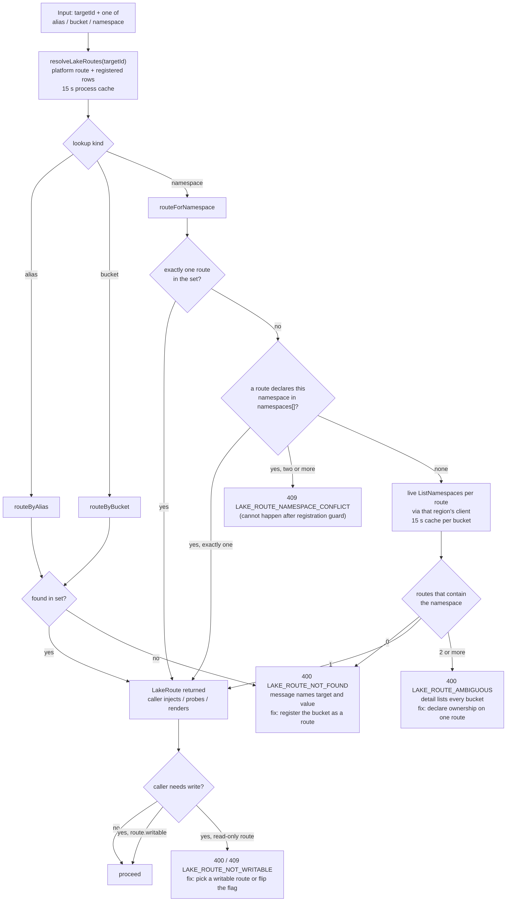
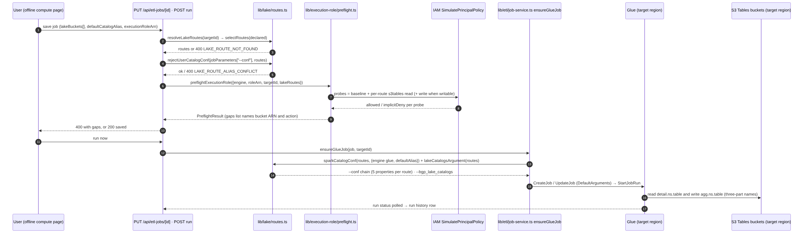
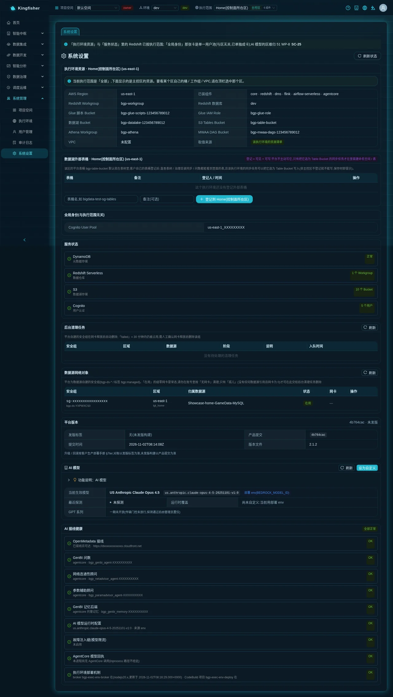
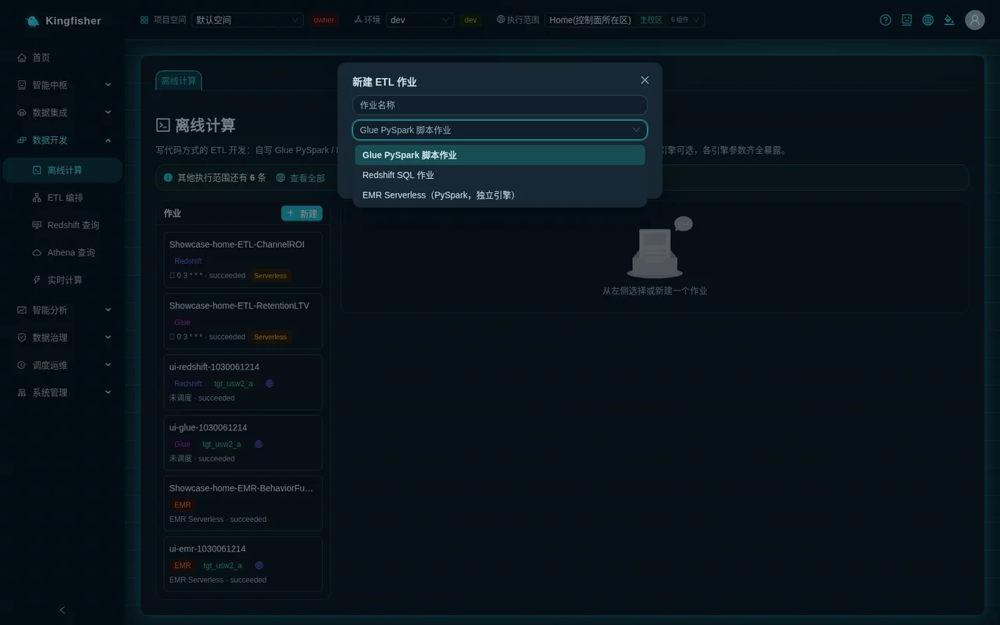
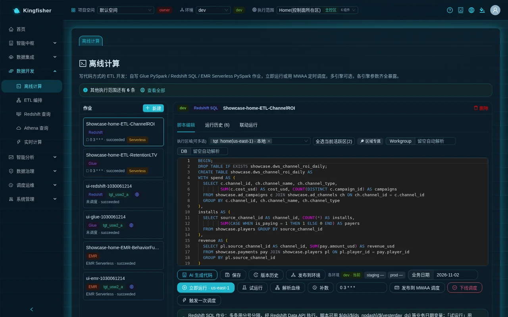
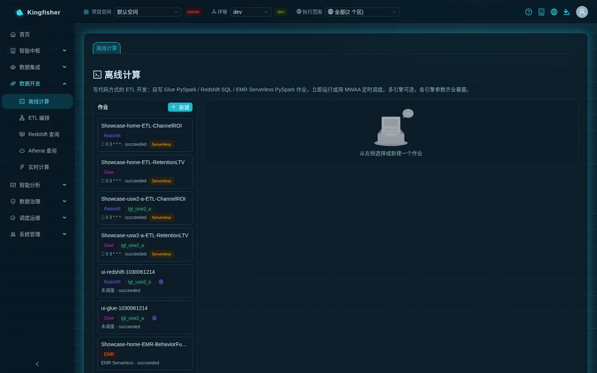

# Scenario 2: Detail-bucket / aggregate-bucket layering — one batch job reads the detail bucket and writes the aggregate bucket

| Item | Description |
|---|---|
| Audience | Platform admin (registers the routes) · Data engineer (creates the job, writes the script) · Operations (creates the table buckets) |
| Estimated time | About 60 minutes (including the 1–2 minute Glue cold start of the first run) |
| Prerequisites | Version 2.2.0 or later; an execution environment that has already been enabled ("Enable"); you are an editor or owner of a workspace authorized for that execution environment; a platform admin account (role group bgp-admin) is available to do the registration |
| What you will have | Two customer-owned S3 Tables table buckets registered as platform routes; one Glue PySpark job that reads from the detail bucket and writes to the aggregate bucket with zero hand-written Spark configuration; the result visible on the Athena query page; sync tasks able to land directly in the detail bucket |

---

## 0. Summary first

**The end result in one sentence**: once the "detail bucket" and the "aggregate bucket" are each registered as a route, the job script simply reads `detail.<namespace>.<table>` and writes `agg.<namespace>.<table>`; you no longer type account, region or bucket ARN into job parameters; permissions are checked per bucket and the result is visible on the page.

Overview of the route:

1. Operations creates the two S3 Tables table buckets and their namespaces with the AWS CLI (one-time).
2. The platform admin registers the two buckets as routes under "System → Settings → Lake table buckets and routes": aliases `detail` / `agg`, tiers `detail(Detail tier)` / `agg(Aggregate tier)`, writable.
3. The data engineer creates a Glue PySpark job under "Data Development → Batch Compute"; "Advanced Properties → Lake table buckets" defaults to all routes of the region (you can declare detail as read and agg as write).
4. Scripts always use the three-part name `<alias>.<namespace>.<table>` and never contain any `--conf`.
5. "Save" → "Run now · <region>" → "Run History" shows succeeded.
6. Verify the rows of the aggregate table with the three-part name under "Data Development → Athena Query".
7. (Optional) A sync task lands source-database detail rows directly in the detail bucket: the Table Bucket dropdown lists only writable routes and unregistered buckets (unregistered ones carry the "Not registered" tag and are rejected if chosen).
8. (Optional) Bind the job to your own execution role: on save, s3tables permissions are checked per bucket and every missing one is listed on the spot.

Differences between 2.1.x and 2.2.0:

| Item | 2.1.x (transitional recipe, see the appendix) | 2.2.0 and later |
|---|---|---|
| Making a job aware of a second bucket | Hand-write one `--conf` line under "Job parameters", 5 properties per bucket, including account / region / ARN | Register once under "Settings → Lake table buckets and routes"; the platform injects the catalog into every job of the region |
| Catalog name (the first part in SQL) | Defined by you in `--conf` | Entered as "Alias" at registration; shown directly under "Catalogs available to this job" on the job page |
| What registration means | Visibility only: the table tree / governance catalog / GenBI can list it | Registered = routed: visible + writable by sync + injected into jobs by alias + tier tag + namespace ownership |
| Your own role lacks a permission on some bucket | Your own role has no effect; jobs always use the platform role (already allowed on any table bucket of the region) | 400 on "Save", listing each missing action and table bucket |
| Sync task writing to your own bucket | Any bucket allowed in the home region; execution regions require registration | Same rule for home and execution regions: Table Bucket must be a writable route |

---

## 1. How it works (one page)

- **S3 Tables table bucket**: AWS-managed Iceberg table storage; one table bucket holds several namespaces (the equivalent of databases), and namespaces hold tables.
- **Platform table bucket**: every execution environment comes with one table bucket at deployment; it is the region's "implicit default route" with the fixed alias `s3tablescatalog`, which cannot be changed or revoked.
- **Route**: a registration of "table bucket → alias / tier / namespace ownership / writable". A route belongs to an execution environment (it is registered for the region selected under "Execution scope" in the top bar), not to a workspace.
- **Alias**: the first part of the three-part name in job scripts, that is, the Spark catalog name. Grammar: starts with a lowercase letter, may contain only lowercase letters / digits / underscores, at most 32 characters; `s3tablescatalog` / `spark_catalog` / `glue_catalog` / `default` are reserved names.
- **Tier**: six fixed values `detail(Detail tier)` / `agg(Aggregate tier)` / `result(Result tier)` / `ods(ODS tier)` / `dim(Dimension tier)` / `other(Other)`. It is only a display and compliance tag and carries no permission semantics.
- **Namespace ownership**: optional. When the same namespace name (for example `dw`) exists in the buckets of two routes at the same time, you must declare which one of them owns it, otherwise the registration is rejected; three-part names are unaffected, only queries that give a namespace without an alias (for example GenBI) are affected.
- **Writable**: when switched off, sync tasks cannot pick it as Table Bucket and jobs cannot declare it for "Write". This is a platform-level guard and changes no IAM.
- **Jobs and routes**: by default a job can use every route of its region; the platform injects one Spark catalog per route, named after the alias. Reads and writes across catalogs must use three-part names; two-part names resolve only in the "default catalog".
- **Permissions**: the platform default Glue / EMR roles are allowed on any table bucket of the region, so jobs run out of the box; to achieve "this job may touch only these buckets", bind the job to your own role, and on save the platform probes permissions bucket by bucket against the declaration.
- **Data stays in the region**: routes can only register table buckets of the same region, and a job only receives the routes of its own execution region.





---

## 2. Preparation

### 2.1 People and permissions

| Role | Task | Identity required |
|---|---|---|
| Operations | Create the two table buckets and namespaces (AWS CLI) | An IAM identity in the account with `s3tables` bucket-creation permission |
| Platform admin | Register / edit / revoke routes | Role group bgp-admin; non-admins only see "Registering / editing / revoking requires a platform admin (bgp-admin)" below the card |
| Data engineer | Create the job, write the script, run, verify | Editor or owner of a workspace authorized for that execution environment |

### 2.2 Operations: create the table buckets and namespaces (one-time)

The table buckets must be in the **same region and the same account** as the execution environment the job runs in. The platform never creates, modifies or deletes customer table buckets for you, and never changes bucket policies.

```bash
REGION=<region>
ACCT=$(aws sts get-caller-identity --query Account --output text)
aws s3tables create-table-bucket --region $REGION --name <detail-bucket>
aws s3tables create-table-bucket --region $REGION --name <aggregate-bucket>
aws s3tables create-namespace --region $REGION --table-bucket-arn arn:aws:s3tables:$REGION:$ACCT:bucket/<detail-bucket> --namespace detail
aws s3tables create-namespace --region $REGION --table-bucket-arn arn:aws:s3tables:$REGION:$ACCT:bucket/<aggregate-bucket> --namespace agg
```

- Bucket name rules: 3–63 lowercase letters / digits / hyphens, starting and ending with a letter or digit.
- Namespace, table and column names **must be all lowercase** (`[a-z0-9_]`), otherwise the federated catalog does not recognize them.
- You do not need to create the tables by hand; the script below creates them with `CREATE TABLE IF NOT EXISTS … USING iceberg`.

### 2.3 Switch to the target execution environment

After signing in, select the execution environment where the table buckets live under "Execution scope" in the top bar (the dropdown is grouped by region; the home region entry carries the "Home region" tag). The route card in Settings shows the route table of the region you selected; with "All" selected, the card shows and registers to the home region, so make sure the target execution environment is selected before registering. The "Execution region" of a new job also follows this selection by default.


---

## 3. Step 1: Register the two routes (platform admin)

**Page**: "System → Settings" → card "Lake table buckets and routes · <execution environment> (<region>)".

The top of the card shows a purple note "Registered = routed: jobs get a Spark catalog per alias, sync can write it, and it shows up in lake query / governance catalog / NL2SQL" and a "Refresh" button. The first row of the table is always the region's platform table bucket: it carries the blue tag "Platform table bucket of this region", alias `s3tablescatalog`, the "Registered by / at" column reads "Created at deployment", and the action column reads "Implicit default route".



<!-- Screenshot to be added: Settings → Lake table buckets and routes · the two routes detail / agg registered -->

### 3.1 Register the detail bucket

1. In the table bucket dropdown (placeholder "Table bucket name, e.g. demo-agg-bucket") choose `<detail-bucket>`; the dropdown lists only buckets of the region that are **not yet registered**; if the list cannot be fetched, you can type the name directly.
2. "Alias (Spark catalog name, pre-filled from the bucket name)" is filled in automatically from the bucket name; change it to `detail`.
3. In the tier dropdown choose `detail(Detail tier)`.
4. Leave the "Writable" switch on (the detail bucket has to be written by sync tasks).
5. "Namespace ownership (optional, press Enter to add)": you can leave this step empty; it is only needed when both buckets contain a namespace of the same name.
6. Enter a short description in "Notes (optional)", for example `detail tier`.
7. Click "Register to <execution environment>".

**You should see**: the green message "Route <detail-bucket> registered (alias detail): jobs can reach it as detail.<namespace>.<table>; lake query / governance catalog / NL2SQL will show it", and one more row in the table: alias `detail`, tier `detail`, the "Namespace ownership" column reads "Resolved from what exists", and the "Writable" column shows the green tag "Writable".

Note: the "governance catalog" half of that message currently holds only for routes of the **home region** (the catalog push to OpenMetadata scans only home-region routes), so tables in execution-region route buckets do not reach OpenMetadata for now; lake query and GenBI are unaffected.

### 3.2 Register the aggregate bucket

Same steps, with alias `agg`, tier `agg(Aggregate tier)`, writable.

### 3.3 Cases rejected at registration (error messages verbatim)

| What you did | Page message (verbatim) | Next step |
|---|---|---|
| The alias contains uppercase letters / hyphens | Alias "<alias>" is invalid: it must start with a lowercase letter and may contain only lowercase letters / digits / underscores, at most 32 characters | Change the alias |
| The alias is a reserved name | Alias "<alias>" is a reserved name (s3tablescatalog / spark_catalog / glue_catalog / default); choose another | Change the alias |
| The alias is already used by another route in the same region | Alias "<alias>" is already used by route <bucket> of execution environment <execution environment>; choose another alias | Change the alias |
| The bucket does not exist in the region | There is no S3 Tables table bucket named <bucket> in <region> (…) — create it in that region before registering, or check the name | Go back to 2.2 to create the bucket, or check which region the execution scope points to |
| You picked the platform table bucket | <bucket> is the platform table bucket of execution environment <execution environment> (alias s3tablescatalog); it is already the default route and needs no registration | No registration needed |
| The same bucket registered twice | <bucket> is already registered in execution environment <execution environment> (<time> by <registrant>, alias <alias>) | Change it with the inline "Edit" |
| A namespace in the new bucket collides with an already registered route and neither side declares ownership | Namespace <namespace> exists in both <bucket A> (alias <alias A>) and <bucket B>. Declare in namespaces which route owns <namespace> (only one) and retry; three-part names <alias>.<namespace>.<table> are unaffected | Enter this namespace under "Namespace ownership" of one of the routes, then register |

### 3.4 Edit and revoke

- Inline "Edit" → dialog "Edit route <bucket>": you can change "Alias (scripts using the three-part name must change too)", "Layer", "Writable (when off, sync / create-table / write declarations cannot use it)", "Namespace ownership" and "Notes" → "Save".
- When you change the alias, a second confirmation appears: "Changing the alias breaks scripts that reference the old alias. Change it anyway?"; its body lists the jobs that declare this route (when none does, it reads "(No job currently declares this route explicitly, but scripts may still reference the old alias)") and ends with an API-flavored sentence "To change it, retry with confirmAliasChange=true"; just click "Change" as usual.
- Inline "Revoke" → popover confirmation "Revoke the route? The bucket and its tables stay; the platform just stops injecting / listing it" → success message "Route revoked (the bucket and its tables are untouched)".
- When a sync task still has it selected as Table Bucket, or a job declares it explicitly under "Lake table buckets", the revocation is rejected: "Table bucket <bucket> is still referenced; remove the references before revoking: sync task <name>; job <name>". Change the task / job first, then revoke.
- The platform table bucket row has no "Edit" or "Revoke".

> Note: registering / editing / revoking takes effect immediately — validations such as save / start, the Settings card and "Catalogs available to this job" on the job page all read live (the job page reads once when it opens; after registering, click "Refresh" on the right of the block to see it). Only read paths such as the table tree on the Athena query page and GenBI's bucket lookup by namespace have a 15-second cache and update within 15 seconds at most.

---

## 4. Step 2: Create the Glue job and view the available catalogs (data engineer)

**Page**: "Data Development → Batch Compute".

1. Click "New" → dialog "New ETL Job": enter `agg_orders_daily` in "Job name", choose the type "Glue PySpark Script Job" → "Create" → message "Created".
2. Select it in the list on the left; the "Edit script" tab appears on the right.
3. In "Execution regions (multi-select)" check the execution environment where the table buckets live (or click "Select all active regions (N)"). When a job is bound to several regions, each region is validated against its own route table; the "Lake table buckets" block shows "The job is bound to several regions: this shows the first region's route table; on save each bound region is checked against its own routes".
4. Leave the Glue version dropdown at the default `Glue 6.0 (Spark 4.1.1 / Python 3.13)`; the minimum version for writing S3 Tables is 5.1. From 6.0 on, Spark 4 ANSI mode is on by default (integer overflow / illegal casts raise errors instead of returning NULL); to get the old behavior, add `--conf` = `spark.sql.ansi.enabled=false` under "Job parameters", or lower the version to `Glue 5.1 (Spark 3.5.6 / Python 3.11)`.
5. Expand "Advanced Properties (retry / execution class / bookmark / custom parameters / dependent libraries)" and find "Lake table buckets (none selected = all routes of the region; a subset injects only those catalogs and checks permissions per bucket):".





<!-- Screenshot to be added: Batch Compute → Advanced Properties → Lake table buckets · detail declared as read / agg as write -->

### 4.1 Default: declare nothing and use all routes of the region

Leave the multi-select empty (placeholder "All routes (default)"). Below it, "Catalogs available to this job:" lists three tags: `s3tablescatalog → <platform-table-bucket>`, `detail → <detail-bucket>`, `agg → <aggregate-bucket>`. That is enough for cross-bucket reads and writes; no further configuration is needed.

### 4.2 Least privilege: declare a subset and mark read / write

To pair with your own role for bucket-level isolation, check `detail · detail · <detail-bucket>` and `agg · agg · <aggregate-bucket>` in the multi-select (the option format is alias · tier · bucket name; read-only routes carry the "Read-only" tag). Once checked, a "Read" / "Write" toggle appears under each bucket:

- `detail`: choose "Read";
- `agg`: choose "Write". "Write" is greyed out for read-only routes and cannot be clicked.

Clearing the selection equals "no declaration"; checking all routes from the start also equals "no declaration" (if you declared a subset first and then completed it to all routes, it is saved as an explicit declaration).

### 4.3 Default catalog (optional)

After choosing `agg → <aggregate-bucket>` in the dropdown "Default catalog (two-part names resolve in it; cross-catalog access still needs three-part names):", a two-part name such as `agg.orders_daily` in the script is equivalent to `agg.agg.orders_daily`; but as soon as you cross into another bucket, a three-part name is still required. The placeholder "Not set (two-part names fall into the Spark session catalog)" means no default catalog is set.

### 4.4 Copy an example

Click "Copy three-part name example" → the button changes to "Copied". The clipboard holds a read-route map generated from the catalogs available to this job and one cross-catalog `INSERT OVERWRITE … SELECT …` example.

> Do not hand-write `spark.sql.catalog.<alias>.*` under "Job parameters" anymore. Hand-written entries with the same alias and the same bucket are taken over by the platform and ignored; the same alias pointing to a different bucket is rejected on save: "The hand-written Spark catalog '<alias>' points to table bucket <bucket A>, while platform route '<alias>' is <bucket B> — one alias cannot point to two buckets. Remove these spark.sql.catalog.<alias>* entries from the hand-written --conf (the platform injects them), or give the hand-written catalog a different alias".
> Catalog names that are not in the route table can still be hand-written; the platform appends them as-is and does not probe permissions. Hand-written entries that are taken over are not flagged on the page; save shows "Saved" as usual.

---

## 5. Step 3: Write the script (three-part names, zero `--conf`)

In "Edit script", replace the whole template with the script below. There is only one rule: **always write tables as three-part names `alias.namespace.table`**.

```python
import sys
from awsglue.utils import getResolvedOptions
from pyspark.context import SparkContext
from awsglue.context import GlueContext
from awsglue.job import Job

args = getResolvedOptions(sys.argv, ["JOB_NAME"])
sc = SparkContext()
glue = GlueContext(sc)
spark = glue.spark_session
job = Job(glue)
job.init(args["JOB_NAME"], args)

# 1) Detail table (detail bucket, catalog detail) — created automatically on the first run
spark.sql("""
CREATE TABLE IF NOT EXISTS detail.detail.orders_detail (
  dt string, region string, amount double
) USING iceberg TBLPROPERTIES ('format-version'='2')
""")

# 2) Aggregate table (aggregate bucket, catalog agg) — created automatically on the first run
spark.sql("""
CREATE TABLE IF NOT EXISTS agg.agg.orders_daily (
  dt string, total double, cnt bigint
) USING iceberg TBLPROPERTIES ('format-version'='2')
""")

# 3) 6 sample detail rows: only so the first run shows a result; in production the detail rows are written by sync tasks, so delete this block
spark.sql("""
INSERT INTO detail.detail.orders_detail VALUES
('2026-11-01','north',100.0), ('2026-11-01','south',200.0), ('2026-11-01','east',300.0),
('2026-11-02','north',150.0), ('2026-11-02','south',250.0), ('2026-11-02','east',350.0)
""")

# 4) Cross-bucket aggregation: read from the detail bucket, overwrite the whole table in the aggregate bucket
spark.sql("""
INSERT OVERWRITE TABLE agg.agg.orders_daily
SELECT dt, sum(amount) AS total, count(*) AS cnt
FROM detail.detail.orders_detail
GROUP BY dt
""")

job.commit()
```

- To get the "alias → bucket" mapping inside the script, read the reserved parameter `bgp_lake_catalogs` injected by the platform (its value looks like `s3tablescatalog=<platform-table-bucket>,detail=<detail-bucket>,agg=<aggregate-bucket>`):

  ```python
  args = getResolvedOptions(sys.argv, ["JOB_NAME", "bgp_lake_catalogs"])
  catalogs = dict(kv.split("=", 1) for kv in args["bgp_lake_catalogs"].split(","))
  ```

- EMR Serverless jobs (type "EMR Serverless (PySpark, standalone engine)") have the same "Lake table buckets" block and use the same three-part names; the route map is read from `spark.conf.get("spark.bgp.lakeCatalogs")`.
- `s3tablescatalog.<namespace>.<table>` in existing scripts keeps working; it is the implicit route of the platform table bucket.

---

## 6. Step 4: Save and run

1. Click "Save" → message "Saved".
2. Click "Run now · <region>" (when bound to several regions the button reads "Run now (once in each of N regions)") → message "Run submitted (business date <today>)" (when bound to several regions the message is "Submitted one run in each of N regions: … (business date <today>)").
3. Switch to the "Run History (N)" tab and wait for the newest row to reach `succeeded`; the first run takes about 1–2 minutes including the Glue cold start. If it fails, click the inline "Logs" to read the original error.



<!-- Screenshot to be added: Batch Compute → Run History · cross-bucket job succeeded -->

On save the platform validates the "Lake table buckets" declaration for every bound region; the messages for the rejected cases:

- A bucket in the declaration is no longer a route (for example it was just revoked): "Table bucket '<bucket>' is not a lake route of execution environment <execution environment> (neither the platform table bucket '<platform-table-bucket>' nor a table bucket registered under 'Settings → Lake table buckets and routes'). Register it first (one registration = usable by jobs / sync, visible in lake query / governance catalog / NL2SQL)…"
- A read-only route declared as "Write": "Lake route '<alias>' (<bucket>) is registered read-only; a job cannot declare it for 'Write' — change the access to 'Read', or make it writable under 'Settings → Lake table buckets and routes'"
- The default catalog is not in the declaration: "Default catalog '<alias>' is not a catalog available to this job (available: …)"
- Too many routes: "The injected Spark catalog configuration (--conf) is <N> bytes, exceeding the 10240-byte limit of a single Glue job parameter value — declare only the routes you use under the job's 'Lake table buckets' (each route is about 430–610 bytes)"

The declaration is saved together with the job definition: the scheduled runs after you enter a cron and "Publish to MWAA schedule", the workflows in ETL orchestration that reference this job, and the day-by-day "Backfill" runs all inject catalogs from the same declaration. After changing the declaration or the route table, "Save" the job again for the change to take effect; workflow orchestration freezes the job definition at publish time, so you also have to republish the workflows that reference it.

---

## 7. Verify the result

### 7.1 Read the aggregate bucket by three-part name on the Athena query page

**Page**: "Data Development → Athena Query" (page title "Athena Query (S3 Tables / Iceberg)").

The blue bar at the top reads "Query the current execution target's S3 Tables table bucket (Iceberg) via Amazon Athena. Strictly read-only, results are not persisted. Federated catalog: …". The table tree on the left is listed by namespace; for buckets registered as routes, the namespace is preceded by a purple bucket-name tag.

Paste the SQL below and click "Execute" (replace the bucket name):

```sql
SELECT dt, total, cnt
FROM "s3tablescatalog/<aggregate-bucket>"."agg"."orders_daily"
ORDER BY dt
```

**You should see**: above the result, "Scanned …" and "2 rows returned"; the two rows are `2026-11-01 | 600.0 | 3` and `2026-11-02 | 750.0 | 3`.

You can query the detail bucket the same way:

```sql
SELECT count(*) FROM "s3tablescatalog/<detail-bucket>"."detail"."orders_detail"
```


<!-- Screenshot to be added: Athena Query · the detail / agg namespaces with purple bucket-name tags in the table tree -->

### 7.2 Other places where it shows

- The success message promises "lake query / governance catalog / NL2SQL will show it". In GenBI, a question that gives only a namespace and no alias is resolved to the corresponding bucket through the route table; when the namespace exists in two routes and no ownership is declared, it reports "Namespace <namespace> exists in both … — declare ownership for one of the routes under 'Settings → Lake table buckets and routes' (enter <namespace> in namespaces)".
- The "governance catalog" half currently holds only for the home region: when pushing tables to "Governance Center (OpenMetadata)", only home-region routes are scanned, so tables in route buckets registered in execution regions are not pushed; the catalog on the Data Governance page and "Sync column information" cover warehouse tables only. To see tables in execution-region route buckets, query them by three-part name on the Athena query page.

---

## 8. (Optional) Land detail rows directly in the detail bucket with a sync task

In production the detail table is usually not filled by a script; a sync task writes it into the detail bucket from the source database.

**Page**: "Data Integration → Data Sync" → "New sync task". The wizard has five steps: "Source configuration" → "Select Tables & Mapping" → "Target configuration" → "Create table preview" → "Schedule settings"; finally click "Done".

1. In "Source configuration" choose the data source, set "Sync mode" to "Full-load sync", "Write mode" to "Overwrite" and "Target type" to "S3 Data Lake".
2. In "S3 Tables Data Lake Configuration" under "Target configuration":
   - "Table Bucket" dropdown: options are shown as `bucket · alias · tier`; routes carry the purple "Registered" tag, the platform table bucket carries the blue "Platform table bucket of this region" tag; **read-only routes are not listed**. The field help reads: "Leave empty = resolve to the platform bucket of the datasource's execution environment (recommended); to use a customer bucket, register it as a writable route under System settings → Lake table buckets and routes first (the dropdown shows bucket · alias · tier and lists writable routes only)". Choose `<detail-bucket> · detail · detail`.
   - "Namespace": choose "Manual" and enter `detail` (or "Auto (follow DB name)" to use the source database name).
   - Leave "Glue Version" at the default; the hint under the field reads "Writing S3 Tables requires Glue 5.1 or later".
3. "Done" → the task appears in the list; click the inline "Start" → message "Started"; the status column goes from "Running" to "Success".


<!-- Screenshot to be added: sync wizard · the "bucket · alias · tier · Registered" options in the Table Bucket dropdown -->

What happens if you choose an **unregistered** bucket:

- The option carries an orange "Not registered" tag; once selected, red text appears under the field: "Bucket <bucket> is not registered as a route for execution environment <execution environment>: save / start will be rejected. Register it under System settings → Lake table buckets and routes first (once registered: sync can write it, jobs reach it by alias, and it shows in lake query / governance catalog / NL2SQL), or clear the field to use the platform bucket.", followed by two links "Register →" and "Registered? Re-check". In the home region the wording is "Bucket <bucket> is not registered as a route in the home region: save / start will be rejected (the home region no longer accepts arbitrary buckets). …".
- Forcing "Done" returns 400 with: "Execution environment <execution environment> cannot write to table bucket '<bucket>': it is neither the platform table bucket '<platform-table-bucket>' of that execution environment nor registered as a route for it under 'Settings → Lake table buckets and routes'. Register it first (one registration = writable by sync, visible in lake query / governance catalog / NL2SQL), or clear Table Bucket to use the platform table bucket; writable routes of this execution environment: …". "Start" gives the same message (409).
- A read-only route selected: "Lake route '<alias>' (<bucket>) of execution environment <execution environment> is registered read-only; a sync task cannot pick it as Table Bucket. Make it writable under 'Settings → Lake table buckets and routes', or choose a writable route".

> Automatic registration when upgrading to 2.2.0: the upgrade script automatically registers as routes the not-yet-registered customer table buckets referenced by existing **home-region** sync tasks — the alias is derived from the bucket name (lowercased, characters other than letters / digits / underscores replaced with `_`, prefixed with `b_` when the first character is not a letter, suffixed with `_2` on a collision), tier `other`, writable, the "Remarks" column reads `auto-registered by upgrade`, and the operator in the audit log is `upgrade`; buckets that no longer exist in the region are only warned about in the upgrade log and not registered. After the upgrade, go to the "Lake table buckets and routes" card and change the alias and tier to the names you want (changing the alias prompts a confirmation).

---

## 9. (Optional) Your own execution role: permissions checked per bucket on save

To achieve "this job may only read the detail bucket and only write the aggregate bucket", bind the job to an IAM role of your own and declare `detail` as read and `agg` as write under "Lake table buckets".

**Page**: "Batch Compute" → job → "Advanced Properties" → "Execution Role".

- The dropdown has three groups: "Platform default (recommended, permissions complete)", "Created by Role Advisor", "Your own roles (must trust glue.amazonaws.com and be able to read the buckets your job depends on)". "Refresh" on the right re-reads the IAM roles in the account, "Enter ARN manually" switches to a text field (placeholder "Leave empty = platform default role; or enter arn:aws:iam::<account>:role/<name>"), and "Check permissions" runs the check before you save.
- When "Check permissions" passes it shows "Permissions complete (N checked)"; when it cannot check, it shows "Could not verify: <reason>" and saving is not blocked.
- The help text reads: "The execution role decides which AWS resources the job can access. Empty = platform default role (permissions complete); your own role must trust glue.amazonaws.com and be able to read the buckets holding the job's dependencies / script references."

### 9.1 Which permissions the platform probes

The platform checks each permission with IAM policy simulation and **never changes your role**. Baseline for Glue jobs: read the script in the platform script bucket, write the temporary directory under `temp/` in the script bucket, write CloudWatch logs; plus every declaration under "Lake table buckets":

| Declaration | Actions probed | Resource |
|---|---|---|
| Read | `s3tables:GetTableBucket` `ListNamespaces` `GetNamespace` `ListTables` | Bucket `arn:aws:s3tables:<region>:<account>:bucket/<bucket>` |
| Read | `s3tables:GetTable` `GetTableMetadataLocation` `GetTableData` | Table `…:bucket/<bucket>/table/*` |
| Write (in addition to read) | `s3tables:CreateNamespace` `CreateTable` | Bucket ARN |
| Write (in addition to read) | `s3tables:PutTableData` `UpdateTableMetadataLocation` | Table ARN |
| Read (Glue jobs only) | `glue:GetDatabase` `GetTable` `GetTables` | Federated catalog `catalog/s3tablescatalog/<bucket>`, `database/s3tablescatalog/<bucket>/*`, `table/s3tablescatalog/<bucket>/*/*` |
| Write (Glue jobs only, in addition) | `glue:CreateTable` `UpdateTable` `CreateDatabase` | Same as above |

EMR Serverless jobs do not go through the Glue Data Catalog, so the two `glue:*` groups are not checked.

### 9.2 What "Save" shows when permissions are missing

The save is rejected (400) with a message that begins "The job was **not saved / submitted**: execution role `<role-name>` lacks N required permissions —", followed by each item, for example:

```text
  · s3tables:GetTableData → arn:aws:s3tables:<region>:<account>:bucket/<detail-bucket>/table/*(implicitDeny)
    Why it is needed: the job declares lake route "detail" (<detail-bucket>) as read; without this permission the run gets 403 on its first access to a table in that bucket
Way out: ① In the "Role Advisor" of the job form, click "Recommend Execution Role Permissions" first, then "One-click create / repair role" (requires a platform admin) (it reconciles this role against the required-permission list and writes it back);
② **Leave** the "Execution Role" in the job spec empty ⇒ use the platform default role.
④ Lake table bucket permissions insufficient: add the s3tables actions listed above (table bucket <detail-bucket>) to this role, or remove "detail" from the job's "Lake table buckets" declaration, or change its access to "Read".
```

After completing the role, click "Refresh" or "Check permissions", then "Save" → "Saved" → "Run now".

- The role does not exist: "Execution role `<role-name>` does **not exist** in this account. Two ways out: ① **leave** the 'Execution Role' in the job spec empty ⇒ use the platform default role (its permissions are already complete); ② in the 'Role Advisor' of the job form …".
- The role does not trust Glue: "The job was **not saved / submitted**: the trust policy of execution role `<role-name>` does not allow glue.amazonaws.com to assume it, so that service cannot obtain this role. Way out: in IAM, add the service glue.amazonaws.com (Principal.Service) to the role's 'Trusted entities', or leave 'Execution Role' empty ⇒ use the platform default role."

> Note: the platform default role is allowed on **any** table bucket of the region, so jobs are not isolated from each other; bucket-level isolation requires your own role. The "Writable" switch is only a platform guard: it changes no IAM and cannot stop a script from writing with a role that has the permission. Catalogs hand-written under "Job parameters" that are not in the route table are not probed by the platform; they rely entirely on the role's own IAM.

---

## 10. Troubleshooting

| Symptom (verbatim) | Cause | Next step |
|---|---|---|
| The run fails, log `[TABLE_OR_VIEW_NOT_FOUND] The table or view agg.orders_daily cannot be found` | A two-part name was used and Spark looked in the default catalog | Use the three-part name `agg.agg.orders_daily`; or choose `agg` as "Default catalog" and then use two-part names |
| Log `REQUIRES_SINGLE_PART_NAMESPACE` | A catalog name that is neither in the route table nor hand-registered | Check the aliases under "Catalogs available to this job"; or register the bucket |
| Save 400 "Table bucket '<bucket>' is not a lake route of execution environment … " | The declared bucket was revoked, or the region the job is bound to has no such route | Register it again in that region, or remove it from the "Lake table buckets" declaration |
| Save 400 "The hand-written Spark catalog '<alias>' points to table bucket <bucket A>, while platform route '<alias>' is <bucket B> …" | A `--conf` left over from 2.1.x collides with a new route alias | Delete the hand-written `spark.sql.catalog.<alias>.*`, or give the route a different alias |
| Registration 409 "Namespace … exists in both … and …" | Both buckets contain a namespace of the same name | Enter the namespace under "Namespace ownership" of one route and retry |
| Revoke 409 "Table bucket <bucket> is still referenced; remove the references before revoking: …" | A sync task or job still references it | Change the task / job as the message says, then revoke |
| The run fails, log `… is not authorized to perform: s3tables:GetTableBucket …` | Your own role lacks permission on that bucket, and the bucket is not in the declaration (so it was not probed on save) | Add the bucket to the "Lake table buckets" declaration so that save checks it first; or add the `s3tables` permissions to the role |
| The Athena query page reports "Only read-only SELECT / WITH / SHOW / DESCRIBE / EXPLAIN queries are allowed" | That page is read-only | Do writes through batch jobs |
| Athena reports `Unsupported Federation Resource - Invalid table or column names` | Namespace / table / column names contain uppercase letters | Make them all lowercase |
| "Catalogs available to this job" lacks the bucket you just registered | The job page read the route table once when it opened and does not refresh automatically | Click "Refresh" on the right of the block |
| An old script fails with cast / overflow errors on Glue 6.0 | Spark 4 ANSI mode is on by default | Add `--conf` = `spark.sql.ansi.enabled=false` under "Job parameters", or lower to Glue 5.1 |
| Save 400 "The injected Spark catalog configuration (--conf) is … bytes, exceeding … 10240 bytes …" | Too many routes in the region; injecting all of them exceeds the Glue single-value limit | Declare only the routes you use under "Lake table buckets" |
| Sync "Done" 400 / "Start" 409 "Execution environment … cannot write to table bucket …" | Table Bucket is not a writable route of the region | Click "Register →" next to the red text, then "Registered? Re-check" after registering |

---

## 11. Clean up the practice objects

Do it in this order; referenced objects cannot be deleted:

1. In "Batch Compute" delete the job `agg_orders_daily`: while a run is in flight the deletion is rejected and names the runId; wait for "Run History" to reach a final state, then delete.
2. In "Data Sync" delete the practice sync task: if its status is "Running", click "Stop" first, then "Delete".
3. Under "Settings → Lake table buckets and routes" revoke the two routes `agg` and `detail` (409 if still referenced; go back to 1 and 2).
4. Operations deletes the tables, namespaces and table buckets with the CLI (the platform never deletes customer buckets on your behalf):

```bash
aws s3tables delete-table --region $REGION --table-bucket-arn arn:aws:s3tables:$REGION:$ACCT:bucket/<aggregate-bucket> --namespace agg --name orders_daily
aws s3tables delete-table --region $REGION --table-bucket-arn arn:aws:s3tables:$REGION:$ACCT:bucket/<detail-bucket> --namespace detail --name orders_detail
aws s3tables delete-namespace --region $REGION --table-bucket-arn arn:aws:s3tables:$REGION:$ACCT:bucket/<aggregate-bucket> --namespace agg
aws s3tables delete-namespace --region $REGION --table-bucket-arn arn:aws:s3tables:$REGION:$ACCT:bucket/<detail-bucket> --namespace detail
aws s3tables delete-table-bucket --region $REGION --table-bucket-arn arn:aws:s3tables:$REGION:$ACCT:bucket/<aggregate-bucket>
aws s3tables delete-table-bucket --region $REGION --table-bucket-arn arn:aws:s3tables:$REGION:$ACCT:bucket/<detail-bucket>
```

---

## Appendix: 2.1.x transitional recipe (versions without the "Lake table buckets and routes" card)

2.1.x has no route table, but the same job can still read and write across buckets, relying on Spark catalogs hand-written in the job parameters. After upgrading to 2.2.0 this configuration keeps working (see A.4).

### A.1 Preparation

- Operations creates the table buckets and namespaces as in section 2.2 of this document.
- (Recommended) The platform admin registers each of the two buckets once in the "Data lake external table buckets" card under "Settings" (it has a single field, "Notes (optional)"). This step only makes them visible to the table tree / governance catalog / GenBI; cross-bucket reads and writes themselves do not depend on the registration.

### A.2 Job

1. "Batch Compute" → "New" → type "Glue PySpark Script Job".
2. The script is exactly the same as in section 5 of this document: tables always as three-part names, and the catalog names are the `detail` / `agg` you define yourself in the next step.
3. Expand "Advanced Properties" → "Job parameters (custom --key parameters …)" → "Add parameter": parameter name `--conf`, value = 5 properties per bucket, joined into one line with ` --conf ` between the items, without a leading `--conf`:

   ```text
   spark.sql.catalog.<catalog-name>=org.apache.iceberg.spark.SparkCatalog
   spark.sql.catalog.<catalog-name>.catalog-impl=org.apache.iceberg.aws.glue.GlueCatalog
   spark.sql.catalog.<catalog-name>.glue.id=<account>:s3tablescatalog/<table-bucket>
   spark.sql.catalog.<catalog-name>.io-impl=org.apache.iceberg.aws.s3.S3FileIO
   spark.sql.catalog.<catalog-name>.warehouse=arn:aws:s3tables:<region>:<account>:bucket/<table-bucket>
   ```

   Two buckets make 10 entries (one group for `detail`, one for `agg`); a third bucket simply adds another group.

4. Keep Glue version 5.1 (the minimum for writing S3 Tables).
5. Leave "Execution Role ARN" empty: the 2.1.x platform Glue role is already allowed on any table bucket of the region; a custom role in that field has no effect in 2.1.x.
6. "Save" → "Run now" → check "Run History" for succeeded; verify as in section 7 of this document.

### A.3 Known limits of 2.1.x

- Two-part names fail with `TABLE_OR_VIEW_NOT_FOUND`; unregistered catalog names fail with `REQUIRES_SINGLE_PART_NAMESPACE`.
- Permissions are not checked per bucket: a role lacking permission on some bucket only gets 403 at run time.
- Jobs are not isolated from each other (all use the same regional role).
- Sync tasks in execution regions (other than the home region) that write to your own bucket must register it under "Data lake external table buckets" first; the home region allows any bucket.

### A.4 What happens to these jobs after upgrading to 2.2.0

| `--conf` left over from 2.1.x | On save in 2.2.0 |
|---|---|
| The catalog name equals a registered route alias and the bucket is the same | The platform takes over this group of properties and ignores the hand-written entries; no extra notice on the page, save shows "Saved" as usual; the job runs as before |
| The catalog name equals a route alias but the bucket differs | The next "Save" is rejected with "… one alias cannot point to two buckets"; fix the hand-written entries or change the route alias; until it is saved again, the job keeps running on the old definition |
| The catalog name is not in the route table | Appended as-is, not probed; works as before |
| A region with no external routes registered | The `--conf` injected by the platform is byte-for-byte identical to before the upgrade |

After upgrading, we recommend registering both buckets as routes and deleting the hand-written `--conf`, so that alias, tier, writability and the permission pre-check are all managed in one place.

---

## Further reading

- Data engineer guide: [11-guide-data-engineer.md](11-guide-data-engineer.md)
- Platform admin guide (registering routes is routine admin work): [10-guide-admin.md](10-guide-admin.md)
- Main scenario "detail to daily report" (sync → job → orchestration → backfill): [20-scenario-detail-to-daily-report.md](20-scenario-detail-to-daily-report.md)
- Configuration reference (route fields, job fields, date variables): [31-reference-config.md](31-reference-config.md)
- Rules and status code reference: [30-reference-rules.md](30-reference-rules.md)
- Core concepts (target, execution scope, table-bucket routing): [02-concepts.md](02-concepts.md)
- Design document (lake table-bucket routing): [../design/lake-bucket-routing.md](../design/lake-bucket-routing.md)
- Design document (job execution roles and the save-time pre-check): [../design/execution-role-binding.md](../design/execution-role-binding.md)
- Feature tour: [../features.md](../features.md) · Module overview: [../modules.md](../modules.md)
