# Scenario 3: Data stays in its region — add an execution region, run the same job once in each of two regions, compare across regions and trace the audit trail

| Item | Description |
|---|---|
| Audience | Platform admin (creates / authorizes / retires regions) · Data engineer (binds regions and runs / queries several regions) · Compliance and audit staff (traceback) |
| Estimated time | About 90 minutes, of which waiting for the execution region build takes roughly 10 to 25 minutes |
| Prerequisites | A platform that is "Running" (home region); a platform admin account (`bgp-admin` role group); the AWS account is enabled in the target region; a workspace and an account that can write jobs |
| What you will have | A second execution region that is "Running" and authorized for the project; the same batch job with one run in each of the two regions; one SQL statement with one sheet per region that you can compare / merge; the cross-jurisdiction disclaimer consent on record with an audit ID; the ability to retire a region safely |

## 0. Summary first

In one sentence: **a few clicks on the page add a new region to the platform; afterwards each region's data is computed, stored and scheduled only in that region, and the home region receives only run records and audit summaries.**

The running example of this document: home region `us-east-1`, new execution region `us-west-2`. Replace these two names with your own regions.

Route (do it in order):

1. System → Execution Environments → the "New execution environment" wizard: choose the region, enter the jurisdiction tag, review the full component list, "Start deployment".
2. Wait for the build to succeed → (only when the wizard flagged "ops must release it once after the build") operations redeploys the control plane once → "Check initialization" all green → "Enable" → "Authorized projects".
3. Data Development → Batch Compute: check both regions in the same job's "Execution regions (multi-select)", "Run now (once in each of 2 regions)" → one row per region in "Run History" → filter the task monitor by "Region".
4. Data Development → Redshift Query: check both regions, "Run (2 regions)" → one sheet per region → "⚖ Compare" → "Merge into one table"; cross-jurisdiction sheets carry 🌍 and "Audit #".
5. The first data operation on a cross-jurisdiction region shows the "Disclaimer"; after you click "Agree and continue" the consent is recorded and the dialog does not appear again.
6. Scheduling & Ops → Multi-Region Dashboard: one screen with the cell color of every job / modeling artifact in every region.
7. System → Audit Log: look at the `residency.*` and `exec-env.*` actions and trace back by audit ID; the "Consents" card on the execution environment details page.
8. Retire a region: "1. Stop accepting work (drain)" → "2. Request deletion" → type the region name to confirm → platform admin approval → destruction; data resources are retained.

## 1. How it works (one page)

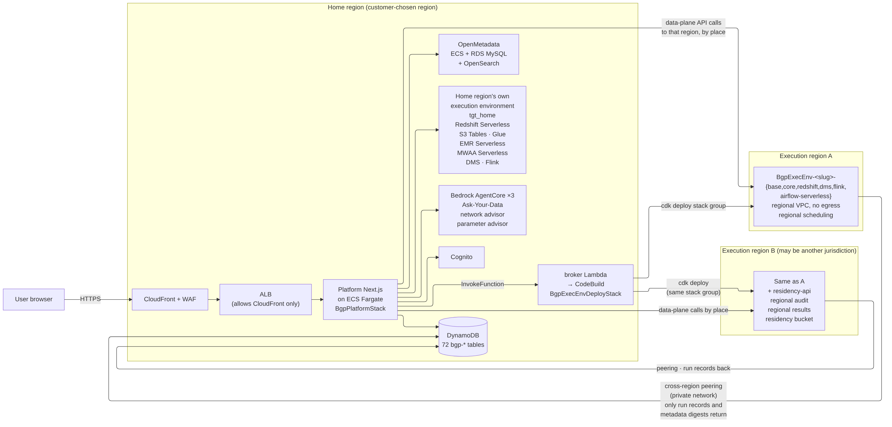

### 1.1 Two kinds of region

- **Home region**: the region specified at installation; it hosts the pages, metadata, user pool, governance catalog and AI agents. On the page its card carries 🏠 and the "Home" tag, the execution scope dropdown shows it with the "Home region" tag, and its internal name is fixed to `tgt_home`.
- **Execution region (execution environment)**: every region has a complete data plane: Redshift Serverless warehouse, S3 Tables data lake, Glue, EMR Serverless, Airflow Serverless scheduling, DMS, Flink. A region allows only one set, and components cannot be trimmed.
- Every execution environment has an internal name `targetId` (such as `tgt_usw2_a`); lists, dropdowns and run history all use it to mark "which region".

### 1.2 What guarantees "data stays in its region"

- **Every object has a target**: data sources, sync tasks, batch jobs, queries and modeling landings all explicitly record "which region it runs in"; a request that lacks this information is rejected, and the platform never silently picks the home region for you.
- **Each region has its own scheduler**: when you "Publish to MWAA schedule" a job, it goes to the Airflow Serverless of each region you checked; the timed trigger happens in that region, and only the run record is sent back to the home region.
- **Execution regions have no internet egress**: an execution region builds no NAT gateway and uses no Elastic IP; all AWS calls go through VPC endpoints; the only cross-region link is one private path used to write the run ledger back to the home region (the gist of the "This region's execution environment has no internet egress" note in step 1 of the wizard).
- **Sync tasks run only in the region of their data source**: to keep a region's data in that region, create the data source in that region too (a data source's region is fixed at creation and cannot be changed later).
- **"Execution scope" in the top bar**: lists, runs, costs and catalogs are filtered by the selected region, so you do not mistake another region's objects for this region's; see §4.5.

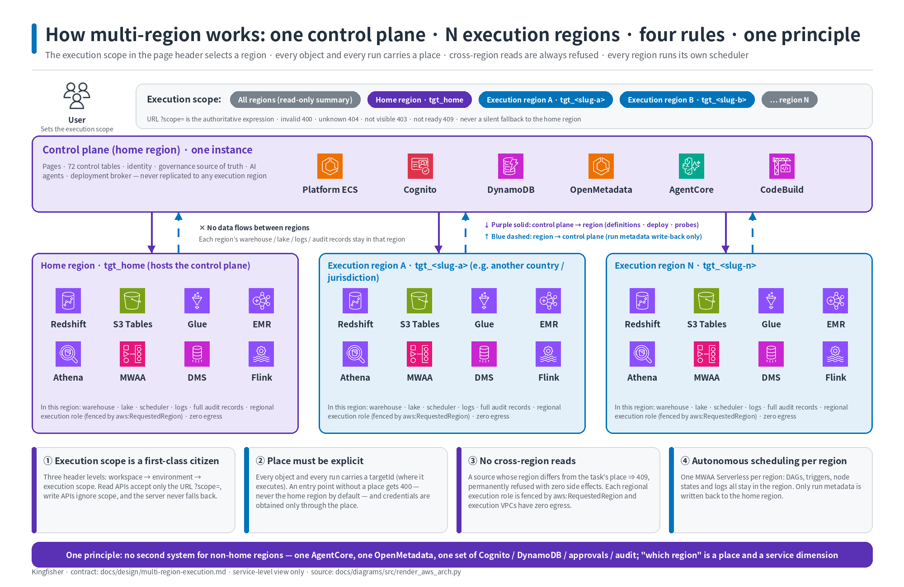

### 1.3 Jurisdiction and disclaimer

- When you create an execution environment there is a "Jurisdiction tag (jurisdiction)" field, default `home`. The admin fills it in **manually**; the platform does not derive it from the region, it cannot be changed after registration, and the platform makes no legal judgment.
- When the execution region and the home region are not in the same jurisdiction, change it to a value other than `home` (this document uses `eu-sim`). Doing so adds four things:
  - The last step of the wizard requires checking "I have read and agree" to the disclaimer, otherwise "Start deployment" cannot be clicked;
  - The region gets one extra component, `residency-api` (regional audit table / regional result store);
  - Every user sees the "Disclaimer" once before their first data operation on that region, and the consent is kept on record;
  - Every data operation on that region writes two audit records: the full record in the region (including the SQL text and the operator), and only a summary in the home region (audit ID, action, target region, row count, duration). The SQL history text stays only in that region.
- When both regions are in the same jurisdiction, keep `home`; none of the four things above happens and all other steps are identical.

### 1.4 Auditable: the audit ID

- Every query / job run on a cross-jurisdiction region has a regional audit record ID. It appears as "Audit #" in the sheet header of Redshift query results and in the "Audit" column of the batch job "Run History" and the "Task Monitor".
- With this ID you can find the summary entry of the home region in the "Audit Log"; the full record stays in the regional audit table of that region.

### 1.5 What is still platform-wide (tell your compliance colleagues candidly)

- The pages, the user pool, workspaces, audit log summaries and the run-record ledger all live in the home region.
- The GenBI agent and the governance center (OpenMetadata) each exist exactly once for the whole platform and are deployed in the home region: GenBI SQL runs in the region you choose, but the agent that produces the conclusion is in the home region; governance catalog metadata is aggregated in the home region.
- In the current version, "cross-region access" is rejected by the application-layer target validation; the defense-in-depth layer "the platform task role holds no permissions in other regions at all, enforced by IAM" is not yet in effect (known boundary).

## 2. Preparation

- [ ] Sign in with a platform admin account and switch "Workspace" in the top bar to the project you want to use (example: the default project).
- [ ] Confirm that the target region (example `us-west-2`) is enabled in the AWS account and has no execution environment of this platform yet.
- [ ] Find out and note two things: ① whether the new region and the home region are in the same jurisdiction (this decides what to enter as the jurisdiction tag); ② whether the region was pre-authorized at installation / upgrade (the wizard shows this directly, no need to check in advance).
- [ ] Prepare a batch job whose script you can edit. This document creates a new Redshift SQL job `region_probe` that depends on no business table; you can also simply observe the demo object `Showcase-<region-slug>-ETL-ChannelROI`.
- [ ] If you take the cross-jurisdiction branch: have your compliance / legal colleagues read the disclaimer text first (quoted in §3.3) and decide who clicks "I have read and agree".

## 3. Step 1: Create the execution environment (three-step wizard)

Page path: **System → Execution Environments**, click "New execution environment" at the top right.

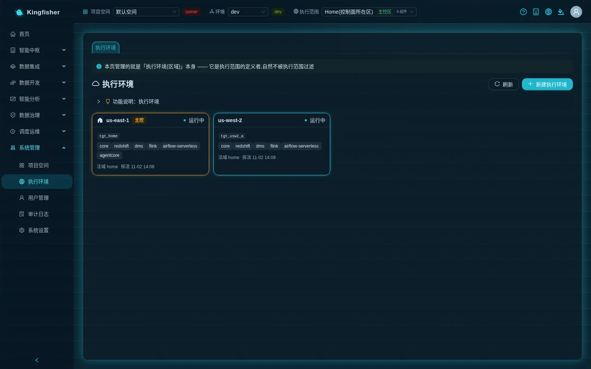

### 3.1 Step 1 "Choose region + name"

- "region" dropdown: the list comes from the account's actual state; each region is suffixed with "pre-authorized, usable right after the build" or "ops must release it once after the build". Choose `us-west-2`.
  - Regions that already have an execution environment show "Already has an execution environment <targetId> (<status>)" and are **not selectable** (one region, one set).
  - Regions blocked by organization policy show "Blocked by your organization's service control policy (SCP); cannot deploy here: <blocked action>" and are not selectable.
  - Regions marked "Organization policy could not be verified" remain selectable; click "Refresh" next to the dropdown to check again first.
  - The line under the dropdown reads "N of them are pre-authorized by the control plane (usable right after the build); the others need ops to run the release command once after the build, then 'Probe'". Remember which kind your region is; it decides whether you need §4.2.
- "Jurisdiction tag (jurisdiction)": keep `home` for the same jurisdiction; for a different jurisdiction enter a value that starts with a lowercase letter and contains only `a-z` / `0-9` / `-` (example `eu-sim`). The hint under the field reads "If this execution region is in a different jurisdiction from the home region, change the jurisdiction label".
- "cellId (optional)" and "stage (optional)": leave empty.
- Two read-only notes: "This region's execution environment has no internet egress" and "Resource name preview (naming SSOT)" (a preview of the data lake bucket / script bucket / S3 Tables table bucket / Athena workgroup / CFN stack names).
- Click "Next" (the button is disabled when no region is chosen or the jurisdiction format is invalid).

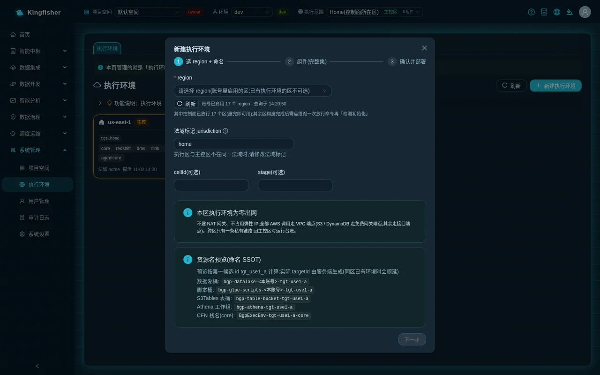

### 3.2 Step 2 "Components (full set)"

- This step has **no checkboxes**: each row is a "Required" tag + component name + description + cost basis. For the same jurisdiction it is `core / redshift / dms / flink / airflow-serverless`; when the jurisdiction is not `home` there is one more row, `residency-api`.
- The note below reads: "Every execution environment gets all components; there is no reduced variant".
- Click "Next".

### 3.3 Step 3 "Confirm and deploy"

- Check the three summary lines: region, jurisdiction, components.
- The note states that the platform deploys automatically through CodeBuild, no commands need to be typed, and the wizard shows live progress in place.
- **Cross-jurisdiction only**: a yellow "Disclaimer (text v1)" block with the text below, followed by the checkbox "I have read and agree". While it is unchecked, "Start deployment" cannot be clicked.

> This platform assumes no legal liability related to cross-border data transfer or data compliance. You are responsible for constraining and controlling data compliance in accordance with the laws and regulations of your local government. By clicking [Agree and continue] you acknowledge and agree to the above.

- Click "Start deployment". You should see the messages "Registered: <targetId>" and "Deployment triggered (buildId …)" in turn, and then the wizard turns into a progress view in place: "Environment <targetId> created; deployment in progress".
  - If you chose a region flagged "ops must release it once after the build", one more yellow message appears here: "The control plane has not enabled this region yet: the deployment can finish, but Probe will fail until it is enabled". This is normal; §4.2 handles it.
  - Click "Done (you can keep following progress on the details page)" to close the wizard; the new card in the list shows the status "Deploying" and its component tags read "Pending deployment".

## 4. Step 2: Wait for the build → release → check initialization → enable → authorize projects

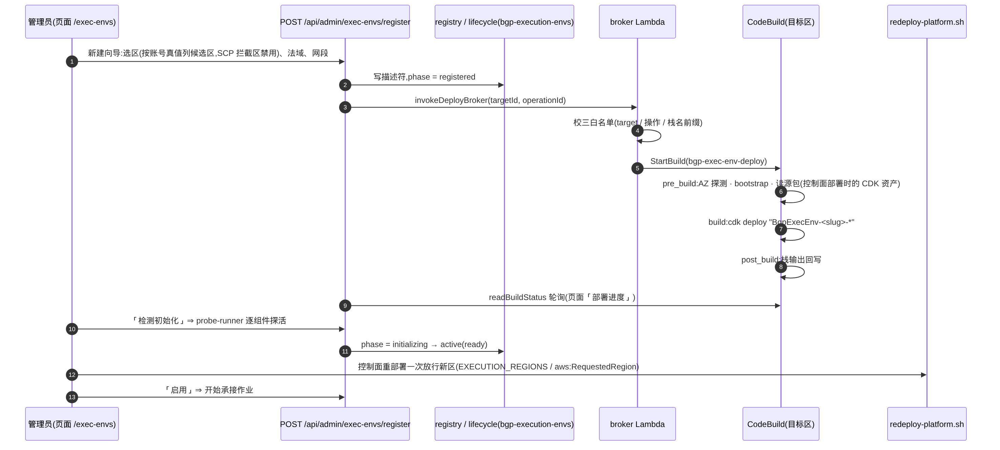

### 4.1 Wait for the build to succeed

- Click the new card to open the details drawer and look at the "Deployment progress" section: the badge goes from "Building" to "Build succeeded"; below it the stacks are listed one by one, `BgpExecEnv-<slug>-base / -core / -redshift / -dms / -flink / -airflow-serverless` (plus `-residency-api` for cross-jurisdiction), all reaching `CREATE_COMPLETE`.
- "View build log (tail)" expands the log. Timing reference: the 6 stacks of a same-jurisdiction region took about 11 minutes in the demo environment (10.9–11.2 minutes across three demo accounts); the 7 stacks of a cross-jurisdiction region take slightly longer.
- When the build fails, a red "Manual recovery required" banner appears at the top of the details page; see §11 Troubleshooting for how to handle it.

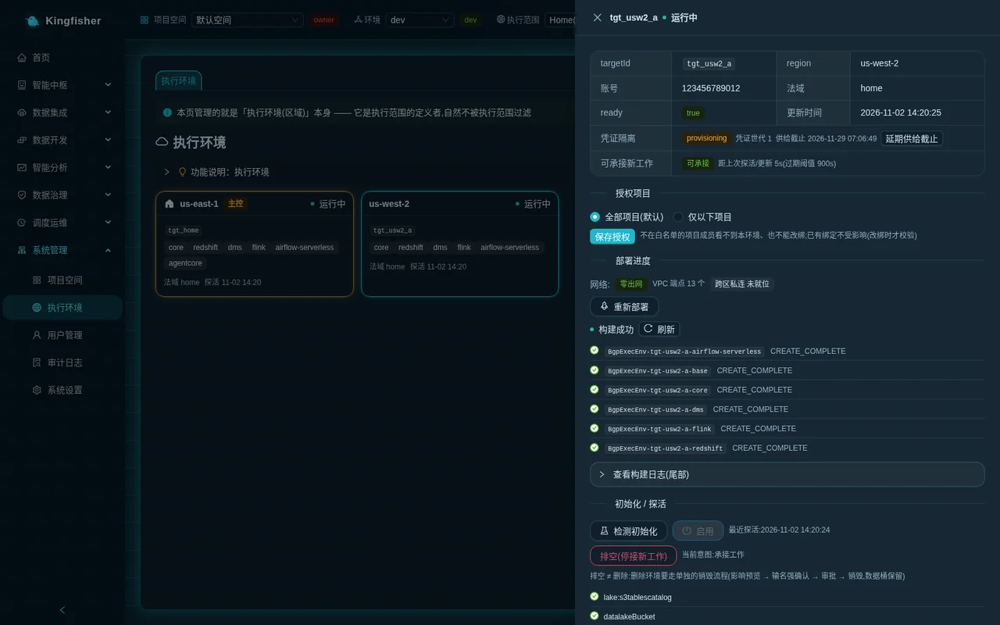

### 4.2 Release (only when the wizard flagged "ops must release it once after the build")

- Check: does the "Initialize / probe" section of the details page show the yellow message "Control plane has not enabled region us-west-2: Probe will fail until it is enabled"? If not ⇒ skip to §4.3.
- If yes ⇒ have operations run one **control-plane redeployment** on the deployment machine (the command and the "what changes / what does not change" list are in [the customer production deployment manual, section 7 step 2](../deployment.md)); the command shown in the page message lacks the `BGP_DEPLOY_MODE=production` prefix, so follow the manual.
  - Impact on users: within about two minutes the platform pages may hit one failed request; refresh and you are back, the login session is kept; running jobs and timed schedules are unaffected.
- When operations is done, go back to the details page and click "Refresh" at the top right of the list; confirm that the yellow message is gone before continuing.
- To skip this step for every future region: at the next upgrade, have operations pre-authorize the candidate regions as described in the manual; afterwards those regions show "pre-authorized, usable right after the build" in the wizard.

### 4.3 "Check initialization"

- In the "Initialize / probe" section click "Check initialization". The platform probes each resource, one row per resource, green ✓ or red ✗ with a reason; the probe items depend on the installed components (core probes the buckets / table bucket / Glue / Athena; the warehouse is probed only if installed, and so on).
- You should see the message "All probes green"; the card status becomes "Testing". With red items it reports "Some probe items failed; see details below".
- The probe items depend on which components are installed: in the demo environment a same-jurisdiction execution region (core + Redshift + DMS + Flink + Serverless Airflow) has 18 items — core 10 (federated catalog, data lake bucket / script bucket / table bucket, Athena workgroup, EMR security group and two roles, two network checks for zero egress and the link back to the home region), Redshift 2, DMS 2, Flink 1, Serverless Airflow 3; the home region additionally has three agent checks and lacks the two network checks.

### 4.4 "Enable" → "Authorized projects"

- The "Enable" button is clickable only when the status is "Testing" and all probes are green; otherwise hovering shows "Can only be enabled when status=testing and all probes are green (currently …)" or "Probes not all green".
- Click "Enable"; you should see the message "Enabled; now accepting pushed work"; the card status becomes "Running"; the "Accepting new work" row on the details page shows "Accepting work".
- Enabling only means the region can accept **new** tasks; it does not move any existing task there; existing tasks stay bound to their original regions.
- Scroll down to the "Authorized projects" card:
  - "All projects (default)": every project can bind tasks / queries / modeling to this region;
  - "Only the projects below": a project multi-select appears (searchable by project name); only the checked projects can use this region; empty = nobody can bind.
  - Click "Save authorization"; you should see "Set to: all projects allowed" or "Set to: only N projects allowed".
  - The note next to the card reads: "Members of projects not on the allowlist cannot see this environment or rebind to it; existing bindings are unaffected (checked only when rebinding)".
- This document keeps "All projects (default)".

<!-- Screenshot to be added: execution environment details · "Authorized projects" card · the multi-select after choosing "Only the projects below" -->

### 4.5 "Execution scope" in the top bar: take a look at the new region

- The third level of the top bar is "Execution scope" (Workspace → Environment → Execution scope). The first entry of the dropdown is "All (N regions)", followed by every execution environment grouped by region: name + "Home region" tag (home region only) + "🌍 <jurisdiction>" tag (cross-jurisdiction only) + component count; regions that cannot accept new work right now carry the "Not accepting work" tag but remain selectable.
- The dropdown lists only installed execution environments (the hover tip reads "Switch the current execution scope (only installed execution environments are listed; switching stays on the current page)"), so `us-west-2`, which you just enabled with "Enable", should now appear in it. Switching stays on the current page and does not reload; the address bar gets `?scope=`, which survives a refresh.
- In a region's view, list pages keep a line at the top "Other execution scopes have N more" + "View all", so you do not think things have disappeared.
- Pages that follow the execution scope: home statistics, data sources, data sync, batch compute, ETL orchestration, Redshift query, Athena query, stream compute, data governance, data modeling, task monitor, backfill center, alerting center, FinOps, audit log, the resource cards in Settings, and so on.
- Pages that do not follow it: Multi-Region Dashboard, Execution Environments, Users, Business Glossary & Rules, Requests (they are global views by nature); GenBI requires a specific region to be selected first and shows "Select an execution scope" in the "All" view.


## 5. Step 3: Bind the same batch job to two regions and run once in each with one click

Page path: **Data Development → Batch Compute**. First switch "Execution scope" in the top bar back to "All".

### 5.1 Create a Redshift SQL job unrelated to any business table

- Click "New"; in the "New ETL Job" dialog enter the job name `region_probe`, choose the type "Redshift SQL Job", and click "Create".
- Select it; in the "Execution regions (multi-select)" dropdown of the editor check both regions, or simply click "Select all active regions (2)".
  - With both regions checked, the tag "🌐 Multi-region shared: one copy runs in each of 2 regions" appears; with one region checked it is "📍 Region-specific".
  - The dropdown lists only regions that can receive work (enabled + warehouse installed + this project authorized). If only 1 is selectable and the orange "Only 1 region can be pushed to right now (more appear here after you create regions or add components under 'Execution Environments')" appears, go back and check §4.4.
- In the script editor write (separate multiple statements with semicolons):

```sql
CREATE TABLE IF NOT EXISTS public.region_probe (at timestamp);
INSERT INTO public.region_probe VALUES (getdate());
```

- Click "Save".

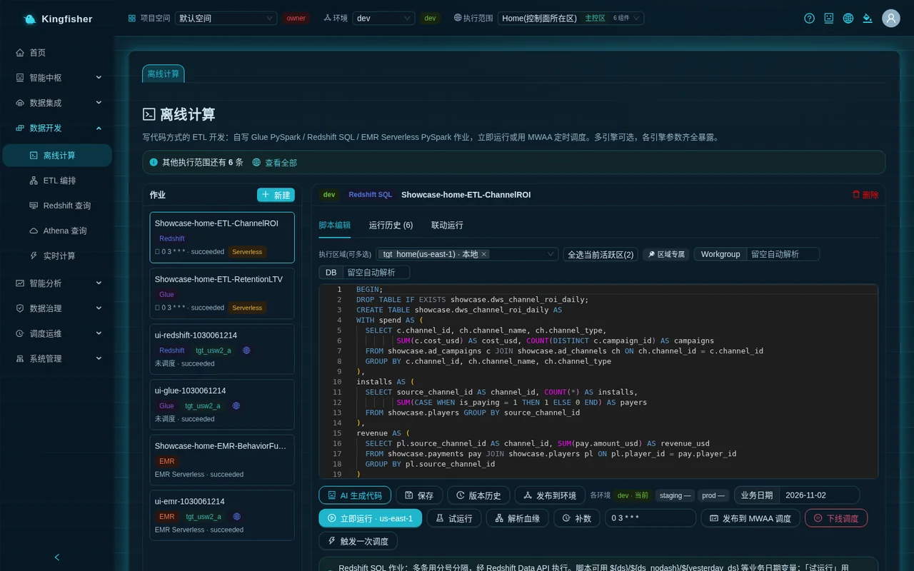

### 5.2 "Run now (once in each of 2 regions)"

- The button text tells you what the click will do: with two regions bound it reads "Run now (once in each of 2 regions)"; with one region bound it reads "Run now · us-west-2".
- With several regions bound, the dialog "Which execution scopes should this run in?" appears first:
  - top bar in the "All" view ⇒ all checked by default, with the hint "By default, runs once in each of the 2 regions this job is bound to.";
  - top bar in a region's view ⇒ only that region checked by default, with the hint "By default only the current execution scope (…) runs; checking other regions will not change the execution scope in the top bar.";
  - with both checked, the note at the bottom reads "These 2 runs are grouped into one linked run: view them as a group, cancel unfinished ones in one click, and retry only the failed regions."; the confirm button reads "Run now (once in each of 2 regions)".
- **Cross-jurisdiction branch**: this is your first data operation on the `eu-sim` region, so the "Disclaimer" appears first (see §7); after you click "Agree and continue" the run continues automatically.
- You should see the message "Submitted one run in each of 2 regions: tgt_home, tgt_usw2_a (business date …)". If a region did not start, an extra message says "N of these regions are not up: <region> (<reason>)".
- Redshift jobs can also "Dry run (2 regions)" first: only an EXPLAIN validation, no data is written.

### 5.3 "Run History": one row per region

- Switch to the "Run History (N)" tab and click "Refresh". You should see two rows:
  - "Execution region" column: one row "Local" (home region), one row `tgt_usw2_a`;
  - "Audit" column: the cross-jurisdiction row shows `#` + the last 8 characters of the audit ID, the home region row shows `-`;
  - "Trigger", "Business date", "Start", "Duration", "Error" as usual; the "Logs" button shows that region's run log.
- This column is the visible evidence of "executing in several regions together": one click, two runs, each in its own region.

### 5.4 Filter the task monitor by "Region"

- **Scheduling & Ops → Task Monitor**: the filter bar has a "Region" dropdown (from the active execution environments ∪ the regions that actually appear in the results). Choose `us-west-2` and click "Search"; only that region's runs remain.
- The "Region" and "Audit" columns of the list mean the same as in run history; rows with "Region" = `-` are legacy run records from before tagging (treated as the home region).


### 5.5 Publish to each region's own scheduler (optional)

- Enter a cron in the job editor (such as `0 * * * *`) and click "Publish to MWAA scheduler (2 regions)". Each region's own Airflow Serverless receives one copy of the schedule artifact.
- After publishing, "Take schedule offline" and "Trigger once" appear; "Trigger once" asks "Run every published schedule artifact once now (cron unchanged)?", and after confirmation reports "Triggered the schedule artifact once in 2 region(s); a new row appears in run history in about a minute".
- The "Schedule config" tab of the task monitor shows the timed objects on each region's scheduler.

## 6. Step 4: Redshift query with one sheet per region, compare / merge

Page path: **Data Development → Redshift Query**.

### 6.1 Choose the regions and run

- In the "Connection Config" card check both regions under "Execution regions (multi-select)", or click "Select all active regions (2)". The tag "🌐 Runs once in each of 2 regions; results in separate sheets" appears.
- With several regions, the Workgroup / Database dropdowns are **greyed out**, with the tag "Place is determined by each execution target's descriptor" next to them: each region hits its own warehouse; you neither need nor are allowed to fill them in.
- The "Database object" tree on the left shows only the structure of the first selected region (click "Load Schema"); when that region has no warehouse installed, the reason is stated here instead of an empty tree.
- In the "SQL Editor" write:

```sql
SELECT count(*) AS n, max(at) AS last_at FROM public.region_probe;
```

- Click "Run (2 regions)". The region count on the button is the number of scans and billing units that will be produced; at most 8 regions per run.

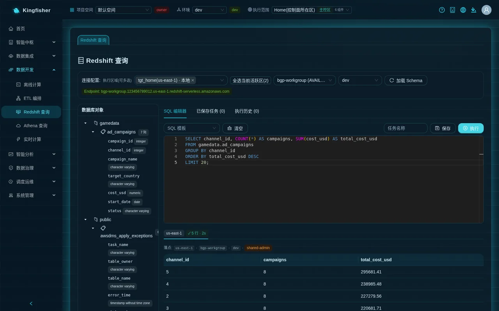

### 6.2 Read the results: one sheet per region

- The result area is a set of tabs: the first is "⚖ Compare" (absent for single-region queries), followed by one sheet per region.
- Each sheet's tab title carries its status: `us-east-1 ✓ 1 rows · 1s`, `us-west-2 ⏳ Running 12s`, `✗ Failed`, `⏱ Timed out`, "Cancelled". Cross-jurisdiction sheets additionally carry the "🌍 eu-sim" tag.
- Regions return and display independently, without waiting for the slowest one; the first sheet to return is activated once automatically, and afterwards focus is not stolen again.
- The top line of every sheet is "Target": region · workgroup · database · credential-mode tag; cross-jurisdiction sheets also carry "🌍 eu-sim" and "Audit #<ID>" (hover tip "Regional audit record ID for this query (the full record stays in that region; the central store keeps only a summary)"). Note this ID down; §8 needs it.
- When a region fails, its sheet shows "Execution failed in this region (other regions are unaffected)" + the engine's original message + the platform's classification advice + that region's target; the other sheets are unaffected.
- When a region exceeds 5 minutes it shows "⏱ This region timed out (Ns) — it may still be running in the background", with "Keep waiting" and "Cancel this region"; cancelling only cancels that one region.

<!-- Screenshot to be added: Redshift Query · multi-sheet results for two regions (with the "⚖ Compare" tab and "Audit #" in the cross-jurisdiction sheet header) -->

### 6.3 "⚖ Compare" and "Merge into one table"

- The "⚖ Compare" table has one row per region: region / status / row count / duration / column signature / error. Until every region reaches a final state the top reads "Each region runs independently and is filled in as it returns; column-signature consistency is judged only after every region reaches a final state (to avoid false alarms)".
- All final and columns consistent: "All regions have returned; row-count differences are in the table below (column signatures match)"; columns inconsistent: "N region(s) have a column signature that differs from the baseline region — usually the table structure differs there or data is not yet synced", and that row is marked red. Baseline = the first region that returned successfully.
- "Merge into one table" is clickable only when every region is final and the column signatures match. Clicking it opens the tab "🧩 Merged (N rows)", whose first column "Source" shows which `targetId` each row came from; the hint reads "This is a view you merged explicitly; the platform never merges cross-region results automatically. The first column shows which region each row came from.".
- Merging is equally available when a cross-jurisdiction region participates, because the query itself has already been audited.

### 6.4 "Run history": cross-jurisdiction SQL text stays in the region

- Switch to the "Run history (N)" tab: one SQL statement sent to two regions makes two rows, with the "Execution region" column reading "Local" and "🌍 tgt_usw2_a" respectively.
- The SQL column of the cross-jurisdiction row does not show the text but "Kept in region eu-sim" + "View". Clicking "View" opens "SQL text (kept in region eu-sim)" with "Audit #…" at the bottom — this read itself also writes a regional audit record.
- "Load" puts that SQL back into the editor (cross-jurisdiction rows are likewise read back on demand).

## 7. First operation on a cross-jurisdiction region: the "Disclaimer" dialog (once per user per region)

- Trigger: any user's **first** data operation on a cross-jurisdiction region — a query, running / dry-running a job, a modeling landing, reading SQL text kept in the region, GenBI questions and card refreshes.
- The dialog title is "⚠️ Disclaimer (v1)", the first line reads "Execution target <targetId> belongs to another jurisdiction. Before your first data operation on it, please read and agree to the notice below (your choice is retained: user / target / version / time).", and the body is the text quoted in §3.3.
- "Cancel": nothing is executed and nothing is recorded; the next operation shows the dialog again.
- "Agree and continue": the platform records (user, target, text version, time) and then **automatically retries** the operation you just attempted. The same person sees it only once for the same region and the same text version; it reappears only when the text version changes.
- Bypassing the page and calling the API directly does not work either: without a consent record the server always rejects, and the dialog is merely how that rejection is presented.
- Traceback: the "Consents" card on the execution environment details page (§8.3).

<!-- Screenshot to be added: Disclaimer dialog · "Cancel" / "Agree and continue" -->

## 8. Steps 5 and 6: Multi-Region Dashboard, audit log, consents

### 8.1 Multi-Region Dashboard (Scheduling & Ops → Multi-Region Dashboard)

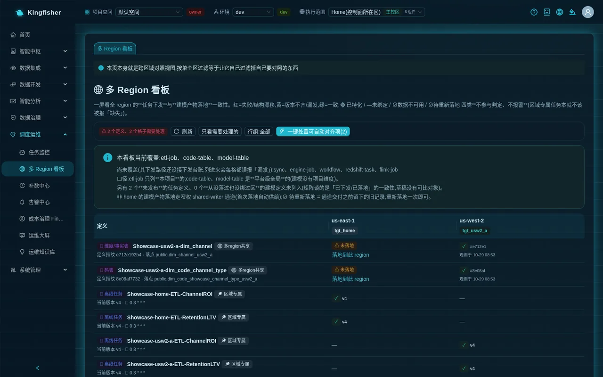

- This page is a global view and does not change with "Execution scope" in the top bar. Row = one definition (⏱ batch task / 🧱 code table / 🧱 dimension/fact table), column = one execution environment (column header region + `targetId`; retired regions are still shown with the "Retired" tag), cell = the status of that definition in that region.
- Summary at the top: "✓ Dispatch/landing consistent across regions" or "⚠ N definitions, M cells need attention"; buttons "Refresh", "Show only items needing attention", "Rows: all", "Rows: tasks only", "Rows: modeling artifacts only", "One-click fix for auto-alignable items (N)".
- The blue note states the coverage honestly: "This dashboard currently covers: etl-job, code-table, model-table"; sync tasks, EMR engine jobs, workflows, Redshift tasks and Flink jobs are **not covered yet**. Another "N unpublished task definitions" are not listed: the matrix is about the consistency of what has been "dispatched", and drafts have nothing to compare against.
- Cell meanings (same source as the "Cell legend" at the bottom of the page):

| Cell | Counts toward the verdict | Meaning and next step |
|---|---|---|
| ✓ (green) | Yes | Dispatched / landed and consistent with the current definition |
| ⚠ Version mismatch (yellow) | Yes | Dispatched, but not the current version ⇒ click "Re-dispatch to this region" in the cell |
| ⚠ Missed / ⚠ Not landed (yellow) | Yes | Bound to this region but never dispatched / landed ⇒ "Re-dispatch to this region" / "Land in this region" |
| ✗ Failed (red) | Yes | Dispatch / landing failed; hover to see the original error (common: missing component / permissions / bucket policy) |
| 🔴 Structure drift (red) | Yes | The region already has a same-named table with a different structure and the platform did not overwrite it ⇒ "Needs manual handling → 'Modeling' page" |
| ⊘ Needs re-landing | No | A stale record (left from before the write channel was delivered) ⇒ land it once more for this region on the modeling page |
| 🔶 Specialized / — / ⊘ Data unavailable | No | Meant to differ, never bound, or no dependency data in that region ⇒ normal, no alarm |

- "Land in this region" is clickable only by platform admins (others see the button greyed out + "Only platform admins can land modeling artifacts").
- "One-click fix for auto-alignable items (N)" first shows "Impact preview: N items pending, K of them auto-alignable", listing what will be done for each (definition × region) and which ones are "Skipped (manual)"; click "Confirm fix" to execute them one by one in series, and the result table shows ✓ / ✗ per row. Structure drift is deliberately excluded from the automatic scope.
- After the `region_probe` job of this document went through "Publish to MWAA scheduler (2 regions)" in §5.5, it should appear as one row with both cells ✓. A job that was only run with "Run now" and never published to a schedule does not appear in the matrix; it counts toward the "N unpublished task definitions" in the note.

### 8.2 Audit log (System → Audit Log)

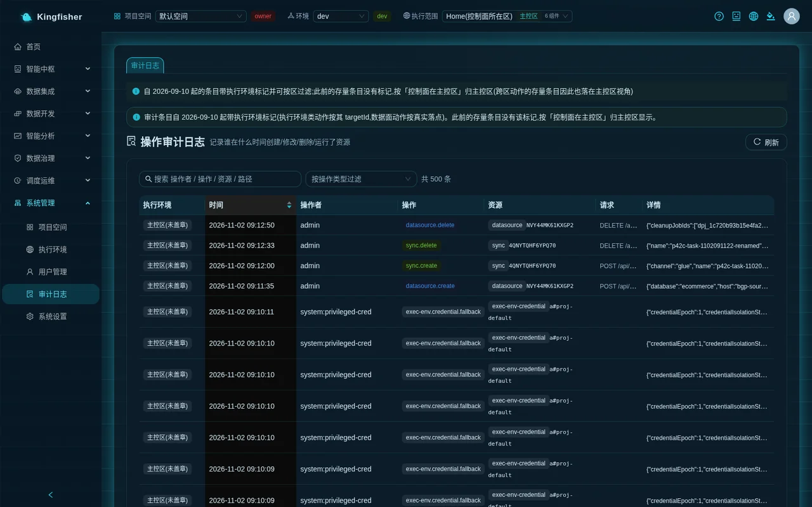

- The blue bar at the top reads: "Audit entries carry an execution environment tag since 2026-09-10 (execution environment actions by their targetId, data-plane actions by their actual place). Earlier entries have no such tag and are shown under the home region, as the control plane lives there."
- Columns: "Execution environment" (region tag; legacy entries show "Home region (untagged)"), time, operator, action, resource, request, details. This page follows "Execution scope" in the top bar: switch to `us-west-2` to see only that region's entries.
- Use the "Filter by action type" dropdown to pick an action. The actions relevant to this scenario:
  - summaries of cross-jurisdiction data operations: `residency.execute` (query execution), `residency.result` (fetching results), `residency.history` (reading SQL text kept in the region), `residency.run-submit` (job run submission), `residency.modeling-land` (modeling landing);
  - consent records: `residency.ack`;
  - execution environment lifecycle: `exec-env.register`, `exec-env.deploy`, `exec-env.probe`, `exec-env.enable`, `exec-env.access.set`, `exec-env.drain`, `exec-env.delete-request`, `exec-env.destroy.done`, `exec-env.discard`.
- The home-region entries of `residency.*` are summaries only: audit ID, action, target region, row count and duration, and **no** SQL text; the text and the operator identity are in the regional audit table of that region. An environment whose two regions share one jurisdiction (for example a demo installation) does not produce such entries; only cross-jurisdiction execution regions do.
- Tracing back by audit ID: paste the "Audit #" noted in §6.2 or the ID from the "Audit" column of run history into the "Search operator / action / resource / path" box. The search matches keywords in the five columns "operator / action / resource type / resource ID / path" and does not search "details"; the ID is hit only when it lands in the "Resource" column as the resource ID; otherwise filter `residency.*` with the "action" dropdown first and then find it by time.

### 8.3 The "Consents" card on the execution environment details page

- **System → Execution Environments** → click the `us-west-2` card. The "Jurisdiction" row in the header shows the "🌍 eu-sim" tag and the small text "Consented v1 ✓" (hover: "<who> agreed to disclaimer v1 at registration on <time> (auditable; immutable)").
- The "Consents" card (cross-jurisdiction environments only) lists row by row: the admin "At registration", every user who consented "At first use", the time and the text-version tag. The table is append-only and cannot be edited or deleted; it is the single authority that "avoids disputes". When empty it shows "No consent records yet".

<!-- Screenshot to be added: execution environment details · "Consents" card (with both "At registration" and "At first use" records) -->

## 9. Step 7: Retire an execution region (stop accepting work → request deletion → approval → destruction)

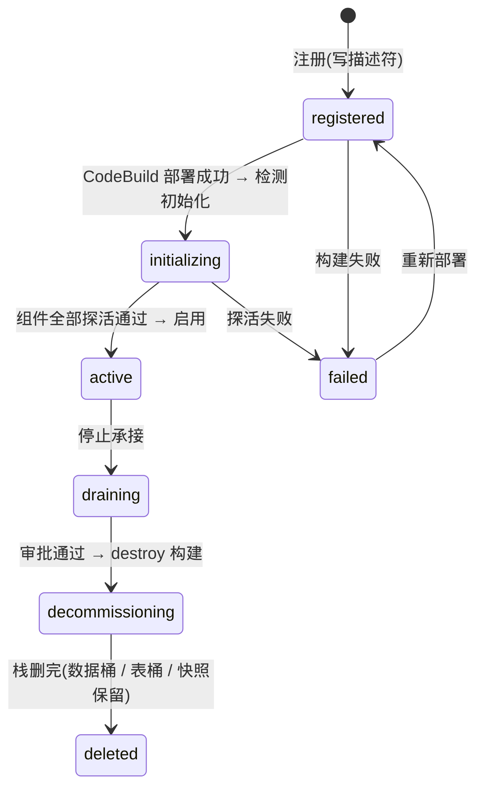

The "Danger zone" at the bottom of the details page offers exactly one path, based on the environment's actual state. The home region has no danger zone and cannot be deleted.

### 9.1 An environment that was never installed: "Discard"

- For an environment whose deployment failed and that created not a single resource in the target region, the danger zone shows "Discard this environment": "This environment was never installed (it has no resources in the target region). After discarding it shows as 'Deleted' and frees the execution-environment slot in us-west-2, so you can register again there."
- Click "Discard this environment" → dialog "Confirm discarding <targetId>" → type the `targetId` → "Discard". The platform first checks live that the target region really has none of its stacks.

### 9.2 An environment that was deployed: four gates

1. **1. Stop accepting work (drain)**: the danger zone reads "This environment was deployed: to delete it, first stop accepting work, then review the impact preview, type the region name to confirm, and get approval before it is destroyed (data buckets / table bucket / final snapshot are retained).". Click the button → dialog "Stop accepting work: <targetId>", enter the "Reason (required, recorded in the audit log)" → "Stop accepting work".
   - You should see "Stopped accepting work: new bindings / schedules / runs are all rejected"; the card status is "Draining"; the region immediately stops accepting new bindings, schedules and runs, in-flight jobs finish, and no resource is destroyed.
   - As observed in the demo environment: after confirming, the top of the details page shows "This execution environment has stopped accepting work (drained; intent=drain) — not accepting new bindings, schedules or runs (status=draining)", the card and list status are "Draining", "Current intent: draining — not accepting new work (in-flight jobs still run to completion)", and the former "Drain (stop accepting new work)" button becomes "Resume accepting new work".
   - If you change your mind, click "Resume accepting new work"; the dialog "Resume accepting new work? … the phase returns to 'Running' only after the next all-green probe" appears; after "Confirm" the intent immediately returns to accepting, but the status is still "Draining" (hint "Phase cannot accept new work (phase=draining)"); only after one more "Check initialization" with all probes green does it return to "Running / Accepting work".
2. **2. Request deletion**: the danger zone changes to "This execution environment has stopped accepting work", followed by the three "Pre-delete checks" numbers "Bound resources", "Enabled schedules", "Running runs"; each gets a ✓ only when it is 0; and it lists "Retained (not deleted): data resources must be cleaned up separately after a human confirms; the platform does not decide for you".
   - With bindings present, a detail table is listed (type / name / "Go unbind these tasks") and the button is disabled; first, as in §12, remove the region from the job's "Execution regions (multi-select)" and "Save", "Take schedule offline", and wait for the runs to finish.
   - When some source cannot be read, it shows "Some sources could not be read, so zero cannot be confirmed (unreadable is not the same as none)" and refuses; retry later.
   - Click "2. Request deletion" → dialog "Delete execution environment us-west-2 — impact preview" → "Next".
3. **Type the region name to confirm**: the dialog "Confirm deletion us-west-2" reads: "This destroys all execution resources in the region. Data buckets / table bucket / final snapshot are retained and must be cleaned up separately; they are not deleted by this action.". Type `us-west-2` into the field (the button is enabled only when it matches the region name exactly) → "Confirm deletion".
   - You should see "Deletion request submitted; waiting for a platform admin to approve"; the danger zone shows "Deletion request submitted (approval …); waiting for a platform admin to approve".
4. **Platform admin approval**: **System → Workspace** → the "Pending my approval (N)" card shows the red tag "Delete execution environment" + "Delete execution environment <targetId> (us-west-2)", replaying below it "Impact preview snapshot (<time>): bound resources 0 · enabled schedules 0 · running runs 0" and the "Retained (not deleted):" list.
   - Click "Approve" (or "Reject"). On approval the server recomputes the impact preview; if it differs from the one submitted with the request, the approval is refused and you must reject and request again.
   - You should see "Approved and executed"; if it shows "Approved, but destruction could not start: …", go back to the execution environment details page and see §9.3.

<!-- Screenshot to be added: execution environment details · the three danger-zone dialogs "1. Stop accepting work (drain)" → "2. Request deletion" → "Confirm deletion us-west-2" -->

### 9.3 Destruction and wrap-up

- The danger zone of the details page shows "Destroying": "Managed services go first, then component stacks in reverse dependency order, then core and base; build status: …". When finished it shows "Deleted", together with "Warehouse final snapshot: <name> (<state>)" and the retained list.
- When stuck it shows "Destruction is stuck" + the resource and reason by name; click "Retry destruction" (type the region name again): it reuses the same deletion plan and the same final snapshot name and does not take a second snapshot.
- **Data resources are not deleted by the destruction and keep billing**: data buckets, table buckets, the warehouse namespace / workgroup and final snapshot, the data-domain CMK and its alias, the Airflow Serverless DAG bucket, and the regional audit table / result bucket of non-`home` jurisdictions. Clean them up separately after human confirmation (list in [the customer production deployment manual, section 7bis](../deployment.md)).
- After the deletion, have operations run one more control-plane redeployment to withdraw the control plane's release of that region (manual section 7bis).
- The deleted region disappears from the "Execution scope" dropdown in the top bar; in the Multi-Region Dashboard the column of a region that once received dispatches is still shown with the "Retired" tag and does not vanish silently.

## 10. Verify the result

| Check | Where to look | You should see |
|---|---|---|
| New region in place | Execution environment list | The `us-west-2` card status is "Running"; details "Accepting new work" = "Accepting work"; no component tag reads "Pending deployment" |
| New region in the dropdown | "Execution scope" in the top bar | "All (2 regions)"; `us-west-2` in the group (with "🌍 eu-sim" for cross-jurisdiction) |
| One run, two records | Batch Compute → Run History | Two rows, "Execution region" reading "Local" and `tgt_usw2_a`; the cross-jurisdiction row has `#…` in the "Audit" column |
| Filter runs by region | Task Monitor | With "Region" = `us-west-2` only that region's runs remain |
| Each region's data stays in place | Redshift Query → two sheets | `public.region_probe` has 1 row in each region; "⚖ Compare" column signatures match; "Merge into one table" gives 2 rows with different "Source" |
| SQL text does not leave the region | Redshift Query → Run history | The cross-jurisdiction row shows "Kept in region eu-sim" + "View" |
| Consent on record | Execution environment details → Consents | One "At registration" + at least one "At first use" |
| Audit summary in the home region | Audit Log | Entries can be filtered by `residency.execute` / `residency.ack`, with the "Execution environment" column = `us-west-2` |
| Dashboard consistent | Multi-Region Dashboard | Both cells of the `region_probe` row ✓; "✓ Dispatch/landing consistent across regions" at the top |

## 11. Troubleshooting (symptom → cause → next step)

- **The target region is grey and not selectable in the wizard** → the region "Already has an execution environment" (one set per region), or an organization policy (SCP) blocks an action required for deployment → choose another region, or have the account admin handle the organization policy. For regions showing "Organization policy could not be verified", click "Refresh" to re-check before choosing.
- **The wizard reports "Cannot read the list of regions enabled in the account"** → the platform failed to read the account's region list → click "Refresh"; if it still fails, have the admin check the platform role's permissions.
- **Red "Manual recovery required … build=FAILED" on the details page** → the build failed → click "Recover (record failure and unlock)" → dialog "Confirm" → expand "View build log (tail)" for the cause → fix it and click "Redeploy".
  - "Redeploy" first does a 1-to-3-minute dry run and shows "Confirm the impact of this redeployment (upgrade)"; the real deployment starts only after you confirm. Do not create a second environment in the same region.
  - If the log starts with "fewer than 2 availability zones available" or "endpoint service … has no supported AZ" → the region does not meet the prerequisites → "Discard this environment" to free the slot and choose another region.
- **"Check initialization" red item "control plane has not enabled"** → §4.2 was not done, or was done without refreshing → after operations releases the region, click "Refresh" and check again. "Descriptor missing resources.*" is usually a secondary symptom; confirm the release first and re-test.
- **The "Enable" button is grey** → hover for the reason: the status is not "Testing" or the probes are not all green → fix the red items first, then "Check initialization".
- **The new region is missing from the batch job's "Execution regions (multi-select)"** → the new region is not yet enabled with "Enable", has no warehouse installed (required by Redshift jobs), or this project is not on the "Authorized projects" allowlist → check against §4.4.
- **A run / query is rejected with "Execution target … is not authorized for project … this target has a project allowlist ('Authorized projects' on the execution environment details page); ask an admin to add this project to the allowlist"** → the admin adds the project under "Authorized projects" on that environment's details page and clicks "Save authorization".
- **The new region is not in the execution scope of the top bar** → the dropdown lists only environments whose initialization is complete; the new region has not been enabled with "Enable" yet → finish §4.3 / §4.4.
- **The page says "The execution scope given in the URL is currently unavailable"** → `?scope=` in the address bar points to a deleted or incompletely installed region → click "Switch to 'All'"; the platform does not switch back to the home region automatically.
- **The page says "The last selected execution scope 'X' is currently unavailable (it may have been deleted, is not yet initialized, or this project is not authorized); switched back to 'All'"** → the remembered region was deleted or the project authorization was withdrawn → simply pick a region again.
- **One sheet is "✗ Failed" while the other succeeds** → that region lacks the table / permissions are insufficient / the target is not ready; the sheet contains the engine's original message, classification advice and that region's target → act on the advice (for example let the job run once in that region to create the table); the other sheets are unaffected.
- **One sheet is "⏱ Timed out"** → that region is slow or the data volume is large; it may still be running in the background → "Keep waiting" or "Cancel this region"; a timeout is not a failure.
- **The "Merge into one table" button is grey** → some region has not reached a final state, or the column signatures differ → wait for all regions to finish; when the columns differ, fix the table structure in that region.
- **Nothing happened after clicking "Cancel" on the disclaimer** → by design: cancel = not executed, nothing recorded → to execute, repeat the operation and click "Agree and continue".
- **My job is not in the Multi-Region Dashboard** → it is unpublished (drafts are not in the matrix), or its type is outside the coverage (sync / EMR / workflow / Flink), or the row count exceeded the cap and was truncated (the page shows "⚠ Row count exceeds N; truncated.") → read the note bar.
- **A dashboard cell shows "⊘ Needs re-landing"** → a stale record → land it once more for this region on the data modeling page.
- **"2. Request deletion" is grey with red text** → the impact preview is not 0 → follow the red text to "Go unbind these tasks", unbind, take the schedules offline, wait for the runs to finish, then retry.
- **The approval reports "approval is refused if it differs from the one submitted"** → someone bound something to the region after the request → reject, unbind, and request again.
- **The danger zone shows "Destruction is stuck"** → some resource cannot be deleted; the page names the resource and the reason → fix it and "Retry destruction".
- **Old cross-region entries in the audit log show "Home region (untagged)"** → legacy entries from before tagging, attributed to the home region because the control plane lives there → normal; see the blue bar at the top of the page.

## 12. Cleanup (delete the practice objects in this order)

1. Job `region_probe`: change the script to `DROP TABLE IF EXISTS public.region_probe;`, "Save", then "Run now (once in each of 2 regions)" to drop the table once in each region; or have a platform admin run the same statement against both regions in Redshift Query. Non-admin queries are read-only and cannot DROP.
2. If you did §5.5: click "Take schedule offline".
3. Stop in-flight runs before deleting the job, otherwise you get a 409 "In progress"-type rejection (a job referenced by a workflow cannot be deleted either; remove the reference in orchestration first).
4. If the new region was only for practice: retire it as in §9 (first remove it from "Execution regions (multi-select)" of every job bound to it and "Save"), then clean up the retained resources listed in §9.3 by hand, otherwise they keep billing.
5. Disclaimer consent records and audit entries are **not** cleaned up (append-only, no edits or deletes); this is by design.

## 13. Further reading

- [Core concepts](02-concepts.md): one-page definitions of execution environment / execution scope / target / jurisdiction.
- [Platform admin guide](10-guide-admin.md): all routine operations on execution environments — create / check initialization / enable / authorize projects / redeploy / stop accepting work / retire.
- [Data engineer guide](11-guide-data-engineer.md) and [Scenario 1: detail to daily report](20-scenario-detail-to-daily-report.md): how jobs, orchestration, scheduling and backfill work across regions.
- [Scenario 7: data modeling and metrics](26-scenario-modeling-metrics-report.md): landing modeling artifacts region by region, drift in the dashboard and "Land in this region".
- [Scenario 8: operations and alerting](27-scenario-ops-alerting.md) · [Scenario 9: FinOps](28-scenario-finops.md): runs and costs by region; the idle base cost of each execution region is in the [cost model](../cost-model.md).
- [Rules and status code reference](30-reference-rules.md) · [FAQ](32-faq.md) · [Glossary](33-glossary.md).
- Feature tour [Execution environments](../features.md) · module overview [Execution environments (key module)](../modules.md) · customer production deployment manual [section 7 adding an execution region / section 7bis retiring an execution region / section 8 known boundaries](../deployment.md).
- Design contracts: [Multi-region interaction design](../design/multi-region-execution-interaction.md) (execution environment lifecycle, disclaimer, multi-sheet queries, the six guardrails of execution scope) · [Multi-region technical contract](../design/multi-region-execution-spec.md).
