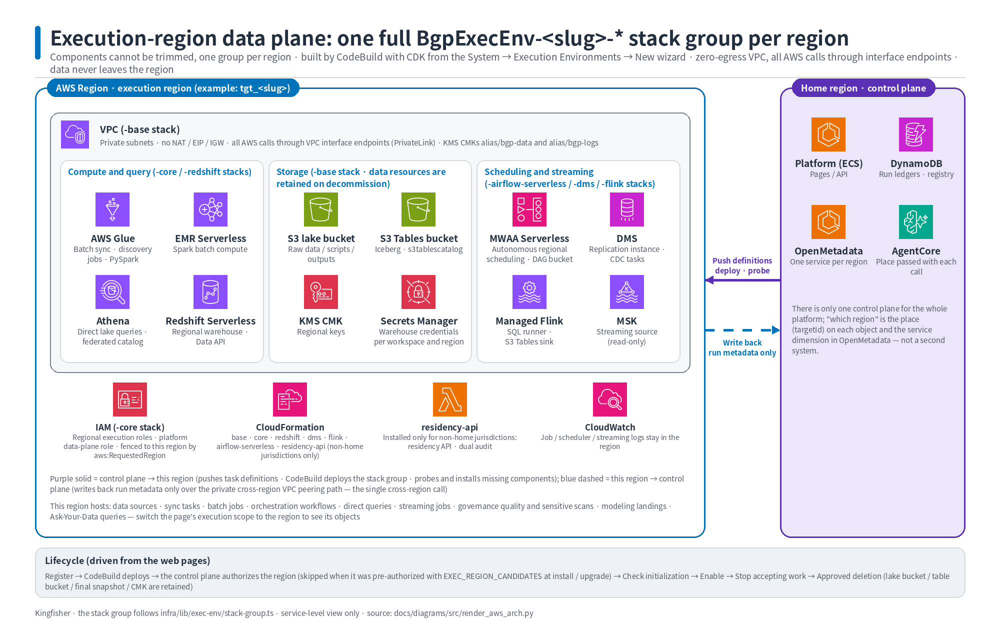
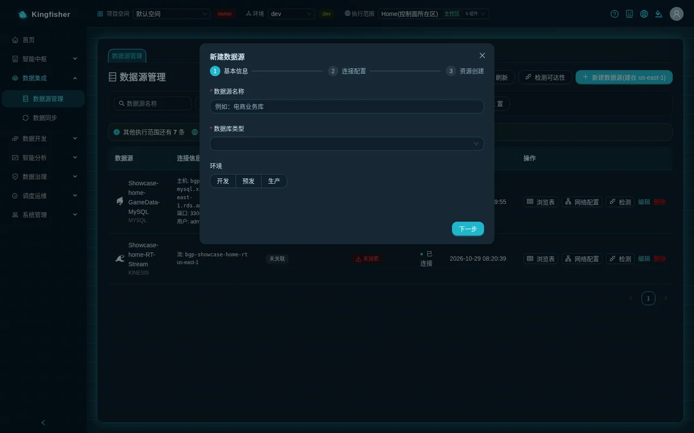
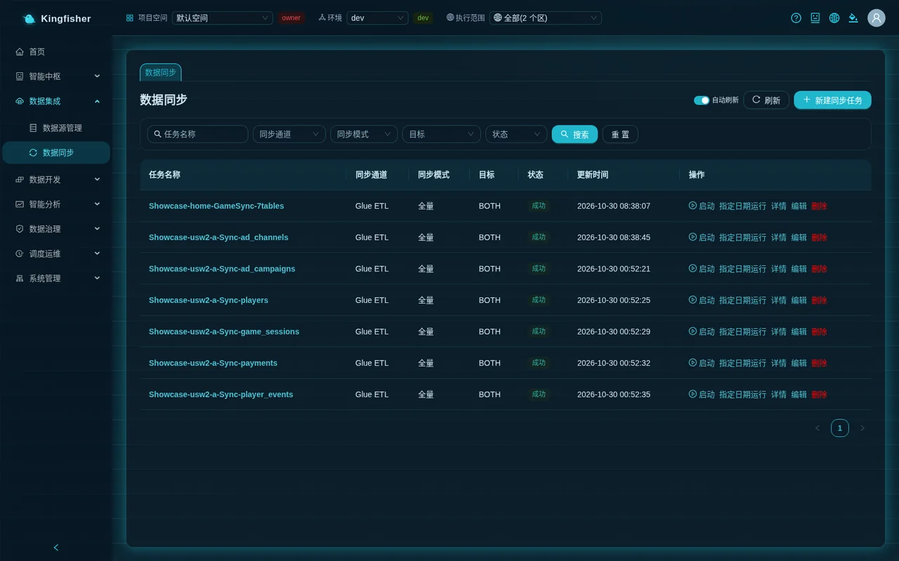
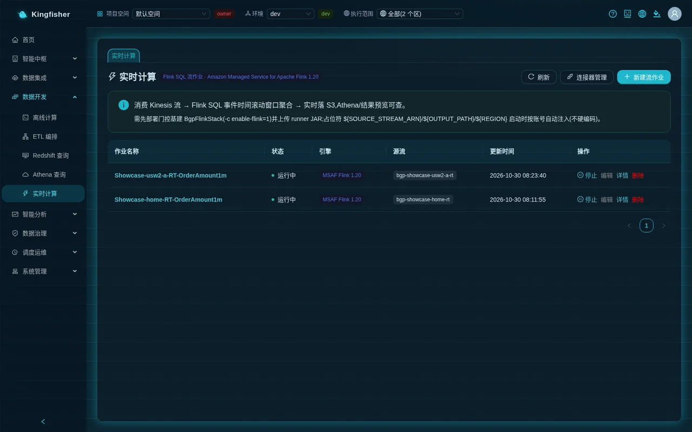
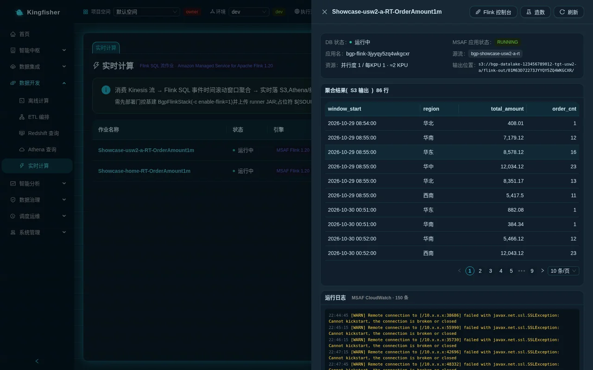
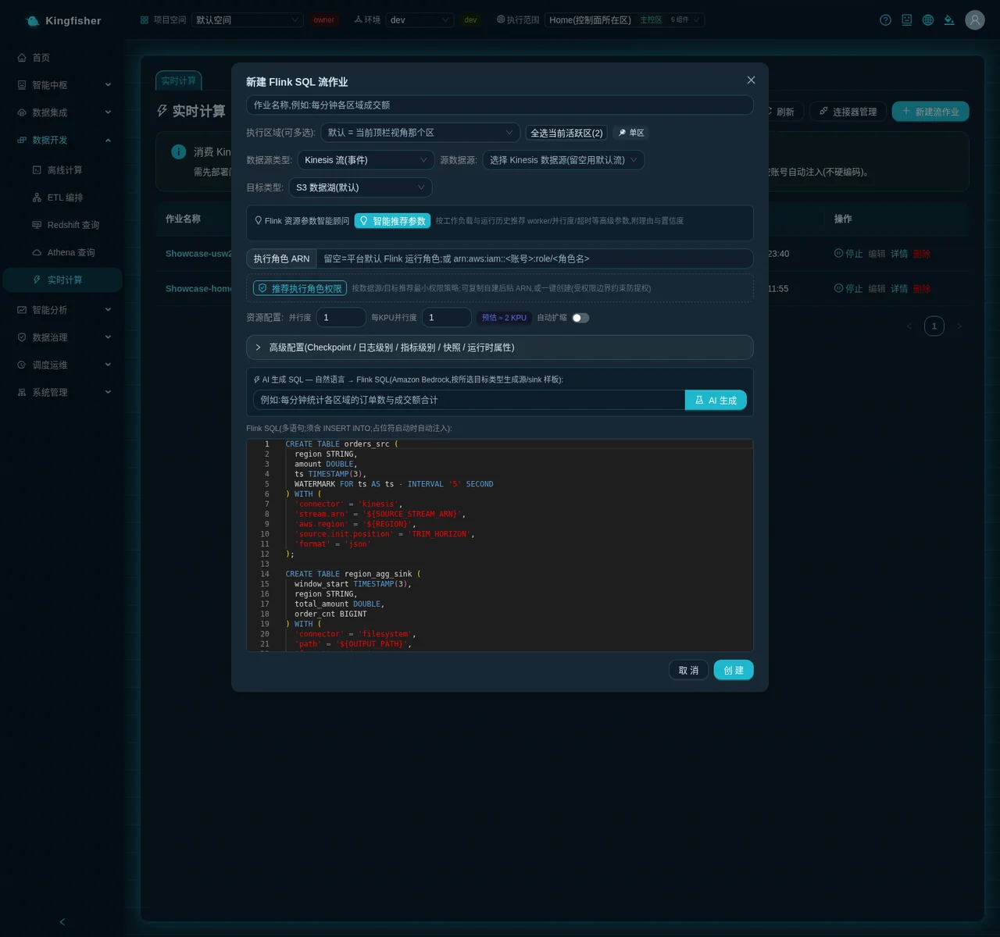

# Scenario 4: Real-time pipeline — real-time sync (DMS CDC / Zero-ETL) and Flink SQL stream processing

| Item | Description |
|---|---|
| Audience | Data engineers (building real-time sync tasks, writing Flink SQL); platform administrators (watching always-on billing and infrastructure prompts) |
| Estimated time | Part A about 40 minutes (of which about 10–15 minutes is waiting for the replication instance); Part B about 30 minutes |
| Prerequisites | Signed in and a member of a workspace; the "Data Sync", "Stream Compute" and "Athena Query" menus are visible; a MySQL data source in "Connected" status (the demo database is `Showcase-<region-slug>-GameData-MySQL`) |
| What you will have | A real-time sync task that continuously replicates source-database changes into Redshift; a Flink streaming job that aggregates order amounts per region every minute and writes to S3 Tables; knowing how to read status and logs, verify results, and stop and delete so nothing keeps billing |

This scenario has two parts; you can do either one on its own:

- **Part A · Real-time sync**: on the "Data Sync" page, use the **DMS CDC** or **Zero-ETL** channel to continuously replicate inserts / updates / deletes from the source database into the warehouse.
- **Part B · Stream compute**: on the "Stream Compute" page, write one Flink SQL statement that consumes a Kinesis stream, aggregates over 1-minute tumbling windows and lands the result in S3 Tables, then verify it on the "Athena Query" page.

---

## 0. The outcome first

When you finish this scenario, a new payment in the source database shows up in Redshift within seconds; at the same time a Flink streaming job produces one row of "region · amount · order count" every minute, which you query directly in Athena with a three-part name.

Route overview:

1. A1 "Data Sync → New sync task": choose the sync mode "Real-time sync (DMS CDC)", choose Redshift as the target, and leave the DMS task settings at their defaults.
2. A2 Click "Start": the first start creates the replication instance (about 10–15 minutes); the task shows "Starting", then "Running"; the "DMS Sync Monitor" on the detail page shows full-load progress, CDC latency and per-table insert / update / delete counts.
3. A3 The status column is the real status (if DMS fails, the list shows "Failed" directly); "Stop" can be clicked at any time; always stop when not in use — both DMS and Zero-ETL bill continuously.
4. A4 Zero-ETL variant: sync mode "Incremental sync (CDC)" + MySQL source + Redshift target; the channel recommendation tags Zero-ETL "Recommendation"; integration activation takes tens of minutes.
5. B1 First look at the ready-made `Showcase-<region-slug>-RT-OrderAmount1m` streaming job to get familiar with the detail drawer.
6. B2 "Stream Compute → New stream job": execution regions, data source type "Kinesis Stream (events)", target type "S3 Tables (managed Iceberg)", write the SQL from the template or with "AI Generate", click "Create".
7. B3 "Start" is asynchronous (about 1–3 minutes to "Running"); click "Generate Data" in the detail drawer to inject sample events; aggregated results appear about 30–60 seconds after the window closes; "Run Logs" shows the CloudWatch logs.
8. B4 On the "Athena Query" page, find the result table under the `realtime` namespace in the table tree; one click auto-generates `SELECT … LIMIT 100`; click "Execute".
9. B5 "Stop" only pauses (the application and logs are kept, KPU billing stops); only "Delete" destroys the backend application. When you are done practicing, clean up in the order given in section 14.

---

## 1. How it works (one page)

### 1.1 Real-time sync is two channels of the "Sync task", not a separate page

The "Sync mode" step of the "Data Sync" wizard has three options: "Full-load sync", "Incremental sync (CDC)", "Real-time sync (DMS CDC)". Once you pick the mode, data source and target type, a "Channel Recommendation" appears below the wizard listing the three channels Glue ETL / Zero-ETL / DMS CDC, each tagged "Recommendation" or "Not supported" with a one-line reason.

| Channel | Supported sources | Target | Startup wait | Always-on billing |
|---|---|---|---|---|
| DMS CDC (mode "Real-time sync (DMS CDC)") | MySQL / Aurora MySQL / PostgreSQL / Oracle / SQL Server | Redshift (target schema = source database name) | About 10–15 minutes the first time (creating the replication instance); a few minutes afterwards | One replication instance stays resident and is shared by all DMS tasks |
| Zero-ETL (mode "Incremental sync (CDC)" + channel Zero-ETL) | RDS MySQL / Aurora MySQL managed instances only | Redshift (a dedicated Zero-ETL workgroup and database) | Integration activation takes tens of minutes | AWS-managed integration + a dedicated Redshift Serverless workgroup |
| Glue ETL (batch) | All JDBC / DynamoDB / S3 sources | S3 data lake / Redshift / both | About 1–3 minutes per run to start the Glue job | By run duration; zero when idle |

Key points:

- **DMS CDC**: the first time you start a DMS task, the platform automatically creates one replication instance (resident and reused from then on), then creates source / target endpoints and one "full load + continuous CDC" replication task for each task. The target is Redshift; the platform first creates a dedicated user and a schema named after the source database.
- **Zero-ETL**: the AWS-managed RDS → Redshift integration. The platform creates a dedicated Redshift Serverless workgroup and namespace for it (not mixed with the platform's main warehouse); each task gets one target database `zeroetl_<task-suffix>`, and the schema name inside it = the source database name.
- **Home region only**: both channels currently land only in the home-region warehouse. Clicking "Start" on a task bound to another execution region is rejected (HTTP 409, verbatim message in section 13); the platform will not quietly run it in the home region instead.
- **Real status**: when the list is read it reconciles with DMS / Zero-ETL; if the replication task failed on the AWS side, the list shows "Failed" directly, with no need to open the detail page first.

### 1.2 Stream compute is Flink SQL streaming jobs; one job = one managed Flink application

- Each job on the "Stream Compute" page corresponds to one Amazon Managed Service for Apache Flink application, started from the platform's shared runner, with your SQL injected as runtime properties.
- Sources can be "Kinesis Stream (events)", "MSK / Kafka (stream)" or "MySQL CDC (reads binlog directly)"; targets can be "S3 Data Lake (default)", "S3 Tables (managed Iceberg)", "MySQL (JDBC batch)" or "Custom connector (upload JAR)".
- The template SQL uses event time + a 5-second watermark (`WATERMARK FOR ts AS ts - INTERVAL '5' SECOND`) and aggregates over 1-minute tumbling windows. Results appear only about 30–60 seconds after a window closes.
- Streaming applications are inherently "one per region": selecting several execution regions when creating = one job per region (names carry a region suffix), not one job running in several regions at once.
- When writing to S3 Tables, the target is the `realtime` namespace (default) in **that region's platform table bucket**; the table name is decided by your SQL (`flink_region_agg` in the template). The Athena Query page can query it by three-part name.
- The "Generate Data" button writes a batch of sample order events (fields `region / amount / ts`) to the source Kinesis stream, **in ascending event-time order**, so every window closes deterministically and produces output.



---

## 2. Preparation

### 2.1 Source database (needed for Part A)

- The MySQL source must have ROW-format binary logging enabled: `binlog_format=ROW`; Zero-ETL also needs `binlog_row_image=FULL`. On RDS, change it in the parameter group and reboot the instance afterwards. If the source has it off, the DMS replication task fails on the AWS side and the task shows "Failed".
- Set the binlog retention longer than the longest downtime you expect (for example 72 hours). If retention is too short, the job may not find the last position when you stop and start again (section 13 has the matching error).
- Zero-ETL accepts RDS managed instances only: the data source must be a MySQL / Aurora MySQL registered by RDS instance in "Data Sources"; self-hosted MySQL cannot use Zero-ETL — use DMS CDC.
- The source database's security group must allow the database port from the subnets / security groups chosen under "Network Access (optional)" in the data source wizard (this is done when creating the data source, see the [Data engineer guide](11-guide-data-engineer.md)).

### 2.2 Data source (needed for Part A)

- A data source for the source database already exists under "Data Integration → Data Sources", with the status cell showing "Connected". The demo environment uses `Showcase-<region-slug>-GameData-MySQL`.
- Switch the top-bar "Execution scope" to the home-region view (or "All"): real-time sync tasks can only be started in the home region; the data source dropdown labels each source with its region, and the source you pick decides the region it runs in.

### 2.3 Kinesis data source (needed for Part B)

Each region of the demo environment already has `Showcase-<region-slug>-RT-Stream`, which you can use directly. To create your own:

1. "Data Integration → Data Sources" → click "New data source" → choose the type "Kinesis Stream".
2. In the second step choose "New Kinesis stream" and fill in "Stream name" and "Shard count (default 1)". The page notes "Will create a new Kinesis stream (always-on billing)" — Kinesis bills per shard-hour, so make sure you need it before creating one.
3. Click "Create stream and register"; the platform really creates the stream, waits for it to become ready (tens of seconds), then registers it as a data source.



### 2.4 Infrastructure in place (confirm once with the administrator)

- If clicking "Start" shows "Real-time infrastructure is not ready: deploy BgpRealtimeStack (-c enable-realtime=1) first" or "Real-time compute infrastructure is not ready: deploy BgpFlinkStack (-c enable-flink=1) first and upload the runner JAR", the real-time components are not installed in that region; ask the platform administrator — you cannot fix it from the page.
- The tag next to the "Stream Compute" page title names the current engine ("Flink SQL Stream Job" · Amazon Managed Service for Apache Flink); the description under the title says that placeholders are injected automatically per account at start time.

---

## 3. A1 Create a real-time sync task (DMS CDC)

Page path: "Data Integration → Data Sync".

1. Click "New sync task" at the top right. The wizard has five steps: "Source configuration" → "Select Tables & Mapping" → "Target configuration" → "Create table preview" → "Schedule settings". The first step only offers "Next"; from the second step on, "Done" appears at the bottom right, and the later steps all have defaults.
2. **Source configuration**: fill in "Task name" (for example `RT-Payments-CDC`); under "Select data source" choose `Showcase-<region-slug>-GameData-MySQL` (dropdown items carry their region tag).
3. Under "Sync mode" choose "Real-time sync (DMS CDC)"; pick any "Write mode" (for the DMS channel, how the target table is handled is decided by "Target table prep mode", see step 6); under "Target type" choose **Redshift**.
4. "Channel Recommendation" appears: in real-time mode only **DMS CDC** is selectable and tagged "Recommendation", with the reason "Continuous CDC replication, syncs source-database changes in real time (seconds)"; Glue ETL is tagged "Not supported" (reason "Glue is batch ETL and does not support real-time CDC"). Confirm that DMS CDC is selected.
5. The "Network connectivity precheck (DMS)" below is a read-only probe; it gives a reachability verdict and suggestions and does not block saving.
6. **Select Tables & Mapping**: check `payments` (the payments table). You can sync several tables; the DMS task shows progress per table.
7. **Target configuration**: you see the "DMS Task Settings" group; keep the defaults:
   - "Target table prep mode" defaults to `DO_NOTHING (keep data)` — leaves existing tables alone (the platform has pre-created the schema); the other two options `DROP_AND_CREATE (rebuild)` and `TRUNCATE (clear but keep structure)` rebuild / truncate the target table — do not choose them when connecting to a customer's existing tables.
   - "LOB Column Mode" defaults to `limited (truncated, recommended)`; "LOB Limit (KB)" can be changed (Redshift limit 63 KB).
   - "CDC Batch Apply" and "Data Validation" default to off; "Full-load parallel subtasks" defaults to 8; "Rows committed per batch" defaults to 10000.
8. Leave the "Execution Role" selector below empty. It applies to Glue sync jobs (its hint reads "The execution role decides which AWS resources the sync job can access. Empty = platform default role; your own role must trust glue.amazonaws.com."); the DMS channel's replication instance and endpoints always use the DMS role configured at platform deployment, so a selection here does not affect DMS. To use your own role for Glue sync jobs, see the [Configuration reference](31-reference-config.md).
9. Click "Done". The task appears in the list with status "Draft"; the "Sync channel" column shows DMS and the "Sync mode" column shows "Real-time (CDC)".


---

## 4. A2 Start and wait for the replication instance

1. Click "Start" in the list row (or open the detail page and click "Start" at the top right).
2. On first use a message appears (verbatim): "DMS sync orchestration started (full-load-and-cdc): first use must create the replication instance first (about 10–15 minutes); the task shows 'Starting' meanwhile and you can 'Stop' at any time; check the status later on the detail page / monitor". When the instance already exists the message is "DMS sync orchestration started (full-load-and-cdc); check the status later on the detail page / monitor".
3. The status column changes to "Starting" and the row action becomes "Stop". With "Auto refresh" at the top right of the list turned on, the list is re-fetched every few seconds until it reaches a terminal state.
4. Click the task name to open the detail page and switch to the "Run Logs" tab; the orchestration steps appear line by line, for example:
   - `[orchestration] DMS sync start accepted; replication instance being created for the first time (about 10–15 minutes); the replication channel (endpoints / replication task) is created once it is ready...`
   - `✓ DMS replication instance ready` → `✓ Target Redshift dedicated user / secret ready (dms_ingest)` → `✓ Target schema ready: <source-db>` → `✓ Source endpoint ready (MySQL)` → `✓ Target endpoint ready (Redshift)` → `✓ DMS replication task ready (full-load-and-cdc)`
   - `✓ Connectivity passed on both ends; DMS replication task started (running)`
5. After the status changes to "Running", the detail page shows the "DMS Sync Monitor" card: "Replication status", "Full-load progress" (percentage), "CDC Latency" (seconds), "Target" (REDSHIFT); below it, every table is listed with "Table / Status / Full-load rows / Insert / Update / Delete".
6. The "Run History" tab has one row for this start orchestration (the "Trigger" column shows manual); the "Task Monitor" page shows it too.

<!-- Screenshot to be added: Data Sync list · DMS task "Starting" -->
<!-- Screenshot to be added: sync task detail · "DMS Sync Monitor" card showing full-load progress and CDC latency -->

Verify that data arrives:

1. Insert a payment row in the source database (in the demo environment, use the seeding script or a manual `INSERT`).
2. "Data Development → Redshift Query": choose the home region as the execution region and run `SELECT COUNT(*) FROM <source-db>.payments;`; the row count should increase within seconds.
3. Back on the detail page, the "Insert" count in the per-table row of "DMS Sync Monitor" increases accordingly.

---

## 5. A3 Status, stop, restart and failure reconciliation

Meaning of the status column (the list and the detail page share one set of wording):

| Status | Meaning | Row action |
|---|---|---|
| Draft | Created, not started | Start |
| Starting | Replication channel being created (including the first-time replication instance) | Stop |
| Running | Replication task running (full load + CDC) | Stop |
| Stopped | You clicked "Stop"; the replication task is kept and can be started again | Start |
| Failed / Abnormal | Failed on the DMS side or orchestration failed; the "Error" row on the detail page has the verbatim message | Start |

- **Stop**: click "Stop" in the row. The platform sends the stop to DMS and waits for a terminal state; the replication task itself is kept and the next "Start" reuses it. If the replication task is still on its way to stopping, you get HTTP 409 with the message "Task status **unchanged** — the replication task **is still stopping**; click 'Stop' again in a few tens of seconds."
- **Clicking Start while Starting**: no second orchestration is sent. The verbatim message: "This task is already starting (replication channel being created; first use includes creating the replication instance, about 10–15 minutes); no second start was sent — wait for it to finish; to abort, click 'Stop'. If it stays in 'Starting' for a long time, 'Stop' and then 'Start' again".
- **Your "Stop" always wins**: if you click "Stop" during the start orchestration, the background orchestration yields and will not flip the status back to "Running".
- **Failure reconciliation**: if the replication task fails on the DMS side (most often because binlog is not enabled on the source), the list shows "Failed" as soon as it is read, and the verbatim "Error" is in "DMS Sync Monitor" on the detail page; fix the source database and click "Start" to retry.
- **Delete**: "Delete" in the row → confirm. The platform first stops, then deletes the DMS replication task; if AWS refuses to stop, it reports an error and leaves the record unchanged, so "deleted on the page, still replicating in the background" cannot happen.

### Always-on billing reminder (must read)

- The DMS replication instance is created the first time a DMS task starts and then stays **resident**; even when all DMS tasks are "Stopped" or deleted, the instance keeps billing (about USD 27 / month, see the [Cost model](../cost-model.md)). When you are sure real-time sync is no longer needed, ask the platform administrator to delete the replication instance `bgp-dms` in the AWS console.
- Zero-ETL's dedicated Redshift Serverless workgroup bills by active time; for Zero-ETL, "Stop" = delete the integration (see section 6), and replication stops afterwards.
- The page's "How to use this page" hint states: "DMS and Zero-ETL channels bill continuously; stop them when not in use".




---

## 6. A4 Variant: near-real-time incremental sync with Zero-ETL

Conditions: the source is an **RDS MySQL / Aurora MySQL managed instance**, the target is **Redshift**, and the mode is **incremental**. If any of the three is missing, the channel recommendation tags Zero-ETL "Not supported" and states the reason (for example "Only MySQL/Aurora sources are supported", "Only Redshift targets are supported", "Zero-ETL is near-real-time CDC and does not support full-load only (use Glue / DMS for full load)").

1. "New sync task" → under "Sync mode" choose "Incremental sync (CDC)", under "Target type" choose Redshift, and pick a MySQL data source.
2. In "Channel Recommendation", **Zero-ETL** is tagged "Recommendation" with the reason "Near-real-time CDC, zero operations, recommended for MySQL → Redshift incremental"; select it.
3. Select tables and click "Done".
4. Click "Start"; the message is "Zero-ETL incremental sync orchestration started (integration activation takes tens of minutes); check progress on the detail page"; status "Starting".
5. The detail page shows the "Zero-ETL Incremental Sync (managed CDC)" card: "Integration Status" (creating → active), "Target Workgroup" (`bgp-zeroetl-wg`), "Target database" (`zeroetl_<task-suffix>`), "Source schema" (= source database name).
6. Once the integration is active, a green note appears in the card, reading roughly "Incremental sync running: changes in source <db> are replicated to Redshift in near real time. …on the Redshift query page, select Workgroup 'bgp-zeroetl-wg' / database 'zeroetl_…' and run SELECT COUNT(*) FROM <source-db>.<table>."; the table below lists the "Row count copied" for each table (tables not yet in place show "Syncing").
7. Verify: on the "Redshift Query" page first choose the execution environment, then choose `bgp-zeroetl-wg` in the workgroup dropdown and `zeroetl_<task-suffix>` in the database dropdown, and run `SELECT COUNT(*) FROM <source-db>.payments;`. The workgroup dropdown lists **all** Redshift Serverless workgroups in the account for that region, so it appears as soon as the integration is created; an environment that has never run Zero-ETL (for example a demo install) has only the platform workgroup `bgp-workgroup`, with databases `dev`, `awsdatacatalog` and `sys:internal` only.

Notes:

- Clicking "Stop" on a Zero-ETL task = delete the integration and drop the target database `zeroetl_<task-suffix>`; the next start takes a fresh full snapshot + CDC. Unlike DMS, it does not "resume where it stopped".
- Zero-ETL does not support "Run for a date" (it replicates continuously; there is no "particular day").
- The task's target data lives in the Zero-ETL workgroup, not in the platform's main warehouse; GenBI and the governance catalog look at the platform's main warehouse by default.

<!-- Screenshot to be added: sync task detail · "Zero-ETL Incremental Sync (managed CDC)" card -->

---

## 7. B1 First look at a ready-made streaming job

Page path: "Data Development → Stream Compute". Switch the top-bar "Execution scope" to one region's view; the list shows only that region's jobs.

1. List columns: "Job name / Status / Engine / Source stream / Updated At / Actions". Each region of the demo environment has one `Showcase-<region-slug>-RT-OrderAmount1m`, whose source stream is that region's `bgp-showcase-<region-slug>-rt`.
2. Click the job name to open the detail drawer. Three buttons at the top: "Flink Console" (opens the native Flink Web UI, only while running), "Generate Data", "Refresh".
3. First card: "DB Status" (the status recorded by the platform), "MSAF Application Status" (the AWS-side status, such as RUNNING / READY), "Application name", "Source stream", "Resources" (parallelism / parallelism per KPU / estimated KPU), "Output Location".
4. "Aggregated result (S3 output)" card: this sample job writes raw files to the S3 data lake, and the results are paged directly inside the card; with no results it says "No aggregated results. Start the job (RUNNING) → click "Generate data" to inject events → results appear ~30-60s after the event-time window closes (auto-refreshes by polling)."
5. The "Run Logs" card title carries "MSAF CloudWatch · N entries"; the "AI Diagnosis" card offers "AI Root-Cause Diagnosis"; the "Flink SQL" card at the bottom shows the job SQL.





---

## 8. B2 Create a streaming job: Kinesis → 1-minute window → S3 Tables

1. Click "New stream job" at the top right; the "New Flink SQL stream job" dialog opens.
2. Enter `RT-OrderAmount1m-s3t` as the "Job name" (the input's example text is "Job name, e.g. per-minute transaction amount by region").
3. "Execution regions (multi-select):" — the first dropdown in the dialog, with the default hint "Default = the region selected in the top bar". For a single region leave it alone; the tag on the right shows "📍 Single region"; with several regions selected it changes to "🌐 One job per region in N regions (one streaming app per region)"; "Select all active regions (N)" selects them all at once.
4. "Data source type:" defaults to "Kinesis Stream (events)"; under "Source data source:" choose `Showcase-<region-slug>-RT-Stream` (leave it empty to use the default stream; the dropdown lists only the current region's Kinesis data sources).
5. "Target type:" choose "S3 Tables (managed Iceberg)". The SQL in the editor is replaced automatically with the S3 Tables template (below).
6. Leave "Execution Role" empty = that region's platform Flink runtime role. "Resource Config:" parallelism 1, parallelism per KPU 1; the right side shows "Est. ≈ 2 KPU"; "Auto-scaling" defaults to off.
7. Keep "Advanced Config (Checkpoint / log level / metrics level / snapshot / runtime properties)" at its defaults: Checkpoint on, interval 30000 ms; "Snapshot (savepoint)" is recommended on — state is saved automatically on stop, and the next start continues from the last checkpoint number (in the create dialog "Snapshot (savepoint)" is checked by default).
8. Two ways to write the SQL:
   - use the template directly (below);
   - or type a requirement in the "AI Generate SQL" box, for example "per-minute count of orders and total transaction amount by region", and click "AI Generate". After generation the message is "Flink SQL generated by AI; review before creating"; if dialect corrections were applied it says "Auto-corrected N issue(s) per platform dialect rules".
9. Click "Create". The message is "Stream job created (draft)" (with several regions, "Created one stream job (draft) in each of N regions"); a new row appears in the list with status "Draft".

S3 Tables template (filled in by the page automatically; the `${…}` placeholders are injected at start time for the job's region — do not edit them by hand):

```sql
CREATE TABLE orders_src (
  region STRING,
  amount DOUBLE,
  ts TIMESTAMP(3),
  WATERMARK FOR ts AS ts - INTERVAL '5' SECOND
) WITH (
  'connector' = 'kinesis',
  'stream.arn' = '${SOURCE_STREAM_ARN}',
  'aws.region' = '${REGION}',
  'source.init.position' = 'TRIM_HORIZON',
  'format' = 'json'
);

CREATE CATALOG s3t WITH (
  'type' = 'iceberg',
  'catalog-impl' = 'software.amazon.s3tables.iceberg.S3TablesCatalog',
  'warehouse' = '${TABLE_BUCKET_ARN}'
);

CREATE DATABASE IF NOT EXISTS s3t.`${S3TABLE_DB}`;

CREATE TABLE IF NOT EXISTS s3t.`${S3TABLE_DB}`.`flink_region_agg` (
  window_start TIMESTAMP(3),
  region STRING,
  total_amount DOUBLE,
  order_cnt BIGINT
);

INSERT INTO s3t.`${S3TABLE_DB}`.`flink_region_agg`
SELECT window_start, region, SUM(amount) AS total_amount, COUNT(*) AS order_cnt
FROM TABLE(TUMBLE(TABLE orders_src, DESCRIPTOR(ts), INTERVAL '1' MINUTE))
GROUP BY window_start, window_end, region;
```

Notes:

- The sample job `Showcase-<region-slug>-RT-OrderAmount1m` uses the "S3 Data Lake (default)" template; the only difference is the sink: it writes JSON files to `s3://<that region's data-lake bucket>/flink-out/<job id>/`, while this section writes to S3 Tables so you can query by three-part name in Athena.
- The SQL must contain `INSERT INTO`, otherwise creation is rejected: "Flink SQL must contain INSERT INTO (otherwise there is no sink and the streaming job produces nothing)". Window aggregation must `GROUP BY window_start, window_end`.
- `${S3TABLE_DB}` is injected as `realtime` by default, and `${TABLE_BUCKET_ARN}` as that region's **platform table bucket**. Flink can currently write only to the platform table bucket; you cannot pick a customer table-bucket route.
- Do not worry about very long SQL: at start time the platform strips indentation / blank lines / comments and, if still too long, splits it into shards across Flink application properties (2048-byte limit per value); you never split it by hand, and the page shows no extra prompt.
- If you need a custom connector (for example an OpenSearch sink): first click "Connector Management" at the top right of the page → "Upload connector JAR", fill in "Connector name" and "Connector ID connector=" (the value of `'connector'='<id>'` in your SQL), and upload the `.jar`; then choose "Custom connector (upload JAR)" under "Target type" and tick it.



---

## 9. B3 Start, generate data, read results and logs

1. Click "Start" in the list row. Starting is asynchronous: the message is "Flink streaming job starting (MSAF application STARTING→RUNNING, about 1-3 minutes)" and the status changes to "Starting". When the server waits longer than 45 seconds, the bottom right of the page shows "Running in background: Start streaming job (n s elapsed)", which closes automatically at the terminal state.
2. Clicking "Stop / Edit / Delete" while starting is rejected (HTTP 409 "in progress"); wait until the status is "Running" before acting.
3. Open the detail drawer (auto-refreshes every 10 seconds); "MSAF Application Status" becomes RUNNING and "Output Location" fills in with the actual path.
4. Click "Generate Data" at the top right of the drawer (hover hint "Inject sample order events into source Kinesis (mock data)"). The message is "Injected 150 sample events into the source stream (~3 min span); aggregated results appear ~30-60s after the window closes". The sample event fields are `region` (one of five Chinese region names), `amount` (100–1000) and `ts`, written in ascending event-time order.
5. Wait 30–60 seconds and click "Query results (Athena)" at the top right of the "Aggregated result (flink_region_agg)" card. The message is "S3 Tables returned N rows (via Athena federated catalog)", and the card shows the real columns (`window_start / region / total_amount / order_cnt`). The verbatim empty-result hint is "No results. Start the job (RUNNING) → click "Generate data" → after the window closes and the checkpoint commits (~30-60s), click "Query results (Athena)" to read aggregated results from S3 Tables (managed Iceberg)."
6. "Run Logs" card: logs begin about 1–2 minutes after the start (before that it shows "No logs (output begins ~1-2 min after launch)"); ERROR lines are red, WARN lines yellow; the window covers the last 60 minutes and no earlier than this start.
7. When the job errors, a red / yellow notice appears at the top of the drawer: if a known failure pattern matches, it shows a plain-language conclusion, "Why this happened" and optional actions; otherwise it shows the error text as is. You can click "AI Root-Cause Diagnosis"; the message is "AI diagnosis started (DevOps Agent investigating in background, ~tens of seconds; the report will appear in the history below when done)", then click "View report" when it finishes.

<!-- Screenshot to be added: streaming job detail · "Aggregated result (flink_region_agg)" showing several rows after "Generate Data" -->

---

## 10. B4 Verify the results on the Athena Query page

Page path: "Data Development → Athena Query". The tag to the right of the title shows the current execution target (region); the blue bar reads "Query the current execution target's S3 Tables table bucket (Iceberg) via Amazon Athena. Strictly read-only; results are not persisted. Federated catalog: s3tablescatalog/<table-bucket>".

1. Switch the top-bar "Execution scope" to the region of the streaming job.
2. In the "S3 Tables Table" tree on the left (the card has "Refresh tables" at the top right), expand the 📁 `realtime` namespace and click `flink_region_agg`. The editor is filled in automatically:

   ```sql
   SELECT * FROM "s3tablescatalog/<table-bucket>"."realtime"."flink_region_agg" LIMIT 100
   ```

3. Click "Execute". Above the result grid you see "Scanned … / Duration … / N rows returned". Each row is one 1-minute window × one region's amount and order count.
4. To see the total per minute, change the SQL to aggregate by `window_start` and "Execute" again. The editor accepts any hand-written read-only SQL; the three-part name is always written as `"s3tablescatalog/<table-bucket>"."<namespace>"."<table>"`.
5. If `realtime` is not yet in the table tree, the job has not written its first batch (window not closed or checkpoint not committed); wait 1 minute and click "Refresh tables".


---

## 11. B5 Stop, edit, delete

- **Stop**: "Stop" in the row. The message is "Stopping the Flink job (about 1 minute to stop fully; once stopped, KPU billing stops, the backend application and logs are kept, and you can start / diagnose again)". Status "Stopping" → "Stopped"; while stopping, the row actions are greyed out with the hint "The engine is stopping; you can act on it once it has fully stopped". With "Snapshot (savepoint)" on, stopping saves a snapshot automatically and the next start restores from it, so aggregation state in flight is not lost.
- **Edit**: "Edit" is clickable only in a non-running state; while running it is greyed out with the hint "Cannot edit while running — stop it first". The edit dialog is titled "Edit Flink SQL stream job" and its confirm button is "Save"; the execution regions cannot be changed.
- **Delete**: "Delete" in the row opens the confirmation "Confirm delete? (Stop only pauses; delete destroys the backend MSAF application)". If the application has already stopped, the message is "Deleted (MSAF application cleaned up)"; if it is still stopping, the message is "Deletion accepted: the Flink application in that region is still stopping; it will be destroyed and removed from the list once it has fully stopped (no need to click again)", and the status shows "Deleting" until the row disappears.
- **Billing**: one resident streaming job with parallelism 1 is about 2 KPU, billed hourly (about USD 170 / month, see the [Cost model](../cost-model.md)); "Stopped" does not bill KPU. Stop when you are done practicing; delete if you will not use it for a long time.

---

## 12. Verify the results (check each item)

| Check | Where | Expected |
|---|---|---|
| DMS task status | Status column of the "Data Sync" list | "Running"; row action is "Stop" |
| Full load + CDC established | "DMS Sync Monitor" on the detail page | "Full-load progress" 100%, "CDC Latency" has a value, per-table "Insert" grows as the source is written |
| Data reaches the warehouse | Run `SELECT COUNT(*) FROM <source-db>.payments;` in "Redshift Query" | Row count = source row count; +1 within seconds after a new row is inserted at the source |
| Flink job status | "Stream Compute" list + "MSAF Application Status" in the detail | "Running" / RUNNING |
| Window aggregation output | Detail "Aggregated result" → "Query results (Athena)" | Several rows appear within 30–60 seconds after generating data, each with `window_start / region / total_amount / order_cnt` |
| Queryable in Athena | "Athena Query" table tree 📁 realtime → flink_region_agg | `SELECT …` returns the same rows as the detail drawer |
| Logs healthy | Detail "Run Logs" | INFO logs present, no persistent ERROR; "AI Diagnosis" history empty |

---

## 13. Common problems (symptom → cause → next step)

- **Clicking "Start" reports "Real-time infrastructure is not ready: deploy BgpRealtimeStack (-c enable-realtime=1) first"** (or, for Flink, "Real-time compute infrastructure is not ready: deploy BgpFlinkStack (-c enable-flink=1) first and upload the runner JAR").
  - Cause: the real-time components are not installed in that region.
  - Next step: ask the platform administrator; this cannot be fixed from the page.
- **DMS task start rejected with "This task is bound to execution environment … and the DMS real-time channel has not been rolled out per region yet (currently home region only) — start rejected; it will not be run in the home region instead"** (Zero-ETL equivalent: "The Zero-ETL channel has not been rolled out per region yet (the managed integration is currently provided only in the home-region warehouse) — start rejected").
  - Cause: the task's data source is in another execution region; real-time sync currently lands only in the home region.
  - Next step: recreate the task with a home-region data source; for real-time needs in other regions, use a Flink job (MySQL CDC source) on the "Stream Compute" page instead.
- **After the first "Start" the task stays in "Starting" for a long time**.
  - Cause: creating the replication instance for the first time takes about 10–15 minutes, longer on slow days; "Run Logs" on the detail page shows which step it is stuck on.
  - Next step: be patient; if it is still "Starting" after 30 minutes, "Stop" and then "Start" again (the verbatim message says the same).
- **The list shows "Failed" and the detail "Error" shows the DMS message containing binlog**.
  - Cause: the source does not have `binlog_format=ROW` (Zero-ETL also needs `binlog_row_image=FULL`), or the binlog has already been purged.
  - Next step: change the source parameter group and reboot the instance, then come back and click "Start".
- **Zero-ETL is tagged "Not supported" in "Channel Recommendation"**.
  - Cause: the reason is written right next to it — "Only MySQL/Aurora sources are supported" / "Only Redshift targets are supported" / "full-load only is not supported"; starting also requires the data source to be an RDS managed instance (otherwise 400 "The data source is not an RDS managed instance; cannot create a Zero-ETL integration (missing rdsInstanceId)").
  - Next step: switch to the DMS CDC channel.
- **Clicking "Stop" reports 409 "the replication task is still stopping"**.
  - Cause: the DMS stop is asynchronous and has not reached a terminal state.
  - Next step: click "Stop" again after a few tens of seconds; the status stays unchanged meanwhile.
- **After "Generate Data", the Flink job's "Aggregated result" stays at 0 rows**.
  - Cause: the window has not closed or the checkpoint has not committed (default interval 30 seconds); or the job is not RUNNING; or, for an S3 Tables job, "Query results (Athena)" was not clicked.
  - Next step: confirm "MSAF Application Status" is RUNNING, wait 60 seconds and click "Query results (Athena)" again; clicking "Generate Data" once more advances the watermark and closes the windows left open by the previous batch.
- **The Flink job restarts repeatedly and the top notice says "The job wants to resume reading the MySQL change log from where it left off, but the source database has already purged that part of the log, so it keeps restarting."** (MySQL CDC source).
  - Cause: the downtime exceeded the source's binlog retention, and the saved position no longer exists.
  - Next step: follow the notice and click "Discard the old position and start reading again (recommended)" → "Confirm and restart" (this takes a full load first and then incremental; aggregated results may be recomputed); then increase the source's binlog retention.
- **The Flink job notice says "A temporary file written to S3 Tables has the same name as one left by the previous run and was rejected by the storage layer, so the first checkpoint failed and the job restarted."**.
  - Cause: the job cold-started without state, checkpoint numbering restarted from 1 and collided with old files.
  - Next step: follow the notice "Confirm enabling snapshots and restore from snapshot (recommended)": edit the job and turn on "Snapshot (savepoint)"; or write to a new table instead.
- **"Edit" is greyed out**.
  - Cause: editing is not allowed while running.
  - Next step: "Stop" first, then "Edit".
- **The job is not in the "Stream Compute" list**.
  - Cause: the list is filtered by the top-bar "Execution scope"; the job was created in another region.
  - Next step: switch the execution scope to that region or "All".
- **The "Sync mode" filter of the sync list only has "Full load / Incremental"**.
  - Cause: the list's "Sync mode" filter has only the two entries "Full load" and "Incremental", not real-time.
  - Next step: to filter real-time tasks, use the "Sync channel" filter and choose "DMS CDC".

---

## 14. Cleanup (in order; referenced objects cannot be deleted)

1. **Flink streaming job**: "Stream Compute" → "Stop" in the row → wait for "Stopped" → "Delete" → confirm. The "Deleting" status disappears on its own.
2. **Kinesis data source** (the practice stream you created yourself): "Data Sources" → "Delete" in the row. It is rejected while a streaming job still references it (409 `DATASOURCE_IN_USE`, with a dialog listing every referencing streaming job); delete the jobs first. The Kinesis stream itself bills per shard-hour, so delete it once you are sure it is no longer needed.
3. **DMS real-time sync task**: "Data Sync" → "Stop" → wait for "Stopped" → "Delete". The platform deletes the DMS replication task along with it.
4. **Zero-ETL task**: "Stop" deletes the integration and drops the `zeroetl_<task-suffix>` database; then "Delete" the task row.
5. **Replication instance** (administrator): the platform does not delete the resident replication instance `bgp-dms`; when you are sure DMS is no longer needed, delete it manually in the AWS console, otherwise it keeps billing.
6. **S3 Tables result table**: `realtime.flink_region_agg` stays in that region's platform table bucket and keeps using storage; if you do not want it, have the administrator delete it in S3 Tables (the platform pages offer no drop-table entry).
7. **Do not delete the sample objects**: the `Showcase-*` series is maintained by the administrator for everyone's reference.

---

## 15. Further reading

- [Data engineer guide](11-guide-data-engineer.md): the complete flow for data sources and batch sync.
- [Scenario 1: from detail to daily report](20-scenario-detail-to-daily-report.md): the batch pipeline over the same payment data.
- [Scenario 9: FinOps](28-scenario-finops.md): see the always-on billing items for DMS / Flink / Redshift on the "FinOps" page.
- [Rules and status-code reference](30-reference-rules.md) · [User FAQ](32-faq.md).
- Feature tour: [Data Sync](../features.md) §3.2, [Stream Compute](../features.md) §4.5, [Athena Query](../features.md) §4.4.
- Module overview: [Real-time integration (CDC) and Stream Compute (Flink)](../modules.md).
- Customer manual [Known boundaries](../deployment.md) §5 (the DMS target-table preparation default leaves existing tables alone) and §8.
- Monthly cost breakdown and unit prices: [Cost model](../cost-model.md).
