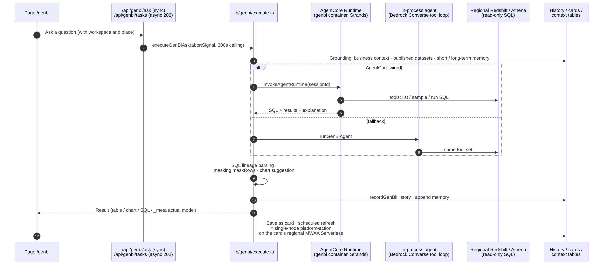
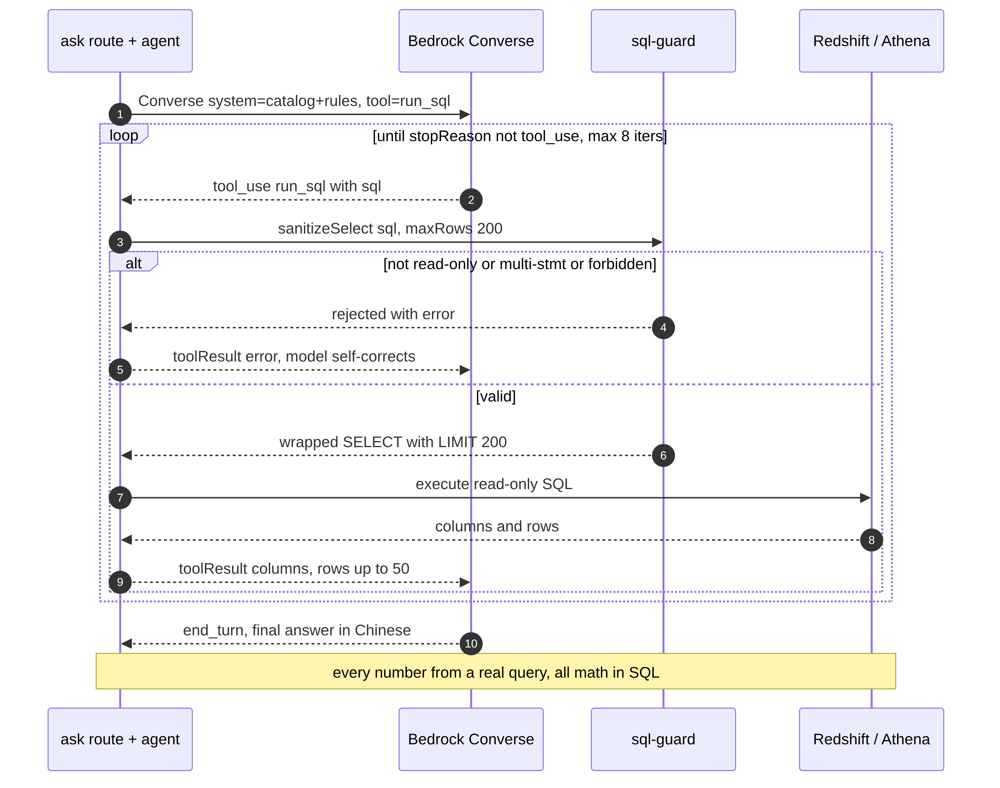
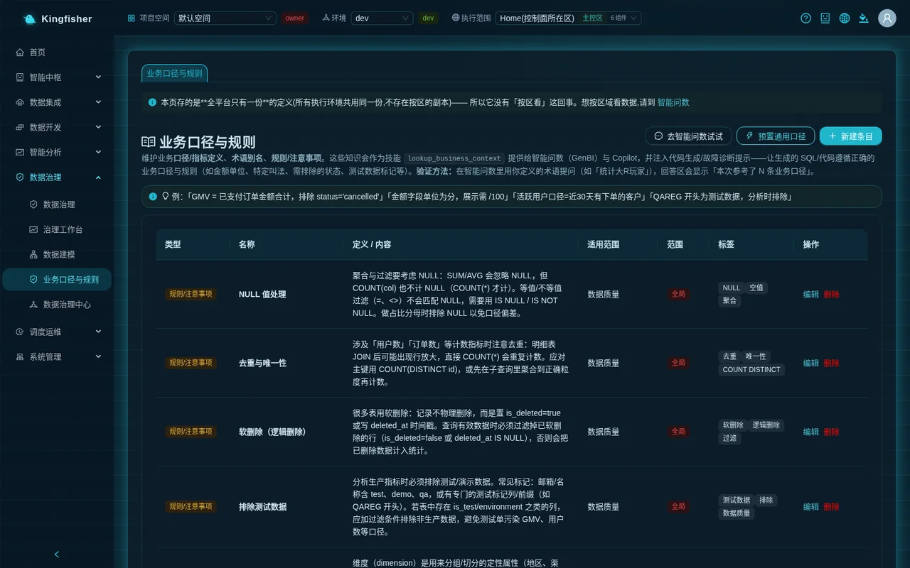
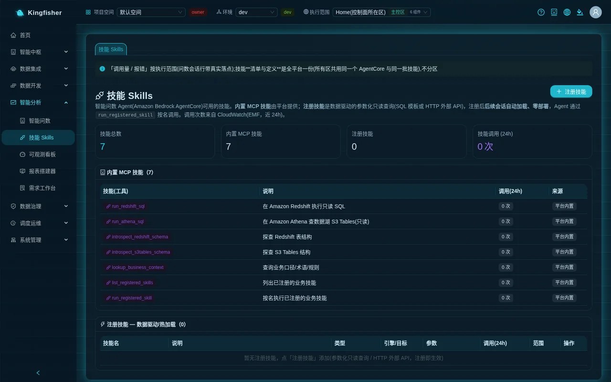
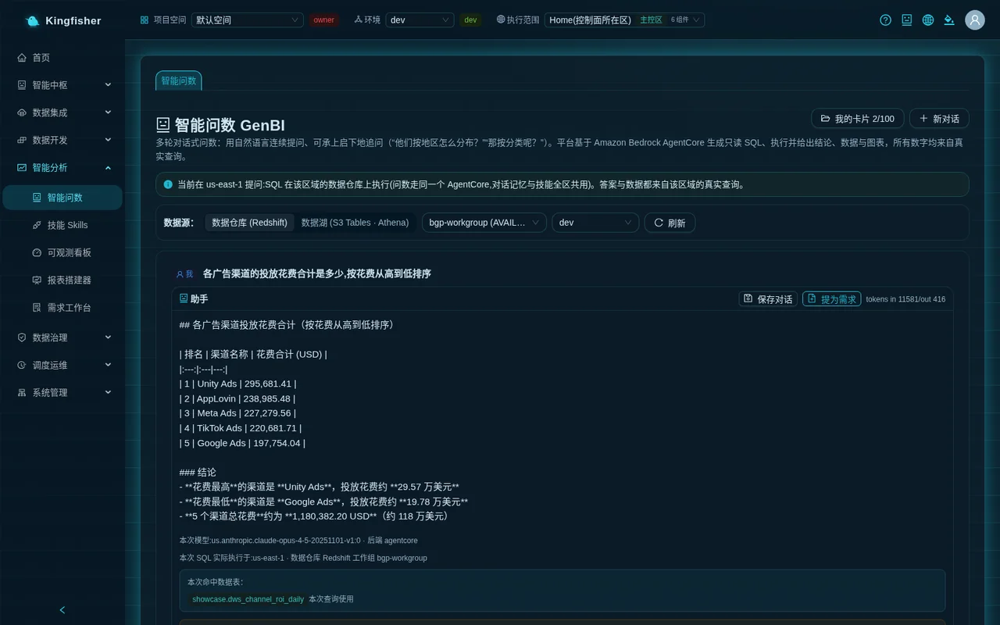
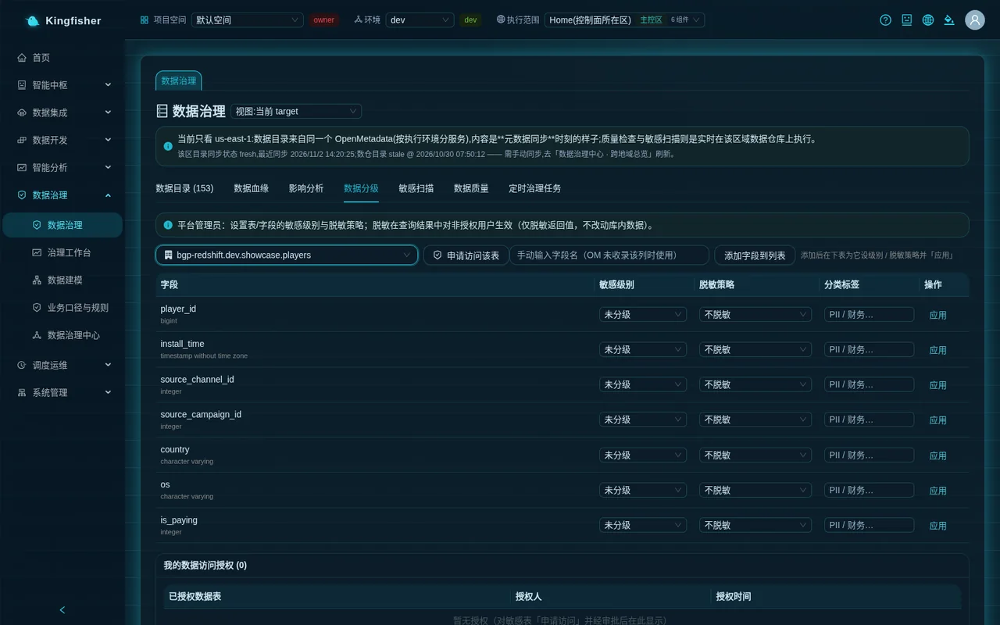
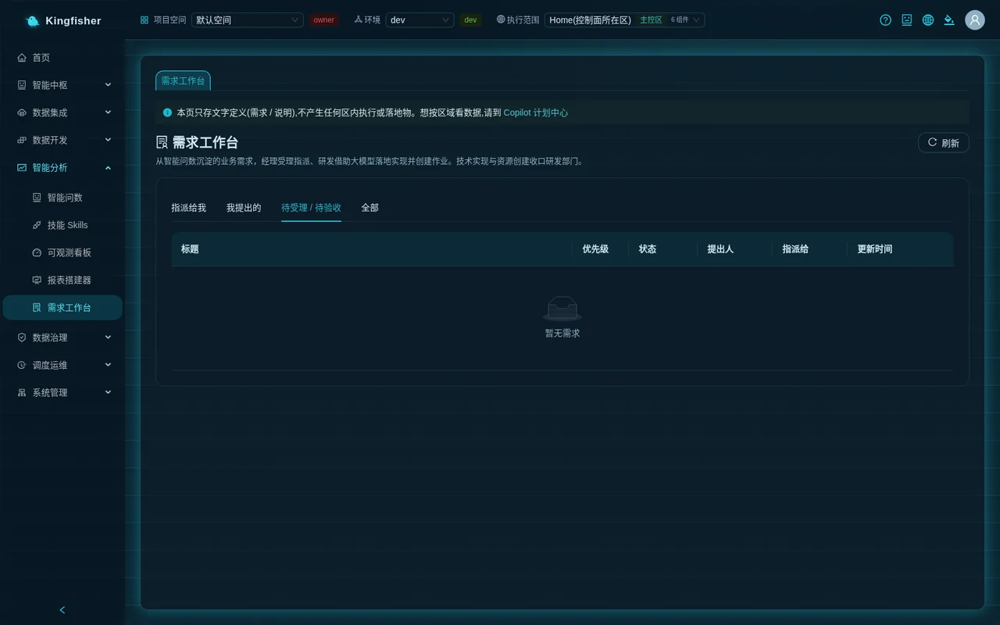
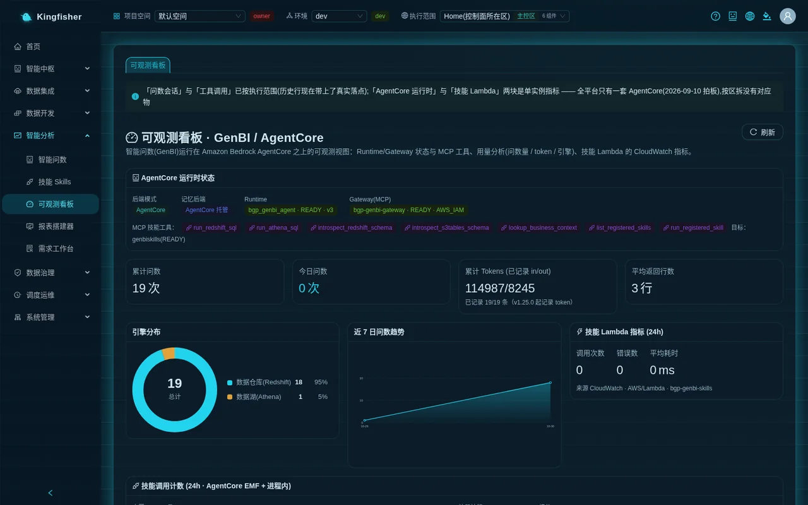
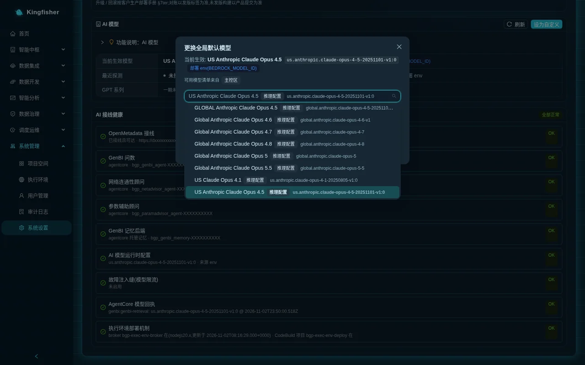

# Scenario 5: Hand Ask-Your-Data to the business team — definitions → skill → questions → SQL review → masking → cards → observability

| Item | Content |
|---|---|
| Audience | Data analysts / data product managers who want to roll out "ask your own data" to business teams; the classification and model-switch steps need a platform admin's cooperation |
| Estimated time | About 2 hours (including waiting for data and the scheduled refresh) |
| Prerequisites | The demo installation (demo mode) has already run the `Showcase-*` sample objects; you are an `editor` in that workspace and your role group can see the "Smart Analytics" menu; a second, non-admin account is available to verify masking; a platform admin (`bgp-admin`) is on hand |
| What you will have at the end | A set of written business definitions, one registered skill, 5 reproducible questions and the method to verify their SQL, evidence that a classified column stays masked even under an alias, a session card that refreshes on a schedule, hit records on the observability dashboard, and the procedure for switching the model |

---

## 0. Outcome first

After this scenario, a business colleague types a plain-language question such as "Which three channels have the highest ROAS?" into "Ask-Your-Data"; the platform generates read-only SQL according to the definitions you wrote, really runs it on the warehouse of the selected execution region, masks the result automatically by data classification, and returns a conclusion with a chart; you can verify the SQL at a glance, save the result as a card that refreshes automatically every morning, and see on the observability dashboard how many times the skill was invoked.

Overview of the route:

1. Prepare: confirm which execution region holds the sample data and which account to use.
2. Write 5 business definitions (ROAS / payment rate / day-1 retention / whale / rule on amounts and organic traffic).
3. Register 1 SQL-template skill `top_channels_by_roas`.
4. In Ask-Your-Data, choose the execution scope and the data warehouse, ask 5 questions and a follow-up.
5. Expand "View generated SQL" and "Execution path" to verify the definitions and the matched tables.
6. The admin sets a classification and masking policy on `ad_events.device_id`; verify with a non-admin account that an aliased column is masked too; request access and approve it.
7. "Save conversation" as a card; "Open and continue", "Refresh now", "Scheduled refresh".
8. "Raise as request" turns one answer into a requirement.
9. Look at skill invocation counts and durations on the observability dashboard.
10. The admin switches the global model under "Settings → AI model" (it can be saved only after the probe passes).

---

## 1. How it works (one page)



One question goes through these steps inside the platform:

1. **Anchor the execution environment**: the Ask-Your-Data page requires that "Execution scope" in the top bar selects one execution environment; the question and the target are sent together to the same agent service (Amazon Bedrock AgentCore), and the SQL runs on the warehouse or data lake of **that region**; data does not leave the region.
2. **Grounding**: the agent first retrieves the relevant tables ("Matched tables:"), then calls the skill `lookup_business_context` to read entries from "Business Glossary & Rules" ("Applied N business definition(s)"), and when needed calls the skill you registered by name (`run_registered_skill`).
3. **Generate and run read-only SQL**: only SELECT / WITH is allowed; one question may take at most 300 seconds; anything beyond the page's 60 seconds is continued by the server in the background while the page polls, so you can ask the next question while waiting.
4. **Mask by classification**: before the result is returned, the platform resolves every result column back to the **physical column** it references (aliases, expressions and CTEs are expanded level by level); every column that hits a classification you are not authorized for is transformed according to the masking policy. Platform admins are not masked.
5. **Present and persist**: conclusion + table / chart + "View generated SQL" + "Execution path"; the whole conversation can be saved as a card with "Save conversation", and the card body stays in that region; a single turn can be turned into a requirement with "Raise as request".
6. **Observability**: every invocation, every skill's hits and errors, and the skill Lambda's durations go into the "Observability" dashboard.



---

## 2. Preparation

### 2.1 Where the sample data is

The demo installation's `Showcase-<region-slug>-GameSync-7tables` sync task wrote the 7 tables of the MySQL game database into both the `showcase` schema of that region's warehouse and the `showcase` namespace of the data lake; the `Showcase-<region-slug>-ETL-ChannelROI` job then computed the summary table `showcase.dws_channel_roi_daily` in the warehouse. This scenario uses the **data warehouse** mode; the tables and key columns involved:

| Table | Key columns | Business meaning |
|---|---|---|
| `showcase.players` | player_id · install_time · source_channel_id · source_campaign_id · country · os · is_paying | Players and attribution |
| `showcase.payments` | payment_id · player_id · amount_usd · product_id · pay_time | Payments |
| `showcase.player_events` | event_id · player_id · event_name (login / level_up / purchase / tutorial_done) · level · event_time | Player events |
| `showcase.ad_channels` · `showcase.ad_campaigns` | channel_id · channel_name · channel_type (paid / organic) · campaign_name · cost_usd · target_country | Channels and campaigns |
| `showcase.ad_events` · `showcase.dws_channel_roi_daily` | device_id · event_type · country · os · cost_usd · event_time; channel_name · installs · payers · cpi_usd · pay_rate_pct · revenue_usd · roas | Ad events; channel ROI summary |

Check once first: "Data Development → Redshift Query" → choose that region in "Execution scope" in the top bar → click "Load Schema" → under "Database object" you should see the 8 tables under `showcase`. If you do not, first run the sync and the job as in [Scenario 1](20-scenario-detail-to-daily-report.md).

### 2.2 Accounts and permissions

| Step | Identity required |
|---|---|
| Write definitions, register the SQL skill, save cards, raise requests | Project `editor` (or owner / platform admin); asking questions and reading definitions only needs `viewer` |
| Set data classification and masking policy, "Load common definitions", change the AI model | Platform admin `bgp-admin` |
| Verify the masking effect | A **non-admin** account (an admin always sees plaintext) |
| Approve "Request access" | Project owner or platform admin |

### 2.3 Top bar

- Switch "Workspace" to the project that holds the sample objects.
- Choose the execution environment that holds the sample objects in "Execution scope" (called "that region" below).

---

## 3. Write business definitions

Page: "Data Governance → Business Glossary & Rules". Click "New entry", fill in the entries one by one, and click "Save" on each; you should see "Added".

| Type | Name | Definition / content |
|---|---|---|
| Definition / metric definition | ROAS | ROAS = total payment amount of players attributed to the channel (showcase.payments.amount_usd) ÷ total ad spend of that channel (showcase.ad_campaigns.cost_usd). Player attribution uses showcase.players.source_channel_id. The summary table showcase.dws_channel_roi_daily already has a computed roas column; prefer using it directly |
| Definition / metric definition | Payment rate | Payment rate = number of players in showcase.players with is_paying = 1 ÷ total number of players × 100%; when viewed by channel, group by source_channel_id and join showcase.ad_channels to get channel_name |
| Definition / metric definition | Day-1 retention | Day-1 retention rate = among players installed on day D, the number of players with an event_name = 'login' record in showcase.player_events on D+1 ÷ the number of players installed on day D; the install day is the date part of players.install_time |
| Term / Alias | Whale | Whale = a player whose cumulative payment amount (sum of showcase.payments.amount_usd) is ≥ 100 USD |
| Rules/Notes | Amounts and organic traffic | amount_usd / cost_usd are both in USD; do not convert; channels with channel_type = 'organic' have no ad spend and are excluded when computing ROAS / CPI |

Fill "Scope (optional)" with `showcase ad-spend analysis` for every entry and "Tags (optional, comma-separated)" with `ad-spend,definition`.

Key points:

- The name is the word business colleagues will use when asking; the content states table names, column names and filter conditions explicitly so the model can copy them.
- The content of this page is one copy platform-wide, not per region; it is isolated by project, so other projects cannot see it.
- Admins can click "Load common definitions" to fill in a set of generic examples in one click (retail definitions, unrelated to this scenario; you can skip it).



---

## 4. Register a skill

Page: "Smart Analytics → Skills" → click "Register skill"; the dialog "Register a business skill" opens:

| Field | What to enter |
|---|---|
| "Skill type" | "SQL template (read-only SELECT / WITH)" |
| "Skill name (English/underscores)" | `top_channels_by_roas` |
| "Purpose (shown to the model)" | Return the top N paid channels by ROAS in descending order with channel name, spend, revenue and ROAS; call it when the user asks about the channels with the "highest / best ROAS" |
| "Engine" | "Data Warehouse (Redshift)" |
| "Read-only SQL template (use {{param}} placeholders)" | See below |
| "Parameter declaration (one per line: name:type:description; type=string\|number\|identifier)" | `topn:number:return the top N channels` |

SQL template:

```sql
SELECT channel_name, channel_type, cost_usd, revenue_usd, roas
FROM showcase.dws_channel_roi_daily
WHERE channel_type = 'paid'
ORDER BY roas DESC
LIMIT {{topn}}
```

Click "Register"; the message "Skill registered (auto-available in future Ask-Your-Data sessions)" appears. The row shows up in the list "Registered skills — data-driven / hot-reload (N)" with "Calls (24h)" at 0.

Key points:

- No deployment is needed; the agent can call it by name in the very next Ask-Your-Data session.
- The "HTTP External API (platform admins only)" type is disabled for non-admins.



---

## 5. Ask questions

Page: "Smart Analytics → Ask-Your-Data".

1. Confirm that "Execution scope" in the top bar is that region; the blue banner on the page reads "Asking in <region>: SQL runs on that region's data warehouse…".
2. For "Data source:" choose "Data Warehouse (Redshift)"; leave the workgroup at "Resolved automatically by execution target", and choose `dev` (or your database name) as the database.
3. Click "New chat", then enter the questions below one at a time and press Enter to send each. While waiting you see "Thinking, generating, and running SQL..." and "Ns elapsed".

   | No. | Question | What to expect |
   |---|---|---|
   | Q1 | Which three channels in showcase.dws_channel_roi_daily have the highest roas? Give channel_name and roas. | A three-row table; "Matched tables:" includes dws_channel_roi_daily; "Execution path" may show `run_registered_skill` (your skill was called) |
   | Q2 | Use top_channels_by_roas to show the top 5 paid channels by ROAS | Five rows; one step of "Execution path" has the tool `run_registered_skill`, with topn among the input parameters |
   | Q3 | Count players, paying players and payment rate by channel type | Two rows, paid / organic; "Applied N business definition(s)" includes "Payment rate" |
   | Q4 | What is the total payment amount per day over the last 30 days? List it by day | A line chart; "Display mode:" can switch to "Table" to see the raw rows |
   | Q5 | Which country and OS do the 10 devices with the most clicks come from? | Ten rows: device, country, OS, clicks; §6 uses it to verify masking |

4. Follow up on Q4 with: "And broken down by iOS and Android?" — the platform keeps the context and splits the result by os.
5. These questions appear under "Recent questions" at the bottom of the page; clicking any of them re-asks it as is.

Key points:

- Naming a table or a definition (such as "ROAS", "Payment rate") in the question makes retrieval more accurate.
- The example-question tags are generic retail definitions; do not click them for the demo game data.
- When "The query was automatically terminated after 5 minutes. Please narrow the scope or split the question and try again." appears, narrow the time range or name a specific table.



---

## 6. Verify the generated SQL

For every answer:

1. Expand "View generated SQL" and check three things:
   - Are the tables right: they should be tables under `showcase.`, consistent with "Matched tables:".
   - Are the definitions right: Q3's payment rate should be the count of `is_paying = 1` divided by the total; Q1 / Q2's ROAS should take the `roas` column directly instead of recomputing it; `organic` channels are excluded.
   - Are the filters right: Q4's time window is the last 30 days and uses `pay_time`.
2. Expand "Execution path (N steps)": every step shows the tool name, phase (Prepare / Reasoning), success / failure, duration, "Input parameters:" and "Result:". Q2 should have one step whose tool is `run_registered_skill`.
3. Look at the entry tags (type · name) listed under "Applied N business definition(s) (results follow these definitions):". If Q3 does not list "Payment rate", go back to §3 and check whether the name and content name the table columns.
4. Check that "This SQL actually ran in: <region>" matches the execution scope you chose; if the red text "…does not match the current view…" appears, do not trust the result; switch region, ask again and report it to the admin.
5. Note "Model used: <model id> · Backend <backend>" and write down the model id to compare after switching models in §10.

---

## 7. Classification and masking: aliased columns are masked too

### 7.1 The admin sets the classification (platform admin action)

Page: "Data Governance → Data Governance" → tab "Data Classification".

1. In the "Select a table to set / view classification" drop-down, choose the entry for `showcase.ad_events` (a drop-down item = type icon + FQN, in the form `bgp-redshift.<database>.showcase.ad_events`, the same FQN as in "Data Catalog").
   If you cannot find it, first search on the "Data Catalog (N)" tab to confirm the table is in the catalog (the catalog is collected by the governance center on a schedule, so a freshly synced table may take a while); if the column information is incomplete, click "Sync Redshift columns" to fill it in.
2. In the field table find `device_id`: choose "L3 Confidential" for "Sensitivity level", "Hash (sha256)" for "Masking policy", enter `device identifier` for "Classification tags", and click "Apply" on that row.
3. If `device_id` is not in the field table, enter `device_id` under "Enter field name manually (use when the column isn't in OM)", click "Add field to list", then set it as in step 2.



### 7.2 Verify with a non-admin account

1. Sign in with the non-admin account, choose the same region in "Execution scope" in the top bar, and go to "Ask-Your-Data".
2. Ask Q5 again: "Which country and OS do the 10 devices with the most clicks come from?"
3. What to expect:
   - The device column values in the result table look like `sha256:9f86d081` instead of the original device ids.
   - A yellow notice above the result card: "Some sensitive fields are masked per data classification: <column> (for plaintext, use "Request Access" in Data Governance)".
   - Expand "View generated SQL": the model usually writes an alias such as `device_id AS device` — the column is called "device" and is masked all the same, because the platform resolved the result column back to the physical column `device_id`.
4. Ask one more question that involves an expression: "What are the first 8 characters of each device id? List the 5 with the most clicks". Even if the SQL is written as `left(device_id, 8)`, the expression references a sensitive column, so the result is masked under the strongest policy just the same.
5. The admin account sees plaintext for the same question — this is by design, not a masking failure.

### 7.3 Request access and approve

1. Non-admin account: "Data Governance → Data Classification" → select that table → click "Request access to this table".
2. Project owner or admin: "System → Workspace" → the "Pending my approval (N)" card shows an entry of type "Data access" titled "Request access to table ad_events" → click "Approve" (or "Reject").
3. The non-admin account returns to the "Data Classification" tab; the "My data access grants (N)" card below now lists this table (Table authorized / Granted by / Granted at).
4. Ask Q5 again; the device column is back in plaintext and the yellow masking notice is gone.

Key points:

- Masking only applies to values returned through the platform's query path; it does not change the data in the database; grants are per whole table.
- Questions in the "Data Lake (S3 Tables · Athena)" mode go through the same result-masking path (identical to the data warehouse mode): masking takes the strongest policy across the result columns and the resolved physical columns, and lake tables are masked only if they carry a classification in the governance catalog.

---

## 8. Save a card, continue the conversation and refresh

1. Go back to the conversation that holds Q1 ~ Q5 (or ask them again with the non-admin account) and click "Save conversation" on any turn.
2. In the dialog "Save conversation as card": enter `Ad-spend ROAS daily` as "Title"; read the notices "Will save: all N turns of this conversation (…)" and "The conversation body and title are stored only in <region> (execution environment <id>) and never leave that region."; click "Save" → "Saved as card". The button at the top right changes to "My cards 1/100".
3. Click "New chat" to clear the page, then click "My cards 1/100" to open the drawer:
   - Click "Open and continue" → the whole conversation is laid out again with the message "Conversation context restored (N turns); you can keep asking"; follow up with "And only paid channels?" to verify that the context is connected.
   - Click "Refresh now" → "Refreshed: N rows (same card; a run snapshot was kept)"; a refresh does not call the LLM, it only reruns the SQL stored in the card.
   - Click "Scheduled refresh" → the dialog "Schedule refresh for this card" opens with the notice "On schedule, reruns the SQL saved in this card in <region> (no LLM call); it refreshes the same card without using quota and keeps a run snapshot each time; results are masked under the strictest policy."; keep the cron at `0 8 * * *` (08:00 every day), turn on the "Enable scheduled refresh" switch, and click "Save".
   - The row shows the green tag "Schedule 0 8 * * *"; if it shows "Carrier not published", wait a moment and click "Refresh" at the top right of the drawer.
   - Click "History" → the dialog "Refresh history" lists every refresh: start time / trigger mode (Manual · Auto) / status / row count / error.
4. Switch "Execution scope" in the top bar to another region and open the drawer again: this card is not in the list, and the top reads "0 in the current execution scope; you have 1 more in other scopes"; click "Show all scopes (1)" to see it; clicking "Open and continue" pops up "This card belongs to <id> (<region>)" with the choices "View read-only" or "Switch to <region> and continue the conversation".

Key points:

- Each person has 100 cards platform-wide; when the quota is full the platform does not evict automatically; "Delete" frees the quota immediately.
- Scheduled refreshes are executed by that region's own scheduler; the run records can be seen under "Scheduling & Ops → Task Monitor" (trigger = Auto).
- When the card was saved by a non-admin, anyone else who opens it is re-masked according to the classification **at the time of opening**.

---

## 9. Raise as a request

1. On the Q3 (payment rate) turn, click "Raise as request".
2. In the dialog: enter `Payment rate by channel, daily` as "Request Title"; "Priority" P2 Medium; enter `Produce the payment rate per channel every day at 08:00, shown by channel_name, excluding organic` as "Request Description"; fill in "Business value" and "Acceptance Criteria" as needed. At the bottom, "Insight sources submitted with the request (read-only snapshot):" attaches the question and the SQL.
3. Click "Submit request" → "Submitted as a request; the dev manager will pick it up".
4. Go to "Smart Analytics → Requests" → the "Submitted by me" tab lists it with status "Pending intake"; click the title to open the details and add the definition under "Add comment..." at the bottom of "Activity timeline", then click "Comment".
5. Later the manager does "Assign developer", the developer does "Generate implementation with LLM" and "Create ETL job", and the status moves to "Delivered". The analyst only needs to follow up under "Submitted by me".



---

## 10. Observability dashboard: hits and durations

Page: "Smart Analytics → Observability"; keep "Execution scope" in the top bar on that region and click "Refresh".

| Where to look | Expectation |
|---|---|
| "Queries today" | ≥ the number of questions asked in this scenario |
| "Skill invocation count (24h · AgentCore EMF + in-process)" → "Registered skills (run_registered_skill breakdown)" | `top_channels_by_roas` appears with calls ≥ 1 and errors 0 |
| "Built-in MCP tools" on the same card | Built-in tools such as `lookup_business_context` have invocation counts |
| "Skill Lambda metrics (24h)" | "Calls", "Errors", "Avg duration" (ms) |
| "Recent asks" | Lists Q1 ~ Q5: question · engine (data warehouse) · backend · row count · Tokens (in/out) · time |
| "Last 7 Days Ask Trend" | Today's bar / point is up |

Key points: "Ask sessions" and "Tool calls" are filtered by execution scope; "AgentCore Runtime Status" and "Skill Lambda" are platform-wide single-instance metrics. The "Calls (24h)" column on the "Skills" page increases accordingly.



---

## 11. Change the global AI model (platform admin)

Page: "System → Settings" → the "AI model" card. Non-admins only see the effective model and its source, with the notice "Only platform admins (bgp-admin) can change the model; you are read-only."

1. The card shows "Effective model", "Source" (runtime config / deploy env / factory default), "Latest probe" and "Runtime overrides". Click "Customize" at the top right (shown as "Change global default" once a custom model has been set).
2. In the dialog "Change global default model": the drop-down is grouped by vendor family (Claude Opus / GPT / GLM / Kimi) and lists only models available in the current region; entries tagged "inference profile" are the us. / global. prefixed ones.
3. Choose a model and click "Test this model". The platform really makes one call:
   - Success: "Probe passed (N s)"; families that need tool-use are probed once more for a tool call.
   - Failure: the red "Probe failed" tag and the reason text are shown. Common reasons and remedies:

   | Probe result | Page text (excerpt) | Next step |
   |---|---|---|
   | Not enabled for the account | "This model is not enabled for this account (Bedrock says "not available for this account" - an account-level restriction unrelated to region / IAM / Marketplace). Ask your AWS account team to enable it, or pick another version or vendor." | Contact your AWS account team; switch model |
   | No permission to invoke | "This account cannot invoke this model. Request access in the Bedrock console or pick an enabled model." | Request model access in the Bedrock console |
   | Unavailable in this region | "This model is unavailable in the current region. …" | Switch to a model that is live in this region |
   | Timeout | "Probe timed out: the model did not respond within this family's budget (reasoning models can take tens of seconds to start; this is not throttling). …" | Test again; or switch to the global. inference profile |
   | Cannot call tools | "This model cannot call tools under Converse (tool-use probe failed); GenBI / Copilot / advisors would go silent, so it cannot be the global default" | Switch to a model that supports tool calling |

4. After "Probe passed; you can save. An impact preview will ask for confirmation first." click "Save" → the dialog "Change the global default model?" lists "Effective now", "Change to" and "Impact preview (takes effect platform-wide immediately)": Affected capabilities (9) · Scope (All tenants, all projects) · Takes effect (≤5s after saving) · Reversible → click "Confirm change".
5. The message "Global default switched to <model>; effective platform-wide within 5s" appears.
6. Go back to "Ask-Your-Data" and ask Q1 again; "Model used: <model id>" on the result card should now be the new model.
7. To roll back: "Restore factory default" on the card (or "Restore factory default now" when the model misbehaves), and confirm "Restore factory default?".

Key points:

- Once saved it is the platform-wide default; a per-region default model is not supported yet.
- The Kimi family emits a reasoning block before every reply and produces about 2× the output tokens of Claude, so response time and cost rise accordingly (the page shows the "always reasoning blocks" tag).
- GPT-family entries are visible but not selectable in the drop-down; the explanation reads "GPT series is not open in phase 1 (transport gate)".



---

## Verify the results

| Check | Where to look | Pass criterion |
|---|---|---|
| Definition was applied | Ask-Your-Data Q3 result card | "Applied N business definition(s)" includes "Payment rate" |
| Skill was called | Q2 "Execution path" · "Registered skills" table on the Observability dashboard | Tool `run_registered_skill`; `top_channels_by_roas` calls ≥ 1 |
| SQL follows the definitions | "View generated SQL" | Tables under `showcase.`; organic excluded; payment rate based on is_paying |
| Target is correct | "This SQL actually ran in:" | Matches the execution scope in the top bar, no red text |
| Aliased column is masked | Non-admin asks Q5 again | Device column is `sha256:…`; yellow masking notice appears |
| Plaintext after grant | "My data access grants (N)" · ask Q5 again | Table is in the list; device column in plaintext |
| Card and refresh | "My cards" drawer | "Open and continue" restores N turns; "History" has both manual and automatic records |
| Request is in the pool | Requests "Submitted by me" | Status "Pending intake" |
| Model switch took effect | Q1 result card "Model used:" | Equals the new model id |

---

## FAQ

| Symptom | Cause | Next step |
|---|---|---|
| The Ask-Your-Data page only shows "Select an execution scope" | "Execution scope" in the top bar is still "All" | Choose one execution environment |
| "Applied N business definition(s)" does not appear | The definition name differs from the wording of the question; the entry is in another project; the content does not name the table columns | Change the name / content; check "Workspace" in the top bar |
| Q2's "Execution path" has no `run_registered_skill` | The model decided the skill was not needed, or the purpose text is not explicit enough | Rephrase the question to name the skill directly; write "Purpose (shown to the model)" more like a trigger condition |
| A non-admin sees no masking; device ids are in plaintext | You are using the admin account; or the classification was not "Apply"-ed; or that account has already been granted access | Switch to a non-admin account; go back to "Data Classification" and confirm level and policy; check "My data access grants (N)" |
| The table is missing from "Select a table to set / view classification" | The governance catalog has not collected it yet | Search in "Data Catalog (N)" to confirm; try again later or "Sync Redshift columns" |
| "The query was automatically terminated after 5 minutes. Please narrow the scope or split the question and try again." | The question is too big / the model is slow | Narrow the time window, name the table, or split the question |
| "Save conversation" is refused and shows 100/100 | Card quota is full | Delete unused cards under "My cards" |
| The scheduled-refresh row shows "Carrier not published" | The scheduler carrier has not been published to that region yet | Click "Refresh" in the drawer later; if it does not change, ask the admin to check that region's scheduler |
| "Test this model" reports "not available for this account" | Not enabled at the account level | Contact your AWS account team; pick another model |
| "Model used" is still the old one after switching | Page cache ≤5s; or the save did not succeed | Wait a few seconds and ask again; check "Effective model" on the "AI model" card |

---

## Clean up

Delete the practice objects in the order below (if a referenced object cannot be deleted, delete what references it first):

1. Card: "Ask-Your-Data" → "My cards" → "Delete" at the end of the row → confirm "Delete this card?" ("The body will also be cleaned up from <region>; quota is released immediately."). It is safer to turn off "Enable scheduled refresh" under "Scheduled refresh" before deleting.
2. Request: "Requests" → open `Payment rate by channel, daily` → "Cancel" (enter a reason).
3. Skill: "Skills" → "Delete" at the end of the `top_channels_by_roas` row → confirm "Delete this skill?".
4. Definitions: "Business Glossary & Rules" → "Delete" each of the 5 entries → confirm "Delete this item?".
5. Classification (admin): "Data Governance → Data Classification" → select that table → set "Sensitivity level" of `device_id` back to "Unclassified" → "Apply" → the message "Cleared classification for device_id" appears. Leaving the grant record in place is harmless.
6. Model (admin): if you switched the model during the exercise and do not want to keep it, click "Restore factory default" on the "AI model" card.

Do not delete the sample objects `Showcase-*` or the `showcase` schema; other scenarios still use them.

---

## Further reading

- [Data analyst guide](12-guide-analyst.md): the buttons on each page and daily usage
- [Scenario 6: governance loop](25-scenario-governance-loop.md): the complete flow of classification, sensitive scans, quality and lineage
- [Platform admin guide](10-guide-admin.md): role groups, project members, the AI model card
- [Rules and status code reference](30-reference-rules.md): probe results such as `NotAvailableForAccount` / `ToolUseUnavailable`
- Feature tour: [../features.md](../features.md) §5.1 ~ §5.3, §6.4, §8.5
- Mechanism details: [GenBI session cards](../design/genbi-session-cards.md) · [Classification and masking](../design/classification-masking.md) · [Model configuration](../design/model-configuration.md)
