# Scenario 6: Governance loop — catalog → classification and masking → sensitive scan → quality and SLA → lineage and impact → scheduled inspection → governance workbench

| Item | Content |
|---|---|
| Audience | Platform admins (classification / rules / scans / scheduled tasks) · data engineers and analysts (browse the catalog / lineage / quality results, experience masking) |
| Estimated time | 60–90 minutes (including waiting for one quality check and one sensitive scan) |
| Prerequisites | Signed in; the "Execution scope" selector in the top bar can select an execution environment; that region has already run the demo sync task and the channel ROI job (see §2 below); the "Governance Center" page shows status "Running" |
| What you will have afterwards | A classified and masked table (unauthorized users see masks in GenBI / direct query) · a set of quality rules with SLA and a quality score · a lineage graph and impact list from the source database to the summary table · a quality inspection that runs automatically every day · trackable to-dos on the governance workbench |

---

## 0. Bottom line first

Once you finish this scenario, you will have turned "governance" on one execution region from a one-off action into a closed loop:
the catalog shows tables and columns → sensitive fields carry a level and a masking policy → business users see masks in "Ask-Your-Data" and "Redshift Query" → quality rules run automatically every day and produce a quality score and an SLA verdict → you check impact analysis before changing a table → the governance workbench lists the remaining debt as to-dos.

Overview route (everything is done on the pages, no code):

1. "Data Governance → Data Catalog": find the demo table and click "Sync Redshift columns" to backfill the real columns into the catalog.
2. "Data Governance → Data Classification": set a sensitivity level and masking policy for fields such as `device_id`, then click "Apply".
3. Use a non-admin account in "Ask-Your-Data" / "Redshift Query" to see masking take effect; when you need plaintext, "Request access to this table" → workspace approval.
4. "Data Governance → Sensitive Scan": click "Start Scan" so the platform finds likely sensitive fields automatically; select the rows and click "Adopt selected … into classification".
5. "Data Governance → Data Quality": "Add rule" for the summary table (not null / unique / row count / freshness SLA), click "Run Check" to get a quality score.
6. "Data Governance → Data Lineage" and "Impact analysis": see the lineage from source database → data lake → warehouse → summary table, and see "who is affected if I change / delete it".
7. "Data Governance → Scheduled governance tasks": attach the quality check to that region's scheduler so it runs automatically every day at 03:00.
8. "Governance Workbench": see the overall governance health score, the four dimension scores and the to-dos, and "Resolve" them one by one.
9. "Governance Center": open the OpenMetadata console to search tables, view lineage and write table descriptions; descriptions flow back into GenBI retrieval.
10. On the "Data Governance" page switch to "View: all targets (read-only metadata)" to see the metadata mirrors of all regions on one screen (one column per region, with a 🌍 jurisdiction tag).

---

## 1. How it works (one page)

- **The catalog is metadata, not a live query.** All execution regions of the platform share one OpenMetadata instance; "which region" is expressed by the service name suffix (the home region uses `bgp-redshift` / `bgp-glue` without a suffix; other regions use names like `bgp-redshift-<execution-environment-id-suffix>`).
  A note stays at the top of the catalog page: the content is what things looked like at the "metadata sync time", and it shows the sync status and last sync time of that region's catalog.
- **Quality checks and sensitive scans are live.** They really execute read-only SQL on the Redshift warehouse of the execution region you currently selected, so tables not yet refreshed into the catalog can still be checked; conversely, if a table in the catalog has been dropped, the check reports an error.
- **Classification and masking only act on query results.** After an admin sets a level and masking policy on a field, the results that unauthorized users get in "Ask-Your-Data", "Redshift Query" and "Report Builder" are replaced by masks on the server side; not a single byte of data in the database is changed.
  Platform admins (role group `bgp-admin`) are not masked; a user who has "requested access" to a table and been approved is not masked on that table.
  If a result column uses an alias (for example `device_id AS device`) or an expression, the platform resolves it back to the physical column it references before deciding, so aliased columns are masked too.
- **Lineage has two sources.** Every run of a sync task automatically produces table-level and column-level lineage "source database → data lake → warehouse"; Redshift SQL batch jobs parse the SQL text automatically when saved to obtain table-level lineage "which tables were read, which table was written". Both are written into OpenMetadata and shown in the same graph.
  Glue PySpark / EMR scripts are not text-parsed; their lineage is only the sync-path part.
- **Quality score = weighted pass rate.** Each rule has a weight (default 1) and a severity (error / warn); quality score = sum of weights of passed rules ÷ sum of weights of all executed rules × 100, and one score is also computed for each of the five dimensions completeness / uniqueness / validity / consistency / freshness.
  The "Freshness / SLA" rule is the SLA: when the latest value of the time column is older than the number of hours you entered, it is "Breached".
- **The governance workbench is a read-only aggregate.** The overall score 0–100 is a weighted sum of four dimensions: security / classification coverage 30%, quality health 30%, SLA compliance 20%, lineage coverage 20%; to-dos fall into four groups: unclassified likely-sensitive tables, SLA breaches, quality below threshold, not yet governed.
- **Scheduled governance tasks are autonomous per region.** Quality checks / sensitive scans / catalog sync are published on a cron to the MWAA Serverless of the execution region selected when you created them; only result metadata returns to the home region; run records are in "Task Monitor".
- **The cross-region overview is a read-only mirror.** What you see under "View: all targets" is the metadata mirror the platform pulls back per region (table count / database count / column count / sync status); it contains no data rows and runs no cross-region aggregate queries.

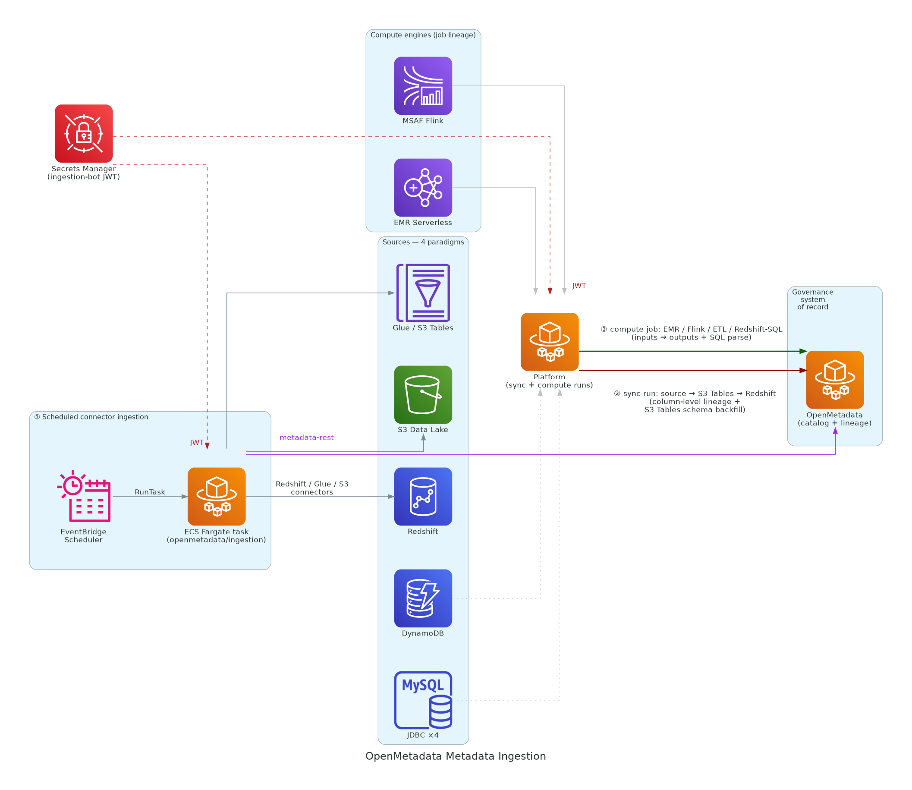

---

## 2. Preparation

### 2.1 Accounts

- One **platform admin** account (role group `bgp-admin`): classification, masking policies, sensitive scans, adding / deleting quality rules, creating scheduled governance tasks, syncing columns and creating tables can only be done by an admin.
- One **non-admin** account (for example role group `bgp-analyst`, and a member of the current workspace): used to confirm that masking really takes effect and to walk through "request access".
- For how to create accounts and add them to a workspace, see the [Platform admin guide](10-guide-admin.md).

### 2.2 Data

This scenario reuses the demo dataset and demo objects (name prefix `Showcase-<region-slug>-`; in production, substitute your own tables):

- The sync task `Showcase-<region-slug>-GameSync-7tables` has run successfully once: it writes 7 MySQL tables into that region's S3 Tables namespace `showcase` and at the same time into schema `showcase` of that region's Redshift.
- The batch job `Showcase-<region-slug>-ETL-ChannelROI` (Redshift SQL) has run successfully once: it computes the summary table `showcase.dws_channel_roi_daily` from the four tables `showcase.ad_campaigns` / `ad_channels` / `players` / `payments`.
- If these objects do not exist, first build them yourself following [Scenario 1: Detail to daily report](20-scenario-detail-to-daily-report.md), or ask an admin to run the demo-object script.

Tables and fields used in this document (all from the demo data):

| Table | Purpose | Role in this scenario |
|---|---|---|
| `showcase.ad_events` | Ad impression / click events | `device_id` set to L3 Confidential and masked (demonstrates masking) |
| `showcase.payments` | Payment transactions | `amount_usd` set to L2 Internal, not masked (demonstrates classification only) |
| `showcase.players` | Player table, includes `install_time` | Carries the freshness / SLA rule (demonstrates SLA) |
| `showcase.dws_channel_roi_daily` | Channel ROI daily summary table | Carries the not-null / unique / row-count rules; used for lineage and impact analysis |

### 2.3 "Execution scope" in the top bar

All write actions in this scenario (classification, rules, scans, scheduled tasks) land in the execution region you currently selected.
First select a specific execution environment in the "Execution scope" dropdown in the top bar (the home region entry carries the "Home region" tag); when "All" is selected, governance writes land in the home region, and the "New scheduled task" button is disabled with the hint "Select an execution environment in the top bar first".


### 2.4 OpenMetadata online

In the left menu, "Data Governance → Governance Center"; the page should show status "Running" and a version number. If it shows "OpenMetadata service not ready", ask an admin to check the deployment status; the catalog and lineage pages will have nothing to read.

---

## 3. Step 1: Browse the data catalog and backfill real columns

Page path: "Data Governance → Data Governance", tab "Data Catalog (N)".

1. Keep the view dropdown to the right of the page title at "View: current target".
2. Above the tabs there is a blue note: "Showing only <region>: the data catalog comes from the same OpenMetadata (one service per execution environment) and reflects the state at the time of metadata sync; quality checks and sensitive scans run live on that region's data warehouse." The line below shows the sync status and last sync time of that region's catalog.
3. Narrow down with the filter bar: choose Redshift for "Source" and `showcase` for "Schema / Namespace"; or type `dws_channel_roi_daily` in the search box and click "Search".
   The filter conditions are written into the address bar and survive a page refresh; click "Reset" to return to the full list.
4. Table columns: Data Assets (name + FQN) · Source · Database / Table bucket · Schema / Namespace · Format · Field count · Sensitivity level · Actions.
   A Redshift table FQN looks like `bgp-redshift.<database>.showcase.dws_channel_roi_daily`; an S3 Tables table looks like `bgp-s3tables.<table-bucket>.showcase.players`. The later tabs all select tables by this FQN.
5. If "Field count" shows 1 or `-`, the catalog does not have the real columns yet. An admin clicks "Sync Redshift columns" to the right of the search box (tooltip "Backfill actual Redshift column info to the data catalog (correct field count)").
   On success the toast "Redshift column info synced" appears and the list refreshes automatically.
   With many tables this step can exceed 45 seconds: a notice "Running in background: Sync column information to the data catalog (n s elapsed)" appears at the bottom right of the page, disappears automatically when done and refreshes the list; do not click again. Clicking again at this point is rejected: "'Sync column information to the data catalog' is in progress (n s elapsed); wait for it to finish before trying again".
6. Each row has three buttons on the right: "Lineage", "Impact analysis", "Classification"; clicking one jumps straight to the corresponding tab with this table selected. Admins also see "Alter table" (only available for Redshift tables; for S3 Tables tables the button is greyed out with the reason) and "New table" above the tabs.

Expected result: the 7 synced tables plus `dws_channel_roi_daily` under `showcase`, field counts equal to the real column counts, and the sensitivity level column currently all "Unclassified".

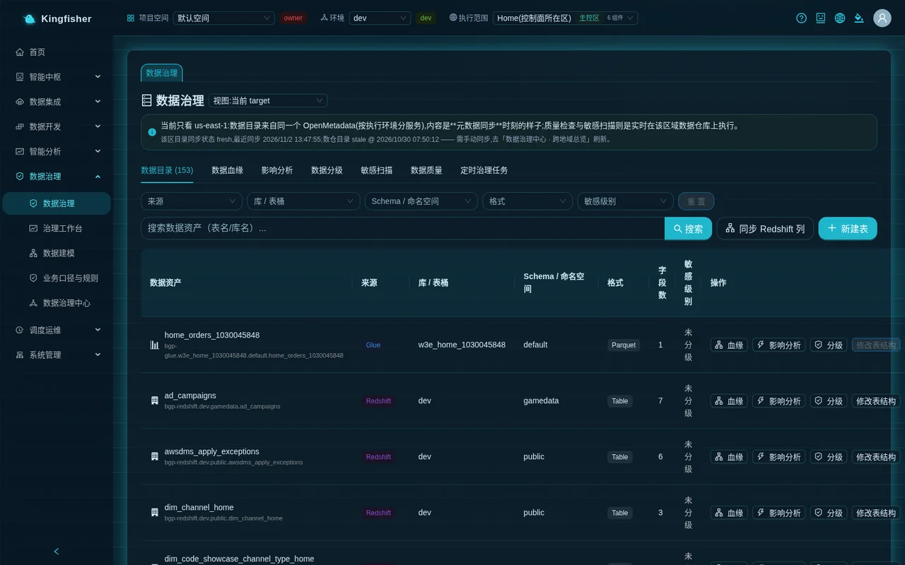

---

## 4. Step 2: Data classification and masking policy (admin)

Page path: "Data Governance → Data Governance", tab "Data Classification".

1. The blue bar at the top of the tab tells admins: "Platform admin: set sensitivity levels and masking policies for tables/columns; masking applies to query results for unauthorized users (masks returned values only, does not change stored data)."
2. In the "Select a table to set / view classification" dropdown, select `bgp-redshift.<database>.showcase.ad_events`.
3. The table lists the fields of that table (Field / Sensitivity level / Masking policy / Classification tags / Actions). Find the `device_id` row:
   - "Sensitivity level": choose "L3 Confidential" (four levels: L1 Public / L2 Internal / L3 Confidential / L4 Top Secret);
   - "Masking policy": choose "Partial (keep first & last)" (options: No masking / Full mask (***) / Partial (keep first & last) / Email (j***@x.com) / Hash (sha256));
   - "Classification tags": enter `PII`;
   - Click "Apply" at the end of the row. The toast "Saved device_id: L3 / partial" appears.
4. Then select the table `showcase.payments`, set `amount_usd` to "L2 Internal", leave the masking policy at "No masking", enter the classification tag `Finance`, and click "Apply". This entry classifies without masking, so that the classification coverage in the catalog and on the workbench changes.
5. If a real column is missing from the catalog, type the column name in "Enter field name manually (use when the column isn't in OM)", click "Add field to list", then set its level and "Apply".
6. Changing a column's "Sensitivity level" back to "Unclassified" and clicking "Apply" clears that column's classification, with the toast "Cleared classification for <column>".

Go back to the "Data Catalog" tab and refresh the search once; the "Sensitivity level" of the `ad_events` row should show "L3 Confidential" (the highest level among that table's fields).

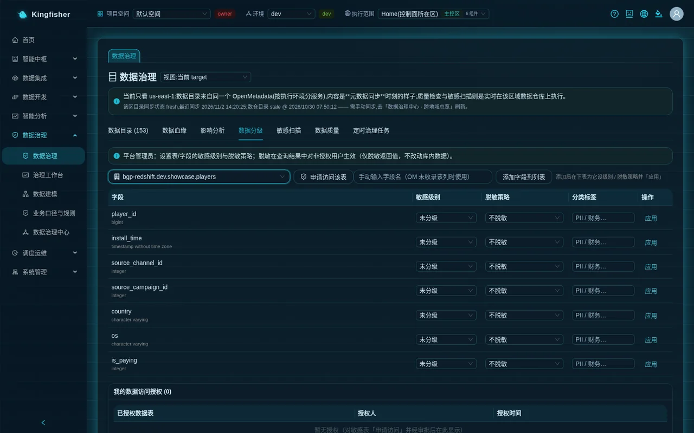

Notes:

- Only platform admins can set classification and masking policies; non-admins can only view this tab and "Request access to this table" for sensitive tables.
- Classification records are stored per execution region: a level set from the region A view does not appear on the same-named table in region B. To mask in both regions, set it once in each region.

---

## 5. Step 3: Masking in effect, access request and approval

### 5.1 See masking with a non-admin account (GenBI)

1. Sign in with an account in the `bgp-analyst` role group (same workspace, same execution scope).
2. In the left menu, "Smart Analytics → Ask-Your-Data", ask: "Show the latest 10 ad events in ad_events with device_id, country and event_time".
3. In the answer table the `device_id` column shows the first and last characters kept with `*` in between; above the result a note appears: "Some sensitive fields are masked per data classification: device_id (for plaintext, use 'Request Access' in Data Governance)".
4. Click "View generated SQL": even when the model wrote the column as an alias such as `device_id AS device`, the result is still masked.

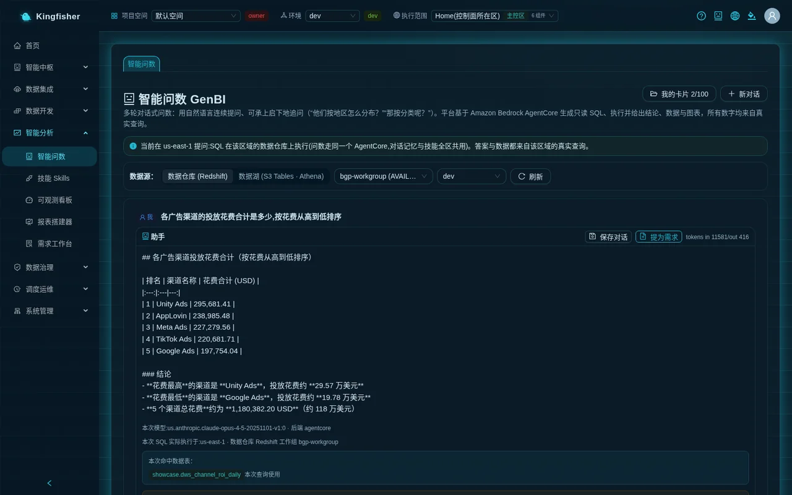

### 5.2 See masking in Redshift Query

1. In the left menu, "Data Development → Redshift Query"; under "Execution regions (multi-select)" check the current region, and enter in the editor:

   ```sql
   SELECT device_id, country, event_time FROM showcase.ad_events ORDER BY event_time DESC LIMIT 10
   ```

2. Click "Execute". The result sheet header gains a gold tag "Masked columns: device_id", and the `device_id` values are masks.
3. Run the same SQL with the admin account: you see plaintext and no such tag — admins are exempt.

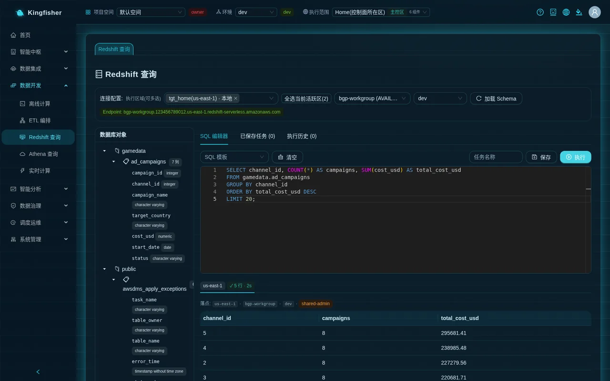

### 5.3 Request access and approval

1. With the non-admin account, go back to "Data Governance → Data Classification", select `showcase.ad_events` in the dropdown and click "Request access to this table". The toast "Access request submitted, pending approval" appears.
2. An admin (or the owner of that workspace) goes to "System → Workspace"; in the "Pending my approval (N)" card at the top of the page, find the entry with type tag "Data access" and title "Request access to table ad_events", and click "Approve".
3. The non-admin account refreshes the "Data Classification" tab; `showcase.ad_events` appears in the "My data access grants (N)" card at the bottom, with the grantor and grant time.
4. Ask the same question again in "Ask-Your-Data": `device_id` is now plaintext and the masking note is gone. A grant applies to the whole table, not per column.


---

## 6. Step 4: Sensitive scan (admin)

Page path: "Data Governance → Data Governance", tab "Sensitive Scan".

1. Blue bar note: "Platform admin: automatically scan table columns to detect likely sensitive fields (email / credit card / phone / credential, etc.; detectors are globally applicable and pluggable). The scan is read-only and sampled values are never persisted; results are suggestions — select and adopt to write them into data classification."
2. "Database": enter `dev` (default); "Schema (optional)": enter `showcase` (leave it empty to scan the whole database, which is very slow with many tables).
3. Click "Start Scan". While waiting, it shows "Scanning: fetch column metadata → sample → detect…"; when done, the toast "Scan complete: N sensitive-field suggestions found" appears.
4. The result card shows: Tables Scanned · Columns Scanned · High-confidence · Medium-confidence (and "Skipped / Failed Tables" if any tables were skipped).
   Below it is the suggestions table: Table / Column · Detected Type · Confidence (high / medium, with "name match" and "value N%") · Current Level · Suggested Level · Suggested Masking · Status (Pending / Adopted).
5. Check the rows you want to accept; you can change "Suggested Level" and "Suggested Masking" inline; click "Adopt selected (N) into classification". The toast "Adopted N, written into data classification" appears, those rows change to "Adopted", and they appear in the "Data Classification" tab at the same time.
6. Rows already "Adopted" cannot be checked again.

Note: the demo dataset has no email, phone or credit-card fields, so a scan on `showcase` will most likely return only a few or even 0 suggestions — that is a normal result, not a failed scan.
Only on your own business database (which usually has email and phone columns) will you see the full effect. Measured in the demo environment (database `dev`, schema `showcase`): Tables Scanned 8, Columns Scanned 53, High-confidence 0, Medium-confidence 4 — all four are "name match · Full name · 60%" (`ad_campaigns.campaign_name`, `dws_channel_roi_daily.channel_name`, `ad_channels.channel_name`, `player_events.event_name`), Suggested Level L3 Confidential, Suggested Masking "Partial (keep first & last)", status "Pending";
these columns are actually channel / campaign / event names, not person names — false positives guessed from the column name; simply leave them unchecked.

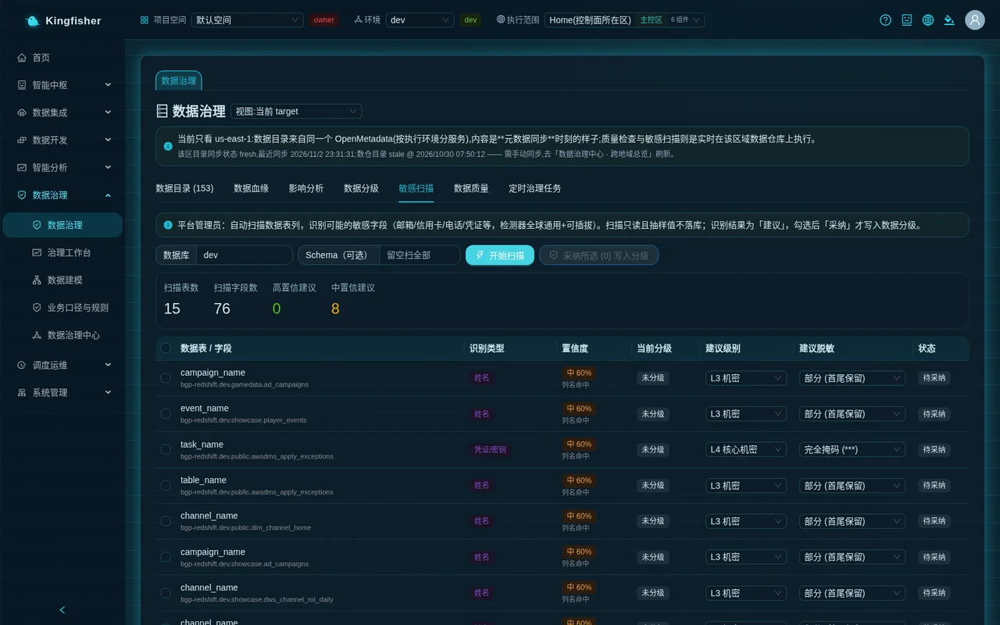

---

## 7. Step 5: Quality rules, quality score and SLA (adding rules requires admin)

Page path: "Data Governance → Data Governance", tab "Data Quality".

### 7.1 Add three rules to the summary table

1. In the "Select a table (quality rules / score / SLA)" dropdown, select `bgp-redshift.<database>.showcase.dws_channel_roi_daily`.
   The first time you see the hint "No quality check has run yet. Configure rules, then click 'Run check'." and an empty "Quality Rules (0)" card ("No rules. Click 'Add rule'.").
2. Click "Add rule"; the "Add quality rule" dialog opens:
   - "Rule type": choose "Not Null · completeness", "Field name": `channel_id`, "Max Null Rate %": leave empty (default 0), "Severity": error, "Weight": 1, click "Save". The toast "Rule added" appears.
   - Add another "Unique · uniqueness", field `channel_id`, "Max Duplicate Rows": leave empty.
   - Add another "Row Count · consistency"; this one needs no field; "Min Row Count": 1, "Max rows": leave empty.
3. Other available types are "Numeric Range (Range) · validity" (enter at least one of min value / max value) and "Enum Values (Accepted Values) · validity" (allowed values comma-separated).
   For example, add an enum rule to `channel_type` with allowed values `paid,organic`.

### 7.2 Add one SLA rule to the players table

1. Switch the dropdown to `showcase.players`, "Add rule" → "Freshness / SLA (Freshness) · freshness", "Field name" `install_time`, "SLA hours": 24, "Severity": warn, click "Save".
2. What this rule means: when the maximum value of `install_time` is more than 24 hours old, the SLA is breached.

### 7.3 Run the check

1. Go back to `dws_channel_roi_daily` and click "Run Check". After a few seconds the toast "Check complete, quality score 100" (or another score) appears.
2. A result card appears at the top of the tab: "Quality Score" N / 100 · per-dimension percentages (completeness / uniqueness / consistency …) · SLA "Met" or "Breached" · "Pass / Fail / Error" counts · "Last run" time.
   After several runs an extra line "Score history:" appears, the sequence of the most recent scores.
3. In the "Quality Rules (N)" card, the "Latest result" column of each rule shows passed / failed / error with details, for example "0/6 nulls (0%, threshold 0%)" or "row count 6 (range [1, -])".
4. Switch to `showcase.players` and click "Run Check". The demo data's `install_time` is a fixed historical time written when the data was seeded, so this rule's "Latest result" shows `failed latest data is N hours old (SLA ≤ 24 hours)` (N varies with the age of the demo data; in the demo environment it is several thousand hours), and the SLA card at the top shows "Breached" — exactly what an SLA rule should report.
5. An admin can click "Delete" at the end of a rule row (a "Delete this rule?" confirmation appears).

At the bottom of the tab there is another card, "OpenMetadata Profiler / TestSuite (supplementary)", showing OpenMetadata's own test results; when the ingestion / Profiler stack is not deployed it shows "No OM quality data (deploy ingestion / Profiler stack)", which does not affect the platform's own quality engine above.

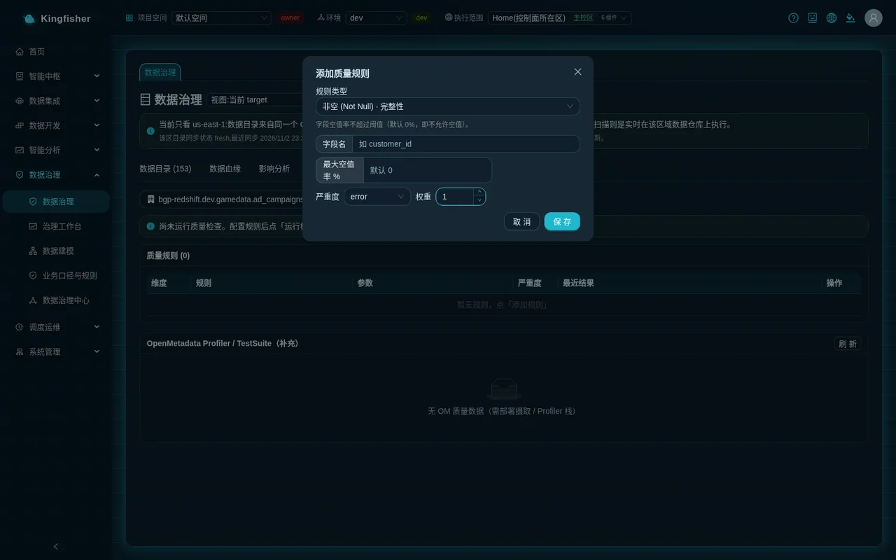

Notes:

- Quality checks really run on the Redshift warehouse of the current execution region; the first "Run Check" is slower when that region's warehouse is cold-starting.
- Rules, results and quality scores are stored per execution region; the same table has a separate set in each of two regions.
- The freshness rule requires a time column in the table; tables without a time column cannot use this template.

---

## 8. Step 6: Lineage graph and impact analysis

### 8.1 Data lineage

Page path: "Data Governance → Data Governance", tab "Data Lineage" (or click "Lineage" on a catalog row).

1. In the "Enter or select data asset FQN" dropdown, select `bgp-redshift.<database>.showcase.dws_channel_roi_daily` and click "Query lineage".
2. In the graph the center node is highlighted, upstream on the left and downstream on the right: the four tables `ad_campaigns` / `ad_channels` / `players` / `payments` point to `dws_channel_roi_daily`.
   These edges come from the automatic SQL parsing when the `ETL-ChannelROI` job was saved (the CTE names `spend` / `installs` / `revenue` in the SQL are not treated as tables). The graph also brings in the sync lineage of those four tables (MySQL source table → S3 Tables table → Redshift table, edges labeled `sync`) and column-level edges, so the node count is noticeably more than five.
3. Then select a synced table, for example `showcase.players`: you can see the sync lineage "MySQL source table → S3 Tables table → Redshift table" (edges labeled `sync`).
   A "Column-level lineage" card appears below the page, with two small tabs "Graph view" and "Table view", listing column by column source table · source column → target table · target column.
4. Select a table that has never been synced and is not referenced by any SQL job: it shows "No lineage found. Lineage is generated automatically after you create a sync task."

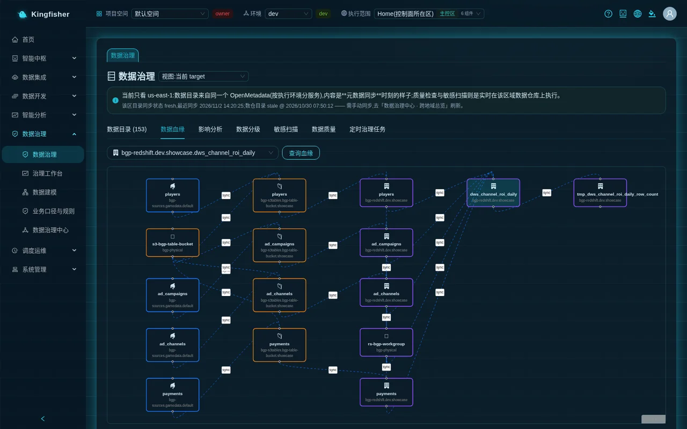

### 8.2 Impact analysis

Page path: same page, tab "Impact analysis" (or click "Impact analysis" on a catalog row).

1. In "Select data asset FQN for impact analysis", select `showcase.players` and click "Analyze downstream impact".
2. Two numbers at the top: "Affected data assets:" N and "Affected jobs / tasks:" N.
3. In the middle is the downstream lineage graph (orange edges are downstream), and below it two tables:
   - "Affected data assets (N)": one downstream table per row with its "Downstream levels" (level 1 = direct downstream); you should see `dws_channel_roi_daily` here;
   - "Affected jobs / tasks (N)": Name · Type (ETL Job / Redshift Task) · Impact type (Reads the changed table / Output downstream tables / Read + Output); here you see `Showcase-home-ETL-ChannelROI · ETL Job · Read + Output` (home region view; the execution region view shows `Showcase-<region-slug>-ETL-ChannelROI`), and both numbers at the top are 1.
4. If OpenMetadata is temporarily unreachable, the page shows "OpenMetadata is currently unreachable: the downstream lineage graph is empty; only direct consumers parsed from job SQL are shown." — the jobs table is still usable.
5. Select a table with no downstream: it shows "This asset has no downstream lineage yet (no downstream table dependencies)".

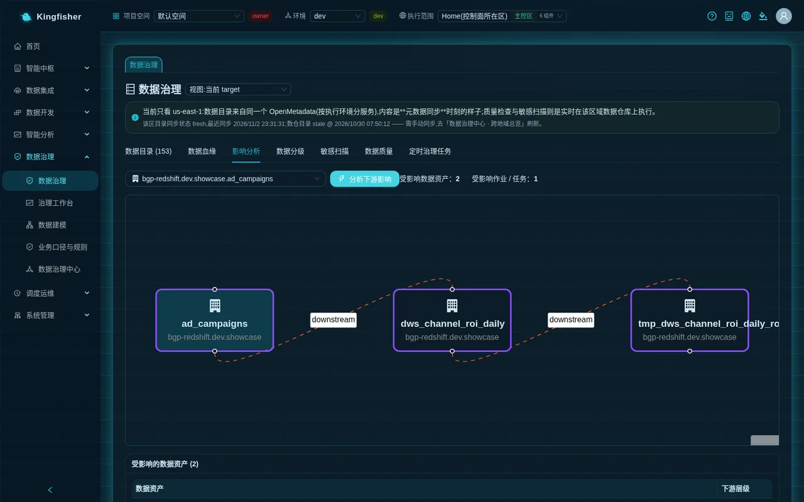

Usage tip: before changing columns of `showcase.players` or truncating it, come here and take a look first; jobs that "Read the changed table" must be changed along with it, and jobs that "Output downstream tables" must be rerun.

---

## 9. Step 7: Scheduled governance tasks (admin)

Page path: "Data Governance → Data Governance", tab "Scheduled governance tasks".

1. Card note: "Quality checks / sensitive scans / catalog sync run automatically on cron in the selected execution scope; each region schedules itself, and only result metadata returns to the home region."
2. The "Execution scope" in the top bar must be a specific execution environment; otherwise "New scheduled task" is disabled with the hint "Select an execution environment in the top bar first: a scheduled governance task runs in the region selected when it was created".
3. Click "New scheduled task"; the "New scheduled governance task" dialog restates at the top: "Runs on cron in <region> (<targetId>); the schedule is published to that region's MWAA Serverless and never falls back to the home region".
4. Fill in:
   - "Task name": `daily-quality-inspection-dws_channel_roi_daily`;
   - Action dropdown: choose "Quality check (run rules on that region's warehouse)";
   - In the text box "Tables to check (one FQN per line, e.g. bgp-redshift.dev.public.orders); each table runs all of its enabled rules", enter one FQN per line: the FQNs of `dws_channel_roi_daily` and `players`;
   - In the cron editor choose "Daily", time 03:00 (equivalent expression `0 3 * * *`; you can also choose "Hourly", "Weekly", "Monthly", "Every N minutes" or "Custom"; "Next run:" is shown below);
   - Check "Enable the schedule right after creating";
   - Click "Create". The toast "Scheduled governance task created and enabled" appears.
5. List columns: Name · Action · Execution scope (shows 🌍 <region>) · Cron Expression · Schedule type · Enable · Actions.
   A green "Auto schedule" under "Schedule type" means it has been published to that region's MWAA Serverless; orange "Carrier not published" means the switch is on but the carrier has not been published yet; grey "Not enabled" means the switch is off.
6. The switch in the "Enable" column can disable / enable at any time; the "Runs" link jumps to "Task Monitor" to view the logs of each run; "Delete" first withdraws the schedule artifacts in that region and does not delete the record if they cannot be withdrawn.

The other two actions:

- "Sensitive scan (classification hits on that region's tables)": you can enter a schema (empty = all) and "Scan only these tables (optional, one schema.table per line)".
- "Catalog sync (push that region's metadata to OpenMetadata)": check "Glue catalog (free catalog API)" and / or "Warehouse catalog (Redshift)".
  Checking the warehouse catalog shows a red reminder: "Scheduled warehouse catalog collection wakes the region's Redshift Serverless warehouse and incurs charges (per RPU-second); check it only when truly needed. The platform's own 30-minute mirror timer still refreshes Glue only."

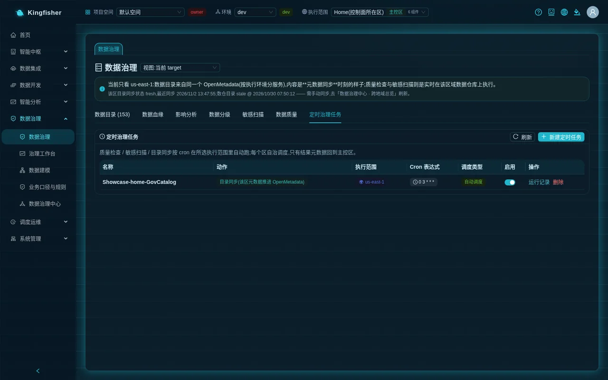

---

## 10. Step 8: Governance workbench

Page path: "Data Governance → Governance Workbench".

1. Top left, the "Governance Health Score" gauge, with a line below it "N tables · N columns · N classified".
2. On the right, four small "Governance Dimensions" cards: Security / Classification (weight 30%) · Quality Health (30%) · SLA Compliance (20%) · Lineage Coverage (20%); each card has a one-line fact below it, for example "2/8 tables classified", "1 tables breach SLA", "5/8 tables have lineage".
3. "Governance To-dos (N)" are listed in four groups: "Unclassified likely-sensitive tables", "SLA Breach", "Quality below threshold", "Not yet governed". Each row has the table name, a one-line reason (such as "freshness over threshold", "quality score 60 below 80", "no classification, no quality rules") and a "Resolve" button that jumps straight to the corresponding tab of "Data Governance".
   After steps 2–5, `players` should appear in the "SLA Breach" group and `ad_events` should disappear from the "Not yet governed" group.
4. "Assets Most in Need of Governance" lists the tables with the most issues and their issue tags ("N sensitive fields unclassified", "SLA Breach", "quality score N").
5. Data is aggregated by the current "Execution scope"; after switching regions click "Refresh" to recompute.

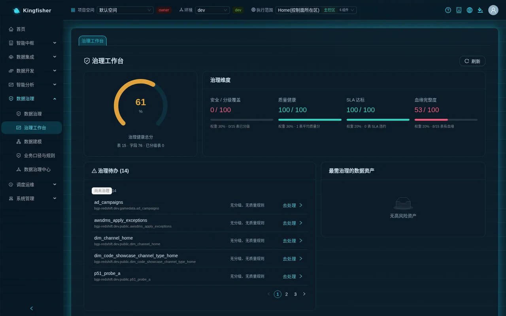

---

## 11. Step 9: Governance Center (OpenMetadata) and description flow-back

Page path: "Data Governance → Governance Center".

1. The top of the page shows status "Running", the version and the access URL; "Open OpenMetadata console" at the top right opens OpenMetadata in a new tab.
2. Three shortcut cards: "Data Catalog" (browse all data assets), "Data Lineage" (table-level and column-level lineage), "Data Quality" (OpenMetadata's own test results).
3. The "OpenMetadata services by execution scope" card: one row per region; after the blue region tag come that region's service buttons (`bgp-redshift` / `bgp-glue`, non-home regions carry the region-slug suffix); clicking one takes you to that region's databases and tables in OpenMetadata.
   The note on the card: "One OpenMetadata instance serves all regions; the region is reflected in the service name suffix (the home region keeps the original name without a suffix, so existing assets need no migration)."
4. "Quick access": Configure database service / Configure pipeline service / Glossary / Tag management / Settings.
5. In the OpenMetadata console, find `dws_channel_roi_daily` and write a business description for it, for example "Channel acquisition daily report: spend, installs, payer rate and ROAS aggregated by channel".
   When GenBI retrieves relevant tables, it reads the table descriptions in OpenMetadata (matched by table name); the clearer the description, the more accurate the hit for questions like "Which channel has the highest ROAS?".

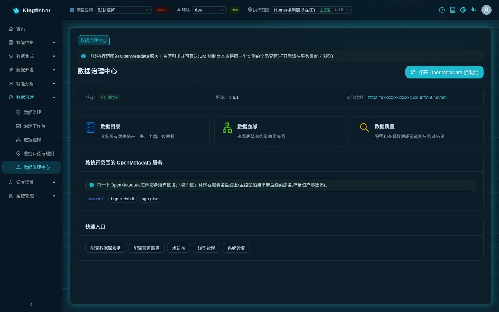

Note: the OpenMetadata login password is randomly generated and replaced by the deployment script at deployment time; it is not the factory password. Get it from the platform admin.

---

## 12. Step 10: Cross-region metadata overview

Page path: "Data Governance → Data Governance", switch the dropdown to the right of the title to "View: all targets (read-only metadata)".

1. The page becomes the "Cross-region metadata overview": rows are metrics, columns are execution regions (column header = region name + targetId; regions in a non-home jurisdiction carry a purple "🌍 <jurisdiction>" tag; retired regions are still shown and marked "Retired"), and the rightmost column is "Total".
2. The rows, in order: Assets (tables) · Database / Namespace · Columns (Glue side) · several "Not collected" items (hover for the reason) · Metadata mirror · Warehouse catalog (manual collection).
3. The "Metadata mirror" cell shows ✓ / "⚠ Mirror stale" / "⚠ Mirror expired" / "— Never synced" / "⚠ Last sync failed", with a line below "Last synced N minutes ago".
   Cells that need a refresh give admins a "Sync now" link (collects the Glue catalog, free).
4. The "Warehouse catalog (manual collection)" row has its own timestamp and a "Collect warehouse catalog" link; the tooltip says "Wakes the region's Serverless warehouse (billed per RPU) ⇒ click only when you need to look; the platform never collects on a schedule".
5. "Drill down" in a column header expands the list of databases and tables in that region's mirror (Type / Source / Name / Columns / Mirrored at).
6. The blue bar at the top states plainly: "Cross-region [metadata] panorama (no data rows at all); click a target to drill into its databases and tables; the data itself stays in that region." — to merge data from two regions, go through an explicit copy job and approval, not here.

Measured in the demo environment: in the "Cross-region metadata overview", the three rows "lineage edges", "quality score" and "sensitive hits" show "Not collected" in every region, and the note below reads literally "3 metrics were not collected this round (shown honestly as 'not collected' rather than 0)"; the "Metadata mirror" column shows the last sync time or "—"; "Warehouse catalog (manual collection)" shows "Never synced / never collected" when it has never been collected and "Collected at N hours ago" when it has, stale ones are marked "⚠ Mirror stale · N tables", with a "Collect warehouse catalog" button beside them (the warehouse catalog is collected only when someone clicks, to avoid keeping each region's Serverless warehouse awake all the time).

---

## 13. Verify the results

Check each item; when all are ticked, the loop is closed:

| Checkpoint | Where to look | What you should see |
|---|---|---|
| Catalog field counts correct | Data Governance → Data Catalog | "Field count" of each `showcase` table = real column count; `ad_events` sensitivity level "L3 Confidential" |
| Masking in effect | Ask-Your-Data / Redshift Query (non-admin) | `device_id` is a mask; note "Some sensitive fields are masked per data classification" or tag "Masked columns: device_id" |
| Grant lifts masking | Data Classification → "My data access grants" | The table is listed after approval; asking the same question again returns plaintext |
| Quality score and SLA | Data Governance → Data Quality | `dws_channel_roi_daily` has a quality score; `players` SLA shows a verdict |
| Lineage and impact | Data Lineage / Impact analysis | Four source tables → summary table; downstream of `players` includes the summary table and the ROI job |
| Scheduled inspection | Scheduled governance tasks / Task Monitor | Task is "Auto schedule"; the next day "Task Monitor" has a run with trigger = Auto |
| Workbench to-dos | Governance Workbench | Overall score and four dimension scores have values; the SLA Breach group is visible in the to-dos |

---

## 14. FAQ

- **Symptom: a table's "Field count" in the catalog is 1, and the classification tab says "This table has no field info (columns not recorded in OM)".**
  Cause: the catalog has only the table entity, no columns. Next step: an admin clicks "Sync Redshift columns"; if still missing, use "Enter field name manually" to add the column to the list, then classify it.
- **Symptom: after clicking "Sync Redshift columns", the bottom right keeps showing "Running in background: Sync column information to the data catalog".**
  Cause: many tables; this is normal background execution. Next step: wait for it to disappear by itself; clicking again meanwhile returns "is in progress (n s elapsed); wait for it to finish before trying again", which is not a fault.
- **Symptom: an admin sees no masking in GenBI.**
  Cause: platform admins are exempt from masking. Next step: verify with a non-admin account.
- **Symptom: a non-admin sees masking in region A, but the same-named table in region B is plaintext.**
  Cause: classification is stored per execution region. Next step: set it again from the region B view.
- **Symptom: the "New scheduled task" button is grey.**
  Cause: the "Execution scope" in the top bar is "All". Next step: select a specific execution environment and click again.
- **Symptom: the scheduled task's "Schedule type" is "Carrier not published".**
  Cause: the switch is on but there is no artifact on that region's scheduler yet. Next step: turn the "Enable" switch off and on once; if that does not help, check that region's scheduler status in "Task Monitor".
- **Symptom: "Run Check" reports `error` with the detail that a column does not exist.**
  Cause: the field name in the rule does not match the real column. Next step: delete the rule and recreate it; field names may only contain letters / digits / underscores.
- **Symptom: the sensitive scan returns 0 results.**
  Cause: the scanned tables have no fields matching patterns such as email / phone / credit card (exactly the case for the demo data). Next step: scan your own business schema, or classify manually in the "Data Classification" tab.
- **Symptom: impact analysis says "OpenMetadata is currently unreachable".**
  Cause: the OpenMetadata service is offline. Next step: check the status in "Governance Center"; meanwhile "Affected jobs / tasks" still gives results from job SQL parsing.
- **Symptom: lineage shows only synced tables, not tables produced by Glue PySpark jobs.**
  Cause: the platform only parses the text of Redshift SQL jobs; PySpark scripts get no text lineage. Next step: carry the processing that needs lineage tracking in Redshift SQL jobs, or add lineage edges manually in the OpenMetadata console.
- **Symptom: after switching execution region, the governance workbench scores did not change.**
  Cause: the page needs to re-fetch. Next step: click "Refresh".

---

## 15. Cleanup

Delete the practice objects in the following order to avoid leaving orphans:

1. "Data Governance → Scheduled governance tasks": first turn off the "Enable" switch, then click "Delete" at the end of the row (it withdraws the schedule artifacts in that region first).
2. "Data Governance → Data Quality": select the table and "Delete" each rule in the "Quality Rules" card; results and score history lose their meaning along with the rules but need no manual deletion.
3. "Data Governance → Data Classification": set the practice columns' level back to "Unclassified" and "Apply"; approved access grants remain visible under "My data access grants"; the current version has no page entry to revoke a grant, and keeping the grant record is harmless.
4. Sensitive scan results are suggestions; nothing is written unless you adopt them, so no cleanup is needed.
5. The demo tables and demo jobs are long-lived demo objects; do not delete them. If `dws_channel_roi_daily` is deleted, the nodes centered on it disappear from the lineage graph and impact analysis reports no downstream.

---

## 16. Further reading

- [Analyst guide](12-guide-analyst.md): everyday use of GenBI, cards, business definitions and reports.
- [Scenario 5: Rolling out GenBI to the business](24-scenario-genbi-rollout.md): the complete chain of business-definition entries, skills and masking on the GenBI side.
- [Scenario 7: Data modeling and metrics](26-scenario-modeling-metrics-report.md): organizing governed tables into layers / dimensions / metrics.
- [Rules and status code reference](30-reference-rules.md): meaning of rejections such as 409 "in progress" and 403 no permission.
- Feature tour [data governance section](../features.md) · module overview [Data governance](../modules.md).
- Mechanism details: [Classification and masking](../design/classification-masking.md) · [Quality rules and scoring](../design/quality-rules-scoring-sla.md) · [SQL lineage and impact analysis](../design/sql-lineage-impact.md) · [Governance health score and sensitive detection](../design/governance-deepening.md).
