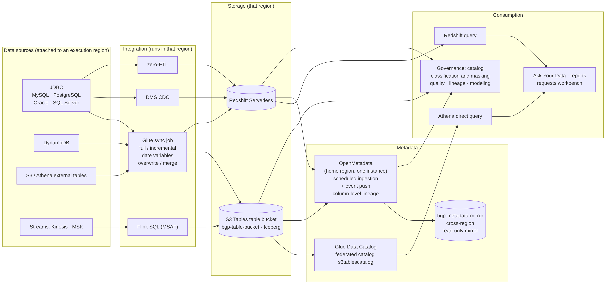
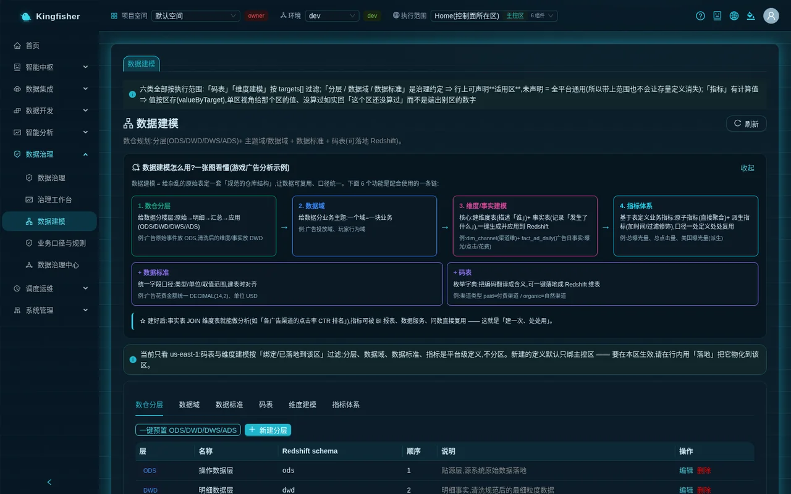
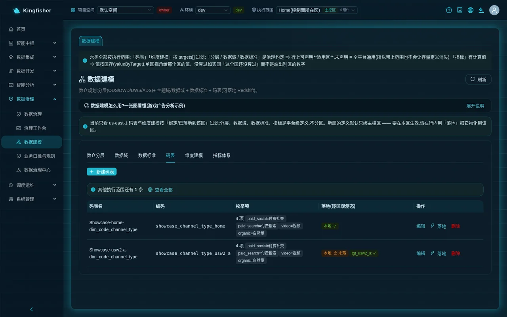
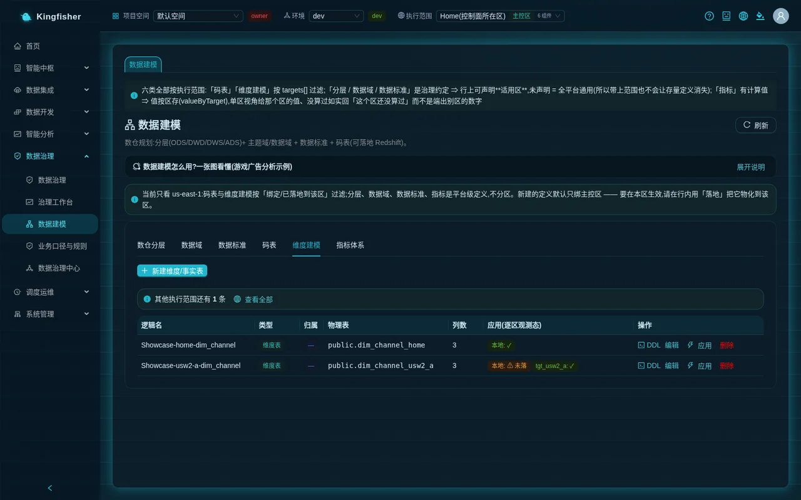
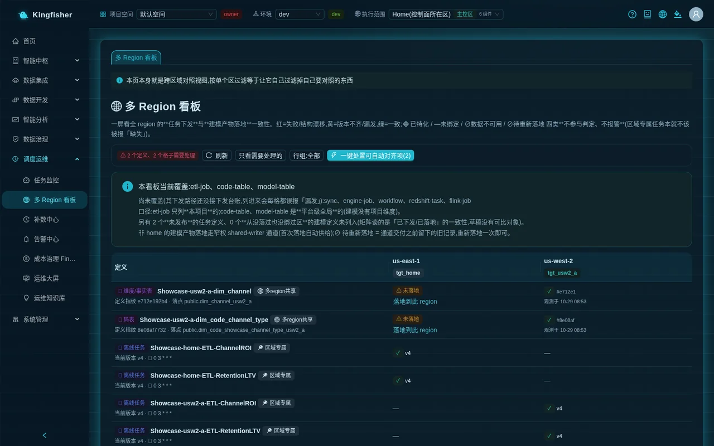
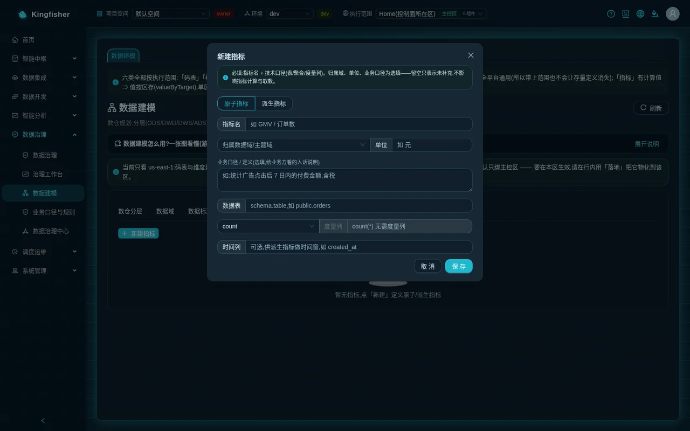
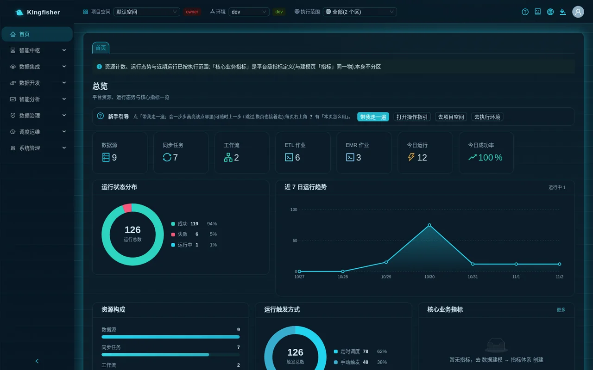
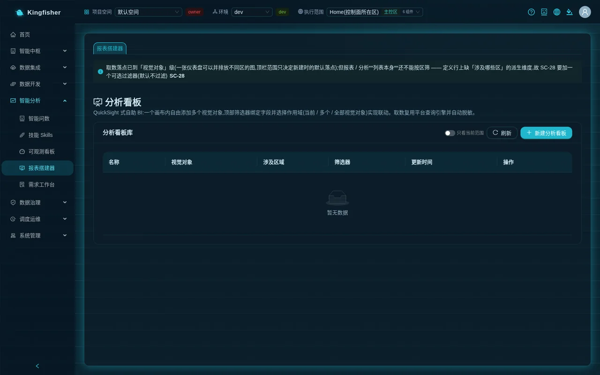

# Scenario 7: Data modeling → land in each region's warehouse → metrics → reports and home-page KPIs

| Item | Content |
|---|---|
| Audience | Platform admins (create layers / domains / standards / code tables / dimension tables / metrics and land them) · data engineers and analysts (build reports from the landed tables and metrics) |
| Estimated time | 60 minutes (one landing in each of two execution regions; a few more minutes when a warehouse cold-starts) |
| Prerequisites | Signed in with a platform admin account; at least one execution environment is available (two show "landing region by region" better); the sample sync task has run in that region (see §2) |
| What you will have at the end | A set of ODS / DWD / DWS / ADS layers and data domains · one channel-type code table and one channel dimension table that really exist in every region's Redshift · two atomic metrics + one derived metric with computed values · the "Core business metrics" card on the home page and a metric card in the report builder |

---

## 0. Outcome first

After this scenario, you will have turned "modeling" from a design sketch into tables that really exist in every region's warehouse, with identical structure and observable state, and you will define business metrics once and reuse them everywhere:

- The "Data Modeling" page defines layers, data domains, data standards, code tables, dimension / fact tables and metrics;
- Code tables and dimension / fact tables are landed in Redshift region by region through the "Landing panel"; the panel and the "Multi-Region Dashboard" use observed state to tell you whether each region is ✓ landed, ⚠ version mismatch or 🔴 drift;
- When no longer needed, "Unbind and clean up" in the panel; a definition that still has landed artifacts cannot be deleted directly (a 409 blocks it and offers two ways out);
- Metrics are defined on the "Metric system" tab and "Compute"-d; the "Core business metrics" card on the home page shows them directly; the report builder uses a "Metric card" with the same definition.

Overview of the route:

1. "Data Modeling → Warehouse layers": "One-click ODS/DWD/DWS/ADS preset".
2. "Data Domain": create the "Ad Campaign Domain" and its subject domain "Channel Performance".
3. "Data Standard": create "Ad spend amount" DECIMAL(14,2) · USD.
4. "Code table": create "Channel type" (paid = Paid channel / organic = Organic channel).
5. "Dimensional modeling": create the dimension table `dwd.dim_channel` and the fact table `dwd.fact_ad_daily`; preview the "DDL" first.
6. "Land" / "Apply" in the row opens the landing panel; check the execution regions and "Land in the N selected regions"; watch the observed state; verify in "Redshift Query" that the tables really exist.
7. Switch the row group of the "Multi-Region Dashboard" to "modeling artifacts only" and see one cell per region.
8. Change an enum value of the code table, watch the panel turn into "⚠ Version mismatch", then "Land in this region" to realign; learn about 🔴 drift and "Force rebuild from platform definition".
9. "Metric system": create the atomic metrics "Total ad spend" and "Installs" and the derived metric "Paying players"; "Compute" each one.
10. Read the values on the "Core business metrics" card on the home page; create an analysis in "Report Builder" and present the same definition with a "Metric card" and a bar chart.
11. Clean up: "Unbind and clean up" in the panel, then delete the definitions; experience the "This definition still has landed physical tables" block.

---

## 1. How it works (one page)

- **Six kinds of definitions, two of which land.** Layers, data domains, data standards and metrics are platform-level definitions, not per region; only **code tables** and **dimension / fact tables** have a "which region to land in" dimension.
  In a single-region view the page says so explicitly: "Showing only <region>: code tables and dimensional modeling are filtered by 'bound / landed in this region'; layers, data domains, data standards and metrics are platform-level definitions, not per region. New definitions are bound to the home region only by default — to take effect in this region, use 'Land' in the row to materialize it here."
- **Landing = really creating the table in that region's Redshift.** A code table lands as `public.dim_code_<code>` (three columns value / label / seq) and is filled with the enum values; a dimension / fact table lands as the `schema.physical table name` you entered, generated from the column definitions as `CREATE SCHEMA IF NOT EXISTS` + `CREATE TABLE IF NOT EXISTS` + column comments.
  The DDL only accepts allow-listed types (VARCHAR / CHAR / INTEGER / BIGINT / SMALLINT / DECIMAL / DOUBLE PRECISION / REAL / BOOLEAN / DATE / TIMESTAMP / TIMESTAMPTZ / SUPER), and identifiers may contain only letters / digits / underscores.
- **The status is observed state, not a promise.** After every landing the platform reads back the real table structure in that region and compares it with the definition fingerprint, giving one of six states: ✓ Landed · ⚠ Version mismatch (the definition changed but that region still has the old structure) · 🔴 drift (that region already has a table with the same name but a different structure, and the platform did not overwrite it) · ⊘ Needs re-landing (an old record; land once more) · ✗ Landing failed · ⚠ Not landed.
  Every cell of the panel shows an "Observed at" time; if someone changed the table in the database, the platform does not know; to see the current state click "Re-detect".
- **Unbinding is an explicit action.** "Unbind only" keeps the table in that region, and the dashboard cell shows "Leftover"; "Unbind and clean up" DROPs the table in that region and requires you to type the physical table name exactly to confirm. The platform will not judge for you whether that table can be deleted.
- **Deleting a definition is controlled.** Clicking "Delete" on a definition that still has landed artifacts is blocked by the server with a 409; the dialog lists the physical tables per region and offers only two ways out: go to the landing panel and "Unbind and clean up" region by region, or type the confirmation string exactly and "Keep physical tables, delete definition only" (the audit records "intentionally kept" per table).
- **Long-running operations.** Landing / applying / unbinding / metric computation all wait for Redshift to reach a terminal state. Finishing within 45 seconds gives the normal success message; beyond 45 seconds (typically a warehouse cold start in that region) the bottom right of the page shows "Running in background: Land code table to execution target (n s elapsed)", and when it finishes the original success message and the list refresh happen as usual.
  Clicking land / edit / delete again on the same object while it is in progress is refused: ""Land code table to execution target" is in progress (n s elapsed); please wait for it to finish before trying again".
- **First landing in a region of another jurisdiction.** When the target region and the home region are not in the same jurisdiction, the first landing pops up "⚠️ Disclaimer"; after you click "Agree and continue" the consent is stored and the same request is retried automatically; it does not pop up again afterwards.
- **Metric = definition + computation.** An atomic metric = table + aggregation + measure column; a derived metric = a reference to one atomic metric + time period + modifiers (filter conditions). "Compute" runs the aggregation on the warehouse of the current execution region, and the value is stored per region; the "Core business metrics" card on the home page shows the most recently computed value.



---

## 2. Preparation

- **Account**: platform admin (role group `bgp-admin`). Non-admins are read-only on the "Data Modeling" page and do not see "New …", "Land", "Apply", "Compute", "Edit", "Delete".
- **Execution regions**: at least one available execution environment; this guide uses the home region + one execution region as the example. The sample sync task `Showcase-<region-slug>-GameSync-7tables` must have run in both regions, so that `showcase.ad_campaigns` / `showcase.players` have data in the Redshift of both regions and the metrics can compute values.
- **Look at the ready-made ones first**: the sample objects already include a code table `Showcase-<region-slug>-dim_code_channel_type` (enum values paid_social / paid_search / video / organic) and a dimension table `Showcase-<region-slug>-dim_channel`, both landed in their region.
  On the "Code table" and "Dimensional modeling" tabs open their "Land" / "Apply" to glance at the ✓ in the panel, then build your own set following the steps below.
- **"Execution scope" in the top bar**: a new definition is bound to the home region by default; to take effect in a region you check it in the landing panel, not by switching the top bar. For the whole scenario keep the "All" view, so that the code table and dimension tabs show the observed state of all regions at once.

At the top of the page there is a collapsible card "💡 How to use Data Modeling? One diagram (game ad-analytics example)" that chains the six kinds of definitions together:
Warehouse layers (give data its floors ODS/DWD/DWS/ADS) → Data domains (one domain = one block of business, such as the ad campaign domain or the player behavior domain) → Dimension/fact modeling (dim_channel channel dimension + fact_ad_daily ad daily fact) → Metric system (total impressions, total clicks, US impressions);
Data standards (ad spend amount unified as DECIMAL(14,2), unit USD) and code tables (channel type paid=Paid channel / organic=Organic channel) are the two companion pieces. This guide follows that example.

---

## 3. Step 1: Warehouse layers

Page path: "Data Governance → Data Modeling", tab "Warehouse layers".

1. Click "One-click ODS/DWD/DWS/ADS preset". The message "Provisioned 4 standard layers" appears and the table shows four rows: Layer (ODS / DWD / DWS / ADS) · Name · Redshift schema (`ods` / `dwd` / `dws` / `ads`) · Order · Description.
2. To add a custom layer click "New layer": "Layer code" (such as DIM), "Name", schema (Redshift schema name), "Order", description, then click "Save".
3. "Edit" and "Delete" at the end of the row are visible to admins only.

Layers are a convention: they tell the later dimension / fact table creation "which layer this table belongs to and which schema it lands in"; by themselves they create nothing in Redshift.



---

## 4. Step 2: Data domains

Tab "Data Domain".

1. Click "New domain": enter `Ad Campaign Domain` as "Name", `ads` as "Encoding", leave "Parent data domain" blank (blank = create a top-level data domain), any "Owner", and click "Save".
2. Click "New domain" again: "Name" `Channel Performance`, "Encoding" `channel_perf`, choose "Ad Campaign Domain" as "Parent data domain" (selected = subject domain), and click "Save".
3. The table shows a two-level tree: top-level rows carry a purple "Data Domain" tag, child rows are indented and carry a "Subject area" tag.

---

## 5. Step 3: Data standards

Tab "Data Standard".

1. Click "New standard": "Standard name" `Ad spend amount`, "Encoding" `cost_usd`, "Data type" `DECIMAL(14,2)`, "Unit" `USD`, "Naming convention" `snake_case`, leave "Linked lookup table (optional)" blank, "Constraints" `>=0`, and click "Save".
2. Table columns: Standard name · Encoding · Data type · Unit · Constraints.

A data standard is the dictionary of field definitions; when creating tables you fill in types and units according to it; the platform does not enforce it, it is a convention for people to read.

---

## 6. Step 4: Code tables

Tab "Code table".

1. Click "New code table": "Code table name" `Channel type`, "Encoding" `channel_type` (the landed table name is derived from it and must be letters / digits / underscores only), any description.
2. Under "Enum value" click "Add enum value" twice and enter code value `paid` / meaning `Paid channel`, code value `organic` / meaning `Organic channel`, then click "Save". The message "Created" appears.
3. Table columns: Code table name · Encoding · Enum values (`2 items paid=Paid channel organic=Organic channel`) · Landed (observed per region) · Actions.
   Right after creation, "Landed (observed per region)" shows "Local: ⚠ Not landed" — the definition exists, but nothing is in the database yet.
4. "Land" at the end of the row opens the landing panel, covered in a later step.



---

## 7. Step 5: Dimension table and fact table

Tab "Dimensional modeling".

### 7.1 Dimension table

1. Click "New dimension/fact table" and keep the radio at the top on "Dimension table".
2. "Logical Name" `Channel dimension`; schema `dwd`, "Physical table name" `dim_channel`; choose `DWD` as "Owning layer" and "└ Channel Performance" as "Owning data domain / subject domain".
3. Choose "SCD1 (overwrite)" for "SCD Type", "Business key" `channel_id`.
4. "Column definitions": one row exists by default; fill in three columns as in the table below (choose the type from the drop-down; VARCHAR needs a length; check PK for primary key, check NULL for nullable):

| Column name | Type | Length | PK | Comment |
|---|---|---|---|---|
| `channel_id` | INTEGER | — | checked | Channel ID |
| `channel_name` | VARCHAR | 128 | unchecked | Channel name |
| `channel_type` | VARCHAR | 32 | unchecked | Channel type; values see code table channel_type |

5. Click "Save". The table gains a row: Logical name · Type "Dimension table" · Ownership (DWD + Channel Performance) · Physical table `dwd.dim_channel` · Columns 3 · Applied (observed per region) "Local: ⚠ Not landed".
6. Click "DDL" in the row to see the read-only preview "DDL Preview — Channel dimension": `CREATE SCHEMA IF NOT EXISTS dwd;` plus `CREATE TABLE IF NOT EXISTS dwd.dim_channel (...)` plus column comments.
   The bottom of the dialog reads: "This DDL is safely generated from column definitions (type allowlist + identifier validation). Click "Apply" in the list to run CREATE TABLE in Redshift."

### 7.2 Fact table

1. Click "New dimension/fact table" again and switch the radio to "Fact table".
2. "Logical Name" `Ad daily fact`; schema `dwd`, "Physical table name" `fact_ad_daily`; ownership DWD / Channel Performance; enter `one row = one channel per day` as "Granularity".
3. Column definitions: `dt` DATE (PK checked) · `channel_id` INTEGER (PK checked) · `impressions` BIGINT · `clicks` BIGINT · `cost_usd` DECIMAL (precision 14, scale 2).
4. "Save".



---

## 8. Step 6: Land in each execution region

"Land" on a code table row and "Apply" on a dimension / fact table row open the same "Landing panel". The code table "Channel type" is used as the example below.

1. On the "Code table" tab click "Land" at the end of the "Channel type" row. The dialog title is "Landing panel Channel type".
2. Two items at the top: "Physical table" `public.dim_code_channel_type` and "Definition hash" (the definition fingerprint; it changes when the enum values change).
   The blue bar: "The status is observed state: each cell shows the "Observed at" time, which stands for the real structure in the database at that moment — the platform does not know about later changes made by someone else; to see the current state click "Re-detect"."
3. One execution region per table row: Execution region (targetId + region name; unbound ones carry a "Not bound" tag) · Observed state · Observed at · Actions. The home region row is at the top.
4. Check the home region row and the execution region row and click "Land in the 2 selected regions" at the bottom (hover tip: "Lands only these regions; bindings in other regions are not changed (the platform never unbinds implicitly)").
5. Wait:
   - Warehouse is warm: after a few seconds the message "Landed in 2 regions (status comes from actual observation after landing; bindings in other regions unchanged)" appears, the observed state of both rows becomes "✓ Landed", and "Observed at" is the time just now;
   - A region's warehouse cold-starts: the bottom right of the page shows "Running in background: Land code table to execution target (n s elapsed)", possibly for a minute or two, and the same success message appears as usual when it finishes. Do not click land again in the meantime, and do not delete this code table (a 409 refuses it).
   - The execution region and the home region are not in the same jurisdiction and this is your first data operation on it: "⚠️ Disclaimer" pops up first; read it and click "Agree and continue", and the landing continues automatically.
6. Close the panel; the "Landed (observed per region)" column shows "Local: ✓" and "<execution-region targetId>: ✓".
7. Go to the "Dimensional modeling" tab, click "Apply" once each on "Channel dimension" and "Ad daily fact", and land them in the two regions the same way.

### 8.1 Verify that the tables really exist

In the left menu "Data Development → Redshift Query", check both regions under "Execution regions (multi-select)" and enter:

```sql
SELECT * FROM public.dim_code_channel_type ORDER BY seq
```

Click "Execute". There is one result sheet per region, each with two rows (paid / organic). Then query `SELECT COUNT(*) FROM dwd.dim_channel`; both regions return 0 rows (a dimension table only gets its structure; data is written by jobs).

### 8.2 Look at it on the Multi-Region Dashboard

In the left menu "Scheduling & Ops → Multi-Region Dashboard", click "Rows: all" to switch to "Rows: modeling artifacts only".

1. One row per code table / dimension / fact table (tags "🧱 Code tables", "🧱 Dimension / fact tables"); the row header reads "Definition fingerprint <first 10 chars> · place <physical table>"; one column per region.
2. Cell semantics: ✓ consistent · "⚠ Version mismatch" · "⚠ Not landed" · "✗ Failed" · "🔴 Structure drift" · "—" not bound · "⊘ Data unavailable" (that region lacks the unique data it depends on and naturally cannot be bound) · "⊘ Needs re-landing" (an old record left from before the write channel was delivered; land once more for this region on the modeling page).
   The last four kinds do not take part in the red / yellow judgment and never alert. Cells carry an "Observed at" time; the "Leftover" tag means that region is not bound but the table still exists in the database.
3. Cells that need handling give admins a "Land in this region" link; 🔴 structure-drift cells only show "Needs manual handling → "Modeling" page".
4. "One-click fix for auto-alignable items (N)" shows an impact preview first and then handles the items one by one; structure drift is deliberately excluded from automatic handling.



---

## 9. Step 7: Version mismatch, drift and force rebuild

### 9.1 Create a "version mismatch" and realign

1. Back on the "Code table" tab, click "Edit" on the "Channel type" row, "Add enum value" `video` / `Video`, "Save". The definition hash changes.
2. In the list the observed state of both regions becomes "⚠ Version mismatch" (the definition changed, the database still has two rows).
3. Click "Land" to open the panel; the "Actions" column of both rows offers "Land in this region"; click them one by one, or check both rows and "Land in the 2 selected regions". The observed state returns to "✓ Landed".
   Reloading a code table is idempotent (it is emptied and all enum values are loaded again); for a dimension / fact table, "Apply" after adding a column does not change the structure of the existing table — the statement is `CREATE TABLE IF NOT EXISTS`, and the panel then judges it as drift, see below.

### 9.2 What drift is and how to handle it

- "🔴 drift" means that region already has a table with the same name but a different structure, and the platform did not overwrite it. Typical sources: someone created a table with that name manually in the database, or the dimension table definition changed its columns while the table in the database still has the old structure.
- The "Actions" column of that row in the panel shows "View diff" and "Force rebuild from platform definition":
  - "View diff" opens "Column-level diff · <region>": columns only in the platform definition / columns only in that region's table / type mismatches, plus the definition signature and the observed signature;
  - "Force rebuild from platform definition" DROPs the existing table in that region and recreates it from the definition; the data disappears with it. The dialog warns in red: "This will DROP the existing table on this execution target, and the data in it will be lost. Back it up first." You must type `FORCE-REBUILD` exactly before you can click "Confirm force rebuild".
- If you do not want to lose data: run the ALTER yourself in Redshift according to the diff, then click "Re-detect (all bound regions)" in the panel; once the structure matches it returns to ✓.
- The "Multi-Region Dashboard" only says "Needs manual handling → "Modeling" page" for drift; it never DROPs for you.

After changing the definition (for example adding a column) and before "Apply", that region shows "Version mismatch" (the platform knows the definition changed but has not landed it yet); when you click "Apply" and that region already has a table with the same name whose structure differs from the new definition, the platform does not overwrite it, the observed state turns to drift, and the two actions "View diff" and "Force rebuild from platform definition" are offered.

---

## 10. Step 8: Metric system and computation

Tab "Metric system". The notice at the top: "Required: metric name + technical spec (table / aggregation / measure column). Owning domain, unit and business definition are optional — leaving them blank only means "not filled in" and does not affect metric computation or querying."

### 10.1 Two atomic metrics

1. Click "New metric" and keep the radio on "Atomic metric".
2. "Metric name" `Total ad spend`; choose "└ Channel Performance" as "Owning data domain / subject domain"; "Unit" `USD`; enter `Total spend of all campaigns, including finished ones` as "Business definition".
3. Enter `showcase.ad_campaigns` as "Data table" (format `schema.table`); choose `sum` as the aggregation; "Measure column" `cost_usd`; "Time column" `start_date` (used by derived metrics for time windows). Click "Save".
4. "New metric" again: "Metric name" `Installs`, data table `showcase.players`, aggregation `count` ("Measure column" is disabled automatically and shows "count(*) requires no measure column"), "Time column" `install_time`, unit `count`. "Save".

### 10.2 One derived metric

1. "New metric", switch the radio to "Derived metric".
2. "Metric name" `Paying players`; choose "Installs (count@showcase.players)" as "Referenced atomic metrics"; keep "Time period" at "All (unlimited)" (options: Today / Last 7 Days / Last 30 Days / Last 90 Days / Month to date / Year to date; choosing one requires a "Time column").
3. Under "Modifiers (filters)" click "Add modifier": column name `is_paying`, operator `=`, value `1`. "Save".
4. Table columns: Metric name · Type (Atomic / Derived) · Owning domain · Technical spec (agg@table) · Business definition · Unit · Latest value · Actions.
   The technical spec of a derived metric shows as "Atomic "Installs"" plus a tag with the number of modifiers.

### 10.3 Compute

1. Switch "Execution scope" in the top bar to one specific region (in a single-region view the "Latest value" column shows that region's value; in the "All" view it shows the most recently computed value and the hover tip tells which region computed it).
2. Click "Compute" row by row. The message "Computed: <value>" appears, the "Latest value" column updates, and hovering shows the computation time.
3. Switch to the other region and click "Compute" again; that region gets its own value. The `showcase` data of both regions comes from the same demo source, so the numbers should be identical; in production each region has different data and therefore different values.
4. A derived metric with "Time period" set to "Last 30 Days" most likely computes 0 on the demo data — the demo timestamps are fixed historical dates written at data generation; this is not an error.



Notes:

- "Data table" accepts only the two-part `schema.table`, and the table must really exist in the current region's Redshift; a wrong value saves without error and fails only at "Compute" with a computation failure.
- Only platform admins can click "Compute" (it runs an aggregation on the warehouse).
- Metric definitions are platform-level and do not change when you switch region in the top bar; only "Latest value" changes.

---

## 11. Step 9: Home-page KPIs and the report builder

### 11.1 "Core business metrics" on the home page

In the left menu "Home", the "Core business metrics" card at the bottom right lists the first 4 metrics of the metric system: name + most recently computed value + unit; "More" at the top right jumps to "Data Modeling".
When there are no metrics at all, the card reads "No metrics yet. Create one in Data Modeling → Metric System."

Note: this card shows the **most recent** computed value without distinguishing which region computed it; to see a region's value, switch to that region on the "Metric system" tab and read "Latest value".



### 11.2 Metric card and channel chart in the report builder

In the left menu "Smart Analytics → Report Builder".

1. Click "New analysis" and enter `Channel ad-spend daily` as "Analysis name".
2. Click "Add visual":
   - "Visual name" `Total ad spend`; switch to "Free SQL" at the top; choose "Warehouse (Redshift)" as the engine; enter one statement with the same definition as the metric:

     ```sql
     SELECT SUM(cost_usd) AS cost_usd FROM showcase.ad_campaigns
     ```

   - Click "Preview data", choose "Metric card" as "Chart type"; a big number appears in the preview and should equal the latest value of "Total ad spend" in the "Metric system"; click "OK".
3. "Add visual" again: name `ROAS by channel`; switch to "Visual builder", engine "Warehouse (Redshift)"; choose `showcase.dws_channel_roi_daily` under "Select a table (no SQL needed)";
   drag `channel_name` to "X axis / dimension" and `roas` to "Value / measure", choose "Bar chart" as "Chart type", click "Preview", then "OK".
4. Click "Add filter": "Bind field" `channel_type`, "Label" `Channel type`, "Scope" all visuals, "OK"; a drop-down appears at the top; choose `paid` and click "Apply filters"; the bar chart keeps only paid channels.
5. Click "Save". The message "Saved" appears and you can see it back in "Analyses"; every visual has "Edit", "Refresh", "Export CSV" at its top right.



Notes:

- The report builder's data sources are SQL or the visual builder; it cannot yet pick a metric from the "Metric system" directly as a data source; the metric system is the single source of definitions, and reports write SQL with the same definition. (The report builder's only data sources are "Visual builder", "Free SQL" and "Import from reports")
- Report results also go through data-classification masking (see [Scenario 6](25-scenario-governance-loop.md)).
- To make Ask-Your-Data respect these metric definitions too, write the business definition of each metric into an entry on the "Business Glossary & Rules" page as well (see the [analyst guide](12-guide-analyst.md)).

---

## 12. Verify the results

| Checkpoint | Where to look | What you should see |
|---|---|---|
| Layers and domains | Data Modeling → Warehouse layers / Data Domain | Each of the four layers has a schema; the two-level tree "Ad Campaign Domain → Channel Performance" |
| Code table landed | Code table tab / landing panel | Both regions are "✓ Landed" with "Observed at" equal to the landing time |
| Tables really exist | Redshift Query (both regions) | `public.dim_code_channel_type` has two rows; `dwd.dim_channel` has 0 rows |
| Dashboard consistent | Multi-Region Dashboard → modeling artifacts only | Every cell of the three modeling-artifact rows is ✓; the top reads "✓ Dispatch/landing consistent across regions" |
| Versions aligned | After changing the code table enum | First "⚠ Version mismatch", back to ✓ after "Land in this region" |
| Metrics have values | "Latest value" in the Metric system | All three metrics have numbers; derived "Paying players" ≤ "Installs" |
| Home page and report | Home / Report Builder | The "Core business metrics" card shows "Total ad spend"; the metric card number matches it |

---

## 13. FAQ

- **Symptom: after switching to an execution region, the code table / dimension table lists are empty, yet the layers are unchanged.**
  Cause: only code tables and dimensional modeling are filtered by region; the other four kinds are platform-level. Next step: read the blue bar on the page; open the panel in the "All" view and check that region to land, or switch back to "All".
- **Symptom: after clicking "Land in the N selected regions" it keeps spinning and the bottom right shows "Running in background: Land code table to execution target".**
  Cause: that region's warehouse is cold-starting and the operation moved to the background. Next step: wait for it to finish; do not click again and do not delete the definition (you would get "is in progress (n s elapsed); please wait for it to finish before trying again").
- **Symptom: observed state "✗ Landing failed", hover shows "Error details".**
  Cause: commonly a missing component in that region, permissions, or a non-existent schema. Next step: read the error text; confirm in "Execution Environments" that the region's Redshift component is in place; the DDL of a dimension table creates the schema automatically, and code tables always land in `public`.
- **Symptom: observed state "🔴 drift".**
  Cause: that region already has a table with the same name but a different structure. Next step: "View diff"; if the data can be lost, "Force rebuild from platform definition" (type FORCE-REBUILD); if not, ALTER manually and then "Re-detect".
- **Symptom: "⊘ Needs re-landing".**
  Cause: an old record left from before the write channel was delivered; that region does not have this table. Next step: check that region and click "Land in the N selected regions".
- **Symptom: clicking "Delete" pops up "This definition still has landed physical tables".**
  Cause: deleting a definition is controlled; the platform does not decide for you whether the tables stay. Next step: "Open the landing panel to unbind and clean up per region"; or type the code table encoding / physical table name exactly and "Keep physical tables, delete definition only".
- **Symptom: "Unbind and clean up" fails.**
  Cause: the DROP did not succeed (that region's warehouse is unreachable or permissions are insufficient), and the platform does not change the record. Next step: read the message; fix the cause and try again; leaving the record and binding untouched is deliberate.
- **Symptom: metric "Compute failed".**
  Cause: "Data table" is not the two-part `schema.table`, or the table does not exist in the current region, or the measure column name is wrong. Next step: "Edit" and correct it; first run `SELECT COUNT(*)` on the same table in "Redshift Query".
- **Symptom: the number on the home page "Core business metrics" differs from "Latest value" in the "Metric system" of some region.**
  Cause: the home page shows the most recently computed value without regard to region. Next step: treat the single-region view of the "Metric system" tab as authoritative.
- **Symptom: a non-admin cannot see "New …", "Land", "Apply", "Compute".**
  Cause: modeling management actions are for platform admins only. Next step: have an admin do it, or request the role group.

---

## 14. Clean up

Delete the practice objects in this order (do not delete the sample objects `Showcase-*`):

1. "Report Builder": delete `Channel ad-spend daily` in "Analyses".
2. "Metric system": "Delete" the three practice metrics one by one (the derived metric references an atomic metric; deleting the derived one before the atomic one is safer).
3. "Code table" / "Dimensional modeling": for each practice object click "Land" / "Apply" to open the panel, and region by region click "Unbind…" → choose "Unbind and clean up: DROP <physical table>" → type the physical table name exactly → "Unbind and clean up".
   The message "Unbound and cleaned up <region>: the table in that region was dropped; landing record removed" appears. Unbinding the last binding shows "This is the last binding: after unbinding, the definition falls back to the default home".
4. After all regions are cleaned up, click "Delete" at the end of the row; if something is left over, "This definition still has landed physical tables" pops up; follow the dialog.
5. "Data Standard", "Data Domain", "Warehouse layers": "Delete" as needed (before deleting a layer, confirm that no dimension / fact table belongs to it).
6. Go to "Multi-Region Dashboard → modeling artifacts only" and confirm that the rows of the practice objects are gone and there is no "Leftover" tag.

---

## 15. Further reading

- [Scenario 6: governance loop](25-scenario-governance-loop.md): how landed tables enter the catalog, classification, quality and lineage.
- [Scenario 3: data stays in its region](22-scenario-multi-region-residency.md): creating execution regions, jurisdictions and the disclaimer, the task side of the Multi-Region Dashboard.
- [Scenario 1: detail to daily report](20-scenario-detail-to-daily-report.md): using batch jobs to write `showcase` detail into a fact table such as `dwd.fact_ad_daily`.
- [Core concepts](02-concepts.md): targets, execution scope, long-running operations and object leases.
- [Rules and status code reference](30-reference-rules.md): what the 409 "is in progress" and "This definition still has landed physical tables" mean.
- Feature tour [Data Modeling section](../features.md) · Module overview [Data Modeling](../modules.md) · Mechanism details [Data modeling design](../design/data-modeling.md) · [Long-running operations](../design/long-running-operations.md) · [Report builder design](../design/bi-report-dashboard.md).
