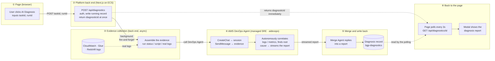
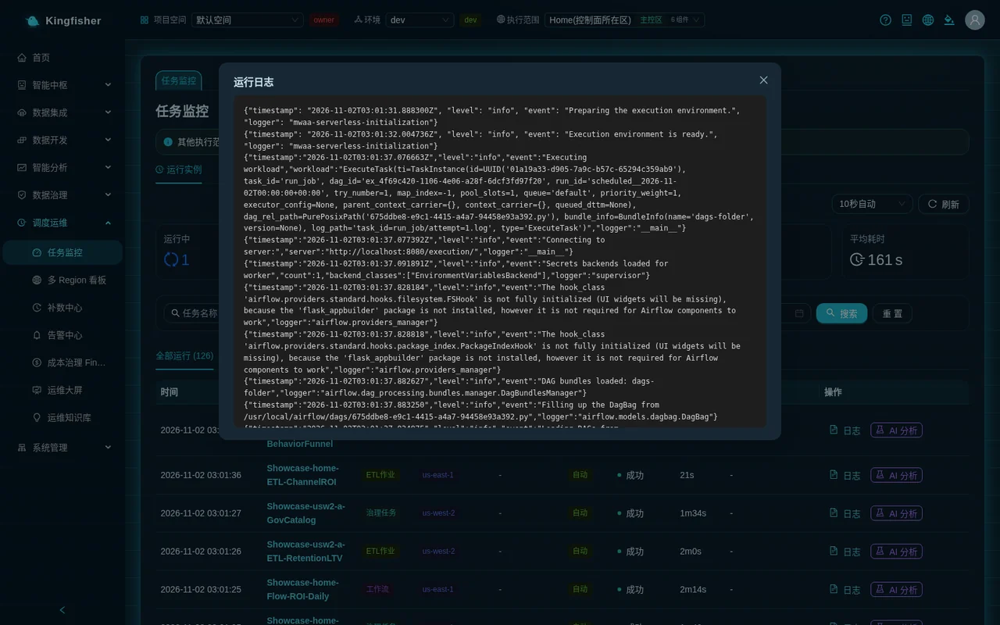
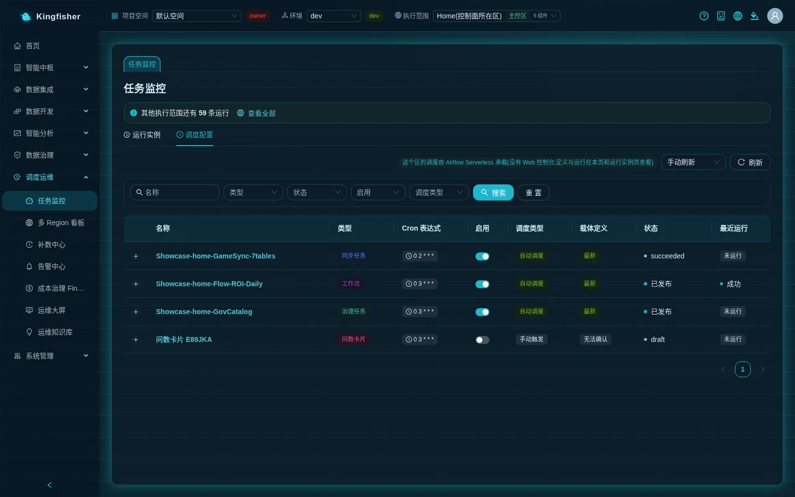
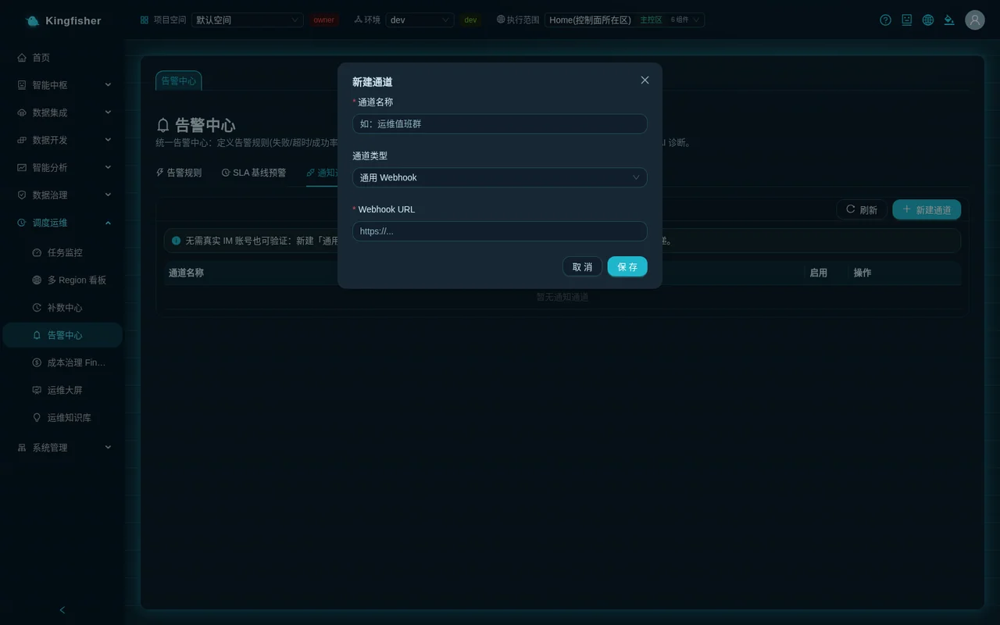
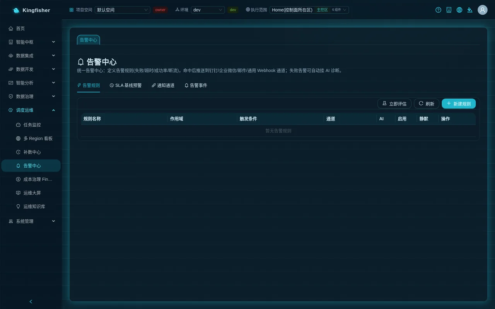
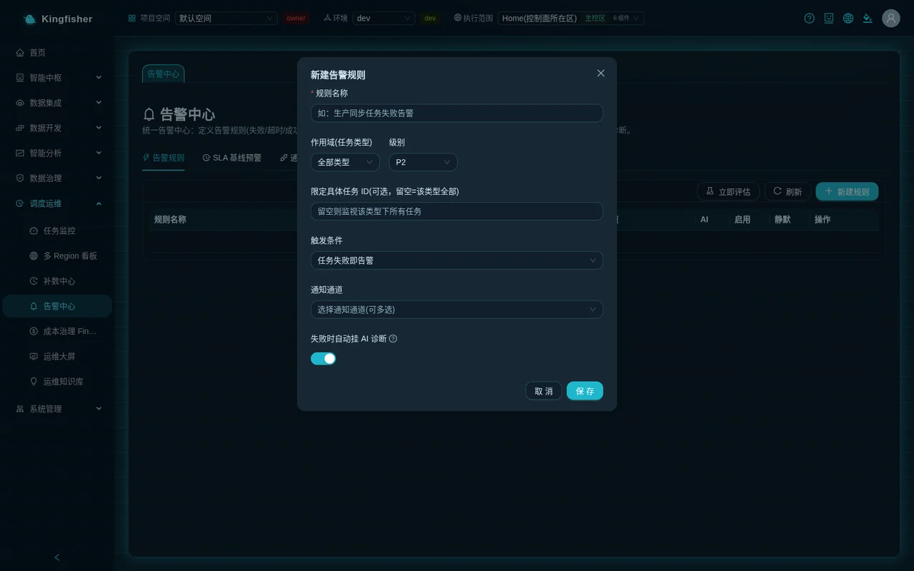
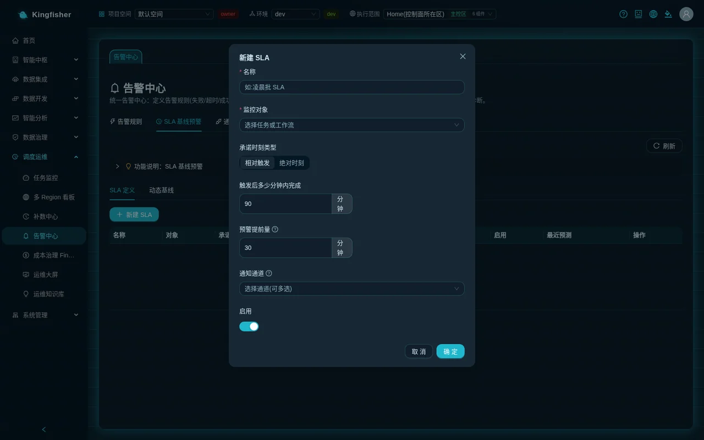
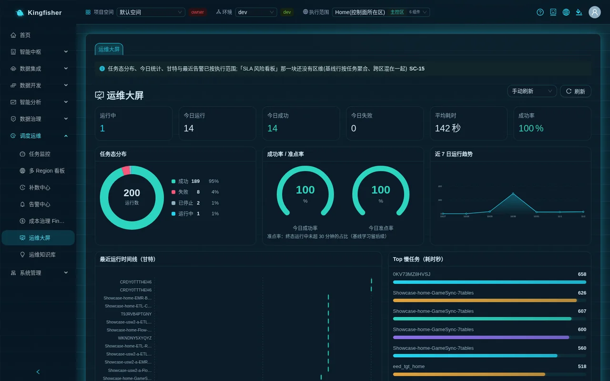
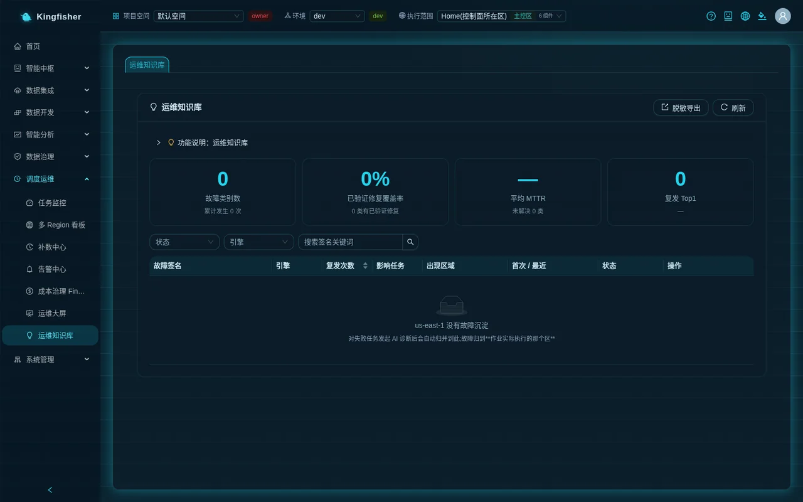

# Scenario 8: A day on call — task monitor · alerts · SLA baselines · ops dashboard · incident knowledge base · failure troubleshooting

| Item | Content |
|---|---|
| Audience | Platform administrators · data engineers responsible for on-call / operations |
| Estimated time | 60 minutes (including one deliberately failed run and one AI diagnosis) |
| Prerequisites | Signed in; at least one runnable task in the current workspace (you can use the sample object `Showcase-<region-slug>-ETL-ChannelROI` directly); project role editor or above |
| What you will have | One alert rule and channel that really deliver; one SLA definition and a learned baseline; one verified fix runbook; one troubleshooting route table for "how to investigate a failed job" |

> Permission quick check: any project member can view the monitor / dashboard / knowledge base; creating rules / channels / SLAs, clicking "Evaluate now" or "Re-learn baselines", and writing fix runbooks need editor or above; "Redacted export" needs the project owner.

---

## 0. The outcome first

A day on call needs only six pages in the platform, all in the "Scheduling & Ops" group of the left menu:

1. **Task Monitor**: filter run instances by status / region / type / trigger mode / time; click "Logs" for the verbatim output; click "AI Diagnosis" on a failed row for a root-cause report; "Retry", or go back to the job page and "Rerun".
2. **Alerting Center**: create "Notification Channels" first and "Send test"; in "Alert Rules" choose the target and condition (failure / timeout / success rate / no-run), "Save" and turn on "Enable"; "Alert Events" shows which channel each alert was delivered to.
3. **Alerting Center → SLA & Baseline Alerts**: "Re-learn baselines" learns each task's normal duration from historical runs; "New SLA" sets the committed completion time and the warning lead time.
4. **Ops Dashboard**: one screen with today's runs / success rate / on-time rate / Gantt timeline / top slow tasks / SLA risk board / recent alerts; choose "Every 30s" auto-refresh when projecting.
5. **Incident Knowledge Base**: AI diagnoses are merged automatically into entries by failure fingerprint; here you write the "Verified fix runbook", which the next diagnosis of the same failure references directly; use "Redacted export" when sharing externally.
6. **Failure troubleshooting route**: list symptom → verbatim log → common causes → next step (the table in §9 of this document).

Running example: `Showcase-<region-slug>-ETL-ChannelROI` (a Redshift SQL job) and a practice job `ops-practice-fail` in which you deliberately misspell a table name.

---

## 1. How it works (one page)

### 1.1 One run record, read by six pages

- Every run of a sync task, batch job (Glue / Redshift / EMR), workflow, governance task or scheduled GenBI card refresh is written to the same run record, tagged with "the region it ran in".
- Task Monitor, Ops Dashboard, the alert engine, SLA baselines, the Incident Knowledge Base and cost attribution all read this one record, so the six pages see the same thing.
- When the top-bar "Execution scope" is switched to one region, all six pages see only that region; switch to "All regions" for the aggregate. Switching does not leave the current page.

### 1.2 How alerts are produced

- One rule = scope (task type + optionally a specific task) + condition + severity (P1 / P2 / P3) + notification channels + whether to "Auto-attach AI diagnosis on failure".
- Four conditions: "Alert on task failure", "Run timeout (duration over threshold)", "Success rate below threshold", "No-run (no success within window)".
- On evaluation the platform scans the run records and matches each rule. The two aggregate conditions, success rate and no-run, are **evaluated per execution environment**: one region fully down is not averaged away by another region's healthy data.
- The same run (or the same statistics window) alerts only once; repeated evaluation does not resend.
- Evaluation is triggered only by the "Evaluate now" button on the "Alert Rules" tab; the platform has no scheduled evaluation, so no new alert events appear unless you click it.

### 1.3 Channels and delivery

- Four channel types: "Generic Webhook", "DingTalk group bot", "WeCom group bot", "Email (SES)". Channels are account-level configuration, independent of region.
- Every channel has "Send test"; the page shows "Test delivered (HTTP 200)" or "Test failed: …" directly.
- The platform ships a self-test address `<platform-domain>/api/public/alerting-sink`: create a "Generic Webhook" channel with it and you can verify delivery end to end without connecting a real IM.
- Feishu has no dedicated type; connect a Feishu group bot through "Generic Webhook".

### 1.4 What AI diagnosis is

- "AI Diagnosis" packages this run's definition, script, real logs and verbatim error and hands them to AWS DevOps Agent for autonomous investigation, producing a structured report (failure summary / root cause / fix suggestions / prevention suggestions).
- Diagnosis is **asynchronous**: when you click, the dialog first shows "AWS DevOps Agent is investigating (correlating CloudWatch logs, pinpointing root cause); usually 1-3 minutes…", the page polls every 3 seconds, and the report appears automatically when ready.
- A finished diagnosis is persisted automatically into the "Incident Knowledge Base", merged by failure fingerprint; the next time the same failure is diagnosed, the top of the report references the "Verified fix runbook" you wrote last time.
- Every report ends with the fixed line "Autonomously investigated and generated by AWS DevOps Agent; review manually before applying the fix." — a diagnosis is a lead, not a verdict.

### 1.5 Where SLA baselines come from

- "Re-learn baselines" learns each task's duration baseline p50 / p90 / EWMA from historical runs, one row per "task × execution region".
- Learning automatically excludes backfill runs and removes outliers with robust statistics; tasks with fewer than 7 samples are tagged "Cold start" and do not trigger duration warnings, so new tasks do not raise false alarms.
- One SLA = monitored target (task or workflow) + committed completion time (relative to trigger or absolute) + warning lead time + channels. When a breach is predicted, it is pushed through the channels and marked red on the Ops Dashboard "SLA risk board".

---

## 2. Preparation

### 2.1 Check your role and execution scope

1. Top-bar "Execution scope": choose "All regions" first; on call, look at the whole picture first, then switch to a region as needed.
2. Top-bar "Workspace": switch to the practice project; every object in this document is created in that project.
3. The ❓ "How to use this page" next to the avatar at the top right exists on all six pages; check it if you forget a step.

### 2.2 Produce a failed run (for practice)

The on-call drill needs a real failed run. A Redshift SQL job that queries a non-existent table is the easiest and touches no data.

1. Left menu "Data Development → Batch Compute" → click "New" → dialog "New ETL Job": job name `ops-practice-fail`, type "Redshift SQL Job" → "Create".
2. On the "Edit script" tab replace the whole script with `SELECT count(*) FROM showcase.table_that_does_not_exist;` → "Save".
3. Click "Run now · <region>" (when the job is bound to a single region the button carries the region name). Expect the message "Run submitted (business date …)".
4. A row appears in "Run History" after about 1 minute with status "Failed". Keep it; every later step uses it.

### 2.3 Prepare a self-test channel (optional but recommended)

- If you do not have a real DingTalk / WeCom group bot yet, create a "Generic Webhook" channel with the self-test address from §1.3 first; every "alert delivery" in this document then works end to end.

---

## 3. Step 1 Task Monitor: filter down to that failure

Page path: "Scheduling & Ops → Task Monitor", tab "Run instances".

1. Six cards at the top: "Running", "Succeeded today", "Failed today", "Runs today", "Success rate", "Avg duration". On call, look at "Failed today" first.
2. Filter bar: "Task name" input, "Status" (Success / Failed / Running), "Task type", "Region", "Trigger mode", date range, then click "Search"; "Reset" clears.
   - "Task type" dropdown: Sync · Workflow · ETL Job (Glue) · ETL Job (Redshift) · EMR Batch · Governance task · Ask-data card · Generate Data.
   - "Trigger mode" dropdown: Auto · Manual · Backfill · Dry run · Rerun · Upstream dependency · Copilot. Runs produced by backfill are recognised here as "Backfill" and never masquerade as "Manual".
3. Four tabs below: "All runs (N)", "Running (N)", "Failed (N)", "Today (N)". Click the "Failed" tab and find `ops-practice-fail`.
4. Columns:
   - "Region": the region this run ran in; legacy records without a region tag show "-", with the hover hint "Legacy run records have no execution target (treated as the home region)".
   - "Audit": runs on cross-jurisdiction execution environments carry a regional audit number "#xxxxxxxx"; click it to look up that region's audit record; for home-region runs this column is "-".
   - "Error": the verbatim failure reason (in red). Read this column first when troubleshooting.
5. Refresh interval at the top right: "Manual refresh", "Auto every 5s", "Auto every 10s", "Auto every 30s" (default 10 seconds), with a "Refresh" button next to it for an immediate fetch.

### 3.1 Read the run log

1. Click "Logs" on the failed row; the "Run Logs" dialog opens: black background, monospaced font, line by line; lines prefixed with a timestamp come from CloudWatch.
2. Logs are fetched from the region this run ran in. If they cannot be fetched, the top of the dialog shows the verbatim reason in red, for example "Cannot determine the execution region of this run (targetId=…)…", instead of papering over it with another region's empty log.
3. If the failure reason was written back by the consumer, the log has an extra line "Failure reason (written back by the consumer): …".

### 3.2 Retry

- Failed rows have a "Retry" button (except the three kinds governance task / ask-data card / generate data); clicking it shows "Re-triggered" and the list refreshes with a new run.
- The three platform actions governance task / ask-data card / generate data have no "Retry": wait for the next schedule, or run them manually on their own pages.
- Batch jobs (Glue / Redshift / EMR) also have "Retry" on the monitor page; to rerun for a specific business date, go back to the job's "Run History" under "Data Development → Batch Compute" and click "Rerun", which shows "Rerun (business date …)".

### 3.3 The "Schedule config" tab

- The "Schedule config" tab on the same page lists the scheduled objects on each region's scheduler: name / type (sync task · workflow · governance task) / cron expression / "Enable" switch / last run.
- After changing the cron, the message is "Cron saved; takes effect once scheduling is enabled"; the status column says plainly "Published", "Carrier not published", "Schedule disabled" and so on.
- When you see "cron saved, but this row has no schedule artifact yet…", turn "Enable" off and on again and the platform republishes the carrier.

---

## 4. Step 2 Start an AI diagnosis on the failed run

Page path: the failed row in "Scheduling & Ops → Task Monitor", or the failed row in "Batch Compute → Run History", or a run row on the "ETL Orchestration" detail page.

1. Click "AI Diagnosis" on the failed row of `ops-practice-fail` (on a successful row the same button is called "AI Analysis").
2. The dialog "Diagnosis report (AWS DevOps Agent)" first shows "AWS DevOps Agent is investigating (correlating CloudWatch logs, pinpointing root cause); usually 1-3 minutes…".
3. Once the report is ready, it is split into "failure summary / root-cause analysis / fix suggestions / prevention suggestions"; in this example the root cause should point at `showcase.table_that_does_not_exist` not existing. The status tag at the bottom is "done".
4. If a green notice "Similar incident history: this failure shares a signature with incidents already recorded in the knowledge base…" appears at the top of the dialog, the knowledge base already has an entry of the same kind with a verified fix; click "View fix details" to jump to the Incident Knowledge Base.
5. If no report appears within 5 minutes, the message is "Diagnosis timed out; check the diagnosis records later"; the diagnosis continues in the background — reopen the dialog later or look in the Incident Knowledge Base.
6. For stream compute (Flink) jobs, the diagnosis entry is in the job detail on "Stream Compute", also asynchronous + polling.

> The diagnosis report is an AI-generated lead; compare it with the verbatim log before changing anything.

---

## 5. Step 3 Alert channels

Page path: "Scheduling & Ops → Alerting Center", tab "Notification Channels".

1. The verbatim blue hint at the top of the page: "Verify without a real IM account: create a "Generic Webhook" channel with URL <platform-domain>/api/public/alerting-sink for end-to-end delivery testing."
2. Click "New Channel" → dialog "New Channel":
   - "Channel name": for example `ops-oncall-group`.
   - "Channel type": Generic Webhook · DingTalk group bot · WeCom group bot · Email (SES). The type cannot be changed after saving.
   - Webhook types take a "Webhook URL"; DingTalk has one more field, "Signing secret (required when DingTalk security uses "Signing")".
   - The email type takes "Sender (must be SES-verified)" and "Recipients (comma-separated)".
3. After "Save" the message is "Channel created". List columns: channel name / type / config (email shows sender → N recipients; webhooks show only a tail hint, never the full URL) / enable / actions.
4. Click "Send test" on the row: on success the message is "Test delivered (HTTP 200)"; on failure "Test failed: <verbatim>". Get the test through before building rules.
5. When editing a channel, the dialog shows the yellow hint "For security, webhook URL / secret are not echoed; leave blank to keep, fill in to overwrite."

> The email channel depends on Amazon SES in the account: the sender must complete identity verification in SES first; if the account is still in the SES sandbox, recipients must be verified too. The demo environment has no DingTalk / WeCom / email channel configured; this document uses the self-test webhook throughout.

---

## 6. Step 4 Alert rules and alert events

Page path: "Scheduling & Ops → Alerting Center", tab "Alert Rules".

### 6.1 Create a rule

1. Click "New Rule" → dialog "New Alert Rule":
   - "Rule name": for example `prod-sync-failure-alert` (the input's verbatim placeholder: "e.g. Prod sync task failure alert").
   - "Scope (task type)": All types · Data Sync · Offline Compute (ETL) · EMR Serverless · ETL Orchestration · Real-time Compute (Flink). Defaults to "All types".
   - "Severity": P1 / P2 / P3, default P2.
   - "Limit to a specific task ID (optional; blank = all of this type)": leave blank to watch every task of that type.
   - "Condition": Alert on task failure (default) / Run timeout (duration over threshold) / Success rate below threshold / No-run (no success within window).
   - Choosing "Run timeout" adds "Timeout threshold (minutes)"; choosing "Success rate below threshold" adds "Success rate threshold (%)" and "Window (minutes)"; choosing "No-run" adds "No-run window (minutes)".
   - "Notification Channels": multi-select; the dropdown shows `channel name (type)`.
   - "Auto-attach AI diagnosis on failure": switch, on by default; hover hint "Only applies to the "task failure" condition".
2. After "Save" the message is "Rule created".
3. List columns: rule name (with a severity colour mark in front) / scope / condition / channels ("N" or "None") / AI (purple "AI" tag = auto-attach AI diagnosis on failure) / "Enable" switch / "Silence" switch / actions (Edit · Delete).
4. A rule takes part in evaluation only when its "Enable" switch is on; with "Silence" on, evaluation skips it (for maintenance windows) — remember to turn it off afterwards.

Practice: create one rule with "Offline Compute (ETL)" + "Alert on task failure" + the self-test channel, and another with "Data Sync" + "No-run" + "No-run window (minutes)" set to 1440.

### 6.2 Evaluate now

1. Click "Evaluate now" at the top right of the rules tab. When finished, the message is "Evaluated: N new alert(s)" or "Evaluated: no new alerts".
2. With the failed run from §2.2, the first rule should hit 1 alert; clicking "Evaluate now" again adds nothing new (the same run alerts only once).

### 6.3 Alert events

1. Switch to the "Alert Events" tab. Columns: severity / rule / execution environment / alert message / status / time.
   - The "Execution environment" column shows which region this alert belongs to; aggregate rules not limited to a region show "Platform-wide total".
   - The "Alert message" reads for example "Task "ops-practice-fail" run failed: …"; for no-run, "No successful run in execution environment <region> over last 1440 min (possible data-flow interruption / scheduler stall)".
   - "Status": Notified · Partial · Delivery failed · Firing.
2. Expand a row to see "Delivery results": one line per channel, type + success / failure + HTTP status code + verbatim failure reason; when the rule has no channel bound it shows "(this rule has no channel bound)".
3. For events whose rule has "Auto-attach AI diagnosis on failure" on, the expanded area shows "AI diagnosis attached: <diagnosis id>", and the delivered message ends with an extra line "AI diagnosis started automatically (view the diagnosis report in the platform)".

---

## 7. Step 5 SLA & Baseline Alerts

Page path: "Scheduling & Ops → Alerting Center", tab "SLA & Baseline Alerts". The tab has two sub-pages: "SLA definitions" and "Dynamic baseline".

### 7.1 Learn the baselines first

1. Switch to "Dynamic baseline" and click "Re-learn baselines". The message is "Learned baselines for N tasks".
2. Table columns: task / type / execution target / p50(s) / p90(s) / EWMA(s) / samples / on-time rate / success rate / confidence.
   - One row per "task × execution region"; the same task in two regions gets one row each.
   - "Confidence" shows "Ready" or "Cold start" (fewer than 7 samples).
   - Rows tagged "Pre-tagging · no region dimension" are baselines learned from legacy records; they have no region dimension, and the platform labels them plainly rather than pretending they belong to a region.
3. The verbatim hover text of "Description" next to it: "Learns each task's duration baseline from history, excluding backfill runs, with MAD outlier removal."

### 7.2 Define an SLA

1. Switch to "SLA definitions" and click "New SLA":
   - "Name": for example `overnight-batch-sla`.
   - "Monitored target": pick a task or workflow from the dropdown, shown as `name (type)`. Cannot be changed after saving.
   - "Deadline type": Relative to trigger / Absolute time. Relative to trigger takes "Minutes to finish after trigger" (default 90); absolute time takes "Deadline (UTC, HH:mm)" such as `02:00`. Note that it is UTC.
   - "Warn lead time": default 30 minutes; verbatim hover text "Warn when the predicted finish is within this margin of the SLA".
   - "Notification Channels": reuses the Alerting Center's channels.
   - "Enable" switch.
2. After saving, the list columns are: name / target (task · workflow) / committed deadline ("N min after trigger" or "daily HH:mm") / warn lead time / channel / enable / last prediction / actions.
3. "Last prediction": shows "Not run" when it has never run; with a prediction it shows "Normal" or "Breach predicted" plus the margin in minutes. The current version has no scheduler that calls the prediction automatically mid-run, so this column usually stays at "Not run"; the demo environment has no pre-built SLA and this table is empty — to see this column, create one as in the previous step first.

---

## 8. Step 6 Ops Dashboard inspection

Page path: "Scheduling & Ops → Ops Dashboard". A read-only page in a dark projection style, filtered by the top-bar "Execution scope".

1. Dropdown at the top right: "Manual refresh", "Every 10s", "Every 30s", "Every 60s"; the "Refresh" button next to it fetches immediately. Choose "Every 30s" when projecting.
2. First row of KPIs: "Running", "Runs today", "Succeeded today", "Failed today", "Avg duration", "Success rate".
3. Second row: "Run Status Distribution" donut · two gauges "Success Rate / Punctuality" ("Success rate today", "Today's Punctuality") · "Last 7 Days Run Trend".
   - Under the punctuality card is the small verbatim text: "Punctuality: share of terminal runs under 30 min (baseline learning is future work)".
4. Third row: "Recent Run Timeline (Gantt)" · "Top Slow Tasks (seconds)". Every bar on the Gantt is one run, coloured by status; when you see a red failed segment, go back to Task Monitor and filter by task name.
5. Fourth row: "SLA risk board" (tag "N at risk" at the top right; each row name / committed / ETA / bottleneck / risk tag Breach predicted · Close · Has margin) · "Top baselines (p90 sec)" (shows "No baselines yet — run learning first" when no baselines have been learned).
6. At the bottom, "Recent Alerts": severity / rule / message / time. The footer "Generated at <time>" tells you how fresh this screen's data is.

Suggested inspection order: failed today → recent alerts → SLA risk board → red segments on the Gantt → back to Task Monitor to handle them.

---

## 9. Step 7 Incident Knowledge Base: persist the fix

Page path: "Scheduling & Ops → Incident Knowledge Base".

### 9.1 Reading the page

1. Four health cards at the top: "Incident categories" (subtitle "N occurrences total") · "Verified-fix coverage" ("N categories have a verified fix") · "Average MTTR" ("N unresolved categories") · "Top recurring".
2. Filters: "Status" (Unresolved · Verified fix · Silenced) · "Engine" · "Search signature keywords".
3. Table columns: incident signature (the normalised signature in monospaced font with a title line below) / engine / recurrences (≥3 red, 2 yellow) / affected tasks / occurred in / first seen / latest / status / actions.
4. The diagnosis you ran in §4 has already been persisted here automatically once it finished; clicking "Refresh" at the top right also catches up any missed diagnoses, and "N newly recorded" appears next to the filter bar.
5. When the single-region view is empty, the empty state tells you how many entries other execution scopes still hold, and notes that "incidents are attributed to the region where the job actually ran".

### 9.2 Write the "Verified fix runbook"

1. Click "Details / fix" on the entry for `ops-practice-fail`; the drawer on the right opens: title, engine, status, "N recurrences", "Latest diagnosis root-cause summary".
2. Write Markdown in the text box of the "Verified fix runbook" card: root cause + step-by-step fix actions + verification method. Verbatim placeholder: "Record in Markdown: root cause + step-by-step fix actions + verification method. Only after being marked "verified" will it be referenced by the diagnosis Agent."
3. Once the fix is confirmed to really work, turn on the "Mark as verified" switch and click "Save fix runbook"; the message is "Fix runbook saved".
4. After saving, the right of the card shows "Last verified: <user> @ <time>"; the row's status in the list changes to "Verified fix" with a green shield icon (hover "Has a verified fix runbook").
5. The "Occurrence timeline" below lists every occurrence: time · task name · type · symptom summary · runId.
6. When two people edit at the same time, the one who saves second gets "Version conflict; please refresh and retry" — refresh and write again.

### 9.3 Silence and export

- For incident categories known to be harmless or scheduled for later, click "Silence"; after confirming "Silence this incident category for 30 days?" the status becomes "Silenced" and it no longer counts as "Unresolved".
- "Redacted export" at the top right downloads JSONL containing only the redacted signature / symptom template / engine / fix type, safe to share externally; requires the project owner.
- Knowledge base entries cannot be deleted, only silenced; the signature algorithm already strips variables such as table names / paths / accounts / UUIDs / dates, so no sensitive data is stored.

---

## 10. Step 8 Troubleshooting route for failed jobs

General route: read the verbatim "Error" column in Task Monitor → click "Logs" for context → check the table below → "AI Diagnosis" when needed → handle → "Retry" / "Rerun" → go back to the knowledge base and write the runbook.

| Symptom (page / verbatim log) | Common cause | Next step |
|---|---|---|
| A sync / scheduled run fails, the log contains "Security Group Not Found …", and the data source still shows "Connected" | The security group `bgp-ds-*` the platform created for the data source was deleted by a cleanup tool that treats "no network interface" as "orphan" | From 2.2.0 on, the platform recreates it automatically at the next "Start" or the 10-minute patrol and writes an audit / alert; click "Start" once more. A deleted user-owned group is tagged "Network object missing"; switch the group under the data source's "Network configuration" |
| Start or scheduled trigger reports "Glue connection does not exist / secret does not exist" | The data source the task references has been deleted | From 2.2.0 on, deleting a source is blocked by 409 `DATASOURCE_IN_USE`, listing every task; if it was already deleted by mistake, edit the task to point at a new source or delete the task |
| The log contains "… is not authorized to perform: s3tables:GetTableBucket …" or Glue reports 403 at startup | The execution role bound to the job lacks permissions on the target table bucket / object bucket | Check the execution role under the job's "Advanced properties"; use "Check permissions" for a save-time preflight; a customer-built role must allow that bucket. See [Scenario 2](21-scenario-cross-bucket-layering.md) |
| Athena / lake query reports "Unsupported Federation Resource - Invalid table or column names" | The S3 Tables namespace / table name / column name contains upper case | Change everything to lower case; always write tables as the three-part name `catalog.namespace.table` (on the query page `"s3tablescatalog/<table-bucket>"."<namespace>"."<table>"`) |
| Lake query / GenBI reports `CATALOG_NOT_FOUND` | The S3 Tables federated catalog was never enabled in this region | From 2.2.0 on, install / upgrade and "Check initialization" enable it; click "Check initialization" in the execution environment detail and retry |
| The data source row shows "Unreachable" and "Browse tables" returns 0 | The source database's security group does not allow the database port, or the subnet is unreachable | Check subnets / security groups under the data source's "Network configuration"; allow the port in the source database's security group; diagnose with the "Network Connectivity Advisor" |
| A real-time task reports "Not ready (creating; retry later)" after the first "Start", or stays in "Starting" for a long time | The first cold creation of the DMS replication instance takes time — measured at over ten minutes | Check again after the "about 10–15 minutes" the page mentions; do not click "Start" repeatedly. See [Scenario 4](23-scenario-realtime-cdc.md) |
| The page reports 504 / "Service response error", but the object or run was actually created | An older version's synchronous wait hit the 60-second gateway timeout | From 2.2.0 on, anything over 45 seconds moves to the background automatically, with "Running in background: …" at the bottom right; after a 504, refresh the list / run history first and do not click again |
| The "Run Logs" dialog shows in red "Cannot determine the execution region of this run (targetId=…)…" | This run's region tag is missing or that region cannot be read | The platform deliberately does not fall back to the home region for logs; confirm that region's status on the Execution Environments page, or read the log in that region's Glue job run |
| Deleting a batch job is rejected with 409 `JOB_RUN_IN_PROGRESS` listing runIds | The job still has runs in flight | Wait for the runs to reach a terminal state (or stop them in run history), then delete |
| Any edit / delete is rejected with 409 ""<label>" is in progress (n s elapsed); wait for it to finish before acting" | The same object has an unfinished long-running operation (object lease) | Wait until "Running in background" at the bottom right disappears, then act; do not open a second tab and click again |

> The verbatim messages above are taken from the pages and from the customer manual's known boundaries; for anything not in the table, run "AI Diagnosis" first, then write the conclusion into the Incident Knowledge Base.

### 10.1 The two messages of long-running operations and 409

- "Running in background: <label> (n s elapsed)": the bottom-right notice meaning this action took longer than 45 seconds and moved to the background; the page polls automatically until the terminal state and then shows the result. It continues even if you close the tab.
- ""<label>" is in progress (n s elapsed); wait for it to finish before acting": a 409 meaning the object you want to edit / delete is held by a long-running operation. This is protection, not a fault.

---

## 11. Verify the results

Check each item:

- [ ] The "Failed" tab of Task Monitor filters down to `ops-practice-fail`, the "Error" column has the verbatim message, and the "Logs" dialog has content.
- [ ] The "AI Diagnosis" dialog produces a report with the status tag "done".
- [ ] "Send test" on the notification channel shows "Test delivered (HTTP 200)".
- [ ] After "Evaluate now", "Alert Events" has one more entry; expanding it shows the delivery result "Success"; clicking again adds no duplicate.
- [ ] "Dynamic baseline" has rows, and the "Confidence" of `Showcase-*` tasks is "Ready" or "Cold start".
- [ ] "SLA definitions" has the SLA you created.
- [ ] The Ops Dashboard "Recent Alerts" shows the alert from just now; the "SLA risk board" lists your SLA.
- [ ] The matching entry in the Incident Knowledge Base has status "Verified fix".

---

## 12. Common problems

**Clicking "Evaluate now" says "Evaluated: no new alerts", but there clearly is a failure.**

Cause: the rule is not "Enable"d, "Silence" is on, the scope type does not include that run's type, or the run happened before the rule was created (failure conditions only look at runs completed after the rule was created). Next step: check the switches and scope; run the task once more and evaluate again.

**The alert event status is "Delivery failed".**

Cause: the webhook URL is unreachable, the DingTalk signature is wrong, or the SES sender is not verified. Next step: expand the event and read that channel's verbatim failure; reproduce with "Send test" under "Notification Channels" and fix the configuration.

**"AI Diagnosis" keeps spinning.**

Cause: a deep DevOps Agent investigation can take up to 3 minutes; after 5 minutes the page says "Diagnosis timed out; check the diagnosis records later". Next step: reopen the dialog later; a failed diagnosis shows "Diagnosis failed" or the verbatim error.

**A task in the baseline table shows "Cold start".**

Cause: fewer than 7 samples. Next step: run it a few more times (backfill runs do not count), then "Re-learn baselines".

**The Ops Dashboard is all green in one region's view, but Alert Events has red.**

Cause: both the dashboard and alerts are filtered by execution scope, and you may be looking at different regions. Next step: check the top-bar "Execution scope"; the "Execution environment" column of "Alert Events" tells you which region it is.

**The Incident Knowledge Base is empty.**

Cause: no diagnosis has finished yet; or the region in the current execution scope has had no incidents. Next step: run "AI Diagnosis" on a failed run and wait for it to finish; switch to "All regions" and look again; click "Refresh" to catch up.

**I cannot see my run in the monitor list.**

Cause: three filters — the top-bar "Workspace" and "Execution scope", and the in-page "status / type / region / trigger mode / date" filters. Next step: switch to "All regions" and click "Reset". See the [FAQ](32-faq.md).

---

## 13. Cleanup

Delete in order; referenced objects cannot be deleted:

1. "Alerting Center → Alert Rules": first turn off "Enable" on the practice rules, then click delete at the end of the row and confirm "Delete this rule?".
2. "Alerting Center → SLA & Baseline Alerts → SLA definitions": delete the practice SLA (confirm "Confirm delete?").
3. "Alerting Center → Notification Channels": once no rule or SLA references it, delete the self-test channel (confirm "Delete this channel?"). Do not delete real channels you want to keep.
4. "Batch Compute": delete `ops-practice-fail`. If it has runs in flight, 409 `JOB_RUN_IN_PROGRESS` blocks the delete; wait for the terminal state and delete again.
5. Incident Knowledge Base entries cannot be deleted: click "Silence" (30 days) on the incident category produced by the practice so it does not count as "Unresolved".
6. Learned baselines need no cleanup; the next "Re-learn baselines" overwrites them.

---

## 14. Further reading

- A data engineer's day and the run entry points: [Data engineer guide](11-guide-data-engineer.md)
- Run history and backfill in the main scenario: [Scenario 1](20-scenario-detail-to-daily-report.md)
- Cost alerts use the same channels: [Scenario 9 FinOps](28-scenario-finops.md)
- Every 400 / 403 / 409 the pages can show: [Rules and status-code reference](30-reference-rules.md)
- Troubleshooting by symptom: [FAQ](32-faq.md) · core concepts (execution scope / target / long-running operations / object leases): [Core concepts](02-concepts.md)
- Feature tour (with screenshots): [Feature tour §7 Scheduling and Ops](../features.md) · module boundaries: [Module overview](../modules.md) · known boundaries: [Customer production deployment manual §8](../deployment.md)
- Mechanism details: [Alerting Center and Ops Dashboard design](../design/intelligent-ops-alerting.md) · [Fault diagnosis design](../design/devops-agent-diagnostics.md) · [Baseline and SLA design](../design/agent-native-operations-baseline-sla.md) · [Incident knowledge base design](../design/agent-native-operations-incident-memory.md)
