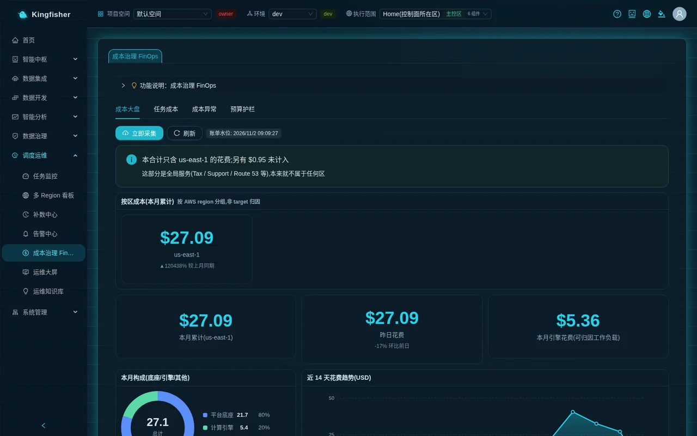
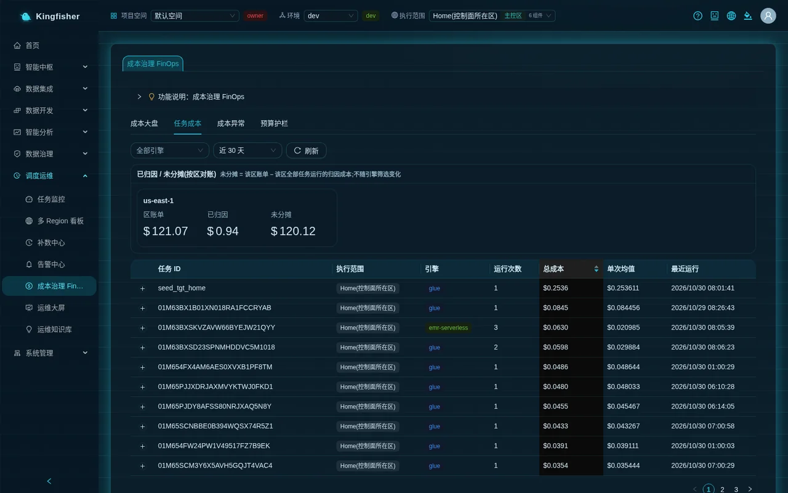
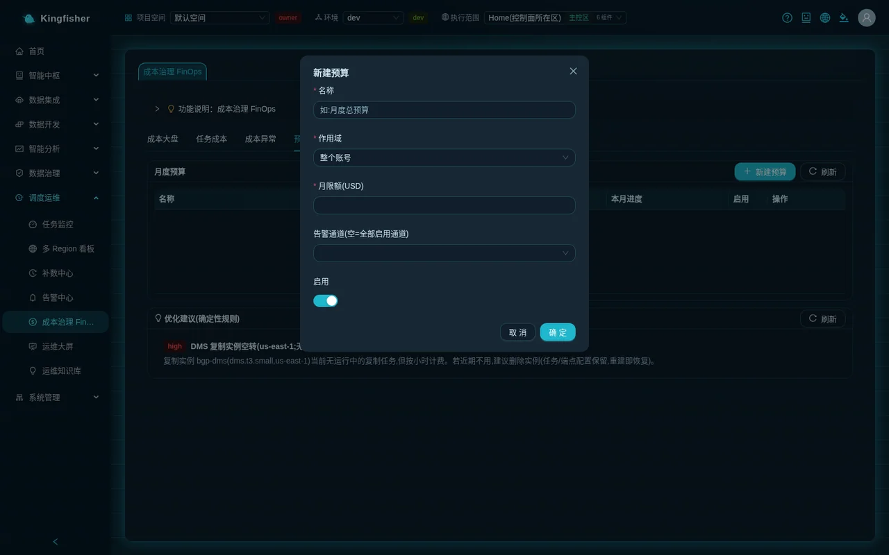

# Scenario 9: FinOps — overview · task-level attribution · budgets and threshold alerts · what keeps billing · shutdown advice

| Item | Content |
|---|---|
| Readers | Platform administrators · architects · data engineers who care about spend |
| Estimated time | 40 minutes (including one billing collection and one anomaly detection) |
| Prerequisites | Signed in; Cost Explorer enabled on the account; a few sync / batch job runs already made (the demo objects are enough); any project member can view the pages, "Collect now" and "Detect & notify" need editor, creating a budget needs the project owner |
| What you will have afterwards | An understanding of the four "FinOps" tabs; one monthly budget with threshold alerts; a list of "what keeps billing on the platform"; a set of page operations for shutting down and slimming |

---

## 0. Conclusions first

- The platform drills the AWS bill down from "per service, T+1" to "per task / run, near-real-time": **Cost overview** for trends, **Task costs** to find the expensive tasks, **Cost anomalies** to catch spikes, **Budgets** to set a monthly limit and push to the alert channels when 80% / 100% is crossed.
- The bill can only be split down to the **AWS region**, not between two execution environments in the same region; only task-level attribution carries the "Execution scope". Keep these two different granularities in mind when reading the pages.
- Only a few standing components bill while idle: the platform base in the home region (OpenMetadata, load balancers, NAT, security components) and the VPC interface endpoints of each execution region; the warehouse / scheduler / data lake cost zero when idle; the real-time pipeline (Kinesis streams, DMS replication instance, Flink applications) becomes standing only after you create real-time tasks.
- Three ways to save: stop idle real-time tasks and Flink applications; do not let dashboards / GenBI cards wake the warehouse too often; retire execution regions you no longer use (data resources are kept and keep billing; delete them only after manual confirmation).

Overview route:

1. "Cost overview" → "Collect now" → read "Billing watermark", "Cost by region", "Month to date", "Breakdown", "Trend", "Top services".
2. "Task costs" → pick an engine and a time window → read "Attributed / unallocated (reconciled by region)" → expand a task to see usage and cost per run.
3. "Cost anomalies" → "Detect & notify" → read the deviation multiple and the "Notified" / "In knowledge base" status.
4. "Budgets" → "New budget" → choose scope / monthly limit / alert channels → after the next "Detect & notify", read "MTD progress".
5. Compare against the "what keeps billing" list and shut things down on the Data Sync / Stream Compute / Execution Environments pages.

---

## 1. How it works (one page)

### 1.1 Two data sources, two granularities

| Layer | Data comes from | Granularity | Freshness | Pages |
|---|---|---|---|---|
| Billing layer | AWS Cost Explorer | Service × AWS region × day | T+1 (yesterday's bill arrives today) | "Cost overview" region cards, breakdown, trend, top services; the "Region bill" in the "Task costs" reconciliation card |
| Attribution layer | The engines' own metering (Glue DPU-seconds, EMR vCPU-hours + memory GB-hours, Athena bytes scanned) × the platform's built-in price list | Per task × per run × execution scope | Near-real-time (newly finished runs are scanned at collection time) | "Task costs" ranking and run details; task-level rows in "Cost anomalies" |

- The billing layer stops at the region: when one region hosts two execution environments, the bill cannot be split; the page says so next to the "Cost by region" title: "Grouped by AWS region, not attributed to execution targets".
- Every attribution record carries a "Price version", so you can audit which version of the unit prices it was computed with.
- "Unallocated" = the region's bill − the attributed cost of all task runs in that region. It contains the platform base, warehouse active time, storage, logs and other money that cannot be tied to a single run.
- If the billing watermark is more than 6 hours behind when the page loads, the platform collects again in the background automatically; you can also click "Collect now" at any time.

### 1.2 How anomalies and budgets are judged

- Task-level anomaly: a single run's cost for a task in a region deviates too far from the task's own history baseline (robust statistics, at least 7 samples, backfill runs excluded).
- Service-level anomaly: a service's daily cost in a region spikes relative to its recent baseline.
- Budget: a monthly limit + a scope (entire account / a single AWS service / a single execution region); crossing 80% and 100% each pushes once, and each threshold pushes only once per month.
- Anomaly and budget notifications reuse "Alerting Center → Notification Channels"; confirmed anomalies are also persisted to the "Incident Knowledge Base", where diagnosis can reference them.

### 1.3 When evaluation happens

- Billing collection and run attribution: automatically in the background when the watermark is stale at page load; or when you click "Cost overview → Collect now".
- Anomaly detection and budget evaluation: when you click "Cost anomalies → Detect & notify". A budget row's "MTD progress" shows numbers only after that (before evaluation it reads "Not evaluated (click 'Detect & notify' on the anomalies tab)").
- Optimization advice: probed live when you open the "Budgets" tab; click "Refresh" to recompute.

---

## 2. Preparation

1. Set the top-bar "Execution scope" to "All regions" first. In a single-region view, "Month to date" is only that region's money, and the page explains with a hint: "This total only covers <region>; another $… is not included".
2. Account side: Cost Explorer must be enabled (data appears only within 24 hours after first enabling it). The platform only reads the bill and changes no billing settings.
3. Make sure "Alerting Center → Notification Channels" has at least one usable channel (how to create one: [Scenario 8](27-scenario-ops-alerting.md) §5); budget and anomaly alerts use it.
4. Roles: any member can view the four tabs; "Collect now" and "Detect & notify" need project editor; "New budget" needs project owner.

---

## 3. Step 1 Cost overview: pull the bill in first

Page path: "Scheduling & Ops → FinOps", tab "Cost overview".

1. On first open, the tag at the top reads "Not collected yet — click 'Collect now' to pull billing data" and the body shows "No cost data yet".
2. Click "Collect now". When it finishes you see "Collected: N billing rows, M runs attributed" and the tag changes to "Billing watermark: <time>". The first collection looks back about 30 days and at least to the 1st of last month, so month-over-month can be computed.
3. The "Cost by region (month to date)" card group, with the small print "Grouped by AWS region, not attributed to execution targets" next to the title:
   - Each card = one AWS region's month-to-date amount, with the subtitle "▲/▼N% vs same period last month" or "No data for the same period last month".
   - When the region has exactly one execution environment, clicking the card switches the top-bar "Execution scope" to it; with several, a "N execution targets, click to choose" dropdown appears; with none, the card is marked "No execution target in this region" and is not clickable.
   - A separate "No region (global services)" card lists Tax / Support / Route 53 and other money that belongs to no region.
4. Three metric cards: "Month to date" (in a single-region view "Month to date (<region>)") · "Yesterday" (subtitle "+N% vs prior day") · "Engine spend MTD (attributable workloads)".
5. The "MTD breakdown (base / engine / other)" donut: "Platform base" = standing components (OpenMetadata, load balancers, VPC, WAF, KMS, etc.), "Compute engines" = the part that scales with tasks (Glue, EMR, Athena, Redshift, DMS, Kinesis, Flink, S3, Bedrock, etc.), "Other" = unclassified.
6. The "14-day spend trend (USD)" area chart and the "Top services MTD" bar chart, by service name (Cost Explorer naming, such as "AWS Glue", "Amazon Redshift").

How to read it: a high base share means the task volume is small; when "Compute engines" spikes, go to "Task costs" first to find out who.

---

## 4. Step 2 Task costs: find the expensive one

Page path: "FinOps", tab "Task costs".

1. Filters: the "All engines" dropdown (Glue / EMR Serverless / Athena) · time window (last 7 days / last 30 days / last 90 days) · "Refresh".
2. The reconciliation card "Attributed / unallocated (reconciled by region)", with the verbatim small print "Unallocated = region bill − attributed cost of all task runs in that region; not affected by the engine filter" next to the title:
   - One card per region: "Region bill", "Attributed", "Unallocated".
   - A negative "Unallocated" shows "Attributed exceeds the bill: billing is T+1 delayed, or the price list is high" — usually yesterday's bill has not arrived yet.
   - When the window starts before the billing coverage, the hint reads "Billing only covers from … (window starts …); unallocated is understated before that".
   - Before any bill has been collected, the hint reads "No per-region billing in this window yet: click Collect now on the Cost overview tab".
   - "Another $… of run cost could not be resolved to a region (target deleted or unreadable) and is not counted in any region": runs left behind after an execution environment was deleted.
3. Ranking table columns: Task ID / Execution scope / Engine / Run Count / Total cost (descending by default) / Avg per run / Recent runs. The same task in two regions gets one row per region.
4. Click the start of a row to expand it and see every run under that execution environment: Run ID / Status / Usage (`N DPU-s`, `N vCPUh + N GBh` or `N MB scanned`) / Cost / Price version / Trigger / Finished at.
5. The hint "Other execution scopes have N more cost runs" below the table tells you how many rows the other regions hold.

Next step: note the Task ID, go back to "Data Development → Batch Compute / Data Sync" and look at its worker count, schedule frequency and script; for frequent small jobs consider consolidating the schedule or lowering the worker count.

> Attribution covers only runs of the Glue and EMR Serverless engines (the Usage column shows DPU-s and vCPUh). Money for Redshift queries and Athena direct queries exists only in the billing layer ("Unallocated"); although the engine filter dropdown has an Athena entry, the current version shows no Athena rows.

---

## 5. Step 3 Cost anomalies: catch spikes and push them out

Page path: "FinOps", tab "Cost anomalies".

1. The blue bar at the top reads verbatim: "Spike detection compares against each item's own history (robust MAD statistics, ≥7 samples, backfill runs excluded); confirmed anomalies are pushed via alert channels and persisted to the incident knowledge base (/incidents) for the diagnosis Agent to learn from."
2. Click "Detect & notify". When it finishes you see "Detection done: N anomalies processed (notified + persisted, idempotent)". Clicking again does not push again.
3. Table columns: Type (task · service) / Target / Execution scope (task level = execution environment, service level = AWS region) / Date / Actual / Baseline / Deviation (≥5× red, otherwise yellow) / Samples / Status.
4. "Status": "Notified" (went through a notification channel) · "In knowledge base" (click it to jump to the incident knowledge base) · "Pending".
5. The pushed content appears under "Alerting Center → Alert Events"; budget evaluation is done in the same "Detect & notify" pass (see §6).

Exercise — produce an anomaly: temporarily change a Glue job that normally uses 2 workers to 10 workers and run it once; after collection, "Detect & notify" should show one task-level anomaly. Change it back afterwards.

---

## 6. Step 4 Budgets and optimization advice

Page path: "FinOps", tab "Budgets".

### 6.1 Create a budget

1. In the top-right corner of the "Monthly budgets" card click "New budget" → the "New budget" dialog:
   - "Name": for example `Monthly total budget` (the placeholder reads "e.g. Monthly total budget").
   - "Scope": entire account / a single AWS service / a single execution target (e.g. us-west-2).
   - Choosing "Single AWS service" adds a "Service name (CE dimension)" field; enter the service name as it appears in Cost Explorer, e.g. `AWS Glue`.
   - Choosing "Single execution target" adds an "Execution target (from installed execution environments)" dropdown; the home region carries the suffix "· Home region".
   - "Monthly limit (USD)".
   - "Alert channels (empty = all enabled channels)": multi-select.
   - The "Enable" switch.
2. After saving you see "Budget created". List columns: Name / Scope ("Entire account" or the service name) / Monthly limit / "MTD progress" / Enabled / Actions.
3. "MTD progress" shows numbers only after "Cost anomalies → Detect & notify": the progress bar shows `$spent (N%)`, turns active above 80% and red above 100%. Before evaluation it reads "Not evaluated (click 'Detect & notify' on the anomalies tab)".
4. When a threshold is crossed, the message pushed to the channel reads like: "Budget 'Monthly total budget' 2026-11 has used $… / limit $… (N%), crossed the 80% threshold." Title "[FinOps] Budget warning: <name>" (the 100% threshold uses "Budget exceeded", severity P2; the 80% threshold P3).
5. In a single-region view only budgets with the "Single execution target" scope are filtered; account-level and service-level budgets are visible in every view.

### 6.2 Optimization advice (deterministic rules)

Lower on the same tab, the "Advice (deterministic rules)" list is probed when the tab opens; click "Refresh" to recompute; when nothing can be optimized it shows "No advice — nothing to optimize right now". Four kinds of advice:

| Advice title | When it appears | What you should do |
|---|---|---|
| "DMS replication instance idle (<region>; no running task but still billing)" | The region has a DMS replication instance but no running replication task; probed per region | The advice text explains the reclaim policy and points the way: delete the region's real-time sync tasks you no longer need; once the last one is deleted the instance is reclaimed after a 10-minute idle grace; marked "Est. monthly saving ~$120" |
| "Glue job with tiny per-run usage at high frequency" | A task had ≥5 recent runs averaging under 120 DPU-seconds | Glue bills at least 1 minute per run; consolidate the schedule or lower the worker count |
| "Large gap between task attribution and the bill (price list or coverage needs calibration)" | The platform's attributed monthly Glue cost differs from the Glue amount in the bill by more than half | Usually Crawler / interactive-session or other non-task usage, or an outdated price list; trust the bill |
| "Sync task fell back from COPY to INSERT (the slow path costs more)" | A sync task's history contains a run where COPY fell back to row-by-row INSERT | Check the type mapping, then rerun |

> All advice values are computed by deterministic rules; AI is not involved. The DMS replication instance is reclaimed by the platform: once the region's last DMS task is **deleted**, the background cleanup job deletes the instance after a 10-minute idle grace and writes an audit entry; "Stop" only stops the task (keeping its CDC checkpoint) and does not reclaim the instance.

---

## 7. Step 5 What keeps billing (reading the idle bill)

The figures come from the cost model in the repository (public on-demand prices for one US East region, no discounts; other regions are typically 10%–30% more expensive) and are meant to show the order of magnitude, not a quote. See the [Cost model](../cost-model.md) for details.

### 7.1 Idle floor

| Object | Approximate idle cost / month | Composition |
|---|---|---|
| Home region (control plane) | ≈ $460 and up | OpenMetadata's search node and containers, two NAT gateways, the OpenMetadata database, the platform containers, two load balancers, public IPs, WAF, KMS, secrets |
| Home region extras | Possibly another +$70 to +$290 | When the account already has another CloudTrail trail, the platform's trail is billed per event; if the OpenMetadata database is still on the old engine version it incurs extended-support fees (gone in the new version) |
| Each execution region | ≈ $165 | Almost entirely the 11 VPC interface endpoints × 2 Availability Zones required for zero egress; warehouse / scheduler / data lake idle at $0 |
| Demo mode extra | ≈ +$320 | The demo source database (RDS MySQL); not present in production mode |

### 7.2 Standing only after you create tasks

| Object | When billing starts | Approx. / month | Where to stop it |
|---|---|---|---|
| Kinesis source stream (1 shard per region) | Once stream compute is enabled in the execution region | ≈ $11 | Goes with the execution environment; not stopped separately |
| DMS replication instance (one per region, shared by all real-time sync tasks) | Lazily created when the first DMS real-time sync task is started with "Start"; reclaimed automatically 10 minutes after the region's last DMS task is deleted | ≈ $27 (small class) | Delete all DMS tasks of the region under "Data Sync"; progress under "System Settings → Background cleanup jobs" |
| Zero-ETL integration | After a sync task with the Zero-ETL channel is created | Billed per the corresponding AWS item | "Stop" / delete the task under "Data Sync" |
| Flink streaming job (at least 2 KPU per job) | Runs continuously after the job is started with "Start" | ≈ $170 / job | "Stop" or "Delete" the job under "Stream Compute" |
| Redshift Serverless | Active while queries run (base 8 RPU ≈ $3 / active hour, minimum 60 seconds per wake-up) | Depends on query time | Reduce the frequency of dashboards / GenBI cards / governance catalog sync |

### 7.3 Still billing after an execution region is retired

In the "Execution Environments" details, "1. Stop accepting work (drain)" → "2. Request deletion" → approval → destroy does **not** destroy data resources, which keep billing for storage: data buckets, S3 Tables table buckets, warehouse namespace / workgroup and final snapshot, KMS keys, the DAG bucket. To bring the cost to zero, the customer must confirm and delete each of them in their own account. The steps are in [Scenario 3](22-scenario-multi-region-residency.md) and the [Customer production deployment manual](../deployment.md).

---

## 8. Step 6 Cost hygiene: shutdowns you can do on the pages

| Money to save | Page path | Action | Note |
|---|---|---|---|
| Idle real-time sync tasks | "Data Integration → Data Sync" → task row | Click "Stop"; delete the task if you will not use it for a long time | After "Stop" the replication instance remains (checkpoint kept); once the region's last task is deleted the instance is reclaimed within about 10 minutes; check whether "Budgets → Advice" still shows "DMS replication instance idle" |
| Streaming jobs no longer needed | "Data Development → Stream Compute" → job | "Stop"; to drop it entirely click "Delete", which shows "Deletion accepted — the application will be destroyed and removed from the list once it has fully stopped" | Each job keeps at least 2 KPU standing; the money stops only once the job is stopped |
| A warehouse woken too often | "Smart Analytics → Ask-Your-Data / Report Builder"; "Data Governance → Schedule" | Lengthen the scheduled refresh of GenBI cards and the dashboard refresh interval; do not schedule governance catalog sync too densely (the UI warns "incurs warehouse compute charges") | The platform's own health checks do not wake the warehouse; users opening dashboards / GenBI do |
| Frequent small jobs | "Data Development → Batch Compute / Data Sync" | Consolidate the schedule; lower the worker count | Compare with the "Task costs" ranking and the "Advice" |
| Execution regions no longer used | "System → Execution Environments" → details | In the danger zone, "1. Stop accepting work (drain)" (in-flight jobs finish, nothing is destroyed) → "2. Request deletion" (read the "Impact preview") → an administrator approves under "Pending my approval (N)" on the "Workspace" page → destroy | Data resources are kept and keep billing, see §7.3; confirm in the Multi-Region Dashboard first that no job is still bound to it |
| "Other" you cannot interpret in the bill | "Cost overview → Top services MTD" | Match the service name in Cost Explorer and check the usage type | The platform's "Other" = services that are neither base nor engine |

---

## 9. Step 7 Reading the FinOps page side by side with AWS Cost Explorer

| What you see in the platform | How to view it in Cost Explorer | Common reasons they differ |
|---|---|---|
| Each "Cost by region (month to date)" card | Group by REGION, from the 1st of this month to today | The platform only collects up to yesterday (T+1); CE has not settled today's money either |
| "Month to date" (all-regions view) | No grouping, from the 1st of this month to today | Did you overlook the "No region (global services)" card? |
| "Month to date (<region>)" (single-region view) | Filter by REGION to that region | The hint "This total only covers <region>; another $… is not included" tells you where the difference is |
| "Top services MTD" | Group by SERVICE | Use CE's service names (e.g. "EC2 - Other" is NAT / EBS) |
| "Region bill" in "Task costs" | Filter by REGION + time window | The hint "Billing only covers from …": the time window starts before the billing coverage |
| "Attributed" | No counterpart in CE | Computed by the platform from engine metering × price list; compare with CE's Glue / EMR amounts — a large gap produces the "price list deviation" advice |

> The platform does not replace Cost Explorer: reimbursement and reconciliation follow the AWS bill; the platform's value is telling you "which task, which region, which day".

---

## 10. Verify the result

- [ ] The top of "Cost overview" shows "Billing watermark: <time>" and "Cost by region" has at least one card.
- [ ] The "Task costs" ranking has rows, and expanding one shows the "Price version".
- [ ] On "Cost anomalies", "Detect & notify" shows "Detection done: …".
- [ ] "Budgets" has one budget and "MTD progress" shows a progress bar (set the monthly limit below what has already been spent, and you can see "[FinOps] Budget exceeded: …" under "Alerting Center → Alert Events").
- [ ] The "Advice" list has entries or shows "No advice — nothing to optimize right now".

---

## 11. FAQ

**"Cost overview" keeps showing "No cost data yet".**

Cause: nothing collected yet; or the account enabled Cost Explorer less than 24 hours ago; or the current project lacks editor permission to click "Collect now". Next step: click "Collect now" and read the verbatim hint; wait for CE data; switch to an account with permission.

**"Month to date" is much lower than the AWS bill.**

Cause: a single-region view includes only that region; "No region (global services)" is not counted in the region cards; billing is T+1. Next step: switch to "All regions", add the global-services card, then compare with CE's "Month to date".

**Redshift queries do not appear in "Task costs".**

Cause: run-level attribution covers only Glue and EMR Serverless; warehouse active time is in "Unallocated". Next step: look in Cost Explorer with SERVICE = Amazon Redshift; reduce dashboard / GenBI / governance sync frequency.

**The budget row keeps saying "Not evaluated".**

Cause: budget evaluation runs only with "Cost anomalies → Detect & notify". Next step: click it once; check whether "Alert Events" has an event starting with "[FinOps]".

**"Detect & notify" reports 0 anomalies, but spend clearly went up.**

Cause: fewer than 7 samples, or the increase is in the billing layer while the corresponding service baseline is rising too, or backfill runs are excluded. Next step: run for a few more days, then detect again; locate it manually with "Cost overview → 14-day trend" and the "Task costs" ranking.

**"Advice" says the DMS instance is idle, but I cannot find a button to delete the instance in the platform.**

Cause: the instance is not deleted on its own; it is reclaimed when the region's last DMS task is deleted, and tasks that are only stopped keep their CDC checkpoints, so the instance stays. Next step: once you are sure the region has no real-time sync task that needs to run, delete those tasks under "Data Sync"; after a 10-minute idle grace the instance is reclaimed, with progress under "System Settings → Background cleanup jobs"; the next "Start" recreates it.

**Creating a budget reports no permission.**

Cause: writing budgets needs the project owner. Next step: ask the project owner to create it, or request the role under "Workspace".

---

## 12. Cleanup

1. "Budgets": delete the practice budget (confirm "Delete this budget?").
2. If you changed a Glue job to 10 workers for the exercise in §5, change it back under "Batch Compute / Data Sync" and save.
3. Anomaly records and knowledge base entries are not deleted; the cost incident entries produced by the exercise can be silenced with "Silence" in the knowledge base.
4. The collected billing data can simply be kept; it costs very little.

---

## 13. Further reading

- How to create alert channels and where to see alert events: [Scenario 8: a day on call](27-scenario-ops-alerting.md)
- Billing reminders and how to stop the real-time pipeline: [Scenario 4: real-time pipeline](23-scenario-realtime-cdc.md)
- Retiring an execution region and the resources that remain: [Scenario 3: data stays in its region](22-scenario-multi-region-residency.md)
- What administrators do after go-live (including the execution environment life cycle): [Platform administrator guide](10-guide-admin.md)
- Itemized monthly cost, three workload tiers, optimization opportunities: [Cost model](../cost-model.md)
- Feature tour (screenshots): [Features §7.5](../features.md) · module boundaries: [Modules](../modules.md) · mechanics: [FinOps design](../design/finops.md)
