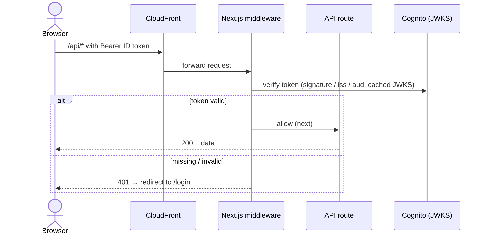
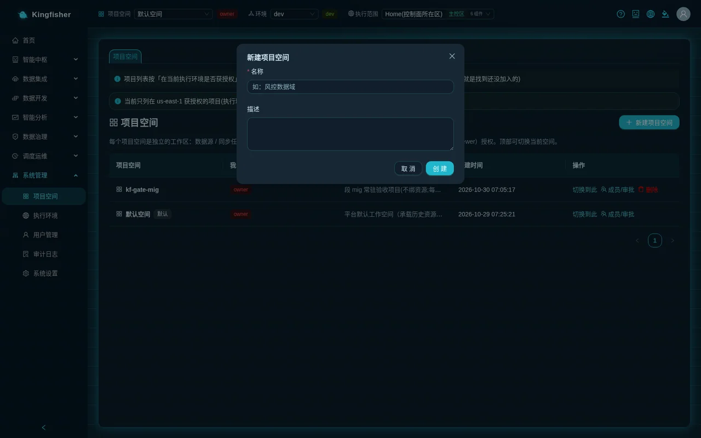
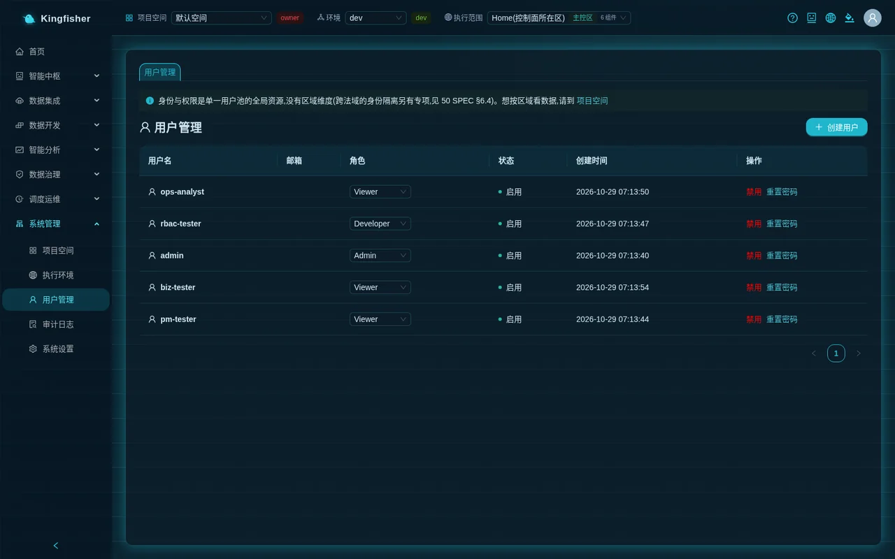
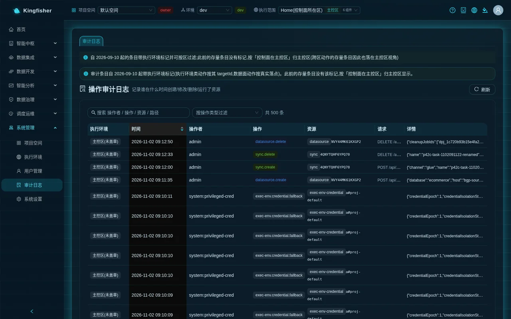

# Scenario: several teams sharing one platform — workspaces, roles and publish approvals

| Item | Description |
|---|---|
| Audience | Platform admins (create spaces, create accounts, approve); data engineers (request to join, develop, publish) |
| Estimated time | 60–90 minutes (two people working together, or one person logged in to two accounts in two browsers) |
| Prerequisites | The platform is live; you have an admin account; a demo installation (with the demo source database and the Showcase sample objects) is easiest, but a production environment with your own databases and tables works just as well |
| What you get | Two mutually isolated workspaces, the three project roles each in place, one "request → approval" record, one sync task published from dev through staging to prod with approval, and the ability to trace every step in the audit log |

---

## 0. Outcome first

After completing this scenario you will see: the user-acquisition team and the payments team each work in their own workspace and cannot see each other's data sources / sync tasks / jobs;
a new colleague requests to join through the page and is approved; a sync task is tuned in dev and published directly to staging, publishing it to prod creates an approval request, and once the admin approves it under "Pending my approval" the copy appears in prod;
every action is recorded by name in the "Audit Log".

Route:

1. The admin creates two workspaces: "Acquisition Analytics" and "Payments Risk Control".
2. The admin creates three accounts under "Users".
3. The admin adds members to both spaces and assigns project roles (owner / editor / viewer).
4. Log in with a developer account and verify that only the resources of your own space are visible.
5. A new colleague requests to join on the "Workspace" page and the admin approves under "Pending my approval".
6. The developer publishes a sync task from dev with "Publish to staging" (takes effect directly).
7. The developer clicks "Publish to prod (approval required)", the admin approves, and the task is visible after switching to the prod environment.
8. Trace the whole chain by username in the "Audit Log".

---

## 1. How it works (one page)

### 1.1 Two layers of roles

| Layer | Where it is set | Values | What it decides |
|---|---|---|---|
| Platform role | System → Users | Admin / Developer / Viewer | Whether you can open admin pages, create workspaces and approve |
| Project role | System → Workspace → "Members / Approvals" | owner / editor / viewer | Whether you can create / modify / delete resources in a space, or only view them |

- To get work done a person needs both layers: first a platform account, then membership of a workspace.
- "New workspace", adding / removing / changing members and approval decisions can only be done by platform admins (or by an R&D manager who is also the project's owner); a person with the Developer platform role has only development permissions even as a project owner.
- The "Default Workspace" has no members at first; until a non-admin is added to a space, GenBI returns 403 "No access to this workspace".

### 1.2 Resources are isolated by "workspace + environment"

- Data sources / sync tasks / workflows / batch jobs / query tasks are visible only in the current workspace (switch with the top-bar "Workspace").
- Sync tasks, jobs, workflows and query tasks are additionally isolated by environment dev / staging / prod (switch with the top-bar "Environment"); data sources are not split by environment and are shared across the whole project.
- "Publish to environment" copies a resource definition from the current environment to the target environment: publishing to staging takes effect directly; publishing to prod requires approval. Publishing carries only the definition, not the run history; the copy in the target environment is an independent object with its own schedule and its own runs.

### 1.3 Which kinds of approval exist and who approves

| Tag in "Pending my approval" | When it is created | Who can approve |
|---|---|---|
| Join group | A non-member clicks "Request to join" under "Other workspaces you can request to join" | Platform admins; or an R&D manager who is also the project's owner |
| Promote | "Publish to prod (approval required)" | Same as above |
| Data access | Requesting access to a data table on the governance side | Same as above |
| Create / alter table | Creating / altering a table in the data catalog of the prod environment | Same as above |
| Delete execution environment | "Request deletion" on the execution environment details page | Platform admins only |

The page reads: "Pending approvals you can decide: promotions / project membership / data access / execution environment deletion (platform admins only)."

---

## 2. Preparation

- An admin account (`admin` or an Admin you created).
- This scenario creates three users: `dev-buy` (user-acquisition team developer), `dev-pay` (payments team developer) and `ana-buy` (user-acquisition team analyst). The names can be changed; the text below uses these three.
- In a demo installation the "Default Workspace" already contains the Showcase sample objects (the `GameData-MySQL` data source, the `GameSync-7tables` sync task, etc.); you can look at a ready-made one first and then build your own in the new space (the sample objects live in the dev environment of the "Default Workspace").
- A demo installation also ships four role users (R&D manager / developer / operations analyst / no group), with their passwords on the deployment machine; this scenario does not depend on them.
- Two browsers (or one normal window + one incognito window), one logged in as the admin and one as the developer.

---

## 3. The admin creates two workspaces

Page: "System → Workspace".

1. Click "New workspace". Enter `Acquisition Analytics` as "Name" and "Ad spend and channel ROI" as "Description", then click "Create". You should see "Workspace created".
2. Click "New workspace" again. Enter `Payments Risk Control` as "Name" and "Payment and risk-control details" as "Description", then click "Create".
3. The list now shows the "Default Workspace" (with the "Default" tag) and the two new spaces; "My roles" is owner for both new spaces.

Expected: one row per space; "Created At" is the current time.

---

## 4. The admin creates three accounts

Page: "System → Users".

1. Click "Create user". "Username" `dev-buy`, "Email" optional, "Password" according to the rules (at least 12 characters, with upper and lower case letters, digits and symbols), "Role" "Developer". After confirming you should see "User created".
2. Create `dev-pay` the same way (Developer).
3. Create `ana-buy` with "Role" "Viewer".
4. The list has three rows, all showing "Enable" in the "Status" column.

Key point: at this point none of the three is a member of any workspace; after logging in they see no resources.

---

## 5. Add members and assign project roles

Page: "System → Workspace".

1. In the "Acquisition Analytics" row click "Members / Approvals" to open the "Members & Approvals · Acquisition Analytics" drawer.
2. In the form below the "Members" table: enter `dev-buy` as "Cognito Username", choose the role `owner`, click "Add / Update"; you should see "Members updated".
3. In the same form: enter `ana-buy` as "Cognito Username", choose the role `viewer`, click "Add / Update".
4. Close the drawer. In the "Payments Risk Control" row click "Members / Approvals" and add `dev-pay` as `editor`.
5. The "Members" tables of the two drawers should show: Acquisition Analytics = admin (owner), dev-buy (owner), ana-buy (viewer); Payments Risk Control = admin (owner), dev-pay (editor).

How to choose the role (dropdown text on the page): owner "project owner (config management also needs the admin/manager platform role…)"; editor "create, update, delete resources"; viewer "Read-only".

---

## 6. Verify isolation with a developer account

Log in as `dev-buy` in the second browser.

1. The top-bar "Workspace" dropdown lists only "Acquisition Analytics" (this user is not a member of the "Default Workspace" or of "Payments Risk Control").
2. Open "System → Workspace": the list has only the "Acquisition Analytics" row with "My roles" owner; the page header has no "New workspace" button, only the line "Workspaces are created by admins / R&D managers; contact them if you need a new one".
3. Click "Members / Approvals"; the top of the drawer shows: "You are the owner of this project (developer permissions). Member management / rename / delete require a platform admin or R&D manager — you can still develop this project's sync tasks / jobs / workflows as usual." The members table has no "Remove" column and no add form.
4. Open "Data Integration → Data Sources", "Data Integration → Data Sync" and "Data Development → Batch Compute": the lists are empty (the new space has no resources yet). The Showcase objects in the "Default Workspace" are not visible here — this is isolation by workspace.
5. "Other workspaces you can request to join" appears at the bottom of the page, listing the "Default Workspace" and "Payments Risk Control". Do not click yet.

Log in once more as `ana-buy` (Viewer): the top bar shows only "Acquisition Analytics"; "Ask-Your-Data" accepts questions; the "Data Sync", "Batch Compute" and "Data Sources" list pages **still show** the "New sync task", "Start", "Edit", "Delete" and similar buttons (pages do not hide buttons by project role), but clicking them is rejected by the server with "Insufficient permissions: a higher project role is required".

---

## 7. Request to join and approval

Log in as `dev-pay` (a member of "Payments Risk Control" only).

1. Open "System → Workspace" and find "Acquisition Analytics" under "Other workspaces you can request to join" at the bottom of the page.
2. In the "Request" column of that row: choose `viewer` in the role dropdown (editor / viewer available), click "Request to join" → the dialog "Submit join request?" appears → confirm.
3. You should see "Request submitted; awaiting workspace owner approval"; the row gets an orange "Pending approval" tag.

Switch back to the admin's browser:

4. A "Pending my approval (1)" card appears at the top of the "System → Workspace" page, with one row tagged "Join group", the text "Request to join project (role viewer)" and requester `dev-pay`.
5. Click "Approve"; the message "Approved and executed" appears. The card disappears (or its count drops by one).
6. You can also handle the same request under "Pending approval (access/role requests)" at the bottom of the "Members / Approvals" drawer of "Acquisition Analytics", with the columns "Requester" and "Request" and the row actions "Approve" and "Reject".

Back in `dev-pay`'s browser, refresh: the top-bar "Workspace" now also lists "Acquisition Analytics", and its "My roles" in the list is viewer.

Key points:

- If the admin's top-bar "Execution scope" is set to a specific region, the page shows "The current execution scope hides N pending approvals (they apply to other regions); switch to 'All' to see every pending item". Join requests are not affected, but make it a habit to review approvals in the "All" scope.
- After "Reject", the requester's row returns to a state in which they can request again.

<!-- Screenshot pending: Workspace · "Pending my approval (1)" card with the "Join group" tag -->

---

## 8. Development: create a sync task in dev

Log in as `dev-buy`, with the top-bar "Workspace" = Acquisition Analytics and "Environment" = dev (default).

1. "Data Integration → Data Sources" → "New data source"; register the demo MySQL source (or your own source database). For field and network access details see the [Data engineer guide](11-guide-data-engineer.md); here it only needs to pass "Detect" and "Browse tables".
2. "Data Integration → Data Sync" → "New sync task"; choose the data source from the previous step, select the tables `ad_channels` and `ad_campaigns` (small tables, fast to run); choose "S3 Data Lake" as "Target type" and explicitly choose "Overwrite" as "Write mode";
   under "S3 Tables Data Lake Configuration" set "Namespace" to "Manual" and enter `buy_dev`. Name the task `ChannelSync-buy`.
3. After saving, click "Start" in the row; the status column goes from "Draft" to "Success". Open the task details page; the header carries the environment tag `dev`, and hovering shows "Resource environment: dev (Development)".

Key point: the detailed sync task options (full / incremental, channel, date variables) are covered in [Scenario: from detail to daily report](20-scenario-detail-to-daily-report.md); this scenario is only about "publishing".

---

## 9. Publish to staging (takes effect directly)

Still on the details page of `ChannelSync-buy` ("Data Sync → click the task name").

1. Click "Publish to environment" at the right of the page header. The first line of the dropdown is the grey text "Current environment dev · order dev → staging → prod", followed by one item per target environment (shown as "Publish to staging" and "Publish to prod"); the prod item is tagged "approval required".
2. Click the staging item. A notification "Published to staging" appears in the bottom-right corner with a button "Switch to staging to view"; the text reads "This resource was created in the target environment. You are looking at the dev environment; switch to staging to see it."
3. Click "Switch to staging to view" (or switch the top-bar "Environment" to staging): the task with the same name appears in the "Data Sync" list with the environment tag staging and status draft / not run — it is a new, independent task with an empty run history.
4. Switch back to dev. The "Environments" status next to "Publish to environment" on the details page shows "Published to staging: v1 from dev, <time>, by dev-buy".

Key points:

- Publishing to staging again = overwriting the staging copy with the latest dev definition (the notification changes to "This resource was updated in the target environment…" and the version number increases by 1); no second copy is created.
- Publishing carries only the task definition; the staging copy must be "Run" or scheduled on its own.

---

## 10. Publish to prod (approval required)

1. On the dev details page of `ChannelSync-buy` click "Publish to environment" → choose the prod item (tagged "approval required").
2. The dialog "Publish approval submitted" appears with the text: "prod is a protected environment: a project owner must approve on the Project Spaces page. The resource appears in prod only after approval; the approver gets a "switch to prod" shortcut." Buttons "Go to Project Spaces to approve" / "Got it".
3. The "Environments" status on the details page changes to "Publish to prod awaiting approval (requested by dev-buy, <time>)".
4. If you switch to the prod environment now, the task is not yet in the "Data Sync" list — nothing is deployed until the approval passes.

Switch to the admin's browser:

5. "Pending my approval (1)" appears at the top of the "System → Workspace" page, with one row tagged purple "Promote", the text "Promote ChannelSync-buy → prod" and requester dev-buy.
6. Click "Approve". A notification "Approved and published to prod" appears in the bottom-right corner with the text "ChannelSync-buy was created in the prod environment (v1). You are looking at a different environment; switch over to see it." and a button "Switch to prod to view".
7. Click it: the top-bar "Environment" switches to prod and `ChannelSync-buy` appears in the "Data Sync" list (environment tag prod).

Back as `dev-buy`: the "Environments" status on the details page shows "Published to prod: v1 from dev, <time>, by admin".

Key points:

- The approver must be a platform admin, or an R&D manager (bgp-manager) who is also the project's owner. `dev-buy` is an owner but has the Developer platform role, so this item does not appear in his "Pending my approval" card.
- After "Reject", the requester can make changes and publish again; nothing changes on the prod side.
- Handling the same approval twice shows "This approval has already been handled".

<!-- Screenshot pending: Workspace · "Pending my approval (1)" with "Promote ChannelSync-buy → prod" -->
<!-- Screenshot pending: Data Sync details · "Publish to environment" dropdown and "Environments" status -->

---

## 11. Audit trail

Page: "System → Audit Log" (admin).

1. Type `dev-buy` in the search box and press Enter. You should see: creation / runs of the sync task, `promote.execute` (publishing to staging, executed directly), `promote.request` (requesting publication to prod).
2. Search `dev-pay`: `approval.submit` (request to join Acquisition Analytics).
3. Search `admin`: `project.create` ×2, `project.member.put` ×3, `approval.decide` ×2 (join group, promote; approving the promotion also completes the publish to prod, no separate `promote.execute` is recorded), plus `user.password.reset` if you reset a password after creating the accounts (creating a user itself is not audited).
4. Choose `approval.decide` under "Filter by action type" to see only approval decisions; the "Details" column shows the approved object and the target environment.
5. The "Execution Environments" column shows the home region for project / approval actions (they are control-plane actions).

---

## 12. Verify the result

| Check | Where to look | Expected |
|---|---|---|
| Space isolation | Log in as dev-pay → Data Sync | The `ChannelSync-buy` created by Acquisition Analytics in dev is not visible |
| Roles in effect | Log in as dev-buy → Workspace → Members / Approvals | The "You are the owner of this project (developer permissions)…" notice; no "Remove" column and no add form |
| Join request | Admin → Workspace | After approval, dev-pay has the viewer role in "Acquisition Analytics" |
| Direct publish to staging | Top-bar Environment = staging → Data Sync | `ChannelSync-buy` is present with an empty run history |
| prod requires approval | Switch to prod before / after approval → Data Sync | Absent before approval; present after, with "Environments" showing "Published to prod: v1 from dev …" |
| Auditable | Search the three usernames in the Audit Log | `project.create` / `project.member.put` / `approval.submit` / `approval.decide` / `promote.execute` all present |

---

## 13. Common issues

| Symptom (on-screen text) | Cause | Next step |
|---|---|---|
| "No access to this workspace" (403) | The current account is not a member of the workspace | Ask an admin to add you under "Workspace → Members / Approvals", or request under "Other workspaces you can request to join" |
| "Insufficient permissions: a higher project role is required" (403) | A viewer tried to create / modify / delete | Ask an admin to change the project role to editor |
| The task just published is not in the list | The top-bar "Environment" is still on the source environment | Click "Switch to <environment> to view" in the notification, or switch the top-bar "Environment" |
| "Workspaces are created by admins / R&D managers; contact them if you need a new one" | The Developer / Viewer platform roles cannot create spaces | Ask an admin to create it |
| Requests for my own project do not appear in "Pending my approval" | You are an owner but your platform role is Developer; or "Execution scope" is set to a specific region | Have an admin approve; or switch "Execution scope" to "All" |
| "This approval has already been handled" / "The approval status has changed; please refresh" | Another admin has already handled it | Refresh the page |
| Rejected with details after "Delete this workspace? Its resources and members must be removed first…" | The space still has resources / members / data-plane tables | Delete or move them category by category as listed, then delete |
| Nothing appears in prod after "Publish approval submitted" | The approval has not been approved yet or was rejected | Check the "Environments" status on the details page; ask an admin to approve |

---

## 14. Cleanup (after the exercise)

The order matters: referenced objects cannot be deleted, and a space with content cannot be deleted.

1. Delete the three copies of the sync task: switch the top-bar "Environment" to prod, staging and dev in turn and delete `ChannelSync-buy` in "Data Sync" each time (a task referenced by a workflow is rejected with 409; delete the workflow first).
2. Delete the data source: make sure no task still references it (the platform checks before deleting a source; if it is referenced you get 409 with the tasks named).
3. Remove the members: "Remove" dev-buy / ana-buy / dev-pay under "Members / Approvals" in both spaces.
4. Delete the workspaces: "Delete" in the row → confirm. If the space still has content, the details are returned and the deletion is refused; deletion is a background long-running operation and shows "Deleting…".
5. Accounts: click "Disable" for the three exercise accounts under "Users" (the page has no delete-user action).

---

## 15. Further reading

- [Platform admin guide](10-guide-admin.md): the full description of Users / Workspace / audit
- [Core concepts](02-concepts.md): workspace · environment · execution scope · roles
- [Data engineer guide](11-guide-data-engineer.md) · [Scenario: from detail to daily report](20-scenario-detail-to-daily-report.md): how to build the sync tasks and jobs themselves
- [Rules and status code reference](30-reference-rules.md): the list of 403 / 409 and other rejection reasons
- [Features](../features.md) §8.1 Workspaces · [Module overview](../modules.md) §7.1
