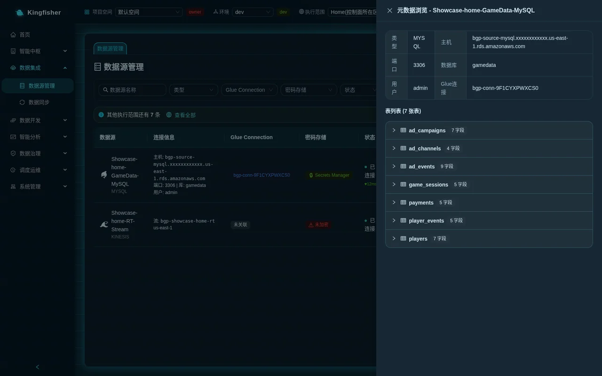
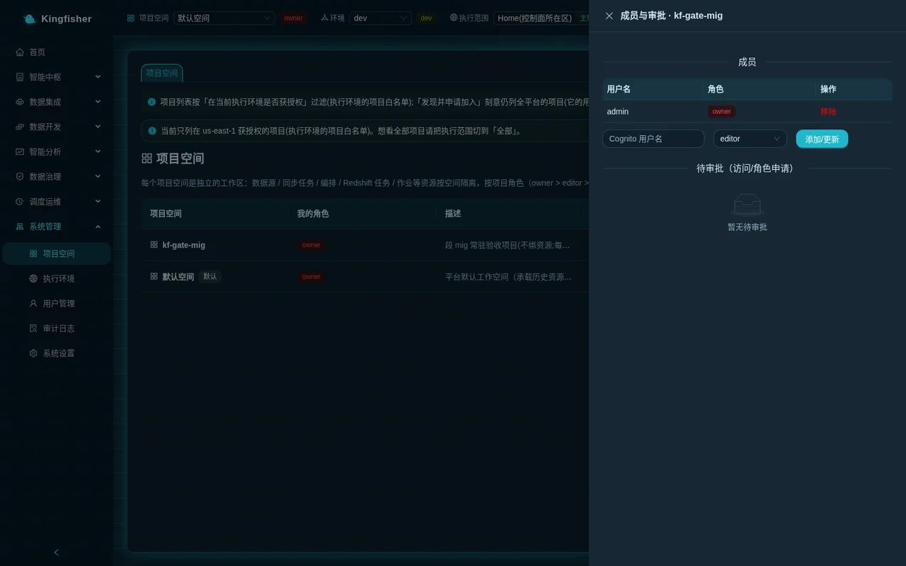
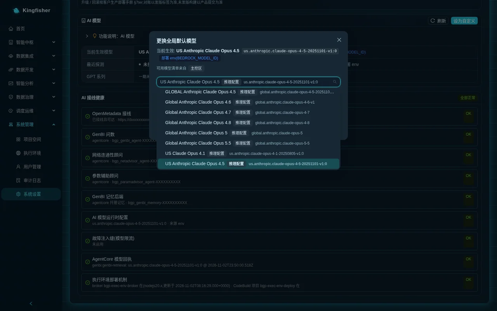

# User FAQ: find answers by symptom

| Item | Description |
|---|---|
| Audience | Platform admins · data engineers · data analysts (when something goes wrong in daily use) |
| Estimated time | Consult as needed, 1 minute per entry |
| Prerequisites | You can log in; you know where the three top-bar selectors "Workspace", "Environment" and "Execution scope" are |
| What you get | A one-sentence cause for each symptom + the next step you can take on the page; for verbatim error messages and the full rejection reasons see [Rules and status code reference](30-reference-rules.md) |

Each entry follows the format **symptom** → cause → next step. The next step lists only what you can do on the page; anything that must be done by operators on the command line only points to the relevant section of the [deployment manual](../deployment.md).

## 1. Login, accounts and the interface

### 1.1 The whole site switched to English

- Cause: the platform suggests a language based on the visitor's location; when accessed from an English-speaking network the first frame switches to English; you may also have switched it yourself earlier.
- Next step: choose the language you want in the language switcher (globe icon) at the right of the top bar; the choice is remembered in this browser and reused next time.

### 1.2 Forgot my password / must change the password at first login

- Cause: the initial password is generated at deployment; the platform requires you to change it right after the first login (at least 12 characters, with upper and lower case letters, digits and symbols).
- Next step: change the password under the avatar in the top-right corner → "Change password"; if you forgot it, ask a platform admin to click "Reset password" under "System → Users". If the only admin on the platform forgot the password, only the customer's account administrator can handle it, following the [deployment manual](../deployment.md) section 4, item 4.

### 1.3 I closed the tour that popped up on my first visit; how do I see it again

- Cause: the interactive tour pops up automatically only on the first visit.
- Next step: the ❓ in the top-right corner of any page opens the "User guide"; the "Onboarding" card on the home page lets you walk through a path again by role.

### 1.4 A button on the page is grey and the tooltip says "Configuration management requires a platform admin or an R&D manager; you can still develop this project's resources as usual"

- Cause: renaming / deleting a project, adding / removing / changing members and approval decisions are reserved for platform admins (bgp-admin) or R&D managers (bgp-manager) who are also the owner of this project.
- Next step: contact an admin or an R&D manager; your development permissions are unchanged.

## 2. I cannot see something

### 2.1 The data source / job / workflow I just created is not in the list

- Cause: lists are filtered by all three top-bar selectors at once: "Workspace" (resources are visible only in their own project), "Environment" (dev / staging / prod each have their own copy) and "Execution scope" (when viewing a single region, objects bound to other regions are hidden).
- Next step: check the top bar selector by selector; switch "Execution scope" back to "All" first to see which region it is in.

### 2.2 I clicked "Publish to prod (approval required)" but there is still nothing after switching to prod

- Cause: publishing to prod creates an approval request; prod gets its copy only after the workspace owner approves it; only staging takes effect directly.
- Next step: the owner approves under "Pending my approval (n)" at the top of "System → Workspace"; after approval, switch the top-bar "Environment" to prod to view it.

### 2.3 The top-bar "Execution scope" dropdown does not list the region I want

- Cause: the dropdown lists only **fully installed** execution environments; a newly created region appears only after "Check initialization" is all green and "Enable" has been clicked; the "Not accepting work" tag means it is currently being deployed / drained.
- Next step: check the region's status under "System → Execution Environments"; if it is not your job, ask a platform admin.

### 2.4 I selected a region as execution scope but the list reports "Execution target … is not authorized for project …"

- Cause: that execution environment has an allow-list under "Authorized projects" and the current project is not on it.
- Next step: ask a platform admin to add this project under "Execution Environments → details → Authorized projects"; or switch the top bar to an authorized project.

### 2.5 Tables synced into my own S3 Tables table bucket are not visible in Athena Query / the governance catalog / GenBI

- Cause: Athena query, the catalog and GenBI only follow the execution environment's **lake route** list; an unregistered table bucket is not in the routes.
- Next step: a platform admin registers the table bucket as a route under "Settings → Lake table buckets and routes" (one registration = sync can write to it, jobs can access it by alias, it is visible in Athena query / governance catalog / GenBI). See [Scenario: detail / aggregate bucket layering](21-scenario-cross-bucket-layering.md).

### 2.6 "My cards" on the GenBI page says "No cards in the current execution scope; you have m in other scopes"

- Cause: a card remembers which region it queried, and by default only cards of the current execution scope are shown.
- Next step: click "Show all scopes"; the top-bar execution scope does not change.

## 3. Data sources

### 3.1 "Browse tables" shows 0 tables / status "Unreachable"

- Cause: the database is in a VPC but network access has not been saved yet, or the database port is not open to the platform; "Unreachable" is the conclusion of a real, failed connection attempt.
- Next step: in the row's "Network configuration" click "Save Network Access" once (in the creation wizard this is the "Network Access (optional)" section); allow inbound traffic on the port in the database's security group; then click "Detect" to see the latest message.

### 3.2 After clicking "Done" for a new data source, "Running in background: New data source" appears in the bottom-right corner

- Cause: creating a source creates a security group and a Glue connection and probes the network; past 45 seconds it moves to the background; this is not a failure.
- Next step: wait for the notice to disappear, then refresh the list; clicking "Done" again for the same name during this time is rejected (409) and does not create a second source.

### 3.3 Clicking "Done" used to return 504, yet after a refresh the source had been created

- Cause: this was the behaviour of versions before 2.1.2 (the request was cut off by the gateway after 60 seconds while the server still created the source).
- Next step: since 2.1.2 source creation runs in the background and this no longer happens; if you are still on an older version, refresh the list after the error and do not click again.

### 3.4 A red "Network object missing" tag appears on a data source row

- Cause: a security group / subnet / Glue connection / credential secret that this source depends on was deleted in the AWS account. Objects created by the platform are rebuilt automatically before the next start; objects you specified yourself are not rebuilt by the platform.
- Next step: hover over the tag to read the message; it points you to "Data Sources → Edit → Network configuration" to pick another security group / subnet, or to "Edit" to re-enter the username and password.

### 3.5 Deleting a data source returns 409 "This data source is still referenced by N tasks; delete them or change their source first: …"

- Cause: since 2.2.0 references are checked before deleting a source, to avoid leaving orphan tasks that cannot connect to their source.
- Next step: the message names each task; go to "Data Sync" / "Stream Compute" and delete those tasks or point them to another source, then delete.

### 3.6 Choosing a source while creating a sync task reports "Cross-region reads are forbidden … the source and the task must be in the same execution environment"

- Cause: sync = read from the source, write to the warehouse; data never leaves its region; this is a design rule and a permanent rejection.
- Next step: switch the top-bar execution scope to the source's region before creating the task; changing the source when editing follows the same rule.

## 4. Data sync

### 4.1 A run failed with "Security Group Not Found" or "The data source's security group … no longer exists (deleted outside the platform)"

- Cause: the data source's security group was deleted by someone or by a cleanup tool outside the platform (platform-created groups attach network interfaces only while a job is running and have zero interfaces the rest of the time, so they are easily mistaken for orphans by "no interfaces = orphan" cleanups).
- Next step: since 2.2.0 platform-created groups are rebuilt automatically and re-attached to the Glue connection before the next "Start"; simply start again; if it is a group you specified yourself, pick another one under "Data Sources → Edit → Network configuration". Do not let any tool that cleans up by "no interfaces = orphan" touch the `bgp-ds-*` security groups.

### 4.2 A run failed with "The target table already exists and was not created by the platform; this task has not confirmed the overwrite table by table ⇒ run rejected (no rows touched)"

- Cause: the "Overwrite" write mode clears the whole target table, and this table was not created by the platform (it is a table you already had); a task that has not confirmed table by table fails immediately at run time without deleting a single row.
- Next step: edit the task and click "Confirm overwrite" for each table in the "Overwrite existing tables?" dialog when submitting; or switch to "Append" / use another target table name.

### 4.3 The Table Bucket dropdown in the wizard shows "Not registered"; saving / starting reports "Execution environment … cannot write to table bucket "…""

- Cause: a sync task can only write to the execution environment's platform table bucket or to a table bucket registered as a (writable) route; the home region and execution regions follow the same rule.
- Next step: click "Register →" next to the dropdown and have a platform admin register it under "Settings → Lake table buckets and routes"; come back and click "Registered? Re-check"; or clear Table Bucket to use the platform table bucket.

### 4.4 A real-time (DMS) task stays in "Starting" for a long time on its first "Start"; clicking again reports "This task is already starting…"

- Cause: the first start creates a replication instance, which takes about 10–15 minutes; the platform does not issue a second start.
- Next step: wait; to abort, click "Stop"; if it stays in "Starting" for a very long time, "Stop" first and then "Start".

### 4.5 "Stop" or "Delete" returns 409 and the message says it is "still on its way to stopping"

- Cause: the replication channel is stopping and has not reached a final state yet; the platform does not change the record, to avoid leaving an orphan channel that can never be stopped and keeps incurring charges.
- Next step: click the same button again after a few tens of seconds.

### 4.6 Starting a task in an execution region with the Zero-ETL / DMS channel reports "Not yet pushed down per region (currently offered in the home region only)"

- Cause: the Zero-ETL and DMS real-time channels are currently offered in the home region only.
- Next step: create the task in the home region, or use the Glue channel instead.

### 4.7 The run history says "The previous run is still finishing (one Glue job can only run one instance at a time); start again later"

- Cause: a sync task can have only one run at a time.
- Next step: wait for the previous run to finish before starting; this message also appears when a scheduled run and a manual run collide.

### 4.8 Do DMS and Zero-ETL channels keep incurring charges after the task is stopped

- Cause: the replication instance / managed integration of these two channels has an ongoing cost regardless of whether the task is moving data.
- Next step: "Stop" it under "Data Sync" when not in use. For Zero-ETL, "Stop" deletes the managed integration and billing stops; for DMS, "Stop" only stops the replication task, the replication instance is not deleted by the platform and is still billed by the hour; when no longer needed, the account administrator deletes it on the AWS side. Actual costs are shown under "Scheduling & Ops → FinOps"; see the [cost model](../cost-model.md) for the breakdown.

## 5. Batch compute, EMR jobs and orchestration

### 5.1 Deleting a job reports "This job still has N unfinished runs: … — deletion rejected"

- Cause: since 2.2.0 in-flight runs are checked before deleting a job; deleting now would leave the run records stuck in "Running" forever.
- Next step: wait for the runs to finish; for EMR jobs you can "Stop" them first in "Run history"; if the message is "This job is submitting a run", try again in a few seconds.

### 5.2 Deleting a job reports "This job is still referenced by batch job nodes of N workflows…"

- Cause: a job referenced by workflow orchestration cannot be deleted; otherwise the workflow's next run would fail at that node.
- Next step: go to the "ETL Orchestration" canvas and remove the node or point it to another job, then delete.

### 5.3 Saving a job reports "The job was **not saved / submitted**: execution role … lacks N required permissions"

- Cause: you chose your own execution role; on save the platform checks the permissions one by one against what the job actually references (script, dependency libraries, lake table buckets) and rejects on the spot instead of waiting for a 403 at run time.
- Next step: follow the way out given in the message: ① in the job form's "Role Advisor", click "Recommend Execution Role Permissions" first, then "One-click create / repair role" (requires a platform admin); ② leave "Execution Role" empty to use the platform default role; ③ switch dependency libraries to "Upload dependency files"; ④ add the table bucket permissions, or remove the bucket from "Advanced Properties → Lake table buckets" / change it to "Read". You can click "Check permissions" before saving.

### 5.4 The execution role dropdown does not list the role I just created

- Cause: the dropdown is a snapshot of the roles in the account.
- Next step: click "Refresh" next to the dropdown to reload (no need to leave the page); or "Enter ARN manually".

### 5.5 After clicking "Run" on an EMR job, "Running in background: Run engine job" appears in the bottom-right corner; it used to return 504

- Cause: an EMR application cold start may exceed 45 seconds; since 2.2.0 the submission step runs in the background; older versions hit the 60-second gateway timeout even though the run had actually been submitted.
- Next step: wait for the notice to disappear and check "Run history"; clicking run / edit / delete again while the submission is in progress returns 409 "In progress"; do not click again.

### 5.6 "Run now" on a multi-region job ran in only some of the regions

- Cause: when several regions are bound, "Run now" first asks in which regions to run this time; the first run in a region of a different jurisdiction shows the disclaimer first.
- Next step: check all regions in the dialog; "Run history" has one row per region, each with its own result.

### 5.7 Publishing a workflow reports "The job "…" referenced by batch job node "…" is bound to execution environment …, but this workflow is being published to …"

- Cause: the job referenced by a job node must be bound to the region the workflow is published to; the platform does not run it in another region on its behalf, and the whole publish changes nothing.
- Next step: go to "Batch Compute" and bind that region to the job as well, or pick a job that is bound to that region.

### 5.8 Publishing / schedule configuration reports "The following execution environments have no scheduler component; scheduling / orchestration cannot be configured for that region"

- Cause: scheduled tasks in each region can only be executed by that region's scheduler, and the scheduler component is not installed there.
- Next step: click "Add a scheduler in Execution Environments" and have a platform admin "Complete missing components" in the execution environment details.

### 5.9 The workflow is bound to an execution region; can the Backfill Center backfill the whole chain

- Cause: yes. Workflow backfill expands region by region over the regions the workflow is bound to; each region's instances execute in their own region; binding only to the home region is no longer required.
- Next step: pick the workflow under "Backfill Center → New"; the region of a sync node must also be a bound region of the workflow, otherwise it is rejected as stated in the message.

### 5.10 I changed the job parameters but the scheduled task still runs with the old ones

- Cause: the scheduled artifact is generated at the moment of "Publish to MWAA schedule".
- Next step: after changing parameters, "Publish to MWAA schedule" once more; "Publish to environment" (dev → staging → prod) and "Publish to scheduler" (attaching a schedule) are two different things.

### 5.11 A job / workflow writing an Iceberg table with a three-part name reports "Execution environment … has no lake route with alias "…" (existing: …)"

- Cause: the three-part name in the script uses an alias that does not exist.
- Next step: correct the alias against "Catalogs available to this job" under the job's "Advanced Properties → Lake table buckets"; the alias of the platform table bucket is fixed to `s3tablescatalog`.

### 5.12 A catalog registered by hand with `--conf` in 2.1.x reports "The same alias cannot point to two buckets" on save after upgrading to 2.2.0

- Cause: the alias of the hand-written catalog collides with a newly registered route and points to a different bucket.
- Next step: remove the hand-written `spark.sql.catalog.<alias>*` (the platform injects it automatically), or give the hand-written catalog another alias; the transition recipe is in the appendix of [Scenario: detail / aggregate bucket layering](21-scenario-cross-bucket-layering.md).

## 6. GenBI and AI

### 6.1 GenBI returns 403 "No access to this workspace"

- Cause: GenBI, saving cards and Athena query all check project membership; the "Default Workspace" has no members at first.
- Next step: ask the project owner or a platform admin to add you under "System → Workspace → Members / Approvals" (viewer = view / ask only, editor = can develop).

### 6.2 Saving a card shows "Select an execution scope in the top bar first"

- Cause: the card must remember which region this conversation queried.
- Next step: choose a specific execution environment in the top-bar "Execution scope", then "Save conversation as card".

### 6.3 Saving a card reports "N/M session cards saved; per-user limit reached"

- Cause: there is a per-user card limit and the platform does not delete the oldest ones automatically.
- Next step: delete the cards you no longer need under "My cards".

### 6.4 GenBI / Copilot / advisors all give no response

- Cause: all AI capabilities on the platform share the global default model under "Settings → AI model"; when the account's access to that model is denied (not enabled in Bedrock), the AI features become unavailable together while everything else is unaffected.
- Next step: a platform admin clicks "Test this model" under "Settings → AI model" to read the message, or "Change global default" to switch to a model that passes the probe.

### 6.5 Changing the model reports "This model is not enabled for this account (Bedrock says "not available for this account" …)"

- Cause: an account-level restriction unrelated to region / IAM / Marketplace.
- Next step: ask your AWS account team to enable it, or pick another version of the same family / another vendor.

### 6.6 Changing the model reports "This model cannot call tools under Converse (tool-use probe failed) … cannot be the global default"

- Cause: GenBI / Copilot / advisors all rely on tool calls, which this model does not support.
- Next step: choose another model.

### 6.7 Changing the model reports "Probe timed out: the model did not respond within this family's budget…"

- Cause: reasoning models (such as Kimi K3) can take tens of seconds to produce the first token; this is not throttling.
- Next step: test again shortly; if it keeps timing out, switch to the global. inference profile or contact your AWS account team.

### 6.8 After switching to Kimi K3, answers are slower and costs are higher

- Cause: Kimi K3 always returns a reasoning block and its output tokens are about 2× Claude's; the platform scales maxTokens by a factor.
- Next step: this is expected; for latency-sensitive scenarios switch back to the Claude family.

### 6.9 Sensitive fields in a GenBI answer are not masked / an aliased column was masked

- Cause: masking follows the classification rules in governance, and result columns are resolved back to physical columns (aliases, expressions and CTEs included), so `country AS region` is also masked by the classification of country.
- Next step: check the column's classification under "Data Governance → Data Classification"; see [Scenario: handing GenBI to the business](24-scenario-genbi-rollout.md).

## 7. Multi-region and cross-jurisdiction

### 7.1 A "⚠️ Disclaimer" pops up the first time I operate on a region

- Cause: the execution environment is in a different jurisdiction from the home region; you must read and accept the disclaimer before the first data operation; the consent is recorded (user / target / version / time) and shown once per person per region.
- Next step: read it and click "Agree and continue"; the original operation continues automatically; clicking "Cancel" executes nothing.

### 7.2 What is the "Audit #" in the result sheet header / run history

- Cause: it is the number of the regional audit record left in that region by a cross-jurisdiction operation.
- Next step: search for it under "System → Audit Log" and look at the residency.* actions; the "Consents" card in the execution environment details shows who accepted which version of the disclaimer and when.

### 7.3 I entered the wrong jurisdiction when creating an execution environment; can it be changed

- Cause: the jurisdiction tag is entered manually by the admin; the platform does not derive it from the region, does not allow changes after registration and makes no legal judgement.
- Next step: it cannot be changed. For an environment that never deployed successfully, "Discard" it on the details page and run "New execution environment" again; for one that has been deployed, go through the deletion flow first (stop accepting work → delete) and then create it anew. When the jurisdiction differs from the home region's, the value must be something other than `home`.

### 7.4 Creating an execution environment built successfully, but "Check initialization" fails with "The control plane has not enabled this region yet"

- Cause: the region was not pre-authorized at install / upgrade time; after the build completes, operators must enable it once.
- Next step: the wizard already notes that "the others need ops to run the release command once after the build, then "Probe""; operators run the release command as described in the [deployment manual](../deployment.md) section 7, then return to the details page and click "Check initialization" → "Enable".

### 7.5 There are ⊘ cells in the multi-region dashboard

- Cause: there are two kinds of ⊘: "⊘ Needs re-landing" = an old record left from before the write channel was delivered; "⊘ Data unavailable" = the region does not have the unique data it depends on and inherently cannot be bound. Neither takes part in evaluation or raises alerts.
- Next step: for "⊘ Needs re-landing", go to "Data Modeling", "Land in this region" again for that region and then "Refresh"; "⊘ Data unavailable" needs no action.

### 7.6 After retiring an execution environment, its data buckets / table buckets are still being billed

- Cause: deleting an execution environment destroys only compute resources; data buckets / table buckets / the final warehouse snapshot are kept and must be cleaned up manually.
- Next step: once you are sure they are no longer needed, the account administrator cleans them up on the AWS side; see the [cost model](../cost-model.md) for which items keep incurring charges.

### 7.7 Can I install only some of the components in a region

- Cause: every execution environment is a complete set; components cannot be trimmed; a region can have only one set.
- Next step: none; when components are missing use "Complete missing components".

## 8. Modeling, governance and the warehouse

### 8.1 Deleting a code table / dimension table pops up "Open the landing panel to unbind and clean up per region" and "Keep physical tables, delete definition only"

- Cause: the definition still has landed physical tables in some regions, and the platform does not DROP them on your behalf.
- Next step: to clean up, go to the landing panel and "Unbind and clean up" region by region (type the physical table name exactly); to keep the tables and delete only the definition, type the confirmation string exactly; the audit records "intentionally kept" for each table.

### 8.2 "Land in this region" takes a long time, with "Running in background: Land code table to execution target" in the bottom-right corner

- Cause: the target region's warehouse cold start may exceed 45 seconds, so it runs in the background.
- Next step: wait for the notice to disappear; the landing panel shows the result automatically; do not delete the same object in the meantime (it is blocked with 409).

### 8.3 Writing INSERT / DROP on the Redshift Query page returns 403 "Direct warehouse queries allow only read-only queries for non-platform-admins"

- Cause: direct queries run as the warehouse administrator, so for non-platform-admins only a single SELECT / WITH is allowed.
- Next step: use a Redshift SQL job under "Batch Compute" for writes; ask a platform admin for DDL.

### 8.4 "Sync column information" in the governance catalog does nothing / shows in progress

- Cause: with many tables the sync exceeds 45 seconds and moves to the background, with "Running in background: Sync column information to the data catalog" in the bottom-right corner; only one is allowed platform-wide at a time.
- Next step: wait for the notice to disappear, then refresh the catalog; do not click again.

### 8.5 "Alter table" is greyed out for S3 Tables tables

- Cause: schema evolution of S3 Tables (Iceberg) tables must be done by a Spark engine; Athena does not support DDL on that catalog.
- Next step: use a Glue / EMR job in Batch Compute for the ALTER; Redshift tables can be changed directly in the catalog.

### 8.6 A scheduled governance task / sensitive-data scan cannot be created, reporting "Only platform admins…"

- Cause: scheduled quality checks / sensitive-data scans / catalog syncs use the same permission tier as manual runs, which is reserved for bgp-admin.
- Next step: ask a platform admin.

### 8.7 The OpenMetadata page shows "Check the deployment status"

- Cause: the built-in OpenMetadata is not ready yet.
- Next step: wait a few minutes and refresh; if it persists, ask a platform admin.

## 9. Operations and monitoring

### 9.1 A run in the task monitor stays "Running" forever

- Cause: since 2.2.0 the platform reconciles against the backend's real status and closes the run; if the job definition was deleted outside the platform, the status is closed as failed with the note "The Glue job definition no longer exists…".
- Next step: refresh once; if it still does not change, open "Run Logs" to read the message, or "Stop" it in the run history.

### 9.2 No alert was sent

- Cause: a rule must be bound to a channel and "Enable"d; there are four channel types, "Generic Webhook", "DingTalk group bot", "WeCom group bot" and "Email (SES)"; when DingTalk uses "Signing", the secret must be filled in.
- Next step: use "Test" under "Alerting Center → Notification Channels" to deliver once; without a real IM account you can create a "Generic Webhook" channel with the URL `/api/public/alerting-sink` under the platform domain for an end-to-end check.

### 9.3 The SLA page says there is no baseline

- Cause: the baseline is learned automatically from past runs and the new task has not run enough yet.
- Next step: click "Re-learn baselines" under "Alerting Center → SLA & Baseline Alerts"; backfill runs are excluded from the baseline and the success rate.

### 9.4 A backfill succeeded but wrote 0 rows and is marked amber "Succeeded (0 rows)"

- Cause: no data in the date window, the WHERE did not match, the incremental watermark has already passed, or the SQL itself filtered down to 0 rows.
- Next step: click the cell to open the instance drawer and check "Rows written and source" and "Error (verbatim)"; then "View run log" or "Locate in Monitor".

### 9.5 Today's cost in FinOps is 0

- Cause: costs are collected from Cost Explorer at T+1.
- Next step: check again tomorrow; task-level attribution is under "FinOps → Task costs".

## 10. Still not solved

- Full rejection reasons and verbatim messages: [Rules and status code reference](30-reference-rules.md)
- Unfamiliar terms: [Glossary](33-glossary.md)
- Known boundaries from the operations side: [deployment manual](../deployment.md) section 8
- When contacting a platform admin, bring: the on-screen message, the values of the three top-bar selectors, the time, and the "Audit #" (if any)
