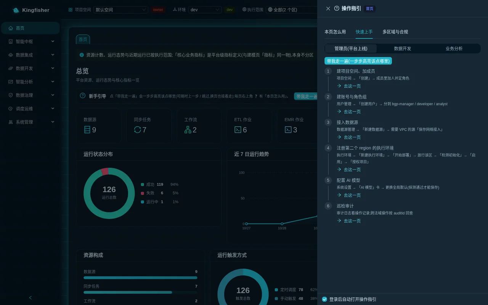

# Kingfisher user guide

| Item | Description |
|---|---|
| Audience | Platform administrators · data engineers · data analysts (follow the page operations; no need to read code) |
| Estimated time | 10 minutes for this page; 2–6 hours for the whole guide along a role path |
| Prerequisites | A deployed Kingfisher environment (demo or production install) and an account that can sign in |
| What you will have | Know which documents this guide contains, which ones you should read first, how the in-page ❓ guide and this guide work together, and what each of the three top-bar selectors controls |

## 0. How to use this guide

- Every menu, button, field, hint and error message in the guide is real on-screen text, wrapped in quotation marks, for example click "New sync task".
- Every step is written as "which page → what to click → what to enter → what you should see"; follow it and you can reproduce it.
- The scenario documents run on one set of demo data: a MySQL game user-acquisition business database (7 tables) and one set of `Showcase-<region-slug>-*` sample objects per execution region.
  On a demo install you can reproduce them step by step; in production, swap in your own databases and tables.
- `<account>`, `<region>` and `<bucket>` in the text are placeholders; replace them with your own values.

## 1. Document map (in "implementation guide" order)

### 1.1 Overview and concepts

| File | Content | For whom |
|---|---|---|
| [README.md](README.md) | This page: document map, reading paths, relationship to the in-page guide, how to read the top bar | Everyone |
| [02-concepts.md](02-concepts.md) | Core concepts one page each: workspace · execution environment · execution scope · target · jurisdiction and disclaimer · environments and publish approval · roles · long-running operations · object leases · table-bucket routing | Everyone |
| [33-glossary.md](33-glossary.md) | Glossary (user wording, one line per term) | Everyone |

### 1.2 Architecture and planning

| File | Content | For whom |
|---|---|---|
| [04-architecture.md](04-architecture.md) | Deployment topology, request chain, per-region data plane and control-plane services, data flow; mapping to the six pillars of the AWS Well-Architected Framework | Architects · administrators |
| [05-plan-deployment.md](05-plan-deployment.md) | Planning the deployment: cost structure, security preparation, region constraints, quota self-check, deployment machine tooling, production and demo modes | Administrators · operations |
| [06-deployment.md](06-deployment.md) | Deployment at a glance: entry points for the four production steps and the one-command evaluation environment, what you get after install, the three steps to add a region, how to verify the version | Administrators · operations |

### 1.3 Getting started

| File | Content | For whom |
|---|---|---|
| [01-quick-start.md](01-quick-start.md) | 30-minute first experience: sign in and change the password → learn the top bar → create a data source → sync to S3 Tables → see rows in Athena → ask one question → Task Monitor | Everyone |

### 1.4 By role

| File | Content | For whom |
|---|---|---|
| [10-guide-admin.md](10-guide-admin.md) | Everything to do after go-live: accounts and role groups · workspaces and approvals · execution environment lifecycle · settings (AI model / wiring / table-bucket routes) · audit · alert channels | Platform administrators |
| [11-guide-data-engineer.md](11-guide-data-engineer.md) | Data source → sync → three kinds of batch job → orchestration → scheduling / publishing → backfill → Task Monitor → multi-region runs | Data engineers |
| [12-guide-analyst.md](12-guide-analyst.md) | GenBI · view generated SQL · save cards · skills · business definitions and rules · report builder · requirements workbench · read-only direct query | Data analysts |
| [13-identity-management.md](13-identity-management.md) | Identity management: sign-in and password policy, role groups and project roles, creating / resetting / disabling accounts, the sole administrator forgetting the password, UI language | Platform administrators |

### 1.5 End-to-end scenarios

| File | Content | For whom |
|---|---|---|
| [20-scenario-detail-to-daily-report.md](20-scenario-detail-to-daily-report.md) | Main scenario: 7 MySQL tables → sync to S3 Tables → Glue / Redshift jobs compute channel ROI → orchestrate into a DAG → schedule → backfill → monitor → report | Data engineers |
| [21-scenario-cross-bucket-layering.md](21-scenario-cross-bucket-layering.md) | Detail bucket / aggregate bucket layering: register two of your own table buckets as routes → jobs declare read / write → three-part names → verify in Athena; with the 2.1.x transition recipe | Data engineers · administrators |
| [22-scenario-multi-region-residency.md](22-scenario-multi-region-residency.md) | Data stays in its region: create a second execution region through the page wizard → the same job runs once in each of two regions → multi-region direct query → cross-jurisdiction disclaimer and audit → retire an execution region | Administrators · data engineers |
| [23-scenario-realtime-cdc.md](23-scenario-realtime-cdc.md) | Real-time pipeline: sync task real-time channels (DMS CDC / Zero-ETL) + Flink SQL window aggregation → query results in Athena → stop and delete | Data engineers |
| [24-scenario-genbi-rollout.md](24-scenario-genbi-rollout.md) | Handing GenBI to the business: definition entries → skill registration → ask and check the SQL → classification masking in effect → cards → observability | Analysts · data engineers |
| [25-scenario-governance-loop.md](25-scenario-governance-loop.md) | Governance loop: catalog and column sync → classification and masking → sensitive scan → quality rules and SLA → lineage and impact analysis → scheduled governance tasks → OpenMetadata | Data engineers · administrators |
| [26-scenario-modeling-metrics-report.md](26-scenario-modeling-metrics-report.md) | Data modeling: layers / data domains / code tables / dimensions / metrics → land in each region's warehouse → metrics → reports and home-page KPIs | Data engineers · analysts |
| [27-scenario-ops-alerting.md](27-scenario-ops-alerting.md) | Operations: Task Monitor filtering / logs / reruns → alert rules and channels → SLA baselines → Ops Dashboard → Incident Knowledge Base → troubleshooting route | Data engineers · administrators |
| [28-scenario-finops.md](28-scenario-finops.md) | FinOps: overview / trends / ranking → task-level attribution → budgets and threshold alerts → always-on billing items and shutdown advice | Administrators |
| [29-scenario-projects-permissions.md](29-scenario-projects-permissions.md) | Several teams sharing one platform: two workspaces, three project roles, access requests and approvals, dev → staging → prod publish approval, audit lookup | Administrators |

### 1.6 Reference

| File | Content | For whom |
|---|---|---|
| [30-reference-rules.md](30-reference-rules.md) | Rejections the pages can show and what they mean: missing target 400 · invalid execution scope 4xx · no project permission 403 · object lease 409 · preflight 400 · table-bucket route rejections · long-running operation 202 · model probe rejections | Everyone |
| [31-reference-config.md](31-reference-config.md) | Configuration reference: sync date variables · batch job parameters and Glue versions · task execution roles · table-bucket route fields · schedule cron and business date · alert rule fields | Data engineers · administrators |
| [40-api-reference.md](40-api-reference.md) | API reference: authentication and request headers, target and scope, the long-running operation protocol, error envelope, and every endpoint by group with method / path / purpose / requirements | Integration developers |
| [32-faq.md](32-faq.md) | Troubleshooting by symptom: browse tables returns 0 / sync failed / object created despite a 504 / first DMS start not ready / GenBI 403 / object missing from the list / page in English mode | Everyone |

### 1.7 Upgrade and retirement

| File | Content | For whom |
|---|---|---|
| [41-upgrade-and-uninstall.md](41-upgrade-and-uninstall.md) | How an upgrade affects users and what to redo afterwards, retiring an execution region, the facts about retiring the whole platform | Administrators · operations |

## 2. Three reading paths (by role)

### 2.1 Platform administrator

1. [Quick start](01-quick-start.md) steps 1–2: sign in and change the password, learn the top bar.
2. [Core concepts](02-concepts.md): focus on workspaces, execution environments, role groups, jurisdiction and disclaimer.
3. [Administrator guide](10-guide-admin.md): work through "things to do after go-live" section by section.
4. [Scenario: several teams sharing one platform](29-scenario-projects-permissions.md) → [Scenario: data stays in its region](22-scenario-multi-region-residency.md) → [Scenario: FinOps](28-scenario-finops.md).
5. For reference: [Rules and status codes](30-reference-rules.md), [FAQ](32-faq.md).

### 2.2 Data engineer

1. [Quick start](01-quick-start.md), all 7 steps (the first pipeline end to end in 30 minutes).
2. [Core concepts](02-concepts.md): focus on execution scope, target, long-running operations, object leases, lake table buckets and routes.
3. [Data engineer guide](11-guide-data-engineer.md).
4. [Main scenario: from detail to daily report](20-scenario-detail-to-daily-report.md) → [Cross-bucket layering](21-scenario-cross-bucket-layering.md) → [Real-time pipeline](23-scenario-realtime-cdc.md) → [Governance loop](25-scenario-governance-loop.md) → [Data modeling](26-scenario-modeling-metrics-report.md) → [Operations and alerting](27-scenario-ops-alerting.md).
5. For reference: [Configuration reference](31-reference-config.md), [Rules and status codes](30-reference-rules.md).

### 2.3 Data analyst

1. [Quick start](01-quick-start.md) steps 1, 2, 5 and 6: sign in, top bar, Athena Query, GenBI.
2. [Core concepts](02-concepts.md): focus on workspaces, execution scope, role groups.
3. [Analyst guide](12-guide-analyst.md).
4. [Scenario: handing GenBI to the business](24-scenario-genbi-rollout.md) → [Scenario: data modeling and reports](26-scenario-modeling-metrics-report.md).
5. For reference: [FAQ](32-faq.md), [Glossary](33-glossary.md).

## 3. Relationship to the in-page ❓ "How to use this page" and the first-visit tour

The platform pages ship with two kinds of guidance; this guide is their expanded version, and the three divide the work as follows.

| Carrier | Where | What it answers |
|---|---|---|
| The ❓ "User guide" drawer at the top right | The ❓ icon at the top right of any page | This page's "Purpose / Steps / Notes / Related pages"; plus two more tabs, "Getting started" (role-based paths) and "Multi-region & compliance" |
| The first-visit interactive tour | Starts automatically the first time the platform is opened in this browser (remembered in the browser); "Walk me through" on the "Onboarding" card of the home page reruns it at any time | Highlights where to click step by step; you can "Skip this step", "Skip tour" or "End tour", and it continues across pages |
| This guide | Repository `docs/user-guide/` | What the in-page guide cannot cover: end-to-end scenarios, demo data, verbatim error messages and next steps, rules and boundaries, cleanup order |

- The in-page guide uses exactly the same wording as the pages; whenever this guide quotes a button / field name, it copies them verbatim.
- The "Getting started" tab of the ❓ drawer has three role-based paths: "Admin (platform rollout)", "Data Development", "Business analysis", and every step has "Go to this page".
  The three reading paths in section 2 of this guide map to them one to one and are their long form.
- The bottom of the drawer has the switch "Open the guide automatically after login"; when it is off, the first-visit tour no longer pops up automatically, while ❓ remains available at any time.

## 4. How to read the top bar

From left to right, the left side of the top bar holds three layers of context, and **every list, run, cost and catalog is filtered by these three layers**; when "something has disappeared", nine times out of ten one of these layers is set wrong.

| Selector | Meaning | After switching |
|---|---|---|
| "Workspace" | Resources (data sources / sync / workflows / jobs / query tasks and so on) are isolated by project; the tag next to it is your role in that project, owner / editor / viewer | Full page reload; every page re-fetches for the new project |
| "Environment" | dev / staging / prod; configuration-type resources are isolated by "project + environment", and publishing to prod requires approval; if you cannot see a resource you just published, switch to the target environment first | Full page reload |
| "Execution scope" | "All (N regions)" = read-only aggregate across regions; one region = view and create only in that region; options are grouped by Region, the home region carries the "Home region" tag, cross-jurisdiction regions carry a 🌍 jurisdiction tag | No reload, stays on the current page, only changes `?scope=` in the address bar |

- To the right, in order: ❓ "User guide", the Copilot entry, "Switch language" (Chinese / English), "Switch theme", and the avatar menu ("Change password", "Sign out").
- In a single region's view, the top of the list always shows a line "Other execution scopes have N more" with a "View all" button, so you never think things are gone.
- Write actions restate the target on the button, for example "New data source (in <region>)"; objects created from the "All" view land in the home region.
- Details and rules are in the "Execution scope" and "Target" sections of [Core concepts](02-concepts.md).

## 5. Writing conventions

- Page paths are written as "menu group → page", for example "Data Integration → Data Sync"; menu names follow the left navigation.
- Error messages are quoted verbatim from the page; "next step" lists only what you can do yourself.
- Versions are mentioned only when necessary, as "from 2.2.0 on"; no internal identifiers.
- Screenshots are taken from the demo environment (Chinese UI); identifiers such as account numbers are replaced with placeholders.

## Further reading

- Screenshot tour of every page: [Feature tour](../features.md)
- Mechanisms and boundaries of every module: [Module overview](../modules.md)
- Components and request chain: [Architecture](../architecture.md)
- Production deployment, upgrades, known boundaries (for operations): [Customer production deployment manual](../deployment.md)

## Revision history

| Date | Version | Change |
|---|---|---|
| 2026-11-09 | 1.0 | First edition: overview / architecture and planning / deployment / getting started / three role guides / identity management / ten end-to-end scenarios / rules · configuration · API reference / FAQ / glossary / upgrade and retirement |
